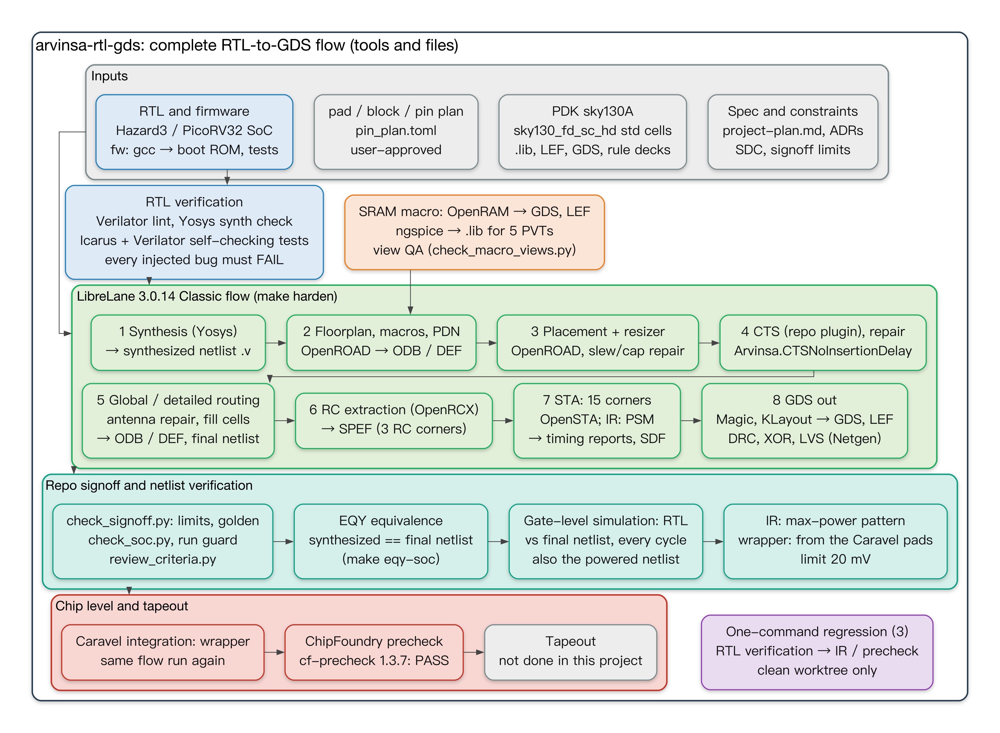
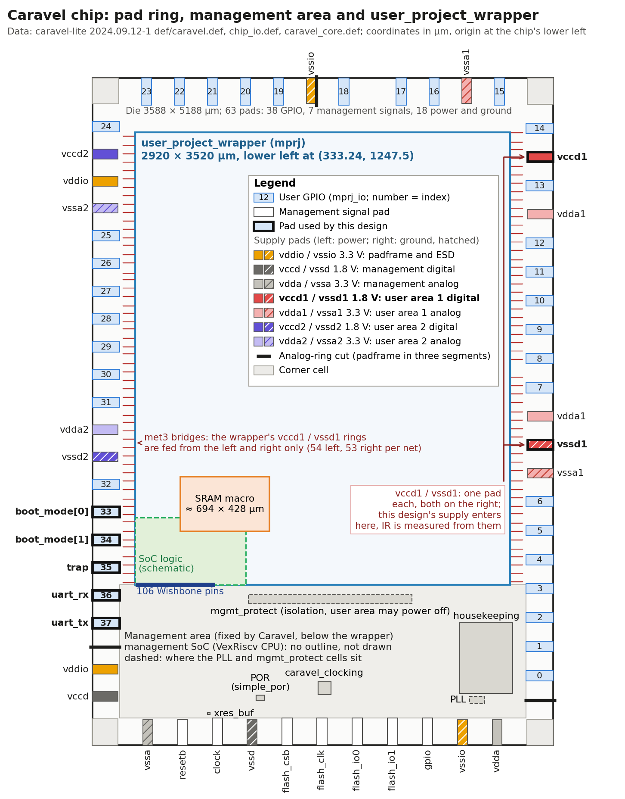
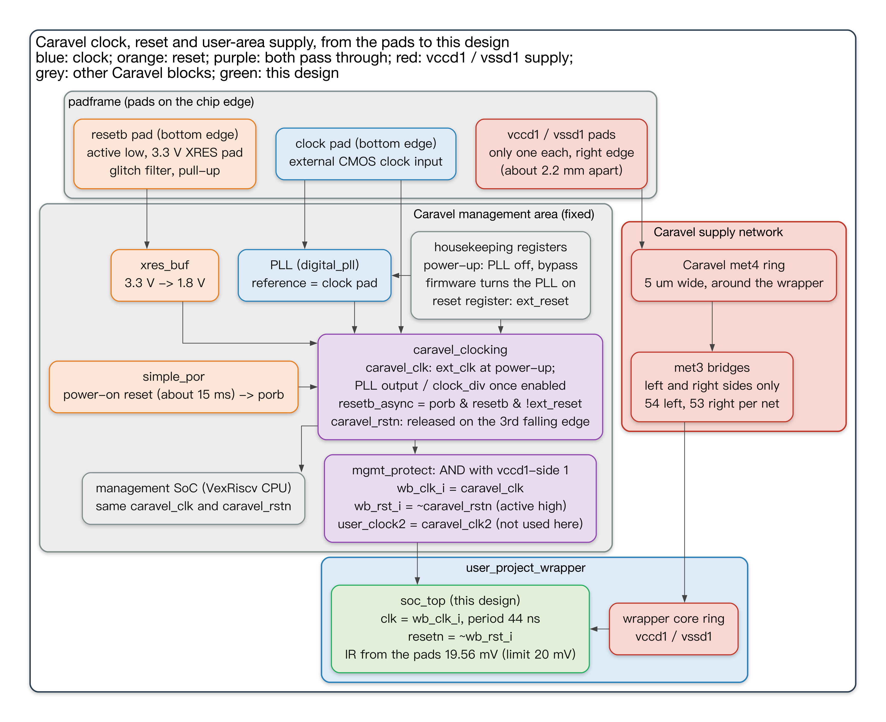

# arvinsa-rtl-gds — Technical Report

**An open-source RTL-to-GDS flow on SkyWater sky130A, from a RISC-V SoC to a ChipFoundry Caravel precheck PASS**

| | |
|---|---|
| Report date | 2026-10-15 |
| Project period | 2026-10-03 – 2026-10-15 (132 commits) |
| Final evidence | commit `2b04451` (three clean-worktree regressions); exit review commit `0d47a3d` |
| Status | Phase 0–7 and Phase 3.5 complete. Phase 7 stops at the precheck; the chip is **not** taped out. |
| Evidence files | The `runs/…` paths cited in the text were deleted at the end of the project; the cited reports are kept in `docs/evidence/` (path mapping in Appendix B) |
| Language | English (this file). Traditional Chinese version: [`technical_report_zh-TW.md`](technical_report_zh-TW.md) |

---

## Abstract

This project built a repeatable, regression-tested RTL-to-GDS flow from open-source EDA tools only (LibreLane 3.0.14 with Yosys, OpenROAD, Magic, KLayout and Netgen; OpenRAM for the SRAM; ngspice for characterisation) on the SkyWater sky130A PDK, and used a small RISC-V SoC with an SRAM macro as the test vehicle.

The work went through nine phases (Phase 0–7 plus Phase 3.5):
- environment;
- RTL and RTL verification;
- a single hardened core;
- SoC integration with a prebuilt SRAM;
- signoff closure and one-command regression;
- SPICE characterisation of the SRAM;
- a CPU swap from PicoRV32 to Hazard3;
- a self-generated OpenRAM SRAM;
- finally, integration into the ChipFoundry Caravel harness.

The final design, a Hazard3 SoC with a 2 KB self-generated SRAM placed flat in the Caravel `user_project_wrapper`, has these results:
- It passes ChipFoundry's precheck: 11 of the 13 official checks pass, and the remaining two report only the OpenRAM bitcell rules at the same positions as the PDK's own prebuilt SRAM.
- It passes the same signoff as the SoC alone: 15-corner STA, DRC, LVS, antenna, formal equivalence (EQY), gate-level simulation, and IR drop measured from Caravel's real pads with a CPU max-power pattern.

From Phase 3 on, every phase closed with a full regression in a clean worktree, independent agent reviews and an exit review. Problems that came up — tool defects, checker holes, ordering mistakes in the flow — were written back into the process skills (23 during the project, 30 after the final review, grouped into Middle-end, Backend and Package with one entry skill each), the flow document, or an automatic checker with a negative test (an injected bug that the checker must catch). A final review on 2026-10-15 found that 39 of the 247 problems were still only in an experience record or in no skill at all (§7); the write-backs the user then chose are in §8.5–§8.6. This report records the whole journey: what was done, which problems appeared and how they were solved, how the skills and the flow changed as a result, and what is still open. Terms and abbreviations are explained in Appendix C.

---

## Contents

1. [Goals and scope](#1-goals-and-scope)
2. [Technology stack and environment](#2-technology-stack-and-environment)
3. [The design: SoC, CPUs, SRAM and the Caravel wrapper](#3-the-design)
4. [The flow: stages, checkers, regression and provenance](#4-the-flow)
5. [The journey, phase by phase](#5-the-journey-phase-by-phase)
6. [Final results](#6-final-results)
7. [Problems encountered](#7-problems-encountered)
8. [How the skills and the flow were corrected](#8-how-the-skills-and-the-flow-were-corrected)
9. [Open issues and future work](#9-open-issues-and-future-work)
10. [Current status and how to reproduce](#10-current-status-and-how-to-reproduce)
- [Appendix A: decision records (ADR)](#appendix-a-decision-records)
- [Appendix B: figure sources](#appendix-b-figure-sources)
- [Appendix C: glossary](#appendix-c-glossary)
- [Appendix D: skills at a glance](#appendix-d-skills-at-a-glance-what-each-does-and-when-to-use-it)

---

## 1. Goals and scope

The goals come from `project-plan.md`:
1. A flow that anyone can re-run from a clean checkout with one command and get a PASS. Signoff metrics are compared with a golden and must be identical except for listed tolerances (ADR-0015). Every PASS/FAIL decision is made by a checker, and each checker's ability to fail is to be proven with injected bugs; the checkers not yet proven are listed in §9.2 (known limitation 12).
2. A realistic test vehicle: a RISC-V SoC with an SRAM macro, taken all the way to signoff (DRC / LVS / STA PASS).
3. A flow that is PDK- and design-independent, so that later projects reuse it. The repository is now the reference flow for the user's other IC projects (`CLAUDE.md` rule 8, `arvinsa-rtl-gds-flow.md`).

**The whole flow**



*Figure 1. The complete RTL-to-GDS flow: the tool used at each step, the files each step produces, and the checkers that judge PASS/FAIL. Steps 1–8 in the green box are the main steps of the LibreLane Classic flow, numbered in execution order; in Phase 7 the Caravel wrapper goes through the same flow again. Sources: `arvinsa-rtl-gds-flow.md` §3, §4; the step list in LibreLane 3.0.14 `librelane/flows/classic.py` (lines 40–121); `pnr/soc_top/config_hazard3.json`, `pnr/user_project_wrapper/config.json`; `pnr/soc_top/run.sh`; `Makefile`; `scripts/regress.py`.*

The figure is drawn from top to bottom in execution order. Inside the green box the arrows also show the direction of data flow: the files one step produces are the inputs the next step reads. Inside the teal and red boxes the arrows only show order. Figure 7 in §4.1 is a summary of the same flow: its nine boxes are grouped by kind of work, and its focus is which checkers judge each box. This figure instead lays out the steps inside LibreLane one by one in execution order, and marks the tool and the output files of each step. What each part does:

1. **Inputs** (grey box):
   - Specification and constraints: the specification and plan (`project-plan.md`, ADRs), the SDC (timing constraints, for example the clock period and the input and output delays), and the signoff limits derived for each design (`signoff/limits/<design>.toml`).
   - PDK sky130A: for the standard cells `sky130_fd_sc_hd`, the `.lib` (timing and power tables for every cell), the LEF (an abstract layout with only the outline, the pins and the routing blockages, which is all that placement and routing need) and the GDS (the full layout), plus the rule files (decks) for DRC and LVS.
   - RTL and firmware: the RTL of the Hazard3 (or PicoRV32) SoC; the firmware is compiled with gcc into the boot ROM contents and the test programs.
   - Pad / block / pin plan (`pin_plan.toml`): for a chip-level design the user must approve this plan before RTL is written and the design is hardened. `make pin-plan` checks this (`CLAUDE.md` rule 14, from Phase 7 on).
2. **Before the first harden**:
   - RTL verification: Verilator lint and a Yosys synthesis check run first, then self-checking tests (each test compares the results itself and decides PASS/FAIL) in Icarus and Verilator. Every injected bug must make the tests FAIL (`make neg-rtl`).
   - SRAM macro: OpenRAM generates the GDS, the LEF and the other files; ngspice runs the SPICE characterisation, measuring timing and power at 5 PVTs, and the results are written as `.lib`. Every delivered file goes through view QA before it is handed to harden: `scripts/check_macro_views.py` checks each file's names, pins and value ranges, and whether the LEF outline equals the GDS (§4.1 item 3).
3. **Harden** (green box, `make harden`): before the run starts, `check_inputs.py` confirms that the RTL files listed in the config match the repo's RTL file list (for example `rtl/rtl.f`) and that the SRAM `.lib` is up to date (`pnr/soc_top/run.sh` lines 5–14). Then the Classic flow of LibreLane 3.0.14 runs:
   - 1 Synthesis: Yosys turns the RTL into a gate-level netlist (`.v`) made of standard cells, called the synthesised netlist.
   - 2 Floorplan, macro placement, PDN: OpenROAD sets up the die and the standard-cell rows, places the SRAM at the position given in the config, and then lays down the power distribution network (PDN). From this step on, the layout is kept in OpenROAD's database (ODB), and every step also writes a DEF in text form (cell positions and routing).
   - 3 Placement and resizer: the standard cells are placed; the resizer changes cell sizes and inserts buffers to repair slew and capacitance violations.
   - 4 CTS: the clock tree is built, and timing is repaired once more. This repo replaces the original `OpenROAD.CTS` with its own LibreLane plugin `Arvinsa.CTSNoInsertionDelay`. The two do the same thing, except that the plugin passes one extra option, `-no_insertion_delay`, to OpenROAD, so that CTS no longer inserts a chain of delay buffers in front of the SRAM clock pin to align the SRAM's clock latency with that of the flip-flops (ADR-0016; `pnr/librelane_plugin_arvinsa/__init__.py`).
   - 5 Routing: global routing and detailed routing. Antenna violations are repaired along the way: during fabrication, a long metal wire connected to a transistor gate collects charge that can break down the gate oxide, so diodes are inserted to drain the charge away. Finally, fill cells fill the gaps in the rows, which gives the routed layout and the final netlist. The flow does not add metal fill; the wrapper's metal density is below the tapeout minimum, and this is listed as an item to handle before tapeout (README.md line 59; §6.5).
   - 6 RC extraction: OpenRCX computes the parasitic resistance and capacitance of every wire and writes them as SPEF, one file each for the nom, min and max RC conditions.
   - 7 STA and IR: OpenSTA reads the SPEF and runs static timing analysis (STA) in 15 corners (5 PVTs × 3 RC conditions); OpenROAD's PSM computes the IR drop. This step also writes an SDF (the delay of every cell and every wire). This project did not use it for timing simulation; timing is judged by STA (§5 Phase 4, "Gate-level simulation with power pins").
   - 8 GDS streamout and physical verification: Magic and KLayout each write a GDS, and the `final/` directory takes the KLayout one (`PRIMARY_GDSII_STREAMOUT_TOOL` in the config); Magic also writes this block's LEF. DRC runs once in Magic and once in KLayout; XOR compares the two GDS files for differences; for LVS, Magic first extracts the circuit from the layout, and Netgen then compares it with the netlist.
4. **Repo signoff and netlist verification** (teal box):
   - Checkers that run automatically at the end of harden: `check_signoff.py` compares against the limits file and the golden; `check_soc.py` checks what metrics cannot express; `review_criteria.py` confirms that each setting really took effect; provenance records the commit and the tool versions of this run. Before any later step starts, the run guard confirms that the harden run comes from the current commit, that the working tree has no modifications, and that the run was judged PASS (§4.2).
   - EQY: a formal proof that the synthesised netlist and the final netlist are equivalent (`make eqy-soc`).
   - Gate-level simulation: RTL and the final netlist run in the same testbench, and their outputs are compared cycle by cycle; the netlist with power pins is run as well.
   - IR judgement: the CPU's max-power pattern runs on the final netlist, the switching record of every signal (VCD) is captured, and the IR drop is computed from it, with a limit of 20 mV. For the Caravel wrapper the drop is computed from Caravel's pads (`make ir-caravel`); for the Hazard3 build of `soc_top`, the same pattern is used and the drop is computed from its own supply points (`make ir-soc`). The IR computed inside harden (LibreLane step 7, and the repo's `ir_worst.py`) uses the tool's default switching rates. For the wrapper it serves only as an early check (`arvinsa-rtl-gds-flow.md` §4.7); for `soc_top`, the `ir_worst.py` result is more pessimistic than the pattern, and its PASS/FAIL judgement is kept as well (`Makefile` lines 212–213).
5. **Chip level and tapeout** (red box):
   - Caravel integration: the SoC and the SRAM are placed flat in Caravel's `user_project_wrapper` (2920 × 3520 µm) and go through the same harden and signoff flow again (`make harden D=user_project_wrapper`; README.md line 79).
   - ChipFoundry precheck: the official `cf-precheck` 1.3.7 Docker image runs in a lima VM, and the result is judged by the repo's checker (`make precheck-caravel`). Of the 13 checks, 11 PASS. The remaining two report only OpenRAM bitcell rules, at the same positions as the PDK's prebuilt SRAM checked alone, and are judged PASS under ADR-0019 decision 5 (§6.4).
   - Tapeout: not done in this project (ADR-0019 decision 1).
6. **One-command regression** (purple box): three in all, `make regress` (Hazard3 SoC), `make regress-picorv32` and `make regress-caravel`. Each one runs RTL verification, harden and signoff, EQY and gate-level simulation in that order, and stops at the first FAIL. `make regress` and `regress-caravel` also judge IR with the max-power pattern, and `regress-caravel` adds the precheck (`TARGET_LISTS` in `scripts/regress.py`). SRAM macro generation and characterisation are not part of the regression; the only check on them is `check_inputs.py`, which confirms that the results under version control are not stale (`arvinsa-rtl-gds-flow.md` §4.8). Official results count only if they come from a clean worktree (§4.3).

**How the phases map to the flow**

The flow was not built in one go. The table lists which part of the flow each phase built or strengthened for the first time, in the order the phases were actually carried out:

| Phase (date closed) | Part of the flow first built or strengthened | Source |
|---|---|---|
| 0 (10-03) | Environment: the versions of the tools, the PDK and the IP are pinned in `env/versions.mk`, and `make env-check` compares them with the versions actually installed. The official LibreLane SRAM example was re-run to create the first golden: 307 metrics compared value by value with a local golden | README.md line 13; `docs/phase_exit/phase0.md` lines 10–11, 30 |
| 1 (10-03) | The input RTL and firmware; the whole RTL verification stage: Verilator lint, the Yosys synthesis check, and the Icarus + Verilator self-checking regression (26/26), with all 33 injected bugs caught (`make phase1`) | README.md line 14; `Makefile` line 282 |
| 2 (10-03) | The first harden of the project's own design (PicoRV32 alone, steps 1–8; Phase 0 ran the official LibreLane example); the first limits file (`signoff/limits/picorv32_core.toml`) and a golden for the project's own design, judged by `check_signoff.py`; the first gate-level simulation on the final netlist (the upstream ISA tests) | `docs/phase_exit/phase2.md` lines 9–15, 17, 19; the limits file and `check_signoff.py` were added in commit `4c1a955` |
| 3 (10-04) | The SRAM macro enters harden for the first time (macro placement in step 2; the SRAM timing at first uses the assumed values of a padded `.lib`, ADR-0007); the repo's signoff gains `check_soc.py`, `check_inputs.py` and provenance; netlist verification gains EQY for the first time, and gate-level simulation that compares RTL and netlist cycle by cycle | README.md lines 16–20; these checkers were added in commit `654c303` |
| 4 (10-04) | The signoff limits stop reusing the LibreLane and PDK defaults and use derived values instead (derived at the close of Phase 3, implemented in Phase 4); the corners go from 9 to 15 (temperature-inversion corners added); IR gets a 20 mV budget; the run guard (downstream steps accept only a PASS run made at the current commit); gate-level simulation of the netlist with power pins; `make regress` runs every Phase 1–4 check with one command | README.md lines 17, 21, 23–27; `docs/phase_exit/phase3.md` line 202; `arvinsa-rtl-gds-flow.md` §4.5 (the example under shift-left check C1); the run guard was added in commit `34e6be4` |
| 3.5 (10-05) | The SRAM `.lib` is generated from SPICE measurements for the first time: local ngspice measures the PDK's transistor-level netlist, one `.lib` for each of 5 PVTs (the macro misreads at ss −40 °C, so that PVT uses a `.lib` marked as a placeholder); the `.lib` is generated from the measurement results, and `check_inputs.py` checks that it is not stale; the measurement method itself is qualified with injected bugs (`make neg-char`) | README.md lines 30–31; `docs/phase_exit/phase3_5.md` "做了什麼" ("What was done"), line 103 |
| 5 (10-08) | The RTL switches to Hazard3, and the two CPUs share one flow configuration; Hazard3 required 4 changes to the flow configuration (ADR-0012–0014, 0016), among them replacing CTS with the repo's plugin (ADR-0016); the criteria review after every harden (`review_criteria.py`, user decision of 2026-10-07); IR now always judges the worst combination | README.md lines 37–41; `review_criteria.py` was added in commit `0b67b76` (2026-10-07) |
| 6 (10-11) | The SRAM macro is now self-generated with OpenRAM: generation, a DRC comparison of the whole macro against a baseline, view QA of every delivered file (`check_macro_views.py`, `CLAUDE.md` rule 12), and timing and power both measured with SPICE | README.md lines 45–48; `docs/phase_exit/phase6.md` line 53 |
| 7 (10-12 – 10-15) | Pad / block / pin planned first and approved by the user (`make pin-plan`); Caravel integration; IR computed from Caravel's pads, with the current from the max-power pattern (`ir_caravel.py`); the ChipFoundry precheck (`make precheck-caravel`) and `make regress-caravel` | README.md lines 54–60; `docs/phase_exit/phase7.md` lines 9, 56 |

**Why there is a Phase 3.5**

Phase 3.5 was not squeezed in later; it was already in the first version of the plan.
- **The first version of the plan already placed it between Phase 3 and Phase 4**: in the first `project-plan.md`, written on 2026-10-03 (commit `73f7524`), the phase table in §8 lists "3.5 (optional) OpenRAM .lib calibration" between Phase 3 and Phase 4. The work was to set up the OpenRAM environment early, run OpenRAM's SPICE characterisation on the same 2 KB configuration, and generate TT / SS / FF `.lib` files to replace the assumed values of the padded `.lib` used in Phase 3. The exit condition was "multi-corner .lib under version control; re-run Phase 3 signoff PASS" (line 340 of that version; line 428 of the current `project-plan.md`).
- **It was meant to fix the SRAM timing model of Phase 3**: the PDK's prebuilt SRAM ships with only one TT `.lib`, and that `.lib` is an analytical model (estimated with formulas, not measured with SPICE). The first plan listed this as risk R2. The mitigation was to run STA in Phase 3 with a conservative padded `.lib` first, and to "calibrate with SPICE characterisation in Phase 3.5/6" (lines 351, 377 of that version; ADR-0007 line 41). So the job of Phase 3.5 was to replace the assumed values of Phase 3 with measured values, and its exit condition was likewise a re-run of the Phase 3 signoff.
- **Why the number is 3.5**: two points can be confirmed from the text of the plan. First, its content and its exit condition both build on the results of Phase 3, so it comes after Phase 3. Second, it is marked "optional", and neither the content nor the exit criteria of Phase 4–7 depend on it. Neither the plan nor the commits say why it was given a fractional number instead of becoming Phase 4. Presumably, 3.5 marks it as an extension of Phase 3 that may or may not be done, while leaving the numbering of the main line 0–7 untouched. When it was later postponed until after Phase 4, the number did not change either; presumably this is because by then ADR-0007, ADR-0004 and the Phase 3 exit review had all used "Phase 3.5 / 6" to refer to this work (ADR-0007 line 41, written on 10-03; ADR-0004 line 12, written on 10-04; `docs/phase_exit/phase3.md` line 156, written in the early hours of 10-04).
- **In practice it was done after Phase 4**, so the execution order is 0 → 1 → 2 → 3 → 4 → 3.5 → 5 → 6 → 7, and Figure 9 and §5 follow this order.
  - Phase 3 closed in the early hours of 2026-10-04, and the README gave the next step as "Phase 4 (Phase 3.5 optional)" (`README.md` line 11 at commit `3b08251`). The Phase 3 exit review also scheduled the fixes for the checker holes to be "done together at the start of Phase 4". The same morning, the user decided that the changes to the signoff thresholds would also be made in Phase 4, together with the fixes for the holes (`docs/phase_exit/phase3.md` lines 194, 198, 202).
  - Phase 4 ran from the morning of 10-04 and closed that evening (commit `9eca68d` → `2954d4a`). At closing, the README gave the next step as "Phase 5 (Phase 3.5 optional)" (`README.md` line 11 at commit `2954d4a`). That same evening, however, Phase 3.5 was started first (commit `d60550f`), and it closed on 10-05 (commit `e16465b`; `docs/phase_exit/phase3_5.md` line 3).
  - The records do not say why the order changed. Phase 4 known limitation 1 states that by then the assumed SRAM values directly set the period: at 42 ns the ss −40 °C corner had only +0.31 ns left (`docs/phase_exit/phase4.md` line 163). Presumably this is why Phase 3.5 was taken up as soon as Phase 4 closed.
  - Because Phase 4 was already done, Phase 3.5 read "re-run Phase 3 signoff" as `make regress` PASS in a clean checkout, and also took on that known limitation: "the SRAM timing is still an assumption … the period must be reviewed again after OpenRAM characterisation in Phase 3.5 / 6" (`docs/phase_exit/phase3_5.md` lines 5, 7).
- **The method changed at the start**: on 2026-10-04 the user decided not to set up the OpenRAM environment first, and to measure the PDK's transistor-level netlist directly with local ngspice instead. That netlist is the SRAM actually placed on the chip; the circuit that OpenRAM would have regenerated under the original plan is not necessarily identical to it. The OpenRAM environment was postponed to Phase 6 (ADR-0010 "查證結果" (findings) item 2 and decisions 1 and 8; the message of commit `d60550f`).
- **Problems it found**:
  - The PDK's prebuilt SRAM reads the previous value at ss −40 °C (1.60–1.95 V), at ss 25 °C 1.60 V and at tt −40 °C 1.60 V. The cause is that the sense amp has no precharge circuit of its own, so at low temperature and in a slow process its internal node is not pulled back. ss −40 °C could only use a `.lib` marked as a placeholder, and this became the top tapeout risk (the table in ADR-0010 "ss −40°C 讀取失敗" (ss −40 °C read failure); `docs/phase_exit/phase3_5.md` "ss −40°C 讀取失敗" (ss −40 °C read failure); README.md line 33). Phase 6 switched to a self-generated OpenRAM SRAM, added a precharge at the sense-amp input (patch 0001) and tied `clk1` to the system clock; it reads correctly at all 7 conditions (`docs/phase_exit/phase6.md` line 7; README.md line 46).
  - `dout0` starts changing about 1 ns after the rising clock edge. The original `.lib` did not describe this, so STA did not check the hold at the receiving end. The new `.lib` adds this hold arc, and because of it the soc_top period changed from 42 ns to 43 ns (ADR-0004 Phase 3.5 addendum; README.md lines 31–32).
- **Looking back**: the flow retrospective of 2026-10-14 concluded that a macro should get a read/write check across the whole specification range before it is chosen. Had this comparison been made when the plan was written, the plan would have put the check in Phase 1–3, not in an optional Phase 3.5 (`docs/notes/flow_retro/retro_p35_5.md` lines 105, 111). The flow document therefore makes "go/no-go before choosing a macro" the first item of the macro step (`arvinsa-rtl-gds-flow.md` §4.3 item 0, shift-left check B1; ADR-0020). In the current flow, the go/no-go is done before the macro is written into the plan, and characterisation is also scheduled before harden (`arvinsa-rtl-gds-flow.md` §4.3). A new project should therefore not need a separate catch-up phase like Phase 3.5 (inferred).

**Why sky130A rather than SkyWater 90 nm (SKY90-FD)** (ADR-0001): the open SKY90-FD PDK was an experimental preview, archived in February 2026. Its standard-cell repository contains no cells, and neither OpenRAM, LibreLane nor OpenROAD supports it. sky130A is from the same foundry. The PDK dependencies are kept in configuration and in `ip/sram/`, so that a later PDK can replace it.

**Scope decisions made by the user** (each recorded in an ADR; from Phase 5 on, with the user's own words):
- the CPU goes from PicoRV32 to Hazard3 (ADR-0002, ADR-0011);
- the SRAM goes from the PDK's prebuilt macro to a self-generated OpenRAM macro (ADR-0003, ADR-0018);
- Phase 7 integrates into Caravel and stops at the ChipFoundry precheck, without taping out (ADR-0019 decision 1).

**How the work was done.** The engineering was carried out by Claude Code working under the user's direction, with these rules:
- Every choice that affects the specification, the measurement method, signoff limits, schedule or scope is first investigated, then presented as options with a recommendation, and decided by the user (`CLAUDE.md` rule 13).
- Independent agents that did not write the code review the testbench (Phase 1) and, from Phase 2 on, the documents and checkers at the end of each phase.
- Recurring know-how lives in project skills (`.claude/skills/*/SKILL.md`): 30 at the end, grouped into Middle-end, Backend and Package, each stage with an entry skill (§8.6); Appendix D describes what each skill does and when to use it.

---

## 2. Technology stack and environment

| Item | Choice |
|---|---|
| PDK | SkyWater sky130A, standard cells `sky130_fd_sc_hd`, PDK commit `8afc8346` (pinned by LibreLane 3.0.14) |
| RTL-to-GDS | LibreLane 3.0.14 (Classic flow; commit `f24e0ea5`), driving Yosys, OpenROAD, Magic 8.3.623, KLayout 0.30.7, Netgen |
| SRAM | Phase 3–5: the PDK's prebuilt `sky130_sram_2kbyte_1rw1r_32x512_8`; Phase 6–7: self-generated `arv_sram_2kbyte_1rw1r_32x512_8` (OpenRAM `3608704c` + 4 patches in the repo) |
| SRAM characterisation | ngspice on the PDK SPICE netlist (Phase 3.5) and on OpenRAM's schematic netlist (Phase 6); the layout-extracted netlist was only used for a read/write trial |
| CPU | PicoRV32 (Phase 1–4, kept as `make regress-picorv32`); Hazard3 `hazard3_cpu_1port` (Phase 5 onward) |
| Simulation | Icarus Verilog 13.0, Verilator 5.050 |
| Formal | Yosys EQY (synthesised netlist vs final netlist) |
| Firmware | `riscv64-elf-gcc` 16.1 (rv32); xPack toolchain with newlib for Hazard3 |
| Tapeout precheck | ChipFoundry `cf-precheck` 1.3.7, official Docker image (linux/amd64), run in a lima VM (vz + Rosetta) on Apple Silicon |
| Host | Apple Silicon macOS, Nix; 24 GB RAM, 10 cores |

All versions are pinned in `env/versions.mk`, and `make env-check` compares `toolchain.md` with the installed tools.

Environment issues met in Phase 0 (`docs/phase_exit/phase0.md`):
- **Slow network.** A single GitHub connection gave 45–175 kB/s. The Nix installer and the PDK download were switched to resumable, sha256-checked downloads (`make pdk-fetch`).
- **Platform differences.** The LibreLane reference design gave 74 max-slew violations locally against 70 on the official CI. Three local runs were identical, so the checker became "signoff items compared across platforms, and all 307 metrics compared bit-exactly with a local golden".

---

## 3. The design

### 3.1 SoC and memory map

The SoC (`soc_top`) is defined by a contract between RTL, firmware and DV: `docs/spec/soc_spec.md`, with `rtl/include/memmap.vh` as the single source of the address map.

| Block | Base | Size |
|---|---|---|
| SRAM | `0x0000_0000` | 2 KB (512 × 32-bit words) |
| Boot ROM | `0x0001_0000` | 512 B |
| UART | `0x0200_0000` | DIV, DATA |
| GPIO | `0x0300_0000` | GPIO_OUT, GPIO_IN (`boot_mode`) |
| TEST_CTRL | `0x0400_0000` | SIG, DONE (PASS = `0x600D_C0DE`), IRQ_TRIG; Hazard3 build also FATAL (+0xC, drives `trap`) |

A **host write port** lets an external master load the SRAM while the CPU is held. This port was designed in Phase 1 so that Phase 7 could connect Caravel's Wishbone bus without changing the SoC RTL.

### 3.2 CPUs

- **PicoRV32** (Phase 1–4): native memory interface.
- **Hazard3** (Phase 5 onward, ADR-0011): `hazard3_cpu_1port`, which puts instructions and data on one AHB5 port, connected through an AHB-to-native-bus adapter. With this choice, the SoC bus, the SRAM interface, the peripherals and most DV checkers stayed unchanged. The intent was "the flow changes only at the design layer"; this was not fully achieved (see Phase 5). The adapter's injected bugs (H01–H04) are caught by the existing TEST_CTRL, bus-assertion, timeout and coverage checkers; the dedicated AHB protocol checker planned in ADR-0011 was not written. Verification includes 65/65 riscv-tests and an instruction-by-instruction trace comparison against Hazard3's `rvcpp` ISS (48/48).

### 3.3 SRAM macro

The SRAM is a 2 KB, 32 × 512, 1RW + 1R macro.
- Phase 3 used the PDK's prebuilt macro with a deliberately pessimistic ("padded") `.lib` (ADR-0007).
- Phase 3.5 measured it with SPICE and found that it **reads the previous value** at ss −40 °C (1.60–1.95 V), at ss 25 °C 1.60 V and at tt −40 °C 1.60 V (ADR-0010).
- Phase 6 generated the macro with OpenRAM and fixed the read circuit (ADR-0018):
  - a precharge at the sense-amp input (patch 0001);
  - `clk1` tied to the system clock, so the idle port's chip-select flip-flop is clocked.

  The self-generated macro reads correctly at all seven PVT conditions checked, and reads and writes correctly at the five characterised PVTs.


*Figure 2. Layout of the self-generated `arv_sram_2kbyte_1rw1r_32x512_8` (694.27 × 428.415 µm).*

### 3.4 Integration into Caravel (Phase 7)

Caravel is the harness chip that ChipFoundry uses for its shuttle runs (MPW, multi-project wafer: several projects share one mask set and one wafer run and split the tapeout cost). ChipFoundry took over Efabless's sky130 shuttle in 2025 (`.claude/skills/caravel-user-project-integration/SKILL.md` line 11). Every project gets the same chip: the pads, the power, the clock and reset circuits and a management RISC-V SoC are already in place, and the user's design can only go into the fixed-size user area in the middle, `user_project_wrapper`.

The Caravel source files cited in this section are from caravel-lite 2024.09.12-1 (commit `5593d992`) inside the official precheck Docker image. Its `def/chip_io.def` is the same file as in the CC2509 version that ChipFoundry currently uses (git blob `9af4f403`; `pnr/user_project_wrapper/caravel_pwr/README.md` line 13). Below, "Caravel `path` line N" always refers to this Caravel source tree (caravel-lite 2024.09.12-1). "Efabless docs" refers to the `docs/` documentation at efabless/caravel commit `27cbe49c`.

#### What is fixed and what can be chosen

The whole chip is 3588 × 5188 µm (Caravel `def/caravel.def` line 6). A ring of pads runs around the edge. In the middle, shifted towards the top, is the 2920 × 3520 µm wrapper, with its lower-left corner at chip coordinates (333.24, 1247.5) µm. The strip directly below the wrapper, at chip y of about 210–1247 µm, is the management area. It holds the management SoC, housekeeping, the clock circuits and the power-on reset circuit (wrapper position: Caravel `def/caravel_core.def` line 400775 plus the caravel_core origin (211.5, 210.5), `def/caravel.def` line 1921; wrapper size: `pnr/user_project_wrapper/fixed_dont_change/user_project_wrapper.def` line 6; block positions: `def/caravel_core.def` lines 387159, 400396, 401897–401901).

Fixed, cannot be changed:
- **Padframe**: the ring around the chip edge made of I/O pads, power pads and four corner cells; 63 pads in total connect to the package (Caravel `def/caravel.def` line 1927).
- **Power**: seven supply and ground pairs, each with its own pads.
- **Clock and reset**: the external clock and `resetb` come in through pads and pass through Caravel's clock and reset circuits to the management SoC, and also to the wrapper.
- **Management SoC**: a VexRiscv CPU with peripherals, plus dedicated pads for an external SPI flash (Caravel `verilog/rtl/caravel_core.v` line 274; the CPU name is taken from the `soc.core.VexRiscv.*` net names starting at line 20207 of `verilog/gl/caravel_core.v`; flash pins in `verilog/rtl/caravel.v` lines 60–67). It is the master of the Wishbone bus and can read and write the wrapper.
- **Housekeeping**: a separate control block in the management area that holds the settings for the PLL, reset and the 38 GPIOs. The management CPU can read and write it, and so can the outside world through its own SPI interface (housekeeping SPI) (Caravel `verilog/rtl/housekeeping.v` lines 25–35, 44–47).
- **GPIO control circuits**: each of the 38 user GPIOs has a control block that decides whether the pad is driven by the management SoC or by the wrapper.
- **Wrapper pin positions**: the wrapper template DEF (`pnr/user_project_wrapper/fixed_dont_change/user_project_wrapper.def`) already fixes the coordinates of every pin and of the surrounding core ring (the power ring around the wrapper). The template draws these pins and the core ring on and outside the wrapper boundary. The precheck's `xor` check overlays this ring on the official empty wrapper and XORs the two; any differing shape is a FAIL, so none of it can be changed (`caravel-user-project-integration` rules 1 and 7).

What the user can choose:
- what goes into the wrapper;
- which GPIOs to use, and the power-up mode of each (written in `user_defines.v`);
- whether each signal goes through a GPIO, the logic analyser (LA: a 128-bit channel through which the management SoC reads and drives user-area signals directly; see below) or the Wishbone bus;
- which user supply pairs to use.



*Figure 3. The Caravel chip (3588 × 5188 µm): the pad ring around the edge, `user_project_wrapper` at the top, the management area below, the numbering direction of `mprj_io`, the power pads, GPIO 33–37 used by this design and the `vccd1`/`vssd1` pads. Sources: Caravel `def/caravel.def`, `def/chip_io.def`, `def/caravel_core.def`; `pnr/user_project_wrapper/pin_plan.toml`.*

#### Pad arrangement

The 63 pads fall into three groups (Caravel `def/caravel.def` line 1927; the GPIO count is in `verilog/rtl/defines.v` lines 22–24):
- 38 user GPIOs, `mprj_io[0]`–`mprj_io[37]`;
- 7 management signals: `clock`, `resetb`, the four SPI flash pins (`flash_csb`, `flash_clk`, `flash_io0`, `flash_io1`), and one `gpio` dedicated to the management SoC;
- 18 power and ground pads. `vddio`, `vssio`, `vdda1` and `vssa1` have two pads each; the second pad's pin name carries the suffix `_2` (Caravel `verilog/rtl/caravel.v` lines 37–54).

The order along the four edges is as follows (the COMPONENTS in Caravel `def/chip_io.def` lines 15830–17467):
- **Bottom edge** (11 pads, all management): left to right `vssa`, `resetb`, `clock`, `vssd`, `flash_csb`, `flash_clk`, `flash_io0`, `flash_io1`, `gpio`, `vssio`, `vdda`.
- **Right edge** (20 pads): bottom to top `mprj_io[0]`–`[6]`, `vssa1_2`, `vssd1`, `vdda1_2`, `mprj_io[7]`–`[12]`, `vdda1`, `mprj_io[13]`, `vccd1`, `mprj_io[14]`.
- **Top edge** (11 pads): right to left `mprj_io[15]`, `vssa1`, `mprj_io[16]`–`[18]`, `vssio_2`, `mprj_io[19]`–`[23]`.
- **Left edge** (21 pads): top to bottom `mprj_io[24]`, `vccd2`, `vddio_2`, `vssa2`, `mprj_io[25]`–`[31]`, `vdda2`, `vssd2`, `mprj_io[32]`–`[37]`, `vddio`, `vccd`.

In other words, `mprj_io` is numbered anticlockwise from the lower-right corner: 0–14 on the right edge from bottom to top, 15–23 on the top edge from right to left, and 24–37 on the left edge from top to bottom. Both ends of the numbering (GPIO 0–1 and 36–37) are close to the management area at the bottom. At power-up these pins are controlled bidirectionally by the management side (GPIO 0 and 1 are JTAG and SDO; 36 and 37 are io2 and io3 of the management flash), so they need a few more control lines from the management area than the other GPIOs. A source comment says that placing them at the two ends nearest the management area shortens these lines (Caravel `verilog/rtl/caravel_core.v` lines 1092–1098). The GPIO pins of the wrapper template follow the same order, each on the same side of the wrapper as its pad (ADR-0019 decision 10, line 38).

The pad positions constrain this design in three ways:
1. **The only choice is which pins to use**: the wrapper pins follow the pads at fixed positions and cannot be moved.
2. **The block must be near Wishbone, and the GPIOs near the block**: the Wishbone bus pins and `wb_clk_i`, `wb_rst_i` are on the left part of the wrapper's bottom edge (x 2.99–623.53 µm), and the logic analyser outputs this design uses, `la_data_out[13:0]`, are right next to them (x 635.03–865.95 µm) (template DEF lines 2392, 2520, 3815, 4183). Wishbone has timing requirements and is 32 bits wide, so the block is in the lower-left corner (ADR-0019 decision 12). The GPIOs nearest the lower-left corner are 33–37 at the bottom of the left edge, at wrapper y 162–1075 µm. The first choice, GPIO 8–20, was on the right and top edges, 2–3 mm from the block, and was later redone (decision 10, lines 37–38).
3. **The user-area power pads are only on the right edge**: `vccd1` and `vssd1` have only one pad each, both on the right edge (pad lower-left corners at chip y 4538 and 2299, about y 3290 and 1051 in wrapper coordinates), about 2.2 mm apart. Wherever the block goes, it is far from at least one of them (ADR-0019 decision 18; Caravel `def/chip_io.def` lines 16653–16654, 17057–17058). The next subsection explains the effect on IR.

#### Power domains

Caravel divides its supplies into seven pairs, each with one supply and one ground. The voltages are from the Efabless docs `docs/source/pinout.rst` lines 312–382. The uses are from the comments in Caravel `verilog/rtl/caravel.v` lines 37–54 and from the connections in `verilog/rtl/caravel_core.v` (lines 276–277, 433–440, 520–521, 541–542, 570–571). The pad positions are in the previous subsection:

| Supply / ground | Voltage | Supplies | Pads |
|---|---|---|---|
| `vddio`/`vssio` | 3.3 V | the padframe and ESD (electrostatic discharge) protection | 2 each |
| `vdda`/`vssa` | 3.3 V | analog supply of the management section | 1 each |
| `vccd`/`vssd` | 1.8 V | digital logic in the management area: management SoC, housekeeping, PLL | 1 each |
| `vdda1`/`vssa1` | 3.3 V | analog supply of user area 1 | 2 each |
| `vccd1`/`vssd1` | 1.8 V | digital supply of user area 1 (**used by this design**) | 1 each, right edge |
| `vdda2`/`vssa2` | 3.3 V | analog supply of user area 2 | 1 each, left edge |
| `vccd2`/`vssd2` | 1.8 V | digital supply of user area 2 | 1 each, left edge |

The user area has two sets of supplies, 1 and 2. The wrapper has power pins for both, and the user decides which to use (Caravel `verilog/rtl/caravel_core.v` lines 433–440).

- **This design uses only `vccd1`/`vssd1`**: `soc_top` and the SRAM both connect to this pair (`rtl/caravel/user_project_wrapper.v` lines 125–126; `pnr/user_project_wrapper/config.json` line 134). The config still lists all four user supply pairs (lines 65–77), because Caravel requires core rings for all four around the wrapper.
- **`vccd1` also affects Caravel's own circuits**: Caravel uses a constant logic 1 powered by `vccd1` as a switch that gates the signals going into the wrapper. `mgmt_protect`, the isolation circuit between the management area and the user area, uses it to gate the clock, reset, Wishbone and LA. The control circuits of the 38 GPIOs are powered mainly by the management area's `vccd`, but the `io_in` they send into the wrapper also passes through a gate controlled by the same `vccd1`; even for GPIO 19–37 on the user-area-2 side, that gate is `vccd1`. So when `vccd1` is off, `wb_clk_i`, `wb_rst_i`, Wishbone and LA are all forced to 0, and `io_in` is zeroed as well (Caravel `verilog/rtl/mgmt_protect.v` lines 122–128, 232–251; `verilog/rtl/gpio_control_block.v` lines 239–251; `verilog/rtl/caravel_core.v` lines 1102–1107, 1261–1266, 1314–1319).
- **Where the power comes in**: the current starts at the pads on the right edge, first passes through Caravel's own 5 µm wide met4 power ring, and then reaches the left and right sides of the wrapper core ring through met3 power connections (54 on the left and 53 on the right for each net). The top and bottom sides have no connections (ADR-0019 decision 18; `caravel-user-project-integration` rule 3).
- **So IR must be counted from the pads**: IR drop is the voltage drop caused by current flowing through the metal resistance of the power network. The current has to travel from the distant pads through Caravel's power ring and the met3 connections before it reaches the wrapper, so the wrapper's power pins are not an ideal supply. Almost all of the drop falls between the pad and the wrapper edge; the wrapper interior adds only 2–5 mV (exploration layout `p7_harden2`, nom_tt, default switching rates; ADR-0019 decision 18). This design therefore adds Caravel's power network outside the wrapper to the IR model and puts the supply points on these two pads (`pnr/user_project_wrapper/caravel_pwr/README.md`). The 20 mV budget is the minimum supply of 1.62 V at the pad (an assumption, see the next item) minus the 1.60 V used to characterise the slow corner (`pdn-ir-drop` rule 4; ADR-0019 decision 20). The official result is 19.56 mV (§5 Phase 7 step 5; `docs/phase_exit/phase7.md` known limitation 5).
- **What the board must supply**: the user-area supplies come from regulators on the development board, and `vccd1` is 1.8 V (Efabless docs `docs/other/power_control.txt` lines 8–18). The 20 mV budget above assumes at least 1.62 V at the pad. This assumption is listed as a known limitation to be confirmed before tapeout (`docs/phase_exit/phase7.md` known limitation 5).

#### Clock and reset



*Figure 4. The external `clock` and `resetb` come in through the bottom-edge pads and pass through `caravel_clocking` and `mgmt_protect` to become the wrapper's `wb_clk_i`, `user_clock2` and `wb_rst_i`; `vccd1`/`vssd1` run from the right-edge pads through Caravel's met4 power ring and met3 power connections to the left and right sides of the wrapper core ring. Sources: Caravel `verilog/rtl/caravel_core.v`, `verilog/rtl/caravel_clocking.v`, `verilog/rtl/mgmt_protect.v`, `verilog/rtl/housekeeping.v`; ADR-0019 decision 18.*

**The clock path** (Caravel `verilog/rtl/caravel_core.v` lines 524–534, 546; `verilog/rtl/mgmt_protect.v` lines 233–234):
1. The external clock comes in through the `clock` pad on the bottom edge. It is a 3.3 V CMOS clock input and must be driven by a clock source with CMOS output levels; a crystal cannot be connected to it directly (Caravel `verilog/rtl/caravel.v` line 57, "CMOS core clock input, not a crystal"; Efabless docs `docs/source/pinout.rst` line 208).
2. This clock goes both to the clock-select circuit `caravel_clocking` and to the PLL. A PLL (phase-locked loop) multiplies a reference clock up to a higher frequency. The source comment for Caravel's PLL says that, strictly speaking, it is a frequency-locked loop, which locks only the frequency and not the phase (`verilog/rtl/digital_pll.v` line 18: "Technically this is a frequency locked loop").
3. `caravel_clocking` outputs two clocks: the core clock `core_clk` and the second clock `user_clk`.
4. The core clock goes to the management SoC and housekeeping, and also passes through an AND gate in `mgmt_protect` to become the wrapper's `wb_clk_i`. The second clock likewise passes through an AND gate and becomes the wrapper's `user_clock2`.

So **`wb_clk_i` is the management CPU's core clock**: as long as `vccd1` is powered, the two always have the same frequency.

**At power-up and after the PLL is enabled**:
- **At power-up**: the housekeeping reset values are PLL off (`pll_ena` = 0) and bypass on (`pll_bypass` = 1: the PLL is bypassed and the external clock is used directly) (Caravel `verilog/rtl/housekeeping.v` lines 1040–1041). In bypass, `core_clk` and `user_clk` are both the external clock (`verilog/rtl/caravel_clocking.v` lines 93–95), so the frequency of `wb_clk_i` is the frequency of the oscillator on the board (Efabless docs `docs/source/external-clock.rst` lines 26–27).
- **After the firmware enables the PLL**: the management firmware writes housekeeping registers over Wishbone. `reg_hkspi_pll_ena` (0x2610_000C) turns the PLL on, `reg_hkspi_pll_bypass` (0x2610_0010) turns bypass off, `reg_hkspi_pll_source` (0x2610_0020) sets the two output divider values, and `reg_hkspi_pll_divider` (0x2610_0024) sets the feedback divider (Caravel `verilog/dv/caravel/defs.h` lines 122–129). The same registers can also be written from outside through housekeeping SPI, at SPI addresses 0x08, 0x09, 0x11 and 0x12 (`housekeeping.v` lines 509–519, 1097–1131).
  - The PLL has two modes. PLL mode multiplies the external clock by the feedback divider. DCO mode (digitally controlled oscillator) ignores the external clock, and a trim value sets the frequency of an internal ring oscillator. The housekeeping default is DCO mode (`housekeeping.v` line 1039; `digital_pll.v` lines 54–57; Efabless docs `docs/source/external-clock.rst` lines 28–30).
  - The select signal is synchronised through two stages on the PLL clock before the switch happens (`caravel_clocking.v` lines 55–66). After the switch, `core_clk` is the PLL output divided by `clock_div`, and `user_clk` is the 90°-shifted PLL output divided by another divider (`caravel_clocking.v` lines 70–95). A source comment warns that there is no check that the PLL is oscillating before the switch (`caravel_clocking.v` lines 52–53).

**Effect on this design** (ADR-0019 decision 15):
- This design's SoC uses `wb_clk_i` directly, and the signoff period is 44 ns, so **the management core clock must not exceed 22.7 MHz**. At power-up this is a requirement on the board's oscillator. After the PLL is enabled, the mode, the multiplication factor (or trim) and the divider values chosen by the firmware must also keep the core clock at or below this frequency. The housekeeping default trim is commented as about 90 MHz, with the output divided by 2 by default (`housekeeping.v` lines 1033–1037). Switching to the PLL with the defaults would give a core clock of about 45 MHz, already over the limit (inferred from the source comments; not simulated). Because it is the same clock, the management CPU can also only run below 22.7 MHz. On the Caravel side there are two figures that can be cited, and 22.7 MHz is slower than both (ADR-0022 decision 2):
  - 40 MHz is the design target: Caravel's own signoff of `caravel_core` uses 25 ns (efabless/caravel `27cbe49c`, `signoff/caravel_core/caravel_core.sdc` lines 7–8), and the Management clock row of the "Absolute maximum ratings" table in the Efabless docs also says 40 MHz (`docs/source/maximum-ratings.rst` line 40).
  - 33 MHz is the operating condition guaranteed by the formal datasheet (CARAVEL-001 §3.2, 0–70 °C; `27cbe49c`, `docs/caravel_datasheet_2.pdf` page 11), the most conservative figure.
- Duty cycle (the fraction of the period the clock is high): at power-up it is set by the board's oscillator; after division by `clock_div`, the PLL output is designed to be 50%. Jitter (the variation in the length of each period): no figure for the PLL was found. Signoff keeps the assumptions in `clock_uncertainty.sdc` (jitter 0.15 ns, duty 45/55%), and this is listed as a tapeout risk (ADR-0019 decision 15; `docs/phase_exit/phase7.md` known limitation 6).

**The reset path**:
1. The `resetb` pad is on the bottom edge and is active low. It uses `sky130_fd_io__top_xres4v2`, the XRES pad in the sky130 IO library that is made for an external reset. It runs at 3.3 V and has a built-in glitch filter that removes very short noise pulses, and the pull-up resistor inside the pad is enabled (Caravel `verilog/rtl/chip_io.v` lines 301–318; 3.3 V from `verilog/rtl/xres_buf.v` lines 16–19).
2. `xres_buf` converts the 3.3 V reset to 1.8 V (`verilog/rtl/caravel_core.v` lines 1390–1399).
3. The power-on reset, POR (a reset generated automatically while the supply is rising), is produced by `simple_por`. The comment in its behavioural model says that the delay of the real circuit is about 15 ms (`verilog/rtl/simple_por.v` lines 35–45).
4. `caravel_clocking` combines three reset sources: POR, `resetb`, and the reset that housekeeping sends (`caravel_clocking.v` line 51). The housekeeping reset is asserted in two cases (`housekeeping.v` line 254):
   - a 1 is written to the reset register (SPI address 0x0b, Wishbone address 0x2610_0018; lines 512, 1107–1108; `defs.h` line 125). Both the outside world, through housekeeping SPI, and the management CPU, over Wishbone, can write this register (lines 1020–1023);
   - housekeeping SPI enters pass-through mode, in which the outside world reads and writes the management SoC's SPI flash directly through housekeeping SPI (Caravel `verilog/rtl/housekeeping_spi.v` line 52). The management CPU is held in reset for as long as this lasts.

   When any source is active, reset takes effect immediately without waiting for the clock (asynchronous). After all three are released, reset is released only on the third falling edge of the core clock (`caravel_clocking.v` lines 101–112).
5. This reset goes to the management SoC and housekeeping, and is also inverted in `mgmt_protect` to become the active-high `wb_rst_i` (`mgmt_protect.v` line 232; `caravel_core.v` lines 410, 444).

So `wb_rst_i` is the same reset the management CPU receives; it is not generated by the CPU. ADR-0019 decision 8 originally described it as "由管理用 SoC 在 `wb_clk_i` 下產生" ("generated by the management SoC under `wb_clk_i`"), which does not match the source code; a correction note was added after the original text on 2026-10-16 (ADR-0019 line 31; ADR-0022 decision 1). This design's SoC uses `resetn = ~wb_rst_i`. After reset, `host_en` is 1 and the CPU stays halted until the management firmware writes 0 (decision 9).

STA checks only the release of this reset, not its assertion (ADR-0022 decision 1; `docs/notes/caravel_reset_and_mgmt_clock.md` sections 2 and 3):
- **Release**: the official wrapper SDC sets the input delay of `wb_rst_i` to half a period (decision 14), which is consistent with the release on a falling edge. This value is hand-written in the "Pre-defined Constraints" section at the top of the official SDC. It is not from the "Retrieved Constraints" section further down, which was extracted from Caravel's STA (caravel_user_project `b510613` `openlane/user_project_wrapper/signoff.sdc` lines 52–53, 64; the correction note on ADR-0019 line 60).
  - STA adds this delay on top of the 4.65–5.57 ns clock source latency (`pnr/user_project_wrapper/caravel_io.sdc` lines 16–17, 27). This amounts to assuming that the reset path and the clock path inside Caravel have the same length.
  - Two things are not included: the delay difference between these two paths inside Caravel, and up to 2.2 ns of duty-cycle error. The second is missed because the input delay of `wb_rst_i` refers to the rising edge, while the duty-cycle term in `clock_uncertainty.sdc` applies only to paths between a rising and a falling edge (`pnr/soc_top/clock_uncertainty.sdc` lines 20–21, 27–28).
  - The wrapper signoff has 0 setup and 0 hold violations, so the setup slack of this path is at least +0.548 ns and its hold slack at least +0.187 ns, the worst values of the whole design (`timing__setup__ws` and `timing__hold__ws` in `signoff/golden/user_project_wrapper/metrics.json`); the slack of this path itself was not read out.
- **Assertion**: asynchronous, and not checked by STA. `resetn` reaches the SRAM's `csb0` through combinational logic (`rtl/bus/soc_bus.v` lines 229, 241). If reset is asserted in the very cycle in which the CPU writes the SRAM, that write may be corrupted. So RTL-RST-01 in spec §4.9 (an SRAM write in the reset cycle must be discarded; `docs/spec/soc_spec.md` line 168) is not guaranteed on the chip. In this design the management firmware reloads the SRAM after a reset, so there is no lasting effect (inference).
- **Clock switching after the PLL is enabled** (inference, not simulated): only POR resets `pll_bypass` (`housekeeping.v` lines 1031, 1041). Once the firmware has switched to the PLL, any reset from a source other than POR (the `resetb` pad, the reset register, SPI pass-through) switches the core clock back to the external clock on assertion, and back to the PLL after release. Both switches go through an ordinary `mux2_1`, not a glitch-free clock switch, and may produce a very short clock pulse (`caravel_clocking.v` lines 55–66, 93–95; `verilog/gl/caravel_clocking.v` lines 378–393).

#### GPIO

**How each GPIO is controlled**:
- Each of the 38 has a control block placed next to its pad (Caravel `verilog/rtl/caravel_core.v` lines 1086–1098). Each block stores 13 configuration bits. The main ones are `MGMT_EN` (who drives the pad), `OEB` (output enable, active low), `INP_DIS` (input disable) and `DM` (drive mode, 3 bits; pull-up, pull-down, input-only and the other modes differ in these bits) (`verilog/rtl/gpio_control_block.v` lines 107–118; the encoding of each mode is in `verilog/rtl/user_defines.v` lines 23–36).
- With `MGMT_EN` = 1 the management side drives the pad; with `MGMT_EN` = 0 the wrapper's `io_out`/`io_oeb` drive it (`gpio_control_block.v` lines 228–237). The pad input always goes to both housekeeping and the wrapper's `io_in` (lines 222, 251).
- How the configuration gets in: the control blocks are connected as shift registers into two chains that run around the padframe, so that 38 × 13 control lines do not have to be routed from the core to the pads (`gpio_control_block.v` lines 34–37). Housekeeping stores one copy of the configuration for each GPIO. The firmware first writes each GPIO's configuration register `reg_mprj_io_N` (Wishbone address 0x2600_0024 + 4N) and then writes `reg_mprj_xfer` (0x2600_0000). Housekeeping then shifts both chains through and makes every block load its new configuration (Caravel `verilog/dv/caravel/defs.h` line 66 and from line 72; `housekeeping.v` lines 920–1000). The configuration can also be set from outside through housekeeping SPI.

**Power-up defaults**:
- At power-up, each control block loads its own default value. Whether each bit of the default is 0 or 1 is set by vias at the chip top level, so each project can have its own power-up values, taken from the project's `user_defines.v` (Caravel `verilog/rtl/gpio_control_block.v` lines 174–187; `verilog/rtl/gpio_defaults_block.v` lines 18–21; `verilog/rtl/caravel_core.v` from line 754).
- **GPIO 0–4 are reserved for the system**: their power-up values are fixed in Caravel and cannot be changed by the project, so that housekeeping SPI and debug always work after power-up. The management firmware can still change them later (Caravel `verilog/rtl/user_defines.v` lines 38–40: "unless overridden by a flash program"; `verilog/rtl/caravel_core.v` lines 701–752). GPIO 0 is the debug interface (the comment says JTAG; the RTL connects it to the management SoC's `debug_in`/`debug_out`, `verilog/rtl/housekeeping.v` lines 832, 839), and 1–4 are the housekeeping SPI's SDO, SDI, CSB and SCK (`verilog/rtl/caravel.v` lines 87–91).
- The template defaults for GPIO 5–37 are all "management-mode input, no pull-up or pull-down" (`GPIO_MODE_MGMT_STD_INPUT_NOPULL`, `user_defines.v` lines 50–85). A source comment recommends that projects change them to the modes they need, so that the pins work right after power-up without waiting for the management firmware to configure them (lines 42–48).
- Some GPIOs carry overlaid management functions, which reach the pad only when that pad is in management mode (Caravel `verilog/rtl/caravel.v` lines 87–114; `verilog/rtl/housekeeping.v` lines 850–888): GPIO 5 and 6 are the management UART; 7 is an external interrupt; 8–11 are for the user's own SPI flash; 13–15 are observation outputs (CPU trap, core clock, second clock); 32–35 are the management SoC's SPI master; 36 and 37 are the third and fourth data lines of the management flash in quad SPI mode.

**This design's choice** (`pnr/user_project_wrapper/pin_plan.toml` lines 28–59; `rtl/caravel/user_defines.v` lines 92–96):

| GPIO | Signal | Power-up mode |
|---|---|---|
| 37 | `uart_tx` | user-mode output |
| 36 | `uart_rx` | user-mode input, no pull-up or pull-down |
| 35 | `trap` | user-mode output |
| 34, 33 | `boot_mode[1]`, `boot_mode[0]` | user-mode input, pull-down (0 when unconnected) |

- The other GPIOs, 5–32, keep the template's management-mode input; 0–4 are reserved (`pin_plan.toml` lines 13, 28).
- Reason: 33–37 are the GPIOs nearest the block in the lower-left corner (see "Pad arrangement" above). The modes are written in `user_defines.v`, so these five pins are in user mode right after power-up, without waiting for the management firmware to configure them. This holds as long as the firmware does not run a GPIO configuration transfer, or writes the same values back for 33–37 before it does (see "GPIO configuration transfer" below).
- Two precheck checks cover the GPIOs. `gpio_defines` requires a configuration value for every GPIO 5–37. `oeb` traces the actual connections of `io_out`/`io_oeb` on the extracted netlist and compares them with the modes; for example, a pull-down input requires both `io_out` and `io_oeb` to be tied to 0 (`rtl/caravel/user_project_wrapper.v` lines 145–148; ADR-0019 decision 10). This design passes both (`caravel-user-project-integration`, "待確認" (to be confirmed) section).
- Cost (inferred from the source): once 33–37 are given to the user, the management functions that Caravel overlays on these pins cannot reach the outside on this chip. This includes the SPI master on 33–35 and the quad SPI data lines on 36 and 37; the management flash can use only the two data lines `flash_io0` and `flash_io1` (Caravel `verilog/rtl/caravel.v` lines 96–101; `verilog/rtl/gpio_control_block.v` lines 228–237).

**A GPIO configuration transfer puts 33–37 back into management mode** (confirmed by a scratch simulation with a stand-in management core and the Caravel RTL; ADR-0022 decision 3; Phase 7 known limitation 22; investigation note `docs/notes/caravel_gpio_xfer.md`). A scratch simulation is one built ad hoc in a temporary directory, outside the repo's regressions. The testbench, run commands and logs of this one are kept in the evidence directory `docs/evidence/arvinsa-rtl-gds/runs/p7_gpio_xfer/`, which holds all the logs and the `cc2509_blobs.txt` cited below.

- **Cause**: the pad configuration is stored twice, and the two copies start with different values.
  - At power-up the pads use the values from `user_defines.v`: each control block loads its power-up default while `resetn` is low (Caravel `verilog/rtl/gpio_control_block.v` lines 174–187).
  - Housekeeping keeps its own copy, with reset values hard-coded in the RTL: GPIO 0, 1, 36 and 37 are `'h1803`, 3 is `'h0801`, and all the others are `'h0403`. The comment also says "These are not startup values" (Caravel `verilog/rtl/housekeeping.v` lines 1057–1072). Only POR resets this copy (line 1031). In the gate-level netlist (`verilog/gl/housekeeping.v`), the reset values of 33–37 are the same, and their reset pins connect only to POR (`gl_reset_values.log`, `gl_reset_nets.log`).
  - When the firmware writes `reg_mprj_xfer` once (0x2600_0000, `defs.h` line 66), housekeeping shifts its copy down both chains and replaces the configuration of all 38 pins, not just the ones the firmware has just written (`housekeeping.v` lines 942–943, 953–961, 969, 984–996; `gpio_control_block.v` lines 188–201). For example, firmware that only wants to set GPIO 5 and 6 to the management UART also changes 33–37.
  - In this design the two copies differ only on 33–37: housekeeping holds `0x0403` for 33–35 and `0x1803` for 36–37, all management mode.
- **Effect on each pin** (transfer without writing 33–37 back first; `case0.log`):
  - 37 `uart_tx` and 35 `trap` no longer reach their pins: the pad comes under management control with its output disabled (`gpio_control_block.v` lines 228–229, 235–237; `housekeeping.v` lines 783–788). Both signals are also mirrored on `la_data_out` (`rtl/caravel/user_project_wrapper.v` line 170), so the management side can still read them once it turns on the LA input enables (`mgmt_protect.v` lines 161–175).
  - The inputs 36 `uart_rx` and 33/34 `boot_mode` still reach the user area: the control block passes the pad input to the wrapper in every mode (`gpio_control_block.v` line 251), and after the transfer `INP_DIS` of these three is 0 as well.
  - 33 and 34 lose their pull-down: `dm` changes from `011` (`0x0c00`, pull-down) to `001` (`0x0403`, no pull-up or pull-down). If nothing is connected on the board, `boot_mode` floats. The boot ROM reads `GPIO_IN[1:0]` once when the CPU starts and picks the boot mode from it (`fw/bootrom/bootrom.S` lines 8, 47–48): 0 jumps to SRAM, 1 runs the March test, 2 loads over UART (`rtl/include/memmap.vh` lines 59–63), and 3 is treated as 0 (`bootrom.S` lines 9, 56). If the transfer happens before the management side writes `host_en` = 0, or the CPU boots again later, the boot mode is undefined (inference).
  - From the source only, not simulated (the stand-in management core does not turn on QSPI or the SPI master): in management mode, the output enable of 35–37 follows `mgmt_gpio_oeb` from housekeeping. When the management side turns on QSPI, `mgmt_gpio_oeb` of 36 and 37 comes from the flash controller; when it turns on the SPI master, 35 follows `spi_sdoenb` (`housekeeping.v` lines 783–788). Pin 36 may then be driven by the management side and fight the external UART TX connected to `uart_rx`. `mgmt_gpio_oeb` of 33 and 34 is tied to 1 (`caravel_core.v` lines 1314, 1336), so their output enable follows only the `OEB` bit of the configuration (`gpio_control_block.v` lines 228–229). That bit is 1 in housekeeping's `0x0403`, so they are not driven.
- **Recovery**:
  - Pulling `resetb` does not help (`case4.log`). Through `xres_buf`, `resetb` reaches only `caravel_clocking` and the PLL (`caravel_core.v` lines 1390–1398, 528, 544), never POR. The synchronised reset that goes into housekeeping resets only its Wishbone-side state machine (`housekeeping.v` lines 638–646).
  - Three methods work:
    1. Power cycling: from the source, not simulated, because the simulated POR is a behavioural model that releases only once, at power-up.
    2. Writing the correct values back for 33–37 and transferring again (`case5.log`).
    3. Pulsing `serial_resetn` low once in bit-bang mode. In bit-bang mode the firmware drives the chain's clock, load and reset signals directly through register bits: writing `0x2600_0000` = `0x2`, `0x6`, `0x0` in that order over Wishbone makes every control block reload its power-up default (`housekeeping.v` lines 908–911, 1132–1139; `case3.log`). Housekeeping's copy is unchanged, so the next transfer breaks the pins again. The outside world can do the same by writing the same register through housekeeping SPI (from the source, not simulated).
  - The firmware lives in the external SPI flash, so reflashing fixes it; the chip does not need to be remade (the upstream example testbench also loads its firmware into an SPI flash model, Caravel `verilog/dv/caravel/mgmt_soc/uart/uart_tb.v` lines 133–135).
- **Usage rule**: this design's management firmware only writes the SRAM over Wishbone, writes 0 to `host_en`, and turns on the Wishbone and LA input enables. None of these changes the pad configuration, so no transfer is needed (inference; decision 9; next subsection). A transfer is needed only to use the management side's own UART (GPIO 5, 6) or other management-mode outputs. The upstream example `verilog/dv/caravel/mgmt_soc/uart/uart.c` lines 34–63 sets GPIO 6 and 16–31 and then transfers, without writing 33–37; copying it into this design would hit this problem (inference). Before any transfer, write back the values below (Caravel `verilog/dv/caravel/defs.h` lines 112–116; this project's `rtl/caravel/user_defines.v` lines 41–44, 92–96; `case1.log`):

| Register | Address | Value | Mode |
|---|---|---|---|
| `reg_mprj_io_33` | `0x2600_00a8` | `0x0c00` | `GPIO_MODE_USER_STD_INPUT_PULLDOWN` |
| `reg_mprj_io_34` | `0x2600_00ac` | `0x0c00` | `GPIO_MODE_USER_STD_INPUT_PULLDOWN` |
| `reg_mprj_io_35` | `0x2600_00b0` | `0x1808` | `GPIO_MODE_USER_STD_OUTPUT` |
| `reg_mprj_io_36` | `0x2600_00b4` | `0x0402` | `GPIO_MODE_USER_STD_INPUT_NOPULL` |
| `reg_mprj_io_37` | `0x2600_00b8` | `0x1808` | `GPIO_MODE_USER_STD_OUTPUT` |

- **What was simulated, and its limits**:
  - The DUT is Caravel's `caravel_core` RTL with this project's `user_defines.v`. Every Caravel file used has the same git blob as in CC2509, the version ChipFoundry currently uses (`cc2509_blobs.txt`).
  - The stand-in management core only writes housekeeping registers over Wishbone; QSPI, the SPI master and the management UART are never turned on. The stand-in wrapper follows the connections in `rtl/caravel/user_project_wrapper.v` lines 149–163.
  - The pad cells are not simulated; pad behaviour is inferred from the control signals the control blocks send out.
  - `run.sh` in the evidence directory recompiles, runs every case and compares the output with the kept logs. Re-run on 2026-10-16, every log matched the kept one; the run takes about 4 seconds.
  - One thing could not be checked: whether the boot code of the real management SoC (the LiteX version) runs a transfer by itself. Its RTL and firmware are not in caravel-lite, so this has to be confirmed with the real firmware.

#### Interface between the management SoC and the wrapper

The wrapper ports follow Caravel's template (`rtl/caravel/user_project_wrapper.v` lines 33–77; Caravel `verilog/rtl/__user_project_wrapper.v` lines 35–78). Where each group connects inside Caravel is in Caravel `verilog/rtl/caravel_core.v` lines 431–472. Group by group:

- **Wishbone** (`wb_clk_i`, `wb_rst_i`, `wbs_*`): Wishbone is an open on-chip bus standard; here the management SoC is the master and the wrapper is a slave. The user-area addresses start at `0x3000_0000` (Caravel `verilog/dv/caravel/defs.h` lines 132–133; Efabless docs `docs/source/memory-mapped-io-summary.rst` lines 115–117). **Used by this design**: `wb_host_bridge`, with the control register at `0x3000_0000` and the SRAM at `0x3000_1000`–`0x3000_17FF` (decision 9).
  - `wbs_dat_o` and `wbs_ack_o`, which the wrapper returns to the management side, pass through an enable gate. They are let through only when `mprj_iena_wb`, an output of the management SoC, is on (Caravel `verilog/rtl/mgmt_protect.v` lines 198–226). The official documentation also says that the management firmware must first set these input enables before the user area can return data to the management side through LA or Wishbone (Efabless docs `docs/other/management_protect.txt` lines 27–31). `defs.h` lines 185–187 list `reg_wb_enable` (0x2f00_0004) under "Management protection", which is presumably this enable. But the Efabless docs `docs/source/memory-mapped-io-summary.rst` lines 111–112 list the same address as the trap output setting, so the two sources disagree. The management SoC's RTL is not in caravel-lite, so this cannot be confirmed from the source; it has to be confirmed with actual management firmware.
- **Logic analyser (LA)**: a 128-bit channel through which the management SoC reads and drives user-area signals directly. It has three groups: `la_data_in` (management side to wrapper), `la_data_out` (wrapper to management side) and `la_oenb` (the management side's per-bit output enable). For the management side to read a bit of `la_data_out`, that bit's input enable must likewise be turned on first (`mgmt_protect.v` lines 161–175). **Used by this design**: `la_data_out[13:0]` = `{host_en, boot_mode, trap, gpio_out, uart_rx, uart_tx}`, with the rest driven to 0; `la_data_in` and `la_oenb` are not used (`rtl/caravel/user_project_wrapper.v` lines 170, 175).
- **Interrupts `user_irq[2:0]`**: three interrupt lines to the management CPU. **Not used**, tied to 0 (`user_project_wrapper.v` line 172).
- **`user_clock2`**: the second clock, with its own divider. **Not used** (`user_project_wrapper.v` line 175).
- **GPIO** (`io_in`, `io_out`, `io_oeb`, 38 bits each): GPIO 33–37 **used** (previous subsection).
- **`analog_io[28:0]`**: analog nodes connected directly to the GPIO 7–35 pads, bypassing the digital circuitry; the template comment asks for care in using them (Caravel `verilog/rtl/mprj_io.v` lines 94–95, 125–126; `rtl/caravel/user_project_wrapper.v` lines 66–70). **Not used**, left unconnected (decision 10). These 29 unconnected inout pins later made the resizer abort; see `RSZ-0074` in §5 Phase 7 step 4.
- **Power** (8 pins): `vccd1`/`vssd1` **used**; the other 6 connect only to the core ring (`pnr/user_project_wrapper/config.json` lines 66–77).

`mgmt_protect` sits between the management area and the user area. Its purpose is to let the user area be powered down completely without the management SoC driving current into it (Efabless docs `docs/other/management_protect.txt` lines 4–8). It works in two halves. Every signal going into the wrapper is ANDed with the logic 1 generated from `vccd1`. A signal coming back from the wrapper is let through only when both the management-side enable bit and the `vccd1` logic 1 are true. So when the user area is unpowered or the management side has not turned the enable on, the management side sees a constant 0, and unconnected or floating wrapper outputs cannot affect the management side (Caravel `verilog/rtl/mgmt_protect.v` lines 17–37, 161–251; Efabless docs `docs/other/management_protect.txt` lines 20–25).

**Verification scope**: the repo's Caravel verification drives the wrapper pins directly (`dv/tb/tb_soc.v` lines 36–41) and does not simulate Caravel's management SoC together with it. The Caravel-related targets in the `Makefile` also cover only the wrapper (lines 181–223). So none of the following has been simulated in the repo: the interface in this subsection, or the Wishbone and LA input enables and the PLL settings described earlier. The GPIO configuration transfer was checked separately on 2026-10-16 with a scratch simulation (a stand-in management core with Caravel's `caravel_core` RTL and this project's `user_defines.v`; evidence in `docs/evidence/arvinsa-rtl-gds/runs/p7_gpio_xfer/`, see "GPIO configuration transfer" above). It was a one-off experiment, not part of `make regress`, so there is no automatic check. The precheck's `gpio_defines` checks only that a value is filled in, and `oeb` checks only the connections (`docs/notes/caravel_precheck_phase7.md` line 28; ADR-0019 decision 10).

#### How this design is placed in the wrapper

The Hazard3 SoC is placed **flat** in the wrapper: its standard cells and the SRAM macro are placed and routed directly at wrapper level, not hardened first as a separate macro (ADR-0019 decision 2). The official examples all harden the design into a macro first and then place it in the wrapper; there is no ready-made example of the flat approach (same decision).


*Figure 5. Hazard3 SoC inside the Caravel `user_project_wrapper`. Sources: `docs/spec/soc_spec.md` §2, §4; ADR-0011; ADR-0019 decisions 8–10, 12.*

Key connections (ADR-0019):
- **Clock and reset** (decision 8): `wb_clk_i` / `wb_rst_i`, the same clock domain as the Wishbone bus, so there is no clock-domain crossing to handle. The period is 44 ns.
- **Host bridge** (decision 9): `wb_host_bridge` has two address ranges:
  - `0x3000_0000`: a control register; bit 0 is `host_en`. Its reset value is 1, so the CPU stays halted until the management firmware writes 0.
  - `0x3000_1000–0x3000_17FF`: a window onto the 512 SRAM words, valid only when `host_en = 1`.
- **Pins** (decision 10):
  - `uart_tx`, `uart_rx`, `trap` and `boot_mode[1:0]` use GPIO 37–33 at the bottom of the left edge, the pads nearest to the block;
  - `gpio_out` goes only through the logic analyser and is not visible from outside the chip;
  - every SoC pin is mirrored to `la_data_out`.
- **Block position** (decision 12): the SRAM is placed at wrapper coordinates (350.98, 413.44) µm, with the CPU logic clustered around it, close to the Wishbone pins on the left part of the bottom edge (`pnr/user_project_wrapper/pin_plan.toml` line 22). The pad, block and pin plan was approved by the user before RTL and configuration were written (decision 13, `CLAUDE.md` rule 14).


*Figure 6. Floorplan and pin plan of the wrapper (`pnr/user_project_wrapper/pin_plan.toml`, approved 2026-10-12): the red dots are GPIO 33–37 used by this design, the green line on the left part of the bottom edge is the Wishbone pins, the orange box is the SRAM, and the dashed boxes are the areas holding 5–95% of each module's cells. Source: run `p7_floorplan4` (run up to global placement).*

---

## 4. The flow

### 4.1 Stages


*Figure 7. Flow stages, tools and checkers. Source: `arvinsa-rtl-gds-flow.md` §3–§4.*

The complete flow, with the steps, PASS conditions, checkers and the skill for each step, is in [`arvinsa-rtl-gds-flow.md`](../../arvinsa-rtl-gds-flow.md). This is the entry point for new projects. In short:
1. **Spec and plan.**
   - Operating range and corners. The user decides VDD and Tj, and the corner list follows from them.
   - A tapeout-platform worksheet with every intake check computed for this design.
   - A pad / block / pin plan approved by the user before RTL.
2. **RTL and DV.**
   - Verilator lint and a Yosys synthesis check.
   - Icarus + Verilator regression with self-checking tests.
   - A list of injected bugs (`dv/bugs.toml`) that the regression must catch.
3. **Macro.**
   - Before choosing a macro: a SPICE read/write go/no-go across the operating range, and a DRC run with the platform's deck.
   - View QA of every delivered file: names, pins, `.lib` values, LEF vs GDS (`scripts/check_macro_views.py`).
   - Characterisation to `.lib`.
4. **Constraints and signoff criteria, before any harden.**
   - SDC and 15 signoff corners.
   - Limits in `signoff/limits/<design>.toml` are derived per design, each with a source (a process requirement; no checker enforces the sources yet, ADR-0020).
5. **Harden with LibreLane**: floorplan, PDN, placement, CTS, routing, fill.
6. **Signoff**, run automatically at the end of every harden:
   - STA in 15 corners, DRC, LVS, XOR, antenna and IR;
   - comparison with a golden set of metrics;
   - a criteria review written after every harden (`CLAUDE.md` rule 9).
7. **Netlist verification**: EQY between the synthesised and the final netlist; gate-level lockstep simulation of the final netlist against RTL, cycle by cycle, including a netlist with power pins.
8. **One-command regression**: `make regress` (Hazard3 SoC), `make regress-picorv32`, `make regress-caravel`.
   - A **run guard** accepts a downstream step only for a harden made at the current commit in a clean tree.
   - **Provenance** records commits, submodules and tool versions.
9. **Tapeout precheck**: the official ChipFoundry image, judged by a repo checker (`make precheck-caravel`).

### 4.2 How a harden is judged


*Figure 8. How a harden is judged, and how the checkers themselves are qualified.*

A harden passes only if all of the following pass:
- **`check_signoff.py`** compares `final/metrics.json` with the limits file and with the golden metrics. Values must be identical except for listed metric families with a tolerance (ADR-0015).
- **`check_soc.py`** checks what metrics cannot express:
  - max slew per corner, with the Caravel-boundary exception (ADR-0019 decision 16);
  - Magic DRC inside the SRAM outline, compared position by position with the SRAM checked alone;
  - IR supply points;
  - disconnected pins.
- **`review_criteria.py`** checks that each setting really took effect (config applied, step configs, clock uncertainty present in every timing step and signoff corner, corners).
- **Provenance and run guard** confirm the commit and a clean tree.

The checkers themselves are **qualified with negative tests**: bugs are injected and each must make the intended checker FAIL. Selected suites at the end of the project:

| Negative test | Cases |
|---|---|
| `neg-pnr` | 82 |
| `neg-precheck` | 31 |
| `neg-ir` | 12 (`soc_top`), 10 (wrapper) |
| `neg-run-guard` | 65 |
| `neg-rtl` (Hazard3 / PicoRV32) / `neg-rtl-caravel` | 36 / 33 / 42 |
| `neg-pnr-caravel` | 9 |
| `neg-eqy` | 16 (Hazard3), 12 (PicoRV32), 14 (`picorv32_core`) |
| `neg-openram` | 50 |

### 4.3 Regression, golden and reproducibility

From Phase 3 on, each phase closed only on a regression run in a **clean git worktree** (`git worktree add --detach` plus submodules, no local edits). The external tools were pointed to with `LIBRELANE_DIR`, `XPACK_DIR` and `PRECHECK_DECK`. Results from the development directory never count (skill `flow-regression-reproducibility`).

**Golden comparison** made non-reproducibility visible:
- Multi-threaded detailed routing occasionally differs by a few µm of wire.
- `GRT-0229` aborts the incremental global routing at random. A bounded retry resumes only on known messages (`GRT-0229`; from Phase 5 also `GRT-0116` with a total overflow ≤ 10), at most two retries, and every retry is recorded.
- ADR-0015 added layout tolerances measured on Hazard3; PicoRV32 was re-measured with four samples in Phase 5; the wrapper borrows Hazard3's tolerances.

In Phase 7 the wrapper was bit-identical with its golden in four comparisons. The `picorv32_core` design showed 29 metrics within tolerance in one run out of three, and was identical in the other two. This is why the tolerances are kept.

---

## 5. The journey, phase by phase


*Figure 9. Phase roadmap with dates and key outcomes. Source: `README.md`, `docs/phase_exit/phase*.md`.*

Figure 9 follows the actual order of execution and reads left to right, top to bottom: 0 → 1 → 2 → 3 → 4 → 3.5 → 5 → 6 → 7. The sections of this chapter follow the same order. Phase 3.5 takes its number from the first version of the plan, which placed it between Phase 3 and Phase 4 under the title "3.5（可選）OpenRAM .lib 校正" ("3.5 (optional) OpenRAM .lib calibration") (line 340 of `project-plan.md` at commit `73f7524`). In practice it was done only after Phase 4 closed: the commit that closed Phase 4, `2954d4a`, was made at 10-04 20:27, and the commit that started Phase 3.5, `d60550f`, at 22:32 the same day. Why it has this number, and what problems it found, are covered in §1 under "Why there is a Phase 3.5".


*Figure 10. Key numbers per phase: clock period, worst setup / hold slack, IR (different models per phase, not comparable), closing-regression size and time, injected bugs. Sources per number in `figures/SOURCES.md`.*

Each phase first states its goal and results, then the problems met. Each problem is written in four parts: Symptom, Root cause, Fix and Outcome. The root cause is marked verified or suspected. The fix explains why it works and which attempts were tried and dropped. The source is given at the end of each outcome.

### Phase 0 — Environment (2026-10-03)

- **Goal**: Show that LibreLane and the sky130A PDK work on this machine, and show on LibreLane's official SRAM reference design that the results can be trusted. There were three exit criteria: the smoke test (a basic self-test after installation) PASSes, `test_sram_macro` PASSes everything at 25 ns, and all versions and hashes are recorded (`project-plan.md` §8).
- **Result**: All three PASS (`docs/phase_exit/phase0.md`).
  - Smoke test PASS: `librelane --smoke-test` printed `Smoke test passed.`.
  - The reference design `test_sram_macro` was re-run at 25 ns, and all 16 signoff items passed. It is the design LibreLane's official CI uses, with two 1 KB SRAM macros. The 16 items are the must rows of `pnr/ci_sram_ref/check_metrics.py`. Fifteen of them are counts of errors or violations (LVS, routing DRC, KLayout DRC, power grid, disconnected pins, antenna, setup / hold violation counts and so on), and all are 0. The remaining item is the macro count, which equals 2.
  - The 9 corners combine three RC extraction corners (nom / min / max) with three transistor conditions: tt 25°C 1.80 V, ss 100°C 1.60 V and ff −40°C 1.95 V. Setup / hold slack was positive in all 9 corners and within 0.01 ns of the official CI.
  - All 307 metrics were identical, value by value, with the local golden. Three back-to-back local runs on the same day also gave identical values for all 307.
  - Versions and hashes: `env/versions.mk` is the single source of the pinned versions (LibreLane 3.0.14, commit `f24e0ea5`; PDK hash `8afc8346…`). `make env-check` compares `toolchain.md` with the versions actually installed on this machine, and confirms that the SRAM LEF in the PDK has `FOREIGN`.
- **Problems and fixes** (`docs/phase_exit/phase0.md` "過程中發現、已處理的問題" (problems found and handled along the way)):
  - **Slow network: the Nix installer aborted, and the PDK download could not resume**
    - **Symptom**: A single connection from this machine to GitHub ran at only 45–175 KB/s. The user's first attempt to install Nix with the official one-line command failed with `curl: (28) Operation too slow`; the measured speed to GitHub releases was about 135 KB/s at the time. By default the PDK is downloaded by ciel, the tool LibreLane uses to download and install PDKs. ciel uses a single connection and cannot resume.
    - **Root cause** (verified: the speed was measured): The official bootstrap script aborts the main download when the average speed over 15 seconds falls below 250 KB/s, and this machine was below that threshold. ciel uses a single connection and cannot resume. So its download was slow, and after an interruption it could not continue from where it stopped.
    - **Fix**: Nix is now installed by `make nix-install` (`env/install_nix.sh`). It downloads the pinned `nix-installer-aarch64-darwin` 2.35.2 directly from GitHub releases (the plan originally named the Determinate installer). The download resumes, retries automatically and has no speed threshold. Before installing, the script verifies the sha256 pinned in `env/versions.mk`. The PDK is now fetched by `make pdk-fetch` (`env/fetch_pdk.sh`), which downloads ciel's 7 default archives (about 338 MB) in parallel. These downloads also resume, and each file is checked against `env/sky130_pdk_assets.sha256`. The script then starts a temporary HTTP server, listening only on 127.0.0.1, as a local mirror, and ciel installs from it with `--data-source`. This works because a slow connection now only slows the download instead of aborting it, and an interrupted download continues from where it stopped. The sha256 check ensures that the resumed files are complete. The parallel download ran at about 360 KB/s and took about 23 minutes for the 338 MB.
    - **Outcome**: Nix and the PDK were both installed. The install scripts were tested in three cases: an existing cache, resuming from a half-downloaded file, and a tampered file, where the sha256 check FAILs with exit 1 (commit `b2cdd8c`). Rewriting the installation and the PDK download took an estimated 1–2 hours. Under `CLAUDE.md` rule 6, Phase 0 environment setup is not made into a skill. The method is written in `env/setup.md` §2 and §3, and section 4.0 of the flow document also lists `make nix-install` and `make pdk-fetch` (`env/setup.md` §2, §3; `review_p0_35.md` P0-01).
  - **`make clean` deleted a running flow directory**
    - **Symptom**: The agent fixing Phase 1 ran `make clean`. It deleted the whole `runs/` directory, including `runs/flow_setup/`, which was still in progress. Phase 0's smoke-test log and tool-version records were written in that directory.
    - **Root cause** (verified): `make clean` deleted the whole of `runs/`, not only Phase 1's own simulation and firmware outputs.
    - **Fix**: `make clean` was narrowed to delete only Phase 1's simulation and firmware outputs. It no longer touches `runs/flow_setup` or `runs/ci_sram_ref` (commit `f5ab58f`). This works because the target deletes only the files it produces, so the outputs of other steps are outside its scope.
    - **Outcome**: flow_setup was re-run once, which took an estimated less than 1 hour. The same kind of thing happened again in Phase 3.5: `run.sh` ran `rm -rf` on the previous run before re-running, and the log of the first harden was lost. From Phase 5 on, `run.sh` uses `keep_prev_run`, which first moves the previous run to `<dir>.prev` (`librelane-run-debug` rule 6). The 2026-10-15 problem review grouped these two incidents into one class. It merged them into `phase-exit-review` rule 3: save evidence, at the time it is produced, where it will not be overwritten or disappear (`env/setup.md` "注意事項" (cautions); `review_p0_35.md` P0-02, recommendation 9; `verify_and_merge.md` B3).
  - **The pinned CI reference design was not the version LibreLane 3.0.14 tests with**
    - **Symptom**: The librelane-ci-designs commit originally pinned in `env/versions.mk` was not the version that LibreLane 3.0.14 uses in its own tests.
    - **Root cause** (verified): The official results that Phase 0 compared against are the metrics uploaded by LibreLane 3.0.14's official CI. The designs that this CI runs are at the commit that 3.0.14's `test/designs` submodule points to. The originally pinned commit (`eef8e18b`) was not that submodule commit. Neither the commit message nor the documentation records why it was pinned at that version.
    - **Fix**: Re-pinned to `9b3bebe8`, the `test/designs` submodule commit of 3.0.14 (commit `f5ab58f`). `test_sram_macro` is identical in both versions, so the re-run results were unaffected. After re-pinning, the design run locally and the official metrics come from the same source.
    - **Outcome**: `toolchain.md` §2 records this commit and states that it is what the official CI runs. Section 4.0 of the flow document points to it (`signoff/golden/ci_sram_ref/README.md` source table; `review_p0_35.md` P0-03; `verify_and_merge.md` section 4).
  - **Slew violation count differed from the official CI (74 vs 70)**
    - **Symptom**: Slew is the time a signal takes to switch from 0 to 1 (or back); exceeding the limit is a max slew violation. This reference design has max slew violations to begin with, and so does the official CI result: 74 locally, 70 in the official CI. Max cap is the limit on the load capacitance that one output pin may drive. There were 2 max cap violations locally and 3 in the official CI. For items that were already nonzero in the official result, the first version of the checker (`pnr/ci_sram_ref/check_metrics.py`) required "local ≤ official". So 74 > 70 was a FAIL. Other placement and routing details also differed: 7451 vs 7454 standard cells, 64489 vs 65305 µm total wire length, and 4 vs 8 iterations for detailed routing to converge.
    - **Root cause** (verified: three back-to-back local runs gave identical results, which ruled out local instability and confirmed a platform difference): This machine runs macOS on Apple Silicon, while the official CI runs x86_64 Linux on GitHub Actions. Placement and routing details differ between the two platforms. The local machine itself is stable: three runs on the same day gave identical values for all 307 metrics. The extra slew violations are at the inputs of fanout buffers and antenna diodes, the same kind as the official violations.
    - **Fix**: The checker now has two layers. The first layer compares with the official result, but only on signoff items: the 16 must items, plus setup / hold slack ≥ 0 in all 9 corners, with all 9 corners present. The second layer compares all 307 metrics with the local golden, value by value; one key more or one key less is also a FAIL. Items that naturally differ across platforms, such as max slew, max cap and wire length, are printed against the official result but not judged. They are still among the 307 metrics and must match the local golden. This works because signoff items must be clean on both platforms, so they can be compared directly. Every local run gives the same result, so any change in the tools, PDK or settings makes the value-by-value comparison FAIL. The revised checker was tested with injected bugs: LVS = 1, slack < 0 in one corner, a missing corner, a missing must item, one extra slew violation, wire length increased by 1, and one metric more or less. Each FAILed on the corresponding row.
    - **Outcome**: `make ci-sram-ref` PASSes (`signoff/golden/ci_sram_ref/README.md`). The later flow retrospective judged that this was not investigated deeply enough. Because the 74 slew violations matched the official result, they were only listed, and their cause was never investigated. Phase 2 then needed 9 trial runs (about 4 hours) to find root causes such as `LAYERS_RC` not being enabled and the clock delay cell `clkdlybuf4s25_1`, which the resizer used as an ordinary buffer, not being excluded (`retro_p0_3.md` #5; `docs/phase_exit/phase2.md` line 37). Section 4.0 of the flow document and `drv-timing-closure` rule 14 now require the cause of every DRV violation on the reference design to be found before the first harden. DRV violations are violations of electrical rules such as max slew, max cap and max fanout; max fanout is the limit on the number of pins that one output may drive. Matching the official result is not enough. This item has no automatic guard yet. Under ADR-0020 decision 2, making it a checker is deferred to the next project (`review_p0_35.md` P0-04).

### Phase 1 — SoC RTL, firmware and RTL regression (2026-10-03)

- **Goal**: Write the SoC RTL (`soc_top`, bus, peripherals, Boot ROM, host write port) and firmware, build an RTL simulation regression, and show that the self-checking tests catch errors. The exit criteria were that L0 (lint), L1a (the upstream PicoRV32 ISA tests) and L1b (SoC RTL simulation with our own firmware and all sim checkers) all PASS. In addition, every injected bug must make the expected checker FAIL (`project-plan.md` §7.1, §8). The exit review lists these as five items, following `docs/spec/soc_spec.md` §9.
- **Result**: All five exit criteria PASS. The numbers come from a `make phase1` run (244 seconds) that the coordinating main agent re-ran itself after `make clean`. They are not taken from other agents' reports (`docs/phase_exit/phase1.md`).
  - Lint (23 variants, 0 warnings), the synthesis check (no latch, exactly one `sram0`, 0 Yosys warnings), firmware and the upstream PicoRV32 tests (`test`, `test_ez`, `test_wb`, `test_synth`) all PASS. `test_rvf` needs riscv-formal, which is not on the tool list, so it is listed as N/A.
  - `make regress-rtl` 26/26: 13 tests × Icarus and Verilator, with identical cycle counts, UART text, SIG and GPIO sequences on both. At the end of a firmware test, the firmware writes DONE (the PASS magic or a fail code) and SIG (a CRC32 signature) to TEST_CTRL.
  - `make neg-rtl` caught all 33/33 injected bugs. An injected bug counts as caught only if it FAILs the checker named for it in `dv/bugs.toml`.
  - `make smoke` took 26 seconds, against a requirement of under 5 minutes.
- **Testbench qualification** (whether the testbench's checkers FAIL after a bug is injected): In both rounds, an agent that had not written the tests injected bugs outside `bugs.toml` into a copy of the repo (`docs/phase_exit/phase1.md` "Testbench qualification").
  - **Round 1: 20 bugs injected; the regression missed 10**
    - **Symptom**: Of the 20 injected bugs, 10 left `make regress-rtl` still PASSing. Examples: the body of a firmware test was skipped; the Boot ROM UART loader did not verify the checksum; the response rule for unmapped addresses (addresses that map to no peripheral) had no test.
    - **Root cause** (verified): Each of the three kinds of miss had its own cause.
      - A test's PASS looked only at the PASS magic and the signature that the firmware writes at the end. It did not check that the test body actually ran. For example, with the comparison loop of `muldiv` removed, the UART still printed `muldiv PASS` and SIG held the same CRC; only the test time became shorter.
      - When the loader rejects a bad packet, the correct result is a fail code written to DONE. Spec §7.4 does not allow such a result as a positive test, so no test in the positive regression sent a bad packet.
      - Spec §7.2 makes any unmapped access a FAIL, while §4.2 requires an unmapped access to respond, read back 0 and ignore writes. So no positive test could verify §4.2.
    - **Fix**:
      - `test_ctrl` gained a `min_cycles` lower bound. DONE must not receive the PASS magic earlier than about 90% of the DONE cycle measured on the Phase 1 RTL (set for `memtest`, `muldiv` and `bootrom_march`). If the test body is skipped, the test gets shorter and this row FAILs.
      - New negative tests L01–L03 send packets with a bad checksum, with N = 0 and with N = 449. Each requires that only `test_ctrl` sees the fail code `0xbad00b00`.
      - The directed unmapped test declares `expect_unmapped = N` in `tests.toml`, and its number of unmapped data accesses must be exactly N. Other tests are still forbidden to make unmapped accesses.
      - A `regs` test (read-back of RW registers) was also added, along with injected cases R08–R15, `R02_memtest` and others. `neg-rtl` grew from 8 to 20 items.
    - **Outcome**: At commit `fb2dedd`, `make phase1` ran in 221 seconds, with `regress-rtl` 22/22 and `neg-rtl` 20/20. These negative tests were themselves verified in reverse. With the comparison loop of `muldiv` deliberately removed, R08 no longer catches its injected division bug, and `neg.py` reports the miss. L01 behaves the same way when the Boot ROM skips the checksum comparison. So a shrunk test is detected (`dv/README.md` negative test list). The cost of `min_cycles` is that it is tied to the CPU's timing. After the switch to Hazard3 in Phase 5, the CPI (average cycles per instruction) fell. memtest and two other tests then finished before `min_cycles` and FAILed, so the bounds had to be re-measured (`review_p0_35.md` P1-05).
  - **Round 2: 23 bugs injected; another 10 missed**
    - **Symptom**: Round 2 injected 23 bugs (F01–F24, with F16 withdrawn and replaced by F16b). Ten of them PASSed `make regress-rtl` on both simulators. They were: a UART stall path that was never exercised; memtest with March C− (a memory test that reads and writes address by address) deleted; a Boot ROM march that skipped one word; a write to one TEST_CTRL register that also changed another; IRQ line timing; the UART divisor's reset value; a Boot ROM that did not write the divisor; one bus transaction that accessed SRAM twice; and firmware that wrote DONE before SIG. Two more (F23, F24) were caught only by `neg-rtl`.
      - Count note: the IDs give 24. The commit at the time, `b1c818d`, records 23 (`dv/README.md` also says 23), and `docs/phase_exit/phase1.md` says 23 on line 23 and 24 on line 25. The original review output is no longer in the repo, so this cannot be checked further.
    - **Root cause** (verified: every bug was re-run on both simulators): The 10 misses fall into three classes.
      - Tests were shrunk. With March C− deleted from memtest, each word in the test area got only 83 reads and 17 writes (it should be 88 and 22). But the image became smaller and the test area larger, so the total time actually grew and `min_cycles` did not catch it. The Boot ROM march that skipped the last word is in this class too.
      - Only final results were compared, so later behaviour covered up an intermediate error. The UART divisor's reset value was wrong (19), but the Boot ROM writes DIV = 18 right at the start, so UART output was still correct. When the Boot ROM did not write the divisor, the reset value was correct and the firmware calls `uart_init()` anyway, so the two masked each other. The IRQ line stayed asserted 40 cycles longer after IRQ_TRIG (the TEST_CTRL register that triggers an IRQ) was cleared. The handler was still entered exactly twice, so the firmware could not tell. When one transaction accessed SRAM twice, or DONE was written before SIG, the final UART and GPIO outputs were still correct. The signature originally compared the final SIG, so a wrong write order was invisible.
      - Paths were never exercised. No test wrote DATA again while the UART was transmitting, so a bug that drops a byte written during transmission was invisible. The original `regs` test did not read back the other registers after writing one. So a write to IRQ_TRIG that also wrote SIG was invisible.
    - **Fix**: Four new checkers compare directly at the pins and on intermediate state:
      - `sram_port`: at every rising edge, it watches the pins of `sram0` port 0. Each SRAM transaction must access the SRAM exactly once, reads and writes must happen in the specified handshake cycle, and no access is allowed on a reset edge. It also checks the host path.
      - `irq_line`: the IRQ line must equal IRQ_TRIG[0] in every cycle.
      - `uart_div`: the divisor must be 18 when reset is released. After every reset, DIV = 18 must have been written before three events: the CPU's first access to UART DATA, its first instruction fetch outside the Boot ROM, and its first write to DONE.
      - `coverage`: it records the read, write and instruction-fetch counts of every SRAM word and the number of stalled UART writes. It compares them with the values declared in `tests.toml`.

      In addition, the signature check now compares SIG at the moment DONE is written. The `irq` test requires the handler to be entered exactly twice, and `regs` cross-reads all registers after every write. Two new tests were added: `uart_burst` (back-to-back writes to UART DATA during transmission) and `reset_store` (a store on a reset edge must be dropped). This works because an error is compared in the cycle it happens, without waiting for the final output, so later behaviour cannot cover it up. Access counts do not depend on test length, so if a test skips a section, the counts no longer match. `neg-rtl` grew from 20 to 33 items (R16–R22, plus the firmware / Boot ROM bug variants M01, B01–B03, S01 and C01).
    - **Outcome**: After the fix, the 24 bugs of round 2 were re-run. `make regress-rtl` caught 22 of them, which FAILed on both simulators. F23 (the loader does not verify the checksum) and F24 (the loader does not check the upper bound on N) only show up when a malformed packet is sent. They are caught by L01 and L03 in `neg-rtl`. The main agent also re-ran the 10 originally missed bugs itself, and each FAILed on both simulators. F23 / F24 can be caught only by negative tests, because the spec does not allow a positive test that expects DONE = fail code; this is listed as a known limitation. The 2026-10-15 problem review added two entries to the checker hole-type table in `signoff-checker-qualification`: "a test that is shrunk or skipped still PASSes" and "only final results are compared, so intermediate interface errors mask each other" (`docs/phase_exit/phase1.md` "Testbench qualification", known limitation 1; commit `b1c818d`; `review_p0_35.md` recommendation 3).
  - **After R02's test was changed, nothing protected the upper half of memtest**
    - **Symptom**: R02 in plan §7.3 (SRAM `addr0[8]` tied to 0) originally ran memtest, which also proved that memtest covers the upper half of the SRAM addresses. The spec changed R02 to run `bootrom_march`. The round 1 review found that memtest's coverage of the upper half was then protected by nothing.
    - **Root cause** (verified): The spec changed which test R02 runs, but the protection that R02 had provided along the way (that memtest really tests the upper half) was not handed to another negative test. Phase 1 had no rule requiring this to be written down. `phase-exit-review` was created later (added to the repo only on 2026-10-04). Until 2026-10-15, its rule 4 only required listing the differences from the plan, not stating which protection was lost as a result.
    - **Fix**: Added `R02_memtest`. It ties `addr0[8]` to 0 in the same way, but runs memtest and requires memtest to FAIL. If memtest is shrunk to test only the lower half, this injected bug is missed and `neg.py` reports it. So memtest's coverage is protected again.
    - **Outcome**: The same kind of thing happened again in Phase 3: P07 and P12 changed from modifying the layout to modifying only the metrics, and EQY's scope also shrank. Since 2026-10-15, `phase-exit-review` rule 4 requires two points for every item under "differences from the plan": what that item originally protected, and what protects it now. Anything without a replacement is listed as a known limitation and entered in the relaxation register (`docs/phase_exit/phase1.md` "與計畫不同的地方" (differences from the plan); `review_p0_35.md` P1-03, recommendation 4).
- **Lesson**: A self-checking test that has not been shown to FAIL is not evidence. Each of the two rounds of injected bugs missed 43–50% (10/20, 10/23). This became the basis of the skills `signoff-checker-qualification` and `dv-directed-tests`.

### Phase 2 — PicoRV32 hardened alone (2026-10-03)

- **Goal**: Harden PicoRV32 alone, without SRAM, using the same parameters as `u_cpu` in the SoC. This brings up the RTL-to-GDS flow end to end and measures real area and timing as the basis for choosing the SoC die size. Exit criteria: GDS produced; abstract DRC = 0, LVS PASS, and setup / hold ≥ 0 in 9 corners at 40 ns; the upstream ISA tests PASS on the final netlist (gate-level ISA regression); and `DIE_AREA` decided from these results (`project-plan.md` §8; `pnr/picorv32_core/README.md`).
- **Result**: All six exit criteria PASS. The numbers come from the last `make phase2`, which took 23 min 31 s end to end (`docs/phase_exit/phase2.md`).
  - GDS 533.6 × 544.3 µm; Magic, KLayout and routing DRC all 0; LVS 0; XOR 0. XOR compares the GDS files written separately by Magic and KLayout against each other. This core has no macro, so DRC ran on the full GDS. That is stricter than the abstract DRC (macros checked only by their outline) that the exit criteria require.
  - 40 ns, 9 corners: setup +6.175 ns (`max_ss_100C`), hold +0.039 ns (`min_ff_n40C`); max slew / cap / fanout violations are 0 in all 9 corners.
  - The upstream ISA tests PASS on the final netlist: `make gl-core` runs the upstream `testbench.v -DSYNTH_TEST`, which prints `ALL TESTS PASSED`, with 45/45 instruction tests OK. The 117,381 bus transactions were identical between RTL and gate level, each compared on cycle, address, data and byte mask.
  - From this, the SoC die was set to 1000 × 800 µm (ADR-0006). The hardened PicoRV32 has 196,970 µm² of standard-cell area. Multiplying by 1.152, the ratio of soc_top's synthesis area to PicoRV32's, gives an estimated soc_top of about 227,000 µm². The SRAM plus its surrounding halo takes about 324,000 µm². This puts the estimated logic-area utilisation at 51%, about 20 percentage points below the 72% at Phase 2 closure. The margin is left for burdens that appear only in Phase 3. The conservative SRAM .lib (padded.lib) may need more timing repair, and SRAM inputs need antenna diodes or buffers. The SRAM also blocks met1–met4, which crowds the routing near its pins.
  - Checker qualification: besides the negative tests written during development, an agent that had not written the checkers devised 47 more injected bugs. It found several checker holes; for example, `cpu_params.py` could not see `defparam`, and `check_signoff.py` accepted an inf slack. After the three checkers were fixed, all cases were re-run, and all FAILed: `cpu_params.py` 14/14, `check_disconnected.py` 9/9, `check_signoff.py` 50/50. The comparison logic of `run_gl_core.py` was not changed. It caught 7 of 10 injected netlist bugs; the 3 misses are described in the problems below (`docs/phase_exit/phase2.md` "Checker qualification").
- **Problems**:
  - **Many DRV violations; 9 trial runs to converge**
    - **Symptom**: DRV means violations of electrical rules such as max slew, max cap and max fanout. In the first trial run, setup / hold already PASSed. But the worst corner had 5544 slew, 71 cap and 83 fanout violations (`pnr/picorv32_core/README.md` trial-run log #1).
    - **Root cause** (verified: each trial changed only one or two things, and the runs were compared with the signoff checker): Four causes were found.
      1. The PDK's exclusion list excludes only `clkdlybuf4s15_1` and `clkdlybuf4s18_1`. The resizer is the OpenROAD step that resizes cells and inserts buffers to fix timing and slew. It therefore treated the very weak clock delay cell `clkdlybuf4s25_1` as an ordinary buffer, and used it on ports and for fanout buffering.
      2. LibreLane 3.0.14 has sky130's pre-route parasitic table `LAYERS_RC` commented out. Before routing, the wire capacitance derived from the tech LEF is about 0.08 fF/µm, while post-route extraction averages 0.178 fF/µm. So the resizer underestimated the load and did not repair enough.
      3. By default, slew / cap repair runs only once, after global placement. CTS, about 2200 hold buffers and routing add load afterwards.
      4. Clock tree: by default, CTS gives each leaf buffer 10 flip-flops plus a dummy load (a fake load cell that balances loading), so the leaf fanout becomes 11–12. This core is about 520 µm square, so levels 3–6 of the H-tree (a clock distribution structure that keeps halving the chip) have segments only 27–54 µm long. CTS places no buffers on those levels, so each of the 4 buffers on level 2 directly drives 16 downstream buffers.
    - **Fix**:
      1. `EXTRA_EXCLUDED_CELLS` excludes `clkdlybuf4s25_1/_2` and `clkdlybuf4s50_1/_2`.
      2. The sky130 table that is commented out in the LibreLane source was filled into `LAYERS_RC`. In trial #5, slew violations fell from 5519 to 1653, leaving about a third.
      3. `RUN_POST_GRT_DESIGN_REPAIR` was turned on to repair once more after global routing. The slew margin of this repair, `GRT_DESIGN_REPAIR_MAX_SLEW_PCT`, was raised from the default 10% to 30%. At 10%, 2 nets still exceeded the 0.75 ns limit in `max_ss` after detailed routing. At 30% (trial #7), the slew violations went to zero.
      4. `CTS_SINK_CLUSTERING_SIZE 8` limits each leaf buffer to at most 9 loads. `CTS_DISTANCE_BETWEEN_BUFFERS 50` makes CTS place buffers on those levels too. The maximum clock-buffer fanout became 9.

      Each fix addresses one root cause, so each is effective on its own. The resizer no longer uses weak cells as buffers, and the pre-route load estimate is close to the real one. The load added by CTS, hold buffers and routing is repaired again after global routing, and every clock-tree buffer's load is within its limit. Three approaches were tried and reverted. Trial #4 also excluded `buf_1` and `clkbuf_1`. The resizer then used the delay cell `dlygate4sd3_1` as a buffer, and ss-corner setup slack became −3.54 ns (30 violations). `CTS_MAX_CAP 0.15` had no effect, since the post-CTS DEF was byte-identical to the previous run; it was removed from the final configuration. `CTS_SINK_CLUSTERING_SIZE 9` split CTS into 319 clusters, more than with 8, and level 2 still drove 16, so that trial was stopped right after CTS. Separately, trial #2 passed a list parameter with `-c` on the command line, and nix-shell's quote handling mangled it. Such parameters were moved into `config.json` afterwards.
    - **Outcome**: Trial #9 PASSed all signoff, with slew / cap / fanout violations 0 in all 9 corners. Standard-cell area grew from 189,133 µm² in trial #1 to 196,970 µm². The cost is that clock paths went from 3–4 buffer stages to 9–10, which has no effect at 40 ns. The 9 trial runs took about 4 hours (`retro_p0_3.md` #5). These four fixes became the DRV closure checklist in `drv-timing-closure` rule 2 and `cts-clock-tree` rules 1–3. `LAYERS_RC` and the delay-cell exclusion have no direct automatic guard; rule 2 states why. Known limitations carried forward: CTS's dummy load cannot be turned off, because OpenROAD has `-dont_use_dummy_load` but LibreLane 3.0.14 has no corresponding variable. `RUN_POST_GRT_DESIGN_REPAIR` is a feature that LibreLane marks as experimental (`docs/phase_exit/phase2.md` "怎麼收斂到 DRV = 0" (how DRV = 0 was reached), known limitations 2–4; `pnr/picorv32_core/README.md`).
  - **Detailed routing not reproducible; the first `make phase2` FAILed**
    - **Symptom**: The second official run (the first `make phase2`) was compared with the golden. Of 325 metrics, 254 were identical and 71 differed very slightly. The golden rule at the time required every item to be identical, so harden-core FAILed, and later steps such as gl-core did not run.
    - **Root cause** (verified: the step where the runs start to differ, found by comparing the intermediate DEFs step by step; why that step gives a different result each time was not investigated): The `resolved.json` files of the second and third runs were identical. The DEFs of steps 13–41 (floorplan through the repair after global routing) were byte-identical. The runs started to differ at step 45, `OpenROAD.DetailedRouting`, which is multi-threaded. The differences were tiny: slack ≤ 0.0003 ns, wire length 6 µm apart (708,673 vs 708,679 µm), and via count 4 apart.
    - **Fix**: The golden comparison gives an explicit tolerance only to the metric families where differences were actually measured. These are ±0.01 ns for slack and clock skew, and ±0.1% for wire length, vias, power and IR drop, about 30–200 times the measured differences. All other metrics, such as cell count, area, hold-buffer count, the various violation counts, DRC and LVS, must still be identical. The signoff thresholds are still judged on this run's own values. This works because almost any change in settings, tools or PDK changes metrics that must be identical, such as cell count and area, so it is still caught. The tolerance rule itself has negative tests. All 13 cases FAIL: out of tolerance, not in an allowed family, a missing key, or a mis-written tolerance setting. A positive control within tolerance PASSes. Single-threaded detailed routing was not adopted. It might remove the differences, but this step already takes 7–8.5 minutes multi-threaded, so the regression would become too slow. Single-threaded routing is suspected to be several times slower, but this was not measured.
    - **Outcome**: The third official run (`make harden-core`) and the fourth (the last `make phase2`) both matched the golden exactly on all 325 metrics, and `make phase2` PASSed end to end. The first draft of the exit review described the FAILed `make phase2` as PASS; the independent review corrected it. Later phases again ran into tolerances that were not wide enough (Phase 4 regress run 2, Phase 5 ADR-0015). So `signoff-checker-qualification` rules 5 and 11 require that, when a golden is first built for each design, its tolerances be set from at least 4 samples. "At least 4 samples" has no automatic check yet and is deferred to the next project (`docs/phase_exit/phase2.md` "可重現性" (reproducibility); `signoff/golden/picorv32_core/README.md`; `review_p0_35.md` P2-07).
  - **The gate-level ISA regression missed 3 netlist bugs**
    - **Symptom**: During checker qualification, the verifying agent injected 10 bugs into the final netlist. `run_gl_core.py` caught 7 and missed 3: `count_cycle[45]` stuck at 1, `count_instr[40]` stuck at 1, and the bus-error IRQ pending bit stuck at 0. Three of the 7 caught bugs were `mem_instr` inverted, `irq_mask[4]` stuck at 1 and timer bit 3 stuck at 0. Even the upstream testbench's own checks missed these three and still printed `ALL TESTS PASSED`. Only the RTL-vs-GL bus-transaction comparison caught them.
    - **Root cause** (verified: separate directed tests confirmed that these three bugs are functionally visible): The upstream firmware never reads `rdcycleh` / `rdinstreth` (the upper halves of the 64-bit counters). It also never makes a misaligned access, which would trigger the bus-error IRQ. So gl-core still PASSes when the netlist is broken in these places. The SoC's own firmware does not read the counters either, and keeps the bus-error IRQ masked.
    - **Fix**: There were two ways to close the gap. One was to prove the netlist equivalent to the RTL with formal equivalence (EQY, which proves mathematically that two circuits behave the same). The other was to add directed tests. On 2026-10-03 the user chose formal equivalence and moved the EQY planned for Phase 4 up to Phase 3. The reason recorded in `docs/phase_exit/phase2.md` is that the project's aim is to build the complete flow first. But Phase 3's EQY can prove only the synthesised netlist against the final netlist. Yosys re-encodes state machines (`cpu_state` goes from 8-bit one-hot to 6 bits), so an RTL-vs-netlist equivalence proof could not be completed. The synthesis step still relies only on gate-level simulation, so the gap remained. Only in Phase 4 were the directed tests `counters` and `buserr` added. `counters` reads `rdcycleh` and `rdinstreth`; `buserr` enables the bus-error IRQ and performs one misaligned `lw` and one misaligned `sw`.
    - **Outcome**: The 3 bugs that Phase 2 missed were injected into the netlist, and the new tests' lockstep comparison caught all of them. In lockstep comparison, the RTL and the netlist run in step in the same testbench, and their outputs are compared cycle by cycle. `counters` catches only the upper-half "stuck at 1"; "stuck at 0" would take 2^32 cycles to show. This became `dv-directed-tests` rule 1: look for gaps starting from the injected bugs that were missed. Formal covers only the part after synthesis, so such gaps cannot be closed with formal alone. The flow retrospective also recommended measuring RTL code coverage from Phase 1, and the problem review listed this as an item for the user to decide (`docs/phase_exit/phase2.md` known limitation 7; `docs/phase_exit/phase3.md` known limitation 11; `docs/phase_exit/phase4.md` "L5 與 directed 測試" (L5 and directed tests); `retro_p0_3.md` #10; `verify_and_merge.md` C7).
  - **`power__total` is not the nom_tt power**
    - **Symptom**: In Phase 2, power was estimated by OpenSTA with default activity, since no switching-activity file was given: 10.0 mW at nom_tt and 11.9 mW at max_ff. Yet the metric `power__total` held the max_ff value. The first draft of the exit review described this mechanism wrongly, and the independent review corrected it.
    - **Root cause** (verified: by reading the LibreLane source): LibreLane's STA step writes the results of the 9 corners into the same metrics one after another (`librelane/steps/openroad.py` lines 808–810). `power__total` keeps the value of the corner written last, which is max_ff, not nom_tt.
    - **Fix**: The fix is to record this as a trap to watch for when reading reports. `librelane-run-debug` rule 4 states that `power__total` is the last corner written. `phase-exit-review` rule 3 requires every number in an exit review to use the metric with its correct meaning. It lists `power__total`, together with `clock__skew__worst_setup` (the minimum across corners), as aggregate values that are easy to misread. The Phase 3 exit review accordingly names the corner: "`power__total` 9.03 mW (max_ff, the last value left after the 9 corners are written in order, as explained for Phase 2)".
    - **Outcome**: This item has no automatic guard and relies only on skill rules (`review_p0_35.md` P3-31). The same trap came up twice more. The Phase 5 document check found that `power__total` was given without its corner, and the Phase 6 golden README attributed the increase in `power__total` to the wrong cause. Both were corrected in review (`review_p4_5.md` P5-31; `review_p6_7.md` P6-41).


*Figure 11. `picorv32_core` hardened alone.*

### Phase 3 — SoC with the prebuilt SRAM (2026-10-04)

- **Goal**: harden the SoC together with the SRAM macro prebuilt in the PDK. The exit criteria (`project-plan.md` §8) had five items: the GDS contains the macro; every signoff item of `project-plan.md` §7.2 PASSes in all 9 corners; DRC violations in the full GDS lie only inside the SRAM and are no more than the baseline of the SRAM checked alone; gate-level simulation with the SRAM model PASSes; and injected bugs P01–P12 each make the intended checker FAIL. In addition, following the user's decision in Phase 2, formal equivalence checking (EQY) was brought forward to this phase (opening of `docs/phase_exit/phase3.md`).
- **SRAM timing model** (ADR-0007): the PDK ships only one TT `.lib`. It was computed with OpenRAM's analytical model, without SPICE characterisation, and its numbers are clearly optimistic. The repo therefore derives a deliberately conservative padded `.lib` from it. For example, the delay from the falling clk edge to `dout0` becomes 10 ns, and the input setup becomes 1.0 ns. All 9 corners use this one file. In the ss corners the delay of `sram0` is further multiplied by 1.5, and in the ff corners its minimum delay by 0.7 (these factors are derates; a derate is a factor applied to delays in timing analysis). All these numbers are engineering assumptions; from Phase 3.5 on, SPICE measurements replaced them (§3.3).
- **Results**:
  - 1000 × 800 µm at 40 ns, PASS in 9 corners. The corners are three PVT sets (process, voltage and temperature combinations), tt / ss / ff, each paired with three wire-parasitic (RC) corners, min / nom / max. PASS means that every item of `project-plan.md` §7.2 passed: setup / hold, max slew / cap / fanout, STA completeness, route DRC, antenna, IR, LVS, XOR and so on (phase3.md "§7.2 signoff metrics"). All 320 metrics also matched the golden. The worst setup slack was +3.553 ns (min_ss). It was on the half-cycle path where `sram0` launches `dout0` on the falling clock edge and the rdata register captures it on the rising edge. The worst hold slack was +0.032 ns (min_ff).
  - Magic full-GDS DRC outside the SRAM was 0. Inside the SRAM outline there were 4,665,810 violations, all in the 30 rules that also appear when the SRAM is checked alone (item 4).
  - EQY proved 18,100/18,100 partitions equivalent (synthesised netlist vs final netlist; 15,137/15,137 for `picorv32_core`). EQY cuts the circuit into many small partitions at the signals whose names match in the two netlists, and then proves each partition equivalent. The plan was to prove RTL against the final netlist, but RTL vs netlist ran into two problems. First, Yosys re-encoded a state machine during synthesis (`cpu_state` went from 8-bit one-hot to 6-bit). Second, registers whose power-up value is undefined and that stay constant once written were replaced by constants. The scope was therefore narrowed, and the step from RTL to the synthesised netlist relies on gate-level simulation alone (phase3.md "與計畫不同的地方" ("Differences from the plan") item 1, known limitation 11).
  - Gate-level simulation 13/13: the RTL SoC and the final-netlist SoC run in the same testbench in lockstep. Every cycle, all outputs of `soc_top` and the input pins of SRAM port 0 are compared, and no mismatch occurred.
  - `neg-pnr` caught all of P01–P20: each injected bug made the intended checker FAIL for the intended reason. The plan asked for P01–P12. Of these, P05–P09 and P12 are now injected in a different way, and P13–P20 are new.
  - `make phase3` ran end-to-end in a clean checkout only on the fourth attempt: commit `53529c6`, 2026-10-04 00:50–02:21, rc=0, about 91 minutes. All 320 metrics of harden-soc were identical to the golden. The first three attempts stopped as follows:
    - 1st (`654c303`): harden-soc aborted at random in `RepairDesignPostGRT` (item 6);
    - 2nd (`658b6dd`): harden-soc, eqy-soc and neg-eqy-soc all PASSed, but gl-soc could not find the firmware in the clean checkout ("gl-soc could not find the firmware in a clean checkout" below);
    - 3rd (`acbc126`): everything PASSed up to gl-soc, but in neg-gl-soc one netlist with an injected bug did not compile in Icarus ("Icarus could not compile a neg-gl-soc netlist with an injected bug" below).
- **Problems during convergence** (`docs/phase_exit/phase3.md` "怎麼收斂" ("How it converged"); the settings and results of every trial run are in `pnr/soc_top/README.md` "試跑紀錄" ("Trial-run log")):
  1. **`PDN-0179`**: the narrow row above the SRAM had no room for power straps
     - **Symptom**: the first trial run (explore1-a) followed the original plan of ADR-0006. It placed the SRAM in the upper-right corner, about 25 µm from the right and top die edges. That space was left for the power network and for the tie-off wires of port 1 (port 1 is unused, and tie cells hold its inputs at fixed levels). The PDN step stopped with `PDN-0179 Unable to repair all channels`. At that point only a standard-cell row about 6 µm high was left above the SRAM, inside the core boundary.
     - **Root cause** (verified): the PDN could not fit a power strap on this narrow row (ADR-0006 Phase 3 addendum). The 2026-10-15 problem review also named a process cause: ADR-0006 estimated the die size from an area ratio alone, without a floorplan trial run first (review_p0_35.md P3-01).
     - **Fix**: the SRAM was moved to (301.76, 364.48), orientation N, so that its 10 µm halo just covers the right and top core boundaries (a halo is a keep-out zone around a macro where no standard cells are placed). No standard-cell row is then left to the right of or above the SRAM, so the PDN no longer meets a row too narrow for a strap. The tie-off wires of port 1 now run outside the core but inside the die. The coordinates are aligned to the site grid (0.46 × 2.72 µm).
     - **Outcome**: the next trial run (explore1-b) passed the PDN step, and the final layout had 0 routing DRC errors and passed LVS. The logic area was now only an L-shaped region: to the left of the SRAM (about 276 µm wide) and below it (about 344 µm high). The detours of item 5 occurred at the corner of this L. `check_soc.py placement` checks the coordinates and orientation of `sram0` in every harden (P09 moves it by 10 µm and must FAIL). The rules went into `floorplan-congestion` rule 2 (a halo either leaves a row wide enough or covers the core boundary) and rule 7. Rule 7 says that, when choosing the die size, a floorplan trial that runs only up to PDN, global placement and global routing comes first (ADR-0006 Phase 3 addendum; `pnr/soc_top/README.md` trial-run log).
  2. **Too many diodes**: heuristic diode insertion kept global routing from converging
     - **Symptom**: explore1-b turned on `RUN_HEURISTIC_DIODE_INSERTION`, the first antenna option in plan §6.4. It inserted 10,231 antenna diodes. Global routing then kept repeating congestion iterations for more than 10 minutes without converging, so it was stopped by hand.
     - **Root cause** (verified): this option adds diodes to every wire longer than 90 µm in the whole design, not only to the wires that connect to SRAM inputs. It had been turned on because the PDK's SRAM LEF has no antenna data at all. The antenna effect arises during manufacturing: before a metal wire is connected to the upper metal layers, it collects plasma charge like an antenna. If the wire connects only to transistor gates and is long enough, the charge can break down the gate oxide, so the rules limit the ratio of metal area to gate area. When the LEF has no `ANTENNAGATEAREA` (the gate area behind a pin), OpenROAD does not check the wires connected to SRAM inputs. "antenna = 0" then only means that these wires were not seen. LibreLane's `Odb.CheckMacroAntennaProperties` also warns that 59 input pins lack this data (ADR-0008 background).
     - **Fix**: instead of heuristic diodes, `ANTENNAGATEAREA` was added to the SRAM's LEF (ADR-0008). `gate_area.py` computes the gate area from the macro's own SPICE netlist. Each of the 57 pins of `din0`, `addr0`, `addr1`, `wmask0`, `csb0`, `csb1` and `web0` gets 0.6 µm² (they connect to the D input of an OpenRAM DFF), and `clk0` and `clk1` get 0.168 µm² each. `gen_antenna_lef.py` adds only this one line to each input pin and changes nothing else. This works because OpenROAD's own antenna check and repair then treat the SRAM inputs like ordinary gates. That repair inserts diodes or changes layers after global routing and during detailed routing, so diodes need not be added to every long wire of the design. The plan's second option, a custom checker requiring the total length of the wires to SRAM inputs to be ≤ 90 µm, was not used either. The 90 µm was a guess. Converted from the gate area, a wire on a single met1 or met2 layer can be about 340 µm long, so total length is not the right criterion.
     - **Outcome**: signoff antenna violations were 0, and only 78 antenna diodes were inserted on the whole chip (29 by the repair after global routing, 49 during detailed routing). Negative test P06 divides the gate area in the LEF by 1000, and OpenROAD's `check_antennas` must then report violations (59; the correct LEF gives 0). The first version of P06 swapped the LEF and re-ran LibreLane's antenna check. That check still read the old antenna data stored in the ODB, so the result did not change at all. P06 was therefore changed to have OpenROAD read the LEF and the final DEF directly. Before the harden, the `antenna_lef` row of `check_inputs.py` confirms that the SRAM LEF in the repo is identical to what `gen_antenna_lef.py` regenerates from the PDK's LEF and SPICE (P18: a LEF missing one line of antenna data must FAIL). The rules went into `antenna-signoff` rules 1, 3 and 5 (ADR-0008; phase3.md "本階段找到的 checker 問題" ("Checker problems found in this phase")).
  3. **13 top cells**: the GDS written by Magic made `KLayout.Render` fail
     - **Symptom**: explore2 (heuristic diodes removed) failed at `KLayout.Render` with the message `The layout has multiple top cells in Layout.top_cell`. The GDS written by Magic had 13 top cells; it should have had only one, `soc_top`.
     - **Root cause** (verified): Magic placed the SRAM into the design through renamed `T2_*` subcells. It also wrote out the 160 subcells under their original names a second time, although nothing referenced them. The GDS therefore had more than one top cell (`pnr/soc_top/README.md` settings table; `drc-signoff` rule 3).
     - **Fix**: `PRIMARY_GDSII_STREAMOUT_TOOL=klayout` was set, so that KLayout writes the primary GDS, and the run was resumed from `Magic.StreamOut` to the end. The GDS written by KLayout has a single top cell, `soc_top`, from which all 161 SRAM cells are reachable. The XOR between the KLayout and Magic GDS files was 0, which shows that the tool change did not alter the layout.
     - **Outcome**: the resumed explore2 ran to the end. Setup and hold were ≥ 0 in all 9 corners, and LVS, KLayout DRC, XOR and antenna were all 0. What remained were the 416 `nwell.4` errors of item 4, plus 50 max slew and 7 max fanout violations (item 5). "All 161 SRAM cells are reachable" was then only a one-time manual check, with no automatic checker. `check_soc.py macro_gds` (P67, P68) and a lower bound on the Magic violations inside the SRAM outline in `magic_drc` (P69) were added only in Phase 6, when the self-generated SRAM really did end up empty in the final GDS. The switch to KLayout output had one more side effect. Magic adds latch-up area markers (GDS 81/14) automatically when it writes a GDS, and KLayout does not. The Phase 3 notes said "Phase 7: confirm that 81/14 covers soc_top", but Phase 7 did not do it. Only the 2026-10-15 problem review found this (review_p0_35.md P3-07, P3-10, P3-33; follow-up in §8.5 A2 and §9.1 item 7).
  4. **False `nwell.4`**: abstract DRC reported it on every row
     - **Symptom**: the Magic DRC of explore2 used the abstract mode that plan §6.3 originally specified (`MAGIC_DRC_USE_GDS=false`). It reported `416 Magic DRC errors found - deferred`. All 416 were `nwell.4`, on every standard-cell row.
     - **Root cause** (verified): abstract mode does not read the GDS of the standard cells; it uses simplified abstract cells instead. These abstract cells contain no tap, so the rule fires on every row, and the errors are false. Full-GDS mode gives 0 outside the SRAM. The plan's premise "abstract DRC = 0" therefore did not hold (`drc-signoff` rule 1).
     - **Fix**: Magic DRC was switched to the full GDS. But the SRAM's own GDS has a huge number of violations under the standard rules, because the bitcells follow SRAM-specific rules. Once placed in `soc_top`, it shows about 4.66 million inside the SRAM outline, so `ERROR_ON_MAGIC_DRC=false` had to be set. The plan worried that this would also let real top-level errors through. The repo therefore judges the result with its own `check_soc.py magic_drc`: outside the SRAM outline the count must be 0, and inside it only rules that also appear when the SRAM is checked alone are allowed. The same error is cut into different boxes in the two checks, so counts cannot be matched one by one. This version therefore compared only the rule types and left the golden to lock the total count. Negative test P10 adds a 0.05 µm wide met2 wire outside the SRAM, and both `Checker.KLayoutDRC` and `magic_drc` (1 outside the outline) must FAIL. The first version of P10 asserted only KLayout, although its description said both were tested; the Magic part was added during the closing self-check.
     - **Outcome**: 0 outside the SRAM outline. Inside it there were 4,665,810 violations in 30 rules, the same 30 rules as the SRAM checked alone (5,579,161 violations). One full-GDS DRC run takes about 4.5 minutes. The independent review later found "compare only rule types" to be a hole (item 3 under "Independent review" below), and Phase 4 changed it to a position-by-position comparison (phase3.md "與計畫不同的地方" item 2, exit criterion 3; `drc-signoff` rules 1 and 2).
  5. **Max slew violations in the ss corners**: caused by detours at the corner of the L
     - **Symptom**: slew is the time a signal takes to transition (the sky130_fd_sc_hd `.lib` measures it from 20% to 80%). The signoff limit was LibreLane's default of 0.75 ns, which comes from the OpenLane default configuration shipped with the PDK. explore2 had 50 max slew violations in the ss corners (0.75–1.09 ns). The next few trial runs tuned the repair settings. Splitting long wires at 200 µm after placement brought the violations down to 20 pins (explore4). The repair after global routing has a slew margin, which says how far below the limit the repair aims. Setting it to 40% brought the violations down to 16 pins (0.775–0.970 ns, explore7), with every other corner at 0. With a 50% margin (explore6) or a 120 µm long-wire length after placement (explore8), this repair step was still running after 13–26 minutes, so those runs were stopped. A 400 µm long-wire length after global routing (explore9) gave exactly the same result as explore7. All remaining violations were on buffer trees (`fanout*`, `wire*`) that the resizer itself had inserted. (The resizer is the OpenROAD step that resizes cells and inserts buffers to fix timing and slew.) The repair after global routing fixed all 1,237 violations it saw (the last log line says Remaining 0). The violations appeared only after detailed routing, and the LibreLane Classic flow has no repair step after detailed routing.
     - **Root cause** (verified): in the first official run (harden-soc 1, see Fix), the slowest ss slew was 1.42 ns. The two worst nets both made large detours at the corner of the L-shaped logic area. One had endpoints 117 µm apart but was routed over 353 µm, detouring east to below the SRAM; the other was 636 µm long. The cause lies in the global placement target density, the target fraction of each region's area occupied by cells (`GPL-0052 Placement target density` in the log). When `PL_TARGET_DENSITY_PCT` is not set, LibreLane computes it automatically, and here it computed 68%. The L-shaped logic area as a whole was only about 48% used, so the cells crowded into the corner. The global-routing congestion report for the whole design (35% usage, 0 overflow) does not show such local detours. Whether the remaining violations of explore7 and explore9 had the same cause was not checked net by net (suspected).
     - **Fix**: `PL_TARGET_DENSITY_PCT` was set to 55% (explore10), close to "the actual usage of the logic area plus some margin". With the cells spread out, the corner was no longer crowded, and the excessive loads caused by the detours disappeared. One approach was tried and withdrawn. On 2026-10-03 the user decided to relax the signoff max transition to 1.0 ns (ADR-0009). 1.0 ns is the strictest pin limit in this library, and it is still within the 1.5 ns characterisation range of most delay tables. The same ADR also tightened the PnR max fanout to 8. harden-soc 1 still FAILed at 1.0 ns (1.42 ns). Once the root cause above was found, the relaxation was withdrawn on the same day, and signoff returned to 0.75 ns and fanout 10. The PnR fanout of 8 was kept, because antenna repair adds diodes after the resizer has finished, and a diode pin also counts as a load (explore7: one buffer driving 10 loads plus 1 diode = 11). The earlier long-wire splitting and repair margin were also kept (violations 50 → 16), but they alone could not deal with the detours.
     - **Outcome**: explore10 (55%) and explore11 (50%) both had 0 slew / cap / fanout violations in all 9 corners, also 0 against the 0.75 ns limit; 55% was adopted. The flow retrospective estimated that this item took about 8 exploration runs and 3–4 hours. The rules went into `floorplan-congestion` rules 4–7 and `drv-timing-closure` rule 5 (find the root cause first, and only then consider relaxing a signoff limit). There is no automatic checker for the target density yet (`floorplan-congestion` rule 7). The Phase 7 wrapper met the same kind of problem again, and the density was lowered from 55% to 50% (Phase 7 item 6, ADR-0019 decision 21) (ADR-0009; `pnr/soc_top/README.md` trial-run log; retro_p0_3.md item 7).
  6. **`GRT-0229` random abort**: the same input sometimes passes and sometimes fails
     - **Symptom**: the first `make phase3` (clean worktree, commit `654c303`) aborted at step 41, `OpenROAD.RepairDesignPostGRT`, the resizer step that fixes slew and cap after global routing. The message was `[ERROR GRT-0229] Vertical edge usage exceeds the maximum allowed. (79, 0) usage=65534 limit=2200`. The same settings had caused no trouble earlier, in the run that produced the golden.
     - **Root cause** (randomness verified, mechanism suspected): the DEF and netlist up to step 39 (global routing) were byte-identical to those of the golden source run, so the input before the abort was the same. Step 41 was re-run alone four times from its `config.json` and `state_in.json`, in parallel, started 2 seconds apart. r1 and r3 passed, and r2 and r4 aborted (exit code 255). The repair result was the same in all four runs (1,273 cells resized, 779 buffers inserted), and the DEFs written by the two passing runs were byte-identical. Only the global routing redone after the repair aborted. (79, 0) is exactly the GCell that holds the clk pin. A GCell is a cell of the global-routing grid, about 6.9 µm here. The pin is on the bottom die edge, and the clk net uses the CTS non-default rule, a routing rule reserved for clock wires, which in sky130 doubles the spacing. 65534 looks like an unsigned 16-bit count decremented to −2. A bug in the global router's usage count for this GCell is suspected, but no experiment confirmed it (for example, moving the clk pin). This also means that explore3, which ran only once, was not a reliable basis for blaming this error on `GRT_DESIGN_REPAIR_MAX_WIRE_LENGTH` 200 µm; that attribution has been corrected.
     - **Fix**: `pnr/librelane_flow.sh` gained a bounded retry. It resumes from this step (`--from`) only when three conditions hold: the last step is `RepairDesignPostGRT`, that step has no `state_out.json`, and the step log contains this error line. The step runs at most 3 times in total (at most 2 retries), and each retry is recorded in `runs/<tag>_signoff/retries.txt`. No other failure is retried. This is acceptable because the error was shown to be random and the result is deterministic when the step passes. Re-running from the aborted step therefore gives the same result as an uninterrupted run. The condition is limited to this one message, so a retry will not hide any other real error. The first version of the retry matched LibreLane's console output. But the console wraps long lines and split this message over two lines, so a single-line match could never succeed, and the retry would never have happened. This was found while reading the code before writing a simulated test, and the retry was changed to read the step directory's own log.
     - **Outcome**: the run of the first `make phase3` was resumed from this step and completed. Its 320 metrics were identical to the golden, and `check_soc.py` PASSed on every item. `make test-flow-retry` uses a fake nix-shell to simulate 7 cases, and all 7/7 behaved as expected. The cases are: success at once; success after 1 or 2 retries; 3 consecutive GRT-0229; another error; the same step with a different message; and GRT-0229 followed by another error. The second to fourth `make phase3` did not trigger a retry, so the retry path has run on real LibreLane only once, as a manual resume. The OpenROAD problem itself is not solved. In Phase 5 the same error also appeared in `ResizerTimingPostGRT`, and the retry was extended to cover it (`docs/notes/grt0229_repro.md`). The rule went into `librelane-run-debug` rule 5. A failure must first be shown to be random by single-step re-runs before a bounded retry may be added, and blaming an error on a setting after a single run is unreliable (phase3.md "怎麼收斂" item 6, known limitation 9).
- **Checker problems found in this phase** (the section of the same name in phase3.md). Three are picked here: one where a tool silently let an error through, and two that each wasted a run of `make phase3`. The rest are in that section.
  - **EQY treated bits mapped to constants as proven**
    - **Symptom**: the `wdata3_stuck0` case of `neg_eqy.py` forces an output of the `picorv32_core` final netlist to 0. EQY still judged PASS: all 15,136 partitions were still proven.
    - **Root cause** (verified): when EQY meets a bit that has been matched to a constant, it only writes a `found constant ... bit` line in the partition log. It then replaces the bit with the constant and does not prove it. EQY on a correct netlist produces no such line.
    - **Fix**: `run_eqy.py` judges FAIL whenever a partition log contains `found constant ... bit`. A correct netlist never produces this line, so the rule does not reject correct netlists; when the line appears, some bit was not proven.
    - **Outcome**: `wdata3_stuck0` is caught only by this rule. All 7 injected bugs of `picorv32_core` (7/7) and all 4 of `soc_top` (4/4) FAIL. The hole went into `formal-equivalence-eqy` rule 3. It is also an example of "the tool silently skips some cases" in the hole-type table of `signoff-checker-qualification`. The rule depends on EQY's log wording. If an EQY upgrade changes the wording, this case will FAIL rather than quietly PASS (phase3.md "本階段找到的 checker 問題" row 1; `formal-equivalence-eqy` rule 3).
  - **gl-soc could not find the firmware in a clean checkout**
    - **Symptom**: in the second `make phase3` (commit `658b6dd`), harden-soc, eqy-soc and neg-eqy-soc all PASSed. In gl-soc, 12 of the 13 tests reported `firmware image ... not found`, and the checker correctly judged FAIL.
    - **Root cause** (verified): the firmware image is a build product, kept in `fw/build/`, which is not under version control. In the Makefile, `make gl-soc` and `make neg-gl-soc` did not declare that the firmware must be built first (target `fw`). The development directory had an old firmware image, so only a clean checkout hit the error. The first `make phase3` had stopped at harden-soc and never reached this step.
    - **Fix**: both targets gained a dependency on `fw` (commit `acbc126`), so any checkout builds the firmware before simulating. The same commit changed the summary line to "n/N tests passed", so that "FAIL 1/13" cannot be read as only one test failing.
    - **Outcome**: gl-soc PASSed in the third `make phase3`. The problem review estimated that this wasted run cost about 40 minutes. The rules went into `signoff-checker-qualification` rule 10 and `gate-level-simulation` rule 7. Rule 10 says that an end-to-end target counts as verified only after it runs from start to finish in a clean checkout. It also says that each target must declare the build steps it needs, checked by finding the scripts that read each directory ignored in `.gitignore` (phase3.md "本階段找到的 checker 問題" second-to-last row; commit `acbc126`; review_p0_35.md P3-26).
  - **Icarus could not compile a neg-gl-soc netlist with an injected bug**
    - **Symptom**: the third `make phase3` (commit `acbc126`) PASSed all the way to gl-soc, but neg-gl-soc reached only 3/4. The netlist of the `csb0_inverted` case failed to compile in Icarus (`Unable to bind wire ... neg_eqy_inv ... Check for declaration after use`). The checker correctly did not count the compile failure as a catch.
    - **Root cause** (verified): `neg_gl_soc.py` borrows EQY's injection code. That code adds the new declaration `wire neg_eqy_inv;` at the end of the module, after `sram0` uses the wire. Yosys (EQY) accepts this, but Icarus requires declaration before use and rejects it. `neg_gl_soc.py` was added to `make phase3` without ever being run on its own.
    - **Fix**: the declaration was moved before `sram0` (commit `53529c6`), so both tools can read it.
    - **Outcome**: after the fix, gate-level simulation reported a lockstep mismatch on `sram0.csb0` in 11/11 tests. EQY also still FAILed, refusing to partition because of a conflicting name match. The fourth `make phase3` then ran end-to-end. The problem review estimated that this wasted run cost about 50 minutes (`acbc126` 00:01 → `53529c6` 00:50). The same kind of mistake happened again once in Phase 3.5 and once in Phase 6: a script was put into a long regression without being run first after it was written or changed. The rules went into three skills. `signoff-checker-qualification` rule 10: run a new negative-test script once on its own first. `gate-level-simulation` rule 4: when a script edits a netlist, a new `wire` must come before its first use. `phase-exit-review` rule 2: before the closing regression, run the most recently changed checkers as a positive test on an existing run (phase3.md "本階段找到的 checker 問題" last row; commit `53529c6`; review_p0_35.md P3-27).
- **Independent review**: found 5 checker holes, which were fixed at the start of Phase 4.
  - **Symptom**: at the close of Phase 3 (2026-10-04), two agents that had not taken part in the implementation were asked to check the work adversarially. The document-checking agent compared the exit review item by item with the evidence of the fourth run. It found 6 wrong numbers or facts, all since corrected: the number of provenance cases, the clock skew, the logic-area usage, the cell composition, the source of the longest wire, and the density. The checker-hole agent used experiments to find errors that the checkers would let through, that is, results that are actually wrong but judged PASS. It found 5 holes, listed as phase3.md known limitations 12–16; the experiment records are in `docs/notes/phase3_review/`.
  - **Root cause** (verified: the reviewers confirmed each one by bug injection or by reading the code): the 5 holes were these.
    1. **Downstream steps did not check which commit a run came from**: `run_eqy.py`, `run_gl_soc.py`, `run_gl_core.py` and `neg_pnr.py` required only that the harden's `result.txt` be PASS. `provenance.json` did record the commit, but no code compared it with the current HEAD. Suppose a harden ran at commit A and the RTL then changed at commit B. Running `make eqy-soc` alone would still judge PASS on A's netlist. There was also no negative test for "downstream steps refuse a harden judged FAIL".
    2. **Provenance did not check the contents of LibreLane and the PDK**: for LibreLane only the clone's commit was compared, and for the PDK only the version hash in its path. File contents were not examined. The reviewer edited `base.sdc` in the clone, and provenance still PASSed. Yet the signoff SDC `source`s this file, and the LVS / DRC scripts also live in the clone.
    3. **Magic DRC inside the SRAM outline compared only rule types** (the approach of item 4): when one new error of an existing rule appeared inside the outline, `check_soc.py magic_drc` still PASSed (the reviewer tested this with a fake report). Only the golden total count could stop it, and the golden has to be rebuilt every time the design changes.
    4. **The "overall FAIL" assertion of some PnR negative tests had no effect**: the fake runs used by P08, P09, the Magic part of P10, P14 and P15 had no STA results. The `sta_setup` row therefore always FAILed, and the overall verdict was always FAIL. These cases proved only that the injected row printed FAIL, not that this row makes `soc-checks` FAIL. There was also no positive test showing that the fake run passes without an injection. P13 did not reach the main verdict of `check_soc.py` at all.
    5. **neg-eqy did not check where the FAIL was**: any unproven partition and any constant or name conflict counted as a catch. Nothing confirmed that the FAIL was related to the injected instance.
  - **Fix**: these fixes change code used by `make phase3`, so by the rules a clean-checkout re-run is needed afterwards. On 2026-10-04 the user decided to fix them together at the start of Phase 4. They were implemented together with the threshold changes decided at the same time: IR limit 90 → 20 mV, SRAM derate changed to 1.575 / 0.665, and "nom_tt setup ≥ 10% of the period" demoted to report only. A full run in a clean checkout followed.
  - **Outcome**: the review judged that none of the holes had turned this phase's result into a false PASS. For example, `make phase3` runs its steps in order, so hole 1 does not affect it. For hole 3, the reviewer compared positions one by one: all 4,665,810 boxes matched same-rule errors of the SRAM checked alone, with 0 unexplained. All 5 were fixed at the start of Phase 4, each with a negative test (phase4.md "checker 漏洞修正" ("Checker hole fixes")):
    1. `run_guard.py`: all 9 downstream steps require `result.txt` to be PASS and the commit in `provenance.json` to equal HEAD. The Makefile gained `.NOTPARALLEL`. `neg_run_guard.py` 37/37.
    2. The LibreLane clone must have no modified files, and the content digest of 6 PDK directories (2,109 files) must equal `env/pdk_content.sha256`. `neg_provenance.py` 19/19.
    3. Position-by-position comparison: every violation inside the outline must fall within a same-rule violation of the SRAM checked alone (tolerance 0.1 µm, measured on the Phase 3 run; after the Phase 4 independent review, only for li.5 and diff/tap.9, where the measurements needed it). P21 injects a `li.3` violation inside the outline, a rule that the SRAM alone also violates. The old comparison missed it, and the new one catches it.
    4. The fake runs were connected to an STA directory, and a positive test P00 was added. The tests also assert that the FAILing rows are exactly the injected ones. P13 now goes through the main verdict of `check_soc.py`. neg-pnr 32/32.
    5. The names involved in a FAIL are extracted from the EQY records and must lie near the injection point (the trace continues through buffers). The non-constant bug `nand2_to_nor2` that the reviewer had tried was added (one nand2 replaced by a nor2, names unchanged).

### Phase 4 — Signoff closure and one-command regression (2026-10-04)

- **Goal**: try to bring the period down to 25 ns. Deliver EQY equivalence proofs (the plan's L4, with the Phase 3 scope of synthesised vs final netlist), gate-level simulation (L5), IR and antenna checkers, and a one-command `make regress`. The exit condition was "`make regress` all PASS; a third party can reproduce it by following the README" (`project-plan.md` §8; `docs/phase_exit/phase4.md`).
- **Results**:
  - The period was changed to 42 ns (user decision). Signoff PASSed in all 15 corners: worst setup +0.313 ns (`min_ss_n40C`), worst hold +0.082 ns (`min_ff_n40C`), and max slew / cap / fanout all 0.
  - The IR checker was changed to a one-sided supply model and judges VDD-side drop plus GND-side rise ≤ 20 mV (see "Static IR" below). Antenna kept the Phase 3 checker.
  - `make regress` in a clean worktree PASSed 25/25 on the fourth attempt (123 minutes), and all 163 negative-test cases behaved as expected (see "Regression" below).
  - "A third party can reproduce it by following the README" was verified only on the same machine. `make regress` ran 4 times in a clean checkout, and the last run PASSed; in 3 of the 4, the 434 metrics of `soc_top` were identical to the golden value by value. It was not tried on another machine (known limitation 12).
- **Timing target**: 25 ns was not reachable, and under the stricter Phase 4 criteria 40 ns also failed. The user chose **42 ns** without relaxing any assumption (ADR-0004 Phase 4 addendum). The period is set by the SRAM half-cycle path: `sram0` launches `dout0` on the falling clock edge and `rdata_q` captures it on the next rising edge, so only half a period is available. The SRAM read delay is the padded `.lib` assumption of 10 ns, multiplied by 1.575 in the ss corners. The padded `.lib` is Phase 3's conservative assumption. The PDK ships only one TT analytical-model `.lib`, whose clk→dout is only 0.38–0.53 ns and clearly optimistic. Read delay, setup and minimum period were therefore filled with engineering assumptions instead (ADR-0007).
  - **25 ns not reachable**: a what-if that re-ran only STA on the same layout showed the SRAM path about 7 ns short at 25 ns. Paths without the SRAM were also short, by 1.8 ns at ss 100 °C and by 4.7 ns at ss −40 °C. 25 ns cannot be reached under the current SRAM assumptions (ADR-0004 Phase 4 addendum).
  - **40 ns also failed**
    - **Symptom**: the 2nd harden's setup was 0.41 ns short at ss −40 °C. The 4th raised the resizer setup margin to 0.6 ns, and `min_ss_n40C` was still 0.42 ns short. In both runs the worst path was the SRAM half-cycle path. In the same run, `min_ss_100C` still had +0.07 ns, and paths without the SRAM still had +8.9 ns at `max_ss_n40C`.
    - **Root cause** (verified, `review_p4_5.md` P4-01): three items of "Stricter signoff" below all land on this path. They are the SRAM derate raised from 1.5 to 1.575, the duty-cycle budget deducted from the half-cycle path, and the new temperature-inversion corner ss −40 °C. Each extra 1 ns of period gives this path only 0.45 ns more slack (half a period, minus 5% duty-cycle deviation), so the minimum period is about 41 ns. Why the resizer did not fix this path is only suspected. The resizer looks at only 9 corners, and at ss 100 °C, which it can see, this path already had margin, so the resizer would not repair it. The resizer log of this run was not kept, so this cannot be confirmed.
    - **Fix**: the user was asked to decide. On 2026-10-04 the user chose 42 ns, without relaxing any assumption or check. ADR-0004 also records that the SRAM's 10 ns is itself an assumption. The period is to be revisited once OpenRAM characterisation replaces it in Phase 3.5 / 6. `picorv32_core` has no SRAM and stays at 40 ns. RTL and gate-level simulation look only at cycles and do not check timing, so the testbench clock is still 40 ns.
    - **Outcome**: the 5th harden (42 ns) passed all 15 corners, with worst setup +0.313 ns (`min_ss_n40C`). The SRAM timing is still an assumption and directly sets the period. This is listed as known limitation 1 and handed to Phase 3.5 / 6. A later retrospective found that all three period increases, this one included (40 → 42 → 43 → 44 ns), were set by ss −40 °C. At those times ss 100 °C still had +0.07, +0.47 and +0.955 ns respectively. The rule now is to run a corner-cost what-if as soon as the first netlist exists, and to have the user confirm the operating temperature (phase4.md "時序目標" ("Timing target"); ADR-0004; `signoff-criteria` early check A3).
- **Stricter signoff**: at the close of Phase 3 the signoff criteria were derived item by item. Three agents each covered one domain (timing; power, IR and EM; physical and PDK rules), 53 items in all. An independent agent then opened every source to check each item, and ran experiments on the `sta` used for signoff. 31 items were correct and 22 partly wrong, and only the checked conclusions were adopted. On 2026-10-04 the user decided 3 of the thresholds: IR limit 20 mV, SRAM derate 1.575 / 0.665, and "nom_tt setup ≥ 10% of the period" demoted to report only. (ss delays are 1.4–1.9 times the tt delays, so "ss ≥ 0" is always stricter; this is an inference.) Phase 4 implemented each item. Every item has a negative test, except the temperature-inversion corner and the report-only nom_tt rule (`docs/notes/signoff_criteria_soc_top.md`; phase4.md "signoff 條件" ("Signoff criteria")).
  - **15 corners, including temperature inversion (ss −40 °C)**
    - **Symptom**: Phase 3 used only LibreLane's default 9 corners (tt / ss / ff × min / nom / max RC), and the only slow corner was ss 100 °C. The derivation found that at 1.60 V most cells are actually slower at low temperature, which is temperature inversion. For example, the CLK→Q of `dfxtp_1` is 11% slower at ss −40 °C than at ss 100 °C. The PDK has `.lib` files for `ss_n40C_1v60` and `ff_100C_1v95`, but the flow did not use them. Caravel's junction temperature specification is −40 to 100 °C.
    - **Root cause** (verified: by comparing delays in the PDK `.lib` files): LibreLane's 3 default PVTs are tt 25 °C, ss 100 °C and ff −40 °C. The low-voltage slow corner exists only at the hot end, so the slowest case caused by temperature inversion was not checked.
    - **Fix**: these two PVTs were added to `STA_CORNERS`, with ff 100 °C added symmetrically on the fast side. That gives 15 corners in all (5 PVTs × 3 RC). Signoff and most PnR steps use all 15; the resizer looks only at the original 9 (see "Convergence" below).
    - **Outcome**: the 5th harden PASSed all 15 corners. This corner matches Caravel's specification and is right in itself, but it was costly: it set every later period increase. Measuring this PVT is also what let Phase 3.5 find that the SRAM could read wrong data (`docs/notes/signoff_criteria_soc_top.md` PVT-corner row; `retro_p35_5.md` #3, sections 2.2–2.3).
  - **SRAM derate 1.575 / 0.665**
    - **Symptom**: Phase 3 had a single padded `.lib`, shared by all 9 corners. An STA hook set derates on the `sram0` instance: late delays ×1.5 in ss, and early delays ×0.7 in ff. The derivation found that in ss the SRAM delay was exactly 1.5×, which means that the ±5% OCV of `base.sdc` was not applied to the SRAM (OCV, on-chip variation, is the speed difference between locations on one die).
    - **Root cause** (verified: OpenSTA `sdc/Sdc.cc` lines 626–662): in OpenSTA, a derate set on an instance replaces the global derate instead of multiplying it. The precedence is instance → lib cell → global.
    - **Fix**: the user decided to multiply the OCV in: ss late 1.5 × 1.05 = 1.575, and ff early 0.7 × 0.95 = 0.665. This hook is active only in STA steps; placement, CTS and the resizer do not see the derate. PnR therefore converges on TT-level numbers, and signoff STA makes the final judgement (ADR-0007 "corner 與 derate" ("Corners and derate")).
    - **Outcome**: negative test P04 was changed to replace 1.575 by 10, and setup must then FAIL. The closing review found that the ff derate was not tested. `check_soc.py sram_derate` was therefore added to confirm that every corner has its derate line (P30). From Phase 3.5 on, the SRAM has one `.lib` per PVT and no instance derate, so OCV applies to the SRAM directly (ADR-0007 Phase 4 addendum; ADR-0010; `signoff-criteria` rule 5).
  - **Duty-cycle budget and min pulse width**
    - **Symptom**: in all 9 Phase 3 corners, the worst setup path was the SRAM half-cycle path described above. STA assumed a 50% clock duty cycle (the fraction of the period the clock is high). The clock uncertainty, the margin STA deducts from the available time, was LibreLane's default of 0.25 ns. It was the same for setup and hold, had no breakdown into components, and included no allowance for duty-cycle deviation. The padded `.lib` specifies a min pulse width of 12 ns and a minimum period of 30 ns for the SRAM clock, and the flow did not check these either.
    - **Root cause** (verified: `create_clock -waveform` changed at nom_ss and signoff STA re-run alone): the half-cycle path uses only the low half of the period. When the high fraction went from 50% to 59% and 60%, the slack went from +3.578 ns to −0.022 and −0.422 ns. That is about 0.4 ns less for each 1% of deviation. Only a high fraction above 50% (a later falling edge) makes this path worse. STA already accounts for the rise / fall asymmetry caused by the clock tree itself. It does not know the duty deviation of the clock source, which must be covered by constraints.
    - **Fix**: a new `pnr/soc_top/clock_uncertainty.sdc` is `source`d by both the PnR and the signoff SDC. Setup and hold are written separately, with their components listed. Setup 0.25 ns = period jitter 0.15 ns (assumed) + 0.10 ns for effects the tools do not analyse. (Jitter is the deviation of clock edges from their ideal time. The unanalysed effects are SI, the delay change caused by coupling between neighbouring wires; dynamic IR; and ageing.) Hold 0.25 ns contains no jitter, because launch and capture use the same edge, so the jitter cancels. The half-cycle path gets a separate uncertainty between the falling and rising edges. It equals half-cycle jitter 0.15 ns + DCD (duty-cycle distortion, (55% − 50%) × period) + 0.10 ns, which is 2.35 ns at 42 ns. The 45/55% is also an assumption, to be replaced once Phase 7 settles the clock source. An edge-specific uncertainty replaces the general value instead of adding to it, so this value must contain the full jitter and margin. The STA hook reports min pulse width and min period in every corner. `check_soc.py pulse_width` requires a min pulse width slack ≥ DCD + half-cycle jitter, and a min period slack ≥ period jitter.
    - **Outcome**: negative tests P24 (duty changed to 60%) and P25 (budget changed to 60%) must both FAIL, and the worst path must be launched by `sram0` on the falling edge. P22 and P23 test pulse width and period, and P01 and P02 test the uncertainty. At 42 ns the worst pulse-width slack is 8.24 ns (`sram0/clk0` low, ≥ 2.25 ns required), and the min period slack is 12.0 ns (≥ 0.15 ns required). This budget is also one of the reasons why 40 ns failed (`docs/notes/signoff_criteria_soc_top.md` "clock uncertainty 的成分" ("Components of the clock uncertainty"), detail item 1; `signoff-criteria` rule 3).
  - **Static IR: VDD-side drop plus VSS (ground)-side rise, limit 20 mV**
    - **Symptom**: static IR drop is the voltage drop caused by current flowing through the metal resistance of the power network. Phase 3's IR drop was 0.306 mV against a limit of 90 mV. The 90 mV was 5% of VDD and had not been derived. The ss `.lib` is characterised at 1.60 V, and Caravel's VCCD is at least 1.62 V. So only 20 mV may be lost between a cell's VPWR and VGND, and the old limit was 4.5 times this budget. The 0.306 mV value itself was also implausibly small.
    - **Root cause** (verified: an agent re-ran LibreLane's IR step alone on the Phase 3 layout, comparing 4 supply models and 4 corners, 16 combinations in all): LibreLane's default model treats every pin shape of the PDN as an ideal voltage source. The power pins of `soc_top` are met5 and met4 straps that span the whole macro. Every point along each strap is then effectively an ideal supply, so any threshold will PASS. OpenROAD PSM always does this when a net has pins, and `-source_type` has no effect. Only when a `-vsrc` file is given does PSM use just the points in that file. In addition, LibreLane's `ir__drop__worst` takes only the VDD (vccd1) drop. The GND rise is recorded in another metric, while the 20 mV budget is the sum of the two.
    - **Fix**: the limit was changed to 20 mV (user decision). `signoff/limits/soc_top.toml` uses `[max_sum]` to judge VDD-side drop + GND-side rise ≤ 20 mV. The supply model was changed to "one point at the left end of each met5 strap" (`VSRC_LOC_FILES`), and `check_soc.py ir_sources` confirms that every point lies on its strap. This model is more pessimistic than the default, but it still assumes that every strap is reachable by the supply. At the time, the real supply locations were thought to be knowable only in Phase 7. The flow's IR step uses nom_tt. The study's worst combination, "ff current + ss metal resistance", corresponds to no real corner and is an artificial bound. It was measured only once, on the Phase 3 layout: 11.46 mV, or 67.1 mV with a single supply point for the whole chip.
    - **Outcome**: the golden run gave 4.04 + 4.03 = 8.07 mV. Negative test P07 injects 11 mV on each of the two nets (22 mV in total) and must FAIL, and P26 moves a supply point off its strap. The closing review added P27 and P28 (size and position of the supply points) and P29. P29 exists because `[max_sum]` originally accepted negative values, so VDD 19 mV + GND −15 mV would PASS. The basis for judging only nom_tt had been measured on PicoRV32. After the Phase 5 swap to Hazard3, the worst combination was 25.75 mV, above 20 mV (ADR-0017). A later retrospective noted that Caravel's pad locations are public and could have been looked up in Phase 4. Only Phase 7 changed the analysis to start from Caravel's real pads (`docs/notes/ir_worst_case_soc_top.md`; phase4.md "Phase 4 新找到的 checker 問題" ("Checker problems newly found in Phase 4"); `retro_p35_5.md` #7; `pdn-ir-drop` rules 4, 5 and 10).
  - **EQY extended to flip-flop types and clock wiring**
    - **Symptom**: EQY cuts the two netlists into many small partitions at signals with the same name and proves each partition equivalent (strategy `sat`, with `pdr` as a fallback). When an agent tried EQY of RTL against the synthesised netlist, an injected reset-value bug still PASSed. The problem was reproduced on the final netlist. One `dfxtp_2` was replaced with a `dfrtp_2`, which clears on reset, and all 18100/18100 partitions between the synthesised and final netlists were still proven. The closing review also found another case: when one flip-flop's CLK was connected to an inverted clock, both EQY and the cell-type comparison PASSed.
    - **Root cause** (verified): for partitions containing flip-flops, the initial-state constraint added by EQY's `sat` strategy is itself unsatisfiable. The base case of the induction therefore proves nothing, and the proof is vacuous: it passes without actually checking anything. `sat` also first runs `formalff -clk2ff`, which moves all flip-flops onto one implicit clock. No partition then has CLK as a boundary, so the clock wiring cannot be proven either.
    - **Fix**: EQY still proves the combinational logic around the flip-flops; the flip-flops themselves are now compared structurally by `run_eqy.py`. The first comparison requires the sequential cells of the two netlists to have the same names and functions, and allows only the drive strength to differ. The second traces back from each clock pin (including the SRAM's `clk*`), passing only through buffers and inverters. In both netlists the trace must reach the same port or constant, with the same parity of inversions. These two comparisons check exactly what `sat` cannot see. In this repo the flip-flops of the two netlists have identical names and functions, so there are no false FAILs. EQY of RTL against the synthesised netlist was also tried. Of 4 kinds of injected bugs, 2 still PASSed (the reset value of the UART divider, and an FSM transition). With PDR alone (another formal proof method), even the design without injected bugs had only 1514/2642 partitions proven. RTL vs synthesised netlist was therefore not adopted (the records of this experiment were not saved in the repo).
    - **Outcome**: in the 4th regress, `soc_top` had 18100/18100 partitions equivalent and 2639 sequential cells with identical functions (104 of them changed from `dfxtp_2` to `dfxtp_4`). All 2641 clock pins traced back to the same source in both netlists. PicoRV32 had 15137/15137. Negative tests `flop_async_reset`, `flop_q_inverted`, `flop_clk_inverted` and `clk0_inverted` were all caught (phase4.md "EQY" and "Phase 4 新找到的 checker 問題", independent review item 1; `formal-equivalence-eqy` rule 5).
  - **Gate-level simulation with power pins** (the plan's L5, `make gl-soc-powered`): this uses the final netlist with power pins (`final/pnl`) and `-DUSE_POWER_PINS`. Every cell output passes through a power-good primitive, `udp_pwrgood_pp$PG`. A cell whose power pins are not tied to vccd1 / vssd1 outputs X, and the lockstep comparison then FAILs. The result is compared cycle by cycle with RTL (lockstep). A negative test reconnects the VPWR of the cell driving `host_rdata[7]` to vssd1, and `hello` then reports a lockstep mismatch. The plan's L5 says "SDF for reference only", and Icarus cannot serve as timing evidence. No SDF timing simulation was therefore done, and timing relies on the 15-corner STA. On the first run the log scan (`log_scan`) FAILed. Icarus had reported 13270 lines of `Instantiating module sky130_fd_sc_hd__tapvpwrvgnd_1 with dangling input port 3 (VPB) floating`. The cause (verified) is that the tap cell's LEF has only VPWR / VGND, while its Verilog model also declares VPB / VNB. Each of the 6635 taps therefore reported two lines. The log allowlist exempts only these two ports of this one cell and no other cell, and `make gl-soc-powered` then PASSed (phase4.md "L5 與 directed 測試" ("L5 and directed tests"); `gate-level-simulation` rule 8).
- **Convergence** (hardens 1–5, phase4.md "收斂過程" ("Convergence process")): the 1st never finished; the 2nd had setup, hold and slew violations; the 3rd tried a CTS setting that had no effect. The 4th passed hold but was still 0.42 ns short on setup (see "Timing target" above). The 5th, at 42 ns, passed all 15 corners.
  - **The resizer never finished when given 15 corners**
    - **Symptom**: the 1st harden gave all 15 corners to PnR. `OpenROAD.RepairDesignPostGRT`, the resizer step that fixes slew and cap after global routing, ran more than 35 minutes without finishing. It was stopped according to the rules of `librelane-run-debug`. Sampling at the time showed that the resizer redid an incremental global routing after each buffer it inserted.
    - **Root cause** (suspected): only the trigger was verified. With the same input and the resizer changed to 9 corners, a single-step re-run finished in 58 seconds. With 9 corners plus `max_ss_n40C` (using the 2nd harden's input), it again ran over 4 minutes without finishing. Why it never finished was not investigated at the time. Phase 5 found that the resizer can swap in a cell too weak to drive even one buffer, and then keeps inserting buffers at the same point forever (ADR-0012). At ss −40 °C with a 40% repair margin, 10 kinds of cells meet this condition. Whether the Phase 4 case had the same mechanism cannot be confirmed, because the original run has been deleted.
    - **Fix**: `RSZ_CORNERS` was kept at LibreLane's original 9, and the 2 temperature-inversion PVTs are judged only in signoff STA. To cover ss −40 °C, which the resizer cannot see, the resizer setup margin (`PL_RESIZER_SETUP_SLACK_MARGIN`) was set to 0.6 ns. This leaves 0.6 ns extra at ss 100 °C, which the resizer can see. ADR-0013 records the basis: on PicoRV32, the tightest SRAM half-cycle path differed by only 0.44 ns between ss 100 °C and ss −40 °C, so the margin was enough. Tightening the PnR max transition to 0.70 ns (see the slew item below) was part of the same compensation.
    - **Outcome**: the 5th harden passed all 15 corners, but the basis for this compensation had been measured only on PicoRV32. After the Phase 5 swap to Hazard3, the full-cycle long path of the multiply / divide unit was +1.48 ns at ss 100 °C and −4.16 ns at ss −40 °C. The resizer saw +1.48 ns and decided no repair was needed, and signoff was 4.158 ns short. Only then did ADR-0013 make the resizer also look at ss −40 °C. The rule was therefore changed: when more corners make PnR slow or keep it from finishing, find the root cause first instead of simply dropping corners (phase4.md "收斂過程" item 1, known limitation 4; ADR-0013; `multicorner-sta` rule 3; `drv-timing-closure` rules 9 and 15).
  - **Hold violations at the SRAM input pins: CTS delayed the SRAM clock**
    - **Symptom**: the 2nd harden's hold was 0.088 ns short at `min_ff_n40C`, at the SRAM input pins, although the post-CTS hold repair had reached +0.100 ns. The 3rd set `CTS_DELAY_BUFFER_DERATE_PCT` to 0 (1% gave the same result). The timing and DRV results were exactly the same as in the 2nd, and CTS still inserted 10 delay buffers before `sram0/clk0`.
    - **Root cause** (verified): to align the clock latency of `sram0` with that of the flip-flops, CTS inserted a chain of delay buffers before the SRAM clock. This delayed the SRAM clock until it was as late as the flip-flops' clock. The input hold requirement in the SRAM `.lib` is a conservative assumed value of 0.5 ns. Post-CTS repair brought the slack positive, but after routing it went negative at `min_ff_n40C`. `CTS_DELAY_BUFFER_DERATE_PCT` does not control OpenROAD's latency-alignment step. It was therefore concluded at the time that "no LibreLane variable can turn this off". A later retrospective judged this a mistake: only the flow's variables had been examined, not the underlying tool's commands. Phase 5 found that OpenROAD's `clock_tree_synthesis -no_insertion_delay` turns this step off; LibreLane 3.0.14 has no setting for it.
    - **Fix**: the target slack of the post-CTS hold repair (`PL_RESIZER_HOLD_SLACK_MARGIN`, default 0.1 ns) was raised to 0.3 ns. The repair then inserts more hold buffers, so the part that worsens after routing still stays positive. The 42 ns layout had 984 more hold buffers. The CTS delay was listed as known limitation 5.
    - **Outcome**: the 4th harden passed hold (+0.082 ns), and the worst signoff hold at 42 ns was also +0.082 ns (`min_ff_n40C`). This compensation had a later cost. In Phase 3.5, the new SRAM hold arc plus the 0.3 ns margin put delay cells on the half-cycle path, and the period became 43 ns. The CTS delay itself remained until Phase 5, where it made the PicoRV32 harden FAIL. Phase 5 then replaced the CTS step with a repo LibreLane plugin that adds `-no_insertion_delay` (ADR-0016); from experiment to finished code took about 2 hours. The 0.3 ns is still in the config and has not been re-evaluated (relaxation register T16). This became `cts-clock-tree` rule 13: in the first harden with a macro, check the macro's clock structure, and when a flow variable cannot turn off a tool behaviour, look up the underlying tool's command options (phase4.md "收斂過程" items 2–4, known limitation 5; `cts-clock-tree` rules 10 and 13; `review_p4_5.md` P4-04).
  - **Max slew violations at ss −40 °C: the long wire from the clock pin to the first clock buffer**
    - **Symptom**: the 2nd harden had 7 max slew (signal transition time) violations at `max_ss_n40C`, at most 0.016 ns over the limit. The 4th had 8, with a maximum of 0.767 ns against the 0.75 ns limit, on two nets. One was the roughly 360 µm wire from the `clk` pin to the first clock buffer, `clkbuf_regs_0_clk`; the other was a data net.
    - **Root cause** (verified: by reading LibreLane's `cts.tcl`): the wire from the clock input pin to the root of the clock tree belongs to the clock net, so it is outside the resizer's repair scope. `CTS_CLK_MAX_WIRE_LENGTH` defaults to 0, which means a length computed from slew, about 3.5 mm. The 360 µm wire was therefore not split. The pin's driver is LibreLane's assumed `inv_2` (the default of `SYNTH_CLK_DRIVING_CELL`). Also, the resizer cannot see ss −40 °C, where transitions are about 25% slower than at ss 100 °C.
    - **Fix**: `CTS_CLK_MAX_WIRE_LENGTH` was set to 150 µm, and `repair_clock_nets` in `cts.tcl` splits the wire accordingly and adds buffers. `set_max_transition` in `pnr.sdc` was tightened to 0.70 ns, while signoff stays at 0.75 ns. The stricter PnR target covers what the resizer cannot see at ss −40 °C.
    - **Outcome**: the 5th harden had 0 max slew violations in all 15 corners. The 5th harden changed the period, the wire splitting and the max transition together, and their separate effects were not tested apart. After Phase 5 made the resizer look at ss −40 °C, the reason for 0.70 ns no longer exists, but it has not been re-evaluated (relaxation register T15). This experience became `cts-clock-tree` rule 11 (`e5b7a4b`; `drv-timing-closure` rule 9).
  - **5th harden** (42 ns, clock-pin wire split, PnR max transition 0.70 ns): all 15 corners passed. The limits-file check showed two kinds of FAIL. One was the comparison with the old golden, which was expected because the settings had changed. The other was 133 "drivers without parasitics", against a limit written as "exactly 134". On inspection, CTS had one dummy load fewer, and the limit was changed to 133 (`d09de0e`). `check_soc.py`, input consistency and provenance all PASSed, so this run was used to update the golden (phase4.md "收斂過程" item 5).
- **Regression**: the 4th `make regress` in a clean worktree (`b7860b7`, 2026-10-04 18:21:51–20:25:16) PASSed 25/25 in 123 minutes. The harden hit one known `GRT-0229`, OpenROAD's occasional random abort in global routing. The bounded retry resumed from step 41 and completed the run. The 434 metrics of `soc_top` and the 325 of `picorv32_core` were identical to the golden value by value. The 10 negative-test suites had 163 cases in total, including positive tests, which confirm that a checker passes a correct run. Examples are 32 cases in `neg-pnr`, 37 in `neg-run-guard` and 19 in `neg-provenance`. Every case got the expected result from the intended checker. The three earlier clean runs did not count, for the following reasons (opening of phase4.md and "可重現性" ("Reproducibility")):
  - **1st: it ran the checkers from before the review**
    - **Symptom**: the 1st (`72e5433`) PASSed 24/24 in 119 minutes. While it ran, two agents that had not taken part in the implementation did an independent review in parallel. They only read files and ran small experiments lasting a few seconds. The document check found 13 wrong items, 19 imprecise statements and 4 claims without evidence. The checker-hole review found 10 items, for example:
      - neither EQY nor the structural comparison could see a flip-flop connected to an inverted clock (item 1);
      - `make regress` read HEAD only once, at the end, so after a commit midway the earlier targets had run on the old commit (item 4);
      - `make -i regress` made a FAILing sub-make return 0, giving a false `regress: PASS` (item 6);
      - `[max_sum]` accepted negative values (item 8).
    - **Root cause** (verified: the reviewers confirmed each item by experiment or by reading the code): the holes had different causes, and none of the 10 turned this run's result into a false PASS. The 1st run did not count because the review was scheduled after the clean regress had started. The run used the checkers from before the fixes, so its PASS cannot stand for the fixed checkers.
    - **Fix**: on 2026-10-04 the user decided to fix first and then run regress once more in a clean checkout. 8 items were fixed, each with a negative test (`6367393`). For example, `run_eqy.py` traces back the source from every clock pin. `regress.py` rejects a dirty working directory and `-i` / `-n` / `-q` / `-t` before the first target, records HEAD, and requires the same HEAD at the end. Each term of `[max_sum]` must be ≥ 0. The new `neg-regress` was also added to `make regress`. The other 2 items were listed as known limitations. First, downstream steps run on their own do not check that the working directory is clean. During development one must be able to test uncommitted changes, and `make regress` itself checks at the start and at the end. Second, `make py-check` does not check names across files. The document errors were corrected in `ba2b1bc`.
    - **Outcome**: the hole types from this review went into the hole-type table of `signoff-checker-qualification` (7 new types). Phase 4's regress ran 4 times before closing, and the 3 extra rounds cost an estimated 4–5 hours. The rule now is to run an independent hole review as soon as a checker is written, and at closing to review only the most recently changed checkers (phase4.md "獨立審查" ("Independent review"); `review_p4_5.md` P4-27; `signoff-checker-qualification` rule 12; `phase-exit-review` rule 10).
  - **2nd: the router's intermediate DRC counts differed**
    - **Symptom**: the 2nd (`c635ffb`) PASSed 12/25 and then FAILed in harden. In the golden comparison, `route__drc_errors__iter:2` was 14 against a golden of 11 (this metric is the DRC count left after the 2nd iteration of the last re-route). Of the 434 metrics, 349 others were identical and 84 were within tolerance. The final DRC was 0 in both runs, and every signoff limit PASSed.
    - **Root cause** (verified): the input of step 45, `OpenROAD.DetailedRouting`, was byte-identical to that of the 1st run. The difference came from the non-reproducibility of multi-threaded detailed routing, which this time spread to the re-route after antenna repair. Phase 2 had measured the same effect on `picorv32_core`. The golden comparison at the time required even the router's intermediate DRC counts to be identical.
    - **Fix**: the user decided to give `route__drc_errors__iter:*` an absolute tolerance of ±100 in both designs, larger than any count seen so far. The final `route__drc_errors` must still match exactly. Negative test P31 was added: final +1 and `iter:2` +101 must both FAIL, and `iter:2` +3 must PASS. The intermediate counts are values from the router's internal iterations. Signoff judges the final DRC, and that value must still match exactly. The option not adopted was single-threaded detailed routing. It was estimated to add 30–50 minutes per run, the golden would have to be redone, and whether it would really give identical results every time was unknown.
    - **Outcome**: under the new rule, the 2nd run had 85 metrics within tolerance and was judged PASS. A tolerance of ±100 means comparing only the keys, not the values. When the router runs a few more or fewer iterations, the keys change and the golden comparison still FAILs (known limitation 13). Phase 3.5 did run up to iteration 7, and the golden's keys changed with it. The categories of golden tolerances are in `signoff-checker-qualification` rules 5 and 11 (phase4.md "Phase 4 新找到的 checker 問題", user decision 5; `59c6748`).
  - **3rd: gate-level simulation exceeded its time limit**
    - **Symptom**: the 3rd (`59c6748`) PASSed 16/25 and then FAILed in `gl-soc-powered`. `boot_uart_max` was stopped at its 620-second limit (a wall-clock timeout, counted in real elapsed time); the same test had taken only 304 seconds in the 1st run. At the time, Spotlight, the macOS file-indexing service, was indexing `runs/`, and the system load was 17–21 (about 10 `mdworker` processes). This run's harden was identical to the golden, 434/434, with one more `GRT-0229` retry.
    - **Root cause** (verified: with the new limit, this test was re-run under a load of 12–15, in parallel with hello, and PASSed): the limit came from `dvlib.default_timeout`, which is computed for RTL simulation speed (4000 cycles per second). Gate-level lockstep simulation runs at only about 1200–1600 cycles per second. That left only about 2× headroom, so a high load pushed the test over the limit.
    - **Fix**: `run_gl_soc.py` now uses `gl_timeout` = 120 seconds + cycle limit ÷ 400, which is 10–50 times the measured time. This does not let a hung firmware through. If the firmware hangs, the simulation still reaches the cycle limit and is judged FAIL; the wall-clock limit only stops a simulator that no longer makes progress. Forcing the limit to 1 second stops `hello`, which proves that the limit really reaches the simulator.
    - **Outcome**: `boot_uart_max` (with power pins) PASSed in 249 seconds under a load of 12–15. In the manual pre-run before the regress (run in parallel with neg-pnr and EQY), 3 tests had already timed out, and each PASSed when re-run alone. The decision then was not to change the limit. This was the second occurrence, so it became `gate-level-simulation` rule 6 (`b7860b7`; phase4.md "Phase 4 新找到的 checker 問題").

### Phase 3.5 — SRAM timing measured with SPICE (2026-10-05)

- **Goal**: replace the SRAM timing, which the padded `.lib` only assumed, with SPICE measurements. The `.lib` files for several corners go under version control, and signoff must still PASS when re-run. Phase 4 was already closed, so "re-run signoff" means `make regress` PASS in a clean checkout. This phase also had to answer Phase 4 known limitation 1: the SRAM timing was an assumption, so the clock period had to be reviewed again (`project-plan.md` §8; start of phase3_5.md).
- **Result**: one `.lib` for each of 5 PVTs. The ss −40 °C one is a placeholder, because the macro misreads at that PVT. The period went from 42 ns to 43 ns. `make regress` in a clean worktree passed 25/25 (see "Regression" below).
- **Method** (ADR-0010):
  - The transistor-level netlist shipped with the PDK was measured with ngspice on the local machine. The original plan was to set up an OpenRAM environment first and generate the `.lib` with its SPICE characterisation. On 2026-10-04 the user chose to measure directly with local ngspice instead. ADR-0010 lists three reasons. First, it measures the macro that is actually placed on the chip. Second, OpenRAM's own characterisation has method flaws: setup/hold is measured only on the input DFF and only at the first corner; `cell_rise` is copied straight from `cell_fall`; `min_pulse_width` is taken as half the minimum period; and there is no wire RC by default. Third, no x86 machine is needed. The cost is that the characterisation script had to be written in-house, so injected bugs had to prove that it measures correctly. N1–N8 were all caught. For example, after 100 fF is added to the sense-amp output, the measured read time must get longer; it grew by 0.72 ns. While these injected bugs were being written, three checker problems were also fixed:
    - N6's target string no longer existed in the new `.lib`, so the injection did nothing.
    - N7 was caught for the wrong reason.
    - `--check` only compared the PVTs present in `char.json`. If a PVT was missing, a stale `.lib` left in the directory went unnoticed (N8 was added for this).

    The full netlist has about 150,000 MOSFETs, and reading the file alone took more than 35 minutes. It was therefore trimmed to keep only the first and last row and column of the array (bitcells 16384 → 1264). The error of the trimmed netlist was checked against the full netlist and against a smaller time step.
  - The `.lib` files for 5 PVTs (tt 25 °C 1.80 V, ss 100 °C 1.60 V, ff −40 °C 1.95 V, ss −40 °C 1.60 V, ff 100 °C 1.95 V) are generated from a measurement JSON (`char.json`). `--check` confirms that the `.lib` files are not stale. The user decided the margins on 2026-10-05:
    - Delays, minimum period and pulse width are multiplied by 1.6, because the schematic netlist has no wire parasitics: when the bitcell was replaced by a version extracted from GDS, the read settling time grew by up to 48%.
    - Setup/hold get +0.1 ns.
    - The padded `.lib` values serve as the floor.

    The `dout0` transition stays at 0.5 ns. The schematic gives 1.08–1.29 ns, while the extracted bitcell gives only 0.23–0.28 ns. The two differ by a factor of 5, so it was not possible to tell which one is right.
  - **A new hold arc, because `dout0` starts changing about 1 ns after the rising clock edge**
    - **Symptom**: in a local trial run (trimmed netlist, TT, 10 fF load), `dout0` returned to 0 at 1.02–1.29 ns after the rising edge in every active cycle. The data was valid only from "falling edge + about 2.3 ns" to "next rising edge + about 1 ns".
    - **Root cause** (verified: waveforms): both the PDK `.lib` and the padded `.lib` contain only the falling-edge timing arc. (A timing arc is the relation in a `.lib` that says how long an output takes to change after a clock edge.) STA therefore assumed that the data was held until the next falling edge, and never checked the hold of the receiving register `rdata_q`. If the clock at `rdata_q` arrives almost 1 ns later than `clk0`, the register captures the 0 that the output has returned to.
    - **Fix**: a `rising_edge` arc was added to the `.lib`. Its minimum delay is the smallest measured time from the rising edge until `dout0` starts changing (moves 0.1 VDD away), × 0.9. In the extracted-bitcell trial the data started changing even later. The schematic value is therefore early, which is the conservative side.
    - **Outcome**: STA checked the `sram0` → `rdata_q` hold for the first time. At ff this arc is only 0.64–0.67 ns. Negative test P32 sets it to 0, and `Checker.HoldViolations` must FAIL. This arc also led to the 43 ns period (see "Timing" below) (ADR-0010 "查證結果" (findings) item 5 and "結果" (results); `openram-macro-characterization` rules 7, 12).
- **Key finding**: the prebuilt SRAM **misreads** (returns the previous value) at ss −40 °C (1.60–1.95 V), at ss 25 °C 1.60 V and at tt −40 °C 1.60 V.
  - **Symptom**: at each PVT the characterisation script first runs a read check. If a read is wrong, it only records the failure and does not measure timing. In the ss −40 °C 1.60 V delay simulation, all 7 reads were wrong (`read_fail` in `char.json`), and dout never moved. To find the cause, the same read/write sequence (4 writes, 7 reads, 20 ns period) was simulated at other conditions, and the internal nodes of the bit-0 sense amp were probed:
    - Correct reads: tt 25 °C 1.80 V, ss 100 °C 1.60 V, and ff −40 °C and ff 100 °C at 1.95 V.
    - Only bits 1–30 wrong: ss 60 °C 1.60 V and ss 25 °C 1.80 V (caused by the trimming; see the root cause).
    - Reads return the previous value, and even bit 0, whose bitline is complete, is wrong: tt −40 °C 1.60 V and ss −40 °C 1.70 / 1.80 / 1.95 V each had 3 wrong reads; ss 25 °C 1.60 V had 3 wrong reads with all 32 bits wrong.

    The first 6 diagnostic simulations (about 25 minutes each) all reported `Error: no such vector xsram.xbank0.xport_data0.bl_0` only at the very end, and produced no waveforms. The reason was that a subcircuit's port node has to be named by the net name of the level above. ss 25 °C 1.60 V was at first left out of the list. When the results were sorted, it was mixed up with ss 25 °C 1.80 V, where only the trimmed bits fail. The independent review at closing recomputed the waveforms and added it.
  - **Root cause** (verified: probing the bit-0 sense-amp internal nodes and re-running with the full netlist): a sense amp is the circuit that amplifies the small voltage difference on the bitlines into a 0 or a 1. This sense amp is a latch with no precharge or equalisation of its own. Before each read, it relies on two PMOS transistors connected back to the bitlines to pull up the internal node that the previous read pulled low. But the column mux between the sense amp and the bitlines is a single NMOS. (The column mux is the switch that connects one of several bitlines to the sense amp.) An NMOS passes a high level only up to VDD − Vt, where Vt is the threshold voltage at which a transistor starts to conduct. At ss −40 °C 1.70 V the sense-amp input reaches only 0.95 V; at tt 25 °C 1.80 V it reaches 1.13 V. At low temperature or in a slow process Vt is high, and at 0.95 V that PMOS barely conducts. The node that the previous read pulled low (`dint_bar`) is not pulled back. The latch's own PMOS then holds the old value, and the bitline difference of the new read cannot overcome it. In cycle 5 the read is from address 508, and bit 0 should change from 1 to 0. The values of `dint` / `dint_bar` 0.3 ns before the sense amp is enabled are:
    - tt 25 °C 1.80 V: 0.79 / 1.79 V, read correct;
    - tt −40 °C 1.60 V: 1.27 / 0.22 V; ss −40 °C 1.70 V: 1.53 / 0.00 V; ss −40 °C 1.95 V: 1.12 / 0.90 V. All three return the previous value.

    So a read fails only when two consecutive reads return different values. At ss −40 °C, raising the voltage to 1.95 V does not rescue it. In the trimmed netlist, the bitlines of bits 1–30 keep only 2 bitcells (originally 128), so their capacitance is much smaller and they fail earlier. The bitlines of bits 0 and 31 are complete. ss −40 °C 1.70 V was re-run with the untrimmed PDK netlist. The failing reads were exactly the same, with node voltages of 1.53 / 0.01 V, so the bit-0 failure is not caused by the trimming. The full netlist at 1.60 V aborted at 169.7 ns with `Timestep too small`, and every read before that point was wrong.
  - **Fix**: on 2026-10-05 the user decided to use a placeholder `.lib` for ss −40 °C. It uses the ss 100 °C numbers (setup, period and delays are all set by the padded floor). Its hold arc is the earliest value over all measurable PVTs × 0.9. The file header states that these values are not measured and only keep the logic around the SRAM checked by STA. The user also made this the top tapeout risk. Until Phase 6, ss −40 °C uses the placeholder `.lib`; the self-generated macro in Phase 6 must fix the failure and verify correct reads at all 5 PVTs. For the ss 25 °C failure, only the documents and the risk description were updated. No further simulation was run to find the boundary (ss 60 °C 1.60 V works, so the boundary lies between 25 and 60 °C).
  - **Outcome**: an STA PASS at ss −40 °C does not mean the SRAM works. ss 25 °C is not an STA corner, so STA cannot see that failure at all. The risk was carried to Phase 6. It was resolved only when the self-generated macro added fixes such as a precharge at the sense-amp input (ADR-0018). This experience became two rules in `openram-macro-characterization`:
    - rule 13: at every PVT, prove that reads and writes are correct before measuring timing; the test sequence must contain consecutive reads of different values; intermediate temperatures are simulated separately;
    - rule 6: before a long simulation, run the same deck for 1 ns to confirm that every probed node exists.

    The retrospective concluded that read/write simulation across the full specified PVT range should have been done before the macro was chosen (ADR-0010 "ss −40°C 讀取失敗" (ss −40 °C read failure) and known limitation 1; `retro_p35_5.md` #1; `signoff-criteria` earlier check A1).
- **Timing**:
  - Measured values plus margins were still below the padded `.lib`, so the padded values still set the floor. For example, the longest read settling time at ss 100 °C is 5.70 ns; × 1.6 gives 9.1 ns, still below the 15 ns floor. Setup, minimum period and pulse width were also all set by the floor, so the measurements did not relax any timing arc. There are two exceptions. The input hold at ss 100 °C is 0.53 ns (measured 0.43 + 0.1), above the 0.5 ns floor. The `dout0` max capacitance changed from 0.02756 pF in the PDK's analytical `.lib` to 0.05 pF, the largest characterised load. `dout0[1]` in the final layout uses 0.031 pF, which would have been a max-cap violation under the old `.lib` (phase3_5.md "時序" (timing); ADR-0010 "結果" (results)).
  - **42 ns setup short by 0.066 ns; the period becomes 43 ns**
    - **Symptom**: the second harden (`3e9b011`, 42 ns) missed setup at `min_ss_n40C` by 0.066 ns (it was +0.31 ns in Phase 4). ss 100 °C dropped from +0.79 to +0.47 ns. The worst path was still the SRAM half-cycle path.
    - **Root cause** (verified: OpenSTA hold reports per corner): the new hold arc states that data starts changing 0.64 ns after the rising edge (ff, already × 0.9). Post-CTS hold repair still carried the 0.3 ns extra margin left from Phase 4. For this arc it inserted a delay cell (`dlygate4sd3`, about 1.17 ns at ss −40 °C) before the D input of each of the 32 `rdata_q` registers. The net increase in hold buffers was 27. This cell is also on the half-cycle setup path of the SRAM read, so it consumed setup slack. By estimate, without the cells the ff hold would still have about +0.18 ns (hold slack minus the delay-cell delay; not re-run with the cells removed). The reason the hold requirement is so large is suspected, not verified: the second harden's reports had been overwritten, so the numbers below were derived from the third harden's min_ss_n40C report. In the hold analysis, `sram0/clk0` arrives at 2.78 ns and the CLK of `rdata_q` at 4.15 ns, a difference of 1.37 ns (only 0.09 ns in the setup analysis). About half of it comes from comparing different edges: the rising and falling edges along the SRAM clock chain differ by about 0.74 ns. The other half comes from ±5% OCV on the long chain of 10 delay buffers (about 0.7 ns). After ADR-0016 removed the Phase 4 latency balancing, these delay cells all disappeared, but no run at 42 ns was made to confirm this.
    - **Fix**: on 2026-10-05 the user chose 43 ns, without changing any check or margin. Two options were not taken. One was lowering the resizer's hold margin to 0.15 ns; this is a global setting, and Phase 4 had raised it to 0.3 for the hold of the SRAM input pins. The other was not judging setup on the SRAM path at ss −40 °C, which amounts to relaxing the check.
    - **Outcome**: the third harden (`edb7d63`, 43 ns) failed only the golden comparison, which was expected because the settings had changed. After each of the 148 changed values and the 5 new keys was reviewed, the golden was updated (`50526cf`). At 43 ns the worst setup is +0.384 ns (`min_ss_n40C`, SRAM half-cycle path), and ss 100 °C is +0.921 ns. The worst hold is +0.074 ns (`max_ss_n40C`, where the placeholder `.lib` takes its hold arc from the ff value). Power is 9.24 mW and IR 7.88 mV (limit 20 mV). The period changed because of the new hold arc, not because the SRAM got slower. The conflict between the hold margin and the half-cycle path is listed as known limitation 8 (ADR-0004 Phase 3.5 addendum; phase3_5.md "時序" (timing); `drv-timing-closure` and `cts-clock-tree` experience records, 2026-10-05).
- **Problem: the first `.lib` had too steep a load slope, and `RepairDesignPostGPL` would not stop**
  - **Symptom**: in the first harden (`ccc536c`), `OpenROAD.RepairDesignPostGPL` ran for 75 minutes and then reported `failed with an unexpected error`. (This is the resizer step that repairs slew / cap violations after global placement.) The same step normally takes about 40 seconds: 42 s in the fourth Phase 4 harden and 43 s in the third Phase 3.5 harden. OpenROAD's log is buffered, and the step log had not been updated for 74 minutes, so it was impossible to tell whether the step was stuck. Sampling with macOS `sample` showed the program always inside `repairNetWire` / `insertBufferBeforeLoads`.
  - **Root cause** (verified: single-step re-runs on the same input, comparing 4 `.lib` versions):
    - the first `.lib` kept the measured load slope and got stuck after driver 9000 of 12736;
    - adding `max_transition 1.5` on `dout0` got stuck the same way;
    - with both the delay tables and the hold-arc tables flattened along the load axis, the step finished in 98 seconds;
    - the Phase 4 padded `.lib` also took 98 seconds.

    The cause is that the read settling time measures when dout enters the valid voltage range; it is not an RC delay. At ss 100 °C it jumps by 1.3 ns from 5 fF to 20 fF. Written as a load slope, this tells OpenROAD that the driver has 60–140 kΩ (the PDK analytical model has about 5.6 kΩ), so the resizer keeps inserting buffers. That the buffers went onto the `dout0` net is an inference, because `sample` does not show net names. Which table caused it was not tested separately either.
  - **Fix**: for each row of the delay table (clock slew), take the largest delay over all loads × 1.6, then shift the whole table up so its minimum equals the floor. The hold arc takes the minimum instead. `max_capacitance` is set to 0.05 pF, the largest characterised load. With no load slope in the table, OpenROAD does not treat the SRAM as a very weak driver. Within the characterised load range, the delays are an upper bound and the hold arc a lower bound, so both sides are conservative. Because the floor dominates, the delay at the operating point did not get smaller.
  - **Outcome**: re-running the same step alone took 52 seconds and inserted 5013 buffers. The gap between the flattened version's 98 seconds and these 52 seconds is machine load, not the `.lib` (pointed out by the independent review). The second and third hardens ran the whole flow with this `.lib` (43 seconds for this step in the third). When the second harden started, `run.sh` deleted the first harden's run directory, so only the summary in the ADR remained. `librelane-run-debug` rule 6 therefore requires saving the previous run before a re-run, and from Phase 5 on `run.sh` moves the previous run to `.prev` (user decision 9). The lesson became `openram-macro-characterization` rule 14: after generating a `.lib`, first re-run `RepairDesignPostGPL` alone to confirm that its run time is normal, and only then run the whole flow. Checking the equivalent drive resistance of the macro outputs in view QA has not yet been made into a checker (ADR-0010 "延遲表為什麼不隨負載變化" (why the delay table does not vary with load); `retro_p35_5.md` #6).
- **Regression**: the second run in a clean worktree (`6316ea9`, 2026-10-05 15:28:52–17:45:16) passed 25/25 in 136 minutes. All 164 negative-test cases (Phase 4's 163 plus P32) behaved as expected.
  - **First failure: a negative-test script emptied a file before reading it**
    - **Symptom**: the first run (`38e85cb`) reached 18/25 PASS. Then the 19th target, `neg-pnr`, FAILed at 32/33: `[FAIL] P17: expected FAIL at case error: RuntimeError('injection point not found: the dout0 rising_edge arc')`. The tt `.lib` copied into the P17 directory was 0 bytes. P17 alters the hold arc in the SRAM `.lib` and confirms that `check_inputs.py char_lib` catches it.
    - **Root cause** (verified): P17's injection code was written as `open(f, "w").write(edit_once(open(f).read(), ...))`. Python executes `open(f, "w")` first, which empties the file, and then reads an empty string. The injection-point check (`edit_once`) therefore reported "injection point not found". P17 was judged FAIL, rather than passing after changing nothing. After `ccc536c` rewrote P17, it was not run on its own before the clean-checkout regress was started.
    - **Fix**: P17 now reads first and then writes. `make py-check` gained a check for this pattern. It reports line 756 of the old `neg_pnr.py`, and if it fails to report its own self-test snippet, `py-check` itself FAILs. P00 (positive test) and P17 gave the expected results, 2/2, on the first regress's run, and then the whole regress was re-run from a clean checkout. The first regress's harden was identical with the golden, 439/439, but the regress as a whole did not PASS, so it does not count.
    - **Outcome**: the second run passed 25/25. `soc_top`'s 439 metrics were identical with the golden value by value. For `picorv32_core`, 254 of 325 were identical and 71 were within tolerance, with no `GRT-0229` retry. Starting a regress without first running a changed negative test had now happened for the second time. It therefore became `flow-regression-reproducibility` rule 9: before a long regress, run every changed negative test once on an existing run (start of phase3_5.md and "本階段找到並修正的 checker 問題" (checker problems found and fixed in this phase) item 4; `6316ea9`).
  - **The independent review found 12 checker holes**
    - **Symptom**: while the second regress was running, two agents that had not taken part in the implementation did an independent review. They only read files and ran small experiments of a few seconds, so as not to slow down the gate-level simulations, which have run-time limits. The document check found about 90 items correct. It also found:
      - 6 items wrong, including the ss 25 °C 1.60 V case left out above, and the parasitic numbers, which should be read settling up to +48% and 50% delay +45–73%;
      - 11 items imprecise. For example, the relaxation of `max_capacitance` was not written down. "All errors are conservative" does not hold either, since the hold arc is optimistic by ≤ 1% at two corners of the delay table;
      - 5 items without evidence, for example the what-if output, which was not saved.

      The checker-hole review found 12 items. For each, the reviewer actually built a broken input, ran the checker and saw it PASS. Nine of them are in the characterisation flow. For example, when the record of one PVT in `char.json` was replaced with another PVT's record, `gen_char_lib` and `check_inputs` both PASSed, with the hold arc optimistic by 0.4 ns. When `gen_char_lib`'s formulas were wrong (max / min flattening swapped, or the × 1.6 or × 0.9 left out), N5–N8 and `--check` also all PASSed.
    - **Root cause** (verified): the program that generates the `.lib` had no checker independent of it. `--check` only confirms that the `.lib` equals what `gen_char_lib.py` regenerates from `char.json`, so it still PASSes when the formulas themselves are wrong. Nobody checked the provenance fields of `char.json` (netlist sha256, PDK, ngspice version, trimming count, time step) or its values (NaN, pass < fail) either.
    - **Fix**: the review confirmed with three experiments that this phase's result was not a false PASS:
      - a separate program that does not import `gen_char_lib` recomputed the 5 `.lib` files from `char.json`, and all matched;
      - replaying `char.json` with the committed code and the cached waveforms gave a bit-identical result;
      - every STA corner in the golden run read only two `.lib` files (the standard cells and the SRAM for its own PVT).

      All document errors were corrected. The user decided to close on the second regress and to list the 12 holes as known limitations. They were to be fixed at the start of Phase 5, together with the `run.sh` changes.
    - **Outcome**: fixed at the start of Phase 5. `check_char_lib.py` recomputes the `.lib` independently and checks the provenance fields; it runs in the input checks of `make harden-soc`. `confirm_char_lib.py` runs confirmation simulations at the values the `.lib` adopts. Injected bugs N9–N16 were added. This became `openram-macro-characterization` rule 16: the program that generates a `.lib` also needs a checker, and that checker must be independent of it (phase3_5.md "獨立審查" (independent review); ADR-0010 known limitation 14).

### Phase 5 — CPU swapped to Hazard3 (2026-10-08)

- **Goal**: replace the SoC's CPU, PicoRV32, with Hazard3, a RISC-V core with an AHB5 interface. Prove that every verification level L0–L5 PASSes, and that only the design layer of the flow settings needs to change (`project-plan.md` §8 Phase 5; §10 item 4, "Hazard3 以同一套 flow 設定完成 signoff" ("Hazard3 completes signoff with the same set of flow settings")). L0–L5 are the verification levels of `project-plan.md` §7.1. In order, they are: lint; core ISA tests and SoC RTL simulation; synthesis and gate-level simulation; PnR signoff; equivalence checking (EQY); and post-layout gate-level simulation.
- **Method** (ADR-0011, decided by the user on 2026-10-05): the CPU is `hazard3_cpu_1port` with a separately written AHB-to-native-bus adapter (`rtl/cpu/soc_ahb2native.v`). The `hazard3_cpu_2port` that the plan suggested was not used. AHB5 write data appears one cycle after the address, but the SRAM needs the address and the data at the same rising edge. The adapter therefore uses wait states: it holds `hready` low until `mem_ready`. This approach was chosen because the SoC bus, the SRAM interface, the peripherals and most DV checkers need no change, and the PnR settings stay almost the same, so it "best proves that only the design layer of the flow changes". The adapter's injected bugs H01–H04 were all caught.
- **Result**:
  - Core level: upstream riscv-tests 65/65 PASS (plus 2 unsupported: `rv32mi-p-pmpaddr`, `rv32ui-p-fence_i`). The RTL was compared instruction by instruction against the trace of rvcpp, Hazard3's instruction set simulator (ISS); 48/48 tests and 13,881 instructions matched. With multiply/divide disabled (`EXTENSION_M=0`), all 8 rv32um tests FAIL, which proves that this test set catches configuration errors.
  - Every level L0–L5 PASSes, for example SoC RTL simulation 30/30, the bug-injection suite `neg-rtl` 36/36, and gate-level simulation with power pins 15/15.
  - Signoff at **44 ns** in 15 corners: worst setup / hold is +1.114 / +0.109 ns for Hazard3 and +0.789 / +0.080 ns for PicoRV32. For both CPUs the worst setup is on the SRAM half-cycle path, where `sram0` launches data on the falling clock edge and a flip-flop captures it on the rising edge. DRC, LVS, XOR and antenna are all 0.
  - In a clean worktree (commit `71b1454`), `make regress` (Hazard3) passed 21/21 and `make regress-picorv32` passed 26/26, taking 109 and 124 minutes. All three hardens (Hazard3 SoC, PicoRV32 SoC, and `picorv32_core` hardened alone) were identical with their golden value by value (436, 435 and 325 metrics). Three earlier clean checkouts do not count as closing evidence:
    - `941e1cb`'s worktree lacked the xPack toolchain and FAILed;
    - `7348fab` passed everything, but the later independent review found checker holes and an IR overrun, so it had to be re-run after the fixes;
    - `5aaf036`'s PicoRV32 FAILed the golden comparison.

    For the last two, see convergence item 7 and item 3 of "Problems outside convergence".
- **Convergence** (12 Hazard3 hardens in all; 5 more for PicoRV32, plus the tolerance samples). Below, the resizer is the OpenROAD step that resizes cells and inserts buffers to repair slew, capacitance and timing. Both CPUs share one flow configuration, so every setting change below applies to both CPUs.
  1. **Runaway resizer**
     - **Symptom**: Hazard3's first harden (`4461661`, 43 ns) ran about 108 minutes in `RepairDesignPostGPL`, the resizer step that repairs slew and capacitance after global placement. It was stopped by hand at 22:12 on 2026-10-05. The console only reported `OpenROAD.RepairDesignPostGPL failed with an unexpected error`. Before it was stopped, its physical footprint was 92.9 GB on a machine with only 24 GB. (The physical footprint is the memory the process really occupies, including what has been swapped out.) At the same time `ps` showed an RSS of only 418 MB, because RSS counts only what is still in physical memory. Progress had stopped at driver 7000 of 12341, with 1595 buffers inserted. The PicoRV32 version of the same step takes only 43 seconds and 590 MB. The 92.9 GB figure was observed at the time and was not saved in the run directory.
     - **Root cause** (verified: single-step re-runs, experiments A–D, and reading OpenROAD's `RepairDesign.cc`): an `a2111oi_2` synthesised in the UART compare logic drives a `nand2_2` input with a slew of 0.509 ns at ss 100 °C. This slightly exceeds the repair limit of 0.49 ns, which is the 0.70 ns max transition minus a 30% margin. When resizing, the resizer evaluates candidate sizes with the first `.lib` it read, which is tt in this flow. At tt none of the three sizes violates, so it picks the one with the smallest area, `a2111oi_1`. At ss this cell gives 0.704 ns, worse than before. The resizer then uses this weak cell to compute a capacitance limit of only 0.002 pF for the net. That is not larger than the input capacitance of the `clkbuf_1` it wants to insert (about 0.0021 pF). Every segment length in the long-wire repair is therefore 0, and the resizer keeps inserting buffers at the same point. Each inserted buffer adds one more estimated RC network, so memory grows without bound. The PDK's `no_synth.cells` does list `a2111oi_1`, but that list only blocks synthesis; PnR can still use the cell.
     - **Fix** (ADR-0012, decided by the user on 2026-10-06): `a2111oi_1` was added to `EXTRA_EXCLUDED_CELLS` in both configs. Synthesis did not use it anyway, so this only affects the resizer. It works because the driver now keeps its `a2111oi_2`. That cell's capacitance limit is about 0.005 pF, larger than the buffer's input capacitance, so the first buffer cuts the wire at 0.7 µm and the repair is done. A single-step re-run finished in 22 seconds with about 420 MB. A new script, `pnr/check_weak_cells.py`, runs before the harden. It looks up the `.lib` at each resizer corner and at the margin of each repair step. It confirms that every cell the resizer may use stays within the slew limit when it drives the input capacitance of the resizer's smallest buffer. Two approaches were tried but not adopted:
       - Lowering the slew margin from 30% to 20% also finished, in 16 seconds. But the resizer would still pick sizes from the tt tables, and 30% had originally been chosen for post-route slew violations at the ss corner.
       - Making the resizer read the ss `.lib` first (experiment D) works, but LibreLane has no setting for the read order. Changing its Tcl would make the provenance check FAIL, and the overall repair result would change a lot (711 vs 406 cells resized).
     - **Outcome**: the second harden (`2251c4a`) ran to completion and then hit item 2. The negative tests are P40–P42, and the rules went into `drv-timing-closure` rules 10 and 11. The weak-cell check is only a necessary condition: in the PicoRV32 version a cell was also swapped to `a2111oi_1` without entering the loop, and the reason was not investigated. Production hardens still have no guard that automatically stops a runaway step. This relies on a person watching, and is left to the next project (ADR-0012; `docs/notes/repair_design_loop.md`; `librelane-run-debug` rule 7).
  2. **ss_n40C setup −4.158 ns**
     - **Symptom**: the second harden (`2251c4a`, 43 ns) completed, and in signoff only the ss −40 °C setup FAILed. The three ss_n40C corners had 81 violations in total (max −4.158, nom −3.248, min −2.209 ns); everything else PASSed. The worst path is a full-cycle path in Hazard3, from an operand register of the multiply/divide unit to a register-file read register (`regs.rdata1[8]`). The same path is +1.48 ns at ss 100 °C.
     - **Root cause** (verified: single-step re-runs): ss −40 °C is a temperature-inversion corner, meaning that at 1.60 V most cells are actually slower at low temperature. In Phase 4 the resizer could not finish with 15 corners (the root cause was not found then). `RSZ_CORNERS` therefore kept only LibreLane's original 9 corners, and `PL_RESIZER_SETUP_SLACK_MARGIN` was set to 0.6 ns instead. In other words, the resizer kept an extra 0.6 ns at ss 100 °C, which it can see, as a stand-in for ss −40 °C. PicoRV32's tightest path is the short SRAM half-cycle path, where the two temperatures differ by only 0.44 ns, so this was enough. On Hazard3's long path, the data arrival times at the two temperatures differ by 5.9 ns (about 15%). The resizer saw +1.48 ns at ss 100 °C, more than 0.6 ns, and decided that no repair was needed. The delay difference between corners scales with path length (each `or4` on this path is about 2 ns at ss_n40C). A fixed margin of a few ns therefore only covers short paths.
     - **Fix** (ADR-0013, decided by the user on 2026-10-07): single-step experiments were first run on the same `ResizerTimingPostCTS` input, measuring each corner with pre-route estimates.
       - The baseline (9 corners, 0.6 ns margin) had an ss_n40C setup of −7.32 ns.
       - Experiment 1 let the resizer also see ss_n40C, still with a 0.6 ns margin. Setup became +0.33 ns, but about 21 hold violations appeared on the SRAM read registers. In ss_n40C these paths sat exactly at the 0.6 ns setup margin, so hold repair stopped inserting buffers.
       - Experiment 2 also lowered the margin to 0.1 ns. Hold recovered (+0.622 ns), and setup was −0.21 ns.

       The decision followed experiment 2. The three ss_n40C corners were added to `RSZ_CORNERS`, and the setup margin went from 0.6 to 0.1 ns. Since the resizer can now see ss −40 °C directly, no margin is needed as a stand-in. At ss_n40C, `check_weak_cells.py` listed 6 more weak cell types (`o41ai_1`, `a2111oi_2`, `nor4b_1`, `a222oi_1`, `o311ai_1`, `nor4_1`), and these were excluded too. `ff_100C_1v95` is still judged only in signoff, because that corner has no hold violations.
     - **Outcome**: the third harden (`d00214d`) finished in about 33 minutes with no memory or run-time problems. In signoff only `max_ss_n40C_1v60` remained at −0.381 ns (9 endpoints). The second harden had 81 violations with a worst of −4.158 ns (ADR-0013; `drv-timing-closure` rules 9, 15; `multicorner-sta` rules 3, 8).
  3. **−0.381 ns left**
     - **Symptom**: in the third harden (`d00214d`, 43 ns), only `max_ss_n40C_1v60` setup remained, at −0.381 ns (9 endpoints, TNS −1.40 ns). The nom and min corners at the same temperature were +0.129 and +0.076 ns. The worst hold was +0.107 ns; slew, cap, LVS, antenna and routing DRC were all 0.
     - **Root cause** (not separately investigated; only the path was measured): the remaining worst path runs from the ALU control register `alu.funct7_32b[6]` to the register-file read register `regs.rdata1[17]`. It has one hold buffer before the endpoint (`hold10171`, about 1.2 ns at ss_n40C). Experiment 2 of ADR-0013 had already shown that setup repair reaches at most +0.021 ns (`RSZ-0062 Unable to repair all setup violations`). Raising the setup margin back to 0.6 ns would again stop hold repair from inserting buffers (experiment 1).
     - **Fix**: on 2026-10-07 the user decided to change soc_top's period to **44 ns** (about 22.7 MHz) and leave every other check and margin unchanged (ADR-0004 Phase 5 addendum). The option not taken was to keep the period and tune the resizer's setup margin again. It was not taken because at 0.6 ns hold repair inserts no buffers, so the outcome was uncertain. The two CPUs share the period, so `slack_max` in the limits file changed with it. The duty-cycle budget of the half-cycle path also followed the period automatically and became 2.20 ns. (Duty cycle is the fraction of the period during which the clock is high.) `picorv32_core` hardened alone stays at 40 ns.
     - **Outcome**: the fourth harden (`1292ca4`, 44 ns) actually got worse; see item 4. The retrospective found that ADR-0016 removed the reason for the 43 ns change in Phase 3.5, and ADR-0014 later handled the reason for the 44 ns change. Yet the period was never re-evaluated. Extrapolating from the slope, 43 ns would give about +0.34 ns for PicoRV32 and about +0.66 ns for Hazard3. This is only an estimate. Run-to-run variation can reach about 1 ns, so only an actual run can tell (`retro_p35_5.md` #12; relaxation register T03).
  4. **Signoff −1.131 ns, about 0.97 ns of it appearing only after routing**
     - **Symptom**: the fourth harden (`1292ca4`, 44 ns) was worse than the 43 ns one: `max_ss_n40C` −1.131 ns (22 paths), `nom_ss_n40C` −0.187 ns. After this harden, the signoff criteria check was run for the first time (`signoff-criteria` "每次 harden 後的檢查" (checks after every harden)). It confirms that the signoff criteria were really applied and that the numbers are reasonable. The check listed the value at the end of each repair:
       - at the end of post-CTS setup repair (`ResizerTimingPostCTS`), WNS was +0.112 ns;
       - after hold-buffer insertion, the pre-route estimate was −0.161 ns;
       - the post-route signoff was −1.131 ns.

       From the end of repair to signoff the loss was 1.243 ns, and about 0.97 ns of it appeared after routing. In the third harden this gap was 0.578 ns.
     - **Root cause** (verified): the post-CTS setup estimate is optimistic on long paths, and the gap appears only after routing. The 0.1 ns setup margin is far smaller than this gap. The margin cannot simply be raised, because 0.6 ns stops hold repair from inserting buffers (ADR-0013 experiment 1). One more nanosecond of period does not help either. When the period changes, placement and the buffer chains inserted by repair change too, and runs differ by about 1 ns. (On the worst path of the fourth harden, the repair buffers added 3.4 ns more than in the third.) Two other causes were ruled out. Changing the long-wire limit from 200 µm to 600 µm, or removing it, removed only 79 buffers and did not improve setup. Clock skew was not the cause either: the latency spread between flip-flops is about 0.2 ns, and the two ends of the worst path differ by only 0.07 ns.
     - **Fix** (ADR-0014, decided by the user on 2026-10-07): LibreLane's `RUN_POST_GRT_RESIZER_TIMING` was turned on in both configs. This step runs after global routing and antenna repair, and repairs timing again with the parasitics estimated from global routing. (Global routing is the stage that roughly decides which routing-grid cells each wire passes through.) Since the gap appears after routing, the repair is repeated after global routing (`drv-timing-closure` rule 12). The margins are LibreLane's defaults (setup 0.025, hold 0.05 ns). The decision rests on two experiments:
       - Experiment A resumed the fourth run after step 43 and enabled only this extra step. `max_ss_n40C` went from −1.131 to +0.636 ns. The first 43 steps were identical, so the difference can be attributed directly to this step.
       - Experiment B changed the PnR max transition from 0.70 to 0.75 ns and re-ran from floorplan. The worst was +0.242 ns, but the improvement could not be separated from run-to-run variation, so it was not adopted for now.

       The period stays at 44 ns.
     - **Outcome**: in the fifth harden (`3a28d54`), setup PASSed in all 15 corners, with a worst of +0.530 ns (min_ss_n40C); the worst hold was +0.107 ns. `ResizerTimingPostGRT` gave exactly the same result as in experiment A: 12 buffers removed, 54 cells upsized, no buffers added. The worst path became the half-cycle path launched by the SRAM falling edge. Its slack depends on the assumption of a worst-case 55% duty cycle. The deviation from 50% is (55% − 50%) × 44 ns = 2.2 ns, which is the DCD budget of the half-cycle path. The global-routing estimate is not always more pessimistic than signoff: for PicoRV32's half-cycle path it was optimistic by at least 0.14 ns. Every harden must therefore still check the gap from end of repair to signoff in the criteria review (ADR-0014; `drv-timing-closure` rule 12).
  5. **Limits and golden**: limits copied from PicoRV32 did not fit Hazard3, and the golden comparison FAILed on small layout differences. These are two separate problems:
     - **The unannotated limit was copied from PicoRV32**
       - **Symptom**: in the fifth harden, signoff timing PASSed (+0.530 ns), yet `harden-soc` FAILed. `check_signoff.py` had 2 FAIL rows left, neither of them about timing. One was `timing__unannotated_net__count` (the number of drivers without parasitic data): 125, not equal to the limit of 133. The other was that Hazard3's golden had not been created yet.
       - **Root cause** (verified): this count is not 0, and the limits file holds a fixed value derived from the design structure. 133 is PicoRV32's composition (90 + 32 + 11). Hazard3's 125 is 81 CTS dummy loads + 32 outputs of the SRAM's unused read port (`sram0/dout1`) + 12 unused tie-cell outputs. The two designs have the same structure, but their clock trees and tie-cell counts differ. Hazard3's limits file had simply copied PicoRV32's 133.
       - **Fix**: the limit was changed to 125, counted from Hazard3's own run, and Hazard3's golden was created from the fifth harden (`d6f3074`). After ADR-0016 changed CTS, both CPUs' counts changed once more: PicoRV32 133 → 118 and Hazard3 125 → 126, with 75 / 82 CTS dummy loads. Following the user's decision, the limits were updated and the golden was rebuilt from the new runs (`1d13775`).
       - **Outcome**: `core-migration-hazard3` rule 22 requires that limits-file numbers derived from the design structure be recounted from the new core's run, not copied from the old core. FAILs of this kind occurred 4 times in all. `signoff-checker-qualification` rule 4 was therefore changed to "classify item by item, and do not hard-code totals for categories that change with the layout". But `check_signoff.py` still compares the total, so there is no automatic guard; this is left to the next project (phase5.md convergence table, hardens 5 and 10; `review_p4_5.md` P4-24, R5).
     - **The golden comparison FAILed on small layout differences**
       - **Symptom**: Hazard3's golden was created from the fifth harden. The sixth and seventh hardens used the same flow settings and PASSed signoff, but FAILed the golden comparison with 61 and 11 differing metrics, including cell counts, diode counts and area. The original golden rule (`signoff-checker-qualification` rule 5) held that multi-threaded detailed routing was the only non-reproducible part. It also held that this routing changed only continuous quantities and the DRC counts of the router's intermediate iterations. Counts and areas were therefore given no tolerance at all.
       - **Root cause** (verified: comparing DEF and logs step by step, then single-step re-runs to measure the frequency): two non-reproducible sources change counts.
         - The first is the last global routing in step 41, `RepairDesignPostGRT`. The repaired DEF is the same, but the global routing result occasionally differs. The same input re-run alone 27 times gave 22 results identical with the golden; the other 5 fell into 3 different results. The antenna repair that follows (109 vs 103 violations found), `ResizerTimingPostGRT` and detailed routing all changed with it. This is what happened in the sixth harden.
         - The second is the detailed routing in step 46 (10 threads). The seventh harden was identical with the golden up to step 44. After detailed routing, the antenna repair still had 1 violation left at its second iteration, where the golden had 0. It therefore ran one more iteration and inserted 1 more diode.
       - **Fix** (ADR-0015; the user decided "改 golden 規則" ("change the golden rule"), for both CPUs): the differences from the golden were measured on 4 runs. These were the sixth and seventh hardens, plus two runs that were re-run from step 41 with a different result and then completed all later steps. `check_signoff.py` gained `[golden_layout_tolerance]`, which gives a tolerance only to counts and areas that vary with routing. Each tolerance is about 5 times the largest measured difference: for example, a standard-cell count difference of 14 → ±70, an area difference of 42 µm² → ±210 µm², and a diode difference of 11 → ±55. If a pattern in this table matches any violation or error metric, the checker FAILs. A second table, `[golden_optional]`, allows keys such as per-iteration or per-warning-type entries to appear on only one side. The original rule's 30–200× was not used, because Hazard3's differences are much larger. At 30× the slack tolerance would reach 1.9 ns, which amounts to not comparing at all. Violation counts, DRC, LVS, antenna and setup / hold violations must still be identical with the golden.
       - **Outcome**: the eighth harden (`9ef0be7`) was identical with the golden in all 440 metrics. Negative tests P50 and P51 prove that the tolerance bounds and the rejection rules work. Each CPU ran P12, P31, P50 and P51, and all 8 were caught. The cost is that the golden cannot catch changes within the tolerance, for example a difference of fewer than 70 cells or a slack change below 0.2 ns. Whether `DRT_THREADS=1` makes detailed routing reproducible was not tried. PicoRV32 at first borrowed Hazard3's tolerances. The independent review later showed that this lets real layout changes through (see item 3 of "Problems outside convergence") (ADR-0015; `signoff-checker-qualification` rules 5, 11).
  6. **PicoRV32's half-cycle path was eaten up**
     - **Symptom**: PicoRV32's first harden (`c976976`) with the settings changed for Hazard3 (ADR-0013, 0014, 44 ns) FAILed signoff setup: `min_ss_n40C` −0.113 ns and `nom_ss_n40C` −0.012 ns. All 9 violating endpoints were half-cycle paths of the SRAM read. Each path had one hold delay cell before the mux and one after it (`dlygate4sd3_1`, 1.42 and 1.15 ns at ss_n40C). ADR-0014 had only listed "hold buffers on `sram_dout0`" as a known limitation; this time it became a FAIL.
     - **Root cause** (verified): CTS, the step that builds the clock tree, inserted 10 delay buffers (`delaybuf_*_clk`, `clkbuf_16`) before `sram0/clk0`. OpenROAD's CTS puts a macro's clock pin in a separate tree. It then inserts delay buffers so that the macro's latency matches the flip-flops (`TritonCTS::balanceMacroRegisterLatencies()`). The falling edge through this chain is slower than the rising edge (about 0.31 vs 0.21 ns per buffer at min_ss_n40C). Accumulated over the chain, the falling-edge latency at `sram0/clk0` is 3.81 ns and the rising-edge latency 2.72 ns. Half-cycle setup uses the SRAM's falling edge, so the data is launched late. Read hold uses the rising edge, and there the SRAM clock is 0.40 ns earlier than the read flop's (min_ff). With a hold uncertainty of 0.25 ns on top, each of the 32 `sram_dout0` nets needed a hold delay cell. Fixing hold on the data side is expensive. The delay cell's delay at ss_n40C is 2.5–3.3 times its delay at ff_n40C. A shortfall of less than 0.3 ns at ff therefore costs more than 1.4 ns at ss.
     - **Fix** (ADR-0016; the user decided "自訂 CTS step" ("a custom CTS step")): first, three data-side fixes were tried by resuming the same run, and none of them worked:
       - Lowering the hold margin from 0.3 to 0.1 ns (experiment A) still inserted the same two cells: −0.114 ns.
       - Keeping the resizer away from `sram_dout0` (experiment B) only moved both cells to after the mux: −0.043 ns, plus 2 new max-slew violations.
       - Excluding `dlygate4sd3_1` (experiments C1, C2) failed because OpenROAD picks a single hold-buffer type for the whole chip. With a small type it would need more than 14,000 buffers, and it stopped at `RSZ-0060 Max buffer count reached`.

       Experiment D worked on the clock side instead: it only added `-no_insertion_delay` to CTS's `clock_tree_synthesis`. This works because `balanceMacroRegisterLatencies()` runs only when insertion delay is on, and this flag is the only way to turn it off. Without the balancing buffers, the SRAM's falling edge is not delayed, and read hold no longer has to be fixed on the data side. LibreLane 3.0.14 has no variable that passes this flag, so the repo added a LibreLane plugin (`pnr/librelane_plugin_arvinsa`). Its step `Arvinsa.CTSNoInsertionDelay` inherits from `OpenROAD.CTS`. It only wraps `clock_tree_synthesis` to add the flag, and then runs LibreLane's original `cts.tcl`. LibreLane itself is unchanged, and `provenance.py` confirms that its clone has no modifications. Putting this into `pnr.sdc` was rejected, because the SDC should contain only constraints.
     - **Outcome**: in experiment D, PicoRV32's `delaybuf_*` cells went from 10 to 0 and the hold delay cells on `sram_dout0` from 32 to 0. Its setup went from −0.113 to +0.765 ns, and Hazard3's from +0.530 to +1.116 ns. The production harden (`2caad0e`) ran from scratch with the custom CTS step. (The first attempt, `adac1a9`, aborted on GRT-0229; see item 2 of "Problems outside convergence".) Both CPUs matched experiment D, with DRC, LVS, slew, cap and antenna all 0. `check_soc.py cts_macro_latency` checks this in every harden (negative tests P52–P54). After the independent review it became a structural check. Above `sram0/clk0` there may be at most 2 consecutive levels of clock buffers that each drive only the next level; runs with balancing have 11 or 12 levels (P58–P60). A side effect is that PicoRV32's SRAM input-pin hold dropped from +0.197 to +0.093 ns (min_ff). One hold delay cell remains on the read flop's path back to itself. Useful skew was not tried either; it means deliberately making a flop's clock earlier or later to borrow time (ADR-0016; `cts-clock-tree` rules 10, 12, 13).
  7. **Worst-combination IR over the limit**
     - **Symptom**: Phase 4 made the flow judge static IR only at nom_tt (limit 20 mV). The basis was that the "worst combination" on the PicoRV32 layout was only 11.46 mV. The worst combination is an artificial upper bound: ff-corner current with ss-corner metal resistance, which no real corner has at the same time. The independent review in the Phase 5 exit review pointed out that Hazard3's nom_tt was already 18.28 mV. At Phase 4's ratio of 1.40, its worst combination would be about 25.6 mV. It was then measured with the same method as in Phase 4. Supply model C has one supply point at the left end of each met5 power strap, that is, supply from one side only. (The met5 straps are the 5 top-level power wires that cross the whole SoC.) The method was a single-step re-run of LibreLane's `OpenROAD.IRDropReport` on the layouts of the two clean regresses at `7348fab`. Hazard3 had a VDD drop of 12.94 mV plus a GND rise of 12.81 mV, a total of 25.75 mV, above 20 mV. The EM of via4 between met4 and met5 was 78.4%; this is the current density relative to the tech LEF limit, counted per single cut. PicoRV32 was 10.36 mV. The flow's checker looks only at nom_tt, so it PASSed.
     - **Root cause** (verified: re-measured with the same method): Hazard3 draws about twice PicoRV32's current. Total power is 15.3 vs 6.92 mW at nom_tt and 18.0 vs 8.06 mW at max_ff. The ratio of the worst combination to nom_tt is about 1.4 for both (Hazard3 1.41, PicoRV32 1.40), the same as in Phase 4. A 20 mV judgement at nom_tt is therefore not enough for Hazard3. The Phase 4 basis had only been measured on the PicoRV32 layout.
     - **Fix** (the user decided on 2026-10-08 "IR 在 Phase 5 內修好" ("fix IR within Phase 5"); ADR-0017): first a PDN what-if was run. It takes the input layout of the IR step and strips the vccd1 / vssd1 power networks. It regenerates them from candidate settings with LibreLane's `pdn_cfg.tcl` and `pdngen`, and runs the same IR analysis, in about 25 seconds per candidate. Regenerating with the current settings gave a power network identical line by line in the DEF, and the same IR (18.276 / 25.745 mV), so the method is trustworthy.
       - Widening the met5 straps from the original 1.6 µm to 3.2, 4.0, 4.8 and 6.4 µm gave worst combinations of 18.04, 15.86, 14.14 and 11.76 mV.
       - Spending the same amount of met5 metal on more straps was less effective than widening (3× the count gave 15.62 mV, 3× the width 14.14 mV), and it also ran into signal wires on met5.
       - Changing only met4 got down to 22.65 mV at best, still above 20 mV.

       The final choice was 4.8 µm (`PDN_HWIDTH`, changed in both configs). The target was a worst combination of at most about 17 mV, leaving about 3 mV for run-to-run differences and for placement changes after the re-run. 4.0 µm gives 15.86 mV, but that is only 1.1 mV from the target. Its via4 at each crossing also has only 2 cuts (EM 28.5%), while 4.8 µm has 3 cuts (EM 17.9%). 6.4 µm uses about a third more met5, and the extra margin it buys is not needed this time. Claude chose this width from the what-if; the user's decision was "Phase 5 內修好" ("fix it within Phase 5"). Widening works because most of the drop is in the met5 strap itself, from the supply point all the way to the far end. A wider strap has less resistance, and the via4 at each crossing gets more cuts as well. A new script, `pnr/soc_top/ir_worst.py`, re-runs the IR step of the same run once in every harden. It uses the ff `.lib`, 1.95 V supply points and ss metal resistance, and requires a total ≤ 20 mV. The options not taken were "report only, do not FAIL, and wait for Phase 7" and "only list it as a known limitation".
     - **Outcome**: after the re-harden at `1dee974`, Hazard3's worst combination went from 25.75 to 14.13 mV (the what-if estimated 14.14 mV), and its nom_tt from 18.28 to 9.98 mV. PicoRV32 went from 10.36 to 5.72 mV. Setup / hold are +1.114 / +0.109 ns for Hazard3 and +0.789 / +0.080 ns for PicoRV32. The number of Magic DRC markers inside the SRAM outline went from 4,665,810 to 4,746,079, and every one matches a position found when the SRAM is checked alone. The negative tests are P61 and P62. Both goldens were rebuilt from these two runs (`5aaf036`). Two parts are still assumed. The supply location (model C) will be known only in Phase 7, when it is clear how Caravel actually connects. EM has no flow check either. Phase 7 recomputed the IR from Caravel's real pads, and the judgement changed to a slow corner plus a CPU max-power pattern (ADR-0019 decisions 18–20) (ADR-0017; `pdn-ir-drop` rules 12, 13; `core-migration-hazard3` rule 22).
- **Problems outside convergence** (`docs/phase_exit/phase5.md` "本階段找到並修正的 checker 問題" (checker problems found and fixed in this phase) and "獨立審查" (independent review))
  1. **When LibreLane FAILed, none of the repo's checkers ran**
     - **Symptom**: Hazard3's hardens 2–4 all ended right after LibreLane judged FAIL. The repo's own limits-file comparison and `check_soc.py` never ran, and nobody noticed at the time.
     - **Root cause** (verified: reading `pnr/soc_top/run.sh`): `run.sh` exited immediately when LibreLane FAILed, so the checkers after it never had a chance to run.
     - **Fix** (decided by the user on 2026-10-07, `0b67b76`): `run.sh` now runs all checkers even when LibreLane FAILs, and the overall verdict is still FAIL. A new script, `review_criteria.py`, checks that the signoff criteria were really applied. It checks whether the config reached every step, the clock uncertainty in every timing step and signoff corner, the signoff corners, and whether the repo's checkers ran. A harden needs it to PASS too. Claude Code also got a Stop hook (`.claude/hooks/require_criteria_review.py`). It blocks the report if no `criteria_review.md` was written after a harden. The same requirement is `CLAUDE.md` rule 9, so that agents without the hook follow it on their own. This works because a run where the flow FAILed still produces checker results. A FAILed run is exactly when it matters most to know what other problems exist. The limits-file copying error in item 5 was found late precisely because the checkers had not run in the earlier hardens.
     - **Outcome**: the criteria review's negative tests are P43–P49, and the Stop hook's is `make test-review-hook`. The independent review later found two gaps. The hook let `picorv32_core` hardened alone report without a review, and it also let the report through when `review_criteria.py` crashed. Both were fixed (`test-review-hook` 12/12, P57). Sections 1.5 and 4.6 of the flow document also state a requirement for new projects: when they rewrite `run.sh`, it must still run the repo's checkers and the criteria review when the flow FAILs (phase5.md "本階段找到並修正的 checker 問題" item 1; `review_p4_5.md` P5-09, R4).
  2. **Random global routing errors: `GRT-0229` in a second step, then `GRT-0116` before closing**
     - **Symptom**: the first production harden of ADR-0016 (`adac1a9`) aborted at step 44 for both CPUs: `OpenROAD.ResizerTimingPostGRT failed`, with the error `[ERROR GRT-0229] Vertical edge usage exceeds the maximum allowed. (79, 0) usage=65534 limit=2200`. This error had been seen in Phase 3, and the flow already had a bounded retry. But the retry only recognised the `RepairDesignPostGRT` step, so there was no retry this time, and both hardens were wasted. Before closing, PicoRV32 layout-tolerance samples were being collected. Sample 4 aborted at step 44 again, this time with `GRT-0116 Global routing finished with congestion` and a total overflow of only 2.
     - **Root cause** (verified that both errors are random; the cause of the errors themselves was not investigated): the `ResizerTimingPostGRT` step enabled by ADR-0014 also runs global routing again after its repair. The same random error can therefore appear in this step too. PicoRV32's step 44 was re-run alone 4 times: 1 abort and 3 passes, with identical DEFs in the 3 passes. The retry rule was tied to a step name, so the newly enabled step was outside its scope. The cause of GRT-0229 was only suspected in Phase 3: a bug in how the global router counts usage in the GCell containing the clk pin. For the GRT-0116 case, the same input re-run alone 4 times passed every time.
     - **Fix** (`2caad0e`, `71b1454`): `pnr/librelane_flow.sh` now resumes from the aborted step (`--from`), with at most 2 retries. This happens when either of these two steps aborts on GRT-0229 and the aborted step's directory has no `state_out.json`. It works because the error is random: the same input passes most of the time, so resuming from the aborted step completes the run. `make test-flow-retry` gained 3 scenarios; the old script scored 8/11 and the new one 11/11. GRT-0116 was also brought into the retry scope. The condition is that the total overflow in the last congestion row of that step's log is ≤ 10. A large overflow is real congestion and is not retried. While this code was being added, the new `grep` returned exit status 1 on a log with no congestion row. Under the caller's `set -euo pipefail`, that would end the whole script. `test-flow-retry` caught it on the spot, and it was fixed.
     - **Outcome**: three regresses resumed after an abort. Two of them (Hazard3 `7348fab`, PicoRV32 `71b1454`) were identical with the golden value by value. The third (Hazard3 `5aaf036`) had 14 continuous quantities within tolerance. `test-flow-retry` is 15/15. It includes scenarios that must FAIL once the retry conditions are removed: real congestion is not retried, and a completed step is not retried. The root cause was not investigated; the error is only worked around by the retry (phase5.md known limitation 5; `librelane-run-debug` rule 5 and known traps).
  3. **The independent review found 8 checker holes**
     - **Symptom**: after both clean regresses at `7348fab` PASSed (Hazard3 21/21, PicoRV32 26/26), two agents that had not taken part in the implementation did an adversarial check. The document check found 17 problems. For example, the wording of the verdict for exit criterion 7 was not honest, and IR was judged only at nom_tt; the IR overrun in convergence item 7 came from this finding. The checker-hole review found 8 items. For each, a broken input was built on a copy of the run, and the checker was actually run to confirm. In 7 of them, a case that should FAIL was judged PASS or let through. In the remaining one, the negative test `reset_b_tied1` caught the bug in a different way than documented: EQY rejected it already at name matching, without doing a proof. Examples:
       - The uncertainty check only confirmed that the SDC printed that line. Deleting every uncertainty from the 15 corner reports still PASSed.
       - `cts_macro_latency` judged by name, so renaming `delaybuf_` to `clkdly_` PASSed.
       - PicoRV32's layout tolerances borrowed Hazard3's values. Adding diode +54 and standard cell +69 to its metrics still PASSed.
       - The Stop hook let `harden-core` report without a criteria review. This actually happened during this phase and was covered by writing the review by hand afterwards.
     - **Root cause** (verified: the reviewers injected a bug for each item): the causes differ by item; see the examples above. The reviewers re-ran each checker on a copy of the Hazard3 run and got the same results as before. The half-cycle path's uncertainty in the STA reports really is 2.450 ns. So none of the 8 items turned the two regresses of this phase into false PASSes. But the next time settings or tools change, these holes would miss errors.
     - **Fix** (user decision 2 on 2026-10-08): all 8 items were fixed, each with a negative test. The fixes shared one re-run with the IR fix of convergence item 7 (`1dee974`). Examples:
       - The uncertainty check now verifies the values actually applied, from each corner's STA report (half-cycle 2.45, same-edge setup 0.25, hold 0.25 ns; P56).
       - `cts_macro_latency` became a structural check (P58–P60).
       - PicoRV32 gets no layout tolerance until differences have been measured; until then it must be identical.

       As a result, the PicoRV32 regress at `5aaf036` measured run-to-run differences for the first time (10 metrics, including a 1-diode difference), and the golden comparison FAILed. User decision 4 was to run 2 more hardens to collect samples, and to set the tolerances with the ADR-0015 method (largest difference × 5). The result was diode 5, cell 5, area 15 µm² and `global_route__vias` 45. One of those runs aborted on GRT-0116 and was run once more. Of the 4 valid samples, 3 were identical value by value.
     - **Outcome**: both clean regresses at `71b1454` passed in full (`neg-pnr` 63/63, `test-flow-retry` 15/15, `test-review-hook` 12/12, `neg-regress` 8/8, and `neg-eqy` 13/13, 9/9 and 11/11). The hole types were added to the table in `signoff-checker-qualification` (9 types). The retrospective found that every phase had done its independent review only after the clean regress, so the regress had to be run again after the fixes. `signoff-checker-qualification` rule 12 was therefore changed to review a new checker as soon as it is written. Golden tolerances are set from at least 4 samples, which became rule 11 (phase5.md "獨立審查" (independent review) and "使用者決定" (user decisions) 2, 4; `retro_p35_5.md` #10).
- **Not met: exit criterion 7b, "flow 設定只需改 design 層" ("only the design layer of the flow settings needs to change")**. In `project-plan.md` §8 the Phase 5 exit condition is "L0–L5 全 PASS；flow 設定只需改 design 層" ("L0–L5 all PASS; only the design layer of the flow settings needs to change"). §10 item 4 is "Hazard3 以同一套 flow 設定完成 signoff" ("Hazard3 completes signoff with the same set of flow settings"). Both sentences assume that the flow settings are general enough: switching CPUs changes only the design's own settings, and the shared flow settings stay untouched. One of ADR-0011's reasons for choosing 1port plus an adapter was also that it best proves this. The exit review's document check pointed out that the original verdict wording for item 7 was not honest. It was therefore split into 7a (both CPUs use the same flow settings) and 7b (only the design layer changes).
  - **Symptom**: 7a PASSes. The two CPUs' configs differ only in `VERILOG_FILES`, `VERILOG_INCLUDE_DIRS` and `VERILOG_DEFINES`, and `check_inputs.py cpu_config` checks this in every harden (negative tests P37–P39). 7b was not met. To close Hazard3's timing, the following changes were all unavoidable, and they applied to both CPUs:
    - 4 flow settings (ADR-0012, 0013, 0014, 0016);
    - the period, 43 → 44 ns;
    - flow code: the CTS plugin `pnr/librelane_plugin_arvinsa/`, and the retry scope and `PYTHONPATH` in `pnr/librelane_flow.sh`;
    - checkers: the layout tolerances in `check_signoff.py` (ADR-0015);
    - the limits files in `signoff/limits/`.

    LibreLane and the PDK themselves were not changed.
  - **Root cause** (technical causes verified; see the corresponding ADR for each): settings tuned for PicoRV32 could not be carried over to Hazard3 directly.
    - The UART, shared by both versions with unchanged RTL, made the resizer run away (item 1).
    - Hazard3 has full-cycle paths longer than PicoRV32's, and the 0.6 ns stand-in margin could not cover them (item 2).
    - The post-CTS estimate is optimistic on long paths (item 4).
    - Shared settings changed for Hazard3 then made PicoRV32's half-cycle path FAIL (item 6).

    The retrospective also identified a process cause. Before the CPU swap, Hazard3's timing across the corners was not examined on its own. The long path that was 4.158 ns short would have been visible from the new core alone (`retro_p35_5.md` #9).
  - **Fix**: user decision 3 on 2026-10-08 accepted this as a deviation from the plan. The reason: this criterion assumed that the flow settings were general enough, but in practice a core swap requires re-tuning. 7a, "兩個 CPU 共用同一份 flow 設定、只差 RTL" ("both CPUs share one flow configuration and differ only in RTL"), serves as the substitute criterion, and `project-plan.md` is not changed.
  - **Outcome**: Phase 5 closed (confirmed by the user on 2026-10-08), with 7b listed as a deviation from the plan and 7a as the substitute criterion. The lessons became `core-migration-hazard3` rules 22 and 23 and earlier check D3 in section 4.4 of the flow document. The first lesson: before a new core goes into the SoC, harden it alone first and look at STA in all signoff corners. List the long paths with the largest ratio of low-temperature ss delay to high-temperature ss delay. The retrospective estimated one standalone harden at about 30–40 minutes. The second lesson: after a shared flow setting changes, harden every variant once instead of waiting for the closing regress. Both are process steps with no automatic guard. `cpu_config` only confirms that the two configs differ only in RTL, and does not prompt a re-harden (phase5.md "Exit criteria" 7a, 7b and "使用者決定" (user decisions) 3; `review_p4_5.md` P5-28).

### Phase 6 — Self-generated OpenRAM SRAM (2026-10-11)

The decisions behind each step are recorded in ADR-0018, decisions 1–20, and the process in `docs/notes/openram_phase6_bringup.md` ("the notes" below).

- **Goal**: generate a 2 KB SRAM macro with OpenRAM to replace the PDK's prebuilt `sky130_sram_2kbyte_1rw1r_32x512_8`, and fix the read failure found in Phase 3.5. The exit criteria had four items:
  - the DRC / LVS results of the self-generated macro are no worse than those of the prebuilt one;
  - every view handed to the flow passes view QA;
  - reads and writes are correct at all 5 PVTs;
  - both SoCs, Hazard3 and PicoRV32, complete signoff with the self-generated macro (`project-plan.md` §8; phase6.md "Exit criteria"; ADR-0018 "範圍" (scope)).
- **Generation**:
  - Generation uses OpenRAM dev `3608704c` plus 4 patches kept in the repo (0001 read circuit, 0002 guard ring, 0003 DFF spacing, 0004 tap contact height) and runs locally on macOS. OpenRAM officially supports only a nix environment on x86_64 Linux. OpenRAM itself is pure Python, so the local run sets `use_nix=False` and uses the Magic, Netgen, KLayout and ngspice already installed on the machine. To rule out differences caused by tool versions, the same macro was also generated in the official environment on Colab, with the same commit and the same configuration. The GDS XOR was 0 for both the small macro and the 2 KB macro (decision 1). `make openram-setup` checks that the OpenRAM working tree is exactly the pinned commit plus these 4 patches.
  - Generation also ran into three OpenRAM defects. When LVS fails, the exit code is still 0, and the GDS, LEF and .lib are written as usual. `make sky130-install` also exits 0 when it fails to copy some cells, because the Makefile uses `cp -va $?`, which copies only files newer than the target directory. Two runs of the same configuration give different met2 / met3 / via2 routing in the GDS. The first two are blocked by the generation script, which reads the logs and reports, and by a cell-by-cell check after installation (`neg-openram` O1–O8, I1–I4). The third comes from Python's hash randomisation. Generation always sets `PYTHONHASHSEED=0`, and there is currently no automatic guard (phase6.md "規則 10 稽核" (rule 10 audit); `openram-macro-generation` rules 2–4).
  - **The newer PDK causes OpenRAM LVS mismatches** (decision 5)
    - **Symptom**: a small 1rw1r 8×16 macro generated with the SoC flow's PDK (open_pdks `8afc834`) had DRC 0, but OpenRAM's LVS reported 45 mismatched cells. Even `pinv` did not match: the extracted NMOS was `sky130_fd_pr__special_nfet_01v8`, while the schematic had `sky130_fd_pr__nfet_01v8`.
    - **Root cause** (verified: a comparison that kept Magic at 8.3.623 and changed only the PDK): the newer PDK changed the extraction rules and the device names. In standard-cell areas, an NMOS narrower than 0.42 µm is now extracted as `special_nfet_01v8`. The bitcell PMOS was renamed from `special_pfet_pass` to `special_pfet_latch`; the PDK model file says, verbatim: '"special_pfet_pass" was incorrect nomenclature and has been fixed to "special_pfet_latch".' OpenRAM's fixed cell library still uses the old names, and the 2022 PDK that OpenRAM itself pins (`e8294524`) does not have these changes. Fixed cells of `sky130_fd_bd_sram`, such as the dummy cell, also show extraction differences, which remain unexplained.
    - **Fix**: macro generation and its DRC / LVS switched to the 2022 PDK pinned by OpenRAM. The SoC flow stays on `8afc834`, because the SoC's LVS treats the SRAM as a black box: it checks only the outline and the pins, not the internal circuit. SPICE characterisation still uses the `8afc834` models, so that it stays consistent with the SoC's STA. The PDK keeps an adapter subcircuit for the old name, but ngspice reports `unknown subckt` for it. The netlist is therefore edited first to change `special_pfet_pass` to `special_pfet_latch`, and `read_check.py` then confirms that no old name remains. Approaches tried and found insufficient: porting the narrow-NMOS fix from OpenRAM stable made `pinv` match, but the fixed cells of `sky130_fd_bd_sram` (bitcell, sense amp and others) still mismatched. Adding the PMOS rename on top gave the same result, and this path was not pursued further.
    - **Outcome**: with the 2022 PDK, the small macro has DRC 0 and LVS `Circuits match uniquely`, and the official Colab environment gives the same result (ADR-0018 decision 5; the notes, "LVS 對照" (LVS comparison); `openram-macro-generation` rule 1).
- **Fixing the read failure**: Phase 3.5 had found that the prebuilt macro reads the previous value at ss −40 °C, at ss 25 °C 1.60 V and at tt −40 °C 1.60 V (ADR-0010). A sense amp is the circuit that amplifies the small voltage difference on the bitlines into the read value. A column mux is the set of switches that connects one of several bitlines to the sense amp.
  - **With default settings, the self-generated macro misreads like the prebuilt one**
    - **Symptom**: step 2a generated the 2 KB macro with the prebuilt macro's settings (words per row 4). Step 3a ran Phase 3.5's read check at 7 conditions, with a 20 ns period and a sequence that includes consecutive reads of different values. At 1.60 V, 3 reads failed at ss −40 °C, 3 at ss 25 °C and 7 at tt −40 °C, and every failure returned the previous value. The same program on the prebuilt macro failed 7 reads at ss −40 °C and 3 at ss 25 °C. This reproduced the Phase 3.5 failure and shows that the program catches this bug.
    - **Root cause** (verified: the prebuilt macro as a control reproduced the failure, plus the netlist what-if below): the read circuit that OpenRAM generates by default is the same as the prebuilt one's. The sense amp is a fixed cell from `sky130_fd_bd_sram`, with no precharge or equalisation transistors. The column mux has only two NMOS per column. An NMOS-only column mux can pull the sense amp's internal nodes back only to VDD − Vt, where Vt is the transistor threshold voltage. At low temperature or in the slow process corner, it cannot restore them to full VDD, so the previous value stays in the sense amp.
    - **Fix**: following decision 3, `words_per_row = 1` was tried first, which means that no column mux is generated. This version read correctly at ss −40 °C and ss 25 °C. At tt −40 °C only bit 31 of the last row still misread, and the cause was not investigated. But the macro was 446.99 × 1152.58 µm and did not fit in the 1000 × 800 µm die, so it was not adopted. Next, a what-if on the schematic netlist compared two fixes, changing only port 0:
      - W1 put a PMOS (2.88 µm wide) in parallel with each NMOS of the column mux to form a transmission gate. Its gate was driven by an ideal voltage source, only to verify the mechanism.
      - W2 added one existing OpenRAM `precharge_0` cell per bit between the column mux and the sense amp (two pull-up PMOS plus one equalising PMOS, 0.55 µm wide). It is driven by `p_en_bar`, the same signal that precharges the bitlines, so the sense amp inputs also return to full VDD.

      The 3 conditions that had failed read correctly with both W1 and W2, and tt 25 °C still read correctly, which confirmed the mechanism above. W2 was chosen because it reuses an existing module and leaves the column mux select lines untouched, so the layout change is smaller. W2 became OpenRAM patch 0001 (decision 8, which replaced the transmission gate originally chosen in decision 7).
    - **Outcome**: with patch 0001 the 2 KB macro is 4.87 µm taller (694.27 × 428.415 µm) and reads correctly at ss −40 °C, ss 25 °C and tt −40 °C. However, tt 25 °C, which had read correctly before, now failed 3 reads; see the next item (ADR-0018 decisions 3, 7, 8; the notes, steps 3a–3p2).
  - **The idle port's chip-select flip-flop was never clocked**
    - **Symptom**: the 2 KB macro with patch 0001 failed 3 reads at tt 25 °C 1.80 V and read correctly at the other 6 conditions. All failures were in row 0 of bits 0 and 31; after trimming, only these two columns carry the full 128 bitcells. ngspice had no convergence problem. Unlike the what-if W2, the patch also added a precharge row to port 1. The SoC does not use port 1, and the simulation holds it at `csb1=1`, `clk1=0`, `addr1=0`. Single-variable experiment E1 removed only port 1's precharge row, and tt 25 °C then read correctly.
    - **Root cause** (verified: probes plus single-variable experiment E2): port 1's control logic (`control_logic_r`) latches `csb1` into a flip-flop on the rising edge of `clk1` to produce `cs`. The wordline enable is `wl_en = (NOT clk) AND cs`, and this flip-flop has no reset. Following the LibreLane example, the SoC ties the idle port 1 to `clk1=0` and `csb1=1`, so the flip-flop is never clocked. `cs` then stays at whatever value the DC solution at simulation t=0 gives. The extra precharge row changed the DC solution, and `cs` landed at 1. The probes showed port 1's row-0 wordline at 1.8 V for the whole simulation, while port 1's bitlines had no precharge. When port 0 wrote row 0, the bitlines on the port-1 side held the same bitcell at the same time, so the write did not take. The wrong value was the stored data, not a sense amp holding the previous value. E2 changed only `clk1`, to the same waveform as `clk0`, and all 7 reads at tt 25 °C were then correct. This shows that the patch was not wired wrong.
    - **Fix**: on real silicon, the state of this flip-flop after power-up is equally undefined. If it lands at `cs=1`, one wordline of port 1 stays open all the time, and that row may not be writable. The prebuilt macro uses the same control logic, so the SoC closed in Phase 5 carries the same risk. The SRAM's `clk1` is therefore tied to the system clock (`csb1=1` and `addr1=0` unchanged), and the first rising edge clears `cs` to 0. The SPICE characterisation stimulus also drives `clk1` with the same waveform as `clk0` (decision 9). This changed `soc_top.v`, which departs from the plan's "RTL unchanged". The RTL change was made in step 4a, together with the macro swap and its re-harden, so that the Phase 5 golden would not mismatch in between.
    - **Outcome**: the self-generated macro reads correctly at all 7 conditions. The prebuilt macro, with `clk1` clocked, still misreads at ss −40 °C, ss 25 °C and tt −40 °C, so its problem is unrelated to `clk1`. `check_soc.py port1_tieoff` traces back from `clk1` and requires it to reach the top-level clock port; negative test P65 injects `clk1` tied to a constant. The rule is written into `hard-macro-integration` rule 3. In addition, the clock skew at ss −40 °C grew by about 0.2–0.4 ns. This is suspected to come from `clk1` becoming a new clock sink, but no separate experiment was run (phase6.md known limitation 5; ADR-0018 decision 9; the notes, step 3p2).
- **Characterisation**: timing and internal power at all 5 PVTs were measured with SPICE.
  - For timing, reads and writes were correct at all 5 PVTs. The measured delays, multiplied by a 1.6× wire margin, still stayed below the ADR-0010 floor (delay 10 ns; 15 ns at ss), so the `.lib` delays use the floor. Confirmation simulations at the setup / hold / pulse width / period values adopted in the `.lib` then gave correct results for all 115 read/write cases across the 5 PVTs.
  - For power, the `.lib` internal_power written by OpenRAM dev was 1.036316e+11, wrong by orders of magnitude (upstream issue #294, unfixed). The prebuilt macro's 13.8 is also only an analytical estimate that does not change with condition. Internal power and leakage were therefore also measured with SPICE (decision 10).

  The measurement method changed 5 times and took about 2 days (10-09 to 10-10), and almost every problem was at −40 °C. Three issues had to be handled along the way:
  - **Crowbar current from the floating port 1**
    - **Symptom**: a tt trial used two trimmed netlists, keeping the full columns of 2 bits and of 4 bits (b2 and b4). Their dynamic energies differed by less than 3%. But the leakage measured after the clock stopped was 0.2032 mW for b2 and 0.0033 mW for b4, which extrapolates to −2.80 mW for 32 bits. When the current was measured with 0 V voltage sources in series with each instance's supply, the DC solution changed as well. The numbers became 24 µA for b2 and 110 µA for b4, with the order reversed. All of the current was in port 1's `port_data1` (precharge, column mux, sense amp).
    - **Root cause** (verified: voltage probes on the sense amp nodes, plus a comparison with the standby state): OpenRAM's control logic precharges a port only when that port is selected (`p_en_bar = NAND(clk_buf AND cs, rbl_bl_delay)`). The SoC never selects port 1 (`csb1=1`), so nothing drives its bitlines and sense amp inputs. Once port 0 is active, these nodes are coupled to intermediate voltages after the first clock edge. At tt, 13 of the 32 sense amps had their output inverter input sitting at about 0.75 V. Both transistors of the inverter then conduct, and current flows straight from VDD to ground (crowbar current), about 0.2 mW. Which sense amps are affected depends on the netlist and the activity history. The two trimmed netlists can therefore swap results, and they cannot be extrapolated.
    - **Fix**: the `.lib` `cell_leakage_power` is now measured with a separate deck in the standby state defined by the SRAM datasheet. Both ports are selected, the last cycle is a read, and the clock stops high. In this state both ports are precharging and no wordline is open. b2 / b4 gave 0.00044 / 0.00045 mW, which agree (decision 11).
      - The static current caused by the floating nodes is recorded separately in `power.json`, and is used only for subtraction from the read/write energies. It later turned out that this current changes with activity: at ff 100 °C it rose from 0.4 to 2.7 mW. Subtracting the post-clock-stop value over the whole window made the ff 100 °C read/write energy negative. The subtraction was then changed so that each edge subtracts a straight line joining the quiescent currents before and after it. This gives positive values at all 5 PVTs.
      - The read/write energies were also switched to the full netlist. Extrapolating the difference between the two trimmed netlists to 32 bits amplifies noise 15-fold (ff −40 °C read_fall extrapolated to −21%) (decision 12).
      - Removing port 1 at the source would need a 1RW macro. But the 1RW macro produced by the pinned OpenRAM has 657 violations in OpenRAM's own DRC and also mismatches in LVS. The user therefore chose to keep 1rw1r (decision 11).
    - **Outcome**: this current is not in the `.lib`, and its maximum is 5.34 mW at ff 100 °C. On real silicon the voltages of these nodes cannot be predicted accurately, so this is phase6.md known limitation 2. After the independent review, this current was added to the worst-case IR combination (decision 19; see "Review before closure"). `neg-char` N17 requires every measured value to be finite and ≥ 0. N19 is a known-answer test: it injects "subtract the post-clock-stop value over the whole window" and must FAIL (ADR-0018 decisions 11, 12; `openram-macro-characterization` rule 25).
  - **Metastable bitcells**
    - **Symptom**: in the full netlist at ss −40 °C, the power suddenly rose inside the leakage measurement window: 0.5 µW → up to 0.2 mW → 0.28 µW.
    - **Root cause** (verified: a trimmed netlist with all nodes saved showed 6 never-written bitcells at `Q = Q_bar = 0.638 V` before the flip, and at `Q=0`, `Q_bar=1.6 V` after it): the deck did not use `uic`, which skips the DC operating point and starts directly from given initial values. ngspice therefore first computed the DC operating point, and the symmetric latch got the balanced solution `Q = Q_bar`: both storage nodes sat at the same intermediate voltage. Leakage is small at low temperature, so the bitcell takes a long time to fall to one side, at a moment that cannot be predicted. On real silicon, device mismatch makes it fall to one side immediately at power-up, so this state exists only in simulation.
    - **Fix**: each bitcell gets the initial values `Q=0`, `Q_bar=VDD` with `.ic` (`sramchar.bitcell_ic()`; the count must equal the number of bitcells in the netlist).
      - The full-netlist leakage deck takes 0.5–5 hours per PVT. On the full netlist, step 3e hit four problems in turn: the subtraction method, memory thrashing caused by the number of parallel jobs, jobs stopped by the system for lack of memory, and the metastable bitcells. Each one meant re-running the whole set, which dragged on for two days.
      - The user said "一顆2KB SRAM不可能要搞兩天" ("a 2 KB SRAM can't possibly take two days") and chose a fast method. It runs the standby deck on a trimmed netlist that keeps 1,264 bitcells, and adds "single-bitcell leakage × the 15,120 removed bitcells". The user also required the new method to run all corners on the trimmed netlist first (decision 13). The fast method is a sum of quantities measured on the circuit itself. Decision 12's extrapolation is a difference of two netlists, so unlike it, the fast method does not amplify noise.
      - Measuring leakage at the DC operating point was also chosen at that time. Once implemented, the Newton iteration (ngspice's method for solving the nonlinear circuit equations) did not converge. The methods ngspice falls back to flipped the flip-flops and control signals, and the current jumped between 1.8 and 9.6 µA depending on the settings (the transient gave 0.25 µA). That approach was dropped, and the transient measurement window was kept.
      - The ss −40 °C window was still not flat: its two halves differed by 6.0%. The reads and writes couple 295 nodes below ground, and at low temperature they recover slowly. The user first chose a longer transient. A 2 µs simulation was still unfinished after more than 30 minutes, and the user then switched: "改用第二個選項，量測窗加絕對門檻" ("switch to the second option: add an absolute threshold to the measurement window"). When the two halves differ by more than 5%, only a decrease of ≤ 10 nW is accepted. A decrease is allowed because the value measured during it is too high, which is the conservative side. 10 nW is twice the 4.6 nW decrease measured at ss −40 °C (decision 14).
    - **Outcome**: with the two trimmed netlists (2 bit / 4 bit), the totals from the fast method differ by only 2–2.5%. `neg-char` N20 requires a FAIL when the measurement window contains a step or a 20% slope; a netlist missing one bitcell must also make `bitcell_ic()` FAIL. "Run a new measurement method over all corners on the trimmed netlist first, and verify it on the full netlist only once" became `openram-macro-characterization` rule 27 (ADR-0018 decisions 13, 14).
  - **gmin swamps the bitcell leakage**
    - **Symptom**: the single-bitcell standby leakage divided by VDD² was 13.1 pS at tt 25 °C, ss −40 °C and ff −40 °C alike (42.7 pW at tt), independent of temperature. The fast method was also 31% higher than the full netlist at ff −40 °C.
    - **Root cause** (verified: in a gmin sweep from 1e-12 to 1e-18 the value converges from 1e-17 on, and extending the run to 200 ns leaves it unchanged, so it is not a settling problem): gmin is a small conductance that ngspice places in parallel with every pn junction to help convergence, 1e-12 S by default. A single bitcell has about 13 reverse-biased junctions, and each passes an extra gmin × V. This swamps the real transistor leakage: with gmin 1e-17 it is only 0.53 pW at tt and 0.21 pW at ss −40 °C. Multiplied by 15,120 bitcells, the `.lib` leakage was overestimated 2.4× at tt, 1.4× at ss 100 °C, 4× at ff −40 °C and 7× at ss −40 °C. Only ff 100 °C barely changed, because there the real leakage (556 pW) dominates gmin.
    - **Fix**: the single-bitcell deck uses gmin 1e-17, and a second run at 1e-18 checks it; a difference above 1% is a FAIL. The two differ by < 0.2% at all 5 PVTs. The trimmed-netlist deck (the peripheral circuits plus the 1,264 kept bitcells) keeps the default gmin. With 1e-15, ss −40 °C reports `Timestep too small` and cannot finish, and ff −40 °C takes 23 minutes (the other PVTs take 5–8 minutes). The user first asked "先看問題是不是都是-40" ("first check whether the problems are all at −40"). After it was confirmed that the convergence problem occurs only at −40 °C, the user chose "好，照選項 1 做，-40 寫進已知限制" ("OK, do option 1, put −40 in the known limitations") (decision 15).
    - **Outcome**: the whole-macro leakage went from 1,099 to 462 nW at tt, 1,760 → 1,256 nW at ss 100 °C, 999 → 252 nW at ff −40 °C and 584 → 81 nW at ss −40 °C; ff 100 °C went 409.9 → 409.1 µW. Only ff 100 °C can be compared with the full netlist, because at the other corners the full-netlist value includes 16384 bitcells × gmin. At this corner the fast method differs by only +1.2%. The trimmed deck reads high at −40 °C (about 48% at ff −40 °C), which is listed as a known limitation. A new checker, `power.cell_gmin_problem()` (message `bitcell leakage depends on gmin`), and `neg-char` N21 were added (ADR-0018 decision 15; `openram-macro-characterization` rule 28).
- **Integration problems**: step 4 swapped the self-generated macro into `soc_top` for both CPUs. Everything passed only after three hardens, and the downstream verification afterwards found two more EQY problems.
  - **LEF database units of 2000 make OpenROAD discard the whole LEF (`ODB-0205`)**
    - **Symptom**: the trial run `runs/p6_fp_pico`, which runs only up to PDN, failed in Floorplan with `[ODB-0205] The LEF UNITS DATABASE MICRON convert factor (2000) is greater than the database units per micron (1000)`, followed by `[ODB-0292] LEF data from ... is discarded due to errors`.
    - **Root cause** (verified: after the change to 1000, the same trial run gave rc=0): OpenRAM dev's LEF says `DATABASE MICRONS 2000`, while the sky130 tech LEF uses 1000, so OpenROAD discards the whole SRAM LEF. The LEF of the PDK's prebuilt macro uses 1000, which is why Phases 3–5 did not hit this.
    - **Fix**: when the LEF for the flow is generated, its units are changed to the tech value (`tech_units()` in `gen_antenna_lef.py`). Before the change, every coordinate must lie on the tech-unit grid, or the step FAILs, because changing the units would then move shapes. All 1,178 coordinates in the OpenRAM LEF lie on the 0.005 µm grid, so the conversion is lossless.
    - **Outcome**: after the change the trial run gave rc=0, with no PDN errors. View QA gained a units check, and `neg-macro-views` Q12 must FAIL when 2000 is injected (the notes, step 4a; `macro-qualification` rule 1).
  - **The SRAM in the final GDS was empty**
    - **Symptom**: in the first harden (`221822a`, both CPUs), one FAILing signoff limit was the unannotated count (`timing__unannotated_net__count`, the number of nets in STA without annotated parasitics), which had to be recomputed per its derivation anyway. Apart from it, the only limit that FAILed was `design__xor_difference__count`, the number of differences in a layer-by-layer comparison of the GDS written by Magic and the GDS written by KLayout, with a limit of 0. It was 5,691,003 for PicoRV32 and 5,690,757 for Hazard3. In the `soc_top.gds` written by KLayout, the SRAM cell had no child cells, and its outline was empty; Magic's GDS had 168 child cells. Yet the KLayout log said `All LEF cells have matching GDS cells`, and the flow reported no error. On that same KLayout GDS, Magic DRC inside the SRAM outline found 0 violations. `check_soc.py magic_drc` requires every violation inside the outline to have a matching position in the SRAM checked alone. With 0 violations this condition holds trivially, so the checker still judged PASS.
    - **Root cause** (verified: a single-step re-run of `KLayout.StreamOut` with `FOREIGN` added to the LEF made all 169 cells identical): LibreLane's `stream_out.py` first builds the macro cells from the LEF and DEF and clears them, then merges the macro GDS. When the LEF has `FOREIGN`, which declares the GDS cell that holds this cell's layout, the cell is an empty placeholder to be replaced (a ghost cell). The merge then swaps in the GDS cell of the same name. The OpenRAM LEF has no `FOREIGN`, so the SRAM became an ordinary cell. The same-named cell from the GDS was renamed by `RenameCell`, and in the end no cell referenced it. The check behind the log message looks only at ghost cells, so it still printed success. Phase 0 had confirmed that the prebuilt SRAM LEF has `FOREIGN`, but this was not re-checked when the self-generated macro came in.
    - **Fix**: the LEF generated for the flow now gets `FOREIGN` (`add_foreign()` in `gen_antenna_lef.py`), and view QA gained a `foreign` check. A new checker, `scripts/check_macro_gds.py` (wired into `check_soc.py macro_gds`), compares the cells under the macro in the final GDS with the macro's own GDS. It checks the GDS that was produced and does not rely on the log. `magic_drc` also gained a lower bound: the violations inside the SRAM outline must be at least 50% of those in the SRAM checked alone. This keeps it from passing when the comparison target is empty. Both CPUs were re-hardened (`3ceca55`).
    - **Outcome**: the second harden had XOR 0 and `macro_gds` PASS. Negative test P67 empties the SRAM in the final GDS, P69 removes the Magic violations inside the SRAM outline, and `neg-macro-views` Q13 injects a LEF without `FOREIGN`. After the independent review, `check_macro_gds.py` was changed to compare shape by shape on every layer (H6). The first harden was wasted as a result (the notes, step 4b; `macro-qualification` rule 1; phase6.md "規則 10 稽核" (rule 10 audit)).
  - **The flow's KLayout DRC reports 27 violations inside the SRAM**
    - **Symptom**: in the second harden (`3ceca55`), once the SRAM was really in the final GDS, the flow's KLayout DRC reported 27 violations inside it: 4 nwell.6, 22 psdm.1 (psdm is the p+ implant layer) and 1 m2.2. The PDK's prebuilt macro, run alone, gives 0.
    - **Root cause** (verified: KLayout run on the macro alone, the prebuilt macro re-run after renaming, the deck source read, and shapes measured after flattening): step 2 had compared the macro with the prebuilt one only under the Magic deck, and had never checked it alone with the flow's KLayout deck. The deck does exclude cells named `*sky130_sram_*kbyte_*`, but only nwell.6 is excluded unconditionally. The prebuilt macro, renamed so that it no longer matches the pattern, still gave 0, so these 27 are real errors of the self-generated macro. They come from three places in OpenRAM's layout:
      - The n-well guard ring around the Deep N-well (a deep n-type well that isolates the p-well from the substrate) has its path centreline on the Deep N-well edge. This leaves only 0.42 µm inside (rule 1.03 µm).
      - The write-mask DFFs abut the column-address DFFs. The met2 of the column-address routing is then only 0.055 µm from the via on a DFF pin (rule 0.14 µm).
      - The tap contact centre is computed from the height of the NMOS source/drain contact (0.29 µm), while the tap contact itself is 0.41 µm tall. The psdm of two rows of mirrored cells is then only 0.26 µm apart (rule 0.38 µm).

      The first two had already appeared in step 2's Magic check (nwell.5a, met2.2). Decision 6 said to fix them after the macro was chosen, but this item was missing from the to-do list. psdm.1 is visible only to the flow's KLayout deck. Two gaps wasted the second harden: the macro was never checked alone with the flow's KLayout deck, and a deferred fix was never put on the to-do list.
    - **Fix**: the user chose to fix all three with OpenRAM patches. Patch 0002 changes the guard ring to 0.42 µm outside and 1.03 µm inside. Patch 0003 leaves one met2 pitch between the two DFF groups. Patch 0004 uses the tap contact's own height. The first version of patch 0003 only moved the DFFs apart. The M3 clk rail, which had been connected only because the cells abutted, was broken. The well and implant layers that extend beyond the cell boundary were also left only 0.06 µm apart. OpenRAM's LVS reported the DFF clk as a separate net, and KLayout additionally reported nwell.2a and nsdm.1. The second version reads the shapes from the DFF GDS and fills the gap with M3 clk plus the three layers nwell, nsdm and psdm. The macro checks gained the flow's KLayout deck (`macro_klayout_drc.py`), which requires 0 violations and FAILs on a cell name that matches the deck's exclusion pattern. It is chained onto the end of `make openram-macro`.
    - **Outcome**: the 2 KB macro was regenerated with patches 0001–0004 in 51 minutes. OpenRAM DRC was 0 and LVS gave `Circuits match uniquely.`. Magic with the full rule set reported 2,234,528 violations of 29 kinds (prebuilt: 2,235,078 of 30 kinds; these are `macro_drc.py` counts, on a different basis from the box counts of the flow's Magic.DRC report, so they cannot be compared with 5,579,161), and KLayout reported 0. In the third harden (`ad184f5`), KLayout DRC, XOR, LVS and antenna were all 0 for both CPUs. The only FAILs were the golden, the SRAM DRC reference file and the unannotated limit, all expected to change; they were recomputed and rebuilt per decision 16.
      - Separately, in the second harden Magic drew 195 licon.14 boxes in the chip that were 60–90 nm longer than in the SRAM checked alone. `check_soc.py magic_drc` compares each violation box inside the SRAM outline in the chip with the positions in the SRAM checked alone. It allows a 100 nm difference only for the rules on a list. The user chose to add licon.14 to this list, which loosens the checker.
      - The guard is `neg-openram` K0–K8, which inject violations into the macro, a cell name matching the deck's exclusion pattern, and so on (ADR-0018 decisions 6, 17; `openram-macro-generation` rule 6; `drc-signoff` rule 6).
  - **EQY skipped the self-generated SRAM**
    - **Symptom**: during the downstream verification in step 4c, `neg-eqy-soc` and `neg-gl-soc` aborted with `KeyError: 'sram0'` for both CPUs. Yet PicoRV32's `eqy-soc` had PASSed.
    - **Root cause** (verified): the repo's EQY run script, `run_eqy.py`, recognised only cells starting with `sky130_` when parsing netlists. It skipped the self-generated macro `arv_sram_2kbyte_1rw1r_32x512_8` entirely, without a warning. Outside EQY, `run_eqy.py` also traces back from every clock pin, including the SRAM's `clk0` / `clk1`, and confirms that both netlists reach the same source. So from the macro swap in step 4a on, the SRAM clock-source check never ran, and indeed the clock-pin list of PicoRV32's passing run did not include `sram0`.
    - **Fix**: the parser now accepts any cell name (excluding Verilog keywords). It also requires every instance in the config's `MACROS` to be parsed in both netlists, or it FAILs. With this, renaming a macro makes the checker FAIL instead of silently skipping it. The same step also found a problem in `neg-pnr` P05, a negative test that removes vias of the SRAM power and expects LVS to FAIL. P05 had the SRAM outline hard-coded to the prebuilt macro's coordinates. With the self-generated macro, the injection removed only 4 redundant vias, and LVS would not FAIL. P05 now reads the outline from the config and the LEF.
    - **Outcome**: after the fix, `sram0/clk0` and `clk1` trace to `clk` for both CPUs. The design itself was fine; the check simply had not been done before. After the change, P05 removes 8 vias, and LVS FAILs as expected. "A script that recognises things by cell-name prefix must be re-checked when a macro is swapped" was written into `formal-equivalence-eqy` rule 5 and `macro-qualification` rule 4, the macro-swap checklist (the notes, step 4c; phase6.md "本階段找到並修正的 checker 問題" (checker problems found and fixed in this phase) 1, 3).
  - **OpenROAD swaps equivalent inputs, and EQY's name matching becomes contradictory**
    - **Symptom**: in the same step, Hazard3's `eqy-soc` FAILed with `conflicting matches for gold bit \_10711_.A: \_10711_.A vs \_10711_.B` and 0 partitions. EQY uses signals with the same name in both netlists (flattened "instance.pin" names) as match points. It cuts the circuit into partitions with them and proves the partitions one by one. This time it stopped at the partitioning step. The `_10711_` in the message has the same connections in both netlists.
    - **Root cause** (verified: one EQY run before and one after the exclusion): when OpenROAD repairs timing (`repair_timing`), it swaps interchangeable inputs (pin swap; the log says `RSZ-0043 Swapped pins`). Here it swapped A↔B of or2 `_10787_` and A1↔A2 of o21ai `_10793_`; both swaps are functionally equivalent. In gold, `_10787_.A` connects to `fetch[0]`, but the same-named pin in gate connects to `fetch[1]`. One name thus maps to two different signals. The two netlists are in fact equivalent; the problem lies in EQY's name-based matching, a tool limitation.
    - **Fix**: the user chose "EQY 端排除被對調的腳位" ("exclude the swapped pins on the EQY side"). `pin_swaps()` in `run_eqy.py` accepts only cells with the same instance name in both netlists, the same cell function, and input sources that differ only in order. It excludes the swapped pin names from matching, and the cell outputs are still proven by name. This loosens the checker. Decision 16, an advance authorisation the user gave before step 4 began, says that any change that loosens a checker must be asked about first, so the user was asked to decide. "流程關掉 pin swap" ("turn off pin swap in the flow") was not chosen. OpenROAD has `-skip_pin_swap`, but LibreLane does not expose it. One more plugin would have to be maintained, and one timing optimisation would be lost.
    - **Outcome**: with 4 names excluded, Hazard3 proved 16222/16222 partitions. A new negative test, `o21ai_swap`, swaps A1 and B1 of an o21ai, which changes its function. `pin_swaps()` will always exclude it as a pin swap, and EQY is still required to fail to prove it.
      - Picking the case was complicated by EQY's optimisation step `opt`, which merges identical ORs in two cells: the first two o21ai picked each shared an OR with another cell. For Hazard3, some unproven partitions were not on the modified net, and the user chose "分區輸入讀被改 cell 也算" ("a partition whose inputs read the modified cell also counts"). For PicoRV32, EQY stopped at the partitioning step on a name conflict, and the user chose "挑不共用 OR 的 o21ai" ("pick an o21ai that does not share an OR").
      - In the 4d regression, `o21ai_swap` was unproven on the modified o21ai and its output loads in all three designs: Hazard3's `soc_top`, and PicoRV32's `soc_top` and `picorv32_core` (ADR-0018 decision 18; `formal-equivalence-eqy` rule 6).
- **Review before closure**:
  - **The independent review found 7 checker holes**
    - **Symptom**: the first clean-worktree regression (`4713c5f`) PASSed for both CPUs (23/23, 28/28). Afterwards, two agents that had not taken part in the implementation reviewed `e19ef5a`. The document check covered 44 rows: 11 were wrong, and 8 were incomplete enough to mislead. The checker-hole review ran 12 bug-injection experiments plus 4 control cases, and confirmed 7 holes (H1–H7). In each one, a checker that should FAIL after the injected bug still PASSed. For example, in H1 the LEF pins `din0[0]` / `din0[1]` were swapped. All 12 rows of `check_inputs.py` PASSed, and LVS, which treats the macro as a black box, could not see it either.
    - **Root cause** (verified: each hole was shown with an injected bug that the checker still PASSed):
      - view QA did not compare pin positions between LEF and GDS (H1), and did not check the LEF's OBS, the routing obstructions (H2);
      - the `.lib` template had no provenance (H3);
      - `macro_drc.py` compared only the total count and the kinds (H4);
      - `macro_klayout_drc.py` blocked only the name-based exclusion of the SRAM, while the deck also excludes IO cells by name (H5);
      - the GDS comparison counted only the shapes and the sum of coordinates (H6);
      - the power table read only the first number, and NaN compared with any number is false, so NaN passes `abs(v - want) > tol` (H7).

      Most document errors came from Phase 6 changes that the documents had not caught up with.
    - **Fix**: the user chose "全部修，再跑兩輪" ("fix everything, then run two more rounds"), rather than fixing only H1–H3 or listing them all as known limitations. The reason was that H1 is exactly the kind of error that view QA should block and LVS cannot see.
      - Each hole was fixed separately and got a negative test. For example, H1 uses `scripts/gds_view.py` to read the pin labels from the GDS and compare them pin by pin (Q14–Q17, P71). H7's comparison became `not abs(..) <= tol`, which judges NaN as FAIL.
      - While H4 was investigated, three macro DRC rules (diff/tap.1, licon.5a, poly.2) turned out to have more boxes than the prebuilt macro (+130, +260, +65). The cause is that Magic cuts error boxes every 157.28 µm. After touching boxes were merged, the block counts and areas of all three matched the prebuilt macro. The judgement was therefore changed to compare the merged block count and area per rule. At the cut lines, the violation Magic draws is missing a thin strip, so even identical layouts can differ in area by up to 0.015%. The user therefore chose "塊數嚴格、面積容許 0.05%" ("block count exact, area tolerance 0.05%").
      - The review also pointed out that the worst-case IR combination looked only at max_ff_n40C. But the self-generated SRAM makes the total power at max_ff_100C about 10% higher, and the port-1 floating current is not in the `.lib` either. The user chose "兩個 ff 都跑＋加浮接電流" ("run both ff corners and add the floating current") (decision 19).
    - **Outcome**: the documents were fixed in `03a796d`. It was also verified that the delivered SRAM is not affected by these holes: the LEF and GDS positions of all 125 pins agree. The two regressions at `4713c5f` do not count as closing evidence. `neg-macro-views` grew to 22 cases, and the hole-type table of `signoff-checker-qualification` gained 5 types (phase6.md "獨立審查" (independent review); ADR-0018 decision 19).
  - **A new variable in the H3 fix reused an existing name, and both rounds of the closing regression FAILed**
    - **Symptom**: the first closing regression after the review fixes (`904e18e`) FAILed at `harden-soc` in both rounds: the `resolved` row of `check_inputs.py` FAILed on every run. The layout itself was fine. The 441 golden metrics of Hazard3 and the 435 of PicoRV32 were identical item by item, and all other checkers PASSed.
    - **Root cause** (verified: after the dictionary was renamed, the runs in both worktrees PASSed; with the buggy checker restored, the new P00 FAILs): the H3 fix (`37c99b4`) reused the variable `files` in the `macro_source` block. It had held the RTL file list, and the fix turned it into a dictionary of view file names. The `resolved` row further down still compared it with the RTL file list. The bug was not caught because `--resolved` is called only by P20, P36, P39 and P42. All four are "must FAIL after injection" cases, so a checker that always FAILs still counts as catching them. No full harden had been run after `37c99b4` either.
    - **Fix**: the dictionary was renamed, and when `resolved` FAILs it now lists the mismatched fields. Positive test P00 gained the check "`check_inputs.py --resolved` must PASS on the run's own `resolved.json`".
    - **Outcome**: the fixed version PASSed on the runs in both worktrees, and the two regression rounds at `85bfa75` PASSed. The two rounds at `904e18e`, 76 minutes in total, were wasted. This became `phase-exit-review` rule 2 and `signoff-checker-qualification` rule 13. Rule 2 says: before opening a closing regression, run positive tests of the most recently changed checker on existing runs; this kind of event occurred for the third time, after Phase 3's `neg_gl_soc.py` and Phase 3.5's P17. Rule 13 says that a new variable must not reuse an existing name in the same scope (phase6.md "本階段找到並修正的 checker 問題" (checker problems found and fixed in this phase) 6).
- **Results**:
  - Hazard3 setup / hold +0.656 / +0.126 ns, PicoRV32 +0.769 / +0.082 ns (period 44 ns). For both, the worst setup is on the SRAM half-cycle path at min_ss_n40C: `sram0` launches data on the falling edge, and a flip-flop captures it on the rising edge. The worst hold of both is at min_ff_n40C. Hazard3's setup slack is 0.46 ns less than in Phase 5 (+1.114 ns), while PicoRV32's is only 0.02 ns less; the reason for this large difference was not verified.
  - Both SoCs have 0 violations in setup / hold, DRV, DRC (routing, KLayout), LVS, XOR and antenna across the 15 signoff corners (§4.1). The worst-case IR combination uses the ff current plus the SRAM port-1 floating current, with ss metal resistance, and takes the larger of the two ff corners. It is 15.91 mV for Hazard3 and 13.49 mV for PicoRV32, against a 20 mV limit.
  - Clean-worktree regressions at `85bfa75` gave 23/23 and 28/28: Hazard3's `make regress` (23 items, 126 minutes) and PicoRV32's `make regress-picorv32` (28 items, 196 minutes). None of the three hardens (Hazard3's `soc_top`, PicoRV32's `soc_top` and `picorv32_core`) needed a retry. Their metrics matched the golden item by item: 441 for Hazard3, 435 for the PicoRV32 SoC and 325 for `picorv32_core` (phase6.md "正式 run" (official runs), "signoff 結果" (signoff results)).
- **Layout extraction trial**: the extracted netlist reads and writes correctly, but its delay is **2.0×** that of the schematic. This is the origin of Phase 7 known limitation 2.
  - **Symptom**: Phase 3.5's known limitation 3 (the extracted netlist cannot be simulated) had been assigned to Phase 6 for confirmation. It had not been done by the time of the independent review, and the user chose "限時 3 小時試跑" ("a trial run limited to 3 hours") (decision 19). Magic extracted capacitance and coupling capacitance (the capacitance between wires; no resistance) from the delivered GDS in 31.6 minutes. The flat output was trimmed and then simulated. The netlist with parasitics read correctly at tt 25 °C, with a read settling time of 5.32 ns, 2.00× the schematic's 2.67 ns. At ss −40 °C with a 20 ns period, all 7 reads were judged FAIL; the read value arrived about 0.8 ns after the next rising edge. The hierarchical output netlist, on the other hand, gave `Timestep too small` in ngspice.
  - **Root cause** (verified): the ss −40 °C FAIL had two possible explanations. Either the parasitics made the read about 2× slower so that it just hit the rising edge, or the read could not finish within the 10 ns low half-cycle. That half-cycle is already narrower than the 12 ns `min_pulse_width` in the `.lib`, which is the minimum time the clock must stay high or low. The user chose "44 ns 重跑 ss 兩點" ("re-run the two ss points at 44 ns"). ss −40 °C then read correctly with a settling time of 10.88 ns (schematic 5.37 ns, 2.03×), and ss 100 °C read correctly at 10.16 ns (2.02×). Both are far ahead of the rising edge at 22 ns, so the read is only slower.

    The root cause of `Timestep too small` was confirmed by a before/after comparison: the same netlist with only the negative capacitors removed finishes at tt 25 °C. Magic's hierarchical output places negative capacitors at the upper level, to correct capacitance counted twice where cells overlap. After flattening, the total capacitance of 263 nodes is negative. The flat output has no negative capacitors and can be simulated directly.
  - **Fix**: the user chose "不改 .lib，寫進已知限制" ("don't change the .lib; write it into the known limitations"), not "現在改成 ×2.2 重產 .lib" ("regenerate the .lib now with ×2.2"). The latter would change the delay-table slopes and `min_pulse_width`. Both CPUs would then have to be re-hardened and two regression rounds re-run, about 6–8 more hours. The current `.lib` covers the extracted values with its floor: 10 ns at tt against the extracted 5.32 ns, and 15 ns at ss against 10.88 / 10.16 ns. A checker was also added: after `extract_sram.py` writes the netlist, it flattens it and computes each node's total capacitance, and any negative value is a FAIL (`neg-char` N22).
  - **Outcome**: the extracted netlist reads and writes correctly at tt 25 °C, ss −40 °C and ss 100 °C. Phase 3.5's "write failure after swapping in the extracted bitcell" did not appear. But the × 1.6 wire margin assumed in Phase 3.5 is not enough: the `dout0` transition is 0.5 ns in the `.lib`, but actually about 1.4 ns (ss −40 °C) to 2.2 ns (ss 100 °C). A what-if in OpenSTA swapped only the SRAM `.lib`. Hazard3 at the ss −40 °C, max RC corner was originally +0.763 ns, the same as the signoff value at that corner. With the transition changed to the measured value, the worst setup dropped to +0.37 ns, still MET. In Phase 7, with the measured transition in the wrapper, the worst setup dropped from +0.548 to +0.151 ns. This is Phase 7 known limitation 2. Before tapeout, the SRAM must be re-characterised from the flat extracted netlist (ADR-0018 decision 20; the notes, step 5d; `sram-layout-extraction` rules 2, 3).


*Figure 12. `soc_top` with Hazard3 and the self-generated SRAM (Phase 6 design, re-hardened identically in Phase 7).*

### Phase 7 — Caravel integration and ChipFoundry precheck (2026-10-12 – 10-15)

Each step and the decision behind it are recorded in ADR-0019, decisions 1–26. The "step N" in parentheses in the step titles is the plan step numbering used by ADR-0019 and the Phase 7 exit review (for example, step 8 is this section's step 10); it is not the same as this section's own step numbers.

- **Goal**: Place the Hazard3 SoC, including the self-generated SRAM, into `user_project_wrapper`, the user area of ChipFoundry's Caravel. The work goes only as far as the precheck; there is no tapeout. The exit criterion was a PASS from the precheck, ChipFoundry's automatic intake checks. After the precheck's new DRC deck reported violations even in the PDK's prebuilt SRAM, the criterion became the three conditions written in step 1 (`project-plan.md` §8; ADR-0019 decision 5).

1. **Precheck environment** (decisions 3–5): the precheck is ChipFoundry's automatic intake check. For a sky130 digital design it runs 13 checks by default (DRC, LVS, XOR, GPIO configuration and others), and all of them must PASS.
   - **The official precheck cannot run natively on this machine**
     - **Symptom**: The user chose "先查清楚再決定 (建議)" ("investigate first, then decide (recommended)") (decision 3). Before work started, the cf-cli source code was read and Docker Hub was checked (notes §1). The findings: `cf precheck` stops if Docker is missing, and it always runs the official image `chipfoundry/mpw_precheck:latest` in Docker. This image exists only for linux/amd64. The local machine is an arm64 Mac without Docker. The repo's nix tools also lack CVC, GNU awk/sed and `pyverilog`, which the precheck needs (notes §6).
     - **Root cause** (verified): The precheck tools are all packaged in the official image, which exists only for amd64. Their versions are pinned inside the image (Magic 8.3.471, KLayout 0.29.12, PDK `3e0e31dc`). These differ from the repo's versions (Magic 8.3.623, KLayout 0.30.7, PDK `8afc834`). The repo's tools lack several pieces and cannot run the full precheck, and their versions also differ from the official ones. So a native run is useful only for faster debugging and cannot count as the official result (notes §6).
     - **Fix**: The user chose "本機 colima＋Rosetta (建議)" ("local colima + Rosetta (recommended)") (decision 4). This means running the official image in a Linux VM on the local machine and taking its result as the official one. Rosetta is Apple's translation layer that runs x86 programs on Apple Silicon. The installation had a 1-hour time limit; if it could not run, the fallback was GitHub Actions' native x86 machines. In practice the VM was created directly with lima. colima is itself a layer wrapped around lima. Both are tools for creating Linux VMs on macOS, and both use macOS's virtualisation framework `vz` plus Rosetta underneath. colima was not used because it downloads a 332 MB VM image from a GitHub release. The local link to GitHub releases runs at only about 80 KB/s, so that download was estimated at 1 hour. The ubuntu image that lima uses was already cached locally. With Rosetta enabled in the VM, amd64 containers run on the arm64 host (`uname -m` inside the container returns `x86_64`). So what runs is the official image with its pinned tools. Each container start runs `pip install --upgrade cf-precheck`, so the version actually used is whatever is newest on PyPI at that moment. Therefore every run records the actual cf-precheck version and the image digest.
     - **Outcome**: The official example `caravel_user_project` (`b510613c`), unmodified, took 19 minutes per run, and 11 of the 13 checks PASSed. The other 2 (`gpio_defines`, `oeb`) FAILed because the example itself leaves the GPIO configuration unfilled (all INVALID). This failure was expected, so the environment was judged usable. Under Rosetta emulation the slowest checks were KLayout BEOL and LVS, about 6.5 minutes each (ADR-0019 decision 4; notes §8, §8a).
   - **The new precheck DRC deck reports violations even in the PDK's prebuilt SRAM**
     - **Symptom**: An experiment before work started (notes §7) checked the two SRAMs alone with the precheck's own KLayout DRC deck (release `2026.03.30_01.00`). The self-generated OpenRAM `arv_sram_2kbyte_1rw1r_32x512_8` and the PDK's prebuilt `sky130_sram_2kbyte_1rw1r_32x512_8` gave identical results. `klayout_feol` had 3 `MR_licon.SP.6` and `klayout_beol` had 264 `MR_mcon.CON.10`, all inside the bitcell and replica column that OpenRAM designs share. These are per-cell counts: KLayout reports a violation only once per cell, and the count grows much larger when expanded to every instance position. The old deck used by the flow found 0 in both macros.
     - **Root cause** (verified: the old and new decks and the cf-precheck commit compared): The old deck (PDK `8afc834`, release `2024.2.11_01.09`) does not check "mcon must be covered by li" inside the SRAM core area (marker layer `areaid.ce`, GDS 81/2). li is sky130's lowest local interconnect layer, and mcon is the contact from li to met1. cf-precheck commit `08f559e30a` (2026-05-07) updated its bundled deck and changed `mconnotace.not(li)` to `mcon.not(li)`. This deliberately removed the exemption, so `MR_mcon.CON.10` now also checks the SRAM core area. `MR_licon.SP.6` is a new rule the old deck did not have. It requires a licon on poly (the contact to li) to be at least 0.11 µm from psdm (the p+ implant layer), with no overlap. The deck's `$sram_exclude` parameter only covers nsdm/psdm and only recognises `sky130_sram_*` names. No parameter in the deck can turn off these two rules. So with the current precheck version, any SRAM built on the OpenRAM bitcell fails these two checks, including the PDK's prebuilt one.
     - **Fix**: The original exit criterion was precheck PASS, that is, all 13 checks passing. The user chose "其他全 PASS＋這兩條比對預建 (建議)" ("everything else PASS + compare these two rules with the prebuilt (recommended)") (decision 5). The exit criterion thus became three conditions. First, the other 11 checks must PASS. Second, the `klayout_feol`/`klayout_beol` violations may only be these two rules, and every one must lie inside the SRAM outline. Third, the PDK's prebuilt SRAM checked alone must have the same violation at the same relative position. The implementation compares positions with the lower-left corner of the bitcell array as the origin. The reason is that the self-generated macro comes from a newer OpenRAM and has a larger outline. Its bitcell array therefore sits (5.61, 9.32) µm away from where the prebuilt macro has it. This way, the only violations accepted are those the bitcell itself carries, which even the PDK's prebuilt SRAM cannot avoid. The checker still reports FAIL for violations outside the SRAM, violations of other rules, and positions the prebuilt SRAM does not have. This comparison is performed by `check_precheck.py` in step 8.
     - **Outcome**: The exit criterion was rewritten accordingly, and `project-plan.md` §8 was updated to match. On the official report these two checks are still FAIL. Whether ChipFoundry accepts this is not known, and the issue draft for ChipFoundry was still unsent at closure, so this is listed as a known limitation. The official precheck at `550869c` on 2026-10-14 (step 9) met this criterion. All 16,900 FEOL and 50,184 BEOL violation positions are inside the SRAM, and all are positions that the prebuilt SRAM already has when checked alone. Only at step 9 was it found that the prebuilt SRAM in the precheck's own PDK (`3e0e31dc`) has 10 more nsdm/psdm violations in its FEOL control logic. The handling: from the prebuilt SRAM's reference report, only the two allowed rules are taken for comparison; other rules are printed but not counted. The design itself may still contain only these two rules (step 9, decision 24) (ADR-0019 decisions 5, 24 and "後果" (Consequences); notes §7, §10, §10b; phase7.md known limitation 1).
2. **Wrapper RTL** (decisions 8, 9): The wrapper drives the SoC with Caravel's Wishbone clock and reset. It also adds a Wishbone host bridge, which lets the management CPU write programs into the SRAM, so the `soc_top` RTL needs no change. Connection details are in §3.4.
   - The SoC's clock and reset connect to Caravel Wishbone's `wb_clk_i`/`wb_rst_i` (`resetn = ~wb_rst_i`). The SoC and the host write port share one clock, so there is no clock-domain crossing to handle, and the period stays 44 ns (decision 8).
   - The wrapper adds a Wishbone host bridge (a Wishbone slave) that drives the existing host write port of `soc_top`, so the `soc_top` RTL needs no change. Caravel's management CPU reads and writes the 512 SRAM words through `0x3000_1000`–`0x3000_17FF`. This address range is valid only when `host_en = 1`. When `host_en = 0`, writes are ignored and reads return 0 (decision 9).
   - Bit 0 of the control register `0x3000_0000` is `host_en`, with reset value 1. After `wb_rst_i`, the CPU stays halted until the management CPU writes 0. Only then does the CPU boot from the boot ROM according to `boot_mode`. With a reset value of 0, the CPU would run a few cycles before the management CPU writes (for example, writing GPIO first). That differs from the condition under which the repo verified the design: "the CPU stays halted throughout loading". The cost is that on silicon the management firmware must write 0 to release the CPU, which is listed as a usage constraint (decision 9; phase7.md known limitation 6).
3. **Planning first** (decisions 10–13): Caravel's pad and wrapper pin positions are fixed. The designer can only choose which GPIOs to use and which signal each one carries. This step set the block position and the GPIOs, and made "plan first, then write RTL" a mandatory part of the flow.
   - **The first GPIO choice was 2–3 mm from the block**
     - **Symptom**: The external signal connections were first decided when the user chose "接實體 GPIO＋一份接 LA (建議)" ("connect physical GPIOs + one copy to LA (recommended)"). Claude Code then proposed GPIO 8–20. Without first checking where these pins are on the template, it wrote the RTL, `user_defines.v` (Caravel's GPIO mode configuration file) and the testbench. The template DEF is a fixed official file; its pin and core ring positions are already set and cannot be changed. Only at floorplan did the template DEF coordinates show that GPIO 8–20 lie on the wrapper's right and top edges. They are 2–3 mm from the block in the lower-left corner. At the time, Claude Code first brushed this off with "slow signals just need a buffer".
     - **Root cause** (verified, pointed out by the user): The flow order was wrong. The RTL pin mapping was written first, and only afterwards were the pin and block positions examined. Caravel's pad and wrapper pin positions are fixed (the precheck's `xor` compares the ring outside the die with the official empty wrapper). So the block position should be set first, and the GPIOs chosen according to that position. The user's words: "我以為block擺放位置應該在後段開始前就應該先確認之後出pin決定好" ("I thought the block placement should be confirmed before the backend starts, and the pins decided after that") and "我在意的是流程問題" ("what I care about is the flow problem").
     - **Fix**: The block position was set first. The Wishbone and LA pins are on the bottom edge at x = 0–870 µm. Wishbone has timing requirements and is a 32-bit bus. So the user chose "左下角，靠近 Wishbone (建議)" ("lower-left corner, near Wishbone (recommended)"), and the SRAM and CPU logic went into the lower-left corner (decision 12). Then the GPIOs were chosen from the template coordinates. GPIO 0–14 are on the right edge, 15–23 on the top edge, and 24–37 on the left edge from top to bottom. The closest to the lower-left corner are therefore 33–37 (y = 162–1075 µm). The user chose "5 支放 GPIO 33–37，gpio_out 只走 LA (建議)" ("5 pins on GPIO 33–37, gpio_out only via LA (recommended)") (decision 10). Following this choice, `uart_tx`, `uart_rx`, `trap` and `boot_mode[1:0]` moved to GPIO 37–33. `gpio_out` goes only through the logic analyser (LA), the set of pins through which the management SoC reads and drives user-area signals. These pins sit right next to Wishbone. Because it goes only through the LA, `gpio_out` is not visible from outside the chip. All SoC pins are also mirrored to the LA. The RTL, `user_defines.v` and the testbench were redone for the new pins.
     - **Outcome**: After the rework, the RTL regression of the Caravel build (`regress-rtl-caravel`) PASSed 30/30, and the negative tests with injected bugs scored 42/42. A floorplan run through global placement (`p7_floorplan4`) showed the logic clustered in the lower-left corner, close to both GPIO 33–37 and Wishbone. On 2026-10-12, after seeing the plan table and this figure, the user replied "可以" ("OK") (ADR-0019 decisions 10, 12, 15; phase7.md "Exit criteria" row 4; experience records of `caravel-user-project-integration` and `chip-floorplan-pin-planning`).
   - **Four levels enforce "plan first, get approval, then write RTL and harden"** (decision 13): The user asked: "現在情況應該是出pin位置因為pad都是固定的受到限制，所以這個流程上的修正很重要，要想個辦法確保之後一定會先探討pad & pin location" ("The situation now is that the pin positions are constrained because the pads are all fixed, so this correction to the flow is important; we need a way to make sure pad & pin location is always discussed first from now on"). The user also chose "四層都做 (建議)" ("do all four levels (recommended)"). The plan is written in `pnr/<design>/pin_plan.toml`. It contains the pad source, the block position, each pin's signal and mode, and the files the plan governs. The user reviews and approves the plan and the floorplan figure. Claude Code then fills in `[approval]` from the user's words: the date, the words themselves, the ADR that records the approval, and the sha256 of the plan content. If the plan changes afterwards, the sha256 no longer matches and the approval lapses, so the user must approve again. The four levels are:
     - checker: `make pin-plan` checks that the RTL pin constants, `user_defines.v`, the macro placement in the LibreLane config and the template DEF follow the plan. When a pin is farther from the SRAM outline than the limit (1000 µm for the wrapper), a reason must be written. `make harden` runs it first and `make regress` runs it too. So a design that does not follow the plan, or lacks approval, is stopped at harden and at regress. The negative test `neg-pin-plan` has two kinds of cases. The checker cases inject errors and confirm that the checker FAILs. The errors include no approval, a plan changed after approval, the same GPIO used twice, and a distance over the limit without a reason. The hook cases confirm that editing a governed file before approval is blocked. They also confirm that changing only the clock period, or editing a legacy design from before the rule existed, is allowed;
     - hook: before every file edit, Claude Code runs a check script (a PreToolUse hook, `.claude/hooks/require_pin_plan.py`). Before the plan is approved, this script blocks edits to governed files (in the config, only the placement and pin settings are blocked). The hook cannot see files changed through Bash; in that case the checker stops the design at harden and regress;
     - skill: the new `chip-floorplan-pin-planning`, which spells out the order, the plan file format and how approval is done;
     - flow document: `arvinsa-rtl-gds-flow.md` 4.1, also written into `CLAUDE.md` rule 14.

     Result: `make pin-plan` PASSed, and all 26 cases of `neg-pin-plan` (16 checker, 10 hook) gave the expected result, 26/26. The independent review before closure found a way around the approval: after changing the plan, one could recompute the sha256 and pass the plan off as approved. So the checker now also requires a line in the ADR that states the user's words, the date and the full sha256 together (case A4). This works because the approved version is recorded in the ADR, which appears in the commit diff. A plan change followed by a self-computed sha256 is therefore visible in the diff (phase7.md "Exit criteria" row 4, "Checker qualification", review H1; `chip-floorplan-pin-planning` rule 3).
   - **PDN** (decision 11): The wrapper's power straps reuse the `soc_top` settings: met4 1.6 µm, met5 4.8 µm, and the LibreLane default pitch of about 153 µm. The met4 width was later changed to 4.8 µm in step 5 (decision 18). The core ring follows Caravel's fixed settings (width 3.1 µm, offset 12.45 µm, spacing 1.7 µm), and the standard cells and SRAM connect to `vccd1`/`vssd1`. At this point the plan only said "power comes in from the core ring". The planning stage did not check from which sides Caravel actually brings power into the wrapper. IR was measured only after the exploration harden `p7_harden2`. It showed that on the same layout, changing only the supply-point model changed the drop by more than 20×. The drop was 6.87 mV with supply around the whole ring, and 143 mV with supply only from the top side. These numbers used the pessimistic estimate of that time, ff current plus ss resistance; signoff later moved to the slow corner and the max-power pattern (step 5). The user pointed out: "這也是跟之前floorplan一樣問題，Caravel pad都是固定，應該早就要決定可以有哪些供電選擇" ("This is the same problem as the floorplan before: Caravel's pads are all fixed, so the possible power supply options should have been decided long ago"). This lesson was written into `chip-floorplan-pin-planning` rule 2: power entry points, like signal pads, must be investigated at the pad stage. This design's `pin_plan.toml` still has no `[power]` section, and there is currently no automatic guard for this.
4. **Harden exploration** (steps 5a–5c): The first harden with the SoC placed directly at wrapper level hit three problems that `soc_top` hardened alone did not have. All three came from Caravel's boundary pins. The resizer mentioned below is the OpenROAD step that resizes cells and inserts buffers to repair timing and slew. Global routing is the stage that roughly decides which routing grid cells each net passes through. The actual wires are drawn later, in detailed routing.
   - **`RSZ-0074`: an unconnected inout pin aborts the resizer**
     - **Symptom**: The exploration run `p7_harden2` aborted at step 41, `RepairDesignPostGRT` (the resizer step that repairs slew/cap after global routing). The step log had only this one error line, which does not name the net: `[ERROR RSZ-0074] failed to build tree from gloubal routes: found route to 1 pins, expected 0`. The same input stopped at the same net every time, so the error was not random. The step was exported with `librelane.steps eject` and rerun with `set_debug_level RSZ repair_net 2`. The last net processed before the abort was `analog_io[9]`.
     - **Root cause** (verified: OpenROAD source code read, and one run each before and after adding the setting): The resizer builds a buffer tree from the global routing routes (`makeBufferedNetGroute` in `BufferedNet.cc`). There it counts an inout pin as both a driver and a load, so the load count is one more than the number of pins on the net. The 29 `analog_io` pins at the wrapper top level are all unconnected inouts (decision 10), so the step aborts. An input pin does not count as a load, and the placement stage estimates routes with Steiner trees instead. So neither of those cases aborts. The official example does not enable `RUN_POST_GRT_DESIGN_REPAIR`, so it never hits this problem.
     - **Fix**: `RSZ_DONT_TOUCH_RX` in the wrapper config was set to cover `analog_io` (for example `^analog_io\\[`). The resizer skips nets marked dont touch (not to be modified) during repair (`RepairDesign.cc`). A checker, `check_inputs.py inout_dont_touch`, was also added. Before harden, it confirms that this setting covers every top-level inout signal pin (power excluded). Its negative test is `neg_pnr.py` P79. At closure, an independent agent's checker-hole review found a gap in this checker (H8 of the H1–H8 listed in step 10). The checker's first version checked only `analog_io[0]`. With the setting written as `^analog_io\[0\]$`, the checker still judged PASS, but the harden would still stop at `analog_io[9]`. The corrected checker requires every bit to be covered, and P79 gained a `bit0` sub-case.
     - **Outcome**: With the setting added, a single-step rerun on the same input passed (809 cells resized, 866 buffers). `p7_harden2` resumed from step 41 and ran to completion. The hold violation below was seen in the signoff of this resumed run (skill `librelane-run-debug` known traps; phase7.md "收斂過程" (convergence) item 4; ADR-0019 decision 17, and H8 in decision 26).
   - **Slew at Caravel input pins exceeds the limit**
     - **Symptom**: Step 38 of `p7_harden2` (STA after hold repair) had 384 max slew violations at the tt corner, while `soc_top` had 0. The violating pins were the 128 pins each of `la_oenb` and `la_data_in`, and the 32 pins each of `wbs_adr_i` and `wbs_dat_i`. They also included the 64 first-stage cells connected directly to those pins, mostly delay cells inserted for hold. The slew at these cells was 0.840–0.920 ns, almost the same as at the pins. There were no other violations inside the wrapper.
     - **Root cause** (verified): Slew is the time a signal takes to transition, and the slew of these nets is set by the Caravel side that drives them. Decision 14 adopted Caravel's official SDC. It gives these four pin groups input transitions of 0.97 ns (`la_oenb`), 0.92 ns (`wbs_adr_i`), 0.86 ns (`la_data_in`) and 0.84 ns (`wbs_dat_i`). These values already exceed this repo's limits (PnR 0.70, signoff 0.75 ns, ADR-0009), so no change inside the wrapper can fix them. The official example's limit is 1.5 ns (`MAX_TRANSITION_CONSTRAINT`), so these values are not violations there.
     - **Fix**: The user (2026-10-12) chose "內部照舊，邊界另判 (建議)" ("internal as before, boundary judged separately (recommended)"). Nets inside the wrapper keep the 0.70/0.75 ns limits. Only two kinds of pins are relaxed to "that pin's transition + 0.05 ns". The first is an input pin that carries an external transition; the second is a cell input on such a pin's net. All other violations FAIL. The 0.05 ns is the margin other nets have between the PnR target and the signoff limit (0.70 → 0.75 ns). The judgement is made by `check_soc.py max_slew`. In each corner it reads the violation list in `checks.rpt` and requires the number of listed violations to equal the count the report states. The wrapper's `MAX_SLEW_VIOLATION_CORNERS` was set back to the LibreLane default. The flow therefore does not FAIL on slew violations, and `check_soc.py max_slew` judges them instead. This relaxation affects only the judgement. STA already computes timing with these real transitions, so timing and layout are unchanged. Two options were rejected. One was the official 1.5 ns everywhere, which would check internal nets only to 1.5 ns, inconsistent with ADR-0009. The other was 1.0 ns everywhere, which had no basis except accommodating Caravel.
     - **Outcome**: `p7_exp_pl_dens` from step 6 passed `max_slew` in all 15 corners, and all remaining violations are on nets driven by external input pins. Negative tests C80a–c inject three errors: a boundary pin above transition + 0.05 ns, an internal violation, and a violation count that does not match the report's count. After the review, C80d was added. For a pin whose external transition is above the limit, every bit must appear in the violation list in every corner. Its slew must also equal the SDC value (±0.05 ns; the wrapper has 320 such bits per corner). This catches a transition that did not take effect. If a driving cell overrides `set_input_transition`, the pin's slew drops to about 0.02 ns and disappears from the report, and the old judgement would still PASS. A retrospective found that 0.84 ns had already been measured on the `p7_floorplan4` netlist but was not compared with the limit at the time. Now, when the official boundary SDC is adopted, this estimate must be made before the first harden (ADR-0019 decisions 16, 21, 26; phase7.md "Checker qualification（本階段新增）" (added in this phase); `caravel-user-project-integration` rule 6).
   - **Hold violation on a Caravel input path**
     - **Symptom**: After `RSZ-0074` was fixed, `p7_harden2` resumed from step 41 and ran to completion. Its signoff STA then had only one hold violation left. The path ran from `wbs_adr_i[4]`, sent in from Caravel, to a register inside the wrapper: −0.071 ns at `max_ff_100C`. The other 3 ff corners were also negative.
     - **Root cause** (verified): Under the official constraints, data is launched 0.79 ns after the Caravel clock (min latency 4.65 ns). The wrapper register samples at 5.57 ns plus about 2 ns of internal clock tree. So at ff, the data needs about 2.4 ns of extra delay to meet hold, and this path already has 5 `dlygate4sd3_1`. The hold repair after global routing uses the default margin of 0.05 ns, and when it finished, the estimated slack was +0.058 ns. But after routing and extraction, `max_ff_n40C`, a corner the resizer does consider, was −0.043 ns. The estimate was thus optimistic by about 0.1 ns. The resizer also does not consider ff_100C, where this path is another 0.028 ns worse than at ff_n40C.
     - **Fix**: `GRT_RESIZER_HOLD_SLACK_MARGIN` was changed to 0.2 ns, only in the wrapper. That covers the gap of about 0.1 ns plus 0.028 ns, with some extra margin. This margin is the target slack of the hold repair after global routing. Raising it makes the repair insert more delay cells on input paths, which absorbs the estimation gap. ff_100C is still guarded by signoff STA in 15 corners, which is what caught this violation. Letting the resizer also consider 3 ff_100C corners had been tried earlier. But all LibreLane resizer steps share this corner list. The slew/cap repair step then stopped upsizing 17 `a221oi_1` cells and inserted long buffer chains after them instead (up to 254 buffers). Buffers went from 866 to 4,759, and global routing failed on congestion (`GRT-0116`, run `p7_harden3`), so the change was reverted. Why the resizer stopped upsizing these cells was not found within the time limit.
     - **Outcome**: In `p7_harden4`, the hold repair after global routing ended with an estimated slack of +0.204 ns. Signoff had no hold violations in any of the 15 corners, with a worst of +0.148 ns. The worst setup went from +0.648 to +0.592 ns (ADR-0019 decision 17).
5. **IR** (decisions 18–20): the judgement method changed three times in one day (2026-10-13). What is judged here is static IR drop: the voltage drop caused by current flowing through the metal resistance of the power network. The judged value is the VDD-side drop plus the GND-side rise. The 20 mV budget is Caravel's minimum supply of 1.62 V minus the 1.60 V used to characterise the slow corner (ss process). This budget protects slow-corner setup. Once the drop exceeds the budget, the voltage the cells actually get falls below the 1.60 V that STA assumes. The slow-corner timing result is then no longer conservative.
   1. **First: from Caravel's real `vccd1`/`vssd1` pads, worst combination 104 mV** (decision 18)
      - **Symptom**: The IR model was extended on the layout of the exploration run `p7_harden2`. It added Caravel's power network outside the wrapper (met4/met5 power shapes, met3 power connections, the pad straps), with supply points on the pads. The "worst combination" used since Phase 5 then gave 104.2 mV against a limit of 20 mV. The worst combination takes the ff-corner current, adds the extra current when the SRAM's unused port 1 floats (not in the .lib), and pairs this with ss-corner metal resistance. With the same combination and supply points only on the wrapper ring, the result was only 6.87 mV (whole ring) or 8.37 mV (left and right sides).
      - **Root cause** (verified: Caravel source read with spot checks of the original text, then measured on the layout): The wrapper's power ring connects to Caravel only on the left and right sides, through met3 power connections (`manual_power_connections.lef`, 54 on the left and 53 on the right). The top and bottom sides have no connections. vccd1 and vssd1 have only one pad each, both on the chip's right side, about 2.2 mm apart. The current must first pass through Caravel's own 5 µm wide met4 power ring before it enters the wrapper. Almost all of the drop falls between the pad and the wrapper edge (at nom_tt the wrapper interior adds only 2–5 mV). Wherever the block is placed, it is far from at least one pad, so this supply structure cannot reach 20 mV.
      - **Fix**: The met4 straps were widened from 1.6 µm to 4.8 µm (`PDN_VWIDTH`, the same width as met5), only in the wrapper. Measured with met4 at 1.6/3.2/4.8/6.4 µm, the worst combination was 104.2/82.2/72.2/66.4 mV respectively. The user had first chosen "移動 block" ("move the block"). But moving the block to various positions on the right side, with met4 at 1.6 µm, only lowered the drop to 73.1–102.8 mV. The middle of the right side plus met4 at 4.8 µm gave 58.2 mV. That is at most about 14 mV better than widening met4 alone (72.2 mV). Yet it would require redoing the pin plan, the RTL and the approval, and Wishbone and the clock would have to span 2–3 mm. After seeing the measurements, the user switched to "不移 block＋met4 4.8＋供電要求 (建議)" ("don't move the block + met4 4.8 + supply requirement (recommended)").
      - **Outcome**: The worst combination dropped to 72.2 mV, still above 20 mV. So the drop including the Caravel network was rewritten as a supply requirement on the board (limit 75 mV, pad ≥ 1.675 V). For the wrapper interior, the supply points were placed where the left and right sides of the wrapper ring cross the met5 straps, and the limit stayed at 20 mV as before. This supply requirement was later superseded by the second and third changes (ADR-0019 decisions 18–20).
   2. **Second: judge at the slow corner the IR budget protects, no longer "ff current + ss resistance"** (decision 19)
      - **Symptom**: After met4 was widened, the worst combination was still 72.2 mV, which as a supply requirement meant pad ≥ 1.675 V. This combination took its current from the ff corner (1.95 V). `p7_harden2` consumed 17.95 mW at ff 100°C, plus 5.34 mW from the floating SRAM port 1. Yet the combination took its metal resistance from ss. No real corner has both the maximum current and the maximum resistance.
      - **Root cause** (verified: the method derived from the definition of the 20 mV budget; power values measured per corner on `p7_harden2`): The budget protects slow-corner setup. The ff corner still has about 8 ns of setup margin, and a lower voltage actually relaxes hold. So ff is outside what this budget protects. Comparing ff current against the slow-corner budget stacks two conservative assumptions. The slow-corner (ss) power is only 10.7–11.3 mW (floating port 0.03–0.15 mW). In total, that is about 0.49× the worst combination ((11.28 + 0.15) / (17.95 + 5.34)).
      - **Fix**: `ir_worst.py` inside the harden now judges at the two slow corners `max_ss_n40C_1v60` and `max_ss_100C_1v60`. Current, voltage (1.60 V) and metal resistance (that corner's ss `LAYERS_RC`) all come from the same corner. The SRAM floating current for that PVT is added, and the larger of the two corners is taken. Running both corners means there is no need to decide in advance which temperature draws more current. This judges exactly the situation the budget protects. The new checker that includes the Caravel network uses the same method. The ff combination still runs, but it is printed only as `[INFO]` and does not affect the judgement. soc_top also switched to this method. Two options were not chosen: keeping the worst combination, or judging with both methods. After seeing the measurements, the user chose "用慢 corner 判 (建議)" ("judge at the slow corner (recommended)").
      - **Outcome**: On the same layout, including the Caravel network, the result was 65.6 mV with met4 at 1.6 µm (worst combination 104.2). With met4 at 4.8 µm it was 45.2 mV (worst combination 72.2). The limit including the Caravel network was set to 50 mV, and the matching supply requirement became pad ≥ 1.65 V. Decision 20 later cancelled both this limit and this supply requirement. The wrapper interior and soc_top stayed at 20 mV (ADR-0019 decisions 18, 19).
   3. **Third: current from the actual switching activity of a CPU max-power pattern** (decision 20)
      - **Symptom**: The slow-corner 45.2 mV still required the board to supply ≥ 1.65 V at the pad. At this point the IR current came from OpenSTA's default switching rates. This is the vectorless method: no simulation, just the tool's default switching rates. That current had never been validated. The user's words: "一般IR都會用CPU max power pattern去做不是嗎" ("isn't IR normally done with a CPU max-power pattern?").
      - **Root cause** (verified: two currents compared on the same netlist and layout): The default switching rates overestimated the current by about 2.2×. The comparison used the `p7_harden2` netlist and the trial layout with met4 at 4.8 µm. It included the Caravel network and used `max_ss_100C` (VCDs recorded with the testbench's 40 ns clock). Under these conditions, the default switching rates gave 11.4 mW and 45.2 mV. The three max-power pattern windows gave 4.99–5.13 mW and 19.39–19.88 mV.
      - **Fix**: A firmware test, `fw/tests/maxpower`, was written to load the CPU fully. It has three loops of about 5000 cycles each: ALU plus SRAM reads and writes; the same plus the multiplier; and register-only operations. Gate-level simulation of the final netlist records a VCD (the switching record of every signal) for each window. It uses a 44 ns clock, the same as the signoff constraints. `make ir-caravel` reads the VCDs to compute the current and judges each window at the two slow corners; the maximum must be ≤ 20 mV. In industry, static IR uses this kind of pattern to obtain real switching activity, so the current does not depend on assumed switching rates. `ir_worst.py` inside the harden, which uses the default switching rates, was kept as a more pessimistic early check. The user also asked "一般都是用50% switching activities 做評估對吧" ("it's usually evaluated with 50% switching activity, right?"). The comparison at nom_tt gave 5.88 mW for the pattern and 14.50 mW for 50% on every net. After seeing it, the user decided "那我們還是採用pattern 評估做法" ("then we'll still go with the pattern-based evaluation").
      - **Outcome**: The limit returned to 20 mV. The board supply requirement also returned to the original assumption, at least 1.62 V at the pad, and the ≥ 1.65 V set by decision 19 was cancelled (ADR-0019 decision 20).

   Result: In the official result at `550869c`, the worst `make ir-caravel` value was 19.56 mV against a 20 mV limit. It occurred at `max_ss_100C` in `win_5c`, the register-only window, which the firmware marks with GPIO value 0x5C. Round 2 of the closing regression gave the same value. The margin is only 0.44 mV. In addition, the pattern does not include Wishbone host-side accesses. Zero-delay gate-level simulation cannot see switching caused by glitches (brief multiple toggles before a signal settles). "Maximum power" is the maximum of three windows, not a proven bound. The board's minimum of 1.62 V at the pad is also an assumption. All of these are listed as known limitations that must be handled before tapeout (ADR-0019 decisions 20, 24; phase7.md "signoff 結果" (signoff results), "已知限制" (known limitations) 5).
6. **Internal net slew** (decision 21): after the last slew repair, the flow redid global routing, which pushed one net into a detour (0.779 ns).
   - **Symptom**: `p7_harden5` used a placement target density of 55% and ran from scratch. In its signoff at `max_ss_n40C`, one net inside the wrapper, `_03489_`, had a slew of 0.779 ns, above the 0.75 ns limit. So `check_soc.py max_slew` FAILed. The message was `not driven by a port with an external transition`, meaning the net is not one of the boundary nets relaxed in step 4. The SDC limits did take effect (PnR 0.70, signoff 0.75 ns), and PnR's slew repair had reported that it was done.
   - **Root cause** (verified: the route guide file `after_grt.guide` compared after each global routing, and the repair step exported alone to measure slew before and after repair): Step 41, `RepairDesignPostGRT`, repaired slew at a moment when this net was a 78 µm straight met2 segment. Its load was 0.018 pF and its slew far below the target, so it was not repaired. This step inserted 926 buffers and redid global routing at the end, which pushed the net aside into a detour. Step 44, `ResizerTimingPostGRT` (setup/hold repair), rerouted again and stretched it further. By signoff the load had grown to 0.042 pF, and no later step checked slew again. Global routing usage over the whole chip was only about 2%. But the column this net must use (about 15 met2 tracks) had 12–15 tracks taken by 51 internal nets. This formed a local hotspot that the chip-level congestion report could not show.
   - **Fix**: The adopted fix lowered the placement target density from 55% to 50% and reran from global placement (`p7_exp_pl_dens`). The target density is the intended share of cell area within each region during global placement. The intent was to spread the cells and reduce local congestion in that column. What the experiment measured directly was the slew improvement (see Outcome); the met2 occupancy of the hotspot column was not recounted. `soc_top` had earlier solved a similar detour problem with the same setting (68% → 55%, ADR-0009). Four other fixes were also tried. Each resumed from an intermediate state of `p7_harden5` and ran to `STAPostPNR`, and none solved the problem. The first three were tried before density 50% was adopted; the fourth was in the same batch of placement experiments as density 50%:
     1. One more slew repair after global routing. With the extra repair after `ResizerTimingPostGRT` (`p7_exp_rd2`), slew PASSed. But a newly inserted `clkbuf_2` made the data of `wbs_adr_i[5]` arrive 0.28 ns earlier, and hold became −0.062 ns (`max_ff_100C`). With the extra repair before it (`p7_exp_rd3`), the same net was again stretched to 0.84 ns by the later reroute.
     2. Post-route ECO (repairing directly on the routed layout). The OpenROAD version pinned by this project (`dcf36133`, not modified locally) does not yet let the resizer compute parasitics from the actual detailed-routing wires (`est::set_parasitics_src detailed_routing`; a TODO in `EstimateParasitics.cpp`). On a routed design the resizer reports `RSZ-0074`. Incremental detailed routing violations stalled at about 5600 and stopped decreasing. This repo does not modify pinned tools, so this path was a dead end.
     3. A loop in the global routing stage: a LibreLane step (plugin) written by this repo, with at most 4 rounds of "reroute → check → repair". Each round fixed the previous round's nets, but rerouting squeezed out new violations. The worst in round 4 was 1.93 ns, and the run then failed on routing overflow (`GRT-0116`).
     4. Placement cell padding set to 2 (`p7_exp_pl_pad`); this setting leaves extra space beside each cell during placement. The result was worse: `check_soc.py max_slew` reported 581 problems with a worst of 1.09 ns. Total wire length grew by 26%, and the setup margin was only 0.019 ns.
   - **Outcome**: `max_slew` of `p7_exp_pl_dens` PASSed in all 15 corners. To measure the margin, STA was rerun with the limit temporarily lowered to 0.50 ns, excluding nets driven by external pins. The same method on `p7_harden5` reproduced the 3 pins at 0.779 ns that check_soc had caught. The measured worst internal slew was 0.576 ns (`max_ss_n40C`, 0.17 ns below the limit). Internal nets above 0.50 ns went from 17 to 5. The cost: worst setup dropped from +0.630 to +0.548 ns, and total wire length grew by 0.2%. Worst hold was +0.187 ns. One thing was not yet verified at adoption: the max-power pattern IR. On `p7_harden5` it was 19.71 mV, only 0.29 mV below the 20 mV limit, and a change in cell distribution also changes the current distribution. The official harden (`f721cff`) and this experiment matched value by value on all 429 metrics they share. The pattern IR measured in verification was 19.58 mV, still within the 20 mV limit. This fix is still a workaround, because the mechanism by which rerouting squeezes nets into detours is still there. For now, `check_soc.py max_slew` checks internal nets at every harden (negative test P80) (ADR-0019 decisions 21, 22; phase7.md known limitation 10; skill `drv-timing-closure` rule 13).
7. **EQY** (decision 23): EQY is a formal equivalence tool that mathematically proves two circuits behave the same. It cuts the circuit into many small partitions at the signals whose names match between the synthesised netlist (gold) and the final netlist (gate). It treats every partition input as free to take any value, and proves each pair of partitions equivalent with SAT. After OpenROAD swapped pins, 1 of 16,149 partitions could not be proven, so one automatic `amend` retry was added. The first version also merged flip-flops into the partition, which made the proof **vacuous**: it actually checked nothing and still passed. Even an injected NAND→NOR bug PASSed. A negative test caught this, and the retry was restricted to merging combinational logic only.
   - **Even a good netlist has 1 partition that cannot be proven**
     - **Symptom**: A verification-only EQY run (not official evidence) used the netlist of the official harden `f721cff`. It left 1 of 16,149 partitions unproven: `Failed to prove equivalence of partition user_project_wrapper._10122_.B`. SAT's counterexample: with `_10120_.B = 1` and the other inputs 0, gold outputs 0 and gate outputs 1. Gate-level simulation of the same netlist was 16/16 PASS.
     - **Root cause** (verified: EQY run once with and once without the amend rule on the same netlist): OpenROAD swapped the three interchangeable pins B, C and D of or4 `_10121_` (pin swap; `run_eqy.py` already excludes these three pin names from matching). After the gate side's cell models are expanded, this or4 and or2 `_10119_` share one OR (`a41 | _06099_`, net `_06100_`). This net's matched names are `_10119_.X` and `_10120_.B`. The gold side has no such sharing. EQY cuts at this net's matched name and treats the net as an independent input. The relation "it equals the OR of other inputs" is then lost. SAT therefore finds a counterexample that cannot occur in the real circuit (`_10120_.B = 1`, other inputs 0). The two netlists themselves are equivalent (gold `a42|a41|a43|_06099_`, gate `a42|a43|_06099_|a41`). Which Yosys step creates this sharing has not been investigated.
     - **Fix**: The user chose "沒證明時自動 amend 重試一次 (建議)" ("automatically retry once with amend when not proven (recommended)"). The retry applies when the first round leaves only a few partitions unproven: ≤ 20, with no name matched to a constant and no name conflict. `run_eqy.py` then writes one EQY `amend <driving name> <partition>` for each input of each unproven partition. Each rule merges the partition that drives that input into the unproven one. The whole EQY then reruns once, and only the second round is judged. After the merge, the partition contains the actual logic driving that input, so the cut relation is back inside the partition. In the experiment, `amend _10119_.X _10122_.B` alone brought all 16149/16149 to proven. Two attempts did not work. Excluding only `_10120_.B` or `_10119_.X` from name matching made EQY match another name of the same net, and it still FAILed. Reversing the order of `amend`'s arguments had no effect. "List this partition as an exemption" was not chosen. Partition names can change with every harden, and an exemption amounts to bypassing the checker for a special case.
     - **Outcome**: Every later official `make eqy-caravel` proved 16149/16149, using the corrected retry below with 2 amend rules written for the wrapper. But `_10122_.B` needs the retry to be proven every time (ADR-0019 decisions 22, 24; phase7.md "Exit criteria" item 5, "已知限制" (known limitations) 11).
   - **The first version of the amend retry gave a vacuous proof**
     - **Symptom**: After implementation, the negative tests were run (injected bugs, to confirm the checker catches them). The Hazard3 case `nand2_to_nor2` replaces the first nand2 `_09960_` in the netlist with a nor2. This case went through the retry, and all 16221/16221 partitions were "proven", with `eqy: PASS` in the EQY log. The negative test's `REQUIRE` stopped it. `REQUIRE` states that this case must FAIL with "partitions still unproven after the retry". It reported `nand2_to_nor2: eqy FAILed without 'partitions not proved after the amend retry'`.
     - **Root cause** (verified: the second-round partition contents inspected): Both inputs of this nand2 are flip-flop outputs (`_20986_`, `_20987_`), and amend merged these two flip-flops into the partition too. The partition's RTLIL (Yosys's internal netlist format) gained 2 `$sdff` cells (the Yosys cell for a flip-flop). EQY's `sat` strategy gives a vacuous proof for partitions containing flip-flops. The initial-state constraint it adds is itself unsatisfiable, so the base case of the induction proves nothing (known since Phase 4, `formal-equivalence-eqy` rule 5). As a result, the wrong nor2 was also judged equivalent. The option description given to the user had said that amend "only adds real logic and no assumptions, so the proof is stricter than before". That sentence does not hold when the inputs are flip-flops. The wrapper PASS from the same code version also had 3 `$sdff` merged in, so that PASS does not count.
     - **Fix**: The approach stayed, but its scope was narrowed and two guards were added. The first guard writes amend rules only for inputs driven by combinational logic. The second guard inspects the amended partitions in the second round. It FAILs if they contain sequential cells such as `$dff`, `$sdff` or latches. When only combinational logic is merged, what is added is the actual combinational logic driving the input, with no assumptions. Every matched name is still proven in its own partition, so a real error cannot slip through. Each guard was verified separately. With only the first guard removed (equivalent to the first version), the second guard still FAILed the `nand2_flop_to_nor2` netlist. With both guards in place, `nand2_flop_to_nor2` does not trigger the retry and is judged "partition not proven". Two negative tests were also added. `nand2_comb_to_nor2` has both inputs from combinational logic, so it always goes through the retry; it requires the partition to stay unproven after the retry. `nand2_flop_to_nor2` has both inputs from flip-flops and requires the partition to be unproven. If the retry ever merges flip-flops again, this case catches it.
     - **Outcome**: With the wrapper's 2 amend rules (`_10119_.B`, `_10120_.B`) merged in, the partition contained only 9 `$or` cells, and 16149/16149 were proven. `nand2_to_nor2`, `nand2_flop_to_nor2`, `nand2_comb_to_nor2` and `o21ai_swap` were all caught, 4/4 (ADR-0019 decision 23). In round 2 of the closing regression, `neg-eqy-soc` was 16/16 on Hazard3 and 12/12 on PicoRV32. The wrapper's `neg-eqy-caravel` was 1/1 (phase7.md "Checker qualification").
8. **Precheck checker** (step 6, implementing decision 5): In the official result, `klayout_feol`/`klayout_beol` are always FAIL (step 1). So the repo wrote `make precheck-check` (`signoff/precheck/check_precheck.py`) to judge them itself under decision 5. The conditions are as follows. The other 11 checks must PASS. Every violation in these two checks must be one of the two allowed rules (`MR_licon.SP.6` in FEOL, `MR_mcon.CON.10` in BEOL). It must also lie inside the SRAM outline and appear in the **reference**. The reference is the list of violation positions obtained by checking the PDK's prebuilt SRAM (`sky130_sram_2kbyte_1rw1r_32x512_8`) alone with the same precheck deck. It confirms that every violation in the design also exists when the prebuilt macro is checked alone. For the official judgement, the reference is generated in the same container that runs the precheck. It checks the SRAM in the PDK that the precheck uses (`3e0e31dc`). The checker's negative test is `make neg-precheck`, which is part of `make regress`.
   - **"The same cell" in decision 5 cannot be compared literally**
     - **Symptom**: The reports of the self-generated SRAM and the PDK's prebuilt SRAM, each checked alone, were compared. Grouping by cell did not match. The self-generated macro had 2 BEOL violations attached to `dummy_array`, while the same violations in the prebuilt macro were attached to `replica_bitcell_array`. The two macros' cell name prefixes also differ (`arv_sram_…`, `sky130_sram_…`). After expansion to every instance, the counts were the same, but the coordinates were shifted as a whole, and no positions matched.
     - **Root cause** (verified): The deck uses deep mode (checking with the hierarchy kept). A violation is reported only once, at the cell level where it was found, so which level it is attached to varies with the macro's hierarchy. In addition, the self-generated macro comes from a newer OpenRAM and has a larger outline (694.27 × 428.415 vs 683.1 × 416.54 µm). The bitcell array's position within the macro therefore differs by (5.61, 9.32) µm.
     - **Fix**: `rdb_flatten.py` expands each violation to every instance of its cell and transforms it back to SRAM coordinates. It then compares positions with the lower-left corner of the bitcell array as the origin. This comparison does not depend on which cell level a violation is attached to. It also cancels the offset caused by the two macros' different outlines. The offset is taken from the instance positions in the GDS, not fitted to the violation positions. This comparison requires every violation of every instance to match, which is stricter than comparing cell names. The substance of the decision did not change, so the user was not asked again.
     - **Outcome**: With the two macros checked alone, the 16,900 FEOL and 50,184 BEOL positions were identical (the implementation section of ADR-0019 decision 5; `signoff/precheck/README.md`).
   - **The independent review found 4 holes that could give a false PASS**
     - **Symptom**: After the checker was written, an agent that had not taken part in the implementation searched specifically for paths where the result is actually wrong but the checker judges PASS (2026-10-14). It found 4 holes. An old report paired with a new GDS would be judged PASS. The cf-precheck version was not compared. Violation items without coordinate values were skipped. The reference was not confirmed to have been run from `--ref-gds` (the specified prebuilt SRAM GDS).
     - **Root cause** (verified; item 1 checked against cf-precheck `runner.py` lines 23–31): The precheck writes its reports to `precheck_results/<start time>/` and each check's result to `.cf/project.json`; the two are written separately. The checker originally compared only the result directory's time and did not confirm which GDS the reports had checked. So if the precheck stopped midway, or the GDS was replaced after the precheck, the old report would still be judged PASS.
     - **Fix**: The checker binds each judgement to its input. `logs/gds.info` in the result directory, where cf-precheck records the sha1 of the checked GDS, must equal the sha1 of the project GDS. The cf-precheck version must equal `CF_PRECHECK_VERSION` in `env/versions.mk`. This matters because the container runs `pip install --upgrade cf-precheck` every time, and an upgrade may change what is checked. The number of items KLayout read must equal the number of items in the report XML. A violation without coordinate values cannot be located and is judged FAIL. The reference's `input.sha1` must equal the sha1 of `--ref-gds`. This way, stale or mismatched inputs are judged FAIL instead of being silently accepted. The fixes for these 4 holes added 10 negative test cases in total.
     - **Outcome**: `neg-precheck` scored 24/24. A local preview of the `f4ea9de` wrapper GDS with the pinned deck found 3 FEOL and 264 BEOL items, and the checker judged these two checks PASS. This was only a preview, not a judgement. `neg-precheck` later grew to 25 cases with decision 24, and had 31 at closure (the implementation section of ADR-0019 decision 5; `phase7.md` "本階段找到並修正的 checker 問題" (checker problems found and fixed in this phase) item 3).
9. **Official precheck** (step 7, decision 24): The first run of the wrapper in the official image used the layout from the `f4ea9de` confirmation harden. A confirmation harden works as follows. HEAD changes after the golden is created, and the run guard requires the harden's commit to equal HEAD. So the harden is run once more, and its result must match the golden value by value (decision 22). By then HEAD had moved on to `1f9d3d9` and the run guard did not hold, so this run counted only as verification, not as official evidence. It took 83 minutes. 8 checks PASSed, and `klayout_feol` met decision 5. The other 4 (`klayout_beol`, `lvs`, `oeb`, `klayout_met_min_ca_density`) FAILed, and the checker also judged the reference FAIL. These fall into the three problems below.
   - **li1 density above the limit**
     - **Symptom**: `klayout_met_min_ca_density` reported 211 `li1.pd.1d`. This rule requires li1 (sky130's local interconnect layer below metal1) to cover no more than 60% of the wrapper area. The 211 violations are really one overall value (log: `li1_ca_density is 0.2491910395100405`, i.e. li1 covers about 75%). The value is printed on every cell that carries the boundary layer (235/4): 1 wrapper and 210 SRAM sub-cells.
     - **Root cause** (verified): LibreLane's Fill Insertion filled the empty space with the PDK default `decap_3`, and 87% of this cell's area is li1. The netlist had 2,461,688 `decap_3` (2,904 of them endcaps at the ends of rows). They occupied 9.24 mm² and contributed 8.02 mm² of li1. li1 excluding decap was only 0.30 mm².
     - **Fix** (the user, 2026-10-14: "都選建議的" ("go with the recommended for all")): `DECAP_CELLS` was changed to `sky130_ef_sc_hd__decap_12` (li1 only 52%), and `FILL_CELLS` gained `fill_8` and `fill_4` (li1 12.5%). li1 was estimated to drop to about 50%, with about a quarter of the instances left. This cell's LEF and SPICE were already in the flow, and the precheck deck reported 0 violations on a small array of it. It has no `.lib`, so whether STA would have problems had to be confirmed in a harden. "Fill the empty space with fill only" (li1 about 14%) was not chosen. That would also remove the decap beside the logic, and static IR cannot see this difference, so no check would notice.
     - **Outcome**: The rerun harden at `7eff65a` (about 182 minutes) placed 543,617 `ef_decap_12` and 428,280 fill cells. Fill-type instances went from 2,608,464 to 974,801, and li1 density went from 75.1% to 39.9%. STA did not report errors for the missing `.lib`. Fill Insertion comes after detailed routing, so timing, DRC, LVS, XOR and antenna all matched the previous run value by value. The cost is that the leakage of `ef_decap_12` is not counted in the power report, so the reported leakage is 0.011 mW lower (ADR-0019 decision 24).
   - **BEOL, LVS and OEB did not finish**
     - **Symptom**: `klayout_beol` printed `failed (stat=-9)` and produced no report. `lvs` printed `Error: extraction did not complete successfully`, and `ext.log` stopped at `Extracting user_project_wrapper`. `oeb` printed `OEB FAILED (stat=5)`.
     - **Root cause** (verified): The lima VM running the precheck had only 10 GiB of memory, while KLayout BEOL and the two Magic extractions each used about 9.2 GB. They were killed by the VM's OOM killer, which forcibly ends processes when memory runs out. `dmesg` had records such as `Killed process (klayout) anon-rss:9284284kB`. The layout at the time had 2.46 million decap instances, which the ADR names as the main contributor. But their share of the memory use was never measured separately (see Fix). The `dmesg` text was only seen in the VM's terminal at the time and was not saved. The supporting evidence is that BEOL had no report, `ext.log` stopped at extraction, and all three checks finished after the VM was raised to 16 GiB.
     - **Fix**: VM memory was raised from 10 GiB to 16 GiB (the local machine has 24 GB). This needed no user decision and was done directly. The decap change on the same day also cut fill-type instances from 2,608,464 to 974,801. The two changes were made together and not tested separately, so it is not known which one was necessary.
     - **Outcome**: In the verification-only precheck at `7eff65a`, all three checks finished. LVS (914 seconds) and OEB (11.8 seconds) PASSed, and BEOL (980 seconds) produced a report containing only the rules allowed by decision 5. Since then, `env/check_env.sh` checks that the VM has at least 15 GB before `make regress-caravel` starts (`docs/notes/caravel_precheck_phase7.md` §10, §10a; ADR-0019 decision 25).
   - **The reference itself judged FAIL**
     - **Symptom**: The checker judged the reference row FAIL. This reference came from the official image, running the same deck on the prebuilt SRAM in the PDK that the precheck uses (`3e0e31dc`). FEOL had 13 violations. Besides the 3 allowed `MR_licon.SP.6`, the control logic had 6 `MR_psdm.SP.1`, 3 `MR_nsdm.WID.2` and 1 `MR_psdm.WID.2`. BEOL had 264, the same as the SRAM in the PDK that the flow uses.
     - **Root cause** (verified): When decision 5 was set in step 1, the SRAM measured was the one in the PDK the flow uses (`8afc834`), and it had only the two allowed rules. The SRAM in `3e0e31dc`, which the precheck actually uses, has 10 more nsdm/psdm violations in its control logic. In other words, the prebuilt SRAM in ChipFoundry's own PDK also fails FEOL. The checker originally required the reference to contain only the allowed rules, so it judged FAIL.
     - **Fix** (the same user decision, "都選建議的" ("go with the recommended for all")): The checker now takes only the violation positions of the allowed rules from the reference for comparison. Other rules in the reference are printed in that row's description and are not compared. The design itself may still contain only the two allowed rules; any additional rule is judged FAIL by the "rules" row. An experiment confirmed that all 16,900 FEOL positions of the design fall within the `MR_licon.SP.6` positions of the `3e0e31dc` SRAM. The original negative test `ref_other_rule` (FAIL if the reference has other rules) became two cases. `ref_extra_rule`, where only the reference has an extra rule, must PASS. `ref_other_rule`, where the reference and the design have the same other rule, must FAIL on the "rule(s) other than" row. This confirms that other rules in the reference do not let the same violation in the design slip through. After the change there were 25 cases in total. "Use the SRAM in the PDK the flow uses as the reference" was not chosen. With it the checker would not need to change, but the comparison would not be against the macro ChipFoundry actually uses.
     - **Outcome**: In the official judgement, all 16,900 FEOL and 50,184 BEOL positions are among the positions of the prebuilt SRAM checked alone. The reference's 10 violations of other rules are printed but not compared (`docs/notes/caravel_precheck_phase7.md` §10b; ADR-0019 decision 24).

   After these changes, the verification-only precheck at `7eff65a` (49 minutes) PASSed 11 checks, and `make precheck-check` also PASSed. Updating the golden with this harden changed HEAD again. So, following the precedent of decision 22, another confirmation harden was run at `550869c`, with all 455 golden metrics identical value by value. Only then did the official `make precheck-caravel` run (53 minutes). The official image PASSed 11 checks, li1 was 39.9%, and the checker judged `precheck: PASS (ADR-0019 decision 5)`. The `7eff65a` and `550869c` hardens produced the same layout, but their GDS sha1 values differed. All 2,040 differing bytes are in the date fields of the BGNLIB/BGNSTR records. The checker is bound to the GDS sha1, so the precheck result of the previous harden cannot stand in. The official judgement must be rerun on this harden's GDS.
10. **Closing regression** (step 8, decisions 25, 26): Under decision 25, the three regressions run separately and in parallel, each in a newly created clean worktree. They are `make regress` (Hazard3 `soc_top`), the new `make regress-caravel` and `make regress-picorv32`. `make regress-caravel` covers the whole wrapper flow, from harden, EQY, gate-level simulation and IR to the official precheck. The shared checkers such as eqy, gl and pnr still get their full negative tests on soc_top. The wrapper injects bugs only into the judgements specific to it (for example boundary slew, IR supply points and the EQY amend retry). The reason is that porting the full set to the wrapper would add 4–6 hours to every regress round.
    - **Round 1** (`84fe505`): all three PASSed (Hazard3 30/30, wrapper 18/18, PicoRV32 31/31). During the run, two agents that had not taken part in the implementation did independent reviews at the same time. They only read files, and their experiments were limited to checkers and single-step tool runs that finish within a few minutes.
      - **The independent reviews found document errors and checker holes**
        - **Symptom**: The document check covered 110 rows: 78 correct, 5 wrong, 23 incomplete in a misleading way, and 4 that could not be checked. The checker-hole review confirmed 8 holes (H1–H8), where the checker still PASSes after a bug is injected. The document check also found 1 guard gap: a check that `timing-constraints-sdc` rule 14 said to add but that was missing at closure. One example is H2. With the IR VCD recorded at 1.1× the period, all checkers PASSed and IR fell from 19.56 to 19.18 mV. Meanwhile the official result was only 0.44 mV below the 20 mV limit. Another example is H7: a verification-only precheck project, which had not passed the run guard, was also judged PASS. The guard gap was that the slew at Caravel input pins was not compared with the SDC value. So the checker still PASSed when a driving cell overrode `set_input_transition`.
        - **Root cause** (verified): Each hole has an injection experiment and a control, the same input without the injected bug. The causes differ per hole. For H2, the recording period was hard-coded in the Makefile (`--clk-half-ns 22`) and not compared with the run's `CLOCK_PERIOD`. For H7, the checker only printed the project's source as INFO. The reviewers checked the official results one by one, and the delivered layout did not hit any of these holes. The document errors fell into two kinds. In the first, a later decision changed something but the earlier text was not updated. For example, the 50 mV limit of decision 19 was not marked "superseded by decision 20". In the second, numbers from different conditions were compared side by side.
        - **Fix**: On 2026-10-14 the user chose "全部修正，三條 regress 重跑 (建議)" ("fix everything, rerun all three regressions (recommended)") (decision 26). The 28 document rows were fixed in one commit. H1–H8 and the slew gap were each fixed and each given its own negative test. Each hole was first reproduced on the code before the fix, then confirmed to be caught by the new negative test after the fix. For example, H2 now measures the clock period from the VCD and requires it to equal `CLOCK_PERIOD`. H7 now requires the project to come from an official harden that passed the run guard. A verification-only project must add `--verification`, and the conclusion is then printed as "verification only". Round 1 ran the checkers from before these fixes, so it does not count as closing evidence.
        - **Outcome**: `neg-precheck` grew to 31 cases. `neg-pin-plan` has 26, `neg-ir` 12 on soc and 10 on the wrapper, and `neg-run-guard` 65. The hole types were written into the table in `signoff-checker-qualification` (7 types). G1 was judged a coverage gap: pin-plan compares only the localparam values and does not check whether the RTL uses them. RTL simulation would catch such an error, so G1 was not fixed and was listed as a known limitation (ADR-0019 decision 26; `phase7.md` "獨立審查" (independent review)).
      - **A new variable added while fixing H8 overwrote an existing expected value**
        - **Symptom**: Before round 2 started, the fixes were applied to the finished `p7close_h3` worktree. A positive test was then run on that worktree's own run (running the checker on a correct run to confirm it PASSes). `check_inputs --resolved` FAILed.
        - **Root cause** (verified): To expand the `analog_io` range, `check_inputs.py` gained a new variable, `defines` (the values of `` `define `` macros). This variable overwrote the `VERILOG_DEFINES` value that the `resolved` row, later in the same function, compares against. As a result every harden would FAIL.
        - **Fix**: The variable was renamed. `make py-check` catches only undefined names and cannot see reassignment. So this kind of error has to be caught by running a positive test on a real run before starting a regress (`phase-exit-review` rule 2).
        - **Outcome**: After the rename, all three CPU builds PASSed. The same kind of error had appeared before. In the Phase 6 `files` case, the regress was started without a positive test after the change, and one round was wasted. Earlier in Phase 7, `cbf2c5e` was the same kind: a loop variable in `check_soc.py` overwrote the SRAM origin. This kind of error became `signoff-checker-qualification` rule 13, which records all three cases (`phase7.md` "本階段找到並修正的 checker 問題" (checker problems found and fixed in this phase) items 1, 7; `signoff-checker-qualification` rule 13).
    - **Round 2** (`2b04451`) is the official evidence: wrapper 18/18 (476 minutes), PicoRV32 31/31 (248 minutes, rerun), Hazard3 30/30 (211 minutes, third attempt). None of the four hardens needed a retry, and all matched the golden value by value. Two of the regressions were rerun. Both reruns were caused by local machine resource problems, not by design or checker problems:
      - **Disk full**
        - **Symptom**: At about 03:33 the disk had only 0.8 GiB left. PicoRV32 FAILed at item 30, `neg-eqy-core`, on a write failure (`OSError: [Errno 28] No space left on device`). The write failure also caused two injected-bug cases to be judged "eqy did not FAIL", which looked as if the checker had missed them. Hazard3 reported no error. Instead, the P32 case of `neg-pnr` hung: 10 `sta` processes were all at 0% CPU, and `sta.log` had not been updated for 87 minutes. In round 1 the whole `neg-pnr` had taken only 16 minutes. The run was stopped manually at 05:00.
        - **Root cause** (verified): Each regress worktree's negative test intermediate files take 40–70 GB. With three regressions running at once, case directories were constantly created and deleted. In addition, 11 worktrees left from earlier phases took about 650 GB in total.
        - **Fix**: The negative test intermediate files of the old worktrees were cleaned, keeping only logs and reports of ≤ 1 MB. The disk then had 630 GiB free. Both PicoRV32 and Hazard3 were rerun from scratch (`make regress` does not resume), with the same clean worktree and commit. The wrapper regression was running at the same time. Its `flow.log` and `warning.log` had no `No space left`, and its 455 metrics matched the golden value by value. So it was judged unaffected and kept. At that time regress items had no timeout, so a hung tool did not turn into a FAIL. The hang was found by looking at how long each item took and at the logs' modification times.
        - **Outcome**: After the rerun, PicoRV32 was 31/31. Afterwards `scripts/regress.py` gained a disk check before the start: by default it FAILs before the first item if less than 100 GiB is free. It also gained a timeout per item (reference time × 3, at least 30 minutes) (ADR-0021 decision 3; `flow-regression-reproducibility` rules 14, 15).
      - **KLayout crash**
        - **Symptom**: At 05:25, `neg-precheck` in Hazard3's second attempt FAILed after 0.9 minutes, with the message `the reference's klayout_feol report has no item`. The log showed that the local KLayout 0.30.7 had crashed while it ran the precheck deck to generate the reference (`ERROR: Signal number: 11`).
        - **Root cause** (suspected): The suspected cause is memory pressure: three regressions were running at once, with swap at 7.6/9.2 GB. This suspicion has not been confirmed, because the crash was not reproduced and no experiment was done. The same GDS and the same deck PASSed 31/31 in the three earlier `neg-precheck` runs.
        - **Fix**: The whole regress was rerun after the load came down. The phenomenon appeared only once, so by the rules no retry was added. The checker's FAIL message reads as if the comparison result were wrong and does not show that the tool crashed. Only `ref/klayout_feol_check.log` shows the crash. There is currently no automatic guard for this.
        - **Outcome**: The third attempt started at 07:51, and the same item PASSed 31/31, with the whole regression at 30/30. By then the wrapper regression had already finished (07:50). Only the PicoRV32 rerun was still running, until 09:09. The result is consistent with the suspicion but does not prove it. Hazard3 ran three times in total (`phase7.md` "正式 run" (official runs); `tapeout-precheck-caravel` experience record 2026-10-15).
11. **Fill trial** (decision 26):
    - **Metal density below the tapeout lower limits**
      - **Symptom**: At closure, the known limitation carried over from Phase 5, "no checker for metal density lower limits", was reviewed. The precheck's density check (`klayout_met_min_ca_density`) reported the wrapper's metal coverage as met1 18.1%, met2 1.6%, met3 0.8%, met4 26.7% and met5 27.3%. All are below the lower limits written in Phase 3 (met1–4 35%, met5 45%). This check covers only the upper limits (li1–met4 ≤ 60%, met5 ≤ 76%), so it judged PASS.
      - **Root cause** (suspected, medium evidence): On 2026-10-14 the user first chose "先查 ChipFoundry 的 fill 規定再決定" ("check ChipFoundry's fill rules first, then decide"). An agent read source code and issues in a 30-minute time-boxed investigation (`runs/p7_review/chipfoundry_fill.md`). Its conclusion was that the user area does not need to add metal fill itself. The integrator adds fill automatically to the whole Caravel at tapeout. The evidence is from the Efabless era: issues, and `generate_fill` in the `Makefile`. ChipFoundry reuses the same scripts, but no document says so explicitly. Only after fill is added are the lower limits checked, with `check_density.py` (700 µm windows; li1 and met1–4 ≥ 35%, met5 ≥ 45%, FOM ≥ 33%). efabless/caravel#397 shows an all-digital design that still FAILed after fill. The 35%/45% the repo had written also came from this script, not from sky130 PDK rules. Not yet confirmed: whether ChipFoundry actually does this, and with which fill parameters.
      - **Fix**: On 2026-10-14, after seeing the investigation, the user chose "加一個限時試跑預估 fill 後密度" ("add a time-boxed trial run to estimate post-fill density"), without adding fill in the design itself. The trial ran after the round-2 wrapper regression finished, with a 2-hour time limit. Caravel's `generate_fill.py` (`wafflefill(tiled)`) and `check_density.py` were each re-implemented. Fill was added to the wrapper GDS from that regression on its own, and the 700 µm windows were measured. The fill totals 1.2 GB, and reading it into Magic together with the wrapper needs a lot of memory. At the time swap was already above 10 GB and the Hazard3 regress was still running. So each fill tile was measured separately and then added to the wrapper's coverage one grid square at a time. As a check, the `fill_0_0` tile was read into Magic together with the wrapper and measured directly. The added values were at most 0.33 percentage points too high over a 700 µm window. For the upper limits, the judgement is therefore conservative. For the lower limits, only windows within 0.35 percentage points of the limit could be misjudged, and there were none this time.
      - **Outcome**: The trial finished in about 91 minutes. li1 and met1–5 were all above the lower limits, except the met2 window at (0, 0) (measured 34.55%). FOM (diffusion layer density) had 15 windows below 33% (lowest 31.5%), all around the SoC and SRAM in the lower-left corner. The highest met4 window was 59.7%, close to the 60% upper limit. The windows at the die's right and top edges, and ChipFoundry's actual fill parameters, could not be judged this time. Following the user's choice not to add fill, the result was listed as Phase 7 known limitation 3. It is also an item to confirm with ChipFoundry in writing before tapeout (ADR-0019 decision 26; `runs/p7_review/fill_trial/README.md`; numbers in §6.5).

---

## 6. Final results

All numbers in this section are from the round-2 closing regression at `2b04451` unless noted otherwise (`docs/phase_exit/phase7.md`). What-if analyses (for example the `dout0` transition in §9.1) are separate STA runs on the same layout.

### 6.1 Regressions

| Regression | Items | Time | Result |
|---|---|---|---|
| `make regress-caravel` (wrapper) | 18 | 476 min | **18/18 PASS** |
| `make regress-picorv32` | 31 | 248 min | **31/31 PASS** |
| `make regress` (Hazard3 `soc_top`) | 30 | 211 min | **30/30 PASS** |

Four hardens, no retries, all bit-identical with golden: wrapper 455 metrics, Hazard3 `soc_top` 441, PicoRV32 `soc_top` 435, `picorv32_core` 325.

### 6.2 Layout


*Figure 13. Final `user_project_wrapper` (2920 × 3520 µm). The SoC and SRAM occupy the lower-left corner; the rest is power grid, tap cells, decap and fill, plus a few logic cells near the edges.*


*Figure 14. Lower-left corner of the wrapper: the Hazard3 SoC logic cells below and to the left of the SRAM macro.*

### 6.3 Signoff (wrapper, 44 ns)

| Item | Wrapper | Hazard3 `soc_top` (reference) |
|---|---|---|
| Worst setup | +0.548 ns (min_ss_n40C_1v60, SRAM half-cycle path) | +0.656 ns |
| Worst hold | +0.187 ns (max_ff_100C_1v95) | +0.126 ns (min_ff_n40C_1v95) |
| Standard cells | 165,577 including 140,477 tap cells (25,100 logic cells); 7.0% utilisation including the SRAM | 30,406 including 6,445 tap cells |
| Flip-flops | 2,238 | 2,152 |
| Routing DRC / KLayout DRC / LVS / XOR / antenna | 0 | 0 |
| Magic DRC (flow's count) | 5,572,955, all inside the SRAM at positions of the SRAM checked alone | 4,770,846, same |
| EQY | 16,149 / 16,149 partitions | PASS |
| Gate-level simulation | 16/16 | 16 + 16 (with power pins) |
| IR, max-power pattern (limit 20 mV) | **19.56 mV** from Caravel's pads (most of the drop is between the pads and the wrapper edge; the wrapper's internal share was not measured separately under the same conditions, see §9.1 item 5) | 4.67 mV from its own ring (not comparable) |


*Figure 15. Worst setup and hold slack of the wrapper in the 15 signoff corners.*


*Figure 16. VDD drop (vccd1, 11.92 mV) and VSS rise (vssd1, 7.65 mV) of the wrapper with the max-power pattern, max_ss_100C_1v60, window 5c; the sum is 19.56 mV (full precision 11.916 + 7.649 mV, each number rounded separately; `figures/SOURCES.md` §9).*

### 6.4 Precheck

The official image (cf-precheck 1.3.7) ran 13 checks:
- 11 pass; the optional `magic_drc` is skipped.
- `klayout_feol` contains 16,900 markers, all `MR_licon.SP.6`, and `klayout_beol` 50,184 markers, all `MR_mcon.CON.10`. All are inside the SRAM, at the positions where the PDK's prebuilt macro checked alone has them.

The repo checker `check_precheck.py` judges this as **PASS** under ADR-0019 decision 5. Whether ChipFoundry accepts this interpretation is not known (open issue 1).

### 6.5 Density and the fill trial

The precheck only checks density upper limits. The lower limits are believed to be checked by Caravel's tapeout scripts: they add metal fill to the whole chip, then `check_density.py` checks li1 and met1–4 ≥ 35%, met5 ≥ 45% and FOM ≥ 33% in 700 µm windows. This is an inference, not stated in a document (medium evidence; `runs/p7_review/chipfoundry_fill.md`).

The wrapper alone, before fill, is far below those limits (met2 1.6%, met3 0.8%). The fill trial re-implemented Caravel's `generate_fill.py` (`wafflefill(tiled)`) and `check_density.py`: the first fills the wrapper, the second measures it. The fill tiles were measured separately and added per 70 µm box, which overestimates by at most 0.33 points:

| Layer | Before fill (inside the die) | After fill: lowest window | Windows below the lower limit |
|---|---|---|---|
| li1 | 39.9% | 41.4% | 0 |
| met1 | 18.1% | 36.0% | 0 |
| met2 | 1.6% | 34.8% (estimate; 34.55% measured) | 1 of 63 |
| met3 | 0.8% | 37.9% | 0 |
| met4 | 25.1% | 50.0% | 0 (highest 59.7%, close to the 60% upper limit) |
| met5 | 26.1% | 58.1% | 0 |
| FOM | 41.1% | 31.5% | 15 of 1,386 |


*Figure 17. Density per 700 µm window before and after the fill trial (`runs/p7_review/fill_trial/`).*

The precheck reports met4 26.7% and met5 27.3% before fill because it counts the power ring outside the die (suspected).

What the trial can and cannot tell:
- Everything that stays below a limit is in the lower-left SoC / SRAM corner.
- The die's right and top edge windows cannot be judged without the harness.
- ChipFoundry's actual fill parameters are not known.

---

## 7. Problems encountered

### 7.1 How the problems were collected

On 2026-10-15 four independent agents, none of which wrote the code, went through every phase:
- three read the exit reviews, ADRs, notes, skill experience records and `git log` of Phase 0–3.5, 4–5 and 6–7;
- one audited all 23 skills and the flow document.

For each problem they checked with `git grep` where it is captured **today**: a skill rule, only a skill experience record, a step of the flow document, an automatic checker or negative test, or nowhere. Their reports are in `docs/notes/problem_review/` (`review_p0_35.md`, `review_p4_5.md`, `review_p6_7.md`, `review_skills.md`). A fifth agent verified their claims and merged their recommendations (`verify_and_merge.md`, §8.5).


*Figure 18. (a) The 247 problems of Phase 0–7 by category. (b) How each problem is captured now, counting only the strongest layer. The category grouping is by keyword in `figures/scripts/problems_overview.py`.*

**247 problems** were found: 90 in Phase 0–3.5, 62 in Phase 4–5 and 95 in Phase 6–7. The three reports defined their capture categories slightly differently, so the totals below are indicative.
- 115 are captured in a skill rule or the flow document **and** have an automatic guard;
- 93 are in a rule or the flow document without an automatic guard (or with a written "no automatic guard, because …");
- 23 are only in a skill experience record;
- 16 are captured nowhere except an ADR, a note or a commit message.

### 7.2 What kinds of problems

| Category (grouped by keyword, see Figure 18) | Count | Typical examples (phase) | How they were solved |
|---|---|---|---|
| Tool defect or unexpected behaviour | 93 | Crashes and runaways: `GRT-0229` random abort (3); resizer loops on a weak cell, 92.9 GB (5); PSM Signal 11 at certain supply points (7); KLayout Signal 11, memory pressure suspected (7). Unexpected behaviour: CTS inserts latency-balancing buffers before the SRAM clock (4–5); stream-out does not merge a macro GDS when the LEF lacks `FOREIGN` but logs success (6); `RSZ-0074` on an unconnected inout (7); OpenSTA ignores `set_input_transition` when a driving cell is set (7) | Bounded retry only on the exact message; tool settings or a repo plugin, never a patched tool; a checker that detects the symptom; a negative test that recreates it (`CLAUDE.md` rule 10) |
| Checker or test hole | 54 | Phase 1 testbench missed 10 of 20 and 10 of 23 injected bugs; `check_soc.py` loop variable overwrote the SRAM origin (7); EQY skipped every non-`sky130_` cell (6); stale precheck report accepted for a new GDS (7); `judged_by` accepted any string (7); NaN dropped by `max()` (7) | Fix, add a negative test, add the hole type to the `signoff-checker-qualification` table; positive tests on a real run before opening a regression |
| Flow order or process | 32 | GPIO chosen before the block position (7); signoff criteria defined after the first hardens (2–3); IR method changed three times in a day (7); evidence left in a session scratchpad (3, 4, 5, 6, 7) | Planning approval checks (pin-plan checker and edit hook, `CLAUDE.md` rule 14), ADR-0020's 19 earlier checks, the relaxation register |
| Specification or assumption | 22 | SRAM read failure at ss low temperature (3.5); padded `.lib` without wire parasitics (3–7); duty cycle and jitter of Caravel's clock (5, 7) | SPICE go/no-go before choosing a macro, documented assumptions, tapeout-risk list |
| Platform rule | 14 | One `vccd1` pad for the whole user area; boundary transitions above the slew limit; li1 density with `decap_3`; prebuilt SRAM rules in the new deck; who adds metal fill (all 7) | Platform worksheet (ADR-0020 A2), skill `tapeout-precheck-caravel` |
| Host environment and resources | 8 | Memory exhausted by another program (5); two `neg-pnr` runs killed together (6); disk full stops a regression and hangs an STA (7) | The precheck VM memory is checked automatically; since ADR-0021, `scripts/regress.py` also refuses to start below 100 GiB free disk and kills a target over 3 × its reference time (`neg-regress` cases `low_disk`, `timeout`); the number of parallel runs is still a manual decision |
| Documentation drift | 7 | A later decision changed but an earlier paragraph was not marked; numbers compared under different conditions (5, 6, 7) | Independent document review at each phase end |
| Macro or IP | 6 | Delay-versus-load slope in the SRAM `.lib` too steep, equivalent to a 60–140 kΩ driver (3.5); LEF database units 2000 (`ODB-0205`) (6) | View QA (`scripts/check_macro_views.py`, `make neg-macro-views`) |
| Other | 11 | Mixed or uncategorised rows | — |

### 7.3 The most expensive problems

Most of these come from the flow retrospective (`docs/notes/flow_retro/README.md`, ADR-0020); the last two items come from the exit reviews and the 2026-10-15 review. Times are estimated from commit times and show only orders of magnitude. Labels such as "shift-left check A1" refer to the 19 shift-left checks of ADR-0020 (§8.4). Labels such as "review B1" are the recommendation numbers of the 2026-10-15 review (§8.5), and the two numbering schemes are unrelated. The user decided to write the 19 shift-left checks into the flow document and the skills first, and to build the parts that can become automatic checkers at the start of the next project (ADR-0020 decision 2). Unless noted otherwise, these shift-left checks therefore have no automatic guard today.

- **The prebuilt SRAM misreads at ss low temperature**
  - **What happened**: In Phase 3.5, the PDK's prebuilt 2 KB SRAM was characterised with ngspice at five PVT conditions chosen from the STA corners. At ss −40 °C 1.60 V, every read returned the previous value. The extra conditions simulated during diagnosis also misread: ss 25 °C 1.60 V, tt −40 °C 1.60 V and ss −40 °C 1.70–1.95 V. The ss 25 °C 1.60 V case was added as a correction, only after an independent review recomputed the waveforms (§5 Phase 3.5). When the user asked for the flow retrospective, this was the example the user gave: "如果很早知道OpenSRAM在低溫的問題，也許一開始就不該建議放到signoff corner" ("if we had known early about OpenSRAM's low-temperature problem, perhaps it should not have been recommended as a signoff corner in the first place"). The retrospective concluded that removing the ss −40 °C corner would not solve the problem. That corner was added for the temperature inversion of the standard cells and for Caravel's −40 °C junction temperature; it has nothing to do with the SRAM. Moreover, ss 25 °C is not an STA corner, and the SRAM misreads there too. Removing the corner would only hide the failure from STA, and the silicon would still misread. The gap was visible in Phase 0: the first version of the plan already stated that silicon measurements of this kind of macro cover only ≥1.7 V, which is above the ss corner's 1.60 V. The problem was solved only in Phase 6, by generating the SRAM with OpenRAM and adding a precharge at the sense-amp input (§5 Phase 6).
  - **Cost**: About 19 hours of commit time passed from the start of Phase 3.5 (`d60550f`, 10-04 22:32) to its exit review (`e16465b`, 10-05 17:49), and the macro being characterised was later replaced. From Phase 3.5 to Phase 5, the ss −40 °C corner used a placeholder `.lib` (marked as not measured, with delays taken from ss 100 °C). An STA PASS at that corner therefore did not mean the SRAM worked, and during this period the problem was listed as the top tapeout risk. After the switch to the self-generated macro, characterisation and integration were done again in Phase 6.
  - **What would have caught it earlier**: Shift-left check B1, a go/no-go **before** the macro is chosen, that is, a check that decides whether to use this macro at all. It runs SPICE reads and writes on the transistor-level netlist shipped with the PDK. The grid covers every STA PVT, temperatures between corners (for example ss 25 °C) and the lowest supply. The test sequence must include two consecutive reads of opposite values, and unused ports are connected as they will be in the design. The macro is also checked alone with the tapeout platform's DRC deck. If any point fails, the options (another macro, a self-generated macro with a fixed circuit, a narrower specification) go to the user for a decision. The step before B1 is shift-left check A1, the operating-range table, which puts the macro's verified range side by side with the VDD and temperature range the chip must operate in. The retrospective estimated that B1 takes about half a day to a day the first time. It also speculated that, had the problem been known when the macro was chosen in Phase 3, the project would have gone straight to a self-generated macro with a fixed read circuit. That would have saved these 19 hours and the Phase 3.5–5 timing closure against the placeholder `.lib`. B1 is a simulation done before the choice, and its result goes into an ADR; it has no automatic guard (`macro-qualification` rule 2).

- **Clock period moved 40 → 42 → 43 → 44 ns**
  - **What happened**: The period was lengthened three times. Each time, setup failed at the ss −40 °C corner, while ss 100 °C still had +0.07, +0.47 and +0.955 ns of setup slack respectively. The ss −40 °C corner is slower than ss 100 °C because of temperature inversion in the standard cells and the clock tree: at low voltage, low temperature is slower, not faster. For example, at 1.60 V the CLK→Q of `dfxtp_1` is 11% slower at ss −40 °C than at ss 100 °C. This has nothing to do with whether the SRAM reads correctly. The direct causes of the three changes were:
    - Phase 4 tightened the signoff criteria (SRAM derate 1.575, a duty-cycle budget for half-cycle paths, and the added ss −40 °C corner). The SRAM half-cycle read path then missed by 0.42 ns at min_ss_n40C, and the period became 42 ns. On this path the SRAM launches data on the falling clock edge and a register captures it on the next rising edge, so it has only half a cycle. The SRAM delays at that time were still assumed values (§5 Phase 4).
    - The Phase 3.5 SPICE `.lib` added a hold arc on dout0. Post-CTS hold repair already keeps an extra 0.3 ns of margin, and to meet this arc it inserted a delay cell in front of each of the 32 `rdata_q` bits. This cell also sits on the SRAM half-cycle read path, so setup at min_ss_n40C missed by 0.066 ns and the period became 43 ns (§5 Phase 3.5).
    - Phase 5 switched to Hazard3, and the resizer was changed to look at ss −40 °C as well. Even then, the full-cycle path from an ALU control register to a register-file read register still missed by 0.381 ns at max_ss_n40C (9 violations), and the period became 44 ns (§5 Phase 5).
  - **Cost**: "Three rounds of closure" means the three changes above. Each time signoff STA FAILed, the user chose to lengthen the period without relaxing any check or margin, and the design was hardened again (the three addenda to ADR-0004). The retrospective pointed out that ADR-0016 later removed the cause of the move to 43 ns: once CTS stopped balancing latency on the SRAM clock, the 32 delay cells disappeared. ADR-0014 also dealt with the cause of the move to 44 ns. The period, however, was never re-evaluated, and the wrapper still uses 44 ns (relaxation register T03). How much the period could shrink is only an estimate; it would take a run to know.
  - **What would have caught it earlier**: Two shift-left checks.
    - Shift-left check A1, the operating-range table: when the plan is written, the user decides the chip's VDD and junction-temperature range, and the decision is recorded in an ADR. The corner list is derived from it, after a scan of every `.lib` in the PDK for temperature inversion.
    - Shift-left check A3, the corner-cost what-if (change one condition, recompute, and see how much the result moves): once the first netlist exists (Phase 2 in this repo), re-run only STA on the same layout. For each corner that sets the period, list how much the minimum period changes with and without that corner, and ask the user to confirm the specification.

    The retrospective estimated the `.lib` scan at under 1 hour and the STA what-if at a few minutes. It also judged that these two checks would not necessarily have avoided the longer period. Removing ss −40 °C is reasonable only if the user decides to narrow the operating temperature range. Otherwise, temperature inversion is a real property of the standard cells, and without ss −40 °C nobody would check the Hazard3 path that misses by 4.16 ns at this corner. What the two checks change is that the user decides the operating temperature in Phase 0, after seeing the cost. There is no automatic guard today.

- **Phase 7 platform surprises (single `vccd1` pad, boundary slew and hold, li1 density, prebuilt SRAM rules, fill)**
  - **What happened**: On the first day of Phase 7, the investigation listed the precheck's 13 checks, the density upper limits and Caravel's official SDC. None of them was applied to this design in a trial calculation, so each of the following was found only after a harden (§5 Phase 7 steps 3, 4, 5, 9, 11):
    - The user area has only one `vccd1` pad and one `vssd1` pad, and power enters the wrapper only from its left and right sides. IR was first estimated with the "worst combination": ff-corner current (including the SRAM's floating port-1 current) plus ss-corner metal resistance. This deliberately pessimistic estimate gave 104 mV against a 20 mV limit. The judgement method was changed twice afterwards, and the official result is 19.56 mV (§5 Phase 7 step 5).
    - The official SDC sets input transitions of 0.84–0.97 ns, above this repo's slew limits of 0.70 / 0.75 ns. The hold slack on the boundary paths was −0.071 ns at ff 100 °C.
    - The PDK's default `decap_3` filled the empty space and pushed li1 density to 75% (limit 60%).
    - The prebuilt SRAM in the PDK that the precheck uses had 10 additional nsdm / psdm violations.
    - Who adds metal fill, and what the density lower limits are after fill, were looked into only in the closing review.
  - **Cost**: Roughly two days of rework.
    - IR, about 1 day: reading Caravel's source, what-ifs over 5 supply models, 4 met4 widths and 5 block positions, and finally widening the met4 strap from 1.6 µm to 4.8 µm. At one point the drop including Caravel's network was written up as a supply requirement on the board (≥ 1.675 V at the pad, then ≥ 1.65 V). The same day (2026-10-13), judgement switched to the max-power pattern and the requirement was withdrawn (ADR-0019 decisions 18–20).
    - li1 density, about 14 hours: from `1f9d3d9` (01:46) to `c84355d` (15:37). This period added one official harden and one confirmation harden (182 minutes each), and it also includes the first official precheck, which had to run anyway.

    Three relaxations also remain. First, boundary nets have a slew exception. Second, the resizer does not look at ff 100 °C and relies on a 0.2 ns hold margin instead. Third, from the precheck's reference (the report of the PDK's prebuilt SRAM checked alone), only the two allowed rules are used in the comparison. This is because the prebuilt SRAM in the precheck's PDK has 10 additional nsdm / psdm violations. The design itself is still allowed to violate only those two rules (§5 Phase 7 step 9).
  - **What would have caught it earlier**: Mainly shift-left check A2, the platform worksheet. When the tapeout platform is chosen, each of the following is turned into a number for this design and placed next to the design's own signoff limits: every intake check, the harness's boundary SDC, the power structure (number and position of power pads), who adds fill and the density upper and lower limits, and the platform's PDK and tool versions. Any conflict goes to the user for a decision before the first harden, and questions that need the platform's answer are sent the same day. The retrospective estimated each calculation at 10 minutes to half a day. Two related checks:
    - Shift-left check C4: when the official boundary SDC is adopted, first estimate the input transitions and the boundary hold.
    - Shift-left check D5: after the first exploratory harden, run a full precheck on its GDS, and turn the platform's density upper and lower limits into a checker inside the harden.

    None of these three shift-left checks has an automatic guard. The worksheet is a document, and the density checker inside the harden has not been built, so li1 density is caught only by the precheck (`caravel-user-project-integration` rule 4). Each of these problems now has a checker, but all of them judge only after the harden. For example, `make ir-caravel` judges the IR including Caravel's network, and `check_soc.py max_slew` judges the boundary slew. One part of D5, measuring the VM's memory, does have an automatic check: `env/check_env.sh` requires at least 15 GB for the precheck VM before `make regress-caravel` starts.

- **Runaway repair steps (4 times, 13–108 min each, once 92.9 GB)**
  - **What happened**: The resizer's slew / capacitance repair steps (`RepairDesignPostGPL` / `RepairDesignPostGRT`) ran for a long time without finishing on 4 occasions:
    - Phase 3 trial runs soc_explore6 / 8: more than 26 and 13 minutes respectively;
    - Phase 3.5, first harden: 75 minutes (normally about 40 seconds);
    - Phase 4, first harden: more than 35 minutes;
    - Phase 5, first harden: about 108 minutes and 92.9 GB of memory, on a machine with only 24 GB (§5 Phase 3.5, Phase 5).

    The root causes differed, and only two were verified. In Phase 3.5, the SRAM `.lib` delay rose too steeply with load, equivalent to a 60–140 kΩ driver, so the resizer kept inserting buffers. In Phase 5, the resizer swapped in the weak cell `a2111oi_1` and inserted buffers endlessly at the same point. A weak cell here is one so weak that driving even the smallest buffer exceeds the slew limit.
  - **Cost**: Hours were lost. Three of the runs were stopped by a person who noticed them; in Phase 3.5 the tool ended abnormally by itself after 75 minutes. In Phase 5, about 26 hours (including a night) passed from the first harden to the fixing commit `2251c4a`. Phase 4 worked around the problem by letting the resizer look at only 9 corners, with a 0.6 ns margin standing in for ss −40 °C. This relaxation broke after the switch to Hazard3 in Phase 5: setup at ss −40 °C missed by 4.158 ns (81 violations).
  - **What would have caught it earlier**:
    - Shift-left check C2, QA of the library and tool defaults: for every cell the resizer may use, look up its tables in every signoff corner with the planned slew limit and each repair step's margin. Confirm that the cell can drive the resizer's smallest buffer. The lookup script runs in a few seconds.
    - Shift-left check C3: by default, the resizer's corners equal the signoff corners. A corner must not be removed just because the run "does not finish"; the root cause must be found first.
    - The Phase 3.5 type maps to shift-left check B3: the equivalent drive resistance of a macro's `.lib` outputs must fall within the range of the standard cells.

    The state of automation is as follows. `pnr/check_weak_cells.py` runs before every harden but checks only the resizer's corners; coverage of all signoff corners has no automatic guard. B3 has no automatic guard either, because `check_macro_views.py` does not check it. An automatic stop for a runaway step (review B2) was deferred to the next project. Today a person follows `librelane-run-debug` rule 7: compare with the same step's time in the previous run, then stop the run and re-run that step alone.

- **Checker holes found at every phase end (5, 10, 12, 8, 7 and 8 + 1 in Phase 3, 4, 3.5, 5, 6, 7)**
  - **What happened**: At the end of every phase, an agent that had not taken part in the implementation searched for checker holes, that is, cases that should FAIL but PASS. Every time it found a batch (the "獨立審查" (independent review) section of each phase's exit review; for Phase 7 see §5 Phase 7 step 10). The "+1" in Phase 7 is a guard gap: a check that `timing-constraints-sdc` rule 14 said to add, but that had not been added at closure. The reviews were always scheduled at the phase end. In Phase 5 and 6 they came after the clean-checkout regression had finished. In Phase 4, 3.5 and 7 they ran alongside a clean-checkout regression (the first run in Phase 4, the second in Phase 3.5, and the first round of closing regressions in Phase 7). Either way, that round of regressions ran the checkers before the fixes, so fixing them within the same phase meant re-running the whole set.
  - **Cost**: Phase 4, 5, 6 and 7 each needed one extra full regression round. The Phase 3 and 3.5 holes were instead fixed at the start of the next phase (Phase 4 and Phase 5 respectively). One round took about 2 hours in Phase 4 and 5. In Phase 6, the two regressions at `4713c5f` were discarded. Fixing the holes then broke `check_inputs.py`, so both regressions at `904e18e` also FAILed (76 minutes in total), and the phase closed only at `85bfa75`. In Phase 7, the three regressions at `84fe505` had to be re-run, and the wrapper regression alone takes about 6 hours.
  - **What would have caught it earlier**: Shift-left check E3. Every new or heavily changed checker is reviewed for holes by an agent that did not write it, as soon as it is written and before the first official harden or its addition to the regression. The review is a bug-injection experiment with a control (the same input without the injected bug); reading the code is not enough. At the phase end, only the checkers changed last are reviewed. The retrospective estimated each review batch at about 1–2 hours of agent time, which can save one full regression round (about 3–4 hours of machine time, estimated from the Phase 6 and 7 regressions). The review needs an agent to run experiments, so it has no automatic guard (`signoff-checker-qualification` rule 12). In addition, "before opening a closing regression, run each changed checker as a positive test on a real run" is now `phase-exit-review` rule 2.

- **Host resources: disk full, memory pressure**
  - **What happened**: In the second round of Phase 7 closing regressions, the three regressions ran at the same time, and at about 03:33 only 0.8 GiB of disk was left. PicoRV32 FAILed because a file write failed. In the Hazard3 regression, one `neg-pnr` case hung for 87 minutes without any error message. When Hazard3 was then re-run, the local KLayout crashed (`Signal number: 11`, suspected memory pressure) (§5 Phase 7 step 10). The disk filled because each regression worktree's negative-test intermediate files took 40–70 GB, and 11 old worktrees left from earlier phases took about 650 GB more. Across the whole project, the review confirmed 5 cases in which host resources caused a false FAIL, an aborted job or a hang, and suspected one more (§8.5 review B1).
  - **Cost**: Two of the three Phase 7 closing regressions were re-run: PicoRV32 once more, and Hazard3 three times in total. Regression targets had no timeout at the time, so a hung tool never turned into a FAIL. A person found the hang by looking at each target's elapsed time and the logs' modification times.
  - **What would have caught it earlier**: None of ADR-0020's 19 shift-left checks covers the host resources a regression uses. This item comes from review B1 of 2026-10-15 and has been implemented (ADR-0021 decision 3):
    - `scripts/regress.py` refuses to start when less than 100 GiB of disk is free (`REGRESS_MIN_FREE_GB`).
    - When any target exceeds 3 × its reference time (at least 30 minutes), `scripts/regress.py` kills its whole process group and judges it FAIL.
    - The negative tests for these two are the `low_disk` and `timeout` cases of `make neg-regress`.

    In the confirmation regressions at `f02a1a0`, all three passed the disk check, and the slowest target used only 35% of its time limit. Two items still have no automatic guard. How many regressions to run in parallel is still a manual judgement based on available memory. Checker FAIL messages cannot tell "tool crashed" from "result wrong" (review B11, deferred to the next project).

### 7.4 Lessons that apply to any project

1. **A checker is only evidence after it has been seen to fail.** Every phase's independent hole review found 5–12 holes. Some fixes introduced new bugs of their own: a new variable that reused an existing name made one check FAIL on every run (Phase 6 `files`, Phase 7 `defines`).
   - Phase 6's was caught only by the closing regression. The negative tests missed it because `check_inputs.py --resolved` was called only by four bug-injection cases. All of them required a FAIL, so a checker that always FAILed still counted as "caught".
   - Phase 7's was caught before the regression started, by positive tests on a real run: the checker runs on a run without injected bugs and must judge PASS (§5 Phase 7 step 10).
   - The opposite direction happened too. The first version of the Phase 7 EQY `amend` retry also "proved" an injected NAND→NOR bug equivalent (16221/16221). A negative test that required a FAIL stopped it (§5 Phase 7 step 7). Every checker must therefore be seen doing two things: FAIL when a bug is injected, and PASS on a correct run.
   - Current practice has three parts:
     - Once a new checker is written, an agent that did not write it reviews it with injected bugs (`signoff-checker-qualification` rule 12).
     - Before a closing regression opens, positive tests run on a real run, together with the bug-injection cases (`phase-exit-review` rule 2). P00 and C00 of `neg-pnr` are such positive tests: they run `check_inputs.py --resolved` and other checkers on a real run and must PASS. They are what caught Phase 7's `defines`.
     - When a checker is changed, a new variable must not overwrite an existing name in the same scope (`signoff-checker-qualification` rule 13). This rule has no automatic guard, because `make py-check` catches only undefined names and cannot see a reassignment.
2. **Tools fail silently.** Examples:
   - EQY skipped cells without a warning. After the switch to the self-generated SRAM in Phase 6, `run_eqy.py`, the repo script that wraps EQY, recognised only cells starting with `sky130_` when parsing netlists, so the self-generated `arv_sram_*` was skipped entirely. As a result, the clock-source checks on `sram0/clk0` and `clk1` did not run at all from step 4a through step 4c, and `eqy-soc` still PASSed. This was found only when a negative test aborted with `KeyError: 'sram0'`. Strictly speaking, this is a hole in the repo's own checker, not a defect of the EQY tool itself (§7.2 counts it as a checker hole), but it is the same kind of skip without a warning.
   - The stream-out logged success while the SRAM was empty. In Phase 6, the self-generated SRAM's LEF had no `FOREIGN`, so the SRAM in the final GDS had no content. The log nevertheless said `All LEF cells have matching GDS cells`, and the first round of hardens (both CPUs) was wasted.
   - Settings did not take effect while the log looked normal:
     - with `PNR_SDC_FILE` set but `SIGNOFF_SDC_FILE` unset, signoff STA reads the PnR SDC instead, with no error and no warning;
     - the PDK's `RT_CLOCK_MIN_LAYER` is not read in LibreLane 3, so clocks are routed on met1 / met2, again without a warning;
     - when a driving cell is set, OpenSTA ignores `set_input_transition` (Phase 7). The pin slew then becomes about 0.02 ns and disappears from the violation report.
   - STA simply hung when the disk was full. At the Phase 7 closure, 10 `sta` processes all sat at 0% CPU for 87 minutes without any error message (the mechanism of the hang was not investigated).

   The answer is a checker that looks at the **output** (whether the GDS contains the macro, whether the report contains the pins), not at the log. The corresponding practice now:
   - `check_soc.py macro_gds` compares the macro in the final GDS with the macro's own GDS (negative tests P67, P68), and view QA checks that the LEF has `FOREIGN`.
   - `run_eqy.py` requires every macro instance listed in the config to be parsed in both netlists, and FAILs otherwise (`formal-equivalence-eqy` rule 5).
   - `check_soc.py max_slew` requires every input pin whose external transition is above the limit to appear in the violation list in every corner, with a slew equal to the SDC value. This catches `set_input_transition` not taking effect (negative test C80d).
   - The timeout in `scripts/regress.py` turns a hang into a FAIL.

   Settings that do not take effect, such as `SIGNOFF_SDC_FILE` and `RT_CLOCK_MIN_LAYER`, still have no checker (review A6, deferred to the next project).
3. **Before relaxing a check, write down what it protects.** A relaxation measured on one design (an IR corner, a resizer margin, a golden tolerance) silently stopped being valid after the CPU swap. Hence the relaxation register.
   - **IR judged only at nom_tt**:
     - **Relaxation and basis**: Phase 4 accepted that the flow judges IR only at nom_tt, with a 20 mV limit. The basis was that the worst combination (ff current plus ss metal resistance) was only 11.46 mV on the Phase 3 PicoRV32 layout, so even the worst case was within budget.
     - **What was missing**: at the time, it was written down that 20 mV comes from the 1.60 V of the ss `.lib` (if IR exceeds the budget, the ss STA result is no longer conservative), but nobody went on to derive which corner the current should come from. "It protects only setup at the slow corner, so the current, the voltage and the metal resistance all come from the same slow corner" was written down only in Phase 7 (ADR-0019 decision 19, §5 Phase 7 step 5).
     - **How it broke**: after the switch to Hazard3 in Phase 5, total power at nom_tt was 15.3 mW, about twice PicoRV32's 6.92 mW. IR was 18.28 mV at nom_tt, but the worst combination was 25.75 mV, already above 20 mV. The flow's checker looked only at nom_tt and still judged PASS. The excess was found only when the Phase 5 exit review re-measured the worst combination (ADR-0017).
     - **Cost**: the met5 strap was widened from 1.6 µm to 4.8 µm, both CPUs were hardened again, the golden sets were rebuilt, and two more regression rounds were run. From commit times, the retrospective roughly estimated 14 hours; checker holes were also being fixed during this period.
   - **The resizer's 0.6 ns margin**:
     - **Relaxation and basis**: Phase 4 let the resizer look at only 9 corners, with a 0.6 ns setup margin protecting the ss −40 °C corner it could not see. The basis was that PicoRV32's tightest path, the SRAM half-cycle path, differed by only 0.44 ns between ss 100 °C and ss −40 °C.
     - **How it broke**: one long Hazard3 path had +1.48 ns at ss 100 °C and −4.16 ns at ss −40 °C. The resizer saw +1.48 ns, more than 0.6 ns, and decided that no repair was needed. The delay difference between corners scales with path length, so a fixed margin covers only short paths (ADR-0013).
   - **Golden tolerances**: the basis was 3 runs of picorv32_core in Phase 2. The golden comparison of Hazard3's 6th and 7th hardens in Phase 5 FAILed (61 and 11 metrics). PicoRV32 then borrowed Hazard3's tolerances, which a review caught. Only after the regression at `5aaf036` FAILed were PicoRV32's own samples measured (ADR-0015).
   - **Current practice**: the relaxation register, which records relaxations and their compensations (`docs/relaxation_register.md`, ADR-0020 decision 3).
     - Every relaxation is registered in the same commit with eight fields, including the reason, the measurement it rests on, the design it was measured on, when it must be re-verified, and the condition for withdrawing it.
     - At every phase end, each row is checked: is the design it was measured on still the current design, and does the reason still hold?
     - When the design, a macro, the platform or a tool version changes, each row's "when to re-verify" is read. Rows that match get a what-if (an STA-only re-run, a single-step re-run or an injected bug).

     The register is a document and has no automatic guard today.
4. **Platform rules are numbers, not names.** Reading "IR drop" or "density" in the platform documentation is not enough. The rule has to be computed for this design before the first harden.
   - **Example**: on the first day of Phase 7, the investigation had already listed the precheck's 13 checks, the density upper limits and Caravel's official SDC, but none was applied to this design in a trial calculation. The netlist of the floorplan trial `p7_floorplan4` already showed an input transition of 0.84 ns. It was simply not compared with the 0.70 / 0.75 ns limits, and was dealt with only when the exploratory harden showed 384 slew violations. Running the precheck's density check locally takes only 84 seconds, yet li1 density became known only when the official precheck reported 75% (§5 Phase 7 steps 4, 9). The retrospective estimated each calculation at 10 minutes to half a day.
   - **Current practice**: a platform worksheet is made when the platform is chosen (shift-left check A2, `caravel-user-project-integration` rule 5). When the official boundary SDC is adopted, the input transitions and the boundary hold are estimated before the first harden (shift-left check C4, rule 6 of the same skill). The worksheet is a document and has no automatic guard. Turning the platform's density upper and lower limits into a checker inside the harden (shift-left check D5) is left to the next project.
5. **Order matters for physical decisions.** Pads and power entry come first, then block position, then pins, then RTL, then harden. Getting the order wrong cost a redo in Phase 7.
   - **Example**: in Phase 7, GPIO 8–20 were chosen first, and the RTL, `user_defines.v` and the testbench were written. Only at floorplan did the template DEF's coordinates show that these pins were 2–3 mm from the block in the lower-left corner (§5 Phase 7 step 3). Caravel's pads and wrapper pin positions are fixed, and the only choice is which GPIOs to use. The block position must therefore be set first, and then the nearest GPIOs are picked (later changed to GPIO 33–37). The redo covered the RTL, `user_defines.v` and the testbench; the RTL regression (30/30) and the negative tests (42/42) were all re-run, and the commits were about 1.5 hours apart. Power entry went the same way. The plan said only "power comes in from the core ring", and only the IR measurement after the harden showed that power enters only from the left and right sides. The user's words: "這也是跟之前floorplan一樣問題，Caravel pad都是固定，應該早就要決定可以有哪些供電選擇" ("this is the same problem as the floorplan before; Caravel's pads are all fixed, so which supply options are possible should have been decided long ago").
   - **Current practice**: under `CLAUDE.md` rule 14 and the skill `chip-floorplan-pin-planning`, the plan is written in `pnr/<design>/pin_plan.toml`, and RTL and config may be written only after the user approves it. In harden and regress, `make pin-plan` stops any design that is not approved or does not match its plan (negative test `neg-pin-plan`, 26 cases). A PreToolUse hook blocks edits to the governed files before approval. The power entry points and the chosen supply model should go into the plan's `[power]` section. This design's `pin_plan.toml` still has no such section, and `check_pin_plan.py` does not check it yet, so this item has no automatic guard today (`chip-floorplan-pin-planning` rule 2).
6. **Keep the evidence where the next reader can open it.** If the source exists only in a session scratchpad, an overwritten run or a terminal screen, the next reader cannot check it.
   - **Example**: the review found that this happened in Phase 3, 3.5, 4, 5, 6 and 7 (review B3). The original `dmesg` text from when the Phase 7 precheck VM was OOM-killed was seen only in the terminal. The development measurements behind ADR-0019 decisions 18–21 existed only in a session scratchpad that is now gone. The `runs/user_project_wrapper_signoff/` cited by a knowledge file was overwritten by the next harden. As a result, 4 rows of the Phase 7 document check could not be verified. There are two earlier examples. In Phase 6, the calculation of the allowed area ratio for licon.14 was not saved. The run directory of the first Phase 3.5 harden was deleted by `run.sh` when the second one started, leaving only the summary in ADR-0010.
   - **Current practice**: `phase-exit-review` rule 3 requires evidence to be saved, at the time the work is done, where it will not be overwritten (small files and experiment scripts go into `docs/notes/<topic>/`). Three kinds of source cannot be cited: a session scratchpad, a `runs/<tag>_signoff/` that the next harden will overwrite, and a message seen only in the terminal. A computed ratio must be saved together with its formula and inputs. Before `runs/` is cleared at the end of a project, `make collect-evidence` copies the reports the documents cite into `docs/evidence/` (677 files, 6.8 MB). `docs/evidence/references.md` lists whether each cited path was kept. No automatic guard checks that the evidence was fully collected before clean-up (`flow-regression-reproducibility` rule 16).

## 8. How the skills and the flow were corrected

### 8.1 The mechanism


*Figure 19. How a problem becomes a skill rule, a guard and a flow step (`CLAUDE.md` rules 2, 3, 5, 8, 10, 13).*

- Every problem is first written as a row in the relevant skill's **experience record**: date, run, the original message, root cause marked verified or speculative, fix, evidence (`CLAUDE.md` rule 2).
- A row moves into the **rule body** only after the same phenomenon appears twice or the root cause is confirmed by an experiment (rule 3). Speculative causes must not enter rules (the 2026-10-15 review found some that did, §8.5 review C1).
- Tool defects need four parts (rule 10): the symptom (also in the skill's `description`, which is all Claude reads when deciding whether to open the skill), how to detect it, how to work around it, and a guard against recurrence (a checker and negative test, or an explicit "no automatic guard, because …").
- Every rule change updates the README skill index in the same commit (rule 5). `make skill-check` checks format and index; whether the content agrees is reviewed by hand. Flow changes update `arvinsa-rtl-gds-flow.md` (rule 8).
- Every choice that affects the specification or schedule goes to the user as options, and the user's words are recorded in an ADR (rule 13).

### 8.2 How the rule set grew

| Date | Change | Trigger |
|---|---|---|
| 10-03 | 15 skills created during Phase 3 (14 in `654c303`, `signoff-criteria` in `d31b52b`): `librelane-run-debug`, `drv-timing-closure`, `signoff-checker-qualification`, … | Phase 2–3 work |
| 10-04 | `flow-regression-reproducibility`, `multicorner-sta`, `phase-exit-review`, `dv-directed-tests`, `openram-macro-characterization` | Phase 4 regression and the Phase 3.5 characterisation; the user: "這個 phase 4 的重要任務也要分析建立對應的skill" ("analyse the important tasks of Phase 4 and create skills for them") |
| 10-05 | `core-migration-hazard3` | Before Phase 5 (`CLAUDE.md` rule 7) |
| 10-07 | Rule 9: a criteria review after every harden, enforced by a Stop hook; rule 10: the four-part guard for tool defects; rule 11: `runs/todo.md` and the progress status line | User requests |
| 10-09 | Rule 12: view QA of every macro before the flow; rule 13: investigate, give options, let the user decide; `arvinsa-rtl-gds-flow.md` becomes the entry point for new projects | Phase 6 macro problems; user requests |
| 10-12 | `tapeout-precheck-caravel`, `chip-floorplan-pin-planning`; rule 14: pad / block / pin plan approved before RTL, enforced by a checker, a hook, a skill and the flow document | Phase 7; the user: "要想個辦法確保之後一定會先探討pad & pin location" ("find a way to make sure pad and pin locations are always discussed first") |
| 10-14 | ADR-0020: 19 earlier checks (A1–E3) written into the flow and 12 skills; relaxation register (`docs/relaxation_register.md`, 90 rows); checker hole-type table extended with 7 new types | Flow retrospective requested by the user; the Phase 7 checker-hole review |
| 10-15 | Experience rows for the disk-full and KLayout incidents and the fill trial | Phase 7 closing regression |
| 10-15 | ADR-0021: the review's maintenance write-backs into 20 skills, the flow document and README; three over-long skills split by function (23 → 27); three entry skills for Middle-end, Backend and Package (30); `check_skills.py` length and stage checks; `regress.py` disk check and per-target timeout | The 2026-10-15 problem review; the user: "整個流程可以分成Middle-end，backend，package 三大部分，每一部分各自搜尋相關的skill" ("split the whole flow into Middle-end, backend and package, each searching its own skills") |

At the end of Phase 7 the 23 skills hold 260 experience rows. The skills whose `SKILL.md` changed most often: `drv-timing-closure` (27 commits), `signoff-checker-qualification` (26), `librelane-run-debug` (22), `signoff-criteria` (20; 30 including its knowledge files), `flow-regression-reproducibility` (20).

### 8.3 Examples of a problem becoming a guard

The seven examples below show how a problem became a skill rule and an automatic guard (the mechanism is in §8.1). Each example covers three things: what happened, what the rule requires, and what now catches a recurrence automatically. Where a part has no automatic guard, the reason is stated.

- **`GRT-0229` random abort (Phase 3)**
  - **Problem**: The first time `make phase3` ran in a worktree in Phase 3, global routing at the end of the repair step `RepairDesignPostGRT` aborted. The message was `[ERROR GRT-0229] Vertical edge usage exceeds the maximum allowed ... usage=65534`. The same input was re-run as a single step four times: two runs aborted and two passed. The two passing runs had identical repair results and wire lengths, so this is a random tool error, not an effect of the settings. An earlier attribution to `GRT_DESIGN_REPAIR_MAX_WIRE_LENGTH` rested on a single run. It later turned out that the abort also occurs about half the time without that parameter. In Phase 5 it appeared again in `ResizerTimingPostGRT`, another step that runs global routing. The retry rule then recognised only `RepairDesignPostGRT`, so two official hardens aborted (§5 Phase 3 item 6).
  - **Rule**: `librelane-run-debug` rule 5. When a step fails but the same settings ran cleanly before, first re-run that step alone on the failing input at least 3–4 times. Only a mix of passes and failures counts as random. Only after that may a bounded retry be added, limited to messages proven to be random, and every retry must be recorded. Today `pnr/librelane_flow.sh` recognises only two messages: `GRT-0229` with `usage=65534`, and `GRT-0116` with a total overflow ≤ 10 in the congestion report. It resumes from the aborted step only when the abort is in `RepairDesignPostGRT` or `ResizerTimingPostGRT` and that step's directory has no `state_out.json`. It retries at most twice (three attempts in total). No other failure is ever retried, and each retry is written to the run's `retries.txt`.
  - **Guard**: `make test-flow-retry` (`pnr/test_librelane_flow.sh`, part of `make regress`) does not run LibreLane. Instead it runs 14 retry scenarios against a mock nix-shell, plus one check of `keep_prev_run` (keeping the previous run before a re-run). Each scenario checks the number of attempts, the number of lines in `retries.txt`, and the `--from` used for each resume. Several scenarios require that no retry happens:
    - a different error (`grtother`);
    - `GRT-0229` with a real overflow, usage 2300 (`grtreal`);
    - a step that had already finished, with the flow stopping later (`grtdone`);
    - real congestion with a total overflow of 480 (`congbig`).

    If a retry condition is removed or loosened, the attempt counts in these scenarios no longer match, and the scenarios FAIL. `grtreal` and `grtdone` were added after the Phase 5 independent review found that two of the retry conditions were untested. Limitation: the retry decision is tied to step directory names and the exact log text. A mock log cannot catch wording changes after a LibreLane upgrade, so these places are listed in the `librelane-run-debug` section "升版時要重看的綁定" (bindings to re-check on a tool upgrade).
- **A weak cell keeps the resizer from finishing (Phase 5)**
  - **Problem**: In the first harden after the switch to Hazard3 in Phase 5, `RepairDesignPostGPL` ran for about 108 minutes. Its physical footprint grew to 92.9 GB on a 24 GB machine. The cause was that the resizer replaced the synthesised `a2111oi_2` with the weaker `a2111oi_1`. After the swap, the capacitance limit of that net was only 0.002 pF. This is no larger than the input capacitance of the `clkbuf_1` the resizer inserts (about 0.0021 pF). Long-wire repair therefore computed a segment length of 0 every time and kept inserting buffers at the same point (§5 Phase 5 item 1; `docs/notes/repair_design_loop.md`).
  - **Rule**: `drv-timing-closure` rule 10. When the resizer does not finish and memory keeps growing, find the driver that was swapped to a size too weak to drive even one buffer. The prevention is a `.lib` table lookup before harden. For every cell the resizer may use (not only the cells allowed in synthesis), compute the output slew when it drives the input capacitance of the resizer's smallest buffer. Any cell above the limit minus the repair margin goes into `EXTRA_EXCLUDED_CELLS`. On this basis the repo excludes `a2111oi_1` (ADR-0012). After the resizer also started looking at ss_n40C, six more cells were excluded (ADR-0013). Rule 14 (shift-left check C2 from the flow retrospective, ADR-0020) further requires the lookup to cover every signoff corner, not only the resizer's corners.
  - **Guard**: `check_inputs.py` runs `pnr/check_weak_cells.py` twice: once before harden (row `weak_cells`), and once after the flow on `resolved.json` (row `weak_cells_run`). For every resizer corner and every repair step's margin, it sets the load to the input capacitance of the weakest buffer the resizer can insert. It then requires the output slew of every non-excluded cell to stay within "max transition × (1 − margin)". Negative tests:
    - P40 removes `a2111oi_1` from `EXTRA_EXCLUDED_CELLS`; the checker must FAIL and name `a2111oi_1/Y`.
    - P41 sets `DESIGN_REPAIR_MAX_SLEW_PCT` to 50; the `RepairDesignPostGPL` row must FAIL.
    - P42 makes the same injection as P40 in `resolved.json`; `weak_cells_run` must FAIL.

    Not guarded automatically: the lookup covers only `RSZ_CORNERS` (or `STA_CORNERS` when that is unset), not every signoff corner yet. An automatic stop for a runaway step does not exist yet either (§8.5 review B2). A further limitation is that this check is a necessary condition, not a sufficient one. In the PicoRV32 version one cell was swapped to `a2111oi_1` without entering the loop, and the reason was not investigated.
- **The SRAM in the final GDS is empty (Phase 6)**
  - **Problem**: Phase 6 switched to the self-generated OpenRAM SRAM. In the first round of hardens after that (`221822a`, both CPUs), the only signoff item that reported a difference was the XOR between the Magic and KLayout GDS. `design__xor_difference__count` was 5,691,003 and 5,690,757 (limit 0). The cause was that the LEF generated by OpenRAM had no `FOREIGN`. When LibreLane wrote the final GDS with KLayout, the macro's GDS cell was renamed and left unreferenced, so the SRAM cell in the final GDS was empty. The KLayout log still printed `All LEF cells have matching GDS cells`. `magic_drc` also still PASSed, with 0 violations inside the SRAM outline. Phase 0 had in fact confirmed that the prebuilt SRAM's LEF had `FOREIGN`, but this was not re-checked when the macro was replaced (§5 Phase 6).
  - **Rule**: This was first written in `hard-macro-integration`; after the 2026-10-15 split it is in `macro-qualification`. The paragraph "LEF 的 `FOREIGN`" (the LEF's `FOREIGN`) of rule 1 gives the symptom, the root cause, how to detect it and the workaround. The root cause: `stream_out.py` replaces a cell with the same-named GDS cell only when the LEF has `FOREIGN` for it. Without `FOREIGN`, the macro's GDS cell is renamed and never referenced. The workaround is to add `FOREIGN` when generating the LEF for the flow. The judgement must look at the produced GDS, not at the log. Rule 4 requires that, when a macro is replaced, every check done on the old macro is re-run on the new one, item by item.
  - **Guard**: Three guards, before and after the harden.
    - Before the harden: view QA (`scripts/check_macro_views.py`) FAILs when the LEF has no `FOREIGN`, and `check_inputs.py macro_views` runs it before every harden. Its negative test is Q13 of `neg-macro-views`: removing `FOREIGN` must FAIL.
    - After the harden: `check_soc.py macro_gds` (`scripts/check_macro_gds.py`) compares every cell under the macro in the final GDS, and all shapes of each cell, with the macro's own GDS; they must be equal. Negative tests P67 (the macro emptied in the final GDS) and P68 (one macro cell with different content) must FAIL.
    - `magic_drc` also requires the violations inside the SRAM outline to be at least half of those found when the macro is checked alone. P69 confirms that too few violations inside the outline FAIL.

    The macro itself is compared directly, rather than relying only on XOR, because XOR is 0 when the Magic and KLayout outputs are wrong in the same way.
- **EQY skipped cells whose names do not start with `sky130_` (Phase 6)**
  - **Problem**: Besides running EQY, `run_eqy.py` parses the netlists itself and traces every clock pin back to its source. It does this because EQY cannot prove clock wiring (`formal-equivalence-eqy` rule 5). This parser originally recognised only cells whose names start with `sky130_`. Phase 6 switched to the self-generated SRAM, whose cell name is `arv_sram_2kbyte_1rw1r_32x512_8`. After that, the whole `sram0` was skipped and the SRAM's `clk0` and `clk1` were not checked. Even so, `eqy-soc` kept PASSing from step 4a on. The problem was found only at step 4c. There the negative test `clk0_inverted` could not find `sram0` and aborted with `KeyError: 'sram0'` (§5 Phase 6).
  - **Rule**: The last point of `formal-equivalence-eqy` rule 5: the netlist parser must cover macros of any name, and every instance listed in the config's `MACROS` must be found in both netlists. `macro-qualification` rule 4 (formerly item 10 of `hard-macro-integration`): in its first positive run, every checker that touches a macro prints the macro instances it read and a summary of their contents. When a macro's name changes, search for scripts that identify things by the old name or by a name prefix.
  - **Guard**: `run_eqy.py` now accepts any cell name. If a macro instance listed in the config is missing from the synthesised or the final netlist, it prints `macro instance(s) of the config not found in the ... netlist` and FAILs. Negative tests that inject a bug on an SRAM pin must FAIL for an equivalence-related reason. The names involved in the FAIL must also be near the injection point. One example is `clk0_inverted`, in which `sram0.clk0` passes through an extra `clkinv_1`. `neg_eqy.py` finds `sram0` with the same parsing function (`instances()` in `run_eqy.py`). If the parser misses the SRAM again, `neg-eqy-soc` aborts with `KeyError: 'sram0'`, as it did on 2026-10-10. `neg_eqy.py` has no case that specifically injects a missing instance. The rule to re-run every old check when a macro is replaced has no automatic guard either (`macro-qualification` rule 4).
- **GPIOs chosen before the block position was fixed (Phase 7)**
  - **Problem**: When the external signal connections were first decided in Phase 7, GPIO 8–20 were chosen without first looking at the pin positions on the Caravel template. RTL, `user_defines.v` and a testbench were written for them. Only at floorplan did it turn out that these pins were 2–3 mm from the block in the lower-left corner. The user pointed out that the flow order was wrong: "我以為block擺放位置應該在後段開始前就應該先確認之後出pin決定好" ("I thought the block placement should be confirmed before the back end starts, and the pins decided after that"). The order was then changed to fix the block position first and choose GPIO 33–37 after it (§5 Phase 7 step 3).
  - **Rule**: `CLAUDE.md` rule 14 and the skill `chip-floorplan-pin-planning`. The order is pads (including power pads and the power entry points) → block position → pin assignment → RTL → harden. The plan is written in `pnr/<design>/pin_plan.toml` and shown to the user, with a floorplan picture, for confirmation. `[approval]` holds only the user's own words and records the sha256 of the plan's content. Any change to the plan therefore invalidates the approval.
  - **Guard**: `make pin-plan` checks that the RTL pin constants, `user_defines.v`, the macro positions in the LibreLane config and the template DEF all follow the plan. It also checks the approval. `make harden` runs it first, and `make regress` runs it too. The negative test `neg-pin-plan` has 26 cases.
    - Checker, 16 cases. Fourteen each inject one kind of error and require the checker to FAIL on the matching row. Examples are a missing approval, an ADR without the user's words, a plan changed after approval, one GPIO used twice, and a distance over the limit without a written reason. The other 2 are controls that must PASS: the correct design that follows the plan (P0), and the old design `soc_top` from before the rule (D0).
    - Hook, 10 cases. They target the PreToolUse hook, a check script that Claude Code runs before every file edit. Five confirm that editing a governed file before approval is blocked. Five confirm that the hook lets the action through when the plan is approved, when only the clock period changes, when the old design is edited, and for a plain read.

    The hook cannot see files changed through Bash; in that case the checkers in harden and regress block the change. The closing review found that changing the plan and then recomputing the sha256 would let it pass as approved. The checker therefore also requires one line in the ADR that gives the user's words, the date and the full sha256 together (case A4). Not guarded automatically: the power entry points, because this design's `pin_plan.toml` has no `[power]` section yet. Also, pin-plan compares only the localparam values and does not check whether the RTL uses them (G1 of the Phase 7 closing review). RTL simulation would catch that, and it is listed as a known limitation.
- **The EQY proof becomes vacuous after `amend` (Phase 7)**
  - **Problem**: On the netlist of the official Phase 7 harden, EQY could not prove 1 of its 16,149 partitions (`_10122_.B`). The two netlists are in fact equivalent: after OpenROAD swapped pins of an or4, the cut points lost one level of logical relationship. One automatic `amend` retry was therefore added. It merges the logic that drives the unproven partition's inputs into the partition, and proves it again. The first version also merged flip-flops. EQY's `sat` strategy gives a vacuous proof for a partition that contains flip-flops: it passes without actually checking anything. As a result, the injected NAND→NOR bug (`nand2_to_nor2`) also became 16221/16221 PASS. The `REQUIRE` in the negative test stopped it (§5 Phase 7 step 7).
  - **Rule**: `formal-equivalence-eqy` rule 7. Amend rules are written only for inputs driven by combinational logic, never for outputs of sequential cells. Any EQY setting that changes partition boundaries (amend, merge, group) must first be confirmed not to bring flip-flops into a partition that relies on `sat` for its proof.
  - **Guard**: Two guards, each verified on its own. The first is that `amend_rules()` in `run_eqy.py` writes rules only for inputs driven by combinational logic. The second is that the retry round inspects the RTLIL of each amended partition and FAILs if it contains `$dff`, `$sdff` or a latch (`amended_sequential()`). With only the first guard removed, the second still judges the `nand2_flop_to_nor2` netlist FAIL. Two negative tests cover this:
    - In `nand2_comb_to_nor2`, both inputs come from combinational logic, so it always goes through the retry. It requires the partition to remain unproven after the retry.
    - In `nand2_flop_to_nor2`, both inputs come from flip-flops. It requires the partition to be unproven, so a retry that merges flip-flops in again is caught.

    In round 2 of the closing regression, `neg-eqy-soc` was 16/16 for Hazard3 and 12/12 for PicoRV32, and the wrapper's `neg-eqy-caravel` was 1/1.
- **A new variable in a checker overwrote an existing value (Phase 6, 7)**
  - **Problem**: Three times, a variable added while fixing a checker reused a name that already existed in the same scope. It overwrote a value needed later.
    - In Phase 6, a fix for a review hole turned `files` into a dictionary of view file names. The `resolved` row of `check_inputs.py` then FAILed on every run. Both rounds of the closing regression FAILed at `harden-soc`, wasting 76 minutes in total. It had not been caught earlier because `--resolved` was called only by four cases that must FAIL after an injection (P20, P36, P39, P42). A checker that always FAILs still counts as "caught" in those cases.
    - In Phase 7, the fix for H8 added `defines`, which overwrote the `VERILOG_DEFINES` value compared later in the same function. Again every run FAILed.
    - In Phase 7 `cbf2c5e`, a loop over supply points in `check_soc.py` used `x, y` and overwrote the SRAM origin read earlier. `magic_drc` then judged all 5,572,955 violations inside the SRAM of `p7_harden5` as outside the outline, and FAILed (§5 Phase 7 step 10).
  - **Rule**: `signoff-checker-qualification` rule 13. A new variable, including a loop variable, must not reuse a name that already exists in the same scope (inside a function or at module level). In Python, a `for` loop variable stays in the enclosing scope after the loop ends, and an `if` block does not separate names either. Before adding a variable, grep for the name in the same scope. After the change, run the positive tests on a real run before opening a regression (`phase-exit-review` rule 2).
  - **Guard**: There is no automatic lint. `make py-check` catches only undefined names and cannot see a reassignment. The current defence is positive tests that must PASS on a real run. After Phase 6, `neg_pnr.py` P00 gained one more requirement: `check_inputs.py --resolved` must PASS on the run's own `resolved.json`. With the checker from before the fix, P00 FAILs. The wrapper's C00 likewise requires both `check_soc.py` (including the SRAM origin used by `magic_drc`) and `check_inputs.py --cpu caravel --resolved` to PASS. Phase 7's `defines` was caught by running the positive tests before the second regression round. A lint is deferred to the next project (§8.5 review B9). One candidate is pylint's `redefined-outer-name`, with the code from before `cbf2c5e` as the injected bug.

### 8.4 The flow retrospective (ADR-0020)

The question the user asked on 2026-10-14 was which long struggles or relaxations came from looking at something too late. Three agents answered it, and their answers merged into 19 shift-left (earlier) checks (A1–E3), now written into `arvinsa-rtl-gds-flow.md` and 12 skills:
- an operating-range table;
- a platform worksheet;
- a corner-cost what-if;
- a macro go/no-go by SPICE and the platform deck;
- signoff criteria derived before any harden;
- library and tool-default QA;
- resizer corners equal to signoff corners;
- floorplan trial with IR;
- a relaxation register;
- golden tolerances from four samples;
- hole review when a checker is written.

The user decided to write them into the process now and to build the automatic checkers at the start of the next project (ADR-0020 decision 2).

### 8.5 Write-backs proposed by the 2026-10-15 review

The four review reports (§7.1) made 58 recommendations in total. A fifth agent verified each one: 45 were confirmed, 13 were partly confirmed, and none was refuted. Most of the partly confirmed ones over-counted occurrences, overlooked an existing guard, or overstated the scope. After duplicates were removed, they were merged into 27 items in three groups by impact (`docs/notes/problem_review/verify_and_merge.md` §3):
- **Group A, 7 items**: would make the next project go wrong directly, or make a skill impossible to select;
- **Group B, 12 items**: has already happened more than once, but only people remember it;
- **Group C, 8 items**: documentation clean-up.

Each item is also marked, under `CLAUDE.md` rule 13, with whether it needs the user's decision:
- **User decision needed**: new checkers, changes to the signoff scope, changes to global settings or `CLAUDE.md`, and anything that may be a tapeout risk. The user decided on 2026-10-15 (ADR-0021). The outcome is given under "Decision and outcome" for each item, and an overview closes this section.
- **Maintenance under the existing rules, no decision needed**: promoting verified experience to rules, and fixing outdated text or references.

The labels A1–A7, B1–B12 and C1–C8 below are this review's numbering. Elsewhere in this report they are written "review A1" and so on. They are unrelated to the labels of ADR-0020's shift-left checks (A1–E3, §8.4).

**Group A: would make the next project go wrong directly, or make a skill impossible to select**

- **A1 Skill descriptions are too long and are cut or disappear in Claude's skill listing**
  - **Problem**: Claude Code lists each skill's name and the `description` at the top of its `SKILL.md` in the skill listing. Claude uses this description to decide whether to read the skill. The official documentation gives two limits. A single description longer than 1,536 characters is cut. All descriptions together may not exceed 1% of the context window (the amount of text the model can see at once). Beyond that, the least-used skills lose their description first and keep only their name.

    At the time of the review, three descriptions were over the per-skill limit: `tapeout-precheck-caravel` (2,088 characters), `openram-macro-characterization` (2,729) and `hard-macro-integration` (1,715). They are cut on any machine, so the error messages in their later part are never seen. In the listing the verifying agent itself received, five skills had no description at all: `pdn-ir-drop`, `signoff-checker-qualification`, `signoff-criteria`, `tapeout-precheck-caravel` and `timing-constraints-sdc`. In effect they could not be selected. Two more stopped at character 1,535.

    The review report had guessed that the cut-off was around character 1,000 and that skills were dropped in alphabetical order. Verification showed this was wrong. `timing-constraints-sdc` (515 characters) was missing while `phase-exit-review` (532 characters) remained, which fits "the least-used are removed first". `CLAUDE.md` rules 5 and 10 both require the situations and error messages to be written into the description. Yet `scripts/check_skills.py` at the time checked only format and index, not length.
  - **Write-back**: 23 descriptions were shortened (text changes only). `scripts/check_skills.py` gained two length limits. Each description must be ≤ 1,024 characters. This is below the tool's 1,536, so a description that grows again is caught here first. The skills that keep their description in the listing must total ≤ 8,000 characters. The script's self-test injects an over-long description (`too_long`) and FAILs if it is not reported. `CLAUDE.md` rule 5 now states the length limits.
  - **Decision and outcome**: Shortening is maintenance and needed no user decision. The new checker and the `CLAUDE.md` change did need one. The user chose "先做兩項最急的 (建議)" ("do the two most urgent first (recommended)") (ADR-0021 decision 3), and it is implemented. The three over-long skills were then also split by function (decision 5). After that, the 27 descriptions totalled 20,475 characters, still over the listing budget. The flow was therefore divided into three stages, each with an entry skill (decision 6). The descriptions in the listing dropped to about 4,500 characters (§8.6). The total limit only lowers the chance of a description being dropped, because the budget varies with the model's context window and the user's other skills (§9.3).
- **A2 No latch-up marker in the delivered GDS, and no check of the 6 µm tap rule**
  - **Problem**: Tap cells tie the n-well and the substrate to power and ground to prevent latch-up. SkyWater's default rule is that diffusion may be at most 6 µm from a same-type tap. Only areas marked with `areaid.lowTapDensity` (GDS 81/14) and at least 50 µm from the padframe may relax this to 15 µm. The delivered `soc_top.gds` and `user_project_wrapper.gds` were both written by KLayout and do not have this layer. (In Phase 3, KLayout replaced Magic for the final GDS because Magic's GDS had 13 top cells.)

    No check anywhere in the flow tests the 6 µm rule either, for three reasons. Magic's DRC implements only the 15 µm LU.2 / LU.3. The PDK and precheck KLayout decks only declare `areaid_ld = polygons(81, 14)`, and no rule uses it. The marker that Magic generates itself when writing GDS covers only the top-cell outline shrunk by 250 µm. Going back to Magic's output would therefore not be a complete fix either. A Phase 3 note did say "Phase 7 確認 81/14 覆蓋 soc_top" ("confirm in Phase 7 that 81/14 covers soc_top"). Nobody checked it before Phase 7 closed (review B4).
  - **Write-back**: `drc-signoff` rule 7 used to say, marked "(inference)", that "otherwise the 6 µm rule would be violated over large areas". It was rewritten as a measured fact, with the measurement script and command. The script `docs/notes/latchup/tap_distance.drc` (KLayout) subtracts from each kind of diffusion the same-type taps grown by d µm. What remains is the area too far from a tap. The results:
    - Under the 15 µm rule, both `soc_top_hazard3` and the wrapper have 0.
    - Under the 6 µm rule, about 7% of the diffusion area outside the SRAM is too far. The wrapper has 113,280 µm² of NMOS and 178,820 µm² of PMOS diffusion too far from a tap, almost all in the standard-cell and decap areas.

    The reason is that the PDK gives LibreLane an `FP_TAPCELL_DIST` of 13 µm. The standard cells are thus tapped for the 15 µm rule from the start, and they comply only because of 81/14. The script has no negative test with an injected bug. Its correctness rests only on its result of 0 at 15 µm, which agrees with Magic.
  - **Decision and outcome**: This may be a tapeout risk, so it needed the user's decision. The user first chose "先量再決定 (建議)" ("measure first, then decide (recommended)") (ADR-0021 decision 2). After seeing the measurement, the user chose "記錄＋問平台，不改設計 (建議)" ("record it and ask the platform, no design change (recommended)"). It is now Phase 7 known limitation 21 and relaxation register D10. It was also added to the ChipFoundry question draft (ADR-0019 decision 6). The draft asks who adds 81/14 in the user area, and whether 6 µm or 15 µm applies. The measurement script is in `drc-signoff`, and the next project measures this already at the floorplan trial. The design is not changed, and the regressions are not re-run. Under decision 8, "先不送，保留草稿 (建議)" ("do not send yet, keep the draft (recommended)"), the question draft waits for the next project that really goes to tapeout (§9.1 item 7, §9.3).
- **A3 `floorplan-congestion` does not point to the pad / block / pin approval**
  - **Problem**: `floorplan-congestion` rules 2 and 3 cover macro positions and IO pins. Yet they never mention `CLAUDE.md` rule 14, `chip-floorplan-pin-planning`, `pin_plan.toml` or the approval (grep finds 0 hits). The description also says "IO pin placement, macro positions". Rule 14 was adopted only on 2026-10-12, and these two rules were not updated with it. When this skill is selected, following it could skip the approval. `verify_and_merge.md` lists this as one of the six most important items.
  - **Write-back**: The first point of rule 2 now reads "plan first, place after approval". Before a new top-level design, or before moving a macro or block, write the plan into `pin_plan.toml` following `chip-floorplan-pin-planning`, and get it approved. Before approval, changing the `MACROS` positions in the config is blocked by the hook, and `make pin-plan` FAILs. The rest of rule 2 covers only placement details after approval. Rule 3's IO pins point to the same process. The description now says "this skill covers only the placement details inside the die after approval".
  - **Decision and outcome**: Maintenance, no user decision needed; done (ADR-0021 decision 1).
- **A4 Rules that contradict later decisions**
  - **Problem**: Several skill rules still reflected old decisions, and following them would undo later work. For example, `timing-constraints-sdc` rule 5 still allowed one exception: `sram0/clk1` without a clock. But Phase 6 tied `clk1` to the system clock under ADR-0018 decision 9. Since then `check_soc.py` no longer allows any warning in soc_top. Following the old rule would re-admit this exception in soc_top. `pdn-ir-drop` rule 12 said the ff corner is "for EM". Yet no script in the repo passes `-enable_em`, so the rule reads as if EM were judged. Others:
    - The `checkers_ran` row of `signoff-criteria` still named `ir_worst.py` (worst-combination IR), a method since replaced by the two slow corners.
    - `lvs-signoff` rule 2 did not list the disconnected pins expected at the wrapper top level, and its path to `check_disconnected.py` was wrong.
    - `librelane-run-debug` rule 5 still said "only that one message" and "10 scenarios".
    - `core-migration-hazard3` rule 22 cited the wrong rule number.

    During verification, `drv-timing-closure` rule 9 and `multicorner-sta` rule 3 were judged partly confirmed. Each already stated the replacement or the conditions of use. Their wording was easy to misread, but they were not truly contradictory. `pdn-ir-drop` rule 12 was also partly confirmed. Its judgement corners had already changed to the two slow corners, and only the sentence "ff is for EM" disagreed with the repo.
  - **Write-back**:
    - `timing-constraints-sdc` rule 5 now says: before Phase 6, `sram0/clk1` without a clock was allowed; ADR-0018 decision 9 removed this exception, and it must not be added back.
    - `signoff-criteria`'s `checkers_ran` now names the IR of the two slow corners.
    - `lvs-signoff` rule 2 now lists the disconnected pins expected at the wrapper top level, and gives the correct path. These pins are exactly the unused fixed pins plus the power pins that no cell uses.
    - The title of `drv-timing-closure` rule 9 changed from "for corners the resizer cannot see, make up with PnR margin" to "PnR margin alone cannot make up for them".
    - `multicorner-sta` rule 3 also got a new title and order, and its history moved to an ADR.
    - `pdn-ir-drop` rules 8 and 12 now state that EM is not judged.
    - `librelane-run-debug` rule 5 now covers two kinds of retry, and points to the script instead of giving a scenario count.
    - `core-migration-hazard3` rule 22 now cites `drv-timing-closure` rule 15.
  - **Decision and outcome**: Maintenance, no user decision needed; done (ADR-0021 decision 1).
- **A5 The entry point for new projects (the flow document) lacks necessary steps**
  - **Problem**: New projects enter through `arvinsa-rtl-gds-flow.md` (`CLAUDE.md` rule 8). Some key steps were written only in skills, not in the flow document, so a new project following the flow document would miss them. The review listed seven places, F1–F7, that were outdated or disagreed with the code. It also listed twelve steps, G1–G12, that the flow document should mention but did not.

    For example, LibreLane on sky130 by default FAILs setup only at tt, and judges neither slew nor capacitance. `SETUP_VIOLATION_CORNERS` and the other `*_VIOLATION_CORNERS` must be set to all signoff corners, yet the flow document never mentioned this (G1). It also never mentioned running positive tests before a closing regression (G2). Another example is that `run.sh` exited immediately when LibreLane FAILed. In Hazard3's second to fourth hardens in Phase 5, the repo checkers (the limits file, `check_soc.py`) therefore never ran, and nobody noticed. Limits wrongly copied from PicoRV32 were found late as a result. This repo has fixed it. But flow document 1.5, which requires a new design to rewrite `run.sh`, did not require this.
  - **Write-back**:
    - Flow document 4.5 adds `*_VIOLATION_CORNERS`.
    - Sections 4.8 and 4.9 add: before a closing regression, first run the positive tests of the most recently changed checkers on an existing run.
    - Section 4.7 adds the three cases an EQY PASS does not cover: bits replaced by constants, the type of each flip-flop, and clock wiring. It also explains how to read CVC's warnings when the precheck LVS treats the SRAM as a black box (`EXTRACT_ABSTRACT`).
    - Sections 1.5 and 4.6 add: when the flow FAILs, the repo checkers and the criteria review still run, and the verdict is FAIL.
    - The sentence "power signoff (IR, EM, power) always uses a pattern" suggested that EM was judged. It now says "EM is not judged at present".
  - **Decision and outcome**: Maintenance, no user decision needed; done (ADR-0021 decision 1).
- **A6 LibreLane settings that silently have no effect lack detection and guards**
  - **Problem**: While investigating the signoff criteria at the end of Phase 3, four LibreLane settings were found that were set but had no effect, without any error:
    - A KLayout DRC parameter name did not match. LibreLane passes `floating_metal` while the deck reads `$floating_met`, so the floating-metal check was never on.
    - `DRT_ANTENNA_REPAIR_MARGIN` is declared but unused; detailed routing actually uses `GRT_ANTENNA_REPAIR_MARGIN`.
    - The PDK's `RT_CLOCK_MIN_LAYER met3` does not take effect in LibreLane 3, and clocks actually route on met1 / met2.
    - When `SIGNOFF_SDC_FILE` is not set, signoff STA reads the PnR SDC instead.

    The review added a few more of the same kind. LibreLane's built-in `Checker.WireLength` has no threshold set. It prints one line, `Threshold for Threshold-surpassing long wires is not set. The checker will be skipped.`, and skips. The PDK's exclusion list misses `clkdlybuf4s*`. Without `LAYERS_RC`, the capacitance estimate before routing is only half the real value. Most of these were written as rules at the time. But `CLAUDE.md` rule 10 (adopted only on 10-07) requires "how to detect" and "guard against recurrence", and these were never added afterwards. The descriptions also lacked these variable names.
  - **Write-back**: `drc-signoff` rule 5, `antenna-signoff` rule 10, `cts-clock-tree` rule 8, `timing-constraints-sdc` rule 2 and `drv-timing-closure` rule 2 each gained a "how to detect" part. Each states "no automatic guard" and the reason, and the descriptions now include the variable names. Two examples:
    - `floating_metal`: read the value the deck actually received, printed in the `Args:` block at the end of the `KLayout.DRC` step's log (`floating_met: false`). Compare it with the same step's `config.json`.
    - `SIGNOFF_SDC_FILE`: check whether it is null in `resolved.json`, and which SDC the signoff `sta.log` read.

    `signoff-criteria`'s section "已驗證的工具行為" (verified tool behaviour) gained one item. `Checker.WireLength` is skipped when it has no threshold, so "flow PASS" does not mean every `Checker.*` was judged.
  - **Decision and outcome**: The text is maintenance and is done (ADR-0021 decision 1). New checker rows need the user's decision and are deferred to the next project under decision 3. Examples are `check_inputs.py` requiring `SIGNOFF_SDC_FILE` whenever `PNR_SDC_FILE` is set, and FAILing when the config sets `DRT_ANTENNA_REPAIR_MARGIN`. For `RT_CLOCK_MIN_LAYER`, the user chose "本專案不設，下專案一開始就設 (建議)" ("leave it unset in this project, set it from the start in the next (recommended)") (decision 8). This repo is closed and will not tape out. Setting it would mean re-hardening three designs, updating the goldens and re-running the regressions (about 10 hours). A new project sets it in the first version of its config (`met3` on sky130). The next project will then add a checker that FAILs when it is null in `resolved.json`.
- **A7 EM has never been judged**
  - **Problem**: EM (electromigration: long-term current through metal thins a wire and can break it) requires comparing the current in every power-wire segment and via with the tech LEF limits. The flow never judged it from start to finish. It was measured only twice:
    - While studying a single-point supply in Phase 4, the current through a single via4 cut was 3.3 mA, above the 2.49 mA limit.
    - In the Phase 5 what-if, before the met5 strap was widened, via4 counted as a single cut used 78% of its limit. After the widening to 4.8 µm, the via4 at each crossing went from 1 cut to 3, and usage dropped to 18%.

    Relaxation register I12 says "do before tapeout". Yet the flow document said "power signoff (IR, EM, power) always uses a pattern", which reads as if EM were judged.
  - **Write-back**: Flow document 4.6 and 4.7 now say "EM is not judged at present and has no automatic guard; it becomes a checker at the start of the next project". `pdn-ir-drop` rule 8 now states that this repo does not judge EM, and that the two cases above are the only measurements. It also gives the method. Output every segment's current with `analyze_power_grid -enable_em -em_outfile`, then compare it with the tech LEF's `DCCURRENTDENSITY` and the per-cut via limits. `signoff-criteria` rule 14 already stated that no tool compares these, so it needed no rewrite.
  - **Decision and outcome**: A new checker, the signoff scope and a possible tapeout risk all need the user's decision. It is deferred to the next project under decision 3. For the scope, the user chose "電源網路 EM (建議)" ("power-grid EM (recommended)") (decision 8). It covers the PDN straps and vias, with the current from the CPU max-power pattern, judged at both ff and ss corners. The injected bugs include at least "a narrower strap" and "a via reduced to a single cut". The reasons are that the only overrun measured in this project was in via4, and that the tool already has this feature. EM on signal nets (including clocks) is out of scope. EM for this design remains on the list of things that must be handled before any tapeout (§9.1 item 4).

**Group B: has already happened more than once, but today only people remember it**

- **B1 The regression has no protection against host resource shortage**
  - **Problem**: Long or parallel jobs failed or were killed because of memory, disk or system load: 5 times verified and once speculative.
    - In the third clean regression of Phase 4, the gate-level simulation's wall-clock limit left only about 2× headroom. Spotlight indexing `runs/` raised the load, and it timed out.
    - In a Phase 4 pre-run alongside `neg-pnr` and EQY, three more tests timed out.
    - On 2026-10-07 another program of the user took 17 GB, and the first attempt of the seventh Phase 5 harden was stopped in detailed routing (it was then restarted and completed).
    - On 2026-10-10 the two CPUs' `neg-pnr` ran at the same time with `-j 4` each (8 LibreLane runs). The system killed them for lack of memory.
    - On 2026-10-15 the disk filled up.
    - The same day KLayout crashed with swap at 7.6 / 9.2 GB (memory pressure suspected).

    The disk-full case is the clearest. Three closing regressions ran at once, and each worktree's negative-test intermediate files took 40–70 GB. Together with 11 worktrees left from earlier phases (about 650 GB), only 0.8 GiB of disk remained at about 03:33. PicoRV32 FAILed in `neg-eqy-core` with `OSError: [Errno 28] No space left on device`. Hazard3 reported no error. Instead one `neg-pnr` case hung, with 10 `sta` processes at 0% CPU and `sta.log` not updated for 87 minutes. Both regressions had to be re-run in full (§5 Phase 7 step 10).

    The hang never became a FAIL because no item in `scripts/regress.py` had a timeout. `env-check-flow`, which runs before the start, checked only the precheck VM's memory, not the disk. The only resource guard was `.claude/guard.json`, read by a global hook on the user's machine. It counts processes only at the moment Claude Code issues a command. It does not exist on another machine or under Codex.
  - **Write-back**: `flow-regression-reproducibility` gained a section "資源與長時間工作" (resources and long jobs), rules 13–17. It covers:
    - choosing how many runs to start in parallel from the available memory;
    - checking the disk before starting;
    - a timeout for every regression item, and how to tell a hang (elapsed time, the tool processes' CPU and the log's modification time, read together);
    - cleaning up old worktrees and intermediate files;
    - keeping `runs/` out of Spotlight indexing.

    Each rule has all four parts required by `CLAUDE.md` rule 10. The description gained `No space left on device` and "regress hangs". Flow document 4.8 gained one point, and the `phase-exit-review` closing checklist gained the clean-up.

    The checker went into `scripts/regress.py`. It FAILs before the first target if the free space on the checkout's disk is below `REGRESS_MIN_FREE_GB` (default 100 GiB). Each target's timeout is 3 × its reference time, with a minimum of 30 minutes. The reference time (`REF_MIN`) was measured in the 2026-10-15 closing runs. On timeout it sends SIGTERM to the whole process group, waits at most 10 seconds, then sends SIGKILL. The target is judged FAIL, and the log says `regress: TIMEOUT`. `make neg-regress` gained two cases:
    - `low_disk` sets the threshold above the free space and must FAIL before the first target.
    - In `timeout`, a fake make hangs at the second target. Its child process ignores SIGTERM and writes a marker file after 8 seconds. The case requires `regress: TIMEOUT` in the log and no marker file after 10 seconds. This proves that the whole process group was killed.
  - **Decision and outcome**: The rule text is maintenance. For the new checkers the user chose "先做兩項最急的 (建議)" ("do the two most urgent first (recommended)") (ADR-0021 decision 3). They are implemented, and `make neg-regress` is 10/10. The review had suggested putting the disk check in `env-check-flow`. The implementation instead made it a refusal condition in `regress.py` before the start, for three reasons. It sits in the same place as the existing refusal of an unclean working tree. `make neg-regress` can inject it with a fake make. And running `make env-check-flow` alone then needs no large free disk space. After the change, real regressions in clean worktrees at `f02a1a0` confirmed it (see the overview at the end of this section).

    Not yet guarded automatically: how many runs to start in parallel is still a manual decision based on memory (rule 13). Processes that open their own session (the precheck in a docker / lima container) are outside the process group, so a timeout cannot kill them. The review also suggested widening what `.claude/guard.json` (the settings read by the user's global hook) counts, which needs the user's decision. ADR-0021 made no decision on it, and the file has not changed since 2026-10-08. It therefore still cannot count the processes spawned later by `make regress`, or the `librelane.steps run` used by `neg-pnr`.
- **B2 No automatic stop for a runaway step**
  - **Problem**: A resizer step ran for a long time while memory kept growing, four times in all:
    - Phase 3 exploration runs (soc_explore6 / 8), stopped by a person after 13–26 minutes;
    - the first Phase 3.5 harden, in which `RepairDesignPostGPL` ended abnormally by itself after 75 minutes;
    - the first Phase 4 harden, in which the resizer looked at 15 corners and did not finish in 35+ minutes;
    - the first Phase 5 harden, which ran about 108 minutes and grew to 92.9 GB on a 24 GB machine, slowing every other job on it.

    The root cause differed each time. Only Phase 3.5 (the load slope in the macro `.lib`) and Phase 5 (a weak cell trapping the repair loop) are verified. The official harden (`pnr/librelane_flow.sh`) has no time or memory limit and relies on a person watching. `check_weak_cells.py` blocks only one known root cause. The review report originally said "all four were stopped when a person noticed". Verification corrected this, because the Phase 3.5 case ended by itself.
  - **Write-back**: `librelane-run-debug` rule 7 (symptom and handling only, no root cause). Symptom: the step takes far longer than the same step in the design's previous run, CPU usage is only 30–40%, and the physical footprint keeps growing. In the end it reports only `failed with an unexpected error`. How to detect: compare the time with that step's `runtime.txt` in the previous run, and read the physical footprint with `vmmap --summary`. `ps` RSS badly underestimates it: in Phase 5, RSS was 418 MB while the footprint was 92.9 GB. Handling: stop only this run through its process group, and keep the run directory. Then re-run the step alone on the same input, changing one input at a time. Flow document 4.6 gained the same sentence.
  - **Decision and outcome**: An automatic stop needs new code and therefore the user's decision. It is deferred to the next project under decision 3, and rule 7 states "guard against recurrence: no automatic stop".
- **B3 Evidence not saved at the time, in a place where it will not be overwritten**
  - **Problem**: Numbers cited in documents had their evidence in places that later disappeared or were overwritten. This happened in Phases 3, 3.5, 4, 5, 6 and 7. Examples:
    - The run of the first Phase 3.5 harden-soc was deleted when the second one started, leaving only the summary in ADR-0010.
    - The `dmesg` text of the Phase 7 precheck VM's OOM kill (forced termination by the system when memory runs out) was only seen in a terminal.
    - The development measurements behind ADR-0019 decisions 18–21 were only in a session scratchpad that no longer exists.
    - `runs/user_project_wrapper_signoff/`, cited by a knowledge file, was overwritten by the next harden.

    As a result, 4 rows of the Phase 7 document check could not be verified. "Write the investigation into notes" in `CLAUDE.md` rule 13 was not specific enough. `librelane-run-debug` rule 6 also covered only one case: a re-run overwriting the run directory.
  - **Write-back**: `phase-exit-review` rule 3 gained a point: save the evidence at the time of the work.
    - Small files and experiment scripts go in `docs/notes/<topic>/` (under version control).
    - Large files go in `runs/<experiment>/` of the main checkout (not under version control, noted when cited).
    - Do not cite a session scratchpad, a `runs/<tag>_signoff/` that the next harden overwrites, a worktree deleted at closure, or a message seen only in a terminal.
    - For a computed ratio or threshold, save the formula together with its inputs.

    `signoff-criteria` sets the same requirement for evidence paths in knowledge files, and flow document 4.9 was synchronised.
  - **Decision and outcome**: Maintenance; done (ADR-0021 decision 1). Later, `runs/` itself also had to be cleared. After the confirmation regressions finished, the 17 worktrees plus the main checkout's `runs/` took about 710 GB. The repo documents cited 307 paths in `runs/` or in worktrees. The user said "我們跑這些主要是出技術報告跟建立流程，相關重要資料與數據報告給技術流程都收錄後，就都不需要了" ("we ran these mainly to produce the technical report and build the flow; once the important data and reports are collected for the technical flow, none of it is needed"). The user added "主要是重要的佐證報告才收" ("collect mainly the important supporting reports") (decision 7).

    A new target, `make collect-evidence` (`scripts/collect_evidence.py`), was therefore added. It copies the following into `docs/evidence/` with their original paths: the reports the documents cite, every harden's verdicts and criteria review, the regression summaries and consoles, the cited small experiment directories, and the precheck results. It collected 677 files, 6.8 MB, and `docs/evidence/references.md` lists whether each cited path was kept. GDS, DEF, netlists and whole run directories are not kept; a clean checkout regenerates them. After the collection was committed, the 17 worktrees and the main checkout's `runs/` were deleted. Free disk space grew from about 351 GiB to 1,106 GiB. This practice is now in `flow-regression-reproducibility` rule 16 and `phase-exit-review` rules 3 and 9. The earlier rule only required large evidence to be saved separately in the main checkout's `runs/`. It did not say that `runs/` itself would also be cleared.
- **B4 "Handle later" items not tracked to closure**
  - **Problem**: Deferred decisions were written only in notes, and nobody checked them when the time came. This is how the latch-up marker was lost. Lines 41 and 118 of `docs/notes/signoff_criteria_soc_top.md` say "Phase 7 確認 81/14 覆蓋 soc_top" ("confirm in Phase 7 that 81/14 covers soc_top") and "Phase 7 才能處理" ("can only be handled in Phase 7"). At Phase 7 closure, none of the exit review, the ADRs or the relaxation register contained this item (review A2). `signoff-criteria` already required every signoff to list the "items not analysed" one by one, including the chip-level latch-up marker. Phase 7 did not do so either.

    Three more deferred decisions in Phases 6 and 7 were not tracked (`review_p6_7.md` P6-08). One was Phase 6's "after choosing a macro, fix only that one", which never entered the to-do list. The chosen macro still had 13 met2.2 and 10 nwell.5a violations. They were handled only together with the second round of hardens, so the second-round hardens of both CPUs were wasted (about 3.5 hours, estimated). The cause: `phase-exit-review` rule 1 only required checking the previous exit review's "known limitations" and "left to the next phase". Sentences in notes were out of scope.
  - **Write-back**: `phase-exit-review` rule 1 gained "track deferred items to closure". At closure, list the files changed in this phase with `git diff --name-only <previous phase's closing commit> HEAD -- docs .claude/skills`. Then grep them for phrases such as "Phase N 才／再／會／確認／處理", "之後會／再", "留到" and "待補／待確認／待驗證". These are the Chinese wordings for "only in / again in / will / confirm in / handle in Phase N", "later will / later again", "leave to", and "to be added / to be confirmed / to be verified". A trial on `signoff_criteria_soc_top.md` on 2026-10-15 found both lines above. Check each match: attach evidence for what was done, and put what was not done into the known limitations or the relaxation register. Also check the list of items not analysed, one by one. Such decisions are written into `runs/todo.md` at the moment they are made. Flow document 4.9 was synchronised.
  - **Decision and outcome**: The rule text is done (ADR-0021 decision 1). The review also suggested adding a sentence to `CLAUDE.md` rule 11, which needs the user's decision. The option the user chose, "全部做，一次提交" ("do everything, in one commit"), covered only the `phase-exit-review` rule and explicitly excluded changes to `CLAUDE.md`. Rule 11 was therefore not changed. This item has no automatic guard; it relies on the grep at closure.
- **B5 Earlier text not updated when a decision is replaced; skills quote case counts that drift**
  - **Problem**: Two related issues.
    - First, when a later decision changed something, the earlier text was not marked. The document checks at both the Phase 6 and the Phase 7 closures were fixing this kind of problem. For example, the 50 mV limit of ADR-0019 decision 19 had been replaced by decision 20, but the earlier text did not say so. There were also comparisons of two numbers taken under different conditions ("8.4 → 45 mV"). The review report counted three occurrences. Verification found two, because the 17 items of Phase 5 belong to a different problem.
    - Second, case counts written into skills fell behind the code; the review found 9 places. For example, `flow-regression-reproducibility` said `neg-regress` had 5 scenarios, but it had 8. The run guard was said to cover 14 downstream steps, but it covered 16. The `Makefile` help said `neg-precheck` had 25 cases, but it had 31.
  - **Write-back**: `phase-exit-review` rule 11.
    - When a new decision replaces an old one, mark the old paragraph "已被 ADR-xxxx 決定 N 取代" ("replaced by ADR-xxxx decision N") in the same commit. Also grep for other documents where the old number appears, and change them together.
    - When two numbers are compared, state the conditions of both. If the conditions differ, do not compare them.
    - Skills and the flow document should not contain numbers that change with the code. They should point instead to the list in the script, or to the summary line of the make target (for example `neg-run-guard: PASS <n>/<n>`). At closure, grep once more for "個案例" and "個情境" (the Chinese for "N cases" and "N scenarios").

    The drifted numbers were corrected at the same time (for example `neg-precheck` in the `Makefile`, 25 → 31).
  - **Decision and outcome**: The rule and the corrections are done (ADR-0021 decision 1). The review also suggested writing "skills do not state case counts" into `CLAUDE.md` rule 4, which needs the user's decision. The scope the user chose excludes changes to `CLAUDE.md`, so it was not changed.
- **B6 Negative tests outside the regression silently go stale**
  - **Problem**: Slow negative tests are not in `make regress`. People must remember to run them in a clean checkout, and to re-run them when the code under test changes. This was missed twice. Cases N9–N16 of `neg-char` (injected bugs for the SRAM characterisation) were added in Phase 5. They ran only in the main checkout and never in a clean checkout (register S21). Phase 6 `ad184f5` changed the source check of `check_char_lib.py`, but `neg-char` was not re-run afterwards. It was only run again at closure, in the main checkout, with 22/22. The rule only says "re-run after a change", and nothing signals that a change happened.
  - **Write-back**: `phase-exit-review` rule 2. The exit review lists every negative test and target outside the regression. For each, it gives the commit of the last run, the environment (main checkout or clean worktree) and the result. If the code under test changed after that, re-run it in a clean checkout.
  - **Decision and outcome**: The text is done (ADR-0021 decision 1). A checker needs the user's decision, and it is deferred to the next project under decision 3. For example, at the start of a harden it would compare the sha256 of the code under test with the one at the last `neg-char` PASS, and FAIL if they differ.
- **B7 Layout-dependent counts are fixed totals and give a false FAIL whenever CTS changes**
  - **Problem**: Some counts in the limits files are legitimately non-zero. One is `timing__unannotated_net__count`, the number of drivers for which STA finds no extracted parasitics. None of these drivers connects to a routed wire. They are the dummy loads that CTS adds at the leaves of the clock tree (`clkload*`), the unused second output of tie cells, unused ports, and the SRAM's unused read pin `sram0/dout1`. The limits files fix the total (soc_top 144, picorv32_core 114, wrapper 667). But the number of dummy loads follows the clock tree, so the total changes whenever CTS or the design changes. The harden then gets a false FAIL: the result is correct, but the checker judges FAIL. Someone then has to recount the composition by hand.

    In Phase 4 and 5 alone this happened four times:
    - In the fifth Phase 4 harden, the limit said "exactly 134" but the actual count was 133 (one dummy load fewer).
    - The Phase 5 Hazard3 limit copied PicoRV32's 133, but the actual count was 125.
    - After ADR-0016 changed CTS, the counts of both CPUs changed once more (126, 118).
    - After Phase 6 switched to the self-generated SRAM, the limits of both CPUs had to be recalculated again (the third harden gave PicoRV32 144 and Hazard3 152 while the limits were still 118 and 126), and they were changed under ADR-0018 decision 16.

    The wrapper is the same. `p7_harden5`, at 55% placement density, had 661 (106 dummy loads), and 667 after the change to 50%. Conversely, a genuinely extra driver of unknown origin would be covered up by the routine recount.
  - **Write-back**: `signoff-checker-qualification` rule 4 gained "classify item by item; do not fix totals for categories that change with the layout". The checker lists every item and classifies it by composition. It FAILs on any item that belongs to no known category. Categories set by the RTL and the DEF template (unused ports, `sram0/dout1`) may have fixed counts. Dummy loads are instead compared with the actual number of `clkload*` in the same run's netlist. After a design or core change, recount on a new run; never copy another design's numbers.
  - **Decision and outcome**: Changing the checker needs the user's decision, and it is deferred to the next project under decision 3. `check_signoff.py` still compares the total in the limits file, and the composition is written only in the file's comments (register V07). The next project will switch to an item-by-item checker with two injected bugs. One adds a driver of an unknown category. The other changes the dummy-load count while keeping the total the same.
- **B8 A shared flow setting changed for one variant made another variant FAIL**
  - **Problem**: The two CPU versions of soc_top share one flow setup (`check_inputs.py cpu_config` requires the two configs to differ only in RTL). The settings changed for Hazard3 in Phase 5 (ADR-0013 / 0014, 44 ns) were later run on PicoRV32, and signoff setup FAILed with a slack of −0.113 ns. The root cause was the CTS latency alignment to the SRAM, shared by both CPUs, as the ADR-0016 experiment confirmed. Nothing warned when the settings changed during development. The last line of defence was `make regress-picorv32` at closure. Another case of the same kind: the basis for IR must be re-measured after a core change. Hazard3's nom_tt IR is about 2.5 times PicoRV32's. The old method still PASSed, but the worst combination exceeded 20 mV, so the met5 strap was widened (ADR-0017).
  - **Write-back**: `core-migration-hazard3` rule 22 gained two points. When a shared flow setting changes, re-harden every variant; do not wait for the closing regression. After a core change, re-measure the basis for IR; do not reuse the old core's margin. `flow-regression-reproducibility` rule 11 states the general version of the same rule, for any setup shared by different cores, macros or corner sets.
  - **Decision and outcome**: Maintenance; done (ADR-0021 decision 1). There is still no automatic warning during development; it relies on these two rules.
- **B9 Variable name reuse inside checkers**
  - **Problem**: Three times; the details are in the last example of §8.3.
    - Phase 6's `files` made `check_inputs.py --resolved` FAIL on every run, and two rounds of the closing regression were wasted (76 minutes in total).
    - Phase 7's `defines` likewise made every run FAIL; the positive tests before the regression caught it.
    - Phase 7's `cbf2c5e` made `magic_drc` judge 5,572,955 violations inside the SRAM as outside the outline.

    All three times the broken checker judged FAIL; none produced a false PASS. A Python loop variable stays in the enclosing scope after the loop ends. `make py-check` catches only undefined names and cannot see a reassignment. The review said `cbf2c5e` was at module level. A re-check found that both places are in the same function, `main()`, as nested loops.
  - **Write-back**: `signoff-checker-qualification` rule 13 gained the `cbf2c5e` example, and its scope became "the same scope (inside a function or at module level)". The practice is to grep for the name before adding a variable. After the change, run the positive tests on a real run (`neg_pnr.py` P00, C00) before opening a regression.
  - **Decision and outcome**: A lint needs the user's decision and is deferred to the next project under decision 3. The plan is to add a lint to `make py-check`, for example pylint's `redefined-outer-name`, after first measuring its false-alarm rate. The code from before `cbf2c5e` would serve as the injected bug.
- **B10 Verified or repeated experience rows not promoted to rules**
  - **Problem**: `CLAUDE.md` rule 3 says a row moves from the experience record into the rule body once the same phenomenon appears twice or the root cause is confirmed by an experiment. The review judged that the items below already qualified. Left in the experience record, they would not be read next time. The review found 44 experience rows (17%) with no counterpart in a rule body. It listed about 20 items that were verified or had appeared at least twice, and should become rules. Examples:
    - `RSZ-0064 Unable to repair all hold checks` appeared 3 times. It means only that hold was not repaired to the target margin, not that there is a violation. On 2026-10-12 it ended at +0.298 ns, slightly below the 0.3 ns margin, with TNS 0.
    - `RSZ-0074` has three different causes, spread over three skills.
    - When a node probed by ngspice does not exist, `no such vector` is reported only at the end of the simulation. Once this wasted six simulations of about 25 minutes each.
    - `GRT-0243` appeared in Phases 3.5, 5, 6 and 7, yet the review report said "it appeared only once".
    - Phase 1's two independent qualification reviews injected 20 and 23 bugs, and the RTL testbench missed 10 in each.
  - **Write-back**: In priority order, they were promoted into the rule bodies and descriptions of the skills. Examples:
    - `drv-timing-closure` rule 16, on reading the hold-repair log: `RSZ-0064` does not mean a violation, a stalled progress table does not mean a hang, and neither `RSZ-0032` nor the metric is a total;
    - the `RSZ-0074` table of three causes in `librelane-run-debug`;
    - `no such vector` in `openram-macro-characterization`: before a long simulation, run 1 ns with the same deck to confirm that every probed node exists;
    - `antenna-signoff` rule 11: `GRT-0243` does not mean a violation;
    - two rows in the hole-type table of `signoff-checker-qualification`: a test that is shrunk or skipped is still judged PASS; and comparing only the final result lets intermediate interface errors mask each other.
  - **Decision and outcome**: Maintenance; done (ADR-0021 decision 1).
- **B11 Checker messages that cannot tell "tool crashed" from "result wrong"; guards for other confirmed defects**
  - **Problem**: At Phase 7 closure, `neg-precheck` in Hazard3's second attempt FAILed after only 0.9 minutes. The message was `the reference's klayout_feol report has no item`, which reads like a wrong comparison result. In fact the local KLayout 0.30.7 had crashed while producing the reference (the log has `ERROR: Signal number: 11`). This was visible only after opening `ref/klayout_feol_check.log`. When a message misleads, people look at the design first. This FAIL voided Hazard3's second attempt, and the whole regression was re-run once the load dropped (§5 Phase 7 step 10).

    The same item also merged several confirmed defects whose guard against recurrence was still missing:
    - When a driving cell is set, `set_input_transition` on input pins has no effect, and there is no automatic check for the pins below the slew limit.
    - Every script that reads a harden run must pass the run guard, but the IR judgement added in Phase 7 lacked it. Only an independent review caught this.
    - CVC in the precheck LVS reports 74 HI-Z inputs, with no automatic judgement.
    - `review_criteria.py` hard-codes the names of 8 LibreLane timing steps. A timing step added in a tool upgrade would be silently skipped.
  - **Write-back**: The hole-type table of `signoff-checker-qualification` gained a row: "the checker's message cannot tell a tool crash from a wrong result". When a checker that wraps an external tool finds an empty report or a missing file, it first scans the same step's log for `Signal number`, `Segmentation fault` or `Killed`. If one is found, it prints "tool crashed" and FAILs. This row describes how a checker should be written. The precheck checker does not have this detection yet, so there is no automatic guard. `tapeout-precheck-caravel` rule 12 gained the four guard parts for the defect "a report from the previous run is also judged PASS". (`stale_results` in `neg_precheck.py` already existed; only the text was missing.) `librelane-run-debug` gained a section "升版時要重看的綁定" (bindings to re-check on a tool upgrade). It lists 8 guards tied to step names and log wording. The KLayout crash has been seen only once and its root cause is speculative, so it stays in the experience record.
  - **Decision and outcome**: The text is done (ADR-0021 decision 1). Each new checker needs the user's decision and is deferred to the next project under decision 3. They are crash detection in the precheck checker, whether the input transition takes effect, a self-check of the run guard against the Makefile, CVC's HI-Z, and a FAIL for steps outside the `TIMING_STEPS` list.
- **B12 A GDS sha256 that differs every run is mistaken for non-reproducibility**
  - **Problem**: Two hardens (or two macro generations) at the same commit with the same settings give the same netlist and DEF sha256, but a different GDS sha256. The reason is that the GDS BGNLIB record and each cell's BGNSTR record store modification and access dates. With these zeroed, the sha256 values match. This happened three times: an OpenRAM macro regeneration, a harden re-run in a clean worktree, and the sha1 of the GDS checked by the precheck. For example, the Phase 7 hardens at `7eff65a` and `550869c` have identical layouts. All 2,040 differing bytes are in the date fields (§5 Phase 7 step 9). Each time, a byte-by-byte comparison was needed to confirm it.
  - **Write-back**: `flow-regression-reproducibility` rule 12. To check whether a layout reproduces, compare netlists and DEF by sha256. Compare GDS with a KLayout XOR, or clear the date records before comparing sha256. Conversely, a checker that ties a result to a particular GDS must tie it to this run's hash; a report from the previous harden cannot stand in. The existing automatic guards are unchanged. The regression compares metrics with the golden, not GDS sha256. The precheck reports must match this GDS's sha1 (`check_precheck.py`, injected bug `stale_results`).
  - **Decision and outcome**: Maintenance; done (ADR-0021 decision 1). Nothing automatically checks that two GDS regenerated with the same settings give an XOR of 0.

**Group C: documentation clean-up** (no user decision needed, except for C7, C8, and the code-side config-file comments under C3):
- **C1 Speculation in rule bodies**: `CLAUDE.md` rule 3 forbids speculative root causes in rule bodies, yet the review found 18 places. One example is `drc-signoff` rule 7, which said, marked "(inference)", that "otherwise the 6 µm rule would be violated over large areas". These moved back to the experience records or were marked as speculation. The shift-left checks added by the flow retrospective (ADR-0020) are practices the user decided on, and their benefits are estimates. They therefore sit in their own section, "提早檢查（流程回顧，ADR-0020，使用者決定）" (shift-left checks: flow retrospective, ADR-0020, user decision). They are not under "規則（已驗證）" (rules, verified).
- **C2 Design numbers in skills**: `CLAUDE.md` rule 4 says this design's numbers belong in repo documents, and skills hold only rules that carry over to the next design. Design numbers moved to ADRs or `pnr/*/README.md`, and sky130 process numbers moved into the `signoff-criteria` knowledge files. This was done together with A1, and it also shortened the descriptions.
- **C3 Outdated "待補" (to be added) and "待驗證" (to be verified) sections**: For example, `core-migration-hazard3` still said "Phase 5 in progress". Both items awaiting verification in `floorplan-congestion` had been settled. `chip-floorplan-pin-planning` said the supply model would be written into `pin_plan.toml`, but the file has no `[power]` section. Finished items were deleted, and unfinished ones were written into the known limitations. The outdated `PL_RESIZER_HOLD_SLACK_MARGIN` comments in `pnr/soc_top/config.json` and `config_hazard3.json` are code, so they need the user's decision. They have not been changed.
- **C4 An outdated `phase-exit-review` template**: The section list in rule 4 was still the Phase 3 version. It lacked the later "Skill 分析" (skill analysis), "規則 10 稽核" (rule 10 audit) and "流程回顧" (flow retrospective). The sections were updated to the Phase 7 version. The closing checklist gained synchronising the flow document and `AGENTS.md`, the rule 10 audit, clearing `runs/todo.md`, and removing old worktrees. Rule 12 was also added, with the closing order and schedule: at least two clean regression rounds plus one round of fixes, with reviews running in parallel with the regressions.
- **C5 Caravel fill and density lower limits missing from the skill**: `tapeout-precheck-caravel` rule 9 pointed to the "待確認" (to be confirmed) section, but that section had no item on fill, so the reference dangled. Three points were added: the integrator adds metal fill at tapeout; after the fill, `check_density.py` checks the lower limits; and a method for estimating it yourself. The platform part is an inference, with strong evidence from the Efabless era but no ChipFoundry document stating it. It therefore sits in the "待確認" section, not in the rule body. After the skill split on the same day (ADR-0021 decision 5), this text is in the "待確認" section of `caravel-user-project-integration`. The risk was already accepted by ADR-0019 decision 26, so only the text was added.
- **C6 Small method notes**: Seven of them. One is that an injected case that changes only a report must be labelled "tests the checker itself only". Another is that `make py-check` cannot see a rename that breaks an import from another module. A third is that, when a macro is replaced, old macro coordinates hard-coded in negative tests must change too. Two of them appeared only once: experiments comparing run times must run alone, and a race in `neg_char`'s parallel cases that share intermediate files. For these two, the review recommended, under `CLAUDE.md` rule 3, only an experience row and no rule-body text.
- **C7 RTL code coverage (decision needed)**: Measure line, toggle and FSM coverage in the RTL regression, and add directed tests for features the tests do not exercise. Before planning the formal scope, try EQY between RTL and the synthesised netlist on one block. The review itself left this to the user. It was not done this time, and the flow document does not include it.
- **C8 Authorisation in one go before a long task (decision needed)**: Before entering a long multi-step stage, list "what can be done directly by the skill" and "what must be asked first". The user decides them all at once, and the decision is written into an ADR (example: ADR-0018 decision 16). This is an optional practice, and it was not done this time.

**Outcome of the user's decisions (ADR-0021)**:
- **Done**: every maintenance write-back (A3–A5, A6 text, B3, B4 text, B5 text, B8, B10, B12, C1–C6; decision 1), plus the rule text of B1, B2, B6, B7, B9 and B11. The outdated comments in `pnr/soc_top/config.json` and `config_hazard3.json` (part of C3) are code, need the user's decision, and have not been changed. Five agents edited 20 skills, the flow document and README were synchronised, and `make skill-check` reports PASS.
- **Implemented checkers** (decision 3): A1's description length check (`scripts/check_skills.py`); B1's disk check and timeouts (`scripts/regress.py`), with `make neg-regress` 10/10.
- **Confirmation that the write-backs did not change the flow's output**: After `scripts/regress.py` changed, the three real regressions were re-run in clean worktrees at `f02a1a0`, following `phase-exit-review` rule 2. Hazard3 was 30/30 (174 minutes), PicoRV32 31/31 (223 minutes), and the wrapper 18/18 including the ChipFoundry precheck (428 minutes). The metrics of all four hardens matched their golden values value for value. All three passed the disk check before the start, and no item timed out. The longest any item took was 35% of its time limit (`neg-gl-soc` 10.6 / 30 min, `neg-eqy-core` 50.0 / 144 min).
- **A2 (latch-up)**: measured (§9.1 item 7), recorded, and added to the ChipFoundry question draft; the design is unchanged.
- **Evidence kept, runs removed** (decision 7): `make collect-evidence` copied 677 files (6.8 MB) of supporting reports into `docs/evidence/`. Then all worktrees and `runs/` were removed (review B3).
- **Deferred to the next project** (as in ADR-0020 decision 2, with "no automatic guard yet" written in the skills): A6's checker rows, A7 EM, B2's automatic stop of a runaway step, and the checkers of B6, B7, B9 and B11. C7 and C8 were not done this time (ADR-0021 made no decision on them).

### 8.6 Skill structure after the review


*Figure 20. The 30 skills: three entry skills (Middle-end, Backend, Package) with their sub-skills, and three cross-stage skills. Source: ADR-0021 decisions 5, 6; `.claude/skills/*-flow/SKILL.md`; `.claude/settings.json`.*

The review found that five skills had no description in Claude's skill listing and two were cut.
- **Cause**: a description is cut at 1,536 characters, and all descriptions share a budget of 1% of the context window; the least-used skills lose theirs first.
- **The user's decisions**: two steps.
  1. Split the three over-long skills by function (decision 5):
     - `tapeout-precheck-caravel` → itself plus `caravel-user-project-integration`;
     - `openram-macro-characterization` → itself plus `openram-macro-generation` and `sram-layout-extraction`;
     - `hard-macro-integration` → itself plus `macro-qualification`.
  2. Group the whole flow into **Middle-end, Backend and Package**, each with an entry skill (decision 6):
     - each entry's description carries the stage's most common situations and exact error messages;
     - its body maps situation or message to the sub-skill's file;
     - the 24 sub-skills are listed by name only (`skillOverrides: name-only` in `.claude/settings.json`);
     - the three cross-stage skills (`signoff-checker-qualification`, `flow-regression-reproducibility`, `phase-exit-review`) keep their descriptions.
- **The listing now**: about 4,500 characters of descriptions instead of 20,475.
- **Guard**: `make skill-check` verifies that each sub-skill is in exactly one entry table and is name-only, and checks the lengths.
- **Rules updated**: `CLAUDE.md` rules 1 and 5 now say to read the stage's entry first, and to update the entry table and `skillOverrides` with any new sub-skill.

## 9. Open issues and future work

### 9.1 Before any tapeout (Phase 7 known limitations 1–6, `docs/phase_exit/phase7.md`)

Phase 7 went only as far as the precheck and did not tape out (ADR-0019 decision 1). The eight items below must be handled before any decision to tape out. Items 1–6 correspond to Phase 7 known limitations 1–6. Items 7 and 8 are known limitations 21 and 22, found only after the phase closed: item 7 by the problem review, item 8 by the document investigation on 2026-10-16. They too must be handled before tapeout. Each item has four parts: status, impact, what has been done so far, and what is still to do.

1. **Precheck interpretation**
   - **Status**: Of the 13 checks the official image (cf-precheck 1.3.7) runs by default, 11 PASS; the optional `magic_drc` check, which is not one of the 13, was not run. The remaining two, `klayout_feol` and `klayout_beol`, still FAIL in the official result. All 16,900 FEOL violations are `MR_licon.SP.6`, and all 50,184 BEOL violations are `MR_mcon.CON.10`. Every violation lies inside the SRAM outline, and the PDK's prebuilt SRAM checked alone has the same violations at the same relative positions. The cause is cf-precheck commit `08f559e30a` (2026-05-07), which updated the bundled DRC rule file (deck). That commit removed the SRAM core area (`areaid.ce`) exemption from the rule that mcon must be covered by li, and it added `MR_licon.SP.6`. The deck has no parameter that turns these two rules off. So with the current precheck, any SRAM built from the OpenRAM bitcell fails these two checks, the PDK's prebuilt one included (§5 Phase 7 step 1). This repo's PASS is judged by `check_precheck.py` itself under ADR-0019 decision 5; ChipFoundry has not confirmed it. A separate matter is Magic DRC, an optional precheck item. It replaces only the PDK's `sky130_sram_*` with abstract views (maglef), while the self-generated SRAM is checked in full with the complete rule set. That gives about 2.2 million violations, so turning this option on always FAILs. This count has a different basis from the flow's Magic DRC count in §6.3.
   - **Impact**: In the official report these two checks are FAIL, and whether ChipFoundry accepts this interpretation is not known. According to the Summary of the issue draft, under the current deck no Caravel project with a sky130 SRAM built from the OpenRAM bitcell can pass the precheck, including one that uses the PDK's prebuilt SRAM. What the draft asks is exactly whether a waiver or another acceptable approach exists. The roughly 2.2 million Magic DRC violations do not block a precheck PASS. However, how ChipFoundry would treat them at tapeout cannot be determined from the source code (cf-cli has a `drc_checks_waived` status).
   - **Done so far**:
     - On 2026-10-12 the user chose "其他全 PASS＋這兩條比對預建 (建議)" (everything else PASS, plus these two rules compared with the prebuilt SRAM (recommended)) (decision 5). The conditions are: the other 11 checks must PASS; these two checks may contain only these two rules; and every violation must lie inside the SRAM outline and also appear at the same relative position when the prebuilt SRAM is checked alone.
     - `check_precheck.py` judges by these conditions. Its negative test, `neg-precheck`, had 31 cases at closure.
     - In the precheck's own PDK (`3e0e31dc`), the prebuilt SRAM has 10 additional nsdm / psdm violations. So the reference comparison takes only the two allowed rules, while the design itself may still contain only these two rules (decision 24).
     - An issue draft for chipfoundry/cf-precheck has been written (`docs/notes/chipfoundry_issue_draft.md`; decision 6). The user chose on 2026-10-12: "我擬稿，你自己決定發不發 (建議)" (I write the draft, you decide whether to send it (recommended)). The draft's reproduction steps use only the PDK's prebuilt SRAM and do not need this project's design.
     - The draft has never been sent. At the closing review on 2026-10-14 the user chose "還沒送，維持草稿 (建議)" (not sent yet, keep it as a draft (recommended)) (ADR-0019 decision 26). On 2026-10-15 the user again chose "先不送，保留草稿 (建議)" (do not send for now, keep the draft (recommended)), because this project will not tape out (ADR-0021 decision 8).
   - **Still to do**: The draft is to be sent by the next project that really tapes out, after first checking whether the cf-precheck deck has been fixed (ADR-0021 decision 8). The draft asks two questions about these two rules. The first is whether removing the `areaid.ce` exemption was intentional. The second is, if it was, how projects with OpenRAM or PDK SRAM should proceed: a waiver, `sram_exclude`, or replacing the macro with an abstract view. The Magic DRC violations of the self-generated SRAM need a separate question to ChipFoundry (ADR-0019 "後果" (Consequences)). Under register D08, this interpretation must be re-verified after a cf-precheck upgrade, a macro change, or a reply from ChipFoundry.

2. **SRAM `.lib` without wire parasitics**
   - **Status**: The SRAM `.lib` timing comes from SPICE characterisation of the schematic netlist, without the parasitic resistance and capacitance of the wires. In Phase 6 the netlist extracted from the full layout, with parasitics, was simulated again. Its read settling time was 2.0× the schematic's: 5.32 vs 2.67 ns at tt 25 °C, 10.88 vs 5.37 ns at ss −40 °C, and 10.16 vs 5.02 ns at ss 100 °C. The "measured × 1.6" factor originally meant to cover parasitics is therefore not enough. Delay is still covered, because the `.lib` delay floor (10 ns at tt / ff, 15 ns at ss) is larger than the extracted values. The `dout0` transition is not covered: the `.lib` says 0.5 ns, but the real value is about 1.4 ns (ss −40 °C) to 2.2 ns (ss 100 °C).
     - **How +0.548 → +0.151 ns was obtained**: The layout is from the confirmation harden at `550869c`, which is value-for-value identical with golden. The ss_n40C and ss_100C SRAM `.lib` files were copied. In the copies, only the `dout0` rise and fall transitions (4 tables each) were changed to the measured 1.40 / 2.22 ns; the delays stayed as in the original `.lib`. 1.40 ns is the schematic's largest measured value, 0.97 ns, times the extracted-to-schematic ratio of 1.44 (ADR-0018 decision 20). Then `STAPostPNR` was re-run in all 15 corners, and `sta.log` confirmed that the copies were the files read.
     - **Result**: The worst setup dropped from +0.548 to +0.151 ns (min_ss_n40C) and is still MET. The worst hold, +0.187 ns, is unchanged.
   - **Impact**: The worst setup path is the SRAM half-cycle read path (§6.3), and its margin drops from 0.548 ns to only 0.151 ns. This what-if changed only the transition. When Phase 6 evaluated regenerating the `.lib`, it noted that the slopes of the delay tables and `min_pulse_width` would change as well (ADR-0018 decision 20). The extraction itself does not yet cover every condition either. There was no simulation with parasitics at the two ff corners, at tt −40 °C or at ss 25 °C, and the trimmed netlist keeps only 1264 bitcells. Two more numbers are related:
     - `min_pulse_width` has a lower limit of 12 ns, and the extracted ss read time is about 10.9 ns, which leaves only about 10% margin. On the wrapper, the worst pulse-width slack of the SRAM clock is 9.32 ns (register S08).
     - The minimum load on `dout0` in the wrapper is 4.3 fF, below the 5 fF bottom of the characterised range. Outside the range, STA extrapolates the table without a warning. An estimate from the slope puts the hold arc at most 5 ps early, which is within the × 0.9 margin (S12).

     Any change that tightens this half-cycle path, for example in the clock tree, the period or the duty-cycle assumption, requires redoing this what-if (S07).
   - **Done so far**: After the Phase 6 extraction trial, the user chose "不改 .lib，寫進已知限制" (leave the .lib unchanged, record it as a known limitation) on 2026-10-11. The reason was that regenerating the `.lib` would mean re-hardening both CPUs and running two more regression rounds, an estimated 6–8 extra hours (ADR-0018 decision 20). Phase 7 repeated the what-if above on the wrapper, and listed re-characterisation as work to do only before tapeout (ADR-0019 decision 1). The basis and the re-verification conditions of each item are recorded in register rows S03, S04, S07, S08 and S12.
   - **Still to do**: Before tapeout, re-characterise from a flat extracted netlist (register S20). The current `make sram-extract` writes hierarchical output, in which Magic places negative correction capacitors, so the checker judges it FAIL; this is the expected result. Phase 6 estimated 2–3 more hours to switch to flat output, and about 32 minutes of simulation per PVT (ADR-0018 decision 20). After the `.lib` is regenerated, re-harden, re-run the regressions, and revisit the 44 ns period under ADR-0004 (register T03). The characterisation must also add load points below 5 fF (S12) and measure pulse width (S08).

3. **Density**
   - **Status**: The precheck checks only density upper limits (li1–met4 ≤ 60%, met5 ≤ 76%). The lower limits are generally believed to be checked by Caravel's tapeout scripts. The integrator first adds metal fill to the whole chip, and then `check_density.py` checks 700 µm windows for li1 and met1–4 ≥ 35%, met5 ≥ 45% and FOM ≥ 33%. The windows step by 350 µm on li1 and the metal layers and by 70 µm on FOM, which is why met2 below has 63 windows and FOM has 1,386. FOM is sky130's diffusion-related mask layer (field oxide mask). That the lower limits are checked this way is an inference with medium evidence. Issues and a `Makefile` from the Efabless era support it, and ChipFoundry uses the same scripts, but no document states it. Before fill, the wrapper's coverage is met1 18.1%, met2 1.6%, met3 0.8%, met4 26.7% and met5 27.3%. These are the precheck's values; counted inside the die only, met4 and met5 are 25.1% and 26.1% (§6.5). All of them are below the lower limits. A trial that filled the wrapper alone, following Caravel's method, still left two kinds of windows below the tapeout lower limits, all in the lower-left SoC and SRAM area (§6.5):
     - met2: 1 of 63 windows, 34.8% estimated by summing, 34.55% measured;
     - FOM: 15 of 1,386 windows, lowest 31.5%.

     In addition, the highest met4 window is 59.7%, close to the 60% upper limit.
   - **Impact**: If ChipFoundry checks the lower limits with the same scripts and the same fill method, all 16 of these windows will be below the limits. efabless/caravel#397 shows a fully digital design that still FAILed after fill. The trial cannot settle two things. The windows on the die's right and top edges can be judged only together with the Caravel harness. ChipFoundry's actual fill parameters are also not known. The trial's own error comes from measuring each fill tile separately and adding it to the wrapper box by box; this overestimates by at most 0.33 percentage points. Only a window less than 0.35 points from a limit could be misjudged, and there was no such window this time.
   - **Done so far**: On 2026-10-14 the user first chose "先查 ChipFoundry 的 fill 規定再決定" (check ChipFoundry's fill rules first, then decide). An agent read the source code and issues in a 30-minute time-boxed investigation (`runs/p7_review/chipfoundry_fill.md`) and found two things. First, the user area does not need its own fill, because the integrator automatically fills the whole Caravel chip at tapeout. Second, the 35% / 45% limits come from Caravel's `check_density.py`, not from a sky130 PDK rule. After reading this, the user chose "加一個限時試跑預估 fill 後密度" (add a time-boxed trial that estimates the density after fill), without adding fill in the design (ADR-0019 decision 26). The trial re-implemented Caravel's `generate_fill.py` (`wafflefill(tiled)`) and `check_density.py`, and ran them on the wrapper GDS from round 2 of the closing regression. The time box was 2 hours, and the trial finished in about 91 minutes (§5 Phase 7 step 11; `runs/p7_review/fill_trial/README.md`).
   - **Still to do**:
     - Confirm with ChipFoundry in writing, and check the tapeout report (ADR-0019 decision 26).
     - An improvement would lower the local density in the lower-left corner, for example by spreading the SoC placement further to leave room for fill around the SRAM. This was not tried.
     - A checker inside the harden for the platform's upper and lower density limits is deferred to the next project under ADR-0020 decision 2 (shift-left check D5).

4. **EM is never checked**
   - **Status**: EM (electromigration) is the thinning, and eventually breaking, of a wire caused by long-term current through the metal. It is checked by comparing the current in every power-wire segment and every via with the current limits in the tech LEF. The flow has never judged EM: none of `ir_worst.py`, `ir_pattern.py` and `ir_caravel.py` turns on `-enable_em`. IR in the ff corner is still run, but it only prints `[INFO]` and does not read current density. EM has been measured only twice, both times on soc_top:
     - in a Phase 4 study with a single supply point, a via4 with a single cut (one conducting hole of the via) carried 3.3 mA, above its 2.49 mA limit;
     - in a Phase 5 what-if, via4 counted as a single cut used 78% of its limit, which dropped to 18% after the met5 strap was widened (ADR-0017).

     The wrapper has never been measured.
   - **Impact**: If any strap or via in the power network carries current above its limit, no check today would find it. In the worst case, that metal thins over the chip's long-term use, or even breaks (Appendix C). The via4 is the only place where this project ever measured a current above the limit (the reason given in ADR-0021 decision 8).
   - **Done so far**: The method is in `pdn-ir-drop` rule 8. `analyze_power_grid -enable_em -em_outfile` writes the current of every power-wire segment, which is then compared with DCCURRENTDENSITY / ACCURRENTDENSITY in the tech LEF. Wires are compared by current per µm of width; for example, met1's DC / AC limits are 2.8 / 6.1 mA/µm. Vias are compared by current per cut, for example mcon 0.36 and via 0.29 mA/cut. ADR-0019 decision 26 lists measuring EM as work to do before tapeout. On 2026-10-15 the user set the checker's scope to "電源網路 EM (建議)" (power-network EM (recommended)) (ADR-0021 decision 8):
     - the scope is the PDN's straps and vias;
     - the current comes from the CPU max-power pattern, and both the ff and ss corners are judged;
     - the injected bugs include at least a narrowed strap and a via reduced to a single cut;
     - signal-net EM is out of scope.
   - **Still to do**: Before tapeout, measure once with `analyze_power_grid -enable_em` on the wrapper layout including the Caravel network (register I12). The EM checker and its negative test will be built at the start of the next project, under ADR-0021 decision 3.

5. **IR margin only 0.44 mV** (19.56 of 20 mV)
   - **Status**: `make ir-caravel` reports a worst value of 19.56 mV against a 20 mV limit, a margin of 0.44 mV. The condition is `max_ss_100C` in `win_5c`, the segment marked by GPIO value 0x5C that contains only register operations. Round 2 of the closing regression gave the same value. The 19.56 mV is a VDD drop of 11.92 mV plus a GND rise of 7.65 mV (11.916 + 7.649 mV at full precision), measured from Caravel's pads, and most of the drop lies between the pads and the wrapper edge. The wrapper's internal share was not measured separately under the same conditions: on the exploration layout `p7_harden2` at nom_tt with default switching rates, the wrapper interior added only 2–5 mV (ADR-0019 decision 18); on the final layout, `ir_worst.py` (supply points on the wrapper ring, default switching rates, slow corner) gives 4.94 mV. The 20 mV budget is Caravel's minimum supply of 1.62 V minus the 1.60 V used to characterise the slow corner. The result carries four caveats:
     - the pattern has no Wishbone host-side accesses;
     - zero-delay gate-level simulation cannot show the switching caused by glitches (brief multiple transitions before a signal settles);
     - "maximum power" is the maximum of three pattern segments, not a proof. This SoC fetches instructions from SRAM at about 3 cycles per instruction, and the three segments differ in power by less than 3%;
     - the 1.62 V minimum at the pad is an assumption; the accuracy of Caravel's regulator was not verified.
   - **Impact**: Once the drop exceeds the budget, cells receive less than the 1.60 V that STA assumes, and the slow-corner timing results are no longer conservative (§5 Phase 7 step 5). Small changes move IR by the same order of magnitude as the 0.44 mV margin, because a change in cell distribution also changes the current distribution:
     - before and after placement density changed from 55% to 50% (`p7_harden5`, `f721cff`), IR was 19.71 and 19.58 mV;
     - before and after the fill changed from `decap_3` to `ef_decap_12` (`f4ea9de`, `550869c`), IR was 19.58 and 19.56 mV; the difference comes from the leakage of `decap_3` in its `.lib`.

     Differences in the measurement method have the same effect. In checker hole H2 from the closing review, recording the VCD with 1.1× the period lowered IR by 0.38 mV, yet every check still PASSed (fixed, see the next part). Register I08 therefore requires re-verification whenever the RTL, the firmware, the cell distribution or the period changes.
   - **Done so far**: The IR method changed three times on 2026-10-13 (ADR-0019 decisions 18–20). It now measures from Caravel's real pads. Current, voltage and metal resistance all come from the same slow corner. The current uses the actual switching activity of the max-power pattern. The wrapper's met4 strap was also widened from 1.6 µm to 4.8 µm (decision 18). After the closing review, the checker requires that the run guard passes, that all three windows are present, that the VCD clock period equals `CLOCK_PERIOD`, and that no value is NaN (H2–H4). `neg-ir-caravel` has 10 cases. The basis and the re-verification conditions are recorded in register rows I02 and I08.
   - **Still to do**: Review the IR margin before tapeout. The register lists three tasks. The first is to add a pattern segment with Wishbone host-side accesses. The second is to do dynamic IR (I08); the open-source flow does only static IR today (I12). The third is to recompute the 20 mV budget once the specification or measurements of Caravel's regulator are found (I02).

6. **Usage constraints**
   - **Status**: The wrapper was designed and verified under the four conditions below, and the chip must also be used under them:
     - **Management clock ≤ 22.7 MHz**: the SoC clock is connected to Caravel's `wb_clk_i`, which is the core clock of the management CPU; signoff uses a 44 ns period (decisions 8, 15). Three upper limits are commonly quoted on the Caravel side, and each means something different. 22.7 MHz is slower than both of the ones that can be cited, so this constraint is unchanged (ADR-0022 decision 2; `docs/notes/caravel_reset_and_mgmt_clock.md` section 5):
       - 40 MHz is the design target: Caravel's own signoff of `caravel_core` uses 25 ns (efabless/caravel `27cbe49c`, `signoff/caravel_core/caravel_core.sdc` lines 7–8), and the table in the Efabless docs also says 40 MHz (`docs/source/maximum-ratings.rst` line 40).
       - 33 MHz is the operating condition guaranteed by the formal datasheet (CARAVEL-001 §3.2, 0–70 °C; `27cbe49c`, `docs/caravel_datasheet_2.pdf` page 11), the most conservative figure.
       - About 50 MHz has been withdrawn and cannot be cited. ADR-0019 decision 15 originally said "TBD，約 50 MHz" ("TBD, about 50 MHz"). It comes from the Caravel documentation of the PicoRV32 era (efabless/caravel `e5cf492`, `docs/source/description.rst`); on the same day (2021-12-17) Efabless changed that section to "TO BE UPDATED" in `ee7eded`. The current management core is VexRiscv (§3.4 "What is fixed and what can be chosen"). A correction note has been added on ADR-0019 line 66.
     - **Firmware must write 0 to `host_en`**: the reset value of `host_en` is 1. After `wb_rst_i` the CPU stays halted until the management CPU writes 0, and then it boots according to `boot_mode` (decision 9). It was designed this way to match the condition used in the repo's verification, where the CPU stays halted throughout loading.
     - **`gpio_out` is visible only through the logic analyser**: only the 5 GPIOs nearest the block are used. GPIO 37 / 36 / 35 / 34 / 33 carry `uart_tx`, `uart_rx`, `trap`, `boot_mode[1]` and `boot_mode[0]` in that order. `gpio_out` goes only to the LA, so it cannot be seen on any off-chip pin and must be read by the management CPU (decision 10).
     - **PLL jitter and duty cycle are assumed**: `clock_uncertainty.sdc` assumes 0.15 ns of jitter and a 45/55% duty cycle, and the half-cycle path has a 2.2 ns duty-cycle budget (register T07). Caravel boots on the external clock `ext_clk`; after the firmware enables the PLL, the clock comes through the `clock_div` divider. There are no official duty-cycle or jitter numbers, and no PLL jitter figure could be found (decision 15).
   - **Impact**: If the management firmware does not write 0 to `host_en`, the CPU never boots (decision 9). A management clock above 22.7 MHz goes beyond the 44 ns period verified at signoff. If the real jitter or duty cycle is worse than assumed, the timing budget that covers them is not enough, so this is listed as a tapeout risk (decision 15).
   - **Done so far**: Caravel's clock sources (`caravel_clocking.v`, `clock_div.v`) were examined, and they give no official numbers. On 2026-10-12 the user chose "維持假設，記成下線風險 (建議)" (keep the assumption, record it as a tapeout risk (recommended)) (decision 15). Every SoC pin is mirrored to the LA (decision 10). The reset value of `host_en` is an implementation detail, not the user's choice, and the user can change it back to 0 (decision 9).
   - **Still to do**: The test firmware and board must be set up to meet these conditions (decision 15). When Caravel clock measurements or specifications become available, update the jitter and duty-cycle assumptions; only the variables at the top of `clock_uncertainty.sdc` need to change (register T07).

7. **Latch-up marker** (newly found by the 2026-10-15 review; Phase 7 known limitation 21)
   - **Status**: Tap cells tie the n-well to VDD and the p-substrate to VSS to prevent latch-up. SkyWater's default rule is that diffusion may be no farther than 6 µm from a tap of the same type. Only areas covered by the `areaid.lowTapDensity` marker (GDS 81/14) and at least 50 µm from the padframe may relax this to 15 µm. The delivered GDS is written by KLayout and has no 81/14 marker. Neither the flow nor the precheck checks the 6 µm rule. Magic checks only 15 µm (LU.2 / LU.3), and the KLayout decks of the PDK and the precheck only declare this layer, with no rule that uses it. The standard cells are tapped for the 15 µm rule: LibreLane's tap-cell spacing setting, `FP_TAPCELL_DIST`, uses the PDK default of 13 µm, and this repo does not change it. The measurement (`docs/notes/latchup/`) ran the KLayout script `tap_distance.drc` on the GDS from round 2 of the closing regression:
     - diffusion farther than 15 µm from a same-type tap: 0 in both soc_top and the wrapper;
     - farther than 6 µm: in the wrapper, NMOS 113,280 µm² and PMOS 178,820 µm² (out of total diffusion areas of 1,630,559 and 2,551,533 µm²). This is about 7% of the diffusion area outside the SRAM, almost all of it in the standard-cell and decap areas.
   - **Impact**: Whether this is a tapeout risk is not yet certain (speculative). It depends on two things: whether the platform adds the marker to the user area when it assembles the full chip, and how SkyWater judges it (ADR-0021 "背景" (Background)). Judged by 6 µm, about 7% of the diffusion area outside the SRAM violates the rule. Even if the GDS were written by Magic again, Magic's marker would cover only the top cell shrunk by 250 µm. The wrapper also has decap and taps within its outer 250 µm, which would still violate the 6 µm rule (inference, `docs/notes/latchup/`). The official documentation says this layer "Should be used sparingly" and "will be reviewed during PDQC"; PDQC is a review on SkyWater's side.
   - **Done so far**: On 2026-10-15 the user first chose "先量再決定 (建議)" (measure first, then decide (recommended)) (ADR-0021 decision 2). After the measurement, the user chose "記錄＋問平台，不改設計 (建議)" (record it and ask the platform, no design change (recommended)) (ADR-0021 "後果" (Consequences)). The result is written into Phase 7 known limitation 21 and register D10, and the questions were merged into the ChipFoundry issue draft. The design is not changed, and the regressions are not re-run. The measurement script is written into `drc-signoff`, so that the next project measures this already in its floorplan trial. The script's self-check is its 15 µm result of 0, which agrees with Magic's LU.2 / LU.3 reporting 0 violations on both GDS files. The script has no negative test with an injected bug.
   - **Still to do**: Ask ChipFoundry two things (draft questions 3 and 4). The first is whether, when the full chip is assembled for tapeout, they add 81/14 to the user area or the user must add it. If the user must, the question is which area it should cover (at least 50 µm from the padframe). The second is whether the tapeout check applies 6 µm or 15 µm to the user area. Like item 1, these questions have not been sent, and the next project that really tapes out will send them (ADR-0021 decision 8). Depending on the reply, add 81/14 or follow the platform's approach, and add a tap-distance checker inside the harden (register D10).

8. **A GPIO configuration transfer by the management firmware puts GPIO 33–37 back into management mode** (newly found on 2026-10-16; Phase 7 known limitation 22)
   - **Status**: The reset values of housekeeping's copy of the GPIO configuration are not the power-up values from `user_defines.v`: 33–35 are `0x0403` and 36–37 are `0x1803`, the same in the RTL and the gate-level netlist, and only POR resets them. One write of `reg_mprj_xfer` by the management firmware replaces the configuration of all 38 pins with this copy (§3.4 "GPIO configuration transfer"). A scratch simulation (stand-in management core, Caravel RTL) confirmed two things (`case0.log` and `case1.log` in `docs/evidence/arvinsa-rtl-gds/runs/p7_gpio_xfer/`):
     - transfer without writing 33–37 back: `uart_tx` (37) and `trap` (35) no longer reach their pins, 33 and 34 lose their pull-down, and the inputs are still received;
     - write back first, then transfer: the pins stay in user mode.
   - **Impact**: This project will not tape out (ADR-0019 decision 1), so this chip carries no real risk. On a real tapeout, the UART output and `trap` would disappear from the chip's pins, and `boot_mode` would float if nothing is connected on the board, leaving the boot ROM's boot mode undefined (inference). Pulling `resetb` does not recover it (`case4.log`). The firmware lives in the external SPI flash, so reflashing fixes it; the chip does not need to be remade.
   - **Done so far**: On 2026-10-16 the user chose "A：寫進文件與 skill (建議)" (A: write it into the documents and skills (recommended)) (ADR-0022 decision 3). The cause, the effect on each pin and the recovery methods are written into §3.4, Phase 7 known limitation 22, the investigation note `docs/notes/caravel_gpio_xfer.md` and the skill `caravel-user-project-integration`. The simulation's testbench and logs are kept in the evidence directory. No new checker is built.
     - Usage rule: this design's management firmware does not need a GPIO configuration transfer (inference). If one is needed, first write `reg_mprj_io_33`..`37` as `0x0c00`, `0x0c00`, `0x1808`, `0x0402`, `0x1808` (`rtl/caravel/user_defines.v` lines 41–44, 92–96; `case1.log`).
     - If a wrong transfer has already happened, there are three ways to recover: power cycling (from the source, not simulated); writing the correct values back and transferring again (`case5.log`); or pulsing `serial_resetn` low once in bit-bang mode (`case3.log`).
   - **Still to do**: Write the test management firmware to the usage rule above. Before tapeout, confirm whether the boot code of the real management SoC (the LiteX version) runs a transfer by itself; its RTL and firmware are not in caravel-lite, so this cannot be checked locally. There is no automatic check: the repo's Caravel simulation stops at the wrapper (`dv/tb/tb_soc.v` lines 36–41), and the evidence-directory simulation is not part of `make regress`. A proper regression test and a full-chip simulation are left to the next project that tapes out (ADR-0022 decision 3, options B and C; §9.4).

### 9.2 Known limitations of the method (Phase 7 limitations 7–20)

The items below are Phase 7 judgement methods or workarounds (`docs/phase_exit/phase7.md` "已知限制" (known limitations) 7–20). They do not change this result, but anyone who reuses this flow or changes the design needs to know them. The parentheses give the Phase 7 known-limitation number, and the row numbers in the relaxation register (relaxations and their compensations, `docs/relaxation_register.md`).

- **The clock skew metric includes pessimism from how the report computes it** (known limitation 7; O02): The wrapper's hold skew metric is −3.598 ns (soc_top: −1.540 ns). About 2.7 ns of it is suspected to come from how `report_clock_skew -hold` computes skew. It counts two things as a penalty: the 0.92 ns difference between the upper and lower source latency in Caravel's SDC, and 0.44 ns from the 5% derate on the common path. The hold check of the same flip-flop pair, however, credits this back (CRPR: the clock path shared by launch and capture cannot be fastest and slowest at the same time). The skew that really affects hold is −0.632 ns in the wrapper and −0.678 ns in soc_top. What the wrapper really adds is a long wire of about 1.9 ns with 6 buffers, from the `wb_clk_i` pin to the clock root. It added at least 312 hold buffers on the Caravel input paths, and took about 0.11 ns from the SRAM half-cycle setup. The worst setup and hold still PASS, so this result is not affected. To remove it, the next design should place the CTS root near the clock pin (not tried). Before any rule on reading skew is written, the cause of the 2.7 ns must first be confirmed in the OpenSTA source; this time only a read-only analysis was done.

- **The boundary slew exception** (known limitation 8; T10, T09): Caravel's official SDC sets the input transitions of four input pin groups, `la_oenb`, `wbs_adr_i`, `la_data_in` and `wbs_dat_i`, to 0.97 / 0.92 / 0.86 / 0.84 ns respectively. These values by themselves exceed this repo's slew limits (PnR 0.70 ns, signoff 0.75 ns), and no change inside the wrapper can fix them. So only two kinds of pins are relaxed to "that pin's transition + 0.05 ns": the input pins that carry an external transition, and the cell inputs on the nets of such pins. The 0.05 ns is taken from the margin the other nets have from the PnR target to the signoff limit (0.70 → 0.75 ns). Nets inside the wrapper are still judged at 0.70 / 0.75 ns (ADR-0019 decision 16). The exception changes only the judgement. STA already uses these real transitions to compute timing, so the timing and the layout do not change. Two gaps remain:
  - OpenSTA silently ignores `set_input_transition` on a pin that has a driving cell. For the pins above the limit, C80d checks that every bit appears with its SDC value. Input pins whose transition is below the limit (for example `wb_clk_i` 0.61 ns and `io_in` 0.38 ns) never appear in the violation report. No automatic guard checks whether their transition really takes effect (`timing-constraints-sdc` rule 14).
  - The boundary timing of `io_in` / `io_out` / `io_oeb` is only the 20% delay assumption in `base.sdc`.

  Removing this exception needs either Caravel-side transitions below the limit, or a first-stage cell after the pin that brings the slew back within the limit (T10). STA numbers from the Caravel in current use are also needed, to replace the SDC extracted in 2023 (T09).

- **The resizer does not see ff_100C** (known limitation 9; T13, T14): The resizer is the OpenROAD step that resizes cells and inserts buffers to repair timing. It sees only the 12 corners of ADR-0013; ff_100C is judged only by signoff STA, as part of its 15 corners. In the exploration run `p7_harden2`, a Caravel input path had a hold violation at ff_100C (`wbs_adr_i[4]`, −0.071 ns). To compensate, the hold-repair target margin after global routing was raised from 0.05 to 0.2 ns (decision 17). Letting the resizer also see the 3 ff_100C corners was tried as well (`p7_harden3`). All LibreLane resizer steps share this corner list. As a result, the slew / cap repair step no longer upsized 17 `a221oi_1` cells and inserted long buffer chains instead. The buffer count grew from 866 to 4,759, and global routing finally failed on congestion (`GRT-0116`). The cause was not found within the time box. Signoff STA still judges ff_100C, and the worst hold in the official result is +0.187 ns, so this result is not affected. Removing the limitation needs one of two things: find why the resizer stops upsizing and let it see ff_100C directly, or write a plugin that gives only the timing-repair steps all 15 corners (T14).

- **Placement density 50% is a workaround** (known limitation 10; T20): After the last slew repair, the flow runs global routing again. That re-route can push a net that used to be short into a detour, so that its slew exceeds the limit, and no later step repairs it. The case was `_03489_` in `p7_harden5`, with a slew of 0.779 ns against a 0.75 ns limit (§5 Phase 7 step 6). None of the four fixes tried solved it. One of them, post-route ECO (repairing directly on the routed layout), is not possible. The pinned OpenROAD version (`dcf36133`) has not yet implemented parasitics computed from the actual routed wires, and it reports `RSZ-0074` on a routed design. So the placement target density was lowered from 55% to 50% to spread the cells out (decision 21). In `p7_exp_pl_dens`, `max_slew` passes in all 15 corners, with a worst internal slew of 0.576 ns. The 429 metrics that the official harden and this experiment have in common are value-for-value identical. `check_soc.py max_slew` judges the internal nets in every harden (negative test P80), so this result is not affected. Removing the limitation means waiting until OpenROAD is upgraded to a version where post-route ECO works, and then re-evaluating (T20).

- **EQY's amend retry, and verification from RTL to netlist** (known limitation 11; V01, V04): EQY proves that the synthesised netlist and the final netlist are equivalent. The step from RTL to the synthesised netlist cannot use EQY, because Yosys re-encodes state machines and replaces registers whose power-up value is undefined with constants. This step relies only on gate-level lockstep simulation, which compares RTL and netlist every cycle, so functions the firmware does not use are not checked. In addition, EQY splits the circuit into many small partitions and proves them one by one. In the wrapper, one partition, `_10122_.B`, can be proven only with an amend retry, every time. The retry merges only the combinational logic driving this input into the partition, and it is judged FAIL as soon as a flip-flop appears in the partition (decision 23; §5 Phase 7 step 7). This time `eqy-caravel` proved 16149/16149 partitions, the 2,238 flip-flops match by type, and `gl-caravel` passed 16/16, so the result is not affected. Removing the limitation needs a solution for mapping the state-machine encodings in the RTL step, or added RTL code coverage (V01). The retry has to wait for EQY to fix how it splits partitions (V04).

- **The wrapper's negative tests cover only its own specific checks** (known limitation 12; V08, D07, D13): The negative tests of the shared checkers, such as eqy, gl and pnr, are done in full only on soc_top. On the wrapper, bugs are injected only into the judgements that it alone has: boundary slew, unused pins, IR supply points, the SRAM origin, Caravel's supply data (`ir_caravel.py`), EQY's amend retry, and 1 gate-level case. The reason is that a full port to the wrapper would add 4–6 hours to every regression round (decision 25). There are three more gaps of the same kind:
  - The pin-plan checker compares only the localparam values and does not check whether the RTL uses them (review G1). The GPIOs hard-coded in the testbench would catch such a case in RTL simulation.
  - CVC is an electrical rule check (ERC) that the precheck runs alongside LVS, and its failures count only as warnings. It reports 74 HI-Z inputs, that is, floating inputs that nothing drives. All of them are the `dout0` outputs of the SRAM black box and the `buf_4` cells connected to them. But neither cf-precheck nor `make precheck-check` reads this warning, so a real floating input outside the SRAM would not be caught either.
  - The precheck's `oeb`, `xor` and `gpio_defines` checks have only ever been seen to PASS. No injected bug has confirmed that they can FAIL.

  These gaps mean that the ability of some checkers to catch errors on the wrapper has not been proven one by one. This time, all 74 HI-Z inputs were confirmed to come from the SRAM black box. Removing the gaps needs three things: a full port of the shared checkers' negative tests (V08), a checker that allows HI-Z only when it comes from a black-box output (D07), and injected-bug cases for those three precheck checks (D13).

- **Golden tolerances borrowed from Hazard3** (known limitation 13; G05, G06): A golden is the complete set of metrics of one reviewed and accepted run. Every later harden must match it value for value; only the metric families listed in ADR-0015 may differ within a tolerance. In all four wrapper comparisons, the 455 metrics were value-for-value identical, so the right size of the tolerances could not be measured. The wrapper therefore borrows the values of the Hazard3 soc_top (for example stdcell ±70, slack ±0.2 ns). The reason is that the wrapper has the same non-reproducible steps the tolerances must cover: the repeated global routing after the first global routing, and multi-threaded detailed routing (decision 26). This departs from the principle of not borrowing another design's numbers. Had PicoRV32 borrowed Hazard3's numbers, it would have let through diode +54 and stdcell +69 (G04). "Identical so far" is no reason to remove the tolerances either. `picorv32_core` had been identical ever since Phase 5, yet round 1 of the closing regression had 29 metrics that differed within tolerance. This time every wrapper harden was identical and used no tolerance, so the result is not affected. Removing the limitation means waiting for the wrapper's first run that is not value-for-value identical, and then setting the tolerances from the wrapper's own samples (G05). All samples also come from the same Mac, so one comparison should run on another machine or on a GitHub Actions x86 runner (G06).

- **`ef_decap_12` has no `.lib`** (known limitation 14; D15): Filling the empty space with the PDK default `decap_3` gave a li1 density of 75%, above the 60% limit. To bring it down, the wrapper's empty space uses `sky130_ef_sc_hd__decap_12` instead (plus `fill_8` and `fill_4`), and li1 density dropped to 39.9%. In the flow this cell has LEF and SPICE but no `.lib` (decision 24; §5 Phase 7 step 9), so its leakage is not in the power report. After the change, the leakage in the power report dropped by 0.011 mW; 98% of that is the leakage that the removed `decap_3` cells had in their `.lib`. li1 density also has no automatic check inside the harden: the 75% was caught only by the precheck (that run took 83 minutes). STA reported no error for the missing `.lib`. Fill Insertion also comes after detailed routing, so timing, DRC, LVS, XOR and antenna are value-for-value identical with the results before the change, and the result is not affected. Closing the check gap needs a density checker inside the harden, which is deferred to the next project under ADR-0020 decision 2 (shift-left check D5).

- **PSM crashes when supply points are on Caravel's met3 power connections** (known limitation 15; I09): PSM is OpenROAD's IR-drop module. For the wrapper's internal IR, the supply points were first meant to sit exactly where Caravel's met3 power connections meet the wrapper ring. But PSM terminated abnormally right after reading the supply-point file (`Signal 11`), with no error message (decision 18). So the supply points were moved to the intersections of every met5 strap with the left and right sides of the ring, the two sides where the power connections are. `check_soc.py ir_sources` checks that every point lies on one of these intersections (negative test C26). The cause of the crash was not investigated. It is suspected that the points fall exactly on the ring edge or on the boundary between two metal layers and cannot map to a single node. However, the PSM source was not read, and no reduced reproduction was made. This workaround is used only inside the harden, for the wrapper's internal IR (LibreLane's IR step and `ir_worst.py`, a more pessimistic early check). The official judgement, `make ir-caravel`, measures from Caravel's pads, with supply points on the straps of the two pads (decisions 18, 20), so the result is not affected. Removing the limitation needs a PSM that accepts the power-connection positions (for example in another OpenROAD version); then the supply points can be moved back (I09).

- **Tool versions differ from the official image** (known limitation 16; D12): The local flow uses Magic 8.3.623, KLayout 0.30.7, Netgen 1.5.316 and PDK `8afc834`. The official precheck image has Magic 8.3.471, KLayout 0.29.12, Netgen 1.5.272 and PDK `3e0e31dc`. The version difference has actually changed a result: in the precheck's PDK, the prebuilt SRAM has 10 more nsdm / psdm violations (decision 24). The precheck verdict accepts only the official image's result, and the checker pins cf-precheck 1.3.7, so this verdict is not affected. There are two costs. `make regress-caravel` depends on the lima VM and the network. The container also runs `pip install --upgrade cf-precheck` every time, so after an upgrade the version differs and the checker FAILs. The register lists this item as not needing to be withdrawn, but it must be re-verified whenever cf-precheck is upgraded or the machine changes (D12).

- **The flat placement has no official example** (known limitation 17; O03): In flat placement, the standard cells of the CPU and peripherals are placed and routed directly at wrapper level, and the SRAM macro is also placed directly at wrapper level, without hardening a macro first (decision 2). The official examples all harden the design into a macro first and then place that macro in the wrapper. This flat wrapper passes 11 checks in the official precheck, and `klayout_feol` / `klayout_beol` are judged PASS by this repo under decision 5 (§6.4). Whether ChipFoundry has extra requirements at intake, however, is not known; this is a speculative risk. Removing it needs ChipFoundry to confirm that intake has no extra requirements (O03).

- **The basis of some relaxations was not measured on the wrapper** (known limitation 18; category 1 of the register section "目前有效、但依據不是現在設計（`user_project_wrapper`）的項目" (items still in force whose basis is not the current design)): The settings below were based on measurements on soc_top or picorv32_core, and were not re-derived after the switch to the wrapper:
  - PnR max transition 0.70 ns (T15): the original reason was that the resizer could not see ss_n40C. That reason has been gone since ADR-0013, but the setting was not re-evaluated.
  - Post-CTS hold margin 0.3 ns (T16): one reason was the CTS latency balancing for the SRAM, which ADR-0016 has removed. The hold at the wrapper's SRAM input pins is +0.21 ns, and no experiment lowered the margin back to 0.1 ns.
  - The 44 ns period (T03): the wrapper measured a worst setup of +0.548 ns at 44 ns, but its minimum period was not derived on the wrapper.
  - PnR repair parameters (T17): the RC table for pre-route parasitic estimation (`LAYERS_RC`), the 30% / 40% slew repair margins, and the splitting of long wires every 200 µm. These are based on trial runs of picorv32_core in Phase 2 and soc_top in Phase 3. The wrapper uses them as they are, without evaluation.
  - The 100 nm tolerance in the Magic DRC position comparison (D03): it applies only to three rules, li.5, diff/tap.9 and licon.14, and is based on measurements on soc_top. The wrapper's checker passes, but whether it used this tolerance was not counted separately.
  - The hold cell on the read flip-flop's self-loop (O01): the one hold delay cell that ADR-0016 kept is based on the soc_top PicoRV32 of Phase 5. Whether the wrapper would also PASS without it was not measured.

  The wrapper uses these settings as they are, and signoff passes. Removing the limitation needs the experiments the register lists, run on the wrapper. Examples are setting PnR max transition back to 0.75 ns and re-running the weak-cell check, measuring the hold at the SRAM input pins with the hold margin lowered back to 0.1 ns, and deriving the minimum period with an STA what-if.

- **Automation of the shift-left checks is deferred to the next project** (known limitation 19): The 19 shift-left checks from the flow retrospective (ADR-0020, §8.4) are written into the flow document and the skills. Until the next project starts, the parts that could become automatic checkers rely only on the flow document and the skills. Examples are checking the sources and the corner list of the signoff limits file before harden (shift-left check C1), and the platform's upper and lower density limits (D5). The reason is that Phase 7 was closing, and adding checkers would widen the scope and delay the regression re-runs (ADR-0020 decision 2). The Phase 7 exit review lists this under "不影響這次結果但要知道的" (does not affect this result, but must be known). These checks exist so that problems are found earlier. For example, the operating-range table, the platform worksheet and the macro go / no-go described in ADR-0020 were all done only after the fact in this project. Removing the limitation means building these checkers at the start of the next project (§9.4).

- **The regression has no protection against running out of host resources** (known limitation 20; this is the state at Phase 7 closure): In round 2 of the closing regression, three regressions ran in parallel and the disk was left with only 0.8 GiB. The PicoRV32 regression FAILed on a write error. In the Hazard3 regression, the STA in `neg-pnr` hung, with no error and no timeout. When KLayout crashed under memory pressure (the cause is suspected), the FAIL message of `neg-precheck` said that the report had no entries, which does not reveal a tool crash. Both affected regressions were re-run from the start. The wrapper regression running at the same time had no `No space left` in its log, and its 455 metrics were value-for-value identical with golden, so the official result is not affected (§5 Phase 7 step 10). ADR-0021 then added two guards, with the negative tests `low_disk` and `timeout` in `neg-regress` (decision 3, see §8.5):
  - `scripts/regress.py` refuses to start when less than 100 GiB of disk is free (`REGRESS_MIN_FREE_GB`);
  - when any target runs longer than 3× its reference time (at least 30 minutes), `scripts/regress.py` kills its whole process group and judges it FAIL.

  Three problems remain unsolved. First, 100 GiB is an estimate for one regression; for parallel runs, a person still has to multiply it by the number of runs and watch swap. Second, processes that open their own session (the precheck in the docker / lima container) are outside the process group, so the timeout cannot kill them; they must be stopped separately with `limactl` / `docker`. Third, the checkers cannot tell a tool crash from a wrong result (review B11), and this is left to the next project.

### 9.3 To be investigated

- **Latch-up marker** (review A2, measured; see §9.1 item 7): Two questions are open: who adds the 81/14 marker in the user area, and whether the tapeout check judges by 6 µm or 15 µm. They have to wait for ChipFoundry's reply. The questions have been merged into the issue draft, but on 2026-10-15 the user chose "先不送，保留草稿 (建議)" (do not send for now, keep the draft (recommended)). The reason is that this project will not tape out; the next project that really tapes out will send them (ADR-0021 decision 8). The handling on the design side is already decided: after measuring, record the result, ask the platform, and leave the design unchanged (ADR-0021 decision 2 and "後果" (Consequences)).

- **Skill listing in practice** (review A1): The question is whether Claude's skill listing really shows the descriptions of the three entry skills. Claude Code cuts any single description longer than 1,536 characters. All descriptions share a budget of 1% of the context window, and when it is exceeded, the least-invoked skills lose their descriptions first. At the time of the review, 5 skills had only their names left and 2 were cut. So what the listing looks like depends not only on description length, but also on the global skills on the user's machine, the invocation history and the model's context window. `make skill-check` cannot guarantee any of that. Three measures are already decided. `scripts/check_skills.py` limits each description to ≤ 1,024 characters, and the descriptions kept in the listing to ≤ 8,000 characters in total (ADR-0021 decision 3). The three over-long skills are split by function (decision 5). The flow is divided into three stages, with the sub-skills listed by name only (decision 6). The official documentation does not say whether a name-only skill can be invoked with the Skill tool, so each entry skill gives the file path of every sub-skill. When Claude Code is upgraded, check with `/doctor` (an estimate of the listing's cost) or `/context` (the size of the Skills row after the budget is applied). The documentation does not say which command lists the omitted skills.

- **Automatic stop of a runaway step** (review B2), and the other checkers deferred to the next project: Resizer runaways happened 4 times, each lasting 13–108 minutes, and one of them used 92.9 GB of memory. Three were stopped by a person, and in the fourth the tool terminated abnormally by itself. There is no automatic stop mechanism today. The other deferred checkers are:
  - review A6's `check_inputs.py` rows: LibreLane settings that do not take effect and give no warning, for example `DRT_ANTENNA_REPAIR_MARGIN`, `RT_CLOCK_MIN_LAYER`, and `PNR_SDC_FILE` set without `SIGNOFF_SDC_FILE`;
  - A7: EM, see the next item;
  - B6: negative tests that are not in the regression (for example `neg-char`) are not re-run after the code under test changes, so their results may no longer hold; a checker should compare the sha256 of the code under test;
  - B7: layout-dependent counts are written as fixed totals, so every CTS change or design change makes them FAIL even when the design is correct (4 times in Phase 4 and 5, and once more for each CPU after the SRAM change in Phase 6);
  - B9: a new variable in a checker shadows an existing variable in the same scope (this happened three times, and once wasted two regression rounds); a lint check should be added to `py-check`;
  - B11: checker messages cannot tell a tool crash from a wrong result.

  ADR-0021 decision 3 did only the two most urgent ones first: A1 (the length limits on skill descriptions) and B1 (the disk check before a regression starts, and a timeout for each target). The rest are written into the flow and the skills in the manner of ADR-0020 decision 2, marked "目前沒有自動防護" (no automatic guard yet), and will be built at the start of the next project.

- **EM** (review A7): The task is an EM checker that uses the same max-power pattern current as IR, and that also compares via currents with the tech LEF limits. The user has set the scope to the power network, that is, the PDN's straps and vias, judged in both the ff and ss corners. The injected bugs include at least a narrowed strap and a via reduced to a single cut. The power network was chosen for two reasons: via4 is the only place where this project ever measured a current above the limit, and OpenROAD already has the function (`analyze_power_grid -enable_em`) (ADR-0021 decision 8). Signal-net EM, including the clock, is out of scope, because OpenROAD has no ready-made check and today there is only an estimate (`pdn-ir-drop` rule 8). The checker is deferred to the next project under decision 3, but this design must still be measured once before tapeout (§9.1 item 4).

- **Clock routing layer** (review A6): The PDK sets `RT_CLOCK_MIN_LAYER met3`, intended to keep the clock on met3 and above. But LibreLane 3 does not read this value in (it is null in `resolved.json`), with no error and no warning, and in fact the clock is routed almost entirely on met1 / met2 (`cts-clock-tree` rule 8). This project leaves the value unset, because the repo is closed and will not tape out. Setting it would mean re-hardening three designs, updating the golden and re-running the regressions (about 10 hours), and the runs have already been deleted. A new project must set it explicitly in the first version of its config (`met3` on sky130), with a checker that confirms it is not null in `resolved.json` (ADR-0021 decision 8).

- **Measurement questions left open by the phases**: The causes of the four items below are not yet clear, and ADR-0021 made no decision about them.
  - **The SRAM macro's internal IR**: In the PSM CSV, `u_soc.sram0` has only one row each for vccd1 and vssd1, located at the macro centre. So the drop distribution inside the macro cannot be seen, and the SRAM outline on the IR map contains only one point. Whether this is how PSM models a macro was not verified (`figures/SOURCES.md`). The power network inside the SRAM has never been analysed, from the Phase 4 study onwards (register I12).
  - **The 2.7 ns of clock skew that comes from how the report computes it**: This cause comes from one read-only analysis and was not confirmed in the OpenSTA source. So it is written only in the experience record of `cts-clock-tree`, not as a rule (§9.2 known limitation 7). The analysis recommends that the criteria review stop using `clock__skew__worst_hold` as a quality metric, but the source must be read to confirm this before it becomes a rule.
  - **Why the resizer does not upsize `a221oi_1` once ff_100C is added**: It was confirmed that under both settings the resizer's target slew corner is `max_ss_n40C_1v60`, and that the ff_100C `.lib` has all 428 cells. No cause was found within the time box (ADR-0019 decision 17). Because the root cause was not found, it cannot become a rule and has no automatic guard. Today it is worked around with the 0.2 ns hold margin after global routing (§9.2 known limitation 9).
  - **Why PSM crashes at certain supply points**: With supply points on Caravel's met3 power connections, PSM crashes with `Signal 11`. It is suspected that a point does not map to a single node, but the source was not read and no reduced reproduction was made (`pdn-ir-drop` experience record). Today the points are placed at the intersections of the ring and the straps instead (§9.2 known limitation 15).

### 9.4 Future work

- Tapeout path: send the ChipFoundry questions (precheck interpretation, fill, Magic DRC of the SRAM); re-characterise the SRAM with parasitics; add EM; review the IR margin; write the management firmware to the usage rule in §9.1 item 8; in the next project that tapes out, run a full-chip simulation with the official caravel-cocotb and the real management SoC and firmware. It should cover what §3.4 "Verification scope" lists as not simulated in the repo, including the GPIO configuration transfer, the Wishbone and LA input enables and the PLL settings, and also check whether the management SoC runs a GPIO configuration transfer by itself at boot (ADR-0022 decision 3, option C).
- Next project: build the automatic checkers that ADR-0020 postponed (limits sources and corner list before harden, platform density limits inside the harden, the relaxation register's "measured on this design" check).

## 10. Current status and how to reproduce

- **Status**: Phase 0–7 and Phase 3.5 complete (README "專案狀態"); exit review `docs/phase_exit/phase7.md` concluded PASS on 2026-10-15. The chip is not taped out.
- **Reproduce**: in a clean checkout with the flow environment from `env/setup.md`:
  ```bash
  make env-check
  make regress            # Hazard3 SoC, about 3.5 h
  make regress-picorv32   # PicoRV32 SoC, about 4 h
  make regress-caravel    # Caravel wrapper including the official precheck, about 6-8 h (lima VM)
  ```
  Results are in `runs/regress*/summary.md` and `junit.xml`. Each harden is compared with `signoff/golden/<design>/metrics.json`.
- **Start a new project with this flow**: `arvinsa-rtl-gds-flow.md` §1 (start checklist, what can be reused as is, what must be redone per design).
- **Evidence and runs**: at the end of the project, `make collect-evidence` copied the reports the documents cite into `docs/evidence/`, and then all worktrees and `runs/` were removed (ADR-0021 decision 7, `ec3dca9`). Re-running the regressions above regenerates `runs/`.

---

## Appendix A: decision records

| ADR | Decision |
|---|---|
| 0001 | PDK sky130A, not SKY90-FD |
| 0002 | RISC-V core: PicoRV32 first, then Hazard3 |
| 0003 | SRAM: PDK prebuilt first, then OpenRAM self-generated |
| 0004 | Silicon timing target 40 ns (25 ns stretch); later 42, 43, 44 ns |
| 0005 | Phase 1 tooling conventions |
| 0006 | `soc_top` die area 1000 × 800 µm |
| 0007 | Conservative padded `.lib` for the SRAM |
| 0008 | Antenna data (`ANTENNAGATEAREA`) added to the SRAM LEF |
| 0009 | PnR max fanout 8; signoff max transition relaxed to 1.0 ns (withdrawn) |
| 0010 | SRAM timing measured with local ngspice (Phase 3.5) |
| 0011 | Phase 5: CPU swapped to Hazard3 |
| 0012 | Resizer must not use weak cells that cannot drive one buffer; pre-harden check |
| 0013 | Resizer also sees the temperature-inversion ss_n40C corner |
| 0014 | A second setup repair after global routing |
| 0015 | Golden comparison allows small layout-count and area tolerances |
| 0016 | CTS does not balance macro latency (`-no_insertion_delay`) |
| 0017 | met5 strap widened to 4.8 µm; worst-case IR checked every harden |
| 0018 | Phase 6: self-generated OpenRAM SRAM macro |
| 0019 | Phase 7: Hazard3 SoC flat in the Caravel wrapper, target ChipFoundry precheck PASS (26 decisions) |
| 0020 | Flow retrospective: 19 earlier checks written into the flow and skills; relaxation register |
| 0021 | Problem review write-backs; latch-up measured and recorded; skill-length and regression resource checks; three skills split; skills grouped into Middle-end, Backend and Package |
| 0022 | Corrections after the 2026-10-16 document investigation: `wb_rst_i` is asserted asynchronously; the management clock limit now cites 40 MHz (Caravel signoff) and 33 MHz (datasheet); firmware must write 33–37 back before a GPIO configuration transfer (Phase 7 known limitation 22); `buserr` version corrected; wording and the PDF contents-page title |

## Appendix B: figure sources

Architecture and flow diagrams were drawn with the `arvinsa-draw-diagram` skill (hand-written node/link JSON rendered by its `engine.py`). The generator is `figures/scripts/diagrams.py`, and every diagram's JSON in `figures/diagrams/` carries its sources in `_note`. Layout screenshots and data plots come from the closing runs, the SRAM macro GDS, the approved floorplan run (`p7_floorplan4`), the fill trial and the README / exit reviews; see [`figures/SOURCES.md`](figures/SOURCES.md) for the source file, the command, and the origin of every number. Re-drawing the diagrams needs the `Arvinsa-skill-develop-template` repository (`diagrams.py` points to its `engine.py`).

The Caravel chip view (Figure 3) is drawn by `figures/scripts/caravel_chip.py` straight from Caravel's DEF files. The Caravel source it reads, which the clock, reset and supply diagram (Figure 4) also relies on, is caravel-lite 2024.09.12-1 from the official precheck Docker image and is not in the repository. Before re-drawing, put it under `.tools/caravel-lite/` with the commands at the top of `caravel_chip.py` (details in sections 12 and 13 of `figures/SOURCES.md`).

**Evidence path mapping**: the `runs/…` paths cited in this report and in `figures/SOURCES.md` were deleted at the end of the project (ADR-0021 decision 7). The cited files are kept under `docs/evidence/` with their original paths: `runs/x` of the main checkout is at `docs/evidence/arvinsa-rtl-gds/runs/x`, and `runs/x` of worktree `<name>` (for example `p7close2_caravel/runs/…`) is at `docs/evidence/arvinsa-rtl-gds-<name>/runs/x`. The rules are in `docs/evidence/README.md`; whether each path was kept is listed in `docs/evidence/references.md`.

## Appendix C: glossary

| Term | Meaning |
|---|---|
| Harden | Run the RTL-to-GDS flow on a block: synthesis, place and route, signoff |
| Signoff | The checks that must pass before a layout is accepted: STA, DRC, LVS, antenna, IR and so on |
| Corner | A process / voltage / temperature combination plus an RC extraction corner (min / nom / max) for timing analysis, for example `max_ss_100C_1v60`; 15 corners = 5 PVT × 3 RC |
| Golden | A recorded, reviewed set of metrics from an accepted run; later runs must match it within the tolerances listed in ADR-0015 |
| Checker | A script that turns a result into PASS or FAIL |
| Negative test / bug injection | A test that deliberately introduces an error and requires the checker to FAIL |
| Testbench / checker qualification | Showing that tests and checkers catch injected errors |
| Clean worktree | A working directory newly created with `git worktree add`, with no local edits; the only place a phase's official results are accepted |
| Clean tree | A working directory with no uncommitted changes (`git status` is clean); this is what the run guard checks |
| Run guard | Refuses downstream steps unless the harden was made at the current commit in a clean tree |
| Criteria review | A per-harden review of whether each signoff criterion was applied and still reasonable |
| EQY | Yosys formal equivalence checking between two netlists |
| Precheck | The tapeout platform's automatic intake checks (ChipFoundry `cf-precheck`) |
| Max-power pattern | A firmware test written to maximise switching, used for the IR-drop current |
| Skill | A process document (`SKILL.md`) with rules, known traps and an experience record |
| ADR | Architecture decision record, with options, reasons and the user's own words |
| Tolerance | How far the metric families listed in ADR-0015 may differ from the golden; every other metric must be identical |
| Positive test | Running a checker on a correct design or run to confirm that it passes, so that a checker that fails on everything is caught |
| Test vehicle | A demonstration design used to prove the flow, not a product |
| PVT | A process / voltage / temperature combination, for example ss, 1.60 V, −40 °C |
| Halo | A keep-out ring around a macro where no standard cells are placed |
| Strap | A metal power stripe in the power distribution network (PDN) |
| Tap cell | A cell that ties the n-well to VDD and the p-substrate to VSS, to prevent latch-up |
| Decap | A decoupling-capacitor cell between power and ground that steadies the local supply |
| Fill | Shapes added to meet density rules: metal fill is unconnected metal; fill cells fill the gaps in the rows |
| Derate | A factor applied to delays in timing analysis to cover variation the models do not include (for example SRAM derate 1.575) |
| FEOL / BEOL | Front end of line (transistors, diffusion, poly and similar layers) / back end of line (metal routing and vias); the precheck's `klayout_feol` and `klayout_beol` check DRC for each |
| FOM | sky130's diffusion-related mask layer (field oxide mask); Caravel's density check uses it for diffusion density, and fill is added on it too |
| OEB | The output enable of a Caravel GPIO (active low, `io_oeb`); one precheck check verifies how it is connected |
| ISS | Instruction set simulator: computes the expected result of each instruction, for comparison with the RTL |
| EM | Electromigration: long-term current through metal thins and eventually breaks a wire; each wire and via current is compared with its limit |
| PSM | OpenROAD's power-grid analysis module (PDNSim, message prefix PSM), used for IR drop |
| Resizer | The OpenROAD step that repairs timing and slew / capacitance violations by resizing cells and inserting buffers |
| Logic analyser | Caravel's logic analyser pins (`la_data_in`, `la_data_out`, `la_oenb`), through which the management SoC reads and drives user-area signals |

---

## Appendix D: skills at a glance (what each does and when to use it)

Skills are a library of process know-how written for AI agents such as Claude Code and Codex to read. `.claude/skills/` holds 30 skills. Each one is a single `SKILL.md` (plain Markdown that any agent can read) and covers one kind of task in the RTL-to-GDS flow. A skill holds three kinds of content: verified rules; known traps and guards against tool defects (including the injected-bug cases); and an experience record that is appended to after each use (README section "Claude Code skills"). The environment setup (Phase 0) is not turned into a skill (`CLAUDE.md` rule 6).

- **How they are organised**: The flow is split into three stages, each with an entry skill: Middle-end (RTL to netlist, constraints, macro and IP preparation, netlist equivalence), Backend (LibreLane harden, PnR and physical signoff) and Package (chip level, wrapper and tapeout). There are also three cross-stage skills; the other 24 are sub-skills (ADR-0021 decision 6, §8.6).
  - At the start of every conversation, Claude sees only the skill listing: each skill's name plus the `description` at the top of its `SKILL.md` (a summary stating when to use it, with the exact error messages). Claude reads the whole `SKILL.md` only when it judges the skill relevant to the task at hand.
  - The listing has a length budget: a single description longer than 1,536 characters is cut, and when all of them together exceed 1% of the context window, the least-used skills lose their descriptions first. The 2026-10 review found 5 skills left with only their names for this reason, and 2 more that were cut.
  - The listing therefore keeps descriptions only for the 3 entry skills and the 3 cross-stage skills. The 24 sub-skills are set to `name-only` in `skillOverrides` of `.claude/settings.json`. The listing shows only their names, and they are found through the entry skills' "situation, error message → sub-skill" tables (README; §8.6).
  - `make skill-check` checks three things: every sub-skill is in exactly one entry table and is set to name-only; the settings agree with the stages; and no description exceeds the length limits (≤ 1,024 characters each, ≤ 8,000 characters in total for those kept in the listing).
- **How they are used** (`CLAUDE.md` rules 1–5, 10):
  - For a task that a skill covers, first read the stage's entry skill, find the sub-skill in its table, then read that `SKILL.md` and follow its rules and known traps. The three cross-stage skills are read directly (rule 1).
  - When the task is done, append any new phenomenon to that skill's experience record: date, run, the original message, the root cause (marked verified or speculative), the fix, and the evidence path (rule 2).
  - A row moves from the experience record into the rule body only after the same phenomenon has appeared twice or more, or the root cause has been confirmed by an experiment. An experiment here means a before/after comparison of a setting, a single-step re-run, or a negative test. Speculative root causes must not enter the rules (rule 3).
  - Numbers specific to this design go into repo documents (`pnr/*/README.md`, ADRs, exit reviews); skills hold only rules that carry over to the next design (rule 4).
  - When a skill changes, the same commit updates the README skill section and that skill's `description`. When a sub-skill is added or renamed, the commit also updates the entry table of its stage and `skillOverrides`, and then `make skill-check` is run (rule 5).
  - Once a defect in a tool (LibreLane, OpenROAD, Yosys / EQY, Magic, KLayout, Netgen, the simulators) is confirmed, it is written up as a four-part guard: the symptom (the exact error message, also in the description and the entry table), how to detect it, how to work around it, and a checker or negative test that catches a recurrence. Where that is not possible, the skill states "no automatic guard" and why. A guard must not be tied to things the flow changes, such as step names, step numbers or log wording (rule 10).
- **Use in other projects** (`CLAUDE.md` rule 8; section 1 of the flow document):
  - The skills are installed at project level, so they are listed automatically only when Claude Code is opened in this repo (or a directory above it). In a new project, the agent must be asked explicitly to read them.
  - When starting a new project, ask Claude Code or Codex to "使用 arvinsa-rtl-gds 這個 repo 的流程" ("use the flow of the arvinsa-rtl-gds repo"); the entry point is `arvinsa-rtl-gds-flow.md`. The agent in the new project reads this repo's `SKILL.md` files directly; do not copy the skills over.
  - General lessons found in a new project are written back into this repo's `SKILL.md` files and README; numbers that belong only to the new design stay in the new project.
  - Codex reads `AGENTS.md`, which only points back to `CLAUDE.md` and the flow document and adds no rules of its own.

**Finding a skill by situation (quick reference)**: When you are unsure which one to read, first decide which stage the work belongs to, and read that stage's entry skill. Each line below gives one skill, its stage, and when to read it; error messages are quoted as in the `SKILL.md`.

- `middle-end-flow` (entry) — work after the RTL is written and before PnR (synthesis and lint, RTL verification, changing the CPU core, SDC, EQY, macro view QA, generating SRAM with OpenRAM, SRAM characterisation and extraction); read it first when unsure which sub-skill applies.
- `backend-flow` (entry) — hardening with LibreLane, and the work after every harden (floorplan, PDN and IR, CTS, timing and DRV, antenna, DRC, LVS, gate-level simulation, LibreLane debugging); read it first when unsure.
- `package-flow` (entry) — chip level and tapeout: planning and approval of pads, blocks and pins, integration into Caravel's `user_project_wrapper`, the ChipFoundry precheck; read it first when unsure.
- `signoff-checker-qualification` (cross-stage) — when writing or changing any PASS/FAIL checker, creating or updating a golden and its tolerances, or designing injected bugs; when a re-run with the same settings gives different results, an injected bug still PASSes, or one row FAILs on every run after a checker change.
- `flow-regression-reproducibility` (cross-stage) — when building or running `make regress`, verifying in a clean checkout, or tracing where a run came from; on `No space left on device`, a regress item that hangs, parallel runs killed by the system for lack of memory, or a GDS sha256 that differs every time.
- `phase-exit-review` (cross-stage) — when closing a Phase: collecting evidence for the exit criteria, writing `docs/phase_exit/phase<N>.md`, independent review, the closing checklist and schedule.
- `rtl-synthesis-lint` (Middle-end sub-skill) — Yosys synthesis settings, a change in the number of lint warnings, latches, `Recoding FSM ... mapping auto encoding to one-hot`, a `cpu-params` FAIL, or synthesis tuning to shorten the period.
- `dv-directed-tests` (Middle-end sub-skill) — when an injected bug in gate-level simulation or formal is not caught, or the regression never exercises some function, and a directed firmware test must be written to fill the gap.
- `core-migration-hazard3` (Middle-end sub-skill) — changing the CPU core (PicoRV32 to Hazard3, AHB5): `core_haddr_d` has no driver, `bus_assert` reports `addr/wdata/wstrb changed while mem_valid=1`, the `exc` / `irq` tests or the cycle-count lower bound FAIL, the new core's PnR must be re-verified.
- `timing-constraints-sdc` (Middle-end sub-skill) — writing or changing SDC; the signoff sta.log reads `pnr.sdc`; `unconstrained endpoints`, `unclocked register/latch pin`; `set_input_transition` is written but the pin slew in the report does not change; the wrapper's boundary constraints.
- `formal-equivalence-eqy` (Middle-end sub-skill) — proving netlist equivalence with EQY: `returncode=-11`, `Failed to prove equivalence of partition`, `conflicting matches for gold bit`, `found constant ... bit`, `eqy FAILed, but not at the injection`.
- `macro-qualification` (Middle-end sub-skill) — choosing, building, receiving or replacing a hard macro: the go/no-go before choosing, view QA (`check_macro_views` FAIL, `LEF has no FOREIGN`), `ODB-0292`, an empty macro in the final GDS, the checklist for replacing a macro.
- `openram-macro-generation` (Middle-end sub-skill) — generating SRAM with OpenRAM: `Netlists do not match`, `ERROR` in the log but exit 0, `Custom cell pin names do not match spice file`, a GDS that differs every time, `nwell.6` / `psdm.1` / `m2.2` inside the macro, 1RW reporting `must have an even number of cols including replica cols`.
- `openram-macro-characterization` (Middle-end sub-skill) — SPICE characterisation of the SRAM and the .lib for each corner: ngspice stopping at `INP2M`, `bad v() syntax`, `no such vector`, reading the previous value at low temperature or at ss low voltage, `repair_design` running for a long time after a new .lib is swapped in, leakage and gmin.
- `sram-layout-extraction` (Middle-end sub-skill) — extracting the SRAM's parasitics from GDS and simulating them: no output from Magic when `PDK_ROOT` is not set, `singular matrix`, `Timestep too small`, how to set the parasitic factor.
- `floorplan-congestion` (Backend sub-skill) — after pads, blocks and pins are approved, setting the die size, utilisation and placement density (`GPL-0052`); routing congestion or large detours; `PDN-0179 Unable to repair all channels`; floorplan trial runs.
- `hard-macro-integration` (Backend sub-skill) — connecting a macro into LibreLane: `MACROS` and the source of each view, only one macro .lib can be read per corner, tie-offs of unused ports, the macro clock (`delaybuf_*`), `DRT-0418 ... has no pins on routing grid`.
- `pdn-ir-drop` (Backend sub-skill) — PDN generation failures, IR drop (`PSM-0069`, `PSM-0075 Expected four values on line`, results implausibly small or large), judging IR with the slow corner plus the CPU max-power pattern, what-ifs before changing the PDN, EM (not checked today).
- `cts-clock-tree` (Backend sub-skill) — CTS: clock buffer fanout / cap, skew, a macro clock delayed for latency balancing (`delaybuf_*`, `-no_insertion_delay`), hold delay cells eating into setup, `RT_CLOCK_MIN_LAYER` not taking effect.
- `drv-timing-closure` (Backend sub-skill) — setup / hold violations (`Setup violations found in the following corners`), max slew / cap / fanout, the resizer and weak cells (`repair_design` does not finish), hold-repair logs (`RSZ-0064`, `RSZ-0060`, `RSZ-0032`).
- `multicorner-sta` (Backend sub-skill) — adding or removing STA corners (`LIB`, `STA_CORNERS`, `PNR_CORNERS`), per-corner hooks, STA-only what-ifs, pushing the minimum period, `STA-0562`, PnR time exploding as corners are added.
- `antenna-signoff` (Backend sub-skill) — antenna violations and the side effects of diodes, `GRT-0243 Unable to repair antennas on net with diodes`, `DRT_ANTENNA_REPAIR_MARGIN` set but having no effect, a macro LEF without `ANTENNAGATEAREA`.
- `drc-signoff` (Backend sub-skill) — Magic / KLayout DRC, XOR, GDS output: `nwell.4`, how to read DRC inside a macro, `The layout has multiple top cells in Layout.top_cell`, a renamed macro reporting `nwell.6` / `psdm.1`, the latch-up marker 81/14, metal density.
- `lvs-signoff` (Backend sub-skill) — LVS failures, the physical connection of power and signal pins, disconnected pins (`Found 0 disconnected pin(s)`, hundreds reported at the wrapper top level), macros as black boxes in LVS.
- `gate-level-simulation` (Backend sub-skill) — netlist simulation: `Unable to bind wire/reg/memory`, `dangling input port ... floating`, `wall-clock timeout`, `firmware image ... not found`, RTL-netlist lockstep, recording the VCD of the max-power pattern.
- `signoff-criteria` (Backend sub-skill) — after every harden, before reporting the result (the Stop hook blocks the report, `review_criteria.py` FAIL); deciding signoff limits and margins (uncertainty, derate, corners, IR budget); `The checker will be skipped` in the flow log; for a new design, when writing the plan and before any harden.
- `librelane-run-debug` (Backend sub-skill) — running LibreLane, resuming from an intermediate step (`--from`) or re-running a single step, a step that hangs or runs away (ending with only `failed with an unexpected error`), `GRT-0229`, `GRT-0116`, `RSZ-0074`, a plugin not on `PYTHONPATH`, tool upgrades.
- `chip-floorplan-pin-planning` (Package sub-skill) — starting a new top-level or wrapper design, choosing which pads / GPIOs to use, moving a macro or block; the hook blocks with "這份 pad／block／pin 規劃還沒經使用者核准" (this pad / block / pin plan has not been approved by the user), or `make pin-plan` reports `no approval` or `plan_sha256 differs`.
- `caravel-user-project-integration` (Package sub-skill) — integration into Caravel's `user_project_wrapper`: `PDN-0239 Ring shape falls outside the die bounds`, `GRT-0036 Pin ... is outside die area`, `li1.pd.1d`, `gpio_defines` all `GPIO_MODE_INVALID`, only one pad for vccd1 / vssd1, fill and the density lower limits of `check_density.py`, boundary SDC, the platform worksheet.
- `tapeout-precheck-caravel` (Package sub-skill) — running and interpreting the ChipFoundry precheck: `MR_mcon.CON.10`, `MR_licon.SP.6`, `klayout_beol failed (stat=-9)`, `possible errors SOFT ... CVC`, `the results directory checked this GDS`, flow DRC at 0 while the precheck FAILs, the lima VM needed on Apple Silicon.

Each skill entry below gives, in order, its stage, what it does, when to use it, key rules, related checkers and commands, related skills, and examples in this project. "Rule N" refers to the rule number in the body of that `SKILL.md`.

### D.1 Entry skills and cross-stage skills

#### D.1.1 `middle-end-flow`: Middle-end entry

- **Stage**: Entry skill (Middle-end).
- **What it does**: This skill only navigates; it holds no rules of its own. Its scope is the work after the RTL is written and before PnR: synthesis and lint, RTL verification, changing the CPU core, timing constraints, netlist equivalence, and the sourcing, generation, QA and characterisation of hard macros. The body is a "situation, error message → sub-skill" table that points to the `SKILL.md` of 9 sub-skills. It also lists the three cross-stage skills, the boundary with Backend, and the files to update when a skill is added. Its `description` carries the stage's most common situations and error messages, and this is how Claude picks it from the listing.
- **When to use it**:
  - Where in the flow: `arvinsa-rtl-gds-flow.md` §4.2 (RTL and RTL verification), §4.3 (macros), the SDC part of §4.5, and the equivalence proof in §4.7. In this repo it applies from Phase 1 (RTL) on; macro work is concentrated in Phase 3 / 3.5 / 6 (SRAM macro), and the core change in Phase 5 (switch to Hazard3). The entry skill itself was added only on 2026-10-15 (ADR-0021 decision 6). Later projects reach the sub-skills through it from the first RTL file on.
  - Read it first in these situations:
    - Synthesis, lint and core change: `Recoding FSM` in the synthesis log, a `cpu-params` FAIL, a latch; `bus_assert` errors when changing the CPU core (PicoRV32 to Hazard3, AHB5).
    - SDC: how to split `PNR_SDC_FILE` / `SIGNOFF_SDC_FILE`, `unconstrained endpoints`, `set_input_transition` written but not taking effect.
    - EQY: `Failed to prove equivalence of partition`, `conflicting matches for gold bit`, `returncode=-11`.
    - Macros: `check_macro_views` FAIL, `ODB-0292`, `LEF has no FOREIGN`; OpenRAM reporting `Netlists do not match`, or `ERROR` in the log but exit 0.
    - SRAM measurement and extraction: ngspice reporting `no such vector`, reading the previous value at low temperature, `singular matrix`, `Timestep too small`.
- **Key rules** (an entry skill has no numbered rules; the points below follow the sections of its body):
  - Navigation only: find the situation in the table, read the corresponding sub-skill's `SKILL.md` with the Read tool, and follow its rules and known traps (opening note).
  - Sub-skills appear in the listing with a name but no description, so they must be reached through this table (opening note; ADR-0021 decision 6).
  - Boundary: connecting a macro into LibreLane (`MACROS`, the `.lib` for each corner, tie-offs, the macro clock) belongs to Backend, so go to `backend-flow` → `hard-macro-integration`. Gate-level simulation and the derivation of the signoff criteria are also in Backend ("交界" (boundaries)).
  - Checkers and golden, one-command regression, and Phase closing are not tied to a stage; read the three cross-stage skills directly ("跨段共用" (cross-stage)).
  - When a Middle-end skill is added or renamed, the same commit updates this table, `skillOverrides` in `.claude/settings.json` (a new skill is set to `name-only`) and the README skill section ("維護" (maintenance)).
- **Related checkers and commands**: `make skill-check` (`scripts/check_skills.py`) checks that every sub-skill is in exactly one entry table and is set to `name-only`, that the files listed in the entry tables exist, and that no description exceeds the length limits. For the checkers of each topic, see the corresponding sub-skill.
- **Related skills**: The table points to `rtl-synthesis-lint`, `dv-directed-tests`, `core-migration-hazard3`, `timing-constraints-sdc`, `formal-equivalence-eqy`, `macro-qualification`, `openram-macro-generation`, `openram-macro-characterization` and `sram-layout-extraction`. For PnR and physical signoff go to `backend-flow`; for chip level and tapeout, go to `package-flow`.
- **Examples in this project**: sections 4.2 and 4.3 of the flow document, the SDC part of §4.5, and the equivalence proof in §4.7 (README); the decision to group skills by stage is ADR-0021 decision 6, and the setting is `skillOverrides` in `.claude/settings.json`.

#### D.1.2 `backend-flow`: Backend entry

- **Stage**: Entry skill (Backend).
- **What it does**: Navigation only. Its scope is turning the netlist into GDS with LibreLane, and the physical and timing signoff after every harden: floorplan → PDN → placement → CTS → routing → fill; STA, IR, DRC, LVS and antenna; and gate-level simulation. The table in its body points to 12 sub-skills, and it stresses one point: after every harden, PASS or FAIL, always read `signoff-criteria` before reporting. It also lists the cross-stage skills and the boundaries with the other two stages.
- **When to use it**:
  - Where in the flow: section 4.4 of the flow document (hardening a sub-block alone, and the floorplan trial when deciding the die size), the signoff criteria in §4.5, §4.6 (harden and signoff), and the netlist simulation in §4.7. In this repo that is every harden from Phase 2 (PicoRV32 hardened alone) on; the entry skill itself was added on 2026-10-15.
  - Read it first in these situations:
    - Floorplan, congestion and macros: `PDN-0179`, `GPL-0052`, large detours; `MACROS`, `DRT-0418`.
    - PDN and IR: `PSM-0069`, `PSM-0075`, how to use the max-power pattern, EM not being checked.
    - Timing and DRV: `Setup violations found`, `RSZ-0064`, `repair_design` not finishing; multi-corner `STA_CORNERS`, `RSZ_CORNERS`.
    - Physical signoff: antenna `GRT-0243`; DRC / XOR `nwell.4`, multiple top cells, latch-up 81/14; LVS and disconnected pins; gate-level simulation `Unable to bind`, `wall-clock timeout`.
    - The Stop hook blocking the report after a harden; running and debugging LibreLane (`--from`, `GRT-0229`, `RSZ-0074`, a step running away).
- **Key rules** (following the sections of its body):
  - Navigation only: find the situation in the table and read the corresponding sub-skill's `SKILL.md` (opening note).
  - After every harden (PASS or FAIL), read `signoff-criteria` and write the criteria review before reporting. This is enforced by Claude Code's Stop hook, a check script that runs automatically before Claude ends its reply (`CLAUDE.md` rule 9).
  - Boundary: how to write SDC, macro view QA and characterisation, and EQY go to `middle-end-flow`. The planning and approval of pads, blocks and pins (`CLAUDE.md` rule 14), integration into the wrapper, and the tapeout precheck go to `package-flow` ("交界" (boundaries)).
  - For checkers and golden, one-command regression and Phase closing, read the three cross-stage skills directly ("跨段共用" (cross-stage)).
  - When a Backend skill is added or renamed, the same commit updates this table, `skillOverrides` and the README skill section ("維護" (maintenance)).
- **Related checkers and commands**: `make skill-check`; the criteria-review script named in the table, `review_criteria.py`, and the Stop hook that enforces it; for IR, `ir_worst.py`, `make ir-soc` and `make ir-caravel`. For the checkers of each step, see the corresponding sub-skill.
- **Related skills**: The table points to `floorplan-congestion`, `hard-macro-integration`, `pdn-ir-drop`, `cts-clock-tree`, `drv-timing-closure`, `multicorner-sta`, `antenna-signoff`, `drc-signoff`, `lvs-signoff`, `gate-level-simulation`, `signoff-criteria` and `librelane-run-debug`. For RTL, SDC and macro preparation go to `middle-end-flow`; for chip level and tapeout, go to `package-flow`.
- **Examples in this project**: section 4.4 of the flow document, the signoff criteria in §4.5, §4.6, and the netlist simulation in §4.7 (README).

#### D.1.3 `package-flow`: Package entry

- **Stage**: Entry skill (Package).
- **What it does**: Navigation only. Its scope is chip level and tapeout: the planning and approval of pads (including the power entry points), block positions and pins; integration into the wrapper (the shell that the tapeout platform provides, with fixed pad and pin positions; in this repo, ChipFoundry Caravel's `user_project_wrapper`); and the tapeout platform's intake checks (precheck). The table points to 3 sub-skills. The body states the chip-level order: pads (including power pads and power entry points) → block position → pin assignment → RTL → harden.
- **When to use it**:
  - Where in the flow: the platform worksheet and the pad / block / pin plan in section 4.1 of the flow document (when writing the plan, before the top-level RTL), the wrapper-related checks in §4.6 (li1 density, fill), and the tapeout precheck in §4.7. In this repo that is Phase 7 (Caravel integration and the precheck). The entry skill itself was added on 2026-10-15; later projects should read it when they plan the chip level in §4.1.
  - Read it first in these situations:
    - Starting a new top-level or wrapper design, choosing which pads / GPIOs to use, moving a macro or block.
    - The hook blocks with "這份 pad／block／pin 規劃還沒經使用者核准" (this pad / block / pin plan has not been approved by the user), or `make pin-plan` reports `plan_sha256 differs`.
    - Caravel integration: `FP_DEF_TEMPLATE`, `PDN-0239`, `GRT-0036`, `li1.pd.1d`, only one pad for vccd1, fill and the density lower limits, boundary SDC.
    - Precheck: `MR_mcon.CON.10`, `MR_licon.SP.6`, `stat=-9` (the VM ran out of memory and the system killed the process), `the results directory checked this GDS`. Apple Silicon has no amd64 Docker, so the precheck must run in a lima virtual machine instead.
- **Key rules** (following the sections of its body):
  - Navigation only: find the situation in the table and read the corresponding sub-skill's `SKILL.md` (opening note).
  - The order is fixed: pads (including the power entry points) → block position → pin assignment → RTL → harden. Only after the user approves the plan may the top-level RTL pin mapping and the config be written ("順序" (order); `CLAUDE.md` rule 14).
  - Boundary: placement inside the die, congestion, PDN / IR and DRC / LVS go to `backend-flow`. The latch-up marker (81/14) at the wrapper top level goes to `backend-flow` → `drc-signoff` rule 7, where the handling is to record it and ask the platform (ADR-0021 decision 2) ("交界" (boundaries)).
  - Cross-stage: `make regress-caravel` includes the precheck; for its machine resources and timeouts, see `flow-regression-reproducibility` ("跨段共用" (cross-stage)).
  - When a Package skill is added or renamed, the same commit updates this table, `skillOverrides` and the README skill section ("維護" (maintenance)).
- **Related checkers and commands**: `make skill-check`; the enforcement of the plan, `make pin-plan` and the hook `require_pin_plan.py`; the density lower-limit check after the Caravel platform adds fill, `check_density.py` (a Caravel script; the precheck does not run it); for the precheck, `make precheck-caravel` (run) and `make precheck-check` (interpret the results); `make regress-caravel`.
- **Related skills**: `chip-floorplan-pin-planning` (planning, approval, floorplan plot), `caravel-user-project-integration` (the wrapper's fixed pins, power supply, li1 density, fill, boundary SDC, platform worksheet), `tapeout-precheck-caravel` (running and interpreting the precheck). For RTL, SDC and macro preparation go to `middle-end-flow`; for PnR and physical signoff, go to `backend-flow`.
- **Examples in this project**: the platform worksheet and plan in section 4.1 of the flow document, the wrapper-related checks in §4.6, and the tapeout precheck in §4.7 (README); `CLAUDE.md` rule 14; ADR-0021 decision 2.

#### D.1.4 `signoff-checker-qualification`: checker design, golden and testbench qualification

- **Stage**: Cross-stage skill (its description is kept in the listing; read it directly).
- **What it does**: A general, tool-independent method for three things. First, how to write a trustworthy PASS/FAIL checker; this applies equally to signoff metrics, RTL testbenches, EQY and scripts written for this repo. Second, how to create and update a golden (the complete metrics of one run confirmed to be correct, compared item by item every time afterwards), and how to set its tolerances. Third, how to prove with negative tests (bug injection: deliberately injecting an error and confirming that the checker really FAILs) that a checker catches errors; the fraction of injected bugs that are caught is called testbench qualification. The body has 13 rules plus a table of known checker hole types, which every new checker is checked against row by row. Examples of hole types: a tool silently skips something; a check proves only that a setting was read, not that it took effect; the comparison is against something empty; NaN is swallowed by a comparison; tests are shrunk or skipped and still PASS. The body ends with the experience record. Domain-specific checkers live in the corresponding skills; for example, the DRC reference comparison is in `drc-signoff`.
- **When to use it**:
  - Where in the flow: throughout. In section 4.2 of the flow document, check the hole-type table when writing the RTL testbench. In §4.6, create the golden after the first signoff passes completely and the criteria review confirms it; afterwards, update the golden whenever the tools, PDK, RTL, config, SDC or the macro's generated files change. In §4.8, run an independent hole review as soon as each new checker is written (shift-left check E3). The "shift-left checks" are 19 practices that ADR-0020 drew up after reviewing Phase 0–7; they move checks that had come too late to the front of the flow. The lessons in the rules start from the independent reviews of Phases 1 and 2.
  - Read it in these situations:
    - A re-run with the same settings gives different results, even in cell count, diode count and area, or a key appears on one side only (`[golden_layout_tolerance]`, `[golden_optional]`); the golden comparison reports messages such as `[FAIL] golden route__drc_errors__iter:2: run=14 expected=11`.
    - An injected bug still PASSes, or the FAIL has nothing to do with the injection.
    - After a checker change, one row FAILs on every run (a new variable or loop variable overwrote an existing name in the same scope).
    - Counts hard-coded in the limits files (`signoff/limits/*.toml`), such as unannotated and disconnected, FAIL every time CTS or the design changes.
    - A checker message looks like a wrong result but is really a tool crash: for example, the log has `ERROR: Signal number: 11` while the checker prints `the reference's klayout_feol report has no item`.
- **Key rules**:
  - Accept only an explicit PASS: a missing metric, a truncated table or a tool that did not finish all count as FAIL. `false` must not be taken as 0. A slack of inf, or a huge value such as 1e30, means there is no constrained path, and must also FAIL (rules 1, 2). Downstream steps accept only the overall result `harden-<x>: PASS` that the harden writes in `result.txt`, and `repo_head` in `provenance.json` must equal the current HEAD (rule 3).
  - For counts that are "not 0" (for example unannotated: the number of nets without parasitic data; disconnected: the number of disconnected pins), write down the composition and classify every item. For categories that change with the layout (dummy loads that CTS inserts to balance clock loads), do not hard-code the total; compare with the actual number in the same run's netlist instead. A hard-coded total gives a false FAIL every time CTS or the design changes, which has happened 4 times, while a genuinely new unknown driver was hidden by the routine of "just recount". There is no automatic guard today (rule 4).
  - The golden comparison compares all metrics item by item, and the key sets must also be identical. Metrics are grouped for tolerances by "which step produces this number", and the tolerances are given up front rather than after a difference has appeared. After non-reproducible steps (multi-threaded detailed routing), continuous quantities that move with small routing changes (slack, skew, wire length, vias, power, IR) get a very small tolerance. The intermediate DRC counts left after each router iteration (`route__drc_errors__iter:*`) get a tolerance so large that they are effectively not compared. Counts, areas and the final `route__drc_errors` must always be identical. Phase 4 wrongly listed the intermediate DRC counts as "must be identical", and the regress FAILed on its 2nd run because of 11 → 14. The exception is when non-reproducible steps also change counts (Phase 5 Hazard3, ADR-0015): counts and areas then go into `[golden_layout_tolerance]` with a tolerance of about 5 times the largest measured difference, while violation and error counts never get a tolerance (rule 5). Each design sets its tolerances from at least 4 samples and must not borrow another design's tolerances (rule 11). One of the samples must come from a clean checkout, that is, a directory newly checked out from a commit with no build products.
  - Order for updating the golden: first confirm that all limits and the repo's own checkers PASS, explain every difference from the old golden, copy it and record its sha256, then run once more to confirm that the new golden PASSes (rule 6).
  - Designing negative tests: every checker gets at least one real injected bug, plus a positive test (with no injected bug, the checker must PASS). An injection may hit only one place, and you must first confirm that the injection really changed the result. The FAIL must come from the expected checker for the expected reason, and the FAIL message must contain the injected instance, net or coordinate; a FAIL somewhere else (missing file, tool error) does not count as caught. When fixing a hole, prove that the old checker misses it and the new checker catches it. Every condition that allows a retry or lets a result through needs a scenario that FAILs when that condition is removed (rule 7).
  - Once a new checker is written, before its first official harden or before it enters the regression, an agent that did not write it runs injected-bug experiments to find holes where it "should FAIL but PASSes"; reading the code alone is not enough. Every closing review from Phase 4 to 7 found 7–12 holes (rules 8, 12). Rules 11 and 12 are shift-left checks from ADR-0020 that the user decided on; their benefit was estimated from commit times.
  - When changing a checker, a new variable (including a loop variable) must not reuse a name that already exists in the same scope; this error has occurred three times. `make py-check` cannot see such a reassignment; today it is caught by a positive test that "must PASS on a real run" (rule 13).
- **Related checkers and commands**:
  - The PASS/FAIL logic itself: `signoff/scripts/check_signoff.py` (limits and golden comparison; `VIOLATION_WORDS` refuses to put violation counts into the tolerance table), `signoff/limits/*.toml`, `signoff/golden/*/README.md`, `pnr/soc_top/check_soc.py`, `dv/scripts/dvlib.py`, `signoff/eqy/run_eqy.py`.
  - Provenance: `signoff/scripts/provenance.py`, `run_guard.py`, and their injected-bug tests `neg_provenance.py` and `neg_run_guard.py`.
  - Negative tests: the `neg_*.py` in each directory. Of these, P12, P31, P50 and P51 of `pnr/soc_top/neg_pnr.py` (`make neg-pnr`) test the golden comparison itself, and P00 is the positive test that must PASS on a real run. There are also `neg_eqy.py`, `neg_gl_soc.py`, `make test-flow-retry` and `make test-review-hook`.
  - Before a run and end to end: `make py-check` (`scripts/check_py_names.py`); `make phase<N>` counts as verified only when it runs from start to finish in a clean checkout (rule 10).
- **Related skills**:
  - `flow-regression-reproducibility`: the implementation of provenance and clean checkouts, and how to run the end-to-end regression.
  - `librelane-run-debug`: finding which step is not reproducible.
  - `drc-signoff`: the DRC reference comparison, and comparing violation by violation by position, not only by rule type (that skill's rule 2).
  - `dv-directed-tests`: read it when what needs filling is "functions the tests never touch"; new directed tests must also be proven effective with injected bugs (that skill's rule 6). Read this skill when what needs proving is "whether the checker itself misses things".
  - `core-migration-hazard3`: after a core change, recount the composition of the counts with a new run (that skill's rule 22).
  - `phase-exit-review`: the hole review at Phase closing covers only the most recently changed checkers (that skill's rule 10).
- **Examples in this project**: `signoff/golden/soc_top/README.md` (reproducibility), ADR-0015 (the tolerance table for counts and areas), ADR-0016 (counts that changed after a CTS change; a checker tied to a step name), ADR-0020 (rules 11, 12), `signoff/eqy/README.md`, `dv/README.md`, the "獨立審查" (independent review) sections of `docs/phase_exit/phase4.md`–`phase7.md`, and `docs/notes/problem_review/verify_and_merge.md`.

#### D.1.5 `flow-regression-reproducibility`: one-command regression, reproducibility and provenance

- **Stage**: Cross-stage skill (its description is kept in the listing; read it directly).
- **What it does**: It makes the whole flow re-runnable with one command, in a clean environment, with the same results. Regression here means running all checks in order and accepting only an explicit PASS from each. A clean checkout is a directory newly checked out from a commit, with none of the development directory's build products; this repo creates it as a git worktree (a separate working directory checked out from the same repo): `git worktree add --detach` plus `git submodule update --init`. Provenance means recording and checking which commit, which tool and PDK versions a run used, and whether there were uncommitted changes at the time. The body has 17 rules. Rules 1–12 cover the structure of the regression, clean checkouts, provenance, downstream steps refusing stale runs, how to develop and wait during long runs, testing new checkers on old runs, the order of updating the golden and committing, trial runs before starting, shared flow settings, and the GDS sha256. Rules 13–17 cover machine resources (memory, disk, timeouts and hangs, cleaning up old worktrees, Spotlight). There is also a known-traps table and the experience record.
- **When to use it**:
  - Where in the flow: section 4.8 of the flow document (one-command regression and provenance), and the evidence collection and clean-up at the end of the project in §4.9. In Phase 3, `make phase3` ran 4 times before it finished in a clean checkout; this is where "only a clean-checkout run from start to finish counts as verified" comes from (rule 2). The skill was created in Phase 4 (README "skill 的由來" (origin of the skills)).
  - Read it in these situations:
    - Disk full: `OSError: [Errno 28] No space left on device`, `echo: write error: No space left on device`, or regress reporting at the very start `regress: FAIL before the first target (only <n> GiB free ...)`.
    - A regress item hangs without an error (the tool's CPU usage near 0%, the log no longer updating), or the log shows `regress: TIMEOUT <target> after <n> min`; parallel regress runs are killed by the system for lack of memory.
    - A clean worktree will not run: `core-hazard3: FAIL - xPack toolchain missing at ...` (the worktree has no `.tools/`, which is not under version control).
    - Two hardens of the same commit give different GDS sha256 values; another design variant FAILs after a shared flow setting changed.
    - You need to find which commit, which LibreLane and which PDK version a run came from; you want to keep developing during a long run, or to wait for it to finish.
- **Key rules**:
  - Structure of the regression: run `make` once per target, in dependency order, stop at the first FAIL, and accept only exit code 0. Before starting, the working directory must be clean, `MAKEFLAGS` must not contain `-i` (a failing sub-make then also returns 0) or `-n` / `-q` / `-t`, and HEAD is recorded; at the end HEAD must be the same (rule 1).
  - Only a clean-checkout run from start to finish counts as verified: git-ignored build products in the development directory hide undeclared dependencies. `.tools/` is not under version control, so `LIBRELANE_DIR` and `XPACK_DIR` point to the main checkout's copies, and the first target, `env-check-flow`, already checks them (rule 2).
  - Provenance compares content, not just version strings: `git status --porcelain` of the LibreLane clone must be empty; for the PDK, a content sha256 is computed over the directories the flow reads, with the reference value computed from the downloaded archive; paths are compared after resolving symlinks. Downstream steps use `run_guard.py` to confirm that `result.txt` is an overall PASS and that `repo_head` equals the current HEAD, and they delete their own output directory before checking (rules 3, 4).
  - Do not change the main checkout during a long run: the provenance check at the end of the harden FAILs on uncommitted changes. To develop while it runs, open another worktree and branch. To test a new checker on an old run, build a dev fixture (a fake run in a real directory, symlinked file by file to the old run); its results cannot serve as signoff evidence. The run that updates the golden can never pass the downstream checks, so commit the new golden first, and then prove it reproducible with a full regression from a clean checkout (rules 5–7).
  - Before a long regression, do a trial run with `make py-check` and a dev fixture, to catch early the problems that would otherwise appear only halfway through. Wait for a run to end by its PID, not with `pgrep -f`; when judging a result from the log, match from the start of the whole line (rules 9, 10).
  - When several design variants share flow settings, a setting changed for one of them requires one harden of every variant right after the change. A GDS sha256 that differs every time is caused by the dates stored in the BGNLIB / BGNSTR records, and does not mean the flow is not reproducible: compare netlists and DEF by sha256, and GDS with a KLayout XOR (rules 11, 12).
  - Machine resources: before running several in parallel, first measure the peak memory of each job, then work out how many fit (no automatic guard). `scripts/regress.py` FAILs before the first target when free disk space is below `REGRESS_MIN_FREE_GB` (default 100 GiB); each target's timeout is its reference time × 3, and at least 30 minutes. Judge a hang from the elapsed time, the tool's CPU usage and the log's modification time together. Ask the user before deleting old worktrees. At the end of the project, before clearing `runs/`, use `make collect-evidence` to copy the supporting reports into `docs/evidence/` (rules 13–17).
- **Related checkers and commands**:
  - Running: `make regress`, `make regress-picorv32`, `make regress-caravel`, `make phase<N>`; implemented in `scripts/regress.py` (`REGRESS_MIN_FREE_GB`, `REGRESS_TIMEOUT_SCALE`, `REF_MIN`).
  - The regression's own injected-bug test: `make neg-regress` (`scripts/neg_regress.py`, with scenarios such as `low_disk` and `timeout`).
  - Provenance: `signoff/scripts/provenance.py`, `env/pdk_content.sha256`, and the injected-bug test `neg_provenance.py`. Downstream checks: `signoff/scripts/run_guard.py`, with the injected-bug test `make neg-run-guard`; the list of downstream steps is `STEPS` in `neg_run_guard.py`, and the number of cases is whatever the summary line `neg-run-guard: PASS <n>/<n>` reports.
  - Before a run: `make py-check` (`scripts/check_py_names.py`), `env-check-flow` (`env/check_env.sh`).
  - End of the project: `make collect-evidence`; `docs/evidence/references.md` lists whether each cited path was kept.
- **Related skills**:
  - `signoff-checker-qualification`: re-runs with the same settings that give different results, how large a golden's tolerances should be, and how to design the checker itself.
  - `librelane-run-debug`: intermittent errors, how to run LibreLane and re-run single steps.
  - `gate-level-simulation`: simulations with a wall-clock limit time out when the machine is heavily loaded (that skill's rule 6).
  - `phase-exit-review`: the schedule of closing regressions, where evidence should be kept, and the closing checklist (that skill's rules 3, 9, 12).
  - `core-migration-hazard3`: the effect of shared flow settings when the core changes (that skill's rule 22).
  - `openram-macro-characterization`: ngspice takes about 4.2 GB per run, which must be included when working out how many runs fit in parallel (that skill's rule 4).
- **Examples in this project**: `scripts/regress.py`, `signoff/scripts/provenance.py`, `run_guard.py`; ADR-0016 (a CTS setting shared by both CPUs made PicoRV32 FAIL setup), ADR-0018 decision 17 (after running out of memory, one CPU at a time with `-j 2`), ADR-0021 decision 3 (disk check and timeouts) and decision 7 (`make collect-evidence`); `docs/phase_exit/phase7.md` known limitation 20 (40–70 GB of negative-test intermediate files in each regress worktree); `docs/evidence/README.md`.

#### D.1.6 `phase-exit-review`: Phase exit review and independent review

- **Stage**: Cross-stage skill (its description is kept in the listing; read it directly).
- **What it does**: Used when a Phase closes. It covers: collecting evidence against the exit criteria (the conditions for closing a phase) in `project-plan.md`, and writing `docs/phase_exit/phase<N>.md`; following deferred items through to the end; keeping evidence where it will not be overwritten or disappear; for each departure from the plan, stating what the original plan protected against and what protects against it now; citing the relaxation register for known limitations; independent review by agents that did not take part in the implementation; recording the user's decisions; and finally, the closing checklist (skills, README and flow document in sync, the to-do list cleared, worktrees cleaned up). The body has 12 rules and the experience record. The quality of the checkers themselves is covered in `signoff-checker-qualification`, and how to run end-to-end runs in `flow-regression-reproducibility`.
- **When to use it**:
  - Where in the flow: section 4.9 of the flow document (Phase closing). This repo used it at the end of every Phase. The skill was created in Phase 4 (README "skill 的由來" (origin of the skills)); the examples are `phase0.md` to `phase7.md`.
  - Read it in these situations (this skill is organised by situation and has no tool error messages):
    - You are about to start the closing regression or plan the closing schedule, or you want to start a regression right after changing a checker.
    - Notes, ADRs or skills contain deferring sentences such as "Phase N 才能處理" (can only be handled in Phase N), "之後會加" (will be added later) or "之後確認" (to be confirmed later).
    - Evidence the exit review wants to cite is in the session's temporary directory (the scratchpad, gone when the conversation ends), in `runs/<tag>_signoff/`, which the next harden overwrites, or in a worktree that will be deleted later.
    - The result differs from the plan, and a limit must be relaxed or a risk accepted, which needs the user's decision.
    - Closing requires writing back the skills, README and `description`, clearing `runs/todo.md` and cleaning up old worktrees; at the end of the project, `runs/` must be cleared.
- **Key rules**:
  - Copy the exit criteria from `project-plan.md` §8, then add, item by item, whatever the previous phase and the one before it left open. Anything the previous phase described as "unchanged" must be re-measured on the new design (Phase 5's IR was first written as unchanged, yet the measurement was already above the limit). At closing, use `git diff --name-only` to list the notes, ADRs and skills changed in this phase, grep for sentences such as "Phase N 才能處理", and follow each one through to the end; the latch-up marker 81/14 was missed because this was not followed up (rule 1).
  - Evidence comes only from end-to-end runs in a clean checkout, stating the commit, the start and end times, the exit code, how many times it ran, and why earlier attempts do not count. Before starting the closing regression, each of the most recently changed checkers first runs its positive test and injection cases on an existing run; Phase 3.5 and Phase 6 each wasted a regression round because a changed checker had not been run this way. For negative tests that are not in the regression (for example `neg-char`), list the commit and environment of their last run, and if the code under test has changed since, re-run them in a clean checkout (rule 2).
  - Every number must trace back to an evidence file and must use the metric's correct meaning; for example, `power__total` is the value of the corner written last. Keep evidence at the time it is produced, in `docs/notes/<主題>/` or in the main checkout's `runs/<實驗名>/`. Never cite the scratchpad, a run directory that will be overwritten, a worktree that will be deleted, or output seen only in the terminal (rule 3).
  - The sections follow `phase7.md`. For each departure from the plan, state what kind of error it originally protected against and which checker or test protects against it now; if nothing replaces it, list it as a known limitation and enter it in the relaxation register (rule 4). When a new decision replaces an old one, the same commit updates the earlier text; when two numbers are compared side by side, state the conditions of both; skills do not record case counts that change with the code (rule 11).
  - Independent review uses two agents that did not take part in the implementation. One checks the document against the evidence item by item; the other runs experiments to find checker holes. The other checkers were reviewed when they were written, so the closing review covers only the checkers last changed in this Phase; checkers with no review record from the time they were written are reviewed now. Nothing may be written as "fixed" without a re-run. Questions for the user are asked as multiple choice, with a recommendation and its reason, and the answer and the date go into "使用者決定" (user decisions) (rules 5, 6, 10).
  - Closing checklist: the README status, the skills' experience records and `description` (run `make skill-check`), the flow document and `AGENTS.md` in sync, the `CLAUDE.md` rule 10 audit, clearing `runs/todo.md`, and cleaning up old worktrees (at the end of the project, run `make collect-evidence` first). Push only when the user explicitly asks. If a major task of this phase has no corresponding skill, create one (rules 8, 9).
  - Closing order: the most recently changed checkers run their positive tests first → start the closing regression → independent review while the regression runs → fixes → the fixed version is first applied to a worktree that has finished, and its positive tests are run on that worktree's own run → then start the next round. Plan for at least two clean regress rounds plus one round of fixes (rule 12).
- **Related checkers and commands**:
  - Following deferred items: `git diff --name-only <上一階段結案 commit> HEAD -- docs .claude/skills` lists the files, and a grep for deferring sentences follows (rule 1); `git diff --stat <上一階段結案 commit> HEAD -- .claude/skills` shows whether each skill has experience rows from this phase (rule 8).
  - Closing: `make skill-check`, `make collect-evidence`; after pushing, confirm both remotes with `git ls-remote` (rule 9).
  - Targets not in the regression that need separate confirmation: `neg-char`, `ci-sram-ref` and others (rule 2). Whether they were re-run after the code under test changed has no automatic guard today.
- **Related skills**:
  - `signoff-checker-qualification`: checker quality, reviewing a checker as soon as it is written (that skill's rule 12), and putting the items left by the previous phase into this phase's checklist (that skill's rule 9).
  - `flow-regression-reproducibility`: how to run end-to-end runs, memory and disk for parallel runs (that skill's rules 13, 14), and cleaning up worktrees (that skill's rule 16).
  - `signoff-criteria`: at closing, go through its "不分析的項目清單" (list of items not analysed) one by one; the relaxation register is its shift-left check E1.
  - `librelane-run-debug`: summary metrics that are easy to misread (that skill's rule 4).
- **Examples in this project**: `docs/phase_exit/phase0.md`–`phase7.md` (sections follow `phase7.md`), `docs/relaxation_register.md`, ADR-0020, ADR-0021, `docs/notes/problem_review/`, `docs/notes/flow_retro/`.
### D.2 Middle-end: RTL, constraints and verification

#### D.2.1 `rtl-synthesis-lint`: RTL synthesis and lint

- **Stage**: Middle-end sub-skill (entry skill `middle-end-flow`).
- **What it does**: Handles problems with the Yosys synthesis settings and with lint. Lint is a check that scans the RTL statically for coding problems without running a simulation, for example unused signals or width mismatches. The core rule of this skill is "the parameters used for the harden must equal the parameters of that instance in the SoC". The checker `cpu_params.py` enforces it by reading the RTL with Yosys and comparing the resulting values. When `defparam` in the RTL or the presence or absence of the `SYNTHESIS` define makes the parameters differ, or when the config has `pdk::` / `scl::` conditional blocks, the checker FAILs outright. The skill also records two fixed behaviours of LibreLane synthesis. It always runs `fsm`, which recodes state machines to one-hot encoding (one bit per state). It also replaces with a constant any register whose power-up value is undefined and whose value stays constant once written. Both make a formal comparison of RTL against the netlist fail to match. The lint warning count and the latch count are locked by the golden with no tolerance; the golden is the complete set of metrics from one reviewed and accepted run, and every later run is compared with it. Experience here is still limited: this repo has never tuned synthesis to shorten the clock period.
- **When to use it**:
  - Where in the flow: section 4.2 of `arvinsa-rtl-gds-flow.md` (RTL and RTL verification), with `make lint`, `make synth-check` and the item on parameter consistency. Used from Phase 1, when the RTL and the lint rules were written; the parameter-consistency checker was strengthened after the Phase 2 independent review.
  - Read it in these situations:
    - The synthesis log shows `Recoding FSM ... mapping auto encoding to one-hot`, and afterwards the formal comparison of RTL against the netlist does not match.
    - `cpu-params` FAILs: the harden's `SYNTH_PARAMETERS` differ from the parameters of the instance in the SoC, or the message is `config.json has conditional blocks ... not supported by this check`.
    - Register bits were replaced by constants in synthesis (tied low, that is, fixed to 0), and in RTL simulation those bits are X until the first write.
    - The LibreLane / Verilator lint warning count or latch count changed.
    - You want to tune the synthesis strategy or the logic depth to shorten the period.
- **Key rules**:
  - Parameter consistency is checked by reading the RTL with Yosys and comparing the resulting values, not strings. Yosys ignores `defparam`, so the checker cannot see the values it changes; a difference caused by `defparam` therefore FAILs outright, and so does a difference caused by the `SYNTHESIS` define. The config's `pdk::` / `scl::` conditional blocks swap parameters depending on the PDK; the checker does not guess, and FAILs whenever it sees one. You must also compare the parameters the harden run actually used, with `cpu_params.py --resolved` (rule 1).
  - LibreLane synthesis always runs `fsm`, and there is no option to turn it off. PicoRV32's `cpu_state` goes from 8 bits to 6 bits, and `mem_wordsize` from 2 bits to 3 bits. The `FSM_RECODE` section of the synthesis log has a table of the old and new encodings (rule 2).
  - When a register whose power-up value is undefined and whose value stays constant once written is replaced with a constant (for example `mem_addr[1:0]` tied low), this is a legal optimisation under X semantics, not a synthesis error (rule 3).
  - LibreLane's `Verilator.Lint` warnings are only counted and never FAIL. The warnings come from third-party RTL and from the cell black boxes that LibreLane generates; the project's own RTL has 0. The warning count and the latch count are locked by the golden, and metrics whose names contain lint or latch never get a tolerance. The project's own lint rules and waivers (a reviewed list of warnings that may remain) are defined by `rtl/lint/` (rule 4).
  - There are two known limitations. Neither `SYNTH_STRATEGY` (AREA / DELAY) nor logic-depth analysis has been tried. Latch detection has no negative test (bug injection that confirms the checker FAILs): only the golden locks `design__inferred_latch__count` at 0, and no automatic guard proves that a latch would be caught if one appeared.
- **Related checkers and commands**: `make lint` (Phase 1 lint and waivers); `pnr/picorv32_core/cpu_params.py` (the `cpu-params` check; `--resolved` reads the run's `resolved.json`); the golden comparison in `check_signoff.py` (`VIOLATION_WORDS` gives lint and latch metrics no tolerance), with the golden in `signoff/golden/<design>/metrics.json`. Latch detection has no negative test yet.
- **Related skills**: For how synthesis affects formal comparison (why RTL against the netlist is not yet possible), go to `formal-equivalence-eqy`. Timing repair during PnR is in `drv-timing-closure`. The general rule that a checker must compare the parameters a run actually used is `signoff-checker-qualification` rule 3. Reading in the Hazard3 sources needs no special handling; see `core-migration-hazard3` rule 13.
- **Examples in this project**: `rtl/scripts/`, `rtl/lint/`, `pnr/picorv32_core/cpu_params.py`; LibreLane's `librelane/scripts/pyosys/synthesize.py` (line 186 runs `fsm`). How the period went 40 → 42 → 43 → 44 ns is in ADR-0004 and its addenda. The review record of the parameter checker is in `docs/phase_exit/phase2.md` lines 70 and 79. Because synthesis always runs `fsm`, EQY instead proves the synthesised netlist against the final netlist; see `signoff/eqy/README.md`.

#### D.2.2 `dv-directed-tests`: directed tests to close verification gaps

- **Stage**: Middle-end sub-skill (entry skill `middle-end-flow`).
- **What it does**: A feature that the regression never exercises can break without any test FAILing; this is called a coverage gap. This skill shows how to find gaps from injected bugs that were not caught, how to read the RTL to confirm the actual behaviour, and how to write directed tests to close the gaps. A directed test targets one specific feature and checks its result explicitly, as opposed to exercising it in passing while running ordinary programs. The skill lists the traps in writing firmware tests. The compiler splits misaligned accesses into byte / halfword accesses, so the test does not exercise the instruction it was meant to. A 64-bit counter whose upper half is stuck at 0 (stuck-at-0, the signal fixed at 0) cannot be seen in a simulation that runs only a few thousand cycles. The skill also specifies every place where a new test must be registered, and requires fixed UART output and fail codes. The last step is always to inject the matching bug into the netlist and prove that the new test really catches it.
- **When to use it**:
  - Where in the flow: section 4.2 of the flow document (RTL and RTL verification), and the netlist simulation in section 4.7 (netlist verification); the overview tree lists it both under "RTL simulation and directed tests" and under "netlist simulation". This repo used it in Phase 4 to cover the injected bugs that the Phase 2 gate-level simulation had missed (`fw/tests/counters/`, `fw/tests/buserr/`).
  - Read it in these situations:
    - An injected bug was not caught by gate-level simulation or by formal. For example, the Phase 2 PicoRV32 netlist simulation (`gl-core`) missed `count_cycle[45]` / `count_instr[40]` stuck at 1 (stuck-at-1, the signal fixed at 1) and the bus-error IRQ stuck at 0.
    - You find that the regression never exercises some feature, for example the upper halves of the counters (the firmware never reads `rdcycleh` / `rdinstreth`), or instructions or IRQs that the upstream tests do not touch.
    - The disassembly shows only `lhu`, `lbu` / `sb`, and not the expected `lw` / `sw`: the compiler split the accesses, and the test in fact tests nothing.
    - A new test already FAILs in RTL simulation (for example, `buserr` once reported fail code `0x22`: it expected the misaligned write to be blocked, but PicoRV32 actually performs the write). The cause is that the expected value was written from the behaviour you assumed, not from what the RTL actually does.
- **Key rules**:
  - Find gaps from missed injected bugs: every injected bug that was not caught points to a feature that is not exercised. EQY proves only the synthesised netlist against the final netlist, and the synthesis step still relies on simulation, so gaps of this kind cannot be closed by formal alone (rule 1).
  - What is checked is the behaviour the design actually has: read the RTL first, and write the cited line numbers into the test file header. For example, on a misaligned access PicoRV32 only sets `irq[2]` pending; the access still goes onto the bus with the low 2 bits of the address cleared, and a write is still performed (rule 2).
  - To test a specific instruction, use inline assembly, and check the disassembly with `riscv64-elf-objdump -d` to confirm that the instruction really is `lw` / `sw` (rule 3).
  - Write down what cannot be tested. With only a few thousand cycles, the upper half of a 64-bit counter stuck at 0 takes 2^32 cycles to show, so only stuck-at-1 can be caught; this is written in the test file header and in the README (rule 4).
  - Register a new test in `TESTS` of `fw/Makefile`, in `dv/tests.toml` (`max_cycles` at least 5 times the measured value) and in the spec's test list. If a test deliberately violates one of the spec's defaults, that item of the spec must be changed too (rule 5).
  - Every new test must prove that it catches the bug it is meant to cover. Third-party source is read-only, so the bug is injected into the netlist instead (`neg_gl_soc.py` ties the D input of a flip-flop to a constant). Only the new test is run, and the RTL / netlist lockstep comparison must FAIL. In lockstep, the RTL and the netlist run in step in the same testbench, and their outputs are compared cycle by cycle. After that, run the full `make regress-rtl` and `make neg-rtl` to confirm that the existing tests and injected cases are unaffected (rule 6).
  - Keep the UART output text fixed, and do not print numbers that may change from run to run, such as counter values. On failure, use a fail code to tell which item failed (rule 7).
- **Related checkers and commands**: `make regress-rtl`, `make neg-rtl` (rule 6); `dv/gl_soc/neg_gl_soc.py` (bug injection in the netlist; Phase 4 added 3 cases); the registration files `fw/Makefile` (`TESTS`) and `dv/tests.toml` (`expect_uart`, `sig_rule`, `expect_gpio`, `max_cycles`); disassembly with `riscv64-elf-objdump -d`.
- **Related skills**: Netlist simulation itself and how lockstep is done are in `gate-level-simulation`. The general rules for bug injection are in `signoff-checker-qualification`; if what you need to prove is whether a checker itself can miss errors, rather than that the tests do not exercise some feature, read that skill instead. Why there is no formal proof from RTL to the synthesised netlist is explained in `formal-equivalence-eqy`.
- **Examples in this project**: `fw/tests/counters/`, `fw/tests/buserr/` (Phase 4), `dv/gl_soc/neg_gl_soc.py`. The testbench and checker architecture is defined by `dv/README.md` and `docs/spec/soc_spec.md` §6–7. The basis for "gaps of this kind cannot be closed by formal alone" is known limitation 11 in `docs/phase_exit/phase3.md`, and the result after the gaps were closed is in `docs/phase_exit/phase4.md`. The basis for PicoRV32's behaviour is `third_party/picorv32/picorv32.v` lines 382, 403–406 and 1922–1935.

#### D.2.3 `timing-constraints-sdc`: timing constraints (SDC)

- **Stage**: Middle-end sub-skill (entry skill `middle-end-flow`).
- **What it does**: SDC (Synopsys Design Constraints) is the constraint file that tells the STA tool about the clocks, the timing requirements on inputs and outputs, and the exception paths. STA (static timing analysis) does not run a simulation; it computes delays path by path. This skill explains which constraints LibreLane's `base.sdc` already provides, how a new SDC builds on it and changes what it needs, and how the PnR and signoff SDCs are kept separate while sharing one set of constraints. LibreLane and OpenSTA have several behaviours that report no error yet silently make constraints ineffective, and the skill writes down the symptom of each and how to detect it. Three examples: without `SIGNOFF_SDC_FILE` set, signoff reads the PnR SDC instead; `unset_*_delay` without `-clock` removes nothing; on a pin with a driving cell set, `set_input_transition` has no effect. The first and the third are written as complete tool-defect guards (symptom, how to detect it, how to work around it, guard against recurrence). The skill also specifies how to check for unconstrained paths, and requires that, when the design goes into a wrapper (the Caravel wrapper), the boundary constraints extracted from the wrapper are used instead. How the constraint values are chosen is not covered here; see `signoff-criteria`.
- **When to use it**:
  - Where in the flow: writing the SDC in section 4.5 of the flow document (constraints and signoff criteria, before the first harden). You also come back to it when reading the signoff STA at the end of a harden ("STA" in the overview tree). Use it before the first harden. In this repo the rules started accumulating with the soc_top signoff investigation (2026-10-03), and the Phase 5 exit review and Phase 7 each added another lesson on whether a constraint actually took effect.
  - Read it in these situations:
    - The signoff sta.log says `Reading design constraints file at .../pnr.sdc`, or the signoff max transition and fanout equal the PnR values: `SIGNOFF_SDC_FILE` is not set.
    - `check_setup` reports `unconstrained endpoints` (for example `There are 42 unconstrained endpoints` when the SDC lacks `set_output_delay`) or `unclocked register/latch pin`.
    - The SDC contains `set_input_transition`, but `report_checks -fields {slew}` still shows 0.01–0.02 ns on the `(in)` line, and sta.log has no warning at all.
    - After removing constraints with `unset_input_delay` / `unset_output_delay -clock ...`, `report_checks` gives `No paths found`, yet `check_setup` shows no new warning.
    - You changed a constraint such as uncertainty and need to confirm that it really appears in the STA report; or you are placing the design into the Caravel wrapper and need the wrapper's boundary constraints.
- **Key rules**:
  - A new SDC first runs `source $::env(SCRIPTS_DIR)/base.sdc`, then changes the one or two items that need changing. Whenever `PNR_SDC_FILE` is set, `SIGNOFF_SDC_FILE` must be set too; otherwise signoff STA silently uses the PnR constraints. There is no automatic guard for this yet (`review_criteria.py` only prints INFO); under ADR-0021 decision 3, writing that checker is deferred to the start of the next project (rule 2; which constraints `base.sdc` already provides is in rule 1).
  - Whether a constraint took effect is judged from the path breakdown in the STA report, not from whether the SDC was read. For uncertainty, look at the `clock uncertainty` / `inter-clock uncertainty` row of each path; for input transition, look at the slew on the `(in)` line. After changing a constraint, re-run only the signoff STA step (`STAPostPNR`) on the same layout to confirm that only the intended thing changed. For example, when only the signoff max transition changes, the setup / hold worst slack must stay exactly the same (rules 3, 16).
  - LibreLane's default checks have gaps. `check_setup` runs in every corner and its result is written to `checks.rpt`, but it does not become a metric and has no checker. This repo checks it with `check_soc.py sta_setup`: soc_top allows no warning at all, and the Caravel wrapper allows only the 29 `analog_io` pins of the wrapper template. The old exception for `sram0/clk1` was removed in Phase 6; do not add it back (rule 5). Also, by default LibreLane FAILs setup only in the `*tt*` corners, judges hold in all corners, and does not judge max slew or max cap at all (rule 9).
  - `unset_*_delay` without `-clock` removes nothing. With `-clock`, those paths are no longer checked, but `check_setup` does not reveal it. To simulate a missing constraint, generate an SDC that really lacks the line; when copying an SDC for a bug injection, expand the `source` first (rules 6, 13).
  - A half-cycle path (launched on the falling clock edge, captured on the rising edge) has only half a period available, and the duty-cycle offset must be included in the constraints. An edge-specific `set_clock_uncertainty` replaces the general value instead of adding to it. `set_clock_latency` without `-source` turns the clock back into an ideal clock (rules 7, 10).
  - On a pin with a driving cell set, `set_input_transition` has no effect, and `base.sdc` sets a driving cell on every input except the clock. The workaround is to replace `set_driving_cell` temporarily with an empty Tcl proc while sourcing `base.sdc`. Pins below the slew limit have no automatic guard; after changing the SDC, check the report by hand as described under "how to detect it" (rule 14).
  - When the design goes into a wrapper, the boundary constraints (clock source latency, IO delay, input transition, output load) use the values extracted from the wrapper. If the wrapper's input transition exceeds the design's own max transition, use it as it is; do not reduce it to pass the slew check (rule 15, ADR-0019 decision 16).
- **Related checkers and commands**: `check_soc.py sta_setup` (unconstrained paths), `check_soc.py max_slew` (whether the input transition on the wrapper pins took effect), `review_criteria.py uncertainty_applied` (checks the uncertainty path by path). The negative tests are in `neg_pnr.py` (`make neg-pnr`):
  - P01–P03: uncertainty or max transition appended to the end of the signoff SDC.
  - P13: `set_output_delay` deleted; `sta_setup` must be the only FAILing row.
  - P22–P25: clock waveform, period and duty cycle.
  - P56: the uncertainty of the worst half-cycle path set back to 0.25 ns.
  - C80d of `neg_pnr.py --cpu caravel` (`make neg-pnr-caravel`): simulates the effect of a driving cell overriding the input transition by deleting from the report one wrapper pin that is above the limit; `max_slew` must FAIL.
- **Related skills**: How to choose the values of uncertainty, duty-cycle offset, IO delay, derate and corners is in `signoff-criteria`. Fixing the violations themselves is in `drv-timing-closure`. Making SDC variables readable by the STA hook, and the corner settings, are in `multicorner-sta`. Caravel's clock source and the trial calculation of the boundary SDC are in `caravel-user-project-integration`.
- **Examples in this project**: `pnr/soc_top/pnr.sdc`, `signoff.sdc`, `clock_uncertainty.sdc`, `sta_extra_corner.tcl`; the wrapper's `pnr/user_project_wrapper/caravel_base.sdc` and `caravel_io.sdc` (ADR-0019 decision 14). The macro derate is in ADR-0007. Relaxing a signoff limit needs the user's decision and an ADR (ADR-0009). The single-step experiment records are in `docs/notes/signoff_criteria_soc_top.md`.

#### D.2.4 `formal-equivalence-eqy`: formal equivalence (EQY)

- **Stage**: Middle-end sub-skill (entry skill `middle-end-flow`).
- **What it does**: Formal equivalence proves mathematically that two circuits behave the same for all inputs and states, without relying on simulation vectors. This skill explains how to use YosysHQ EQY to prove that the synthesised netlist and the final netlist are equivalent. EQY first cuts both sides into many small partitions at the signals with the same name, then proves the partitions one by one. The skill lists the required settings, and three situations that an EQY PASS does not cover: bits replaced by constants, the kind of each flip-flop, and clock wiring. EQY still PASSes with errors of these three kinds, so this repo adds one extra check outside EQY for each of them. The skill also handles two phenomena that make a good netlist FAIL. One is the name conflict caused when OpenROAD swaps equivalent inputs (pin swap). The other is a partition that cannot be proven after the cut; it is retried with `amend`, but flip-flops must not be merged in. The section on negative tests requires each case to assert which mechanism caught it, and the location of the FAIL to be near the injection point.
- **When to use it**:
  - Where in the flow: the equivalence proof in section 4.7 of the flow document (netlist verification), with `make eqy-soc` (`make eqy-caravel` for the wrapper). When a sub-block is hardened alone, `make eqy-core` runs in section 4.4. This repo has used it since Phase 3, and each of Phases 4 to 7 added rules because of an injected bug or a new phenomenon.
  - Read it in these situations:
    - The partition step reports `partition: finished (returncode=-11)`: the stack is too small (SIGSEGV).
    - `Failed to prove equivalence of partition` on only one or two partitions, the partition log has `Partition ... contains N unused gold inputs`, yet gate-level simulation of the same netlist PASSes: the cut points lost a logical relationship.
    - EQY stops in the partitioning step with `conflicting matches for gold bit \_10711_.A: \_10711_.A vs \_10711_.B` and `partitions: 0`, and the log of the same harden has `RSZ-0043 Swapped pins`.
    - EQY itself proves every partition, yet `run_eqy.py` FAILs because a partition log contains `found constant ... bit`, and you want to know why it judges this way.
    - Something goes wrong with the negative tests: after switching to a macro whose name does not start with `sky130_`, they abort with KeyError `'sram0'` (while the macro clock check in `eqy-soc` is silently skipped), or they report `eqy FAILed, but not at the injection`.
- **Key rules**:
  - The combination that works today is the synthesised netlist (EQY's gold side) against the final netlist, with the sky130 cells as models processed by `eqy.formal_pdk_proc` and macros as black boxes. The required settings are `ulimit -s 65520`, `delete t:$scopeinfo` and `[options] insbuf off`, with the `sat` strategy (depth 5) and `pdr` as a fallback (rules 1, 2).
  - PASS requires `DONE (PASS, rc=0)` and `Proved equivalence` for every partition. Any `found constant ... bit` in a partition log is a FAIL, because when an output is injected stuck at 0, every partition still proves equivalent (rule 3).
  - For partitions that contain flip-flops, `sat` in fact proves nothing: the initial-state constraint itself has no solution, which makes it a vacuous pass (the proof holds, but nothing was actually checked). Clock wiring cannot be proven either. So `run_eqy.py` adds two checks. `sequential_cells` compares the sequential cells of the two netlists (same instance, same function; only the drive strength may differ). `clock_sources` traces every clock pin back to the same source with the same parity of inversions. An instance listed in the config's `MACROS` that is not resolved is a FAIL (rules 5, 8).
  - OpenROAD's `repair_timing` swaps interchangeable inputs (pin swap). Because EQY matches signals by "instance.pin" names, one signal then matches two places, and EQY stops in the partitioning step. `pin_swaps()` in `run_eqy.py` writes only the swapped pin names into `gold-nomatch` / `gate-nomatch` (excluding them from name matching); the cell outputs are still proven by name. The alternative is to turn swapping off on the OpenROAD side with `repair_timing -skip_pin_swap`, but LibreLane does not expose this and a plugin would be needed. The user chose the EQY-side approach (rule 6, ADR-0018 decision 18).
  - A good netlist can also have one or two partitions that cannot be proven. When the first round fails only with unproven partitions (no more than 20), use `amend` to merge in the combinational-logic partitions that drive their inputs, re-run once, and judge only the second round. If amend merged flip-flops in, the vacuous pass described above would turn a real error into a PASS, so the second round FAILs if an amended partition contains `$dff` / `$sdff` / a latch (rule 7).
  - RTL against the netlist has no solution yet. LibreLane synthesis always runs `fsm`, and the PicoRV32 source is read-only, so the state-machine encoding necessarily differs from the RTL. The approach tried in Phase 4 misses injected bugs, so it was not made into a checker; the synthesis step is covered by gate-level simulation plus directed tests.
  - How to write negative tests: an EQY FAIL has three sources (a failed partition proof, the constant rule, and a name-matching conflict during partitioning). Each case uses `REQUIRE` to assert the mechanism that caught it, and there must be a non-constant bug (`nand2_to_nor2`) that proves the proof step itself works. The names involved in the FAIL must lie near the injection point, and the cases are cross-checked against each other; re-run `make neg-eqy-*` when the Yosys / EQY version or the design changes. Bugs on reset connections (tied to a constant, tied to a tie cell, or bypassing the synchroniser) are all rejected already in the partitioning step and always FAIL, but no case proves that the proof step itself catches reset bugs, and the documents must say so plainly.
- **Related checkers and commands**: `make eqy-soc`; `signoff/eqy/run_eqy.py` (`sequential_cells`, `clock_sources`, `pin_swaps()`, `amend_rules()`, `amended_sequential()`). The negative tests are `make neg-eqy-soc` and `make neg-eqy-core` (`signoff/eqy/neg_eqy.py`; the case list is defined by `CASES`; the wrapper uses `--design user_project_wrapper`). Representative cases:
  - `nand2_to_nor2`: a non-constant logic bug, which proves that the proof step itself works.
  - `wdata3_stuck0`: caught only by the constant rule.
  - `flop_async_reset`: a flip-flop replaced by another kind.
  - `flop_clk_inverted`, `clk0_inverted`: clock wiring.
  - `o21ai_swap`: with pin swaps excluded, a bug caused by a swap is still caught by the proof.
  - `nand2_comb_to_nor2`, `nand2_flop_to_nor2`: the amend retry.
  - `reset_b_tied1`: RESET_B tied to 1; `REQUIRE` requires the message to contain `mapped to a constant`. It is actually caught by the constant rule together with the name conflict during partitioning, not by the proof step.
- **Related skills**: Simulation evidence is in `gate-level-simulation`. The gap from RTL to the synthesised netlist is covered by `dv-directed-tests`. Why the `fsm` recoding in synthesis makes it impossible to compare RTL against the netlist is explained in `rtl-synthesis-lint`. When a macro is replaced, every script that identifies things by a cell-name prefix must be checked again, see `macro-qualification` rule 4. The general rules for bug injection and for asserting the mechanism are in `signoff-checker-qualification`.
- **Examples in this project**: `signoff/eqy/run_eqy.py`, `signoff/eqy/neg_eqy.py`; `signoff/eqy/README.md` has each design's partition count, run time and the individual points of the PASS condition. The pin-swap handling is in ADR-0018 decision 18, the amend retry in ADR-0019 decision 23, and the choice to inject into the wrapper only bugs that go through the retry in ADR-0019 decision 25.

#### D.2.5 `core-migration-hazard3`: swapping the CPU to Hazard3

- **Stage**: Middle-end sub-skill (entry skill `middle-end-flow`).
- **What it does**: Used when the SoC's CPU is swapped for another core; the example is PicoRV32 to Hazard3 (a RISC-V core with an AHB5 interface). PicoRV32 uses a native bus that sends address, write data and byte strobes at the same time. AHB5 is Arm's pipelined bus: a transfer is split into an address phase and a data phase in the next cycle, so the write data arrives one cycle after the address, and connecting a 1RW synchronous SRAM needs an adapter, a write buffer or wait states. The skill lists Hazard3's configuration traps (parameters cannot be changed with a define, `CSR_COUNTER` defaults to 0, the counters are stopped after reset, the register file has no reset). It covers how to tie off unused ports (to a fixed 0, a fixed 1 or the corresponding signal), and which tests must be redefined because interrupts, reset and CPI (the average number of cycles per instruction) differ. On verification, it explains how to prove that the old core's build is unchanged. It also explains instruction-by-instruction comparison using RVFI (the record a core outputs for every instruction it retires) and an ISS (a software reference model that simulates only the instruction semantics; Hazard3 comes with `rvcpp`). On PnR, the settings tuned for the PicoRV32 version, the signoff limits files (`signoff/limits/`) and the golden cannot be reused as they are; the new core is first hardened alone, and all signoff corners are examined.
- **When to use it**:
  - Where in the flow: section 4.2 of the flow document (RTL and RTL verification), when swapping the core, and the item "when swapping the core, harden the new core alone first" in section 4.4 (when the core is swapped, this step is not optional). This repo used it in Phase 5 (preliminary investigation on 2026-10-05, closed on 2026-10-08).
  - Read it in these situations:
    - Yosys `check -assert` reports that `core_haddr_d` has no driver: `chparam` was placed after `hierarchy`.
    - `bus_assert` reports `addr/wdata/wstrb changed while mem_valid=1`: `hwdata` was not masked during AHB reads.
    - SoC-level DV has problems on the new core: the `exc` / `irq` tests or the cycle lower bound FAIL (`mtval` is fixed at 0, a level interrupt is entered only once, the CPI is smaller), or injected bugs are not caught on the new core (the firmware image used for the injected bugs linked the old core's boot code `start.o`).
    - Environment problems in core-level verification: upstream tests with `#include <stdio.h>` do not compile (the toolchain has no newlib), or rvcpp times out at the end of every riscv-tests test (rvcpp does not implement `fence`).
    - The first SoC harden with the new core gets stuck (`OpenROAD.RepairDesignPostGPL failed with an unexpected error`), or setup is badly violated in the low-temperature ss corner; or, after a shared flow setting was changed for the new core, a variant with the old core FAILs.
- **Key rules**:
  - Hazard3 is pinned to a stable release (`v1.1.1`), and the submodule is read-only. Parameters cannot be changed with `` `define `` (`hazard3_config.vh` is a parameter list included into the module). Use instance parameters or `chparam` during synthesis, and in Yosys run `chparam` before `hierarchy -top` (rules 1, 2).
  - Check the defaults one by one: `CSR_COUNTER = 0`, `mcountinhibit` resets to 1 (the firmware must first run `csrci mcountinhibit, 5`), `EXTENSION_A = 1`, `RESET_REGFILE = 0`. Unused ports must not float either: with `DEBUG_SUPPORT=0`, `dbg_sbus_vld` must be tied to 0 (rules 3, 4).
  - AHB5 write data arrives one cycle late, but the OpenRAM SRAM samples address and data on the same rising edge, so an adapter, a write buffer or wait states are needed; this repo chose 1port plus an adapter to the native bus (ADR-0011). During AHB reads `hwdata` changes and may even be X, so the adapter must hold `mem_wdata` at 0 on reads; otherwise the protocol checker `bus_assert` FAILs. With `hready=0`, the address phase of the same transfer stays on the bus for several cycles, so peripherals with side effects (for example the UART RX data register) sample only in the cycle where `htrans[1]=1` and `hready=1`; otherwise one read would be counted as several (rules 5, 6, 16).
  - Hazard3 has no trap pin, and all exceptions go to `mtvec`. Interrupts follow the standard level-sensitive RISC-V model. Reset is asynchronous and active low, and needs an external reset synchroniser. The CPI is much smaller, and `mtval` is fixed at 0. Tests and checkers that depend on these behaviours (the trap pin, the number of interrupt entries, the cycle lower bound) must be redefined, or set separately for each CPU (rules 7–10, 14, 18).
  - Put all RTL specific to the new core under one define (in this repo `SOC_CPU_HAZARD3`). Then preprocess the old build's RTL from before and after the change with `verilator -E`, strip comments and whitespace, and compare the two to prove they are identical; the old golden can then be reused. In a firmware build split by CPU, every build rule must swap in that CPU's boot code. In this repo the injected-bug variant once hard-coded PicoRV32's `start.o`, which made two injected bugs look uncaught (rules 15, 19).
  - Core-level verification runs riscv-tests plus an instruction-by-instruction comparison against rvcpp. Define `HAZARD3_RVFI_STANDALONE` to get RVFI, and add a patch to rvcpp that makes `fence` a no-op. rvcpp's CSR model is a full-featured configuration, so the instruction-by-instruction comparison covers only the user level (rv32ui / uc / um), and the tests of optional features that are not enabled are listed as "must FAIL" (rules 12, 20).
  - The PnR settings tuned for the PicoRV32 version cannot be reused as they are. The resizer must look at all slow signoff corners. Weak cells (cells that cannot drive their load and keep the resizer from finishing) must be checked again with a run of the new core. Numbers in the limits file that are derived from the design's structure must be recounted. A separate golden is created. For IR, the switching activity must be re-recorded with the new core's CPU max-power pattern (firmware that loads the CPU fully) and IR measured again. When a shared flow setting is changed for the new core, every variant must be hardened once. Before the new core goes into the SoC, harden it alone and look at the STA in all signoff corners; one such run takes about 30–40 minutes (rules 22, 23).
- **Related checkers and commands**:
  - `make core-hazard3`: core-level verification (`dv/core_hazard3/`).
  - SoC-level targets need `CPU=hazard3`, for example `make harden-soc CPU=hazard3`.
  - `bus_assert`: the bus protocol checker; the list of SoC-level injected bugs is in `dv/bugs.toml`.
  - `check_inputs.py cpu_config`: checks that the two configs differ only in RTL, but does not remind you to harden again.
  - `make regress-picorv32`: the last line of defence after a shared flow setting has changed.
  - IR: `ir_worst.py` in every harden, and `make ir-soc` / `make ir-caravel` after a harden, check again on the new core's run.
- **Related skills**: How SoC-level verification changes is in `dv-directed-tests` and `gate-level-simulation`; synthesis parameters and the format of lint waivers are in `rtl-synthesis-lint`. The integration checks of the SRAM interface after a core swap are in `hard-macro-integration`, the checklist for replacing a macro is in `macro-qualification`, and the SRAM .lib is in `openram-macro-characterization`. Timing closure (weak cells, the resizer's corners, setup repair after routing) is in `drv-timing-closure`; equivalence checking is in `formal-equivalence-eqy`; IR after a core swap is in `pdn-ir-drop` rule 12; how to write the numbers in the limits file that are derived from the design's structure is in `signoff-checker-qualification` rule 4.
- **Examples in this project**:
  - ADRs: ADR-0011 (1port plus an adapter), ADR-0012 (weak cells excluded), ADR-0013 (the resizer looks at all slow corners), ADR-0014 (`RUN_POST_GRT_RESIZER_TIMING`), ADR-0015 (golden reproducibility), ADR-0016 (CTS alignment with the SRAM latency), ADR-0017 (met5 strap widened).
  - Exit review and notes: `docs/phase_exit/phase5.md`; the investigation of the resizer that would not finish is in `docs/notes/repair_design_loop.md`.
  - Code and data: `rtl/cpu/` (`soc_ahb2native.v`), `dv/core_hazard3/`, `signoff/limits/soc_top_hazard3.toml`, `signoff/golden/soc_top_hazard3/`.
### D.3 Middle-end: macros and SRAM; Package: chip level and tapeout

#### D.3.1 `macro-qualification`: checks before a macro is handed to the flow

- **Stage**: Middle-end sub-skill (entry skill `middle-end-flow`).
- **What it does**: Every hard macro must pass this skill's checks before it is handed to LibreLane, whether it was self-generated with OpenRAM, is vendor IP, is prebuilt in the PDK, or is a block hardened earlier (`CLAUDE.md` rule 12). The core is view QA: open each delivered file of the macro (LEF, .lib, Verilog model, SPICE netlist, GDS) one by one, and confirm that names, pins, directions, value ranges and geometry agree with each other, rather than only confirming that the files exist. This is needed because the generator's own DRC and LVS do not look at these contents: the SRAM generated by OpenRAM dev had a .lib power value wrong by 10 orders of magnitude, and DRC / LVS still passed. The skill also records two confirmed tool behaviours. When OpenRAM's LEF says `DATABASE MICRONS 2000` (finer than the 1000 of the sky130 tech LEF), OpenROAD discards the whole LEF. When the LEF has no `FOREIGN` (which declares which GDS cell the macro corresponds to), LibreLane's KLayout output leaves the macro empty, without reporting an error. There are also three shift-left checks: a go/no-go before the macro is chosen (the evaluation that decides whether to use it), a range check on the output drive strength in the .lib, and re-running the old checks one by one when a macro is replaced.
- **When to use it**:
  - Where in the flow: section 4.3 of the flow document ("Macro: obtain or generate, QA, characterise"), item 0 (the go/no-go before the macro is chosen, before it is written into the plan), item 2 (view QA) and item 6 (the checklist for a macro replacement). View QA is a requirement the user set on 2026-10-09, while Phase 6 was switching to the self-generated OpenRAM SRAM. The three shift-left checks were added after the flow retrospective of 2026-10-14. This skill was split out of `hard-macro-integration` on 2026-10-15. For the next design, the go/no-go must already be done when the macro is chosen and written into the plan.
  - Read it in these situations:
    - `check_macro_views: FAIL - <name>: <reason>`, for example `internal_power 1.036316e+11 outside (0, 1000]`, `LEF SIZE ... != GDS box`, `Verilog signal pins differ from the LEF`, `LEF DATABASE MICRONS 2000 > the tech LEF's 1000`, `LEF has no FOREIGN <top>`, `GDS pin text(s) outside the pin's LEF RECTs`, `metal outside the LEF OBS and pins`.
    - OpenROAD fails in Floorplan with `[ODB-0292] LEF data from <macro>.lef is discarded due to errors`, preceded by `[ODB-0205] The LEF UNITS DATABASE MICRON convert factor (2000) is greater than ...`.
    - The harden shows the problem only at signoff, as a `design__xor_difference__count` in the millions (the number of differences in a point-by-point comparison of the GDS files written by Magic and by KLayout). The macro in the final GDS is empty, yet the KLayout log prints `All LEF cells have matching GDS cells`. The comparison after the harden reports `<n> cell(s) of the macro missing below <cell> in the final GDS`.
    - After a macro is replaced, a checker's comparison target becomes empty (`neg-eqy-soc` and `neg-gl-soc` abort with KeyError `'sram0'`).
    - The macro's silicon measurements or characterisation range is narrower than the chip's operating range (for example verified only at ≥1.7 V, or without −40 °C), and you have to decide whether to keep using it.
- **Key rules**:
  - View QA checks the content. LEF, .lib, Verilog and SPICE have the same name, the same signal pins and directions, and the same power pins. Every number in the .lib is finite, internal_power and pin capacitance are in a reasonable range, `area` equals the LEF's width × height, and the LEF `SIZE` equals the outline of the GDS top cell. A view that FAILs QA cannot be handed to the flow: fix or replace it, re-run until PASS, and record this in the README or an ADR (rule 1).
  - The geometry of LEF and GDS is compared too. Each pin's GDS text must lie inside a LEF RECT (the pin's rectangle) of the same layer and the same pin name. On every routing metal layer, any metal outside the OBS (the areas the LEF marks as metal inside the macro, which the router must not cross) and outside the pins may only be an extension connected to a pin. The reason is that LVS sees the macro only through the LEF (as a black box). If the RECTs of two pins in the LEF are swapped, the names, directions and outline are all still correct, and the flow's DRC, LVS and EQY cannot see it either, yet on silicon two bits are wired the wrong way round. If the LEF lacks OBS, the router may route over the macro straight through the macro's own metal (rule 1).
  - Workarounds for the two tool behaviours: when generating the LEF for the flow, change the database units to the tech LEF's value (after confirming that every coordinate lies on the new grid), and add `FOREIGN` if it is missing; both are done in `gen_antenna_lef.py`. After the harden, `check_soc.py macro_gds` compares the macro in the final GDS (rule 1).
  - Do a go/no-go before the macro is chosen. With the transistor-level netlist, run SPICE reads and writes at every STA PVT, at a temperature between corners (for example 25 °C) and at the minimum supply. Also run the macro alone through the tapeout platform's DRC deck (rule file). If any point fails, first present options for the user to decide and record the decision in an ADR. This rule has no automatic guard (rule 2).
  - The output drive strength in the .lib must look like a standard cell's. Compute the equivalent drive resistance from the delay table (change in delay ÷ change in load); it must fall within the range of the standard cells in the same library. The slope of the Phase 3.5 SRAM .lib was equivalent to a 60–140 kΩ driver, and `repair_design` ran for 75 minutes before reporting `failed with an unexpected error`. `check_macro_views.py` does not check this yet (rule 3).
  - When a macro is replaced, re-run the old checks one by one. Every checker that touches the macro must print the macro instances it read in its first positive test (running the checker on a correct run to confirm that it judges PASS). When a macro's name changes, search for scripts that identify cells by the old name or by a name prefix (rule 4).
- **Related checkers and commands**: `make macro-views` (for macros being integrated); the second step of `make openram-macro` (view QA runs automatically after generation, with results in `runs/openram/<name>/views.json`); `scripts/check_macro_views.py`, `scripts/check_macro_gds.py`; the three rows `macro_views`, `macro_source` and `lib_template` of `pnr/soc_top/check_inputs.py` (run before every harden); `check_soc.py macro_gds`; the lower bound in `magic_drc` on violations inside the macro outline (at least half of those found when the macro is checked alone, which proves that the macro really is in the GDS being checked). Negative tests: `make neg-macro-views` (part of `make regress`; the case table is at the top of `scripts/neg_macro_views.py`, for example Q12 for database units and Q13 for `FOREIGN`), and P63, P66–P69 and P71–P76 of `neg-pnr` (case table in `pnr/soc_top/neg_pnr.py`).
- **Related skills**:
  - How to connect a macro to the flow once view QA PASSes (`MACROS`, view sources, tying off unused ports, power, the macro clock): read `hard-macro-integration`.
  - The SPICE method and traps for the go/no-go: read `openram-macro-characterization` rules 4 and 13. Generating a macro with OpenRAM: read `openram-macro-generation`.
  - Checking a macro alone with the platform's DRC deck: read `tapeout-precheck-caravel` rule 2. How the work is split between `check_macro_gds.py` and LVS: read `lvs-signoff`.
  - EQY did not resolve a macro instance: read `formal-equivalence-eqy` rule 5. The single-step re-run after a new .lib is swapped in: read `drv-timing-closure` rule 10.
- **Examples in this project**: the self-generated SRAM `ip/sram/arv_sram_2kbyte_1rw1r_32x512_8/` (ADR-0018) and the PDK prebuilt SRAM `ip/sram/sky130_sram_2kbyte_1rw1r_32x512_8/` (ADR-0010). How the Phase 6 independent review led to the pin-position and OBS checks is described in `docs/phase_exit/phase6.md` "獨立審查" (independent review) and ADR-0018 decision 19. Phase 0 confirmed that the prebuilt SRAM's LEF has `FOREIGN`; this is recorded in `docs/phase_exit/phase0.md`.

#### D.3.2 `openram-macro-generation`: generating SRAM macros with OpenRAM

- **Stage**: Middle-end sub-skill (entry skill `middle-end-flow`).
- **What it does**: Read this when generating an SRAM macro on sky130 with OpenRAM (an open-source SRAM memory compiler). It records OpenRAM's confirmed defects and the guards against them. First, OpenRAM's result cannot be judged by its exit code alone: when DRC / LVS fails the exit code is still 0, and when `make sky130-install` fails to copy some cells it also exits 0. Second, OpenRAM's own DRC does not use the full rules and does not run the flow's KLayout deck, while the sky130 generator produces a few layout errors every time, so two additional whole-macro DRC runs are needed. The skill requires DRC / LVS with the PDK that OpenRAM itself pins, a fixed `PYTHONHASHSEED` so that results are reproducible, and changes to OpenRAM only through patches kept in the repo. It also explains two limitations of the pinned OpenRAM dev branch (commit `3608704c`): the analytical .lib it produces has internal_power wrong by 10 orders of magnitude, and a sky130 single-port (1RW) macro cannot be generated with a DRC / LVS-clean layout. The investigation before work started also confirmed that a self-generated macro uses the same read circuit as the PDK prebuilt macro. Generated with default settings, it still reads the previous value at low temperature or low voltage; the problem does not go away by itself (this repo fixes it with patch 0001, which adds a precharge at the sense-amp input).
- **When to use it**:
  - Where in the flow: environment setup in section 4.0 of the flow document (add `make openram-setup` when macros are generated with OpenRAM), and section 4.3, item 1 "obtain or generate" and item 3 "whole-macro DRC". This repo has used it since Phase 6 (from 2026-10-08). Also read it when modifying OpenRAM, or when the pinned version of OpenRAM or the PDK changes.
  - Read it in these situations:
    - OpenRAM's LVS with a newer PDK reports `Final result: Netlists do not match.` (`special_nfet_01v8` and `special_pfet_latch` are extracted, and even `pinv` does not match).
    - The first line of the log is `ERROR: file magic.py: line 387: <name>	LVS mismatch`, yet `sram_compiler.py` returns rc=0; DRC errors are recorded only as `WARNING: file magic.py: line 254: DRC Errors <name>`.
    - Installation, environment and reproducibility: after `make sky130-install`, generating a macro reports `Custom cell pin names do not match spice file: [...] vs []`. Inside the official devShell (`nix develop`) without turning off `use_nix`, generation reports `Unable to find the total error line in Magic output`, and `<name>.drc.err` contains `could not find a flake.nix file`. Two runs of the same configuration give different met2, met3 and via2 in the GDS.
    - After the macro goes into the SoC, the flow's KLayout DRC reports `nwell.6`, `psdm.1` and `m2.2`. After abutting cells are pulled apart inside OpenRAM, clk becomes a different net in LVS and KLayout reports `nwell.2a`.
    - When modifying OpenRAM or its configuration: adding a second control pin with the same name reports `Should use a pin iterator since more than one pin`; a 1RW configuration reports `must have an even number of cols including replica cols`; the .lib produced by the dev version makes view QA report `internal_power 1.036316e+11 outside (0, 1000]` (internal_power between 1e9 and 1e11).
- **Key rules**:
  - DRC / LVS use the PDK that OpenRAM pins (for sky130, `SKY130_CIEL` in the Makefile). The newer PDK renamed devices, while OpenRAM's cell library still uses the old names. The SoC flow keeps using the flow's PDK. If SPICE uses the newer PDK's models, rename the devices in the netlist first; `read_check.py` confirms that no old name remains (rule 1).
  - Looking only at the exit code is the same as not checking. The generation script must read the `ERROR` lines in the log, `Total DRC errors found:` in the DRC report and `Final result:` in the LVS report, and may judge PASS only when all three are clean (`judge()` in `gen_macro.py`). By default the reports go into a temporary directory that is deleted at the end. To keep them, write `keep_temp = True` in the configuration file. To choose their location you must use the environment variable `OPENRAM_TMP`; `openram_temp` in the configuration file has no effect and gives no error (rule 2).
  - Two traps in installation and environment. `make sky130-install` uses `cp -va $?`, which copies only newer files, so `touch` the cell library before installing; `check_install.py` then confirms each file. When already inside the official `nix develop` environment, set `use_nix = False` (rules 3, 5).
  - Results must be reproducible. Python's hash randomisation changes the traversal order used in routing, so the generation script always sets `PYTHONHASHSEED=0` and records the sha256 of every output file in `summary.json`. The GDS records the generation time, so its sha256 cannot be compared directly; compare with a KLayout XOR instead. A checker that regenerates and compares has not been built, so there is currently no automatic guard (rule 4).
  - OpenRAM's own DRC is not enough; two more whole-macro DRC runs are needed. `macro_drc.py` uses Magic's full rules and, rule type by rule type, compares the merged violation areas with those of the prebuilt macro. It does not compare box counts, because the way Magic splits boxes changes with the coordinates. `macro_klayout_drc.py` uses the flow's KLayout deck and requires 0. Patches 0002–0004 fix the errors in the guard ring, the abutting DFFs and the tap contacts. When pulling apart abutting cells inside OpenRAM, add back what used to connect by abutment: the DFF array's M3 clk rail and the nwell / nsdm / psdm. Pulling the cells apart without this makes LVS mismatch and KLayout report `nwell.2a`. The flow's deck excludes cells whose names match `*sky130_sram_*kbyte_*`, so a self-generated macro must not take such a name (rule 6).
  - Modify OpenRAM only through patches in the repo. `check_install.py` compares the tree hash of "pinned commit plus patches" with that of the working tree; an extra change, a patch not applied, or a wrong HEAD all FAIL (rule 7).
  - Neither the dev version's .lib nor 1RW can be used as is. The internal_power values are all one and the same value between 1e9 and 1e11 (the prebuilt macro has 13.8), so replace them with `lib_template.py` before using the .lib as a template. The 1RW layout is not clean. When only one port is needed, still use 1rw1r and use only port 0, with `clk1` tied to the system clock and `csb1=1` (rules 8, 9).
- **Related checkers and commands**: `make openram-setup`; `make openram-macro` (view QA and the two whole-macro DRC runs follow generation); `make openram-lib-template`; in `ip/sram/openram/`: `gen_macro.py` (`judge()`, `spice_content_sha256`), `check_install.py` (`tree_problems()`), `read_check.py`, `macro_drc.py`, `macro_klayout_drc.py`, `lib_template.py`; `gen_char_lib.power_problems()`. Negative tests: `make neg-openram` (case table at the top of `ip/sram/openram/neg_openram.py`: O1–O8 for run results, I1–I4 for installation, the D series for the Magic DRC comparison, K0–K6 for the KLayout deck, T1–T3 for the working tree, L1–L2 for the .lib template, C3–C5 for the circuit-content hash), and P70 of `neg-pnr`.
- **Related skills**:
  - View QA after generation, and the go/no-go before the macro is chosen: read `macro-qualification`.
  - SPICE characterisation and the .lib: read `openram-macro-characterization`. The mechanism by which the default read circuit misreads at low temperature or low voltage is its rule 13, and the leakage of the idle port is rule 25.
  - Layout extraction: read `sram-layout-extraction`. Connecting the macro to the flow: read `hard-macro-integration`.
  - How to read DRC inside a macro in general, and why merged violation areas are compared: read `drc-signoff` rule 2.
- **Examples in this project**: ADR-0018 (decision 5: use the PDK pinned by OpenRAM; decisions 6 and 17: layout errors; decision 8: patch 0001, the precharge at the sense-amp input; decision 9: how port 1 is connected; decision 11: keeping 1rw1r after the 1RW trial failed). `patches/` in `ip/sram/openram/`, and the 1RW trial configuration kept in `configs/` for a re-run after an OpenRAM upgrade. The investigation and the actual runs are recorded in `docs/notes/openram_phase6_bringup.md`. The internal_power problem has also been reported upstream (VLSIDA/OpenRAM issue #294) and is still unfixed.

#### D.3.3 `openram-macro-characterization`: SPICE characterisation and .lib for SRAM macros

- **Stage**: Middle-end sub-skill (entry skill `middle-end-flow`).
- **What it does**: Read this when measuring the timing and power of an SRAM macro with SPICE (ngspice with the sky130 models) and producing one .lib per PVT (a combination of process, voltage and temperature). Characterisation means measuring delays, setup/hold, the minimum period and similar numbers by circuit simulation, and writing them into the Liberty file that STA reads. The skill first shows how to tell whether a vendor .lib is an analytical model (a .lib that OpenRAM estimates with formulas, without simulation), and lists the defects of OpenRAM's own characterisation. It covers ngspice settings and speed, and traps in the ngspice control language. It explains why the .lib needs an extra `rising_edge` timing arc (dout is pulled back to 0 after the rising edge). It also covers proving correct reads and writes at each PVT first, the load slope of the delay tables, and how to measure leakage and idle ports. The program that generates the .lib has its own independent checker: a separate program that does not import the generator recomputes every number from the measurement JSON. Confirmation simulations and injected bugs (`make neg-char`) complete the checks.
- **When to use it**:
  - Where in the flow: section 4.3 of the flow document, item 4 "functional check at each corner" and item 5 "SPICE characterisation". The SPICE method of the go/no-go in item 0 also cites its rules 4 and 13. This repo has used it since Phase 3.5 (2026-10-04, measuring the PDK prebuilt SRAM). Phase 6 applied it to the self-generated SRAM and added the methods for power and leakage.
  - Read it in these situations:
    - ngspice reading the full 2 KB netlist sits at `INP2M` for more than 35 minutes. Running the full netlist in parallel makes each step 10–40× slower, with the CPU at only about 64% (not enough memory).
    - `wrdata` reports `bad v() syntax`. A long simulation reports `Error: no such vector <name>` only at the very end. `meas tran ... FALL=1` measures the wrong edge without reporting an error.
    - Reads return the previous value at low temperature or at ss low voltage (also at the room-temperature condition ss 25 °C 1.60 V).
    - After a new .lib is swapped in, `repair_design` runs for a long time, or reports `failed with an unexpected error`.
    - Measuring leakage reports `leakage window ... not settled` or `bitcell leakage depends on gmin`, or using `.nodeset` with `.op` reports `doAnalyses: out of memory`.
- **Key rules**:
  - First tell whether a vendor .lib is an analytical model. The signs are `Analytical model enabled` in the generation log, identical rows in the delay table, and a `minimum_period` equal to the maximum delay × 2 × 1.85. The SRAM .lib files shipped with the sky130 PDK are all of this kind. OpenRAM's own SPICE characterisation (`-c`) also has defects; for example, setup/hold simulates only the DFF at the input (rules 1, 3).
  - Measure the netlist that ships with the macro, which is the same circuit as the GDS; do not substitute a circuit that OpenRAM regenerates. When the full netlist is too slow, use a trimmed netlist: keep only the first and last rows of the memory array and the columns of the measured bits, and compare it once with the full netlist at the same measurement point. Before running the full netlist in parallel, work out the memory (for 2 KB, about 4.2 GB per ngspice), and have the deck `save` only the vectors to be written out. A new measurement method must first run over all corners on the trimmed netlist with every checker PASSing; only then does it move to the full netlist, where it is verified only once (rules 2, 4, 27).
  - Avoid the ngspice traps. Before a long simulation, run the same deck for 1 ns to confirm that every probed node exists. Output bus nodes through an `E` voltage source. `FALL=1` counts from t=0, so add `TD=<trigger time>`. Neither the 1 ns pre-run nor `FALL=1` has an automatic guard today (rule 6).
  - dout is pulled back to 0 about 1 ns after the rising edge. The vendor .lib has only a `falling_edge` arc, so add a `rising_edge` arc to make STA check hold at the receiving end, and use P32 to prove that STA really uses it. Setup/hold must also be measured on the whole macro; measuring only the DFF underestimates hold by about 0.3 ns (rules 7, 9, 12).
  - At each PVT, prove correct reads and writes before measuring timing. The test sequence must contain consecutive reads of different values. When the sense amp has no precharge and the column mux is NMOS only, reads return the previous value at low temperature or in a slow process. For a PVT at which the macro does not work, provide a placeholder .lib marked PLACEHOLDER, and list it as a tapeout risk (rule 13).
  - The delay tables must not mislead OpenROAD about the driver's strength. The read settling time jumps with load; written into the table as measured, it amounts to a 60–140 kΩ driver, and `repair_design` never stops. So each row takes the largest delay over all loads, and the hold arc takes the minimum. After generation, first re-run `OpenROAD.RepairDesignPostGPL` alone to confirm that its run time is normal. The measured period, loads and input slew must cover the SoC's operating point, and `min_capacitance` / `max_capacitance` are set to the characterised range; otherwise STA extrapolates without a warning (rules 14, 30).
  - The measurement method itself must be verified, and leakage is measured in the standby state. First compare each source of measurement error one at a time, then prove with injected bugs that the script measures correctly. `check_char_lib.py` recomputes the .lib independently, and `confirm_char_lib.py` runs confirmation simulations at the adopted values. An unused port is never precharged: nothing drives its bitlines and sense-amp inputs, and the other port's activity couples them to intermediate voltages. The measured leakage therefore changes with the netlist and cannot be extrapolated. So the .lib leakage is measured in the standby state, with all ports selected and the clock stopped high, and the static current of the idle port is recorded separately as a known limitation. The single-bitcell deck sets ngspice's gmin to 1e-17 and checks it against a value 10 times smaller. Do not measure at the DC operating point (rules 11, 16, 25, 28).
- **Related checkers and commands**: `make neg-char` (case table in `ip/sram/char/neg_char.py`; for example N12 a broken formula, N17 negative values, N19 a known answer, N20 measurement-window flatness, N21 gmin), `make sram-confirm`, `make openram-power`. Scripts in `ip/sram/char/`: `check_char_lib.py`, `confirm_char_lib.py` (writes `confirm.json`), `gen_char_lib.py` (`power_problems()`, `power_record_problems()`), `power.py` (`record_problems()`, `unsettled()`, `cell_gmin_problem()`), `sramchar.py` (`deck(save_only=True)`, `bitcell_ic()`), `characterize.py` (`bisect`). Negative tests on the SoC side: P04, P17, P30, P32–P36 (P32 sets the `rising_edge` arc to 0, and hold must FAIL).
- **Related skills**:
  - Generating the macro: read `openram-macro-generation`. Extracting parasitics from the GDS and simulating the extracted netlist: read `sram-layout-extraction`.
  - View QA and the go/no-go before the macro is chosen: read `macro-qualification`. The `MACROS` declaration, and integrating a new .lib or a placeholder .lib: read `hard-macro-integration`.
  - How much margin to add to the measured numbers: read `signoff-criteria`. Which corners STA uses: read `multicorner-sta`. Single-step re-runs: read `librelane-run-debug` rule 3.
- **Examples in this project**: ADR-0010 (characterisation of the PDK prebuilt SRAM, and the ss −40 °C read failure); ADR-0018 (the self-generated SRAM; decisions 11–15 are the leakage and power methods, decision 20 the parasitics). The scripts and the method are in `ip/sram/char/` (explained in its `README.md`), and the results in `ip/sram/sky130_sram_2kbyte_1rw1r_32x512_8/char/` and `ip/sram/arv_sram_2kbyte_1rw1r_32x512_8/`. For the process, see step 3e of `docs/notes/openram_phase6_bringup.md` and `docs/phase_exit/phase3_5.md`. The mechanism of the read failure is in S25 of `signoff-criteria/knowledge/sky130A_sky130_fd_sc_hd.md`.

#### D.3.4 `sram-layout-extraction`: SRAM layout extraction and simulation of the extracted netlist

- **Stage**: Middle-end sub-skill (entry skill `middle-end-flow`).
- **What it does**: Read this when extracting parasitics from the GDS of an SRAM (or another macro) with Magic (`extract`, `ext2spice`) and then simulating the extracted netlist with ngspice. Parasitic extraction computes the parasitic capacitance of the wires from the layout (with this skill's settings it also extracts the coupling capacitance between wires) and puts it into the netlist, so that simulation reflects the actual layout. The skill explains why a netlist extracted by Magic cannot be simulated as it is. The substrate network and the storage nodes of trimmed cells float, which causes `singular matrix`. In hierarchical output, negative correction capacitors make the total capacitance of some nodes negative, so the transient reports `Timestep too small`. The skill also requires three things: the effect of parasitics is estimated by extracting the whole layout, a trial extraction is done before characterisation, and the parasitic factor is the value measured on the extracted netlist. The matching tools are `ip/sram/char/extract_sram.py` (the negative-capacitance checker), `sramchar.trim_extracted` and N22 of `make neg-char`.
- **When to use it**:
  - Where in the flow: the start of item 5 "SPICE characterisation" in section 4.3 of the flow document, that is, after the macro's view QA PASSes and before the real characterisation. This repo did its first trial extraction in Phase 3.5, and a trial of whole-layout extraction in Phase 6 step 5d. Also read it when changing the Magic version or the extraction settings.
  - Read it in these situations:
    - Without `PDK_ROOT` set, Magic finishes within seconds with exit 0, but produces no output.
    - The DC operating point of the extracted netlist reports `singular matrix` (`VSUBS` and the storage nodes connect only to capacitors). Once that is handled, the transient reports `Timestep too small` at the first clock edge (for example `trouble with node "vwm2#branch"`; the failing node differs each time), and `extract_sram.py` reports `nodes with negative total capacitance`.
    - ngspice takes a long time parsing a flat netlist before the simulation even starts (13 minutes of parsing for 96654 devices).
    - Reads with the extracted netlist FAIL at ss with a short period; the read value arrives only after the next rising edge.
    - When only the bitcell is replaced by its extracted version to estimate parasitics, the estimated delay increase is too low, and write failures appear that do not occur with whole-layout extraction.
- **Key rules**:
  - Check the output files, not the exit code: Magic still exits 0, with no output, when it cannot find the tech file. Capacitance extraction of the 2 KB macro takes about 26 minutes and 1.4 GB of memory (rule 1).
  - Tie floating nodes to ground. At the top level, rename `VSUBS` and the storage nodes of trimmed cells to ground (`sramchar.trim_extracted`), and add `.options rshunt=1e12` for the remaining metal nets that connect only to capacitors (rule 2).
  - Switch to flat output. `ext2spice lvs` writes hierarchical output; when the negative correction capacitors of the upper levels are flattened, some nodes end up with negative total capacitance (263 in the 2 KB macro). Use `ext2spice hierarchy off` and trim the flat netlist instead. To shorten parsing, first remove the transistors on trimmed columns that connect only by their drain (rule 2).
  - Estimate parasitics by extracting the whole layout. For the self-generated 2 KB macro, replacing only the bitcell estimated a +48% increase in read settling time, while flat extraction of the whole layout gave 2.0×. Replacing only the bitcell also produces false write failures (rule 2).
  - When a read FAILs, first rule out a period that is too short: the clock low time must not be less than the .lib `min_pulse_width`. When the read value appears only after the rising edge, first lengthen the period to tell "slower" from "cannot read". ss −40 °C FAILed with a 20 ns period, and read correctly with the SoC's 44 ns (rule 2).
  - Try extraction before characterising. Read and write with the extracted netlist at tt, at the slowest ss and at the coldest ss; the .lib delay and transition must not be lower than the extracted values. When characterisation can use only the schematic netlist, take the parasitic factor from the ratio between the extracted netlist and the schematic at the same measurement point, not from an assumption (Phase 3.5 assumed × 1.6; the real value was 2.0×). This rule has no automatic guard (rule 3).
  - For an assumption you are not sure of, do a what-if first (a trial that changes only one condition and keeps everything else). For any other assumption in the .lib that may be optimistic (for example the transition of the macro outputs), first re-run STA with only that condition changed and see how much the slack moves; then decide whether to re-characterise (rule 3).
- **Related checkers and commands**: `ip/sram/char/extract_sram.py` (`negative_nodes()`: FAIL if any node has negative total capacitance), `trim_extracted` in `ip/sram/char/sramchar.py`, and N22 of `make neg-char` (both kinds of negative correction capacitors must be caught, and a normal netlist with only partial corrections must PASS). Neither the extraction nor `neg-char` is part of `make regress`; run them by hand when changing the Magic version or the extraction settings.
- **Related skills**:
  - Characterisation itself, plus trimming, step size and ngspice settings: read `openram-macro-characterization`.
  - Generating the macro with OpenRAM: read `openram-macro-generation`. View QA before extraction: read `macro-qualification`.
- **Examples in this project**: ADR-0010 (the Phase 3.5 extraction trial and parasitic estimate); ADR-0018 decision 20 and its known limitations (whole-layout extraction in Phase 6 gave 2.0×; the .lib was not changed); step 5d of `docs/notes/openram_phase6_bringup.md`. For the cost, see #15 of `docs/notes/flow_retro/retro_p6_7.md`: after the Phase 7 wrapper's dout0 transition was replaced with the real value, the worst setup dropped from +0.548 to only +0.151 ns.

#### D.3.5 `chip-floorplan-pin-planning`: chip-level pad, block and pin planning

- **Stage**: Package sub-skill (entry skill `package-flow`).
- **What it does**: When a new top-level design starts (at chip level or harness level, for example the Caravel `user_project_wrapper`), the pads, block positions and pin assignment must be planned and approved by the user before the pin mapping of the top-level RTL and the LibreLane config are written (`CLAUDE.md` rule 14). The skill sets the order: pads (including power pads and power entry points) → block position → pin assignment → RTL → harden. The sides and points at which power enters the harness must be found out at the pad stage, because IR drop depends on how far the block is from the power entry points. The plan is written as `pnr/<design>/pin_plan.toml`. A short run that goes only as far as applying the DEF template or global placement then produces a floorplan picture for the user to confirm. Enforcement has four layers: the rule itself, the plan document, a checker (`make pin-plan`), and Claude Code's PreToolUse hook (a script that intercepts edits before a tool runs).
- **When to use it**:
  - Where in the flow: the last point of section 4.1 of the flow document, "Spec and plan" (chip-level planning, before the harness RTL is written). This repo has used it since Phase 7 (2026-10-12). From now on, read it first whenever you start a new top-level or harness design, change which pads / GPIOs are used, move a macro or block, or change the positions in `FP_DEF_TEMPLATE` / `MACROS`. `soc_top` and `picorv32_core`, which existed before this rule (the checker calls them legacy), need no plan.
  - Read it in these situations:
    - The hook blocks an edit with the message "這份 pad／block／pin 規劃還沒經使用者核准" (this pad / block / pin plan has not been approved by the user).
    - `make pin-plan` FAILs: `no approval`, `plan_sha256 differs`, `no pnr/<design>/pin_plan.toml`, ADR `has no line with the quote`.
    - When producing the floorplan picture, a run stopped at PDN has no coordinates in its DEF for pins such as `io_in`; a run stopped at applying the template has no positions for the standard cells yet.
    - Pins already written into RTL turn out at floorplan to be far from the block (Phase 7 chose GPIO 8–20, 2–3 mm from the block).
    - Only after the harden does it turn out that the IR result depends on which side the harness actually supplies power from (on the same layout, changing only the supply-point model made a difference of more than 20×).
- **Key rules**:
  - The block follows the interface, and the pins are the nearest ones. The block position is set by the interface that has timing requirements and many bits (on Caravel, Wishbone, on the left part of the bottom edge). Pins are chosen from the available pins nearest the block, slow signals included. The checker currently implements only the case of fixed pads (`pads.source = "fixed"`) (rule 1).
  - Find the power entry points at the pad stage. For anything that cannot be found, list several supply-point models and mark the most pessimistic one; take them into account when setting the block position, and write the adopted model into `[power]` of `pin_plan.toml` and into an ADR. This repo's plan has no `[power]`, and `check_pin_plan.py` does not check it yet, so there is currently no automatic guard (rule 2).
  - Estimate IR at the slow corner. On the layout, run `OpenROAD.IRDropReport` as a single step and swap `VSRC_LOC_FILES` (the supply-point position files), with current from the slow corner. If a VCD of a max-power pattern exists (a test program that loads the CPU fully; its recorded switching activity is used to compute the current), use it. Each model takes about 2–5 minutes. Do not use the worst combination of ff current plus ss resistance: it is several times too pessimistic, and in Phase 7 it led to considering moving the block. Whether the estimate is accurate enough at the floorplan stage has not been verified; at the latest, measure when the first exploration harden finishes (rule 2).
  - The approval must match the content of the plan. `[approval]` holds `date`, `quote`, `adr` and `plan_sha256` (`scripts/check_pin_plan.py --digest`). `quote` may only be the user's own words, and the ADR must have one line that gives the words, the date and the full sha256 together. Any change to the content above `[approval]` requires a new approval (rule 3).
  - Do not run a full harden for the picture. To see the pins and the PDN, run `--to Odb.ApplyDEFTemplate` (about 1–2 minutes); to see where the logic clusters, run `--to OpenROAD.GlobalPlacement` (about 3 minutes). Then draw it with `scripts/plot_floorplan.py <def> <png> --plan pnr/<design>/pin_plan.toml` (rule 4).
  - Do not work around the hook when it blocks you. While the plan is not approved, the hook blocks the files listed under `[governs]`, and the placement and pin settings in the config (`MACROS`, `FP_DEF_TEMPLATE`, `DIE_AREA`, `IO_PIN_*` and so on). A file written through Bash is invisible to the hook and is caught only by the checkers in harden or regress, so follow the message: complete the plan or ask the user for approval (rules 5, 6).
  - Mind the step order when looking at the picture. LibreLane generates the PDN first and applies the DEF template afterwards; check whether the pins have coordinates in the DEF rather than judging by step number. After the template is applied the pins are `FIXED`, not `PLACED`, and scripts that parse the DEF must accept both. When the design is placed flat in a large harness, the whole die is covered with tap cells (about 140,000 in the Caravel wrapper), which lengthens the harden and raises the precheck's memory use (known traps).
- **Related checkers and commands**: `make pin-plan` (checks all designs, including "every non-legacy design must have a plan"; `make harden D=<design>` runs it first with `--design <design>`, and `make regress` runs it too); `make neg-pin-plan` (tests both the checker and the hook; the case list is at the top of `scripts/neg_pin_plan.py`); `scripts/check_pin_plan.py` (`--digest`), `scripts/plot_floorplan.py`, `.claude/hooks/require_pin_plan.py`. In this repo the wrapper's supply model is also checked by `check_soc.py ir_sources` (negative test C26).
- **Related skills**:
  - Die size, utilisation, placement density and congestion after the plan is approved: read `floorplan-congestion`.
  - Caravel's fixed pin coordinates, reserved GPIOs, GPIO modes and power structure: read `caravel-user-project-integration` rules 1 and 3.
  - The macro's own views: read `macro-qualification`. How IR is judged, and the max-power pattern: read `pdn-ir-drop` rule 12.
- **Examples in this project**: ADR-0019 decision 10 (GPIOs changed to 33–37), decision 12 (block in the lower-left corner), decision 13 (four-layer enforcement) and decisions 18–20 (the wrapper's supply model and IR); `pnr/user_project_wrapper/pin_plan.toml`; `pnr/user_project_wrapper/caravel_pwr/README.md`.

#### D.3.6 `caravel-user-project-integration`: placing a design in the Caravel user_project_wrapper

- **Stage**: Package sub-skill (entry skill `package-flow`).
- **What it does**: Read this when placing a design in ChipFoundry Caravel's `user_project_wrapper` (2920 × 3520 µm, with the fixed DEF template `FP_DEF_TEMPLATE`). Caravel is ChipFoundry's carrier chip, with the pads, the power and a management RISC-V already built in. The positions of the user area's pads and pins are fixed; the only choices are which GPIOs to use, which signals to connect to them and in what mode. The skill covers how to choose GPIOs; the source of `wb_clk_i`; how IR is affected by the user area's vccd1 and vssd1 having only one pad each, on the right side; how decap at the wrapper top level affects li1 density (li1 is sky130's lowest layer, the local interconnect); and the expected warnings caused by a template that is drawn beyond the die by design. It also records two shift-left checks (a platform worksheet when the tapeout platform is chosen, and a trial calculation before the official boundary SDC is adopted), and the things still waiting for the platform's confirmation, such as who adds the metal fill and the density lower limits after fill.
- **When to use it**:
  - Where in the flow: in section 4.1 of the flow document, the "tapeout platform worksheet" (when the tapeout platform is chosen) and the Caravel GPIO selection in chip-level planning; in section 4.5, "Harness designs: estimate the boundary constraints first" (before the first harden); in section 4.6, li1 density and fill for harness designs. This repo has used it since Phase 7 (2026-10-12).
  - Read it in these situations:
    - `OpenROAD.GeneratePDN` reports `[WARNING PDN-0239] Ring shape falls outside the die bounds.`, and every step from global routing on reports `[WARNING GRT-0036] Pin io_oeb[0] is outside die area.`.
    - The precheck's `klayout_met_min_ca_density` FAILs with a report full of `li1.pd.1d` (0.4 min li1 ca pattern density), and `li1_ca_density is <value>` in the log is below 0.4.
    - The `gpio_defines` template in `user_defines.v` is all `GPIO_MODE_INVALID`.
    - Input pins driven directly by Caravel have max slew violations (the official input transitions, 0.84–0.97 ns, exceed this repo's 0.70 / 0.75 ns), and boundary paths have hold violations at the ff corner.
    - IR is small with the supply points on the wrapper ring, and much larger once Caravel's own power network is added (in this repo, with default switching rates and the worst combination, 8.4 mV versus 104 mV).
- **Key rules**:
  - Fix the block position first, then choose the GPIOs. Wishbone and the logic analyser are on the left part of the bottom edge, at x = 0–870 µm. GPIO 0–14 are on the right edge (0–4 reserved by the system), 15–23 on the top edge, and 24–37 on the left edge from top to bottom. Write the pin mapping of the wrapper RTL and `user_defines.v` last (rule 1).
  - `wb_clk_i` is the management CPU's clock: at boot it is the external clock, and after the firmware enables the PLL it is the divider output. When the design uses it, the period of the management clock must not be shorter than the design's period, and this must be written down as a usage constraint (this repo: 44 ns, so the management clock must not exceed 22.7 MHz). Duty cycle and jitter have no official numbers and must be recorded as a tapeout risk (rule 2).
  - The user area's power comes in only through pads on the right side: one pad each for vccd1 and vssd1. From there it passes through Caravel's own 5 µm wide met4 ring, and then through met3 power connections attached only to the left and right sides of the wrapper ring. The wrapper's power pins therefore cannot be treated as an ideal supply: the IR model must include this network, with the supply points on the pads. The two pads are about 2.2 mm apart, so wherever the block goes it is far from one of them, and moving the block helps little. What can be changed is the wrapper's met4 straps and the current itself (measured with a max-power pattern) (rule 3).
  - Do not fill the wrapper top level with `decap_3`: it is 87% li1, and pushes li1 above 60% of the wrapper area. Use `sky130_ef_sc_hd__decap_12` instead, and add `fill_8` and `fill_4` to `FILL_CELLS`. After the harden, li1 density can first be computed locally with KLayout. The cost is that `ef_decap_12` has no .lib, so its leakage is not in the power report (rule 4).
  - When the platform is chosen, turn its requirements into numbers. Work out what each of these means for this design: every intake check of the platform, the harness's boundary SDC, the power structure, fill and the density upper and lower limits, and the platform's PDK and tool versions. Questions that need the platform's answer are sent the same day (rule 5).
  - Estimate the official boundary SDC first. Before the first harden, put the official input transitions side by side with your own slew limits, and estimate how much delay boundary hold needs. On that basis, decide the hold margin and the corners the resizer looks at (rule 6; neither rule 5 nor rule 6 has an automatic guard).
  - Leave the template's expected warnings alone. `PDN-0239` and `GRT-0036` come from the core ring and the pins, which the template draws beyond the die by design. If the template is changed to silence the warnings, the precheck's `xor` FAILs. The wrapper's golden records the counts of these two warnings (rule 7).
- **To be confirmed (not yet rules)**: it is inferred, though no document states it, that the platform (the integrator) adds metal fill to the whole Caravel chip at tapeout (`generate_fill`). After fill there are further lower limits in `check_density.py` (700 µm windows; li1 and met1–4 ≥ 35%, met5 ≥ 45%, FOM ≥ 33%), which the precheck does not check. In this repo's trial, some windows in the lower-left corner, where the SoC and the SRAM are crowded together, were below the limits; this needs written confirmation from the platform. In addition, the precheck's `xor`, `gpio_defines` and `oeb` (the actual wiring of `io_out` / `io_oeb`) all PASSed in real runs in this repo, but whether they FAIL on a violation has not been tested.
- **Related checkers and commands**: `make precheck-caravel` (requires `klayout_met_min_ca_density` to PASS); `check_soc.py max_slew` (boundary pins driven directly by Caravel are judged separately; negative test P80); `check_soc.py disconnected` (how the wrapper's unused pins are judged); `pnr/user_project_wrapper/ir_caravel.py` and `caravel_pwr/extract.py` (re-extract the power structure when the Caravel version changes); the wrapper's golden `signoff/golden/user_project_wrapper/metrics.json` and its limits file `signoff/limits/user_project_wrapper.toml`. The harden currently has no checker for li1 and metal density.
- **Related skills**:
  - Running the precheck and reading its results: read `tapeout-precheck-caravel`. The pad / block / pin plan document, approval, checker and hook: read `chip-floorplan-pin-planning`.
  - How IR is judged: read `pdn-ir-drop` (rule 12 covers the max-power pattern). How to write the boundary SDC, and the OpenSTA driving-cell trap: read `timing-constraints-sdc` rules 14 and 15.
  - `RSZ-0074` caused by `analog_io`: read `librelane-run-debug`. The attempt to add the ff corner to the resizer: read the experience record of `drv-timing-closure`.
- **Examples in this project**: ADR-0019 (decisions 10 and 12: GPIOs and block position; decisions 14, 16 and 17: boundary transition and hold; decision 15: the usage constraint on `wb_clk_i`; decisions 18–20: power and IR; decision 24: decap and li1; decision 26: fill). The design files are in `pnr/user_project_wrapper/` (`config.json`, `ir_caravel.py`, `caravel_pwr/`, `pin_plan.toml`, `fixed_dont_change/user_project_wrapper.def`). Other records: `docs/notes/caravel_precheck_phase7.md`; known limitation 3 in `docs/phase_exit/phase7.md`; the fill-trial evidence `docs/evidence/arvinsa-rtl-gds/runs/p7_review/fill_trial/README.md` (the skill gives the original path, `runs/p7_review/fill_trial/README.md`; the file was moved into `docs/evidence/` before `runs/` was cleaned up on 2026-10-15); and the flow retrospective `docs/notes/flow_retro/retro_p6_7.md`.

#### D.3.7 `tapeout-precheck-caravel`: running ChipFoundry's precheck and reading the results

- **Stage**: Package sub-skill (entry skill `package-flow`).
- **What it does**: Read this when running the precheck, ChipFoundry's automatic checks before intake (`cf precheck`, pip package `cf-precheck`), and reading its results. The precheck runs in the official Docker image, which exists only for linux/amd64; on Apple Silicon it needs a VM with Rosetta emulation. The tools and PDK version in the image differ from the flow's, and its bundled KLayout deck (DRC rule file) is newer than the flow's, so a DRC count of 0 in the flow does not mean the precheck will pass. The skill records three confirmed problems and their guards: the new deck reports two rules on any OpenRAM bitcell; with too little VM memory, three checks are OOM-killed (the system forcibly ends a running tool when memory runs out); and a report left from the previous run is also judged PASS. The matching program is `make precheck-check` (`signoff/precheck/check_precheck.py`). It expands the SRAM violations to positions and compares them with the PDK prebuilt macro. It also confirms that every other check PASSes and that the report is bound to this GDS. `make neg-precheck` verifies it with injected bugs.
- **When to use it**:
  - Where in the flow: the "tapeout precheck" item in section 4.7 of the flow document, "Netlist verification". In addition, item 0 of section 4.3 checks a macro alone with the precheck's deck (rule 2). Shift-left check D5 in section 4.6 requires one full precheck right after a harness design's first exploration harden (rule 11). This repo has used it since Phase 7 (2026-10-12).
  - Read it in these situations:
    - `klayout_beol` reports `MR_mcon.CON.10 : mcon should covered by li` and `klayout_feol` reports `MR_licon.SP.6 : poly_licon minimum space to psdm`, located in `sky130_fd_bd_sram__openram_dp_cell*` and `*_replica_column*`. The PDK prebuilt SRAM used as the reference also has `MR_psdm.SP.1`, `MR_nsdm.WID.2` and `MR_psdm.WID.2` in its control logic, in FEOL.
    - `klayout_beol failed (stat=-9)`, LVS reports `Error: extraction did not complete successfully`, `OEB FAILED (stat=5)`, and there are no reports.
    - The end of the LVS log shows `WARNING: possible errors SOFT - ... CVC <n>`.
    - The checker prints a FAIL line such as `the results directory checked this GDS (logs/gds.info: ...)` or `gds/<top>.gds sha1 ... = the checked file's ...`.
    - The flow's KLayout DRC is 0, yet the precheck FAILs; Apple Silicon has no amd64 Docker.
- **Key rules**:
  - Accept only the official image's result, and record the version every time. The container runs `pip install --upgrade cf-precheck` every time it starts, so record the image digest and the cf-precheck version. `make precheck-check` compares the version with `CF_PRECHECK_VERSION` in `env/versions.mk` and FAILs if they differ. Results from running locally with the flow's tools only help fix bugs faster; they are not a verdict. On Apple Silicon, use lima to build a vz + Rosetta VM (rule 1).
  - For messages such as `stat=-9`, check the VM memory first: run `sudo dmesg | grep 'Killed process'` in the VM to see whether there was an OOM kill, and only then look at the design. This repo PASSed only after switching to a 16 GiB VM and changing the decap to `ef_decap_12`, and the two changes were not tested separately. `env/check_env.sh` requires ≥ 15 GB for `make regress-caravel` (rule 1).
  - Run each macro alone through the platform's deck first. Before any macro goes into the wrapper, run `feol` / `beol` / `offgrid` with the precheck's bundled deck; the results come back in tens of seconds. The deck is a third-party Ruby script, so read it before running it (rule 2).
  - The two OpenRAM bitcell rules may be allowed only under conditions. cf-precheck commit `08f559e30a` (2026-05-07) removed the exemption for the SRAM core area, and no setting makes the official result PASS. This repo allows only these two rules; every violation must lie inside the SRAM outline, and the PDK prebuilt macro must also have a violation at the same relative position. The comparison must be expanded to positions. The deck reports each violation only once, at the cell level where it found it, and both that level and the cell name prefix differ from macro to macro. So the violations are expanded to every instance and compared by position, with the lower-left corner of the bitcell array as the origin, not by cell name. The reference is the prebuilt macro that the precheck actually uses, run in the same image, and only the allowed rules are compared (rule 3; ADR-0019 decisions 5, 24).
  - The SRAM is a black box in LVS. The device names in the OpenRAM netlist do not match the platform PDK, so the SRAM is listed in `EXTRACT_ABSTRACT` in `lvs_config.json` (this file is generated by `make_project.py`, not written by hand). The cost is that the inside of the SRAM is not compared; view QA and `check_macro_gds.py` cover it instead. `possible errors SOFT ... CVC` at the end of the LVS log means that CVC (a circuit sanity check) cannot see the output drivers of the black box; it is not a comparison failure (rule 4).
  - The report must be bound to this GDS. The sha1 of `gds/<top>.gds`, `input_file_hash` and `logs/gds.info` must all be the same, and `project.json` must have been written after the results directory was started (compare in UTC). Rebuild the project directory with `make_project.py` every time; do not re-run in an old directory or swap the GDS by hand (rule 12).
  - Run it once after a harness design's first exploration harden. Run `make precheck-caravel` on the exploration GDS (judge it with `--verification`; the conclusion is for investigation only), and measure the peak VM memory. The density upper and lower limits should become a checker inside the harden; it does not exist yet (rule 11).
- **Related checkers and commands**: `make precheck-caravel` (rebuilds the project directory with `signoff/precheck/make_project.py` every time before running); `make precheck-check` (`signoff/precheck/check_precheck.py`; add `--verification` for an investigation run); `make neg-precheck` (part of `make regress`; case table at the top of `signoff/precheck/neg_precheck.py`, for example `other_version`, `other_check`, `ref_other_rule`, `stale_results`, `other_gds`, `results_after`, `results_after_tz`, `no_tz`); `make precheck-deck` (fetches the local copy of the deck by the version and sha256 in `env/versions.mk`); `signoff/precheck/run_precheck.sh`; `env/check_env.sh` and `make regress-caravel`.
- **Related skills**:
  - The wrapper template, GPIOs, power, li1 density and fill: read `caravel-user-project-integration`. View QA of the macro itself: read `macro-qualification`.
  - How to read DRC in general: read `drc-signoff`. The general approach to LVS: read `lvs-signoff`.
  - Machine resources and timeouts of `make regress-caravel` (which includes the precheck): read `flow-regression-reproducibility`. When changing the precheck checker or its injected bugs: read `signoff-checker-qualification`.
- **Examples in this project**: ADR-0019 (decision 4: run the official image locally in a VM with Rosetta, in practice built with lima; decision 5: how the two SRAM rules are compared; decisions 6 and 26: the issue draft for ChipFoundry, still not sent when Phase 7 closed; decision 24: VM memory, decap and the comparison reference). Records are in `docs/notes/caravel_precheck_phase7.md` (sections 7, 10, 10a and 10b), in the section "檢查內容" (what is checked) of `signoff/precheck/README.md`, and in "precheck 判定的 4 個漏洞" (4 holes in the precheck judgement) of `docs/phase_exit/phase7.md`. The formal result with the official image on 2026-10-14 is PASS: 11 of the 13 checks PASS, and FEOL / BEOL report only the two SRAM rules.
### D.4 Backend: runs, signoff criteria, floorplan to CTS

The six skills in this group all belong to the Backend stage. In Claude Code's skill listing they appear by name only, and are found through the table of the entry skill `backend-flow`. In this group, "the flow document" means `arvinsa-rtl-gds-flow.md`, and numbers such as "4.6" are steps in its section 4.

#### D.4.1 `librelane-run-debug`: running, resuming and debugging LibreLane

- **Stage**: Backend sub-skill (entry skill `backend-flow`).
- **What it does**: This skill covers only how to run LibreLane and how to investigate when something goes wrong. What value a setting should have, and how PASS is judged, are left to the topic skills. It covers the commands and config for a full run, resuming from a step in the middle (a step is a single stage of the LibreLane flow, for example `OpenROAD.RepairDesignPostGRT`), re-running a single step, and using `eject` to export a step as a standalone script to which debug output can be added. It collects several confirmed tool defects and their workarounds: on a resume, the state that is read (the `state_out.json` passed between steps, which records the paths of files such as the netlist and the ODB, plus the metrics) is not necessarily the previous step's; `GRT-0229` and `GRT-0116` abort at random; `RSZ-0074` has three different causes; and the console output is buffered and wraps long lines. For errors proven to be random, the repo's `pnr/librelane_flow.sh` retries automatically, with a bounded number of attempts. When a step runs away (it runs for a long time and its memory keeps growing), the skill says how to recognise it and how to stop it. A separate section, "升版時要重看的綁定" (bindings to re-check on a tool upgrade), lists the guards that are currently tied to step names, step numbers and log wording; whenever LibreLane, OpenROAD, EQY or OpenRAM is upgraded, every row must be re-checked.
- **When to use it**:
  - Where in the flow: the overview in section 3 of the flow document lists it as "貫穿全程" (used throughout). It is mainly used for running and debugging in 4.6 (harden and signoff). Step 4.6 also states that when a step takes far longer than the same step last time, or its memory keeps growing, it is handled by this skill's rule 7. On a tool upgrade, section 5 of the flow document requires its "bindings to re-check on a tool upgrade" to be reviewed item by item. Any LibreLane run needs it: this project was already running LibreLane in Phase 0 (re-running LibreLane's official SRAM reference design locally) and in Phase 2 (hardening PicoRV32 alone).
  - Read it in these situations:
    - A run has failed and you need the cause, or you want to resume from a middle step, re-run a single step, or keep the previous run when re-running. When a finished run had its settings changed and was restarted from the middle, `RepairDesignPostGRT` first reported `[WARNING EST-0026] Missing route to pin` and then aborted with `RSZ-0074 ... found route to 3 pins, expected 4`. EST-0026 is printed more than a thousand times in a normal run too, so it proves nothing; instead, look at which step's files the `state_in.json` of the first step after the resume points to.
    - An error that comes and goes: `GRT-0229 Vertical edge usage exceeds the maximum allowed`, or `GRT-0116 Global routing finished with congestion` with a total overflow in single digits.
    - A step runs much longer than last time, CPU usage is only 30–40%, the physical footprint (macOS's measure of the memory a process really uses, including what has been swapped out) keeps growing, and in the end the only report is `failed with an unexpected error`.
    - The flow stops right at the start with `Could not replace 'OpenROAD.CTS' with 'Arvinsa.CTSNoInsertionDelay': no replacement step with ID ... found.`, because the repo's plugin is not on `PYTHONPATH`.
    - `RSZ-0074 failed to build tree from gloubal routes` appears (the misspelling is in the original). The numbers at the end of the message tell three causes apart: `found route to 1 pins, expected 0` (an inout signal pin at the top level); something like `found route to 3 pins, expected 4` (a restart from the middle read the state of a later step); and something like `found route to 1 pins, expected 3` (a hand-written post-route repair script).
- **Key rules**:
  - Rule 1: To change a step's behaviour, do not modify LibreLane itself, because `provenance.py` checks that it is unmodified. Instead, write a plugin step that inherits from the original step and replaces only its Tcl, and substitute it through `meta.substituting_steps` in the config. For manual runs and resumes, `PYTHONPATH` must include `pnr/`.
  - Rule 2: When resuming with the same run tag (the name of the run, which is also the name of the run directory) plus `--from`, LibreLane reads the `state_out.json` with the newest modification time in the run directory, not the one from the previous step in flow order. Resuming right after a failure is fine. When the run has already passed that step and you want to change settings and restart from the middle, use a new run tag with `--with-initial-state <前一步>/state_out.json` (`<前一步>` is the previous step). On a resume, the directory of the failed step stays, and every later step's number goes up by 1, so a checker must not hard-code step numbers.
  - Rule 3: A single-step re-run (`python3 -m librelane.steps run`) changes only copies of the config and the state, and leaves the original run untouched. A what-if (change one setting, re-run one step, and see how the result changes) can be trusted only after a run with the current settings has reproduced the original run item for item.
  - Rule 4: The metrics in the state carry over values from earlier steps, so a number in the `state_out.json` of a step in the middle of the flow was not necessarily measured by that step. Read `or_metrics_out.json` in that step's directory, and `final/metrics.json` for the final result. DRV counts (design-rule violations such as max slew, max cap and max fanout) are the maximum over all corners, and `power__total` comes from the last corner written (max_ff), not from nom_tt.
  - Rule 5: An error must be proven random before a retry is added: re-run the step alone from the failing run's `state_in.json` at least 3–4 times, and only a mix of passes and failures counts. Retries apply only to messages proven random, are bounded, and are recorded every time. Blaming an error on a setting after a single run is not reliable: `GRT-0229` was once attributed to `GRT_DESIGN_REPAIR_MAX_WIRE_LENGTH`, and it later turned out to appear half the time without that setting too.
  - Rule 6: Re-running with the same run tag overwrites the previous run. `keep_prev_run` keeps only one level, `<dir>.prev`; to compare more runs, rename them yourself. Write any number you want to cite into an ADR or an exit review first.
  - Rule 7: When a step runs away, first compare its time with the same step in the design's previous run (`runtime.txt`), then look at the physical footprint and swap. If the time is several times the previous one, or the footprint approaches physical memory, stop only this run through its process group (the set of processes started by one run), keep the run directory, and re-run the step alone from the same `state_in.json`, changing one input at a time. Official hardens have no time or memory limit. There is no automatic stop today; only a person watching the run can catch it.
- **Related checkers and commands**:
  - `pnr/librelane_flow.sh`: retries only on `GRT-0229` and on `GRT-0116` with a total overflow ≤ 10, and resumes only when the abort is in `RepairDesignPostGRT` or `ResizerTimingPostGRT` and the aborted step's directory has no `state_out.json`; at most 2 retries. `keep_prev_run` is also here.
  - `make test-flow-retry` (`pnr/test_librelane_flow.sh`): tests the retry decisions against a mock nix-shell, for example `cong` (overflow 2, must retry) and `congbig` (overflow 480, no retry).
  - `inout_dont_touch` in `check_inputs.py`: before harden, checks that every top-level inout signal pin (power excluded) is covered by `RSZ_DONT_TOUCH_RX`, so that `RSZ-0074 ... expected 0` does not happen again; its negative test is `neg_pnr.py` P79.
  - Checkers that read step directories count only directories that have a `state_out.json` (`review_criteria.py`, negative test P55).
  - The templates for single-step re-runs are `rerun()` and `rerun_chain()` in `pnr/soc_top/neg_pnr.py`; metrics are extracted with `python3 -m librelane.state latest <run dir> --extract-metrics-to <json>`.
- **Related skills**:
  - Setting values and how to judge them are in the topic skills. A resizer (the OpenROAD function that resizes cells and inserts buffers to repair timing and DRV) that never stops, and post-route ECO (local changes made after routing is done), which this OpenROAD version cannot do, are in `drv-timing-closure` (rules 10, 13). Repair steps that cannot finish because there are too many corners are in `multicorner-sta` (rule 3). The load slope of a macro .lib is in `openram-macro-characterization` (rule 14).
  - Re-runs with the same settings that give different results, and how to set golden tolerances (a golden is the result of a previously accepted run, which later runs are compared with), are in `signoff-checker-qualification`. Hangs, disk and memory at the regression level are in `flow-regression-reproducibility`.
  - The background of `RSZ-0074 ... expected 0` on Caravel is in the experience record of `caravel-user-project-integration`.
- **Examples in this project**: `pnr/picorv32_core/run.sh`, `pnr/soc_top/run.sh`, `pnr/librelane_flow.sh`, `pnr/librelane_plugin_arvinsa/` (ADR-0016); `docs/notes/grt0229_repro.md`, `docs/notes/repair_design_loop.md` (the runaway repair step in Phase 5), `docs/notes/ir_study/phase5/` (what-if); ADR-0010 (the first harden of Phase 3.5), `docs/phase_exit/phase4.md`, `docs/phase_exit/phase5.md`. The measured time of each step of this design is in `pnr/soc_top/README.md` and `pnr/picorv32_core/README.md`.

#### D.4.2 `signoff-criteria`: deriving signoff criteria, and the check after every harden

- **Stage**: Backend sub-skill (entry skill `backend-flow`; the entry states that after every harden, before reporting, this skill must be read first).
- **What it does**: This skill handles two things. The first is deriving signoff criteria. For every criterion it must be clear what real problem it guards against, which components make up its value, which file and line the default value comes from, and whether the open-source tools analyse it at all; if they do not, which margin or which extra check covers it. The skill gives a derivation method for each item: clock uncertainty (the budget for clock jitter and error), OCV derate (multiplying delays by a factor to cover speed differences between locations on the same chip), PVT corners and temperature inversion (at low voltage, low temperature is actually slower), IO delay, max transition / cap, the IR budget (the allowed voltage drop on the supply wires), EM (current density so high that the metal breaks after long use), SI (delay changes and noise caused by coupling between adjacent wires), antenna, density and latch-up. It also lists tool behaviours verified on LibreLane 3.0.14, OpenSTA and OpenROAD, for example that the fmax report excludes half-cycle paths and that OpenSTA has no SI analysis. The second is the criteria review after every harden (PASS or FAIL): `review_criteria.py` checks whether the custom criteria were really applied, and Claude then judges whether they are still reasonable and writes `criteria_review.md`. If the project's Stop hook (a check script that Claude Code runs before ending a reply) does not see this file, Claude is not allowed to report the result. Process-specific facts, and the calibration numbers measured each time, go in a knowledge file per process (`knowledge/sky130A_sky130_fd_sc_hd.md`); the SKILL.md body holds only process-independent methods. It also sets four shift-left checks: the operating-range table, the corner-cost what-if, limits fixed before harden, and the relaxation register.
- **When to use it**:
  - Where in the flow: section 4.1 of the flow document, spec and plan (shift-left checks A1, the operating-range table, and A3, the corner-cost what-if); 4.5, constraints and signoff criteria (before the first harden, C1); and the criteria review after every harden in 4.6 (`CLAUDE.md` rule 9). The relaxation register (E1) applies throughout. This project began deriving criteria only at the end of Phase 3 and implemented them fully in Phase 4; the check after every harden started in Phase 5 (the user, 2026-10-07). A new project should use the skill from the moment the plan is written.
  - Read it in these situations:
    - A harden has finished and you want to report, and the Stop hook blocks with "harden 跑完後要先做 signoff criteria 檢查，才能回報結果" (after a harden, do the signoff criteria check before reporting the result); or `criteria_review.md` has not been written, or it has no criteria-review result line.
    - `review_criteria.py` judges FAIL, that is, the last line of `runs/<tag>_signoff/criteria_review.txt` is `criteria-review: FAIL`.
    - The flow log shows `Threshold for Threshold-surpassing long wires is not set. The checker will be skipped.` or `metric was not found`: a built-in LibreLane checker was skipped, yet the flow still PASSes.
    - You need to set or review the value of a criterion (clock uncertainty, derate, the corner list, the IR limit, max transition), or to explain which margin covers an effect the tools do not analyse.
    - You want to relax or compensate a criterion, or, after a design change or a macro change, confirm that an old relaxation still holds.
- **Key rules**:
  - The four opening questions: every criterion must answer what it guards against, how it is computed, where its default comes from, and whether the tools analyse it. Most of LibreLane's defaults for sky130 are constants carried over from OpenLane 1, with no explanation of their components, so "using the default" does not mean the criterion is reasonable. For the items the tools do not analyse (SI, dynamic IR, signal EM, aging, ESD and so on), every signoff report must state, item by item in its "list of items not analysed", which margin or which extra check covers each one; where there is neither, it writes "沒有涵蓋" (not covered).
  - Rule 6: The `-min` of an IO delay must not simply be changed to 0. It must be modelled together with `set_clock_latency -source`, or with a virtual clock that carries latency. Changing only `-min` produces a large number of false hold violations (measured on soc_top: 269 endpoints, worst −3.3 ns).
  - Rule 8: `report_clock_min_period` (the fmax report) looks only at rise→rise and fall→fall, and so excludes half-cycle paths (paths launched on one clock edge and captured on the opposite edge); it cannot serve as a signoff basis. The minimum period must be derived back from the half-cycle paths.
  - Rule 30: LibreLane's built-in checkers are skipped when no threshold is set, and the flow still PASSes. After a harden, grep the flow log for `The checker will be skipped` and `metric was not found`, and for each hit either add a threshold or state what replaces the check (in this project the longest wire is locked by the golden). This rule has no automatic guard yet.
  - "IR 用多大的電流" (how much current to use for IR): the IR budget protects setup in the slow corner, so current, voltage and metal resistance are all taken from the same slow corner, not "ff current + ss resistance". All power signoff (IR, EM, power) is judged with the switching activity recorded by gate-level simulation of the final netlist running the CPU max-power pattern. OpenSTA's default switching rates (vectorless: estimated without simulation waveforms) are for reference only; in Phase 7 they overestimated by about 2.2×. Supply points are taken from the real pads.
  - "每次 harden 後的檢查" (checks after every harden): in part one, `review_criteria.py` checks whether the criteria were applied. It runs even when LibreLane FAILs, and for a harden to PASS it must PASS too. Part two is writing the three sections of `criteria_review.md`: "有沒有被執行" (applied or not), "合不合理" (reasonable or not) and "學習" (learning). In "reasonable or not", the verdict on each row can only be one of three: "依據仍成立" (basis still holds), "依據不成立" (basis no longer holds) or "資料不足" (not enough data). Where the basis no longer holds, it is written as a proposal for the user to decide, and Claude does not change it on its own.
  - "學習" (learning) and the judgement principles: evidence written into the knowledge file must have a source that can still be found after the next harden. It must not cite `runs/<tag>/`, `runs/<tag>_signoff/`, `.prev` or the scratchpad; copy the file first to `runs/<實驗名>_signoff/` (`<實驗名>` is the experiment name) or `docs/notes/`. A criterion's basis holds only for the design it was measured on: the basis of "IR 只判 nom_tt" (judge IR only at nom_tt) was PicoRV32's worst combination of 11.46 mV, which became 25.75 mV after the switch to Hazard3.
- **Related checkers and commands**:
  - `signoff/scripts/review_criteria.py`: check items `config_applied`, `step_config`, `uncertainty`, `uncertainty_applied`, `signoff_corners` and `checkers_ran`, with the results written to `runs/<tag>_signoff/criteria_review.txt`; negative tests `neg_pnr.py` P43–P49, P55–P57, P62.
  - The Stop hook `.claude/hooks/require_criteria_review.py`; its own test is `make test-review-hook`.
  - Checkers of the reference implementation: `check_signoff.py` (`[max_sum]`, `[corners]`), `check_soc.py` (`pulse_width`, `sram_lib`, `max_slew`, `ir_sources`), `ir_worst.py`, and pattern IR with `make ir-soc` and `make ir-caravel` (negative tests `make neg-ir-soc`, `make neg-ir-caravel`). The negative tests of the derived criteria include P01, P02 (uncertainty), P22–P25 (pulse width, DCD) and P80 (max slew).
  - `make collect-evidence`: before `runs/` is cleaned up, copies the cited supporting reports into `docs/evidence/`.
- **Related skills**: how to write SDC: `timing-constraints-sdc`; fixing violations: `drv-timing-closure`; running IR: `pdn-ir-drop`; DRC and antenna: `drc-signoff`, `antenna-signoff`. The negative tests of the checkers themselves, and a golden-comparison FAIL caused by a flow that is not reproducible, go to `signoff-checker-qualification` (rule 5). Corner what-ifs that re-run only STA: `multicorner-sta` (rule 5); a macro's verified range and its go/no-go: `macro-qualification` (rule 2); how an exit review cites the register: `phase-exit-review`.
- **Examples in this project**: `docs/notes/signoff_criteria_soc_top.md` (soc_top's numbers, gaps and recommended actions, item by item), `.claude/skills/signoff-criteria/knowledge/sky130A_sky130_fd_sc_hd.md`, `docs/relaxation_register.md`, `pnr/soc_top/clock_uncertainty.sdc`, `signoff/limits/<tag>.toml`; ADR-0004, ADR-0019 decisions 16–20 and 25, ADR-0020, ADR-0021; `docs/phase_exit/phase3.md`, `docs/phase_exit/phase5.md`; the retrospective reports in `docs/notes/flow_retro/`.

#### D.4.3 `floorplan-congestion`: floorplan and routing congestion

- **Stage**: Backend sub-skill (entry skill `backend-flow`).
- **What it does**: This skill covers the placement details inside the die once the user has approved the pad, block and pin plan: die and core size, utilisation (the share of the placeable area taken by cell area), the macro's site grid (the placement grid of the standard cells) and halo (a keep-out area around the macro where no standard cells are placed), the arrangement of IO pins, and the placement target density. It also deals with routing congestion (an area needs more routing tracks than are available, so the router takes detours or gives up) and with single nets that take long detours. It explains how to read detours from the final DEF, and warns that the global congestion report does not show local hot spots. In addition, a floorplan trial is required when the die size is set. In the trial, the whole design with its macros runs only through PDN, global placement and global routing, so narrow rows, target density and overflow show up early, without waiting for a full harden.
- **When to use it**:
  - Where in the flow: section 4.4 of the flow document, the floorplan trial when the die size is set (shift-left check D1), and the floorplan, placement density and routing detours in the 4.6 harden. The prerequisite is that the pad / block / pin plan from 4.1 has been approved (`CLAUDE.md` rule 14). This project used it from Phase 2, when `DIE_AREA` was set (ADR-0006), and from Phase 3, when the SRAM was integrated.
  - Read it in these situations:
    - You need to decide the die / core size and the utilisation, or a macro's coordinates, orientation and halo.
    - PDN reports `PDN-0179 Unable to repair all channels`, because a narrow row of about 6 µm is left between a macro and the core boundary.
    - `GPL-0052 Placement target density` in the global placement log is far above the logic area's real utilisation, and cells are squeezed into the corner of an L-shaped logic area.
    - Global routing reports overflow in GCells (the routing tiles that global routing divides the die into); or the global report shows low utilisation and overflow 0, yet one net takes a long detour and violates slew (its routed length is far greater than the straight-line distance between its endpoints).
- **Key rules**:
  - Rule 1: Estimate the die size from the standard-cell area measured in the previous stage (ADR-0006: soc_top ≈ the area of PicoRV32 hardened alone × 1.152), and state clearly the denominator of the utilisation (logic area = core area − macros and keep-out areas) and the conditions for revisiting it.
  - Rule 2: Before a new top-level design, or before moving a macro / block, plan it with `chip-floorplan-pin-planning` and get the user's approval. Changing `MACROS` positions before approval is blocked by the hook, and `make pin-plan` FAILs (the legacy `soc_top` and `picorv32_core` are exempt). After approval, coordinates must align to the site grid (0.46 × 2.72 µm for sky130 hd, counted from the core origin). The halo must either leave a wide enough row or extend over the core boundary; otherwise `PDN-0179` appears. The macro's pins must face the logic area.
  - Rule 3: Designs whose harness fixes the pins (Caravel) use `FP_DEF_TEMPLATE`; designs that arrange their own pins use `IO_PIN_ORDER_CFG` and set `ERRORS_ON_UNMATCHED_IO = "both"`. The clock pin must be close to the centre of gravity of the flip-flops, because the wire from the pin to the first clock buffer is outside the resizer's repair scope (soc_explore2: a 660 µm wire pushed the ss slew to 0.92 ns).
  - Rules 4, 5: Judge detours by "routed length ÷ straight-line distance between the endpoints"; a value far above 1 is a detour. Read each layer's length from the NETS section of the final DEF (soc_top: endpoints 117 µm apart, routed length 353 µm). The global congestion report cannot see local detours: soc_top's global routing had a total utilisation of 35% and overflow 0, yet the corner still had detours.
  - Rule 6: When `PL_TARGET_DENSITY_PCT` is not set, LibreLane computes the target density automatically (68% for soc_top). When macros take most of the area and the logic area is L-shaped, set it close to "the logic area's real utilisation plus some margin" (soc_top: about 48%, set to 55%). This made the corner detours disappear, and max slew went from a worst of 1.42 ns to 0 violations.
  - Rule 7: A floorplan trial looks at three things: whether PDN gives a narrow-row error, how far `GPL-0052` is from the logic area's utilisation, and the global routing overflow. It also produces a floorplan picture and runs IR at the same time. PASS requires no narrow-row error, overflow 0, and a target density no higher than "the logic area's utilisation plus the agreed margin". Local hot spots that appear only after routing still cannot be seen. This rule is a practice the user decided on; its benefit is estimated in retrospect, not confirmed by experiment.
- **Related checkers and commands**:
  - `scripts/plot_floorplan.py`: produces the floorplan picture for the user.
  - `make pin-plan`: a plan that has not been approved is blocked in harden and regress (injected-bug test `make neg-pin-plan`; both belong to `chip-floorplan-pin-planning`).
  - In the trial, a PDN error makes the flow fail outright. Target density and overflow have no automatic check yet; they will be made into a checker at the start of the next project.
- **Related skills**: planning and approval: `chip-floorplan-pin-planning`; a macro's view QA: `macro-qualification`; view sources, the interface list and checking the `MACROS.instances` coordinates: `hard-macro-integration`; the power network and the IR in the trial: `pdn-ir-drop` (rule 14). When signoff shows only a few internal nets slightly over the slew limit while the post-GRT repair saw 0, the cause is a detour from the global re-route after the last repair: see `drv-timing-closure` (rule 13). Caravel's fixed pins: `caravel-user-project-integration`.
- **Examples in this project**: ADR-0006 (including the Phase 3 addendum), ADR-0009 (max transition once relaxed to 1.0 ns and then withdrawn), ADR-0019 decision 21 (the wrapper's target density changed from 55% to 50%); `pnr/soc_top/config.json`, `pnr/soc_top/pin_order.cfg`, `pnr/user_project_wrapper/config.json`, `pnr/soc_top/README.md` (trial-run log).

#### D.4.4 `hard-macro-integration`: bringing a hard macro into the flow

- **Stage**: Backend sub-skill (entry skill `backend-flow`).
- **What it does**: This skill is the integration checklist for bringing a hard macro (a block whose layout is already complete), such as an SRAM or an IP block, into a LibreLane design. The checks before the macro is handed to the flow (view QA, the go/no-go before choosing a macro, .lib drive strength, the checklist for replacing a macro) were split off into `macro-qualification` on 2026-10-15 (ADR-0021 decision 5); what stays here is how to bring the macro into the flow. Views are the files of one macro for different tools: GDS, LEF, one .lib per PVT, a blackbox for synthesis, and simulation models. The checklist explains, item by item, where each view comes from and how to check whether it is stale, and also the trap that STA can read only one macro .lib per corner. It also sets the tie-off of unused ports (connecting unused inputs to fixed values), including the rule that the clock of an unused OpenRAM SRAM port must not be tied to a constant. The remaining items are: the coordinates and orientation in `MACROS.instances` must match the floorplan decision; the power connections; whether the macro works correctly in every corner; and the effect of CTS inserting delay buffers on the macro clock. Finally it lists the signoff order after integration, each item linked to its skill; the details are not repeated here.
- **When to use it**:
  - Where in the flow: "floorplan, macro, IO pin" in the 4.6 harden of the flow document, after the macro acquisition, view QA and characterisation of 4.3. Before 4.6 starts, `check_inputs.py` checks the macro's inputs. This project used it from Phase 3, when the PDK's prebuilt SRAM was integrated, and went through it again in Phase 6, when it switched to the self-generated OpenRAM SRAM.
  - Read it in these situations:
    - You are bringing a macro into the design for the first time, or bringing a replacement macro back into the flow, and need to write `MACROS` and decide the source of each view.
    - The macro's .lib exists only for TT, or is only an analytical model; the STA of some corner treats the macro as a black box (looking only at its outline and pins, without analysing the inside) without reporting an error; or `LIB` / `EXTRA_LIBS` brings in an extra macro .lib.
    - Detailed routing reports `[WARNING DRT-0418] Term sram0/<pin> has no pins on routing grid`, or the narrow row beside the macro reports `PDN-0179`.
    - After harden, `delaybuf_*` appear in front of the macro clock pin, and both the setup of the SRAM half-cycle read and the hold of the read get worse.
    - You need to decide how to connect unused ports, for example `clk1` and `csb` of the OpenRAM SRAM.
- **Key rules** (items of the integration checklist):
  - Item 1, view sources: every generated file must have a `--check` mode, so that staleness is checked before harden (`check_inputs.py`). The LEF needs `ANTENNAGATEAREA` added, `DATABASE MICRONS` changed to the tech's value, and `FOREIGN` added when it is missing. Behavioural models must not go into `VERILOG_FILES`; synthesis uses a `.bb.v` with `(* blackbox *)`.
  - Item 1, .lib: one per PVT, and the wildcards must not overlap. When one corner is missing, that corner treats the macro as a black box without reporting an error. `LIB` and `EXTRA_LIBS` must not bring in the macro's .lib a second time, because LibreLane reads them into every STA corner; the check must open every .lib that STA reads and compare full paths. When only the vendor's single analytical .lib exists, first give every corner a conservative padded .lib (a .lib whose timing numbers are made larger to be safe), then add derate with an STA hook.
  - Item 3, unused ports: inputs are connected to tie cells (a constant written directly in RTL makes synthesis produce `conb_1`), and an output connected to a named wire in RTL does not count as disconnected; the checker must check the actual tie values. The exception is the clock pin of an OpenRAM SRAM, which must not be tied to a constant. Its chip-select is latched by the clock and has no reset, so with `clk1` fixed at 0 the power-up state can leave one wordline permanently on (confirmed with SPICE, ADR-0018 decision 9). The clock of an unused port is therefore connected to the system clock, and `csb` to 1.
  - Item 4, power: `VDD_NETS` / `GND_NETS` must have the same names as the macro's power pins, and `PDN_MACRO_CONNECTIONS` must be set. Whether the pins are physically connected must be verified by LVS.
  - Item 5: the macro must first be proven to work correctly in every STA corner; only then does timing analysis mean anything. (This should be done before the macro is chosen, see `macro-qualification` rule 2; here it is re-run on the netlist actually delivered.) The PDK's sky130 2 KB SRAM reads the previous value at low temperature, and at ss 1.60 V at room temperature. Temperatures between STA corners (for example 25 °C) are invisible to STA and must be simulated separately. A corner in which the macro does not work must still get a placeholder .lib marked PLACEHOLDER, otherwise that corner treats the macro as a black box; the corner is listed as a tapeout risk.
  - Item 6: by default, OpenROAD's CTS inserts delay buffers in front of the macro clock pin to match the flip-flops' latency. For a macro with a half-cycle read (launched on the falling edge), such as the SRAM, the rising and falling delays of this buffer chain differ, which makes both the setup and the hold of the read worse. soc_top turns this off with `clock_tree_synthesis -no_insertion_delay` (ADR-0016). When integrating a new macro, after harden first check whether there are `delaybuf_*` in front of the macro clock pin, then break down the launch and capture clock latencies of the read path.
  - Item 7: the order after integration is timing → antenna → DRC baseline → black-box scope of LVS → gate-level simulation models → EQY blackbox.
- **Related checkers and commands**:
  - `pnr/soc_top/check_inputs.py`: before harden, checks that generated files are not stale and that sources are consistent (for example `macro_source`, `other_libs`, `sim_model`); `--resolved` checks that the run really used these inputs.
  - `check_soc.py`: `port1_tieoff` (the tie values, and that `clk1` traces back to the top-level clock port), `placement`, `macro`, `sram_lib`.
  - LEF data is added with `gen_antenna_lef.py`. In this project `DRT-0418` is 25 lines of warnings for the self-generated OpenRAM SRAM. The root cause is speculative (the pin coordinates in the self-generated LEF are not aligned to the routing grid), and final DRC, LVS and antenna are all 0, so it is only recorded: the count is kept in the golden as `flow__warnings__count:DRT-0418`, and a change in the count is caught by the golden comparison.
  - Negative tests (case table in `pnr/soc_top/neg_pnr.py`): P08, P65 (tie-off broken; an unused port's clock tied to a constant), P09 (placement drift), P14 (`sram0` renamed), P16–P20 (generated files inconsistent with their sources), P30 (one corner reads the .lib of another PVT), P32 (hold arc set to 0, caught by `Checker.HoldViolations`), P33–P36 (macro .lib brought in twice), P64 (stale simulation model).
- **Related skills**: the go/no-go before choosing a macro, view QA, .lib drive strength and the checklist for replacing a macro: `macro-qualification`; SPICE characterisation of the .lib, and the placeholder .lib: `openram-macro-characterization` (rule 13); placement, halo, IO pins and congestion: `floorplan-congestion`; the macro's clock: `cts-clock-tree` (rules 10, 12); power: `pdn-ir-drop` and `lvs-signoff`; the STA hook that adds derate to a padded .lib: `multicorner-sta`; the signoff items after integration: `drv-timing-closure`, `antenna-signoff`, `drc-signoff`, `lvs-signoff`, `gate-level-simulation`, `formal-equivalence-eqy`.
- **Examples in this project**: `pnr/soc_top/config.json`; `ip/sram/arv_sram_2kbyte_1rw1r_32x512_8/` (from Phase 6, self-generated with OpenRAM, ADR-0018); `ip/sram/sky130_sram_2kbyte_1rw1r_32x512_8/` (Phase 3–5, PDK prebuilt); ADR-0006, 0007, 0008, 0010, 0016, 0018; `project-plan.md` §6.1, §6.2.

#### D.4.5 `pdn-ir-drop`: power network and IR drop

- **Stage**: Backend sub-skill (entry skill `backend-flow`).
- **What it does**: This skill deals with errors in generating the power network (PDN, power distribution network), and with the analysis and limits of IR drop (the voltage drop caused by current flowing through the supply wires). It explains how LibreLane and OpenROAD PSM (OpenROAD's power-grid analysis module) actually compute IR: static only; without supply points, every PDN pin is treated as an ideal source; when a net has pins, `-source_type` is ignored; and the format of the `-vsrc` supply-point file. It also explains that power connections are covered by four checks with different scopes. The current method judges IR in the two slow corners that the IR budget protects, with the switching activity of the CPU max-power pattern; the supply points are taken from the real pads of the harness, and macro current that the .lib does not cover is added separately. The skill also gives a what-if method to use before changing the PDN: regenerate the PDN on the finished layout and run only IR, about 25 seconds per candidate. There are also rules for placing decap (decoupling-capacitor cells that steady the local supply nearby), and it states that EM has no check at all today.
- **When to use it**:
  - Where in the flow: IR is run once in the floorplan trial when the die size is set, in section 4.4 of the flow document (shift-left check D2); the PDN and the IR inside every harden (`ir_worst.py`) in 4.6; and pattern IR after gate-level simulation in 4.7 (`make ir-soc`, `make ir-caravel`). This project met `PDN-0179` in Phase 3; in Phase 4 it switched to supply from one side and to judging VDD + GND combined; in Phase 5 it added `ir_worst.py` and the PDN what-if; and in Phase 7 it switched to the slow corners, the max-power pattern and the real pads.
  - Read it in these situations:
    - PDN reports `PDN-0179 Unable to repair all channels` (a narrow row beside a macro).
    - The IR step aborts with `PSM-0069` (the power is not connected), reports `PSM-0075 Expected four values on line` (the supply-point file is separated by spaces and must use commas), or hits `Signal 11` right after reading the supply-point file. (In Phase 7 the supply points sat at the positions of the harness's jumper wires; they were moved to the intersections of the ring and the straps. The root cause was not investigated.)
    - IR results that are implausibly small (no `VSRC_LOC_FILES` was given, so every PDN pin was treated as an ideal source) or implausibly large. When the result is more than 100× smaller than the budget, check the supply model first.
    - The flow's nom_tt IR PASSes, but after a design change, or in the slow corners with the max-power pattern, IR exceeds the limit; or you want to change the width or pitch of the straps (the power metal lines of the power network that run across the whole block).
- **Key rules**:
  - Rule 3: Power connections are covered by four checks, each with a different scope. `Checker.PowerGridViolations` covers only what exists before placement (the grid, taps, endcaps and macros), and it reports its error only at the end of the flow. PSM's connectivity check and LVS look at physical connections. `Odb.ReportDisconnectedPins` looks only at logical connections. So the evidence that a macro's power pins are really connected is PSM and LVS. Rule 2 also points out that the power network generated after removing the macro's power settings is identical, word for word, so that setting cannot prove a connection.
  - Rules 4, 7: The IR limit applies to the sum "VDD drop + GND rise", and the budget = lowest supply − characterisation voltage of the slow corner (for Caravel, 1.62 − 1.60 V = 20 mV). LibreLane's `ir__drop__worst` has only VDD, so the judgement uses `[max_sum]` in `check_signoff.py`. `design_powergrid__drop__average__net:*` stores the average voltage, not the drop.
  - Rules 5, 10: Without `VSRC_LOC_FILES`, the shapes of all PDN pins are treated as ideal voltage sources; that is why soc_top computed 0.3 mV, which cannot be a signoff basis. In this OpenROAD version, `-source_type` is ignored whenever the net has pins. The supply model must state its assumptions, and the checker must block settings that are more optimistic than those assumptions (`check_soc.py ir_sources` confirms that every point lies on a strap and is no larger than the strap width).
  - Rules 11, 12: No real corner has both the largest current and the largest resistance, so "ff current + ss resistance" is printed only for reference. The judgement takes the larger value of the two slow corners the budget protects (`max_ss_n40C_1v60`, `max_ss_100C_1v60`). The current comes from the switching activity that `fw/tests/maxpower` recorded on the final netlist, because OpenSTA's default switching rates overestimated by about 2.2× in Phase 7. Macro current missing from the .lib (the floating current of the SRAM's unused port) is added per PVT. Supply points start from the real pads: if only the wrapper ring were used as supply points for Caravel, IR would be underestimated by about 9×.
  - Rule 13: Before changing the PDN, do a what-if: delete the power network, regenerate it by re-running `OpenROAD.GeneratePDN` as a single step with a different Tcl, and run the same IR. First regenerate with the current settings: SPECIALNETS must match the original layout line for line and IR must be exactly the same, or the method cannot be trusted. For the same amount of met5 metal, widening the straps works better than making them denser (4.8 µm wide gives 14.14 mV; denser gives 15.62 mV). The what-if predicted 14.14 mV, and the full harden measured 14.13 mV.
  - Rule 9: `filler_placement` fills gaps greedily by width, from widest to narrowest, regardless of the order in the `DECAP_CELLS` list. For more decap, add wider decaps (decap_8, decap_12) to `DECAP_CELLS`; do not add wider fills to `FILL_CELLS`.
  - Rules 8, 14: EM has no check at all today; none of the three IR scripts turns on `-enable_em`. This is registered as I12 in the relaxation register, and the new checker is left to the next project, with the power network's straps and vias as its scope (ADR-0021 decision 8). Rule 14 requires IR to be run once when the floorplan trial for the die size reaches PDN, and to switch to max-power pattern current once gate-level simulation can run.
- **Related checkers and commands**:
  - `pnr/soc_top/ir_worst.py`: judges every harden in the two slow corners with default switching rates, and also checks that the judged corners really took effect; negative tests `neg_pnr.py` P61, P62, P77, P78.
  - `make ir-soc` (`pnr/soc_top/ir_pattern.py`) and `make ir-caravel` (`pnr/user_project_wrapper/ir_caravel.py`): run after harden and gate-level simulation, and judge with the max-power pattern; negative tests `make neg-ir-soc`, `make neg-ir-caravel` (cases in `pnr/soc_top/neg_ir.py`). Both are also in `neg-run-guard`.
  - `[max_sum]` in `check_signoff.py` (P07, P29); `check_soc.py ir_sources` (P26–P28).
  - Known gap: there is no end-to-end negative test for "a thinner PDN must FAIL"; the existing ones are all at the checker level.
- **Related skills**: the physical connection of power pins: `lvs-signoff`; the derivation of the IR budget and of "how much current to use for IR": `signoff-criteria`; narrow rows and the floorplan trial: `floorplan-congestion` (rule 7); the supply model is decided during pad planning: `chip-floorplan-pin-planning` (rule 2); recording the VCD of the max-power pattern: `gate-level-simulation` (rule 9); EM estimates for clock nets: `cts-clock-tree` (rule 8); how to run a single-step what-if: `librelane-run-debug` (rule 3); Caravel's supply structure: `caravel-user-project-integration`.
- **Examples in this project**: `docs/notes/ir_worst_case_soc_top.md`, `docs/notes/ir_study/phase5/`, `pnr/soc_top/vsrc/`, `pnr/user_project_wrapper/vsrc/`; ADR-0017 (`PDN_HWIDTH` 4.8), ADR-0019 decisions 18–20, 25; `docs/phase_exit/phase5.md`, `docs/phase_exit/phase7.md` (signoff table, known limitation 4).

#### D.4.6 `cts-clock-tree`: clock tree

- **Stage**: Backend sub-skill (entry skill `backend-flow`).
- **What it does**: This skill deals with problems of CTS itself (clock tree synthesis, which automatically builds the buffer tree that delivers the clock to every flip-flop), and with setup / hold violations that the clock may cause. It collects the measured effects of LibreLane's CTS variables (which ones help and which have no effect when set), how to read the skew metric correctly, the long wire from the clock input pin to the first buffer, and the defect that the PDK's `RT_CLOCK_MIN_LAYER` does not take effect in LibreLane 3 and gives no warning. The central point is that CTS delays the macro clock so that it arrives as late as the flip-flops' clock (by inserting `delaybuf_*`), which harms the SRAM's half-cycle read. The skill gives the way to turn this off (OpenROAD's `-no_insertion_delay`, with the repo's LibreLane plugin replacing the CTS step), and a checker that judges by structure rather than by names. It also requires that, when fixing setup / hold, the launch and capture clock latencies (the delay of the clock from its source to the launching and to the capturing flip-flop) are broken down first. When the problem comes from the clock structure, it is fixed on the clock side, because adding hold delay on the data side is expensive.
- **When to use it**:
  - Where in the flow: CTS in the 4.6 harden of the flow document, and 4.6's "first harden with a macro: check the macro's clock structure" (shift-left check D4). `RT_CLOCK_MIN_LAYER` must already be set explicitly in the first version of the config written in 4.5. This project used the skill from Phase 2, when PicoRV32 was hardened alone (trial runs #8, #9); the macro clock problem was seen in Phase 4 and solved in Phase 5 (ADR-0016).
  - Read it in these situations:
    - Fanout / cap violations on clock buffers, or a skew metric that looks large.
    - The slew of the long wire from the clock input pin to the first clock buffer is over the limit, for example 0.767 ns at max_ss_n40C against a 0.75 ns limit.
    - There are `delaybuf_*` in front of the macro clock pin, and the hold at the SRAM input pins, the half-cycle setup launched on the SRAM's falling edge, and the hold of the SRAM read all get worse; setting `CTS_DELAY_BUFFER_DERATE_PCT` to 0 or 1 does not turn it off.
    - Hold delay cells inserted on setup-critical paths eat up setup in the slow corner; the difference between the launch and capture clocks changes sign from corner to corner.
    - Settings that have no effect, for example `CTS_MAX_CAP`; or clock nets routed almost entirely on met1 / met2, with `RT_CLOCK_MIN_LAYER` null in `resolved.json`, yet no warning at all.
- **Key rules**:
  - Rules 1–3: This project uses `CTS_SINK_CLUSTERING_SIZE 8` (by default each leaf buffer drives 10 flops, and the dummy loads added to balance the load, the dummy-load cells `clkload*`, bring the fanout to 11–12) and `CTS_DISTANCE_BETWEEN_BUFFERS 50` (the maximum fanout of level-2 buffers drops from 16 to 9). `CTS_MAX_CAP` has no effect: the DEF after CTS is byte-identical. This kind of "set but no effect" has no automatic guard; compare again when LibreLane is upgraded.
  - Rules 4, 11: The wire from the clock input pin to the root of the clock tree is outside the resizer's repair scope. The fixes are to move the pin near the flip-flops' centre of gravity, or to set `CTS_CLK_MAX_WIRE_LENGTH` (150 µm in this project) so that CTS splits this wire and adds buffers; the effect of the latter has not been tested on its own.
  - Rule 6: The skew metric includes clock uncertainty (0.25 ns) and the ±5% derate; it is not the skew itself. The aggregated `clock__skew__worst_hold` is the least negative value over the corners; to see the worst corner, read the `__corner:<name>` values.
  - Rule 8: The PDK's `RT_CLOCK_MIN_LAYER met3` does not take effect in LibreLane 3: the clock runs on met1 / met2, with no warning. The user decided not to set it in this project. A new project sets it explicitly in the first version of its config (`met3` for sky130), and after the first harden confirms that it is not null in `resolved.json` (ADR-0021 decision 8). There is no automatic guard yet.
  - Rule 10: CTS delays the macro clock to align it with the flip-flops, with three consequences. First, the hold at the SRAM input pins gets worse. Second, in this chain of `clkbuf_16` the falling edge is slower than the rising edge; accumulated over the chain, the falling-edge latency of the SRAM clock ends up about 1 ns later than the rising-edge latency (min_ss_n40C), so the half-cycle setup launched on the falling edge gets worse. Third, hold uses the rising edge, and the SRAM's clock arrives earlier than the read flop's, so every `dout` needs hold delay cells, and these cells in turn eat setup at ss_n40C. Setting `CTS_DELAY_BUFFER_DERATE_PCT` to 0 or 1 does not turn this off; it takes `clock_tree_synthesis -no_insertion_delay`. LibreLane 3.0.14 has no matching setting, so this project replaces the CTS step with a plugin (ADR-0016), without modifying LibreLane and without putting Tcl that changes tool behaviour into the SDC. The guard judges by structure: starting from `sram0/clk0`, it counts upward the consecutive clock buffers that "drive only the next stage", with a limit of 2 (runs with the alignment have 11 or 12 levels, runs without it have 0). It does not rely on the name `delaybuf_`.
  - Rule 12: For setup / hold violations, first break down the launch and capture clock latencies with `report_checks -format full_clock_expanded`: once for setup and once for hold, in every relevant corner, for both rising and falling edges. Adding hold delay on the data side is expensive: the delay of sky130 delay cells at ss_n40C is 2.5–3.3× their delay at ff_n40C, so if ff is 0.3 ns short, setup at ss pays about 1 ns.
  - Rule 13: Check the macro's clock structure and the latency of both edges at the first harden that includes the macro. When a flow variable cannot turn off a tool behaviour, look up the underlying tool's command options before concluding: in Phase 4 it was believed to be impossible to turn off, and only in Phase 5 was `-no_insertion_delay` found.
- **Related checkers and commands**:
  - `check_soc.py cts_macro_latency`: in every harden, confirms that the config replaces the CTS step, that the log contains the line the plugin prints, and that there is no alignment buffer chain above the macro clock pin; negative tests P52–P54, P58 (renaming `delaybuf_`), P59–P60 (the `-<n>` suffix of duplicated step directories).
  - `pnr/librelane_plugin_arvinsa/`: replaces the CTS step through `meta.substituting_steps` in the config.
  - The clock latency is broken down with `report_checks -format full_clock_expanded`.
- **Related skills**: DRV and hold repair on data paths themselves: `drv-timing-closure` (the hold margin of rule 7, `RSZ-0060`); `clkload*` in the unannotated list, and the skew tolerance in the golden comparison: `signoff-checker-qualification` (rules 4, 5); the duty-cycle deviation of the clock source itself must be covered by constraints: `signoff-criteria`; how to write a plugin step: `librelane-run-debug` (rule 1); macro integration: `hard-macro-integration` (item 6); the placement of the clock pin: `floorplan-congestion` (rule 3).
- **Examples in this project**: `pnr/picorv32_core/README.md` (trial runs #8, #9), the settings table in `pnr/soc_top/README.md` (Phase 4), `pnr/soc_top/pin_order.cfg`, `pnr/librelane_plugin_arvinsa/`; ADR-0016, ADR-0021 decision 8; `docs/notes/signoff_criteria_soc_top.md` (the signal EM row), `docs/phase_exit/phase7.md` (the wrapper's skew listed as a known limitation).
### D.5 Backend: timing closure and signoff

#### D.5.1 `drv-timing-closure`: timing and DRV closure

- **Stage**: Backend sub-skill (entry skill `backend-flow`).
- **What it does**: This skill handles setup / hold violations across multiple corners, and DRV violations. A DRV (design rule violation, an electrical rule violation) is one of three kinds: max slew (a signal transitions too slowly), max cap (too much load capacitance) and max fanout (one net drives too many loads). Both kinds of violation are repaired by OpenROAD's resizer (the repair steps that resize cells and insert buffers), and fixing one side affects the other, so they share one skill. It provides: the correct settings for the corners in which LibreLane judges FAIL; a DRV closure checklist ordered by what actually works; which corners the resizer should see; how to find weak cells when the resizer does not finish (cells swapped to a size so small that they cannot drive even the smallest buffer); how to read the hold-repair log; and a table of "approaches that were rolled back", so that settings already known not to work are not tried again. It guards against three tool problems. LibreLane 3.0.14 has commented out the table of per-unit resistance and capacitance of each sky130 metal layer (`LAYERS_RC`); without it, the pre-route capacitance estimate is only half the real value. The PDK's exclusion list misses the delay cell `clkdlybuf4s*`, so the resizer uses it as an ordinary buffer. And when the OpenROAD resizer chooses candidate sizes, it evaluates them only with the first .lib read in (tt in this repo), so for a violation in a slow corner it may swap to a weaker size. A known limitation is that there is no ECO after routing (engineering change order: only local changes on a layout that is already routed); the pinned OpenROAD cannot do it.
- **When to use it**:
  - Where in the flow: section 4.0 of the flow document (when re-running the reference design, find the cause of every DRV violation), 4.5 (before the first harden: set `*_VIOLATION_CORNERS`, do the weak-cell lookup, decide `RSZ_CORNERS`) and 4.6 (the repairs after placement, after CTS and at routing, and the signoff STA at the end of the harden). This repo first used it when PicoRV32 was hardened alone in Phase 2 (9 trial runs), and the soc_top and Caravel wrapper of Phase 3–7 kept using it.
  - Read it in these situations:
    - Signoff STA reports `Setup violations found in the following corners`; or the ss corner clearly has setup violations but is not judged FAIL.
    - There are max slew / max cap / max fanout violations; or at signoff only a few internal nets slightly exceed the slew limit, while the post-GRT repair (the repair step after global routing) already reported Remaining 0 when it finished (in this case the max_slew row of this repo's `check_soc.py` reports `not driven by a port with an external transition`).
    - `repair_design` does not finish: the progress table stops at some driver count, memory keeps growing, and in the end it reports only `failed with an unexpected error`.
    - The hold-repair log shows `RSZ-0064 Unable to repair all hold checks` or `[ERROR RSZ-0060] Max buffer count reached.`; the WNS (worst negative slack) in the progress table does not move for thousands of rows; or the N in `RSZ-0032 Inserted N hold buffers` is far smaller than the number of hold buffers in the netlist.
    - The setup repair after CTS ends with positive slack, yet signoff violates on long paths; or a setup violation appears only at signoff, in a corner the resizer did not see.
- **Key rules**:
  - First set all four `*_VIOLATION_CORNERS` (setup, hold, max slew, max cap) to `["*"]`. LibreLane's default for sky130 judges setup only at tt and judges neither slew nor cap, so relying on the default misses setup violations at ss (rule 1).
  - Close DRVs in the order that actually works: exclude `clkdlybuf4s*`, set `LAYERS_RC`, turn on the post-GRT repair (with its slew margin, that is, how much stricter the repair target is than the limit, at 30–40%; at 50% this step never finishes), set the post-placement slew margin to 30%, and split long wires every 200 µm. For the few violations left, first check whether they are detours; if they are, lower the placement density. Before relaxing a signoff limit, always find the root cause first; if a limit really has to be relaxed, the user decides and an ADR is written (rules 2, 5).
  - The resizer sees only `RSZ_CORNERS` (not `PNR_CORNERS`), and by default this must equal all the signoff corners. A corner the resizer does not see cannot be made up for by extra margin in other corners, because the delay difference between corners scales with path length: in Phase 5 one path was +1.48 ns at ss_100C but −4.16 ns at ss_n40C. Removing a corner needs a root cause, a what-if (measuring the slack of the removed corner once before routing; the method is in `multicorner-sta` rule 8) and an ADR, and must be entered in the relaxation register (rules 8, 9, 15).
  - When the resizer does not finish and memory keeps growing, look for a driver that was swapped to a size too weak: it cannot drive even the smallest buffer, so long-wire repair keeps inserting buffers at the same point after it, without end. The PDK's `no_synth.cells` blocks these cells only in synthesis, not in the resizer. The weak cells must therefore be computed one by one, added to `EXTRA_EXCLUDED_CELLS`, and checked before harden with `pnr/check_weak_cells.py` (rule 10). Before the first harden, the lookup must cover every signoff corner; this script currently checks only `RSZ_CORNERS`. When the reference design is re-run, the cause of every DRV violation must also be found; "the same as the official result" is not enough (rule 14).
  - To fix a violation in a given corner, decide the fix with that corner's .lib and `report_checks -corner <corner>`. When the tool is changed or upgraded, or the corner settings change, run one comparison experiment that changes only the library read order or the default corner, to confirm that the tool looks at the right corner (rule 11).
  - When setup is repaired after CTS but signoff violates on long paths, first measure in which segment of "after the repair → before routing → signoff" the gap appears; if it appears only after routing, turn on `RUN_POST_GRT_RESIZER_TIMING`. When at signoff only a few internal nets slightly exceed the slew limit but the post-GRT repair already reported 0, the cause is that the global routing re-run after the last repair pushed nets into detours. In that case lower the placement density; do not add more repair steps (rules 12, 13).
  - Hold repair: OpenROAD picks only one hold buffer type for the whole chip (on sky130 it picks `dlygate4sd3_1`). If it is excluded with `EXTRA_EXCLUDED_CELLS`, the resizer inserts cells with a smaller delay each instead, several times as many, and stops with `RSZ-0060` when it reaches the limit. When hold delay cells sit on paths with little setup margin, first look for the cause on the clock side, following `cts-clock-tree` rule 12 (rule 7). When reading the log: `RSZ-0064` means only that the hold margin target was not reached, not that there is a violation; a progress table that stops moving does not mean the step is stuck; and neither `RSZ-0032` nor the metric is a total. Always count hold buffers as the `hold<N>` instances in the netlist; PASS / FAIL is decided by signoff STA (rule 16).
- **Related checkers and commands**:
  - `[corners]` of `signoff/scripts/check_signoff.py`: judges setup / hold corner by corner; the corner list must equal the corners present in the metrics.
  - `pnr/check_weak_cells.py`: run by `check_inputs.py` before harden (`weak_cells`) and, after the flow, on `resolved.json` (`weak_cells_run`).
  - `check_soc.py max_slew`: judges the slew of internal nets in every harden.
  - `review_criteria.py`: its INFO rows print the WNS at the end of each repair, its gap to signoff, and the number of hold buffers in the netlist.
  - Negative tests (bug injection: a deliberately introduced error that must make the checker FAIL; in `pnr/soc_top/neg_pnr.py`, re-running `OpenROAD.STAPostPNR` as a single step plus the matching checker): P01–P04 (setup / hold uncertainty, `set_max_transition`, SRAM derate), P32 (the `rising_edge` hold arc in the SRAM .lib; see `openram-macro-characterization` rule 7), P40–P42 (the weak-cell check), P80 (internal nets in max_slew).
- **Related skills**:
  - How to write the SDC, and how to keep PnR and signoff constraints separate: `timing-constraints-sdc`.
  - Which step uses which set of corners, and how to measure a corner before routing: `multicorner-sta` (rules 2, 8).
  - Hold delay cells on paths with little setup margin, and half-cycle paths: `cts-clock-tree` (rules 10, 12).
  - Remaining violations that are detours or local hot spots: `floorplan-congestion`.
  - Diodes that increase fanout: `antenna-signoff`.
  - How to tell whether a step is stuck, `eject` and single-step re-runs, `RSZ-0074`, `GRT-0229`: `librelane-run-debug`.
  - How signoff limits are set, and the criteria review after every harden (checking whether the signoff criteria took effect and are reasonable): `signoff-criteria`.
  - A load slope in a macro .lib that keeps `repair_design` from finishing: `openram-macro-characterization` (rule 14).
- **Examples in this project**: `pnr/picorv32_core/README.md` (Phase 2), `pnr/soc_top/README.md` (settings table); ADR-0009 (lower placement density, withdraw the slew-limit relaxation), ADR-0010, ADR-0012 (exclude `a2111oi_1`), ADR-0013 (add ss_n40C to `RSZ_CORNERS`), ADR-0014 (`RUN_POST_GRT_RESIZER_TIMING`), ADR-0016, ADR-0019 decisions 17, 21; `docs/notes/repair_design_loop.md`; `docs/phase_exit/phase4.md` known limitation 4; relaxation register T11, T12, T15, T16.

#### D.5.2 `multicorner-sta`: multi-corner STA

- **Stage**: Backend sub-skill (entry skill `backend-flow`).
- **What it does**: A PVT corner is a combination of process (tt / ss / ff), voltage and temperature, each with its own .lib; an RC corner is the min / nom / max of the routing parasitics. LibreLane names corners `<RC>_<PVT>`, for example `max_ss_100C_1v60`. This skill covers how to add or remove corners in LibreLane (`LIB`, `STA_CORNERS`, `DEFAULT_CORNER`, `RSZ_CORNERS`, `PNR_CORNERS`), and how to set the hook that runs for every corner (`STA_EXTRA_CORNER_TCL_FILE`). It also explains three analysis methods: the what-if (without re-running PnR, change the period, duty cycle, uncertainty or derate on the same layout and recompute only STA, to see how the slack changes); deriving the minimum period from the critical path; and measuring, before routing, a corner the resizer does not see. It also records three LibreLane behaviours that are easy to misread: once `LIB` is set, the default corner set is no longer generated automatically; when `PNR_CORNERS` is unset, only `DEFAULT_CORNER` is used, not `STA_CORNERS` as the variable's description says; and mid-flow, the metrics of non-tt corners in the state are stale values left from before placement.
- **When to use it**:
  - Where in the flow: the corner-cost what-if in section 4.1 of the flow document (done as soon as the first netlist exists; it lists how much clock period each period-limiting corner costs; for this repo, that was when the CPU was hardened alone in Phase 2), 4.5 (set the period and the STA corners) and 4.6 (signoff STA at the end of the harden). This repo's experience started to accumulate in Phase 4, when soc_top added the temperature-inversion corners and the total became 15.
  - Read it in these situations:
    - You want to add a PVT corner; or after `LIB` is set, `STA_CORNERS` and `DEFAULT_CORNER` are no longer generated automatically.
    - Only `PNR_CORNERS` was set, but the resizer did not change with it; or you assumed that placement, global routing and `STAMidPNR` had already looked at all corners.
    - You want the slack of a corner before routing: `report_worst_slack -corner` reports `STA-0562`; or mid-flow, the non-tt corner numbers in `state_out.json` are far from what you expect (in the Phase 5 mid-flow state, the nom_ss_n40C setup of −15.5 ns was a stale value left by step 12; the real value was −7.3 ns).
    - PnR time explodes once there are more corners, for example `OpenROAD.RepairDesignPostGRT` goes from one minute to tens of minutes without finishing.
    - You need to choose the period, derive the minimum period from slack, or know how slack changes after uncertainty, derate or duty cycle is changed.
- **Key rules**:
  - Setting `LIB` in the design config replaces LibreLane's whole STA default set for sky130, so `LIB`, `STA_CORNERS` and `DEFAULT_CORNER` must be set together, with all 5 PVTs listed. A new corner's name must match the wildcards of `LAYERS_RC` (`*tt*`, `*ss*`, `*ff*`) and of the parasitic extraction rules (`nom_*`, `min_*`, `max_*`), because these two parasitic settings are mapped to corners by name. After setting them, run `--only Verilator.Lint` for a few seconds and confirm the result in `runs/<tag>/resolved.json` (rule 1).
  - Each step reads a different corner variable: the resizer uses `RSZ_CORNERS`, CTS uses `CTS_CORNERS`, the other OpenROAD steps use `PNR_CORNERS`, and signoff STA uses `STA_CORNERS`. When `PNR_CORNERS` is unset, only `DEFAULT_CORNER` is used, so placement, global routing and `STAMidPNR` see only nom_tt (rule 2).
  - By default, the corners the resizer sees equal all the signoff corners. When more corners make PnR slow or keep it from finishing, first find the root cause by re-running a single step on the same input with only `RSZ_CORNERS` changed; do not simply cut corners. Before letting the resizer see a new corner, run the weak-cell check first. If a corner really is to be judged PASS / FAIL only at signoff, that needs a root cause, a what-if and an ADR, and an entry in the relaxation register (rule 3).
  - The per-corner hook runs in the STA step after that corner's SDC has been read. It suits instance derates and reports that LibreLane does not output; the resizer and CTS do not see it (rule 4).
  - There are two kinds of what-if. A single-corner `sta` script takes about 10 seconds and serves only for exploration; official evidence needs all corners re-run as a single step with `python3 -m librelane.steps run --id OpenROAD.STAPostPNR` (rule 5).
  - The minimum period must be derived from the critical path, not with `report_clock_min_period`, because that command excludes half-cycle paths (paths launched on one clock edge and captured on the opposite edge). Each extra 1 ns of period adds only (0.5 − duty-cycle deviation fraction) ns of slack to a half-cycle path (rule 6).
  - Mid-flow, the non-tt corner metrics in `state_out.json` are stale values left by `STAPrePNR` and must not be used for judgement. To see a corner before routing, use `eject` to export a resizer step, add that corner to `RSZ_CORNERS`, and measure with your own Tcl using `worst_slack -corner`. This is a placement-stage estimate, good only for comparing two layouts measured the same way (rules 7, 8).
- **Related checkers and commands**:
  - `[corners]` of `signoff/scripts/check_signoff.py`: the corner list in the limits file must equal the corners present in the metrics; a missing or an extra corner FAILs.
  - `python3 -m librelane.steps run --id OpenROAD.STAPostPNR`: the method for an official what-if, implemented in `sta_rerun()` of `neg_pnr.py`; the SDC copy must expand the files pulled in with `source`, using `flat_sdc()`.
  - `review_criteria.py uncertainty_applied`: confirms path by path that clock uncertainty is really applied.
  - Negative tests (`pnr/soc_top/neg_pnr.py`): P01–P04, P22–P25, P30 (one corner's STA reads the SRAM .lib of another PVT; `check_soc.py sram_lib` must FAIL), P56 (whether uncertainty is applied).
- **Related skills**:
  - How to fix violations, and why a corner the resizer does not see cannot be covered by margin alone: `drv-timing-closure` (rules 9, 11, 15).
  - How the signoff criteria and the corner list are set: `signoff-criteria`.
  - How to write the SDC: `timing-constraints-sdc`.
  - `eject` and single-step re-runs, and what a step measured by itself (`or_metrics_out.json`): `librelane-run-debug` (rules 3, 4).
- **Examples in this project**: `pnr/soc_top/config.json` (`STA_CORNERS`, `LIB`, `RSZ_CORNERS`), `pnr/soc_top/sta_extra_corner.tcl`, `pnr/soc_top/neg_pnr.py`; ADR-0010, ADR-0012, ADR-0013, ADR-0019 decision 17 (the wrapper's resizer does not see ff_100C); `docs/phase_exit/phase4.md`.

#### D.5.3 `antenna-signoff`: antenna

- **Stage**: Backend sub-skill (entry skill `backend-flow`).
- **What it does**: The antenna effect: during manufacturing, a metal wire collects charge before it is connected to the layers above, and if the wire connects only to gates and is long enough, the charge can break down the gate oxide. The rule looks at "metal area (sidewall area on sky130) ÷ gate area", so the gate area must be known. This skill handles checking and repairing antenna violations: when a macro's LEF has no gate area (`ANTENNAGATEAREA`), how to compute it from SPICE and add it to the LEF; how to estimate the allowed length; the side effects of diode insertion (a diode's pin also counts as fanout); and the parameter differences between OpenROAD and Magic. It guards against two tool problems. LibreLane's Classic flow has no antenna checker, so this repo instead has `check_signoff.py` require all three antenna metrics to be 0. And setting `DRT_ANTENNA_REPAIR_MARGIN` has no effect, because what LibreLane actually passes is `GRT_ANTENNA_REPAIR_MARGIN`. It also explains why the `GRT-0243` warning does not mean there is a violation.
- **When to use it**:
  - Where in the flow: routing and antenna repair in section 4.6 of the flow document, signoff at the end of the harden, and integrating a new macro (the antenna LEF must be prepared). This repo first used it in the Phase 3 soc_top exploration runs (soc_explore1, 2; ADR-0008).
  - Read it in these situations:
    - `check_antennas` or `antenna__violating__nets` is not 0.
    - The count in `Inserted N diodes.` is large, and global routing then congests again and again without converging (soc_top inserted 10231 diodes with heuristic diode insertion on).
    - Max fanout violations appear after diode insertion: one long wire received 10–11 diodes.
    - The log shows `[WARNING GRT-0243] Unable to repair antennas on net with diodes.`
    - `DRT_ANTENNA_REPAIR_MARGIN` is set in the config but has no effect; or `Odb.CheckMacroAntennaProperties` warns that a macro's LEF has no antenna data.
- **Key rules**:
  - When a macro has no `ANTENNAGATEAREA`, the antenna check cannot see the wires connected to the macro's inputs. The fix is to flatten the hierarchy of the macro's own SPICE, sum W×L of the transistors whose gates connect to each pin, and generate a LEF with the data added; recompute it whenever the macro changes (rule 1). Also, OpenROAD does not read `ANTENNAPARTIALMETAL*AREA` from a LEF, so antenna across the macro hierarchy can be handled only by diodes on ports (`DIODE_ON_PORTS`) or by inserting diodes at the upper level (rule 8).
  - The allowed length must be computed from the sidewall-area ratio, not from the total wire length alone. On sky130 the ratio limit without a diode is 400; with a 0.6 µm² gate, a wire can run about 340 µm on met1 / met2 and about 150 µm on met3 / met4 (rule 2).
  - Do not use `RUN_HEURISTIC_DIODE_INSERTION`: it adds a diode to every wire longer than 90 µm, and global routing then does not converge. Antenna repair adds diodes only after the resizer, and the diode pins push fanout over the limit. The countermeasure is to shorten wires with long-wire repair (diodes went from 224 to 61) and to tighten the PnR fanout target to 8 (rules 3, 4).
  - The Classic flow has no antenna checker; this repo requires `antenna__violating__nets`, `antenna__violating__pins` and `route__antenna_violation__count` all to be 0 (rule 10).
  - Setting `DRT_ANTENNA_REPAIR_MARGIN` has no effect, as comparing the `repair_antennas ... -ratio_margin <N>` printed in the DetailedRouting log with the config shows. To change the margin, change `GRT_ANTENNA_REPAIR_MARGIN` (used by both repair steps); there is no automatic guard yet (rule 10).
  - `GRT-0243` means only that one net could not be repaired in one repair round, not that a violation remains at the end; PASS / FAIL looks at the final three antenna metrics. This warning comes and goes with routing, so the golden comparison (an item-by-item comparison of the metrics with an earlier confirmed run) puts it in `[golden_optional]`, where appearing on only one side does not FAIL (rule 11).
  - ODB caches LEFs. To verify a changed LEF, read the tech LEF, cell LEF, macro LEF and final DEF directly with `openroad`, then run `check_antennas` (rule 5).
- **Related checkers and commands**:
  - `check_signoff.py`: judges the three antenna metrics in `signoff/limits/*.toml`.
  - `check_antennas` (OpenROAD).
  - `ip/sram/.../gate_area.py`, `gen_antenna_lef.py`: compute the gate area and generate the antenna LEF.
  - The `[golden_optional]` of the limits files lists `flow__warnings__count:GRT-0243` (`signoff/limits/soc_top.toml`, `soc_top_hazard3.toml`, `user_project_wrapper.toml`).
  - Negative test P06: the gate area in the SRAM LEF is divided by 1000, and the `check_antennas` violations must go from 0 to 58, which proves the check sees the SRAM inputs.
- **Related skills**:
  - Long-wire repair settings: `drv-timing-closure`.
  - The integration checklist for a macro: `hard-macro-integration`.
  - Golden and tolerances: `signoff-checker-qualification`. The diode count also varies with routing, so the golden comparison gives it a tolerance (±55, ADR-0015), while the antenna violation count must still be 0 (experience record 2026-10-07).
  - Before using the PDK's Magic `check_antenna.py` as a second opinion, read rule 9 of this skill: Magic's via parameters differ from the tech LEF, and Magic does not model diodes.
- **Examples in this project**: ADR-0008, ADR-0009 (fanout 8), ADR-0015 decision 1; `docs/notes/signoff_criteria_soc_top.md`, `pnr/soc_top/README.md`; the four records of `GRT-0243` are in `docs/phase_exit/phase3_5.md` known limitation 10, and in `phase5.md`, `phase6.md` and `phase7.md`.

#### D.5.4 `drc-signoff`: DRC, GDS output, XOR

- **Stage**: Backend sub-skill (entry skill `backend-flow`).
- **What it does**: This skill handles Magic and KLayout DRC, GDS output (streamout), and XOR (two tools each write a GDS of the same layout, and the two are compared point by point). When the design contains a macro such as an SRAM, the macro inherently has a large number of violations of the standard rules (the bitcells follow SRAM-specific rules). The skill therefore defines a separate judgement: the count outside the macro outline must be 0, and every violation inside the outline must lie at the position of a violation of the same rule found when the macro is checked alone; PASS / FAIL is decided instead by the repo's own checker `check_soc.py magic_drc`. It also sets out how the coverage of the two decks differs: KLayout has no latch-up rules and excludes some rules by cell name, so a self-generated or renamed macro must be checked separately. As for tool defects, LibreLane 3.0.14 passes parameter names that do not match the KLayout deck, so the floating-metal check has never been on. It also records two items that have no check at all today. One is the 6 µm latch-up rule (latch-up: once a parasitic PNPN structure is triggered, a high-current path forms between supply and ground): diffusion may be no farther than 6 µm from a tap of the same type, and only areas covered by layer 81/14 (`areaid.lowTapDensity`) and at least 50 µm from the padframe may relax this to 15 µm. The other is metal density, which the Classic flow does not check at all.
- **When to use it**:
  - Where in the flow: DRC of the whole macro in section 4.3 of the flow document (a self-generated or renamed macro must be checked alone, with the same KLayout deck as the flow, down to 0), and DRC, XOR and GDS output at the end of the harden in 4.6; for a new design, measure the tap distances with the script of rule 7 already in the floorplan trial of 4.4. This repo first used it when the SRAM was put into soc_top in Phase 3 (soc_explore2), and rules were added when the SRAM was replaced by the self-generated one in Phase 6.
  - Read it in these situations:
    - Abstract DRC reports many `nwell.4`, for example `416 Magic DRC errors found - deferred`.
    - `The layout has multiple top cells in Layout.top_cell`, and `KLayout.Render` fails.
    - The design contains a macro, the DRC count is not 0, and you do not know how to judge the violations inside the macro; or two macros' DRC results differ by hundreds of boxes.
    - After switching to a self-generated or renamed macro, KLayout DRC reports `nwell.6` and `psdm.1` inside the macro; or the macro is empty in the final GDS, yet the Magic DRC position comparison PASSes.
    - You need to confirm whether latch-up, metal density or floating metal is checked, for example when `floating_metal` in `KLAYOUT_DRC_DEFINES` does not reach the deck.
- **Key rules**:
  - Run Magic DRC on the full GDS. In abstract mode (`MAGIC_DRC_USE_GDS=false`, where cells are represented by abstract views instead of their full layout), the cells have no taps, which gives a false `nwell.4` on every standard-cell row; with the full GDS the count outside the macro is 0 (rule 1).
  - DRC inside the macro must be compared by position, not just by rule type: every error box inside the outline must lie within the union of the boxes of the same rule from the macro checked alone. Only the rules measured to need it (li.5, diff/tap.9, licon.14) get a tolerance of 100 nm. The violation count inside the outline must be at least half of the count for the macro checked alone; otherwise a macro that is empty in the GDS also PASSes. Once `ERROR_ON_MAGIC_DRC=false` is set, LibreLane no longer judges FAIL on Magic DRC, so the repo checker that replaces it must have its own injected bugs (rule 2, the negative-test section).
  - Magic cuts one violation into different boxes (a cut every 157.28 µm), so DRC between two macros must be compared, per rule type, by the number and area of the merged regions, not by the number of boxes. The region counts must match exactly, and the area has a tolerance of 0.05% (rule 2, ADR-0018 decision 19).
  - The GDS written by Magic may contain an extra top cell, which makes `KLayout.Render` fail. The fix is to set `PRIMARY_GDSII_STREAMOUT_TOOL=klayout`, and to confirm that every macro cell is reachable from the top cell and that KLayout XOR = 0 (rule 3).
  - The two decks cover different things. Magic checks latch-up (the 15 µm version only) and `nwell.4`, which KLayout does not; neither checks density or antenna. LibreLane passes `floating_metal` and `threads`, but the deck reads `floating_met` and `thr`, so the floating-metal check has always been off; the `Args:` section at the end of `klayout-drc.log` shows the mismatch (rule 5).
  - The KLayout deck treats some cells specially by name; for example it does not check `nwell.6` in `*sky130_sram_*kbyte_*`. A self-generated or renamed macro must be run alone with the same deck as the flow, down to 0; when a name matches such a pattern, the checker FAILs outright (rule 6).
  - The 6 µm latch-up rule has no check at all today: the delivered GDS has no 81/14 marker (`areaid.lowTapDensity`), Magic DRC implements only the 15 µm version, and neither the KLayout deck nor the precheck deck uses 81/14. Measured against 6 µm, about 7% of the diffusion outside the SRAM is too far from a tap. The user decided to record this and ask the platform, without changing the design (rule 7, ADR-0021 decision 2).
- **Related checkers and commands**:
  - The `magic_drc` row of `pnr/soc_top/check_soc.py`: the position comparison, `DRC_POS_TOL_RULES`, and the lower bound on the count inside the outline.
  - `pnr/soc_top/sram_drc_alone.py`: regenerates the Magic DRC report of the macro alone on every run (about 2.5 minutes), and compares it with the reviewed per-rule counts in `signoff/waivers/`.
  - `check_soc.py --make-drc-baseline`: when the macro version changes or the PDK is upgraded, redoes the DRC reference report (baseline) of the macro checked alone.
  - `ip/sram/openram/macro_klayout_drc.py` (KLayout DRC of the macro alone, chained after `make openram-macro`), `macro_drc.py`, `drc_merge.py` (compares the merged violation regions of two macros, per rule type).
  - LibreLane's `Checker.KLayoutDRC` and `Checker.XOR`.
  - `docs/notes/latchup/tap_distance.drc`: measures the distance from tap to diffusion; this script has no negative test.
  - Negative tests (`pnr/soc_top/neg_pnr.py`): P10 (a thin met2 line added outside the SRAM outline; both KLayout and Magic must FAIL), P11 (only the KLayout GDS is changed; `Checker.XOR` must FAIL), P21 (an `li.3` inside the outline, which the old checker that compared only rule types would miss), P69 (the lower bound on the count inside the outline); plus K6–K8 and the D series of `neg-openram` (DRC of the macro alone).
- **Related skills**:
  - Antenna: `antenna-signoff`; LVS: `lvs-signoff`.
  - DRC of the OpenRAM macro alone: `openram-macro-generation` (rule 6).
  - Changing a macro, or a macro that is empty in the final GDS: `macro-qualification` (rule 1).
  - The checker hole type "the object being compared is empty": `signoff-checker-qualification`.
  - The tapeout platform's fill, density lower limits and platform worksheet: `caravel-user-project-integration` (rules 4, 5).
  - The deck of the platform precheck: `tapeout-precheck-caravel`.
  - Replacing `KLayout.DRC` with a repo plugin (`substituting_steps`): `librelane-run-debug`.
- **Examples in this project**: `pnr/soc_top/check_soc.py`, `pnr/soc_top/sram_drc_alone.py`, `signoff/waivers/soc_top/sram_magic_drc_baseline.json`; `pnr/soc_top/README.md` (the `ERROR_ON_MAGIC_DRC` row and known limitation 2); ADR-0018 decisions 17, 19, ADR-0021 decision 2; `docs/relaxation_register.md` D03, D10; `docs/notes/latchup/README.md`, `docs/notes/problem_review/verify_and_merge.md` 2.2, `docs/notes/signoff_criteria_soc_top.md`, `docs/notes/openram_phase6_bringup.md`; `docs/phase_exit/phase3.md` known limitation 14, Phase 7 known limitation 21.

#### D.5.5 `lvs-signoff`: LVS and connectivity

- **Stage**: Backend sub-skill (entry skill `backend-flow`).
- **What it does**: LVS (layout versus schematic) checks that the circuit extracted from the layout matches the netlist. This skill handles LVS failures, the physical connection of power and signal pins, and how to judge disconnected pins (pins on the layout that no wire connects to). The first key point is that a macro is a black box in LVS (only its external pins are seen, not its internal circuit). By default it is extracted from its LEF abstract, so LVS still PASSes when the macro is empty in the final GDS, when its content is wrong, or when the pin positions in its LEF are wrong. The layout content has to be covered by XOR and `check_macro_gds.py`, and the pin geometry of LEF against GDS has to be compared in view QA (the check of the content of a macro's delivered files). The second key point is that LibreLane's `Odb.ReportDisconnectedPins` produces no table when nothing is disconnected, and its metric is only a count. The checker must therefore read the log, and when disconnected pins are expected, it must compare "exactly which pins". The skill notes that experience with it is still limited and that it is filled in as it is used.
- **When to use it**:
  - Where in the flow: LVS and the disconnected-pin check at the end of the harden in section 4.6 of the flow document, the disconnected-pin check when a sub-block is hardened alone in 4.4 (`make harden-core`), and placing the design in a wrapper (the Caravel wrapper). The experience record starts with the Phase 3 soc_top exploration run (soc_explore2); Phase 6 added the scope of the macro black box, and Phase 7 added how to judge the wrapper's top level.
  - Read it in these situations:
    - LVS fails, or you need to prove that the power pins are really connected.
    - The disconnected-pin table does not exist, and the log has only `Found 0 disconnected pin(s), of which 0 are critical.`
    - The wrapper's top level reports hundreds of disconnected pins, 0 of them critical, and you do not know whether that is an error, for example Phase 7's `Found 327 disconnected pin(s), of which 0 are critical.`
    - LVS PASSes, but you are not sure whether the macro's layout really made it into the GDS. This happened in Phase 6: the SRAM in the final GDS was empty, and only `design__xor_difference__count` FAILed.
- **Key rules**:
  - When macros are extracted from their LEF abstracts (`MAGIC_EXT_USE_GDS=false`, the default), LVS verifies only the connections to the macro pins; it cannot see an empty macro, or two pins with their RECTs swapped. The layout content must be checked with XOR = 0 and `scripts/check_macro_gds.py`, and the LEF and GDS geometry compared in view QA (`check_macro_views.py pinpos`, `obs`) (rule 1).
  - `Odb.ReportDisconnectedPins` produces no table when nothing is disconnected, so read that line of the log. When there is a table, check its closing border to confirm that the table is complete, and confirm that `IGNORE_DISCONNECTED_MODULES` is still the sky130 default `[sky130_fd_sc_hd__conb_1]` (rule 2).
  - When disconnected pins are expected, compare "exactly which pins", not just the count. `picorv32` hardened alone must have exactly the 35 unused PCPI inputs. The Caravel wrapper must have exactly the unused fixed input / inout pins plus the power pins that no cell uses, only at the top level, with 0 critical. soc_top must have 0 (rule 2).
  - An unused macro output connected to a named wire in the RTL does not count as disconnected, for example soc_top's `unused_sram_dout1` (rule 3).
  - The physical connection of the power pins must be proven with an injected bug: delete a via on the SRAM power ring from the final DEF, re-run `Magic.SpiceExtraction` → `Netgen.LVS` → `Checker.LVS` as single steps, and the result must be FAIL (rule 4, P05).
- **Related checkers and commands**:
  - `pnr/picorv32_core/check_disconnected.py`: called by `make harden-core` through `pnr/picorv32_core/run.sh`.
  - The `disconnected` row (for the wrapper, using `unused_ports` in `DESIGNS`) and the `port1_tieoff` row of `pnr/soc_top/check_soc.py`.
  - `scripts/check_macro_gds.py`, `check_macro_views.py pinpos` / `obs`.
  - LibreLane's `Checker.LVS`.
  - Negative tests (the cases are described at the top of `pnr/soc_top/neg_pnr.py`): P05 (a power via deleted), P08 (`csb1` floating), P15 (the disconnected-pin log changed to show 1 critical), C15 (in the wrapper's disconnected-pin table, a Wishbone input that is in use is swapped in and a pin that should be disconnected is removed; `make neg-pnr-caravel`).
- **Related skills**:
  - How the PDN is generated: `pdn-ir-drop`.
  - Whether the macro layout really made it into the GDS, and view QA: `macro-qualification` (rule 1).
  - The wrapper's fixed pins and GPIOs: `caravel-user-project-integration`.
  - The precheck's LVS also treats the SRAM as a black box: `tapeout-precheck-caravel`.
- **Examples in this project**: `pnr/picorv32_core/check_disconnected.py`, `pnr/soc_top/check_soc.py`; `docs/notes/openram_phase6_bringup.md` step 4b round 1 (the SRAM was empty, yet LVS PASSed); `caravel-user-project-integration` experience record 2026-10-12 (the wrapper's 327 disconnected pins).

#### D.5.6 `gate-level-simulation`: gate-level simulation

- **Stage**: Backend sub-skill (entry skill `backend-flow`).
- **What it does**: Gate-level simulation runs a simulation on the netlist after synthesis or PnR (built from standard cells), to confirm that the netlist behaves the same as the RTL. This skill provides: the defines for the sky130 cell models; two comparison methods (adding a bus trace to the upstream testbench, which records every bus access for a one-by-one comparison, or lockstep, which puts the RTL and the netlist in the same testbench and compares the outputs and macro pins on every falling clock edge); the comparison rules for X (unknown values); simulation of a netlist with power pins; and how to set the wall-clock limit from gate-level simulation speed. It also explains how to record the switching activity for IR analysis: run the max-power pattern (a firmware test written to maximise switching) on the final netlist and record only the full-load segments. It guards against three Icarus and testbench traps: declaration order (`Unable to bind`), the VPB / VNB warning of tap cells, and `$test$plusargs` matching only a prefix, which records the wrong VCD. It has two limitations. Gate-level simulation cannot see functions the firmware does not use; these must be covered by directed tests. And timing simulation with SDF back-annotation (bringing the cell and wire delays output by STA into the simulation) has not been done; Icarus's support for `$setuphold` is limited, so its timing simulation cannot serve as signoff evidence, and timing signoff relies on STA in all corners.
- **When to use it**:
  - Where in the flow: netlist verification in section 4.7 of the flow document (after harden, RTL-versus-netlist lockstep and simulation of the netlist with power pins), after a sub-block is hardened alone in 4.4, and before IR is judged in 4.7 (record the VCD of the max-power pattern first). This repo first used it for the PicoRV32 netlist simulation in Phase 2; soc_top lockstep ran from Phase 3, Phase 4 added the netlist with power pins, and Phase 7 added recording of the max-power pattern.
  - Read it in these situations:
    - Icarus reports `Unable to bind wire/reg/memory` (something used before it is declared; this also happens when a script edits the netlist); or reading the netlist reports `syntax error, unexpected TOK_ID` (the trailing space of an escaped name was stripped).
    - Simulation of the netlist with power pins reports `dangling input port ... floating`, from the VPB / VNB of tap cells.
    - `wall-clock timeout` stops the simulation: the limit may not have been computed from gate-level speed, or the machine may be too heavily loaded.
    - `firmware image ... not found`: the Makefile does not declare the dependency on `fw`.
    - The VCD recorded for IR is 0 bytes, yet the run directory has an extra `wave.vcd` of several hundred MB: the plusarg's prefix collided with `$test$plusargs("vcd")`.
- **Key rules**:
  - sky130 cell models use `-DFUNCTIONAL -DUNIT_DELAY=#1` (only flip-flops have a 1 ns delay), with the model files taken from `CELL_VERILOG_MODELS` in LibreLane's `resolved.json`; X-sensitive simulation uses Icarus (rule 1).
  - The X rules of lockstep: compare only when the RTL value is 0 / 1, and then the netlist must be identical, so an X in the netlist also counts as a mismatch; when the RTL value is X, do not compare, because synthesis may legally choose a value for it. Also prove that the comparison really ran: `gl_compares` > 0, and an injected bug confirms that it FAILs (rules 2, 3).
  - Icarus requires declaration before use. When a script edits the netlist, a newly added `wire` must come before its first use (Yosys does not check this), and the trailing space of an escaped name must not be stripped (rule 4).
  - Gate-level simulation cannot see functions the firmware does not use. Formal verification proves only that the synthesised netlist equals the final netlist; the synthesis step itself still relies on simulation, so directed tests must be added (rule 5).
  - The wall-clock limit must be computed from gate-level speed. RTL's `dvlib.default_timeout` applied to gate level leaves only about 2× headroom, so `run_gl_soc.py` uses `gl_timeout` instead (120 seconds + cycle limit / 400). When the machine is busy (running neg-pnr or EQY at the same time, or Spotlight indexing `runs/`), all the tests slow down together. On a timeout, first re-run those tests alone, and only then judge whether it is a design problem (rule 6).
  - For the netlist with power pins, use `run_gl_soc.py --powered`, which reads `final/pnl/` and adds `-DUSE_POWER_PINS`. A cell whose power pins are not connected properly outputs X, and lockstep FAILs. For the VPB / VNB warning of the tap cells, allowlist only these two ports of this cell (rule 8).
  - Switching activity for IR (`run_gl_soc.py --record-window`) is recorded only for the netlist (not the RTL copy), and only for the full-load segments that the firmware marks on GPIO, with the clock at the harden run's `CLOCK_PERIOD` (the testbench default of 40 ns is not the signoff period). A plusarg name must not be an extension of an existing plusarg; `record_windows()` requires the VCD to be non-empty and the run directory to have no `wave.vcd` (rule 9).
- **Related checkers and commands**:
  - `make gl-soc`, `make neg-gl-soc`: they read `fw/build/`, so the Makefile must declare the dependency on `fw`.
  - `run_gl_core.py` (`dv/gl_core/`): adds the bus-trace comparison to the upstream testbench and builds its own firmware.
  - `dv/gl_soc/run_gl_soc.py` (`--powered`, `--record-window`, `--plusarg`), `dv/gl_soc/vcd_window.v`, `dv/monitors/gl_lockstep.v`, `dv/log_whitelist.txt`.
  - The maxpower `gl-caravel` must PASS completely once before the recorded switching activity can be trusted.
  - `make ir-soc`: before IR is judged, `ir_pattern.check_inputs()` measures the clock period from the VCD and checks it.
  - Negative tests: `neg_gl_soc.py`, `neg_gl_core.py`; `stray_dump` and `no_window` of `make neg-ir-soc` (`pnr/soc_top/neg_ir.py`).
- **Related skills**:
  - The DV rules at RTL level are those in `dv/README.md`.
  - The netlist equivalence proof: `formal-equivalence-eqy`.
  - An injected bug that was not caught, or a function never tested: `dv-directed-tests`.
  - Machine load and timeouts: `flow-regression-reproducibility`.
  - Judging IR with the recorded VCD: `pdn-ir-drop` (rule 12).
  - How much current IR should use: `signoff-criteria`.
- **Examples in this project**: `dv/gl_core/`, `dv/gl_soc/` (including `vcd_window.v`; point 4 of its README section "PASS 條件" (PASS conditions) lists each test's measured time and limit), `dv/monitors/gl_lockstep.v`, `dv/tb/tb_soc.v`, `fw/tests/maxpower`; ADR-0019 decision 20.
