# arvinsa-rtl-gds — Technical Report

**An open-source RTL-to-GDS flow on SkyWater sky130A, from a RISC-V SoC to a ChipFoundry Caravel precheck PASS**

| | |
|---|---|
| Report date | 2026-10-15 |
| Project period | 2026-10-03 – 2026-10-15 (132 commits) |
| Final evidence | commit `2b04451` (three clean-worktree regressions); exit review commit `0d47a3d` |
| Status | Phase 0–7 and Phase 3.5 complete. Phase 7 stops at the precheck; the chip is **not** taped out. |
| Language | English (this file). Traditional Chinese version: [`technical_report_zh-TW.md`](technical_report_zh-TW.md) |

---

## Abstract

This project built a repeatable, regression-tested RTL-to-GDS flow from open-source EDA tools only (LibreLane 3.0.14 with Yosys, OpenROAD, Magic, KLayout and Netgen; OpenRAM for the SRAM; ngspice for characterisation) on the SkyWater sky130A PDK, and used a small RISC-V SoC with an SRAM macro as the test vehicle.

The work went through nine phases (Phase 0–7 plus Phase 3.5):
- environment;
- RTL and RTL verification;
- a single hardened core;
- SoC integration with a prebuilt SRAM;
- signoff closure and one-command regression;
- SPICE characterisation of the SRAM;
- a CPU swap from PicoRV32 to Hazard3;
- a self-generated OpenRAM SRAM;
- finally, integration into the ChipFoundry Caravel harness.

The final design, a Hazard3 SoC with a 2 KB self-generated SRAM placed flat in the Caravel `user_project_wrapper`, has these results:
- It passes ChipFoundry's precheck: 11 of the 13 official checks pass, and the remaining two report only the OpenRAM bitcell rules at the same positions as the PDK's own prebuilt SRAM.
- It passes the same signoff as the SoC alone: 15-corner STA, DRC, LVS, antenna, formal equivalence (EQY), gate-level simulation, and IR drop measured from Caravel's real pads with a CPU max-power pattern.

From Phase 3 on, every phase closed with a full regression in a clean worktree, independent agent reviews and an exit review. Problems that came up — tool defects, checker holes, ordering mistakes in the flow — were written back into the process skills (23 during the project, 30 after the final review, grouped into Middle-end, Backend and Package with one entry skill each), the flow document, or an automatic checker with a negative test (an injected bug that the checker must catch). A final review on 2026-10-15 found that 39 of the 247 problems were still only in an experience record or in no skill at all (§7); the write-backs the user then chose are in §8.5–§8.6. This report records the whole journey: what was done, which problems appeared and how they were solved, how the skills and the flow changed as a result, and what is still open.

---

## Contents

1. [Goals and scope](#1-goals-and-scope)
2. [Technology stack and environment](#2-technology-stack-and-environment)
3. [The design: SoC, CPUs, SRAM and the Caravel wrapper](#3-the-design)
4. [The flow: stages, checkers, regression and provenance](#4-the-flow)
5. [The journey, phase by phase](#5-the-journey-phase-by-phase)
6. [Final results](#6-final-results)
7. [Problems encountered](#7-problems-encountered)
8. [How the skills and the flow were corrected](#8-how-the-skills-and-the-flow-were-corrected)
9. [Open issues and future work](#9-open-issues-and-future-work)
10. [Current status and how to reproduce](#10-current-status-and-how-to-reproduce)
- [Appendix A: decision records (ADR)](#appendix-a-decision-records)
- [Appendix B: figure sources](#appendix-b-figure-sources)
- [Appendix C: glossary](#appendix-c-glossary)

---

## 1. Goals and scope

The goals come from `project-plan.md`:
1. A flow that anyone can re-run from a clean checkout with one command and get a PASS. Signoff metrics are compared with a golden and must be identical except for listed tolerances (ADR-0015). Every PASS/FAIL decision is made by a checker whose own ability to fail has been proven with injected bugs.
2. A realistic test vehicle: a RISC-V SoC with an SRAM macro, taken all the way to signoff (DRC / LVS / STA PASS).
3. A flow that is PDK- and design-independent, so that later projects reuse it. The repository is now the reference flow for the user's other IC projects (`CLAUDE.md` rule 8, `arvinsa-rtl-gds-flow.md`).

**Why sky130A rather than SkyWater 90 nm (SKY90-FD)** (ADR-0001): the open SKY90-FD PDK was an experimental preview, archived in February 2026. Its standard-cell repository contains no cells, and neither OpenRAM, LibreLane nor OpenROAD supports it. sky130A is from the same foundry. The PDK dependencies are kept in configuration and in `ip/sram/`, so that a later PDK can replace it.

**Scope decisions made by the user** (each recorded in an ADR; from Phase 5 on, with the user's own words):
- the CPU goes from PicoRV32 to Hazard3 (ADR-0002, ADR-0011);
- the SRAM goes from the PDK's prebuilt macro to a self-generated OpenRAM macro (ADR-0003, ADR-0018);
- Phase 7 integrates into Caravel and stops at the ChipFoundry precheck, without taping out (ADR-0019 decision 1).

**How the work was done.** The engineering was carried out by Claude Code working under the user's direction, with these rules:
- Every choice that affects the specification, the measurement method, signoff limits, schedule or scope is first investigated, then presented as options with a recommendation, and decided by the user (`CLAUDE.md` rule 13).
- Independent agents that did not write the code review the testbench (Phase 1) and, from Phase 3 on, the documents and checkers at the end of each phase.
- Recurring know-how lives in project skills (`.claude/skills/*/SKILL.md`): 30 at the end, grouped into Middle-end, Backend and Package, each stage with an entry skill (§8.6).

---

## 2. Technology stack and environment

| Item | Choice |
|---|---|
| PDK | SkyWater sky130A, standard cells `sky130_fd_sc_hd`, PDK commit `8afc8346` (pinned by LibreLane 3.0.14) |
| RTL-to-GDS | LibreLane 3.0.14 (Classic flow; commit `f24e0ea5`), driving Yosys, OpenROAD, Magic 8.3.623, KLayout 0.30.7, Netgen |
| SRAM | Phase 3–5: the PDK's prebuilt `sky130_sram_2kbyte_1rw1r_32x512_8`; Phase 6–7: self-generated `arv_sram_2kbyte_1rw1r_32x512_8` (OpenRAM `3608704c` + 4 patches in the repo) |
| SRAM characterisation | ngspice on the PDK SPICE netlist (Phase 3.5) and on OpenRAM's schematic netlist (Phase 6); the layout-extracted netlist was only used for a read/write trial |
| CPU | PicoRV32 (Phase 1–4, kept as `make regress-picorv32`); Hazard3 `hazard3_cpu_1port` (Phase 5 onward) |
| Simulation | Icarus Verilog 13.0, Verilator 5.050 |
| Formal | Yosys EQY (synthesised netlist vs final netlist) |
| Firmware | `riscv64-elf-gcc` 16.1 (rv32); xPack toolchain with newlib for Hazard3 |
| Tapeout precheck | ChipFoundry `cf-precheck` 1.3.7, official Docker image (linux/amd64), run in a lima VM (vz + Rosetta) on Apple Silicon |
| Host | Apple Silicon macOS, Nix; 24 GB RAM, 10 cores |

All versions are pinned in `env/versions.mk`, and `make env-check` compares `toolchain.md` with the installed tools.

Environment issues met in Phase 0 (`docs/phase_exit/phase0.md`):
- **Slow network.** A single GitHub connection gave 45–175 kB/s. The Nix installer and the PDK download were switched to resumable, sha256-checked downloads (`make pdk-fetch`).
- **Platform differences.** The LibreLane reference design gave 74 max-slew violations locally against 70 on the official CI. Three local runs were identical, so the checker became "signoff items compared across platforms, and all 307 metrics compared bit-exactly with a local golden".

---

## 3. The design

### 3.1 SoC and memory map

The SoC (`soc_top`) is defined by a contract between RTL, firmware and DV: `docs/spec/soc_spec.md`, with `rtl/include/memmap.vh` as the single source of the address map.

| Block | Base | Size |
|---|---|---|
| SRAM | `0x0000_0000` | 2 KB (512 × 32-bit words) |
| Boot ROM | `0x0001_0000` | 512 B |
| UART | `0x0200_0000` | DIV, DATA |
| GPIO | `0x0300_0000` | GPIO_OUT, GPIO_IN (`boot_mode`) |
| TEST_CTRL | `0x0400_0000` | SIG, DONE (PASS = `0x600D_C0DE`), IRQ_TRIG; Hazard3 build also FATAL (+0xC, drives `trap`) |

A **host write port** lets an external master load the SRAM while the CPU is held. This port was designed in Phase 1 so that Phase 7 could connect Caravel's Wishbone bus without changing the SoC RTL.

### 3.2 CPUs

- **PicoRV32** (Phase 1–4): native memory interface.
- **Hazard3** (Phase 5 onward, ADR-0011): `hazard3_cpu_1port`, which puts instructions and data on one AHB5 port, connected through an AHB-to-native-bus adapter. With this choice, the SoC bus, the SRAM interface, the peripherals and most DV checkers stayed unchanged. The intent was "the flow changes only at the design layer"; this was not fully achieved (see Phase 5). The adapter's injected bugs (H01–H04) are caught by the existing TEST_CTRL, bus-assertion, timeout and coverage checkers; the dedicated AHB protocol checker planned in ADR-0011 was not written. Verification includes 65/65 riscv-tests and an instruction-by-instruction trace comparison against Hazard3's `rvcpp` ISS (48/48).

### 3.3 SRAM macro

The SRAM is a 2 KB, 32 × 512, 1RW + 1R macro.
- Phase 3 used the PDK's prebuilt macro with a deliberately pessimistic ("padded") `.lib` (ADR-0007).
- Phase 3.5 measured it with SPICE and found that it **reads the previous value** at ss −40 °C (1.60–1.95 V), at ss 25 °C 1.60 V and at tt −40 °C 1.60 V (ADR-0010).
- Phase 6 generated the macro with OpenRAM and fixed the read circuit (ADR-0018):
  - a precharge at the sense-amp input (patch 0001);
  - `clk1` tied to the system clock, so the idle port's chip-select flip-flop is clocked.

  The self-generated macro reads correctly at all seven PVT conditions checked, and reads and writes correctly at the five characterised PVTs.

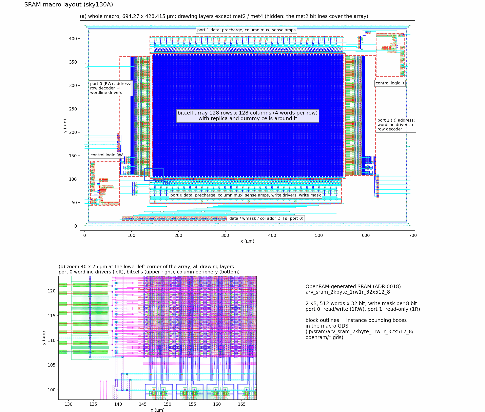

*Figure 1. Layout of the self-generated `arv_sram_2kbyte_1rw1r_32x512_8` (694.27 × 428.415 µm).*

### 3.4 Integration into Caravel (Phase 7)

ChipFoundry's Caravel harness provides a management SoC, pads and a fixed 2920 × 3520 µm user area, `user_project_wrapper`. The Hazard3 SoC is placed **flat** in the wrapper: its standard cells and the SRAM macro are placed and routed directly at wrapper level, not hardened first as a separate macro (ADR-0019 decision 2).

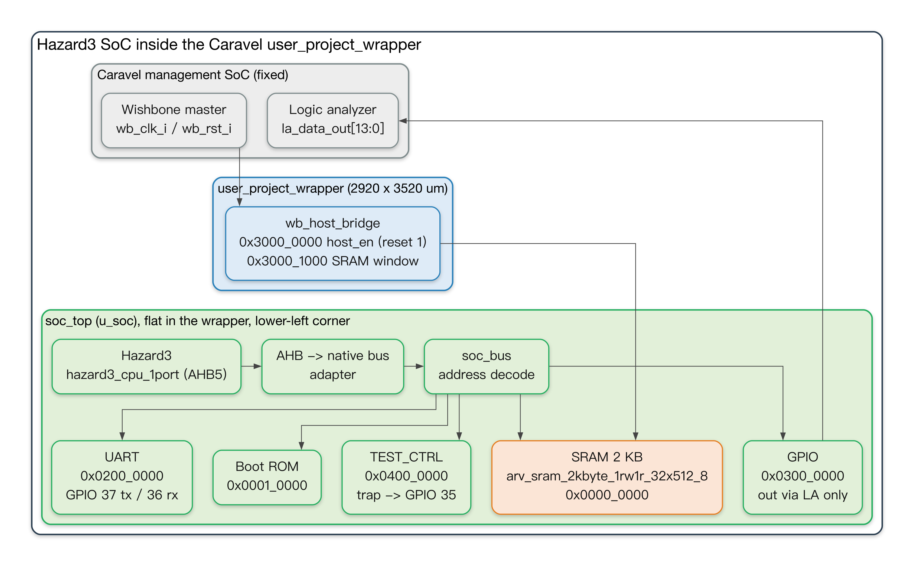

*Figure 2. Hazard3 SoC inside the Caravel `user_project_wrapper`. Sources: `docs/spec/soc_spec.md` §2, §4; ADR-0011; ADR-0019 decisions 8–10, 12.*

Key connections (ADR-0019):
- **Clock and reset** (decision 8): `wb_clk_i` / `wb_rst_i`, the same domain as the Wishbone bus. The period is 44 ns.
- **Host bridge** (decision 9): `wb_host_bridge` decodes `0x3000_0000` as a control register (bit 0 = `host_en`, reset value 1, so the CPU stays halted until the management firmware writes 0) and `0x3000_1000–0x3000_17FF` as a window onto the 512 SRAM words.
- **Pins** (decision 10):
  - `uart_tx`, `uart_rx`, `trap` and `boot_mode[1:0]` use GPIO 37–33 on the lower left edge, the pads nearest to the block;
  - `gpio_out` is visible only through the logic analyser;
  - every SoC pin is mirrored to `la_data_out`.
- **Block position** (decision 12): lower-left corner, close to the Wishbone pins. The pad, block and pin plan was approved by the user before RTL and configuration were written (decision 13, `CLAUDE.md` rule 14).

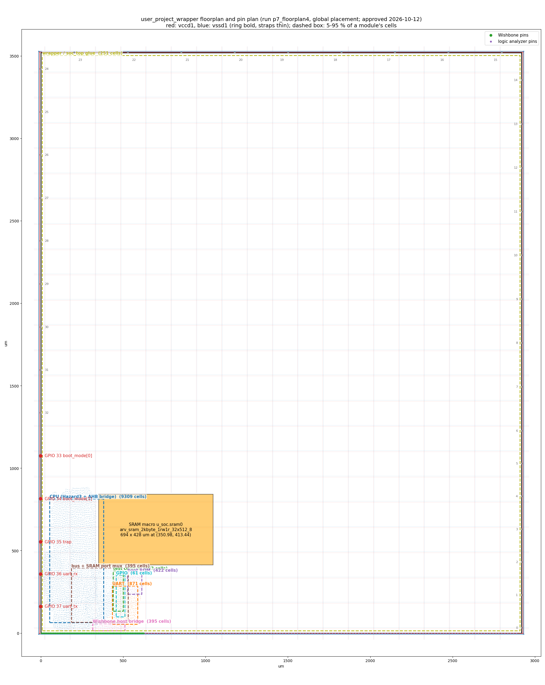

*Figure 3. Floorplan and pin plan of the wrapper (`pnr/user_project_wrapper/pin_plan.toml`, approved 2026-10-12).*

---

## 4. The flow

### 4.1 Stages

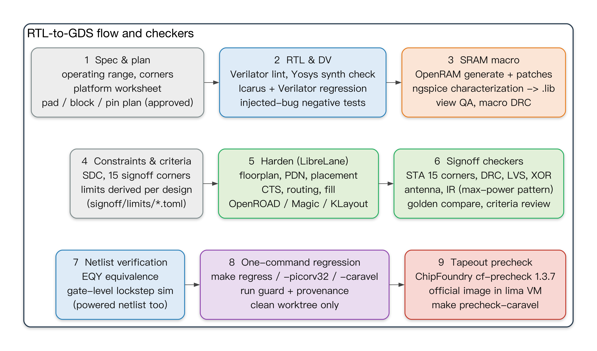

*Figure 4. Flow stages, tools and checkers. Source: `arvinsa-rtl-gds-flow.md` §3–§4.*

The complete flow, with the steps, PASS conditions, checkers and the skill for each step, is in [`arvinsa-rtl-gds-flow.md`](../../arvinsa-rtl-gds-flow.md). This is the entry point for new projects. In short:
1. **Spec and plan.**
   - Operating range and corners. The user decides VDD and Tj, and the corner list follows from them.
   - A tapeout-platform worksheet with every intake check computed for this design.
   - A pad / block / pin plan approved by the user before RTL.
2. **RTL and DV.**
   - Verilator lint and a Yosys synthesis check.
   - Icarus + Verilator regression with self-checking tests.
   - A list of injected bugs (`dv/bugs.toml`) that the regression must catch.
3. **Macro.**
   - Before choosing a macro: a SPICE read/write go/no-go across the operating range, and a DRC run with the platform's deck.
   - View QA of every delivered file: names, pins, `.lib` values, LEF vs GDS (`scripts/check_macro_views.py`).
   - Characterisation to `.lib`.
4. **Constraints and signoff criteria, before any harden.**
   - SDC and 15 signoff corners.
   - Limits in `signoff/limits/<design>.toml` are derived per design, each with a source (a process requirement; no checker enforces the sources yet, ADR-0020).
5. **Harden with LibreLane**: floorplan, PDN, placement, CTS, routing, fill.
6. **Signoff**, run automatically at the end of every harden:
   - STA in 15 corners, DRC, LVS, XOR, antenna and IR;
   - comparison with a golden set of metrics;
   - a criteria review written after every harden (`CLAUDE.md` rule 9).
7. **Netlist verification**: EQY between the synthesised and the final netlist; gate-level lockstep simulation of the final netlist against RTL, cycle by cycle, including a netlist with power pins.
8. **One-command regression**: `make regress` (Hazard3 SoC), `make regress-picorv32`, `make regress-caravel`.
   - A **run guard** accepts a downstream step only for a harden made at the current commit in a clean tree.
   - **Provenance** records commits, submodules and tool versions.
9. **Tapeout precheck**: the official ChipFoundry image, judged by a repo checker (`make precheck-caravel`).

### 4.2 How a harden is judged

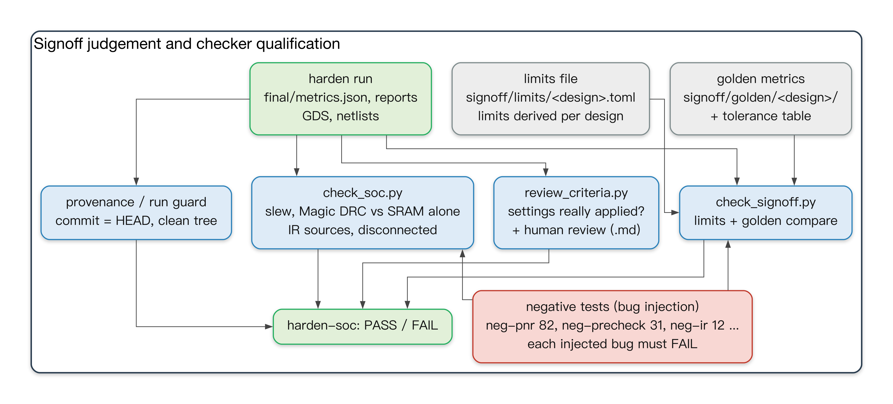

*Figure 5. How a harden is judged, and how the checkers themselves are qualified.*

A harden passes only if all of the following pass:
- **`check_signoff.py`** compares `final/metrics.json` with the limits file and with the golden metrics. Values must be identical except for listed metric families with a tolerance (ADR-0015).
- **`check_soc.py`** checks what metrics cannot express:
  - max slew per corner, with the Caravel-boundary exception (ADR-0019 decision 16);
  - Magic DRC inside the SRAM outline, compared position by position with the SRAM checked alone;
  - IR supply points;
  - disconnected pins.
- **`review_criteria.py`** checks that each setting really took effect (config applied, step configs, clock uncertainty present in every timing step and signoff corner, corners).
- **Provenance and run guard** confirm the commit and a clean tree.

The checkers themselves are **qualified with negative tests**: bugs are injected and each must make the intended checker FAIL. Selected suites at the end of the project:

| Negative test | Cases |
|---|---|
| `neg-pnr` | 82 |
| `neg-precheck` | 31 |
| `neg-ir` | 12 (`soc_top`), 10 (wrapper) |
| `neg-run-guard` | 65 |
| `neg-rtl` (Hazard3 / PicoRV32) / `neg-rtl-caravel` | 36 / 33 / 42 |
| `neg-pnr-caravel` | 9 |
| `neg-eqy` | 16 (Hazard3), 12 (PicoRV32), 14 (`picorv32_core`) |
| `neg-openram` | 50 |

### 4.3 Regression, golden and reproducibility

From Phase 3 on, each phase closed only on a regression run in a **clean git worktree** (`git worktree add --detach` plus submodules, no local edits). The external tools were pointed to with `LIBRELANE_DIR`, `XPACK_DIR` and `PRECHECK_DECK`. Results from the development directory never count (skill `flow-regression-reproducibility`).

**Golden comparison** made non-reproducibility visible:
- Multi-threaded detailed routing occasionally differs by a few µm of wire.
- `GRT-0229` aborts the incremental global routing at random. A bounded retry resumes only on known messages (`GRT-0229`; from Phase 5 also `GRT-0116` with a total overflow ≤ 10), at most two retries, and every retry is recorded.
- ADR-0015 added layout tolerances measured on Hazard3; PicoRV32 was re-measured with four samples in Phase 5; the wrapper borrows Hazard3's tolerances.

In Phase 7 the wrapper was bit-identical with its golden in four comparisons. The `picorv32_core` design showed 29 metrics within tolerance in one run out of three, and was identical in the other two. This is why the tolerances are kept.

---

## 5. The journey, phase by phase

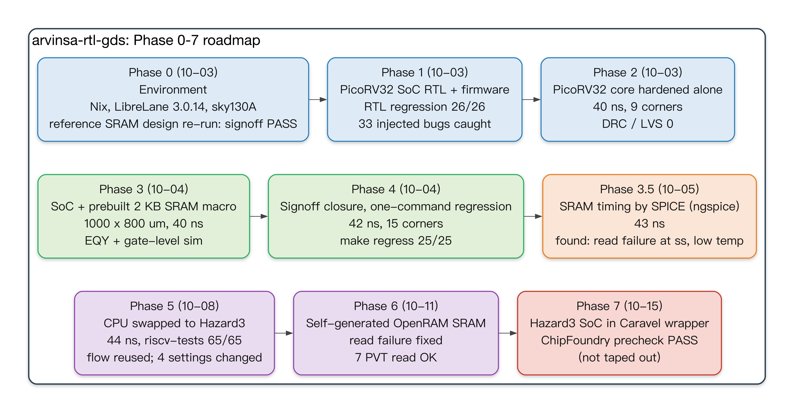

*Figure 6. Phase roadmap with dates and key outcomes. Source: `README.md`, `docs/phase_exit/phase*.md`.*

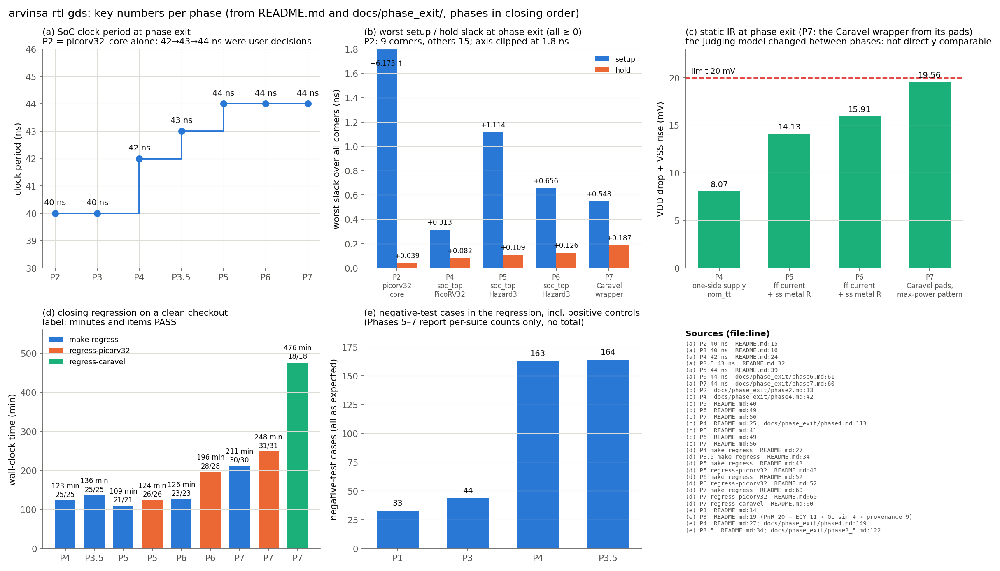

*Figure 7. Key numbers per phase: clock period, worst setup / hold slack, IR (different models per phase, not comparable), closing-regression size and time, injected bugs. Sources per number in `figures/SOURCES.md`.*

### Phase 0 — Environment (2026-10-03)

- **Goal**: a working LibreLane / sky130A installation, proven on the official SRAM reference design.
- **Result**: smoke test passed; the reference design re-run at 25 ns with all 16 signoff items at 0; slack within 0.01 ns of the official CI; 307 metrics bit-identical with a local golden (`docs/phase_exit/phase0.md`).
- **Problems and fixes**:
  - slow network: resumable downloads;
  - `make clean` deleted a running flow directory: narrowed to Phase 1 outputs;
  - the pinned CI-design commit was not the one LibreLane 3.0.14 tests with: re-pinned;
  - 74 vs 70 slew violations against CI: platform difference, so the checker compares signoff items across platforms and metrics only against the local golden.

### Phase 1 — SoC RTL, firmware and RTL regression (2026-10-03)

- **Result**: lint (23 variants, 0 warnings), synthesis check, firmware, upstream PicoRV32 tests; `make regress-rtl` 26/26 (13 tests × Icarus and Verilator, identical cycle counts and UART text); `make neg-rtl` 33/33 injected bugs caught.
- **Testbench qualification**: two independent rounds injected bugs outside `bugs.toml`. Round 1 injected 20 bugs and the regression missed 10. Round 2 injected 23 bugs (F01–F24, F16 replaced by F16b) and missed 10 (for example a UART stall path never exercised, firmware altered to write DONE before SIG, a single bus transaction that accessed SRAM twice). Four new checkers (`sram_port`, `irq_line`, `uart_div`, `coverage`) and new tests closed the gaps; `neg-rtl` grew 8 → 20 → 33.
- **Lesson**: a self-checking test that has never been shown to fail is not evidence. This led to the skills `signoff-checker-qualification` and `dv-directed-tests`.

### Phase 2 — PicoRV32 hardened alone (2026-10-03)

- **Result**: GDS 533.6 × 544.3 µm; Magic, KLayout and routing DRC 0; LVS 0; XOR 0. Setup +6.175 ns (`max_ss_100C`) and hold +0.039 ns (`min_ff_n40C`) at 40 ns in 9 corners. The upstream ISA test passed on the final netlist, and 117,381 bus transactions were identical between RTL and gate level. The SoC die area was then chosen as 1000 × 800 µm (ADR-0006).
- **Problem**: `power__total` is the last corner written (max_ff), not nom_tt (LibreLane `openroad.py` lines 808–810). The skill `librelane-run-debug` records this metric trap.

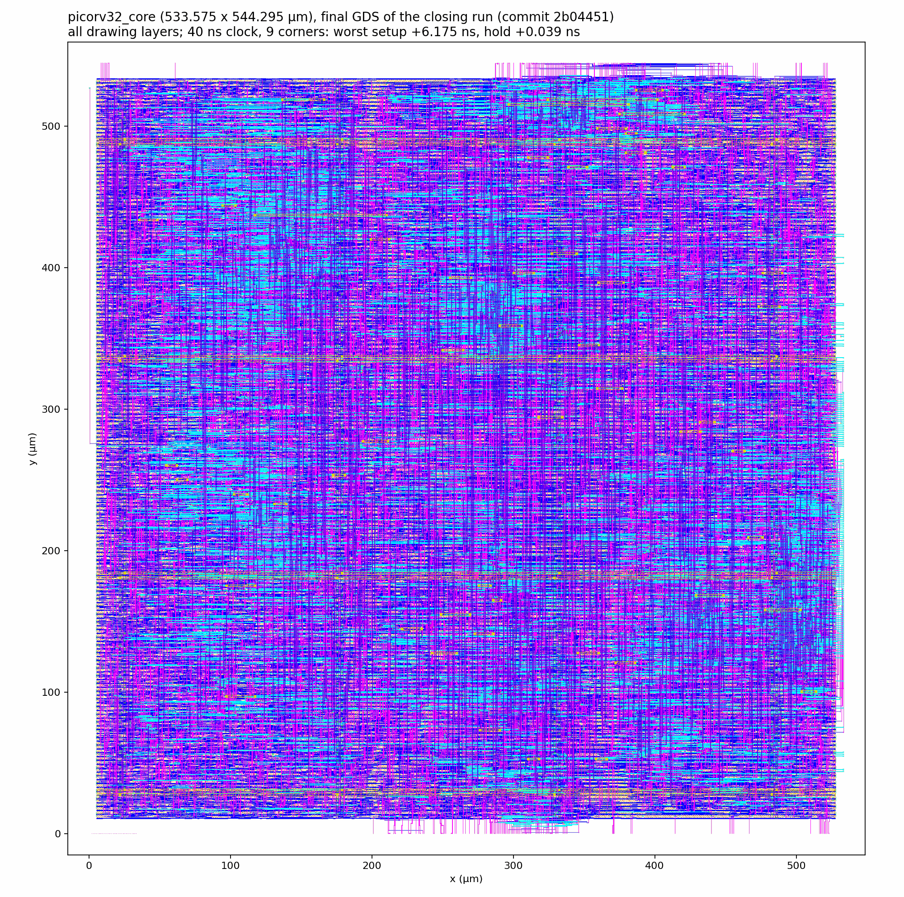

*Figure 8. `picorv32_core` hardened alone.*

### Phase 3 — SoC with the prebuilt SRAM (2026-10-04)

- **Result**: 1000 × 800 µm, 40 ns, 9 corners PASS; Magic full-GDS DRC 0 outside the SRAM; EQY 18,100/18,100 partitions (synthesised vs final netlist); gate-level simulation 13/13; `neg-pnr` P01–P20 all caught. `make phase3` ran end-to-end in a clean checkout on the fourth attempt.
- **Convergence problems** (`docs/phase_exit/phase3.md` "怎麼收斂"):
  1. `PDN-0179` with the SRAM 25 µm from the die edge (a 6 µm row above it): moved the SRAM so its halo covers the core edge.
  2. Heuristic diode insertion inserted 10,231 diodes and global routing ran more than 10 minutes without converging: replaced by an antenna LEF for the SRAM (ADR-0008).
  3. Magic wrote a GDS with 13 top cells: KLayout became the primary stream-out tool.
  4. Abstract DRC reported a false `nwell.4` on every row: full-GDS DRC, judged by `check_soc.py magic_drc`.
  5. ss max-slew violations from detours at an L-shaped corner. The real cause was an automatic placement density of 68%; 55% fixed it. A temporary relaxation of the signoff max transition to 1.0 ns (ADR-0009) was **withdrawn** once the root cause was found.
  6. `GRT-0229` random abort. The same input re-run four times gave two aborts and two passes, the two passes identical to each other. Fix: a bounded retry (`pnr/librelane_flow.sh`), and a correction of an earlier attribution that rested on a single run.
- **Independent reviews** found 5 checker holes, which were fixed at the start of Phase 4.

### Phase 4 — Signoff closure and one-command regression (2026-10-04)

- **Timing target**: 25 ns was not reachable (the SRAM path was short by about 7 ns). With the stricter Phase 4 criteria, 40 ns also failed: the SRAM half-cycle path at `min_ss_n40C` was short by 0.42 ns. The user chose **42 ns** without relaxing any assumption (ADR-0004).
- **Stricter signoff**:
  - 15 corners, including temperature inversion (ss −40 °C);
  - SRAM derate 1.575;
  - a duty-cycle budget;
  - static IR drop as VDD drop plus VSS (ground) rise, limit 20 mV;
  - EQY extended to flip-flop types and clock wiring;
  - gate-level simulation with power pins.
- **Convergence**: resizer with 15 corners did not finish (35+ min), so `RSZ_CORNERS` was kept at 9. Hold was fixed with a 0.3 ns margin. CTS inserted delay buffers before the SRAM clock to balance it with the flip-flops, and no LibreLane variable turned this off (the fix, `-no_insertion_delay`, came in Phase 5). The fifth harden passed all 15 corners.
- **Regression**: `make regress` 25/25 in a clean worktree, 123 minutes, all 163 negative-test cases (including positive controls) as expected. Three earlier clean runs did not count:
  - checkers changed after a review;
  - an intermediate router number differed;
  - a gate-level simulation hit its wall-clock limit.

### Phase 3.5 — SRAM timing measured with SPICE (2026-10-05)

- **Method** (ADR-0010): local ngspice on the PDK's transistor-level netlist, 5 PVT `.lib` files generated from a measurement JSON with a staleness check, and a new hold arc because `dout0` starts changing right after the clock edge.
- **Key finding**: the prebuilt SRAM **misreads** (returns the previous value) at ss −40 °C (1.60–1.95 V), at ss 25 °C 1.60 V and at tt −40 °C 1.60 V. The cause was confirmed at the bit-0 sense-amp internal nodes: there is no sense-amp precharge, and the NMOS-only column mux cannot restore the node at high Vt. The user made this the top tapeout risk; ss −40 °C used a placeholder `.lib` until Phase 6.
- **Timing**: measured delays plus margins stayed below the padded `.lib`, so the padded values remained the floor (exceptions: the ss 100 °C hold of 0.53 ns, and `dout0` max capacitance raised from 0.02756 to 0.05 pF). The new hold arc plus a 0.3 ns hold margin put a delay cell on the SRAM half-cycle path, and the user chose **43 ns**.
- **Problem**: a steep load slope in the first `.lib` (at ss 100 °C, 5 → 20 fF added 1.3 ns, equivalent to a 60–140 kΩ driver) made `RepairDesignPostGPL` end abnormally after 75 minutes (normally about 40 seconds). Each row now takes the maximum over the loads.
- **Regression**: 25/25 in a clean worktree (136 minutes), all 164 negative-test cases as expected. The first attempt failed on a negative-test script that emptied a file before reading it.

### Phase 5 — CPU swapped to Hazard3 (2026-10-08)

- **Result**: 65/65 riscv-tests, 48/48 ISS trace comparisons; signoff at **44 ns** with 15 corners: Hazard3 +1.114 / +0.109 ns, PicoRV32 +0.789 / +0.080 ns. Clean-worktree `make regress` 21/21 and `make regress-picorv32` 26/26, all three hardens identical with golden.
- **Convergence** (twelve Hazard3 hardens, plus five for PicoRV32 and the tolerance samples):
  1. `RepairDesignPostGPL` ran 108 minutes and reached 92.9 GB because the resizer swapped in a weak `a2111oi_1` that cannot drive a buffer. ADR-0012 excludes weak cells; a pre-harden check, `pnr/check_weak_cells.py`, enforces it.
  2. ss_n40C setup −4.158 ns because the resizer did not look at the temperature-inversion corner: ADR-0013.
  3. −0.381 ns remained: the user chose 44 ns.
  4. −1.131 ns at signoff, about 0.97 ns of it appearing only after routing: a post-GRT resizer pass (ADR-0014).
  5. Limits copied from PicoRV32 did not fit Hazard3, and golden comparisons failed on small layout differences: limits re-derived per design, layout tolerances (ADR-0015).
  6. For PicoRV32, CTS inserted 10 `delaybuf` cells before `sram0/clk0` to balance latency, which ate the half-cycle path. LibreLane has no switch for this, so a repo plugin replaces the CTS step with `-no_insertion_delay` (ADR-0016).
  7. An independent review estimated the worst-case IR (ff current + ss resistance) at about 25.6 mV; the exit review measured 25.75 mV, above 20 mV. Widening the met5 strap to 4.8 µm brought it to 14.13 mV (ADR-0017).
- **Not met**: exit criterion 7b, "only the design layer changes". Four flow settings (ADR-0012, 0013, 0014, 0016, changed for both CPUs), the period, a CTS plugin, checkers and limits changed; the user accepted this as a deviation.

### Phase 6 — Self-generated OpenRAM SRAM (2026-10-11)

- **Generation**: OpenRAM `3608704c` with 4 repo patches, run natively on macOS. OpenRAM's own pinned 2022 PDK is used for macro generation, DRC and LVS, because newer device names break OpenRAM's LVS (ADR-0018 decision 5).
- **Read failure fixed**: the default macro failed exactly like the prebuilt one. A netlist what-if compared a transmission gate with a sense-amp input precharge and chose the precharge (patch 0001). Next, tt 25 °C failed on the 2 KB macro because the idle port's chip-select flip-flop was never clocked; tying `clk1` to the system clock made all seven conditions read correctly.
- **Characterisation**: 5 PVT timing and internal power by SPICE. Several effects had to be handled: the floating port-1 crowbar current, a metastable bitcell, and gmin.
- **Integration problems**:
  - LEF database units 2000 made OpenROAD drop the whole LEF (`ODB-0205`); converted to 1000.
  - **The final GDS contained an empty SRAM**: the OpenRAM LEF had no `FOREIGN`, so the stream-out did not merge the macro GDS, yet the log said "All LEF cells have matching GDS cells". Fix: add `FOREIGN` plus a new checker, `check_macro_gds.py`.
  - The flow's KLayout DRC found 27 violations inside the SRAM. The prebuilt macro showed 0 only because the deck excludes `*sky130_sram_*kbyte_*` by name. Fixed with OpenRAM patches 0002–0004.
  - EQY's netlist parser only knew `sky130_*` cells, so the self-generated SRAM was silently skipped. After the fix, an EQY failure appeared: OpenROAD pin swaps (`RSZ-0043`) made the name matching contradictory although the netlists are equivalent, a tool limitation handled by excluding the swapped pins (decision 18).
- **Result**: Hazard3 setup / hold +0.656 / +0.126 ns, PicoRV32 +0.769 / +0.082 ns. Clean-worktree regressions 23/23 and 28/28 at `85bfa75`.
- **Layout extraction trial**: the extracted netlist reads and writes correctly but is **2.0× slower** than the schematic. This is the origin of Phase 7 known limitation 2.

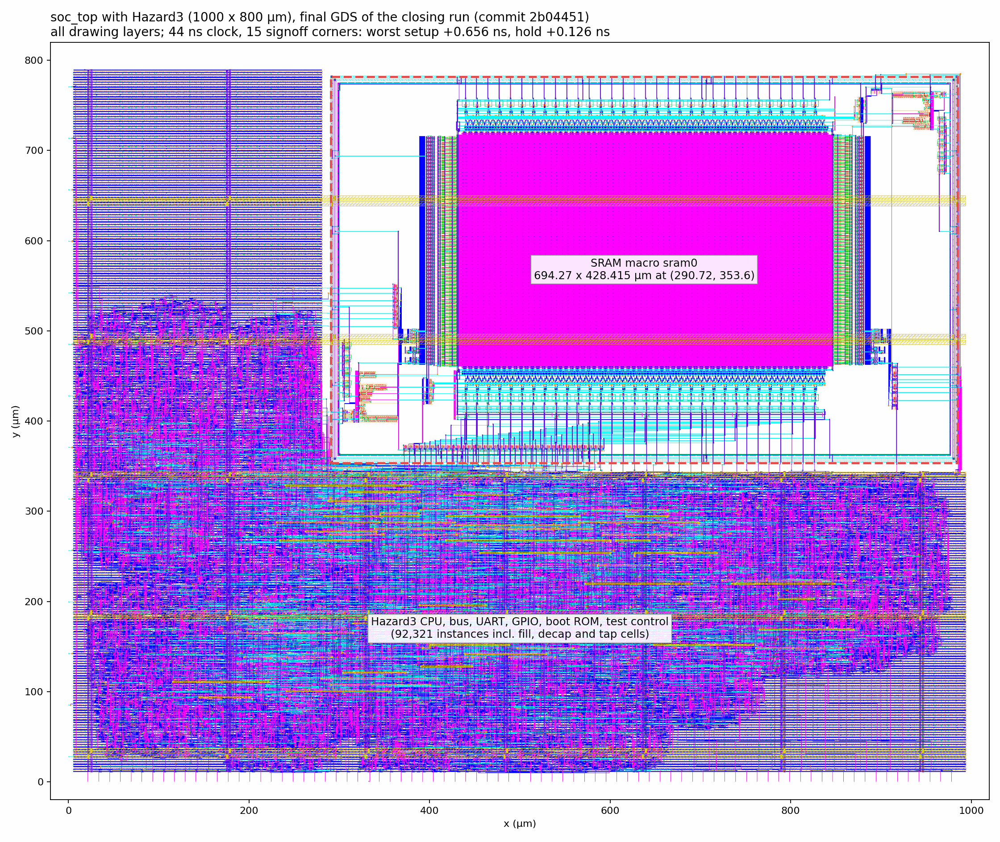

*Figure 9. `soc_top` with Hazard3 and the self-generated SRAM (Phase 6 design, re-hardened identically in Phase 7).*

### Phase 7 — Caravel integration and ChipFoundry precheck (2026-10-12 – 10-15)

The steps and the decisions behind each are recorded in ADR-0019, decisions 1–26.
1. **Precheck environment** (decisions 3–5):
   - The official `cf precheck` runs only in a linux/amd64 Docker image. A lima VM with Rosetta ran the official example in 19 minutes with 11 checks passing.
   - The new precheck deck no longer exempts the SRAM core area, so even the PDK's prebuilt SRAM reports `MR_licon.SP.6` and `MR_mcon.CON.10`. The exit criterion became: 11 checks pass, and the two KLayout checks contain only those two rules at the same positions as the prebuilt macro checked alone.
2. **Wrapper RTL** (decisions 8, 9): Wishbone host bridge, `host_en` reset value 1.
3. **Planning first** (decisions 10–13). The first GPIO choice (8–20) was made before looking at pad positions, and those pins turned out 2–3 mm from the block. The user pointed out that the order was wrong: block position must come before pin selection. The plan was redone (GPIO 33–37), and the order is now enforced at four levels:
   - a checker (`make pin-plan`, with `neg-pin-plan`);
   - a Claude Code hook that blocks edits before approval;
   - a skill (`chip-floorplan-pin-planning`);
   - the flow document (`arvinsa-rtl-gds-flow.md` 4.1), together with `CLAUDE.md` rule 14.
4. **Harden exploration**:
   - `RSZ-0074`: the resizer treats the unconnected inout `analog_io` as both driver and load. Fixed with `RSZ_DONT_TOUCH_RX` and a checker.
   - Caravel's input transitions (0.84–0.97 ns) exceed the slew limit. Internal nets are judged as before; boundary nets get their own limit (decision 16).
   - A Caravel input-path hold of −0.071 ns: the hold margin after global routing went from 0.05 to 0.2 ns (decision 17).
5. **IR** (decisions 18–20), changed three times in one day:
   1. Measured from Caravel's real `vccd1` pads and bridges, the wrapper reached 104 mV in the worst combination, so the met4 strap went 1.6 → 4.8 µm.
   2. The corner used for judgement became the slow corner the budget protects.
   3. The current became the switching activity of a **CPU max-power pattern** (`fw/tests/maxpower`, recorded in gate-level simulation). The user's words: "一般IR都會用CPU max power pattern去做不是嗎" ("isn't IR normally done with a CPU max-power pattern?").

   Result: 19.56 mV against a 20 mV limit.
6. **Internal slew**: after the last slew repair, the re-run of global routing pushed one net into a detour (0.779 ns). Four repair attempts did not converge; placement density 55 → 50% fixed it (decision 21).
7. **EQY**: 1 partition out of 16,149 was not proven after OpenROAD pin swaps. One automatic `amend` retry was added. The first version merged flip-flops into the partition, which made the proof **vacuous** (an injected NAND→NOR bug passed); a negative test caught this and the retry was restricted to combinational logic (decision 23).
8. **Precheck checker** (step 6): `check_precheck.py`. An independent review closed four holes, for example that a stale report could be judged PASS against a new GDS.
9. **Official precheck** (step 7):
   - li1 density was 75% because of `decap_3` fill (limit 60%): switched to `ef_decap_12` plus fill, giving 39.9%.
   - BEOL, LVS and OEB were OOM-killed in a 10 GiB VM: the VM was raised to 16 GiB.
   - The reference comparison was limited to the allowed rules.

   Precheck PASS at `550869c`.
10. **Closing regression**:
    - **Round 1** (`84fe505`): all three regressions passed. During it, two independent agents reviewed the documents (110 rows: 5 wrong, 23 misleading) and searched for checker holes (8 holes, H1–H8, plus one guard gap). The user chose to fix everything and re-run (decision 26).
    - **Round 2** (`2b04451`) is the official evidence. The disk filled up (0.8 GiB left), interrupting PicoRV32 (a write error) and Hazard3 (an STA hung). Hazard3's second attempt hit a KLayout Signal 11, suspected but not confirmed to be memory pressure; Hazard3 ran three times.
11. **Fill trial** (decision 26): Caravel's fill recipe run on the wrapper alone, to estimate post-fill density (§6.5).

---

## 6. Final results

All numbers in this section are from the round-2 closing regression at `2b04451` unless noted otherwise (`docs/phase_exit/phase7.md`). What-if analyses (for example the `dout0` transition in §9.1) are separate STA runs on the same layout.

### 6.1 Regressions

| Regression | Items | Time | Result |
|---|---|---|---|
| `make regress-caravel` (wrapper) | 18 | 476 min | **18/18 PASS** |
| `make regress-picorv32` | 31 | 248 min | **31/31 PASS** |
| `make regress` (Hazard3 `soc_top`) | 30 | 211 min | **30/30 PASS** |

Four hardens, no retries, all bit-identical with golden: wrapper 455 metrics, Hazard3 `soc_top` 441, PicoRV32 `soc_top` 435, `picorv32_core` 325.

### 6.2 Layout

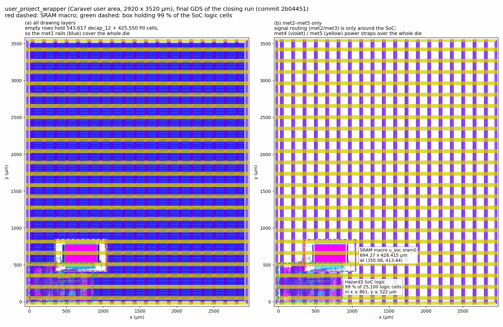

*Figure 10. Final `user_project_wrapper` (2920 × 3520 µm). The SoC and SRAM occupy the lower-left corner; the rest is power grid, tap cells, decap and fill, plus a few logic cells near the edges.*

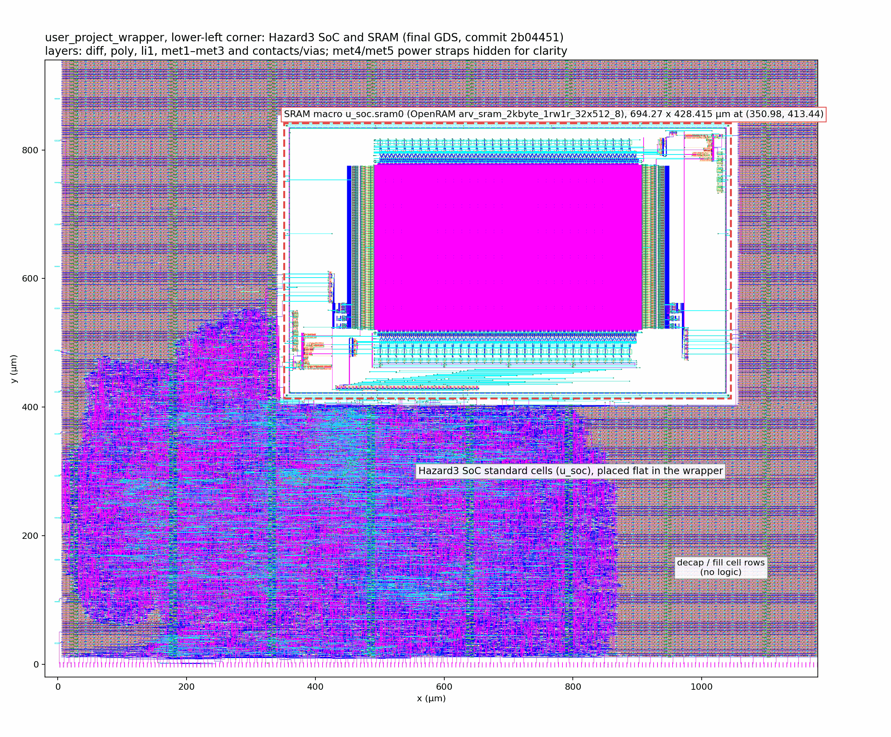

*Figure 11. Lower-left corner of the wrapper: the Hazard3 SoC logic cells below and to the left of the SRAM macro.*

### 6.3 Signoff (wrapper, 44 ns)

| Item | Wrapper | Hazard3 `soc_top` (reference) |
|---|---|---|
| Worst setup | +0.548 ns (min_ss_n40C_1v60, SRAM half-cycle path) | +0.656 ns |
| Worst hold | +0.187 ns (max_ff_100C_1v95) | +0.126 ns (min_ff_n40C_1v95) |
| Standard cells | 165,577 including 140,477 tap cells (25,100 logic cells); 7.0% utilisation including the SRAM | 30,406 including 6,445 tap cells |
| Flip-flops | 2,238 | 2,152 |
| Routing DRC / KLayout DRC / LVS / XOR / antenna | 0 | 0 |
| Magic DRC (flow's count) | 5,572,955, all inside the SRAM at positions of the SRAM checked alone | 4,770,846, same |
| EQY | 16,149 / 16,149 partitions | PASS |
| Gate-level simulation | 16/16 | 16 + 16 (with power pins) |
| IR, max-power pattern (limit 20 mV) | **19.56 mV** from Caravel's pads (the wrapper itself 2–5 mV) | 4.67 mV from its own ring (not comparable) |

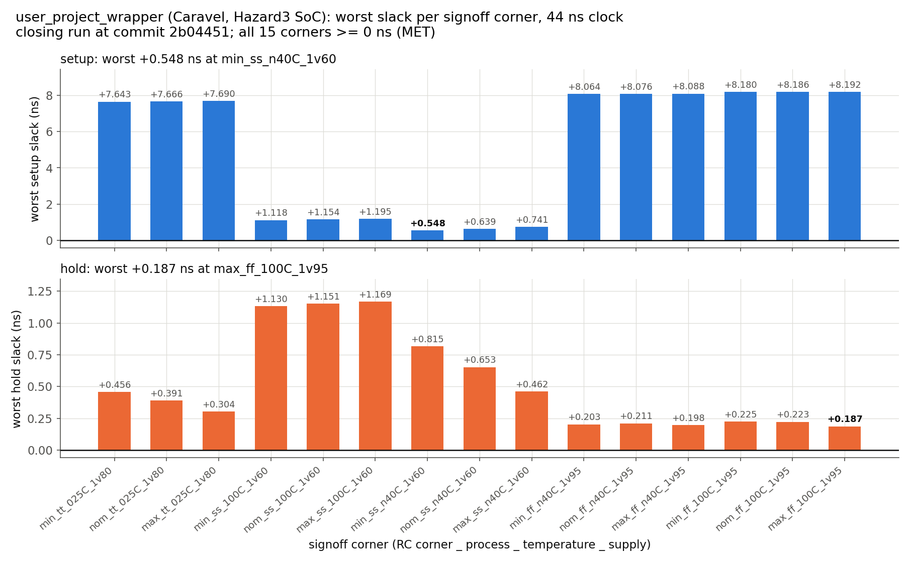

*Figure 12. Worst setup and hold slack of the wrapper in the 15 signoff corners.*

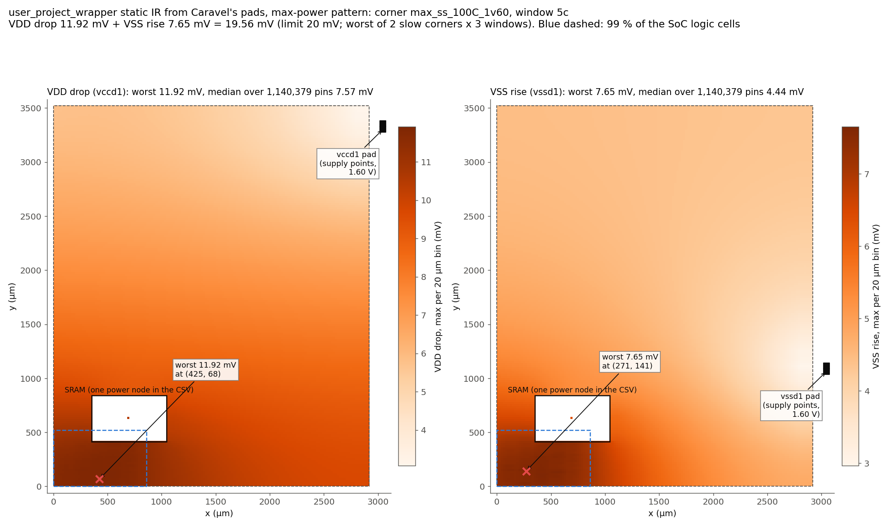

*Figure 13. VDD drop (vccd1, 11.92 mV) and VSS rise (vssd1, 7.65 mV) of the wrapper with the max-power pattern, max_ss_100C_1v60, window 5c; the sum is 19.56 mV.*

### 6.4 Precheck

The official image (cf-precheck 1.3.7) ran 13 checks:
- 11 pass; the optional `magic_drc` is skipped.
- `klayout_feol` contains 16,900 markers, all `MR_licon.SP.6`, and `klayout_beol` 50,184 markers, all `MR_mcon.CON.10`. All are inside the SRAM, at the positions where the PDK's prebuilt macro checked alone has them.

The repo checker `check_precheck.py` judges this as **PASS** under ADR-0019 decision 5. Whether ChipFoundry accepts this interpretation is not known (open issue 1).

### 6.5 Density and the fill trial

The precheck only checks density upper limits. Caravel's tapeout scripts are believed to add metal fill to the whole chip and then check the lower limits (medium evidence, not stated in a document; `runs/p7_review/chipfoundry_fill.md`) (`check_density.py`: li1 and met1–4 ≥ 35%, met5 ≥ 45%, FOM ≥ 33%, in 700 µm windows). The wrapper alone, before fill, is far below those limits (met2 1.6%, met3 0.8%). The fill trial re-implemented Caravel's `generate_fill.py` (`wafflefill(tiled)`) and `check_density.py` on the wrapper. The fill tiles were measured separately and added per 70 µm box, which overestimates by at most 0.33 points:

| Layer | Before fill (inside the die) | After fill: lowest window | Windows below the lower limit |
|---|---|---|---|
| li1 | 39.9% | 41.4% | 0 |
| met1 | 18.1% | 36.0% | 0 |
| met2 | 1.6% | 34.8% (estimate; 34.55% measured) | 1 of 63 |
| met3 | 0.8% | 37.9% | 0 |
| met4 | 25.1% | 50.0% | 0 (highest 59.7%, close to the 60% upper limit) |
| met5 | 26.1% | 58.1% | 0 |
| FOM | 41.1% | 31.5% | 15 of 1,386 |

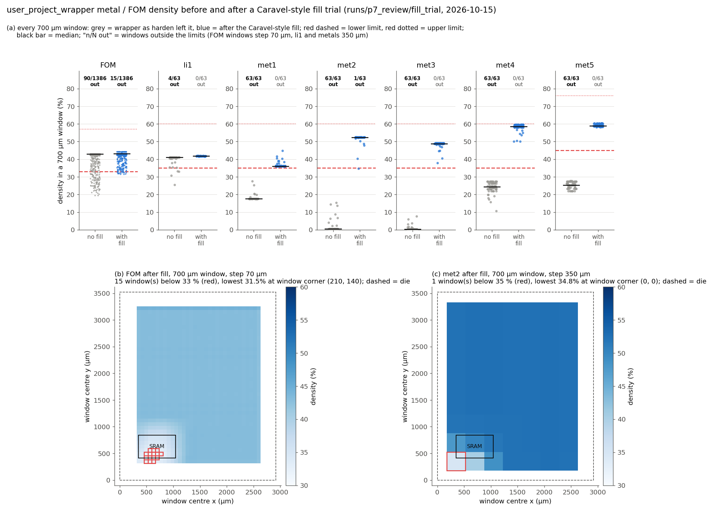

*Figure 14. Density per 700 µm window before and after the fill trial (`runs/p7_review/fill_trial/`).*

The precheck reports met4 26.7% and met5 27.3% before fill because it counts the power ring outside the die (suspected).

What the trial can and cannot tell:
- Everything that stays below a limit is in the lower-left SoC / SRAM corner.
- The die's right and top edge windows cannot be judged without the harness.
- ChipFoundry's actual fill parameters are not known.

---

## 7. Problems encountered

### 7.1 How the problems were collected

On 2026-10-15 four independent agents, none of which wrote the code, went through every phase:
- three read the exit reviews, ADRs, notes, skill experience records and `git log` of Phase 0–3.5, 4–5 and 6–7;
- one audited all 23 skills and the flow document.

For each problem they checked with `git grep` where it is captured **today**: a skill rule, only a skill experience record, a step of the flow document, an automatic checker or negative test, or nowhere. Their reports are in `docs/notes/problem_review/` (`review_p0_35.md`, `review_p4_5.md`, `review_p6_7.md`, `review_skills.md`). A fifth agent verified their claims and merged their recommendations (`verify_and_merge.md`, §8.5).

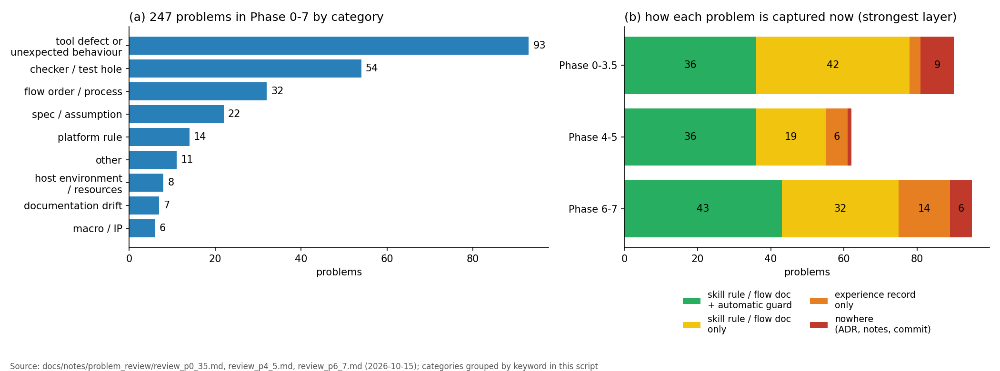

*Figure 15. (a) The 247 problems of Phase 0–7 by category. (b) How each problem is captured now, counting only the strongest layer. The category grouping is by keyword in `figures/scripts/problems_overview.py`.*

**247 problems** were found: 90 in Phase 0–3.5, 62 in Phase 4–5 and 95 in Phase 6–7. The three reports defined their capture categories slightly differently, so the totals below are indicative.
- 115 are captured in a skill rule or the flow document **and** have an automatic guard;
- 93 are in a rule or the flow document without an automatic guard (or with a written "no automatic guard, because …");
- 23 are only in a skill experience record;
- 16 are captured nowhere except an ADR, a note or a commit message.

### 7.2 What kinds of problems

| Category (grouped by keyword, see Figure 15) | Count | Typical examples (phase) | How they were solved |
|---|---|---|---|
| Tool defect or unexpected behaviour | 93 | `GRT-0229` random abort (3); resizer loops on a weak cell, 92.9 GB (5); CTS inserts latency-balancing buffers before the SRAM clock (4–5); stream-out does not merge a macro GDS when the LEF lacks `FOREIGN` but logs success (6); `RSZ-0074` on an unconnected inout (7); OpenSTA ignores `set_input_transition` when a driving cell is set (7); PSM Signal 11 at certain supply points (7); KLayout Signal 11, memory pressure suspected (7) | Bounded retry only on the exact message; tool settings or a repo plugin, never a patched tool; a checker that detects the symptom; a negative test that recreates it (`CLAUDE.md` rule 10) |
| Checker or test hole | 54 | Phase 1 testbench missed 10 of 20 and 10 of 23 injected bugs; `check_soc.py` loop variable overwrote the SRAM origin (7); EQY skipped every non-`sky130_` cell (6); stale precheck report accepted for a new GDS (7); `judged_by` accepted any string (7); NaN dropped by `max()` (7) | Fix, add a negative test, add the hole type to the `signoff-checker-qualification` table; positive controls on a real run before opening a regression |
| Flow order or process | 32 | GPIO chosen before the block position (7); signoff criteria defined after the first hardens (2–3); IR method changed three times in a day (7); evidence left in a session scratchpad (3, 4, 5, 6, 7) | Planning approval checks (pin-plan checker and edit hook, `CLAUDE.md` rule 14), ADR-0020's 19 earlier checks, the relaxation register |
| Specification or assumption | 22 | SRAM read failure at ss low temperature (3.5); padded `.lib` without wire parasitics (3–7); duty cycle and jitter of Caravel's clock (5, 7) | SPICE go/no-go before choosing a macro, documented assumptions, tapeout-risk list |
| Platform rule | 14 | One `vccd1` pad for the whole user area; boundary transitions above the slew limit; li1 density with `decap_3`; prebuilt SRAM rules in the new deck; who adds metal fill (all 7) | Platform worksheet (ADR-0020 A2), skill `tapeout-precheck-caravel` |
| Host environment and resources | 8 | Memory exhausted by another program (5); two `neg-pnr` runs killed together (6); disk full stops a regression and hangs an STA (7) | The precheck VM memory is checked automatically; since ADR-0021, `scripts/regress.py` also refuses to start below 100 GiB free disk and kills a target over 3 × its reference time (`neg-regress` cases `low_disk`, `timeout`); the number of parallel runs is still a manual decision |
| Documentation drift | 7 | A later decision changed but an earlier paragraph was not marked; numbers compared under different conditions (5, 6, 7) | Independent document review at each phase end |
| Other | 11 | Mixed or uncategorised rows | — |
| Macro or IP | 6 | Negative-slope load table in the SRAM `.lib` (3.5); LEF database units 2000 (`ODB-0205`) (6) | View QA (`scripts/check_macro_views.py`, `make neg-macro-views`) |

### 7.3 The most expensive problems

Mostly from the flow retrospective (`docs/notes/flow_retro/README.md`, ADR-0020); the last two rows are from the exit reviews and the 2026-10-15 review. Times are estimated from commit times and are only orders of magnitude.

| Problem | Cost | What would have caught it earlier |
|---|---|---|
| The prebuilt SRAM misreads at ss low temperature | A whole characterisation of a macro that was later replaced (about 19 h); placeholder `.lib` for Phase 3.5–5 | SPICE read/write over the operating range **before** choosing the macro (B1) |
| Clock period moved 40 → 42 → 43 → 44 ns | Three rounds of closure | User-decided operating range and a corner cost what-if at the first netlist (A1, A3) |
| Phase 7 platform surprises (single `vccd1` pad, boundary slew and hold, li1 density, prebuilt SRAM rules, fill) | About two days of rework and three relaxations | A platform worksheet with every intake check computed for this design (A2) |
| Runaway repair steps (4 times, 26–108 min each, once 92.9 GB) | Hours; three stopped by a person, one ended abnormally by itself | Weak-cell QA over all signoff corners (C2) and, still open, an automatic stop |
| Checker holes found at every phase end (5, 10, 12, 8, 7 and 8 + 1 in Phase 3, 4, 3.5, 5, 6, 7) | One extra full regression per phase from Phase 4 on (Phase 3 and 3.5 holes were carried into the next phase) | Hole review when a checker is written, not at the phase end (E3) |
| Host resources: disk full, memory pressure | Two of three closing regressions restarted in Phase 7 | Resource checks and timeouts in the regression (implemented 2026-10-15, ADR-0021; §8.5 B1) |

### 7.4 Lessons that apply to any project

1. **A checker is only evidence after it has been seen to fail.** Every phase's independent hole review found 5–12 holes, and some fixes introduced new bugs: a new variable that reused an existing name made one check FAIL on every run (Phase 6 `files`, Phase 7 `defines`). Phase 6's was caught by the closing regression; Phase 7's by positive controls on a real run before the regression.
2. **Tools fail silently.** EQY skipped cells without a warning; the stream-out logged success with an empty SRAM; the run log looked normal while settings were not applied; an STA hung on a full disk. The answer is a checker that looks at the **output** (the GDS contains the macro, the report contains the pins), not at the log.
3. **Decide what protects what before relaxing it.** A relaxation measured on one design (an IR corner, a resizer margin, a golden tolerance) silently stopped being valid after the CPU swap. Hence the relaxation register.
4. **Platform rules are numbers, not names.** Reading "IR drop" or "density" in the platform documentation is not enough. The rule has to be computed for this design before the first harden.
5. **Order matters for physical decisions.** Pads and power entry come first, then block position, then pins, then RTL, then harden. Doing it in a different order cost a redo in Phase 7.
6. **Keep the evidence where the next reader can open it.** A number whose source was a session scratchpad or an overwritten run can only be cited as speculation.

## 8. How the skills and the flow were corrected

### 8.1 The mechanism

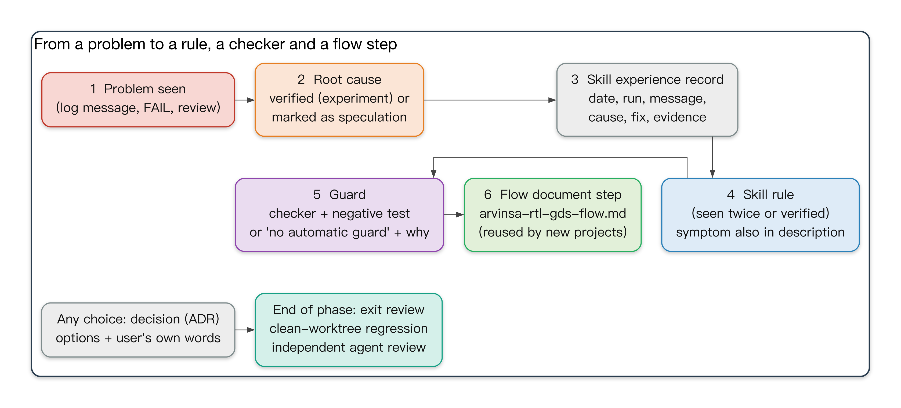

*Figure 16. How a problem becomes a skill rule, a guard and a flow step (`CLAUDE.md` rules 2, 3, 5, 8, 10, 13).*

- Every problem is first written as a row in the relevant skill's **experience record**: date, run, the original message, root cause marked verified or speculative, fix, evidence (`CLAUDE.md` rule 2).
- A row moves into the **rule body** only after the same phenomenon appears twice or the root cause is confirmed by an experiment (rule 3). Speculative causes must not enter rules (the 2026-10-15 review found some that did, §8.5 C1).
- Tool defects need four parts (rule 10): the symptom (also in the skill's `description`, which is all Claude reads when deciding whether to open the skill), how to detect it, how to work around it, and a guard against recurrence (a checker and negative test, or an explicit "no automatic guard, because …").
- Every rule change updates the README skill index in the same commit (rule 5). `make skill-check` checks format and index; whether the content agrees is reviewed by hand. Flow changes update `arvinsa-rtl-gds-flow.md` (rule 8).
- Every choice that affects the specification or schedule goes to the user as options, and the user's words are recorded in an ADR (rule 13).

### 8.2 How the rule set grew

| Date | Change | Trigger |
|---|---|---|
| 10-03 | 15 skills created during Phase 3 (14 in `654c303`, `signoff-criteria` in `d31b52b`): `librelane-run-debug`, `drv-timing-closure`, `signoff-checker-qualification`, … | Phase 2–3 work |
| 10-04 | `flow-regression-reproducibility`, `multicorner-sta`, `phase-exit-review`, `dv-directed-tests`, `openram-macro-characterization` | Phase 4 regression and the Phase 3.5 characterisation; the user: "這個 phase 4 的重要任務也要分析建立對應的skill" ("analyse the important tasks of Phase 4 and create skills for them") |
| 10-05 | `core-migration-hazard3` | Before Phase 5 (`CLAUDE.md` rule 7) |
| 10-07 | Rule 9: a criteria review after every harden, enforced by a Stop hook; rule 10: the four-part guard for tool defects; rule 11: `runs/todo.md` and the progress status line | User requests |
| 10-09 | Rule 12: view QA of every macro before the flow; rule 13: investigate, give options, let the user decide; `arvinsa-rtl-gds-flow.md` becomes the entry point for new projects | Phase 6 macro problems; user requests |
| 10-12 | `tapeout-precheck-caravel`, `chip-floorplan-pin-planning`; rule 14: pad / block / pin plan approved before RTL, enforced by a checker, a hook, a skill and the flow document | Phase 7; the user: "要想個辦法確保之後一定會先探討pad & pin location" ("find a way to make sure pad and pin locations are always discussed first") |
| 10-14 | ADR-0020: 19 earlier checks (A1–E3) written into the flow and 12 skills; relaxation register (`docs/relaxation_register.md`, 90 rows); checker hole-type table extended with 7 new types | Flow retrospective requested by the user; the Phase 7 checker-hole review |
| 10-15 | Experience rows for the disk-full and KLayout incidents and the fill trial | Phase 7 closing regression |
| 10-15 | ADR-0021: the review's maintenance write-backs into 20 skills, the flow document and README; three over-long skills split by function (23 → 27); three entry skills for Middle-end, Backend and Package (30); `check_skills.py` length and stage checks; `regress.py` disk check and per-target timeout | The 2026-10-15 problem review; the user: "整個流程可以分成Middle-end，backend，package 三大部分，每一部分各自搜尋相關的skill" ("split the whole flow into Middle-end, backend and package, each searching its own skills") |

At the end of Phase 7 the 23 skills hold 260 experience rows. The skills whose `SKILL.md` changed most often: `drv-timing-closure` (27 commits), `signoff-checker-qualification` (26), `librelane-run-debug` (22), `signoff-criteria` (20; 30 including its knowledge files), `flow-regression-reproducibility` (20).

### 8.3 Examples of a problem becoming a guard

| Problem | Rule | Guard |
|---|---|---|
| `GRT-0229` random abort (Phase 3) | `librelane-run-debug`: retry only on known messages, at most twice, record every retry | `test-flow-retry` (14 retry scenarios + 1); every retry recorded in the run's `retries.txt` |
| Weak cell makes the resizer loop (Phase 5) | `drv-timing-closure`: exclude cells that cannot drive one buffer, in all signoff corners | `pnr/check_weak_cells.py` before every harden (checks the resizer corners; all signoff corners have no automatic guard) |
| Empty SRAM in the final GDS (Phase 6) | `hard-macro-integration`: the LEF needs `FOREIGN`; check the output GDS, not the log | `check_macro_gds.py`, view QA, `neg-macro-views` |
| EQY skipped non-`sky130_` cells (Phase 6) | `hard-macro-integration` rule 10 (each checker prints the macro instances it read in the positive run); `formal-equivalence-eqy` rule 5 | `neg-eqy` cases |
| GPIO picked before block placement (Phase 7) | `CLAUDE.md` rule 14, `chip-floorplan-pin-planning` | `make pin-plan`, `neg-pin-plan` (26), PreToolUse hook |
| Vacuous EQY proof after `amend` (Phase 7) | `formal-equivalence-eqy` rule 7: amend only combinational drivers | `nand2_comb_to_nor2`, `nand2_flop_to_nor2` and the `amended_sequential()` check |
| A new variable overwrote an expected value in a checker (Phase 6, 7) | `signoff-checker-qualification` rule 13 | Positive controls P00 / C00 on a real run before every regression |

### 8.4 The flow retrospective (ADR-0020)

The question the user asked on 2026-10-14 was which long struggles or relaxations came from looking at something too late. Three agents answered it, and their answers merged into 19 shift-left (earlier) checks (A1–E3), now written into `arvinsa-rtl-gds-flow.md` and 12 skills:
- an operating-range table;
- a platform worksheet;
- a corner-cost what-if;
- a macro go/no-go by SPICE and the platform deck;
- signoff criteria derived before any harden;
- library and tool-default QA;
- resizer corners equal to signoff corners;
- floorplan trial with IR;
- a relaxation register;
- golden tolerances from four samples;
- hole review when a checker is written.

The user decided to write them into the process now and to build the automatic checkers at the start of the next project (ADR-0020 decision 2).

### 8.5 Write-backs proposed by the 2026-10-15 review

A fifth agent verified the four reports' 58 recommendations: 45 confirmed, 13 partly confirmed (mostly over-counted occurrences or an existing guard that was overlooked), none refuted. It then merged them into 27 write-backs in three groups (`docs/notes/problem_review/verify_and_merge.md` §3).
- **Decision needed**: new checkers, signoff-scope changes, global settings, or anything that may be a tapeout risk are the user's decision (`CLAUDE.md` rule 13). The user decided on 2026-10-15 (ADR-0021); the outcome is summarised after the tables.
- **Maintenance**: promoting verified experience to rules and fixing outdated text are maintenance under the existing rules.

**Group A: would make the next project go wrong directly, or make a skill impossible to select.**

| # | Write-back | Where | Decision needed |
|---|---|---|---|
| A1 | **Skill descriptions are too long and disappear from Claude's skill list.** A description is cut at 1,536 characters, and all descriptions together share a budget of 1% of the context window; the least-used skills lose their description first. Three descriptions are over the per-skill limit, and in the verifier's own list five skills had no description at all, so Claude cannot select them. | Shorten all 23 descriptions; `check_skills.py` length limit with an injected over-long case | Shortening: no. New check and `CLAUDE.md` rule 5 change: yes |
| A2 | **No latch-up marker (`areaid.lowTapDensity`, GDS 81/14) in the delivered GDS, and no check of the default 6 µm tap-to-diffusion rule anywhere.** Magic only checks 15 µm; the PDK and precheck KLayout decks declare the layer but use it in no rule; Magic's own marker covers only the top cell shrunk by 250 µm. | ADR-0019, relaxation register, Phase 7 known limitations, `drc-signoff` rule 7 | **Decided**: measured (§9.1 item 7); record and ask ChipFoundry, no design change |
| A3 | `floorplan-congestion` does not point to the pad / block / pin approval, so it can bypass `CLAUDE.md` rule 14 | `floorplan-congestion` rules 2, 3 and description | No |
| A4 | Rules that contradict later decisions (for example an old `sram0/clk1` exception, an IR rule that implies EM is judged) | `timing-constraints-sdc` rule 5, `signoff-criteria`, `lvs-signoff` rule 2, `pdn-ir-drop`, `drv-timing-closure`, `multicorner-sta` | No |
| A5 | Missing steps in the flow document, the entry point for new projects: `*_VIOLATION_CORNERS` (LibreLane judges setup only at tt by default), positive controls before a closing regression, EQY's three silent skips, run checkers even when the flow FAILs | `arvinsa-rtl-gds-flow.md` 4.5–4.9 | No |
| A6 | LibreLane settings that are silently ignored (`SIGNOFF_SDC_FILE` unset, `DRT_ANTENNA_REPAIR_MARGIN`, `RT_CLOCK_MIN_LAYER`, …) lack detection and guards | Five skills; new `check_inputs.py` rows | Text: no. Checkers: yes |
| A7 | EM is never judged (single-cut via4 at 78% of its limit before the Phase 5 met5 widening, 18% after) | Flow document 4.6; future checker | **Yes** |

**Group B: has happened more than once, but today only people remember it.**

| # | Write-back | Decision needed |
|---|---|---|
| B1 | Host resources for regressions: parallelism, memory, disk, timeouts, hung steps, clean-up of old worktrees. Happened 5 times (verified) plus once (speculative); `scripts/regress.py` has no timeout and `env-check-flow` does not look at disk | Rule text: no. Disk check, timeouts, negative tests, global guard settings: yes |
| B2 | Stop a runaway step automatically (resizer loops, four times) | Yes |
| B3 | Save the evidence at the time of the experiment, where it will not be overwritten (Phase 3–7) | No |
| B4 | Track every "handle later" item to closure; this is how the latch-up marker was lost | Rule text: no. `CLAUDE.md` rule 11 change: yes |
| B5 | When a decision is replaced, mark the earlier text; skills should point to scripts instead of quoting case counts | `CLAUDE.md` change: yes; rest no |
| B6 | Negative tests outside the regression silently go stale | Text: no. Checker: yes |
| B7 | Layout-dependent counts are fixed totals and FAIL whenever CTS changes (four times) | Yes (checker change) |
| B8 | A shared flow setting changed for one variant must be re-hardened on every variant | No |
| B9 | Variable name reuse inside checkers (three times) | Lint check: yes |
| B10 | About 20 verified or repeated experience rows to promote into rule bodies (`RSZ-0064`, `RSZ-0074` causes, `no such vector`, `GRT-0243`, RTL testbench hole types, …) | No |
| B11 | Checker messages that cannot tell "tool crashed" from "result wrong"; remaining guards for confirmed defects | Text: no. Checkers: yes |
| B12 | A GDS sha256 differs every run because of the date; this is not non-reproducibility | No |

**Group C: documentation clean-up** (no decision needed except C7 and C8):
- C1: speculation that sits in rule bodies;
- C2: design numbers moved out of skills;
- C3: outdated "to do" sections;
- C4: `phase-exit-review` template updated to Phase 7;
- C5: Caravel fill and density limits added to `tapeout-precheck-caravel`;
- C6: small method notes;
- C7: RTL code coverage (decision);
- C8: authorisation before long tasks (decision).


**Outcome of the user's decisions (ADR-0021)**:
- **Done**: every maintenance write-back (A3–A5, A6 text, B3, B4 text, B5 text, B8, B10, B12, C1–C6). Five agents edited 20 skills; the flow document and README were synchronised; `make skill-check` PASS.
- **Implemented checkers**:
  - **A1** `scripts/check_skills.py`: each description ≤ 1,024 characters, the listed descriptions together ≤ 8,000, with an injected over-long case.
  - **B1** `scripts/regress.py`: refuses to start below `REGRESS_MIN_FREE_GB` (100 GiB); every target times out at 3 × its reference time (at least 30 min) and its whole process group is killed. `make neg-regress` adds `low_disk` and `timeout`, now 10/10. Confirmed on real regressions at `f02a1a0` in clean worktrees: Hazard3 30/30, PicoRV32 31/31, the wrapper 18/18 including the ChipFoundry precheck; every harden matched its golden value for value, no target took more than 35 % of its time limit, and all three passed the disk check.
- **A2 (latch-up)**: measured (§9.1 item 7), recorded, and added to the ChipFoundry question draft; the design is unchanged.
- **Evidence kept, runs removed** (ADR-0021 decision 7; user: the runs were for this report and the flow, keep "mainly the important supporting reports"): `make collect-evidence` (`scripts/collect_evidence.py`) copied the reports the documents cite, every harden's verdicts and criteria review, the regression summaries and the precheck results into `docs/evidence/` with their original paths (677 files, 6.8 MB; `docs/evidence/references.md` lists the status of each of the cited paths). GDS, DEF, netlists and whole run directories were not kept; a clean checkout regenerates them. Then all worktrees and `runs/` were removed. The rule is now part of the flow (`flow-regression-reproducibility` rule 16).
- **Deferred to the next project** (ADR-0020 decision 2 style, "no automatic guard yet" written in the skills): A6 checker rows, A7 EM, B2 runaway stop, B6, B7, B9, B11; C7 and C8 not taken up.

### 8.6 Skill structure after the review

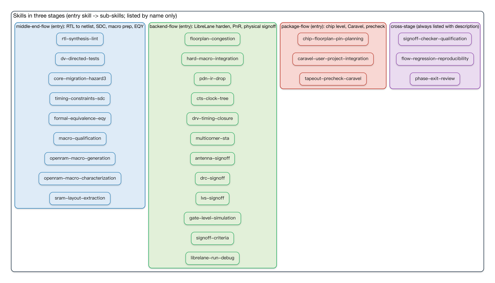

*Figure 17. The 30 skills: three entry skills (Middle-end, Backend, Package) with their sub-skills, and three cross-stage skills. Source: ADR-0021 decisions 5, 6; `.claude/skills/*-flow/SKILL.md`; `.claude/settings.json`.*

The review found that five skills had no description in Claude's skill listing and two were cut.
- **Cause**: a description is cut at 1,536 characters, and all descriptions share a budget of 1% of the context window; the least-used skills lose theirs first.
- **The user's decisions**: two steps.
  1. Split the three over-long skills by function (decision 5):
     - `tapeout-precheck-caravel` → itself plus `caravel-user-project-integration`;
     - `openram-macro-characterization` → itself plus `openram-macro-generation` and `sram-layout-extraction`;
     - `hard-macro-integration` → itself plus `macro-qualification`.
  2. Group the whole flow into **Middle-end, Backend and Package**, each with an entry skill (decision 6):
     - each entry's description carries the stage's most common situations and exact error messages;
     - its body maps situation or message to the sub-skill's file;
     - the 24 sub-skills are listed by name only (`skillOverrides: name-only` in `.claude/settings.json`);
     - the three cross-stage skills (`signoff-checker-qualification`, `flow-regression-reproducibility`, `phase-exit-review`) keep their descriptions.
- **The listing now**: about 4,500 characters of descriptions instead of 20,475.
- **Guard**: `make skill-check` verifies that each sub-skill is in exactly one entry table and is name-only, and checks the lengths.
- **Rules updated**: `CLAUDE.md` rules 1 and 5 now say to read the stage's entry first, and to update the entry table and `skillOverrides` with any new sub-skill.

## 9. Open issues and future work

### 9.1 Before any tapeout (Phase 7 known limitations 1–6, `docs/phase_exit/phase7.md`)

1. **Precheck interpretation**: the two KLayout checks still report FAIL in the official result; PASS is this repo's judgement (rules and positions identical to the prebuilt SRAM). ChipFoundry has not confirmed it; the issue draft was not sent (ADR-0019 decisions 6, 26). The self-generated SRAM also has about 2.2 million Magic DRC violations under the full Magic rule set (a different count from the flow's Magic DRC box count in §6.3).
2. **SRAM `.lib` without wire parasitics**: the read settling time of the extracted netlist is 2.0× the schematic's. The `.lib` delay floor still covers this; the `dout0` transition does not. With the measured `dout0` transition, the wrapper's worst setup drops from +0.548 to **+0.151 ns**. Re-characterise from the flat extracted netlist.
3. **Density**: after the trial fill, one met2 window (34.55% measured) and 15 FOM windows (minimum 31.5%) remain below the tapeout lower limits, all in the SoC / SRAM corner (§6.5). Confirm with ChipFoundry in writing; if needed, lower the local density.
4. **EM is never checked**: the flow never judged electromigration.
5. **IR margin 0.44 mV** (19.56 of 20 mV). The pattern does not include Wishbone host accesses, zero-delay simulation contains no glitches, "maximum power" is the maximum of three windows rather than a proof, and the 1.62 V at the pad is an assumption.
6. **Usage constraints**: management clock ≤ 22.7 MHz; firmware must write `host_en = 0`; `gpio_out` only via the logic analyser; PLL jitter and duty cycle assumed.

7. **Latch-up marker** (found by the 2026-10-15 review; Phase 7 known limitation 21): the delivered GDS has no `areaid.lowTapDensity` (81/14) marker, and no check in the flow or the precheck verifies the default 6 µm tap rule. Measured (`docs/notes/latchup/`): no diffusion is farther than 15 µm from a same-type tap, but about 7% of the diffusion area outside the SRAM is farther than 6 µm (the standard cells are tapped for the 15 µm rule, `FP_TAPCELL_DIST` 13 µm). The user decided to record it and ask ChipFoundry who adds the marker and which distance applies, without changing the design (ADR-0021 decision 2).

### 9.2 Known limitations of the method (Phase 7 limitations 7–20)

These do not change this result but have to be known:
- the clock skew metric includes a reporting artefact (about 2.7 ns, speculative);
- the boundary slew exception;
- the resizer does not see ff_100C;
- placement density 50% is a workaround;
- EQY proves only synthesised vs final netlist (RTL to netlist relies on gate-level simulation);
- golden tolerances borrowed from Hazard3;
- `ef_decap_12` has no `.lib`;
- tool versions differ from the official image;
- the flat placement has no official example;
- relaxations whose basis was not measured on the wrapper;
- earlier-check automation postponed to the next project;
- the wrapper's negative tests cover only its specific checks, and CVC's HI-Z warnings are not judged automatically;
- PSM crashes (Signal 11) with supply points on Caravel's bridges;
- the regression has no protection against host resource exhaustion.

### 9.3 To be investigated

- **Latch-up marker** (A2, measured; see §9.1 item 7): the answer from ChipFoundry on who adds the marker in the user area and whether 6 µm or 15 µm applies.
- **Skill listing in practice** (A1): `make skill-check` enforces the lengths, but whether the listing really shows the entry descriptions depends on the model's context window and the user's other skills; check with `/context` or `/doctor` when a new Claude Code version arrives.
- **Automatic stop of a runaway step** (B2) and the other checkers deferred by ADR-0021 decision 3 (A6 `check_inputs.py` rows, A7 EM, B6, B7, B9, B11).
- **EM** (A7): add an EM checker with the same max-power pattern current, and compare via currents with the tech LEF limits. The user set the scope to the power grid (straps and vias, ff and ss corners); signal-net EM is out of scope (ADR-0021 decision 8).
- **Clock routing layer** (A6): a new project sets `RT_CLOCK_MIN_LAYER` explicitly in its first config (`met3` on sky130), with a checker that `resolved.json` does not hold null; this project leaves it unset (ADR-0021 decision 8).
- **Measurement questions left open by the phases**:
  - the SRAM macro's internal IR (the PSM CSV has one supply node for the SRAM; whether this is PSM's model was not checked);
  - the 2.7 ns clock-skew reporting artefact (not confirmed in OpenSTA source);
  - why the resizer does not upsize `a221oi_1` when ff_100C is added;
  - why PSM crashes at certain supply points.


### 9.4 Future work

- Tapeout path: send the ChipFoundry questions (precheck interpretation, fill, Magic DRC of the SRAM); re-characterise the SRAM with parasitics; add EM; review the IR margin.
- Next project: build the automatic checkers that ADR-0020 postponed (limits sources and corner list before harden, platform density limits inside the harden, the relaxation register's "measured on this design" check).

## 10. Current status and how to reproduce

- **Status**: Phase 0–7 and Phase 3.5 complete (README "專案狀態"); exit review `docs/phase_exit/phase7.md` concluded PASS on 2026-10-15. The chip is not taped out.
- **Reproduce**: in a clean checkout with the flow environment from `env/setup.md`:
  ```bash
  make env-check
  make regress            # Hazard3 SoC, about 3.5 h
  make regress-picorv32   # PicoRV32 SoC, about 4 h
  make regress-caravel    # Caravel wrapper including the official precheck, about 6-8 h (lima VM)
  ```
  Results are in `runs/regress*/summary.md` and `junit.xml`. Each harden is compared with `signoff/golden/<design>/metrics.json`.
- **Start a new project with this flow**: `arvinsa-rtl-gds-flow.md` §1 (start checklist, what can be reused as is, what must be redone per design).
- **Host disk**: at the end of the project, the other 13 worktrees hold about 386 GB in their `runs/` (the three `p7close2_*` worktrees hold the closing evidence), and the main checkout's `runs/` another 176 GB. Cleaning up is the user's decision.

---

## Appendix A: decision records

| ADR | Decision |
|---|---|
| 0001 | PDK sky130A, not SKY90-FD |
| 0002 | RISC-V core: PicoRV32 first, then Hazard3 |
| 0003 | SRAM: PDK prebuilt first, then OpenRAM self-generated |
| 0004 | Silicon timing target 40 ns (25 ns stretch); later 42, 43, 44 ns |
| 0005 | Phase 1 tooling conventions |
| 0006 | `soc_top` die area 1000 × 800 µm |
| 0007 | Conservative padded `.lib` for the SRAM |
| 0008 | Antenna data (`ANTENNAGATEAREA`) added to the SRAM LEF |
| 0009 | PnR max fanout 8; signoff max transition relaxed to 1.0 ns (withdrawn) |
| 0010 | SRAM timing measured with local ngspice (Phase 3.5) |
| 0011 | Phase 5: CPU swapped to Hazard3 |
| 0012 | Resizer must not use weak cells that cannot drive one buffer; pre-harden check |
| 0013 | Resizer also sees the temperature-inversion ss_n40C corner |
| 0014 | A second setup repair after global routing |
| 0015 | Golden comparison allows small layout-count and area tolerances |
| 0016 | CTS does not balance macro latency (`-no_insertion_delay`) |
| 0017 | met5 strap widened to 4.8 µm; worst-case IR checked every harden |
| 0018 | Phase 6: self-generated OpenRAM SRAM macro |
| 0019 | Phase 7: Hazard3 SoC flat in the Caravel wrapper, target ChipFoundry precheck PASS (26 decisions) |
| 0020 | Flow retrospective: 19 earlier checks written into the flow and skills; relaxation register |
| 0021 | Problem review write-backs; latch-up measured and recorded; skill-length and regression resource checks; three skills split; skills grouped into Middle-end, Backend and Package |

## Appendix B: figure sources

Architecture and flow diagrams were drawn with the `arvinsa-draw-diagram` skill (hand-written node/link JSON rendered by its `engine.py`). The generator is `figures/scripts/diagrams.py`, and every diagram's JSON in `figures/diagrams/` carries its sources in `_note`. Layout screenshots and data plots come from the closing runs, the SRAM macro GDS, the approved floorplan run (`p7_floorplan4`), the fill trial and the README / exit reviews; see [`figures/SOURCES.md`](figures/SOURCES.md) for the source file, the command, and the origin of every number. Re-drawing the diagrams needs the `Arvinsa-skill-develop-template` repository (`diagrams.py` points to its `engine.py`).

## Appendix C: glossary

| Term | Meaning |
|---|---|
| Harden | Run the RTL-to-GDS flow on a block: synthesis, place and route, signoff |
| Signoff | The checks that must pass before a layout is accepted: STA, DRC, LVS, antenna, IR and so on |
| Corner | A process / voltage / temperature combination plus an RC extraction corner (min / nom / max) for timing analysis, for example `max_ss_100C_1v60`; 15 corners = 5 PVT × 3 RC |
| Golden | A recorded, reviewed set of metrics from an accepted run; later runs must match it within the tolerances listed in ADR-0015 |
| Checker | A script that turns a result into PASS or FAIL |
| Negative test / bug injection | A test that deliberately introduces an error and requires the checker to FAIL |
| Testbench / checker qualification | Showing that tests and checkers catch injected errors |
| Clean worktree | A fresh `git worktree` with no local edits; the only place official results are accepted |
| Run guard | Refuses downstream steps unless the harden was made at the current commit in a clean tree |
| Criteria review | A per-harden review of whether each signoff criterion was applied and still reasonable |
| EQY | Yosys formal equivalence checking between two netlists |
| Precheck | The tapeout platform's automatic intake checks (ChipFoundry `cf-precheck`) |
| Max-power pattern | A firmware test written to maximise switching, used for the IR-drop current |
| Skill | A process document (`SKILL.md`) with rules, known traps and an experience record |
| ADR | Architecture decision record, with options, reasons and the user's own words |
