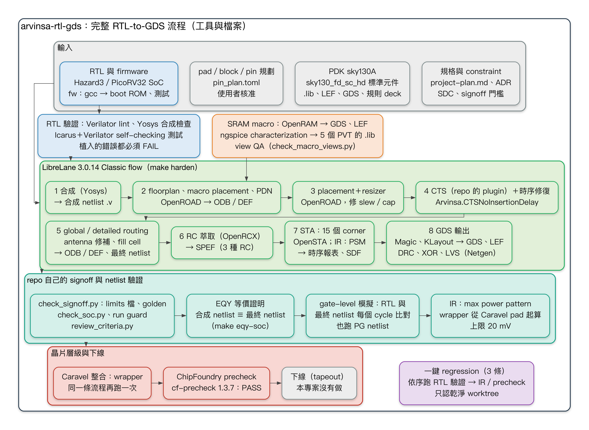
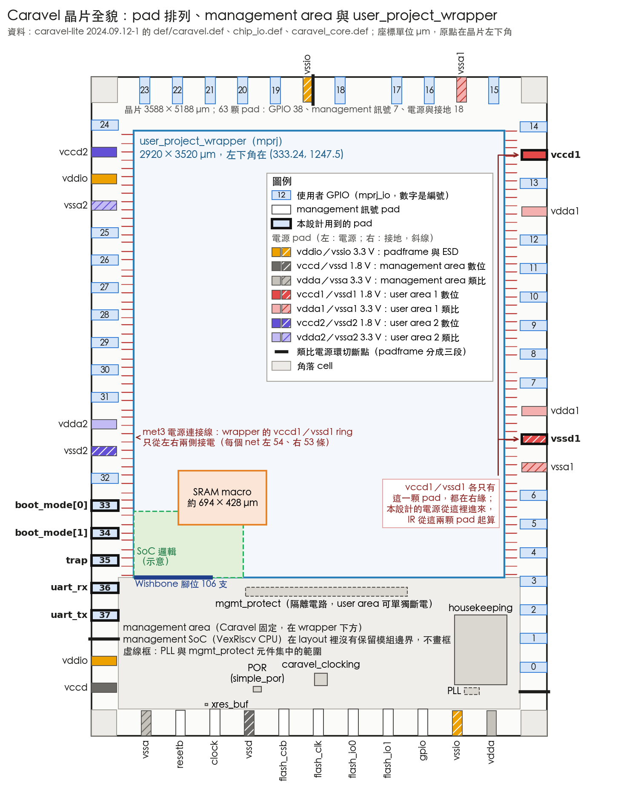
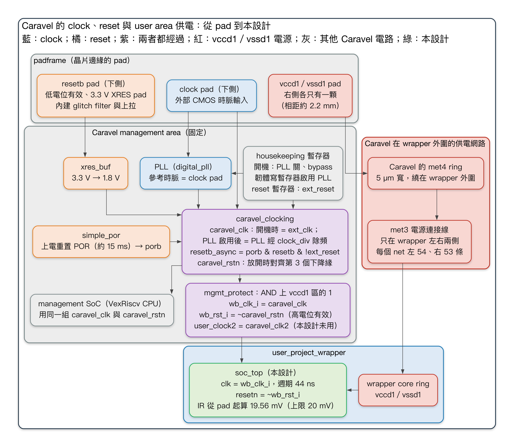

# arvinsa-rtl-gds 技術報告

**在 SkyWater sky130A 上用全開源工具建立 RTL-to-GDS 流程：從 RISC-V SoC 到 ChipFoundry Caravel precheck PASS**

| | |
|---|---|
| 報告日期 | 2026-10-15 |
| 專案期間 | 2026-10-03 – 2026-10-15（132 個 commit） |
| 最終證據 | commit `2b04451`（三條乾淨 worktree regression）；exit review commit `0d47a3d` |
| 狀態 | Phase 0–7 與 Phase 3.5 完成。Phase 7 只做到 precheck，**沒有下線**。 |
| 佐證檔案 | 文中的 `runs/…` 路徑在專案結束時已刪除，被引用的報告收在 `docs/evidence/`（新舊路徑對照見附錄 B） |
| 語言 | 繁體中文（本檔）。英文版：[`technical_report_en.md`](technical_report_en.md) |

---

## 摘要

本專案只用開源 EDA 工具，在 SkyWater sky130A PDK 上建立一條可重複執行、有 regression test 的 RTL-to-GDS 流程：
- LibreLane 3.0.14，內含 Yosys、OpenROAD、Magic、KLayout、Netgen；
- OpenRAM 產生 SRAM；
- ngspice 做 characterization（用 SPICE 模擬量出時序與功耗，寫成 STA 讀的 `.lib`）。

test vehicle 是一顆帶 SRAM macro 的小型 RISC-V SoC。

工作分九個階段（Phase 0–7，加上 Phase 3.5）：
- 環境建置；
- RTL 與 RTL 驗證；
- 單獨 harden 一顆 core；
- SoC 整合 PDK 附的現成 SRAM macro；
- signoff 收斂與全流程 regression；
- SRAM 的 SPICE characterization；
- CPU 從 PicoRV32 換成 Hazard3；
- 用 OpenRAM 產生 SRAM；
- 最後放進 ChipFoundry 的 Caravel。

最終設計是 Hazard3 SoC 加上用 OpenRAM 產生的 2 KB SRAM，以 flat 方式放在 Caravel 的 `user_project_wrapper` 裡，結果如下：
- **ChipFoundry precheck PASS**：官方 13 項檢查中 11 項 PASS；剩下兩項只回報 OpenRAM bitcell 裡的 DRC 違規，而且違規位置和 PDK 自己附的 SRAM 完全相同。
- **完成和單獨 SoC 同一套 signoff**：15 個 corner 的 STA、DRC、LVS、antenna、formal equivalence（EQY）、gate-level 模擬；IR drop 從 Caravel 真實的 pad 起算，電流依 CPU 跑 max power pattern 時的波形計算。

從 Phase 3 起，每個 Phase 都以三件事收尾：乾淨 worktree 的完整 regression、獨立 agent 審查、exit review。過程中遇到的問題，包括工具缺陷、checker 漏洞（該 FAIL 卻判 PASS 的情況）與流程順序錯誤，都寫進三個地方：
- 流程 skill（專案期間 23 個；2026-10-15 問題總檢討後 30 個，分成 Middle-end、Backend、Package 三段，各有一個入口 skill）；
- 流程文件；
- 自動 checker 加上 negative test（bug injection：故意植入錯誤，checker 必須抓到）。

2026-10-15 的問題總檢討發現，247 個問題中仍有 39 個只寫在經驗紀錄裡，或沒有寫進任何 skill（第 7 章）。經驗紀錄是 `SKILL.md` 最後的一張表，記下遇過的現象、錯誤訊息與原因（標明已驗證或推測），還不算規則。使用者之後選定的修正見 §8.5–§8.6。

本報告完整記錄：一路做了什麼、遇到哪些問題與怎麼解決、skill 與流程因此怎麼修正，以及還有哪些問題沒解決。英文術語與縮寫的意思見附錄 C。

---

## 目錄

1. [目標與範圍](#1-目標與範圍)
2. [技術組合與環境](#2-技術組合與環境)
3. [設計：SoC、CPU、SRAM 與 Caravel wrapper](#3-設計)
4. [流程：步驟、checker、regression 與版本追溯](#4-流程)
5. [逐 Phase 的歷程](#5-逐-phase-的歷程)
6. [最終成果](#6-最終成果)
7. [遇到的問題](#7-遇到的問題)
8. [skill 與流程怎麼修正](#8-skill-與流程怎麼修正)
9. [待解問題與後續工作](#9-待解問題與後續工作)
10. [目前狀態與重現方式](#10-目前狀態與重現方式)
- [附錄 A：決定紀錄（ADR）](#附錄-a決定紀錄)
- [附錄 B：圖的出處](#附錄-b圖的出處)
- [附錄 C：名詞](#附錄-c名詞)
- [附錄 D：skill 一覽（功能與使用時機）](#附錄-dskill-一覽功能與使用時機)

---

## 1. 目標與範圍

目標出自 `project-plan.md`：
1. **一個指令就能重現的流程**：任何人在乾淨的 checkout 上用一個指令重跑，結果都 PASS。signoff metrics 和 golden 比對，除了容許誤差（tolerance）表列出的項目（ADR-0015）之外，其餘每個值都要完全相同。每個 PASS／FAIL 都由 checker 判斷，而 checker 遇到錯誤時真的會判 FAIL，這一點要用植入錯誤證明；還沒證明的 checker 列在 §9.2（已知限制 12）。
2. **貼近實際的 test vehicle**：帶 SRAM macro 的 RISC-V SoC，一路做到 signoff（DRC／LVS／STA PASS）。
3. **和 PDK、設計無關的流程**，之後的專案可以沿用。使用者其他 IC 專案現在沿用這個 repo 的流程（`CLAUDE.md` 規則 8、`arvinsa-rtl-gds-flow.md`）。

**整體流程**



*圖 1：完整的 RTL-to-GDS 流程：每一步用什麼工具、產出哪些檔案、由哪些 checker 判 PASS／FAIL。綠框裡的 1–8 是 LibreLane Classic flow 的主要步驟，編號就是執行順序；Phase 7 的 Caravel wrapper 用同一條流程再跑一次。出處：`arvinsa-rtl-gds-flow.md` §3、§4；LibreLane 3.0.14 `librelane/flows/classic.py` 的步驟清單（第 40–121 行）；`pnr/soc_top/config_hazard3.json`、`pnr/user_project_wrapper/config.json`；`pnr/soc_top/run.sh`；`Makefile`；`scripts/regress.py`。*

這張圖由上往下照執行順序畫。綠框裡的箭頭也是資料流動的方向：上一步產出的檔案，就是下一步讀進去的輸入；青框與紅框裡的箭頭只表示先後順序。§4.1 的圖 7 是同一條流程的摘要，九格依工作性質分組，重點是每一格由哪些 checker 判斷 PASS／FAIL；這張圖則把 LibreLane 內部的步驟照執行順序拆開，標出每一步的工具與產出的檔案。以下說明各段在做什麼：

1. **輸入**（灰框）：
   - 規格與 constraint：規格與計畫（`project-plan.md`、ADR）、SDC（timing constraint，例如 clock 週期與輸入輸出延遲）、每個設計自己推導的 signoff 門檻（limits 檔 `signoff/limits/<design>.toml`，記錄每個 metric 的 PASS／FAIL 門檻）。
   - PDK sky130A：standard cell `sky130_fd_sc_hd` 的 `.lib`（每顆 cell 的時序與功耗表）、LEF（只有外框、腳位與禁止繞線區的 abstract view，placement 與 routing 只需要這些）、GDS（完整的 layout），以及 DRC、LVS 用的規則檔（deck）。
   - RTL 與 firmware：Hazard3（或 PicoRV32）SoC 的 RTL；firmware 用 gcc 編成 boot ROM 的內容與測試程式。
   - pad／block／pin 規劃（`pin_plan.toml`）：晶片層級的設計要先經使用者核准這份規劃，才能寫 RTL 與 harden，由 `make pin-plan` 檢查（`CLAUDE.md` 規則 14，Phase 7 起）。
2. **第一次 harden 之前**：
   - RTL 驗證：先跑 Verilator lint 與 Yosys 合成檢查，再用 Icarus 與 Verilator 跑 self-checking 測試（測試自己比對結果、判 PASS／FAIL）。每一個植入的錯誤都必須讓測試 FAIL（`make neg-rtl`）。
   - SRAM macro：OpenRAM 產生 GDS、LEF 等檔案；ngspice 做 SPICE characterization，量出 5 個 PVT 的時序與功耗，寫成 `.lib`。每個交付檔案先過 view QA，才交給 harden：`scripts/check_macro_views.py` 核對各檔的名稱、腳位、數值範圍，以及 LEF 外框是否與 GDS 外框一致（§4.1 第 3 點）。
3. **harden**（綠框，`make harden`）：開跑前，`check_inputs.py` 確認 config 列出的 RTL 檔案和 repo 的 RTL 檔案清單（例如 `rtl/rtl.f`）一致、SRAM 的 `.lib` 是最新的（`pnr/soc_top/run.sh` 第 5–14 行）。接著跑 LibreLane 3.0.14 的 Classic flow：
   - 1 合成：Yosys 把 RTL 轉成由 standard cell 組成的 gate-level netlist（`.v`），稱為合成 netlist。
   - 2 floorplan、macro placement、PDN：OpenROAD 定出 die 與 standard cell row，把 SRAM 放到 config 指定的位置，再鋪電源網路（PDN）。從這一步起，layout 存在 OpenROAD 的資料庫（ODB）裡，每一步也輸出文字格式的 DEF（cell 的位置與繞線）。
   - 3 placement 與 resizer：對 standard cell 做 placement；resizer 換 cell 大小（cell sizing）、插 buffer，修 slew 與 capacitance 違規。
   - 4 CTS：建 clock tree，再修一次時序。本 repo 用自己寫的 LibreLane plugin `Arvinsa.CTSNoInsertionDelay` 取代原本的 `OpenROAD.CTS`。兩者做的事相同，plugin 只多傳一個 `-no_insertion_delay` 給 OpenROAD，讓 CTS 不再為了把 SRAM 的 clock latency 對齊 flip-flop，在 SRAM 的 clock pin 前插一串 delay buffer（ADR-0016；`pnr/librelane_plugin_arvinsa/__init__.py`）。
   - 5 routing：global routing 與 detailed routing。這一步也修 antenna 違規：在製造過程中，連到電晶體閘極的長金屬線會累積電荷，可能打穿閘極氧化層，所以要插 diode 把電荷導走。最後用 fill cell 填滿 row 的空隙，得到繞完線的 layout 與最終 netlist。flow 裡沒有補 metal fill；wrapper 的金屬密度低於下線門檻，列為下線前要處理的項目（README.md 第 59 行；§6.5）。
   - 6 RC 萃取：OpenRCX 算出每條線的寄生電阻與電容，寫成 SPEF；nom、min、max 三種 RC 條件各一份。
   - 7 STA 與 IR：OpenSTA 讀 SPEF，在 15 個 corner（5 個 PVT × 3 種 RC）做靜態時序分析（STA）；OpenROAD 的 PSM 算 IR drop。這一步也輸出 SDF（每顆 cell 與每條線的延遲），但本專案沒有拿它做時序模擬（帶 SDF 延遲的 gate-level 模擬，業界常叫 post-sim），時序以 STA 為準（§5 Phase 4「PG netlist 的 gate-level 模擬」）。
   - 8 GDS 輸出與實體驗證：Magic 與 KLayout 各輸出一份 GDS，`final/` 目錄採用 KLayout 那份（config 的 `PRIMARY_GDSII_STREAMOUT_TOOL`）；Magic 另外輸出這個區塊的 LEF。DRC 由 Magic 與 KLayout 各跑一次；XOR 比對兩份 GDS 有沒有不同；LVS 先用 Magic 從 layout 萃取電路，再用 Netgen 和 netlist 比對。
4. **repo 自己的 signoff 與 netlist 驗證**（青框）：
   - harden 結尾自動執行的 checker：`check_signoff.py` 把 metrics 拿去和 limits 檔與 golden 比對；`check_soc.py` 檢查 metrics 表達不了的項目；`review_criteria.py` 確認每個設定真的生效；版本追溯（provenance）記下這次 run 用的 commit、submodule、工具與 PDK 版本，並檢查有沒有未提交的修改。之後的步驟開跑前，run guard 檢查 harden 的 run 是不是來自目前的 commit、worktree 沒有修改，而且結果是 PASS（§4.2）。
   - EQY：用 formal 方法證明合成 netlist 與最終 netlist 等價（`make eqy-soc`）。
   - gate-level 模擬：RTL 與最終 netlist 放在同一個 testbench，每個 cycle 比對輸出；PG netlist（含電源／地接腳的 netlist，`final/pnl`）也跑一次。
   - IR drop 檢查：在最終 netlist 上跑 CPU 的 max power pattern，dump 每個訊號的波形（VCD），再用它算 IR drop，上限 20 mV。Caravel wrapper 從 Caravel 的 pad 起算（`make ir-caravel`）；Hazard3 版的 `soc_top` 用同一個 pattern，從它自己的電壓源起算（`make ir-soc`）。harden 裡算的 IR（LibreLane 第 7 步，以及 repo 的 `ir_worst.py`）用工具預設的 toggle rate（vectorless：不跑模擬，每個訊號套同一個假設的 toggle rate）：對 wrapper 只當早期檢查（`arvinsa-rtl-gds-flow.md` §4.7）；對 `soc_top`，`ir_worst.py` 的結果比用 pattern 算的悲觀，照樣列入 PASS／FAIL 判斷（`Makefile` 第 212–213 行）。
5. **晶片層級與下線**（紅框）：
   - Caravel 整合：SoC 與 SRAM 以 flat 方式放進 Caravel 的 `user_project_wrapper`（2920 × 3520 µm），用同一條 harden 與 signoff 流程再跑一次（`make harden D=user_project_wrapper`；README.md 第 79 行）。
   - ChipFoundry precheck：官方 `cf-precheck` 1.3.7 的 Docker image 跑在 lima VM 裡，結果由 repo 的 checker 判斷 PASS／FAIL（`make precheck-caravel`）。13 項中 11 項 PASS；剩下兩項只報出 OpenRAM bitcell 造成的違規，而且位置和 PDK 附的 SRAM 單獨檢查時相同，依 ADR-0019 決定 5 判 PASS（§6.4）。
   - 下線：本專案沒有做（ADR-0019 決定 1）。
6. **全流程 regression**（紫框）：共三條，`make regress`（Hazard3 SoC）、`make regress-picorv32`、`make regress-caravel`。每一條都依序跑 RTL 驗證、harden 與 signoff、EQY、gate-level 模擬，遇到第一個 FAIL 就停；`make regress` 與 `regress-caravel` 另外用 max power pattern 檢查 IR drop，`regress-caravel` 再加 precheck（`scripts/regress.py` 的 `TARGET_LISTS`）。SRAM macro 的產生與 characterization 不在 regression 裡，只由 `check_inputs.py` 檢查進版控的結果沒過期（`arvinsa-rtl-gds-flow.md` §4.8）。正式結果只認乾淨 worktree 跑出來的（§4.3）。

**Phase 與流程的對應**

這條流程不是一次建好的。下表列出每個 Phase 第一次建立或加強了流程的哪一段，依實際執行的先後排列：

| Phase（完成日） | 第一次建立或加強的流程 | 出處 |
|---|---|---|
| 0（10-03） | 環境：工具、PDK、IP 的版本鎖定在 `env/versions.mk`，`make env-check` 比對本機實際版本。重跑 LibreLane 官方 SRAM 範例，建立第一份 golden：307 個 metrics 都要和本機 golden 逐項比對、完全相同 | README.md 第 13 行；`docs/phase_exit/phase0.md` 第 10–11、30 行 |
| 1（10-03） | 輸入的 RTL 與 firmware；整段 RTL 驗證：Verilator lint、Yosys 合成檢查、Icarus＋Verilator 的 self-checking regression（26/26），33 個植入錯誤都被抓到（`make phase1`） | README.md 第 14 行；`Makefile` 第 282 行 |
| 2（10-03） | 第一次 harden 自己的設計（單獨的 PicoRV32，執行步驟 1–8；Phase 0 跑的是 LibreLane 官方範例）；第一份 limits 檔（`signoff/limits/picorv32_core.toml`）與自己設計的 golden，由 `check_signoff.py` 檢查；第一次在最終 netlist 上跑 gate-level 模擬（上游 ISA 測試） | `docs/phase_exit/phase2.md` 第 9–15、17、19 行；limits 檔與 `check_signoff.py` 在 commit `4c1a955` 加入 |
| 3（10-04） | SRAM macro 第一次接進 harden（步驟 2 的 macro placement；SRAM 的時序先用 padded `.lib` 的假設值，ADR-0007）；repo 的 signoff 加上 `check_soc.py`、`check_inputs.py` 與版本追溯；netlist 驗證第一次有 EQY，以及 RTL 與 netlist 做 cycle-by-cycle 比對的 gate-level 模擬 | README.md 第 16–20 行；這些 checker 在 commit `654c303` 加入 |
| 4（10-04） | signoff 門檻不再沿用 LibreLane 與 PDK 的預設值，改用推導出來的值（Phase 3 收尾推導，Phase 4 實作）；corner 從 9 個加到 15 個，加入 temperature inversion 的 corner（低電壓時 cell 在低溫反而比高溫慢）；IR drop 有了 20 mV 的預算；run guard（下游步驟只接受目前 commit、而且 PASS 的 run）；PG netlist 的 gate-level 模擬；`make regress` 一個指令跑完 Phase 1–4 的全部檢查 | README.md 第 17、21、23–27 行；`docs/phase_exit/phase3.md` 第 202 行；`arvinsa-rtl-gds-flow.md` §4.5（提早檢查 C1 的例子）；run guard 在 commit `34e6be4` 加入 |
| 3.5（10-05） | SRAM 的 `.lib` 第一次由 SPICE 量測產生：用本機 ngspice 量 PDK 附的電晶體級 netlist，5 個 PVT 各一份（ss −40°C 讀取失敗，用標明為 placeholder 的 `.lib`：不是量測值，延遲借 ss 100°C 的數字，只為讓 SRAM 周邊的邏輯仍被 STA 檢查）；`.lib` 由量測結果產生，`check_inputs.py` 檢查它沒過期；量測方法本身用植入錯誤驗證（`make neg-char`） | README.md 第 30–31 行；`docs/phase_exit/phase3_5.md`「做了什麼」、第 103 行 |
| 5（10-08） | RTL 換成 Hazard3，兩個 CPU 共用同一份 flow 設定；為了 Hazard3，flow 設定改了 4 項（ADR-0012–0014、0016），其中 CTS 換成 repo 的 plugin（ADR-0016）；加上每次 harden 後的 criteria review（`review_criteria.py`，使用者 2026-10-07 決定）；IR drop 改成每次都用 worst-case 組合檢查（ff corner 的電流配 ss corner 的金屬電阻，是人為湊出的上限，沒有對應的真實 corner） | README.md 第 37–41 行；`review_criteria.py` 在 commit `0b67b76`（2026-10-07）加入 |
| 6（10-11） | SRAM macro 改用 OpenRAM 產生，流程包括產生 macro、整顆 macro 的 DRC 結果與 baseline 對照、每個交付檔案的 view QA（`check_macro_views.py`，`CLAUDE.md` 規則 12），以及用 SPICE 量時序與功耗 | README.md 第 45–48 行；`docs/phase_exit/phase6.md` 第 53 行 |
| 7（10-12 – 10-15） | pad／block／pin 先規劃、經使用者核准（`make pin-plan`）；Caravel 整合；IR 從 Caravel 的 pad 起算、電流用 max power pattern（`ir_caravel.py`）；ChipFoundry precheck（`make precheck-caravel`）與 `make regress-caravel` | README.md 第 54–60 行；`docs/phase_exit/phase7.md` 第 9、56 行 |

**為什麼有 Phase 3.5**

Phase 3.5 不是後來臨時插進來的，它在第一版計畫就有。
- **計畫第一版就排在 Phase 3 與 4 之間**：在 2026-10-03 寫成的第一版 `project-plan.md`（commit `73f7524`）裡，§8 的階段表在 Phase 3 與 Phase 4 之間列了「3.5（可選）OpenRAM .lib 校正」。這一階段的內容是提前建 OpenRAM 環境，用 OpenRAM 對同樣 2 KB 的 config 做 SPICE characterization，產生 TT／SS／FF 的 `.lib`，取代 Phase 3 用的 padded `.lib` 假設值；exit 條件是「多 corner .lib 進版控；重跑 Phase 3 signoff PASS」（該版第 340 行；現行 `project-plan.md` 第 428 行）。
- **它要補的是 Phase 3 的 SRAM 時序模型**：PDK 附的 SRAM 只有一份 TT 的 `.lib`，而且是 analytical model（用公式估算，不是 SPICE 量的）。第一版計畫把這件事列為風險 R2，對策是 Phase 3 先用保守的 padded `.lib` 做 STA，再「Phase 3.5/6 以 SPICE 特性化校正」（該版第 351、377 行；ADR-0007 第 41 行）。所以 Phase 3.5 的工作是把 Phase 3 的假設值換成量測值，exit 條件也是重跑 Phase 3 的 signoff。
- **編號用 3.5 的原因**：能從計畫原文確認的有兩點。第一，它的內容與 exit 條件都接在 Phase 3 的結果上，所以排在 Phase 3 後面；第二，它標成「可選」，Phase 4–7 的內容與 exit criteria 都不以它為前提。計畫與 commit 都沒有寫為什麼編成 3.5、而不排成 Phase 4。推測是用 3.5 表示它是 Phase 3 的延伸、可做可不做，這樣主線 0–7 的編號不受影響。後來它延到 Phase 4 之後才做，編號也沒有改；推測是因為在那之前，ADR-0007、ADR-0004 與 Phase 3 的 exit review 都已經用「Phase 3.5／6」指這件事（ADR-0007 第 41 行，10-03 寫；ADR-0004 第 12 行，10-04 寫；`docs/phase_exit/phase3.md` 第 156 行，10-04 凌晨寫）。
- **實際在 Phase 4 之後才做**，所以執行順序是 0 → 1 → 2 → 3 → 4 → 3.5 → 5 → 6 → 7，圖 9 與第 5 章也照這個順序排。
  - Phase 3 在 2026-10-04 凌晨結案，README 寫的下一步是「Phase 4（Phase 3.5 可選）」（commit `3b08251` 的 `README.md` 第 11 行）。Phase 3 的 exit review 也把 checker 漏洞的修正排在「Phase 4 開頭一起做」；同一天早上，使用者決定 signoff 門檻的修改也在 Phase 4 和漏洞修正一起做（`docs/phase_exit/phase3.md` 第 194、198、202 行）。
  - Phase 4 從 10-04 早上做到晚上結案（commit `9eca68d` → `2954d4a`），結案時 README 寫的下一步是「Phase 5（Phase 3.5 可選）」（commit `2954d4a` 的 `README.md` 第 11 行）。當晚卻先開始 Phase 3.5（commit `d60550f`），10-05 結案（commit `e16465b`；`docs/phase_exit/phase3_5.md` 第 3 行）。
  - 紀錄沒有寫明為什麼改變順序。Phase 4 的已知限制 1 寫到，SRAM 的假設值這時已經直接決定週期：42 ns 時 ss −40°C corner 的 slack 只剩 +0.31 ns（`docs/phase_exit/phase4.md` 第 163 行）；推測這是 Phase 4 一結案就先做 Phase 3.5 的原因。
  - 因為 Phase 4 已經完成，Phase 3.5 把「重跑 Phase 3 signoff」解讀成在乾淨 checkout 把 `make regress` 跑到 PASS，並一起處理這個已知限制：「SRAM 的時序仍是假設值……Phase 3.5／6 用 OpenRAM 特性化後要重新檢討週期」（`docs/phase_exit/phase3_5.md` 第 5、7 行）。
- **一開始就改了做法**：使用者 2026-10-04 決定不先建 OpenRAM 環境，改用本機 ngspice 直接量 PDK 附的電晶體級 netlist。這份 netlist 就是晶片上實際放的那顆 SRAM；原計畫用 OpenRAM 重新產生的電路，不一定和它完全相同。OpenRAM 環境延到 Phase 6（ADR-0010 查證結果第 2 點與決策 1、8；commit `d60550f` 的說明）。
- **它找到的問題**：
  - PDK 附的 SRAM 在 ss −40°C（1.60–1.95 V）、ss 25°C 1.60 V、tt −40°C 1.60 V 會讀成前一次的值。原因是 sense amp 沒有自己的預充電電路，低溫、ss 製程時內部節點拉不回去。ss −40°C 只能用標明為 placeholder 的 `.lib`，列為頭號下線風險（ADR-0010「ss −40°C 讀取失敗」的表；`docs/phase_exit/phase3_5.md`「ss −40°C 讀取失敗」；README.md 第 33 行）。Phase 6 改用 OpenRAM 產生的 SRAM，在 sense amp 輸入端加預充電（patch 0001），並把 `clk1` 接到系統時脈，查過的 7 個條件都讀對（`docs/phase_exit/phase6.md` 第 7 行；README.md 第 46 行）。
  - `dout0` 在 clock rising edge（正緣）之後約 1 ns 就開始變化，原本的 `.lib` 沒有描述這件事，STA 因此沒檢查 capture 端的 hold。新 `.lib` 加了這條 hold arc，soc_top 的週期也因此從 42 ns 改成 43 ns（ADR-0004「Phase 3.5 補充」；README.md 第 31–32 行）。
- **事後檢討**：2026-10-14 做了一次流程回顧（ADR-0020），回頭檢視 Phase 0–7，找出哪些檢查可以更早做，整理成 19 條「提早檢查」（業界說 shift-left；編號 A1–E3，清單見 §8.4）。這次回顧認為，macro 要在選定之前，就在整個規格範圍做讀寫檢查；如果寫計畫時就拿 macro 已驗證過的 PVT 範圍和規格對照，計畫會把這項檢查排在 Phase 1–3，而不是選用的 Phase 3.5（`docs/notes/flow_retro/retro_p35_5.md` 第 105、111 行）。流程文件因此把「選定 macro 之前的 go／no-go」放在 macro 步驟的第一項（`arvinsa-rtl-gds-flow.md` §4.3 第 0 項，提早檢查 B1；ADR-0020）。照現在的流程，go／no-go 在 macro 寫進計畫之前做，characterization 也排在 harden 之前（`arvinsa-rtl-gds-flow.md` §4.3），所以新專案應該不必再另排一個像 Phase 3.5 這樣的補做階段（推測）。

**為什麼用 sky130A 而不是 SkyWater 90 nm（SKY90-FD）**（ADR-0001）：
- 開源版 SKY90-FD 停在實驗性預覽，並在 2026 年 2 月封存；
- 它的 standard cell library 的 repo 裡沒有任何 cell；
- OpenRAM、LibreLane、OpenROAD 都不支援它。

sky130A 是同一家晶圓廠的製程。PDK 相依的部分集中在設定與 `ip/sram/`，之後可以換成別的 PDK。

**使用者決定的範圍**（每一項都記在 ADR；Phase 5 起附使用者原話）：
- CPU 先 PicoRV32 後 Hazard3（ADR-0002、ADR-0011）；
- SRAM 先用 PDK 附的 macro，後改用 OpenRAM 產生（ADR-0003、ADR-0018）；
- Phase 7 放進 Caravel，只做到 ChipFoundry precheck，不下線（ADR-0019 決定 1）。

**工作方式**：工程由 Claude Code 在使用者指導下進行，原則如下：
- 凡是影響規格、量測方法、signoff 標準、時程或範圍的選擇，先查證、列出選項與建議，由使用者決定（`CLAUDE.md` 規則 13）。
- 由沒有參與實作的獨立 agent 審查：Phase 1 審 testbench；Phase 2 起，每個 Phase 收尾時審文件與 checker。
- 反覆用到的做法寫成專案 skill（`.claude/skills/*/SKILL.md`）：最後共 30 個，分成 Middle-end、Backend、Package 三段，各有一個入口 skill。入口 skill 是該段的索引，本身不放規則，主要是一張「遇到的情況或錯誤訊息 → 該讀哪個 skill」的對照表；表上指到的是各管一個主題的細部 skill，共 24 個；另有 3 個三段都會用到、直接讀的跨段共用 skill（§8.6）。每個 skill 的功能與使用時機見附錄 D。

---

## 2. 技術組合與環境

| 項目 | 選擇 |
|---|---|
| PDK | SkyWater sky130A，standard cell library `sky130_fd_sc_hd`，PDK commit `8afc8346`（LibreLane 3.0.14 鎖定的版本） |
| RTL-to-GDS | LibreLane 3.0.14（Classic flow，commit `f24e0ea5`），呼叫 Yosys、OpenROAD、Magic 8.3.623、KLayout 0.30.7、Netgen |
| SRAM | Phase 3–5：PDK 附的 `sky130_sram_2kbyte_1rw1r_32x512_8`；Phase 6–7：OpenRAM 產生的 `arv_sram_2kbyte_1rw1r_32x512_8`（OpenRAM `3608704c` 加 repo 內 4 個 patch） |
| SRAM characterization | ngspice：Phase 3.5 量 PDK 附的 SPICE netlist；Phase 6 量 OpenRAM 的 schematic netlist。從 layout 萃取的 netlist 只做了讀寫試跑 |
| CPU | PicoRV32（Phase 1–4，保留為 `make regress-picorv32`）；Hazard3 `hazard3_cpu_1port`（Phase 5 起） |
| 模擬 | Icarus Verilog 13.0、Verilator 5.050 |
| Formal | Yosys EQY（合成 netlist 對最終 netlist） |
| Firmware | `riscv64-elf-gcc` 16.1（rv32）；Hazard3 用含 newlib 的 xPack toolchain |
| 下線前檢查（precheck） | ChipFoundry `cf-precheck` 1.3.7 官方 Docker image（linux/amd64），在 Apple Silicon 上用 lima VM（vz＋Rosetta）執行 |
| 主機 | Apple Silicon macOS、Nix；記憶體 24 GB、10 核 |

所有版本都鎖定在 `env/versions.mk`，`make env-check` 比對 `toolchain.md` 與本機實際安裝的版本。

Phase 0 遇到的環境問題（`docs/phase_exit/phase0.md`）：
- **網路慢**：到 GitHub 單一連線只有 45–175 kB/s。Nix 安裝程式與 PDK 都改成可續傳、驗 sha256 的下載方式（`make pdk-fetch`）。
- **平台差異**：LibreLane 的參考設計在本機有 74 個 max slew 違規，官方 CI 是 70 個。本機連跑三次結果完全相同，所以 checker 改成兩層：signoff 項目跨平台比對；307 個 metrics 只和本機 golden 逐項比對、必須完全相同。

---

## 3. 設計

### 3.1 SoC 與 memory map

SoC（`soc_top`）由 RTL、firmware、DV 三方共同遵守的 spec 定義：`docs/spec/soc_spec.md`。memory map 只定義在 `rtl/include/memmap.vh`，其他檔案都從這裡引用。

| 區塊 | Base | 大小 |
|---|---|---|
| SRAM | `0x0000_0000` | 2 KB（512 個 32-bit word） |
| Boot ROM | `0x0001_0000` | 512 B |
| UART | `0x0200_0000` | DIV、DATA |
| GPIO | `0x0300_0000` | GPIO_OUT、GPIO_IN（`boot_mode`） |
| TEST_CTRL | `0x0400_0000` | SIG、DONE（PASS = `0x600D_C0DE`）、IRQ_TRIG；Hazard3 版另有 FATAL（+0xC，驅動 `trap`） |

**host write port** 讓外部 master 在 CPU 停住時把程式寫進 SRAM。這個 port 在 Phase 1 就設計好，所以 Phase 7 接 Caravel 的 Wishbone 時，SoC 的 RTL 不必改。

### 3.2 CPU

- **PicoRV32**（Phase 1–4）：原生記憶體介面。
- **Hazard3**（Phase 5 起，ADR-0011）：用 `hazard3_cpu_1port`（指令與資料共用一條 AHB5），經 AHB-to-native bus bridge（`rtl/cpu/soc_ahb2native.v`）接到 SoC。
  - 這樣 SoC 匯流排、SRAM 介面、周邊與大部分 DV checker 都不用動。原本的目標是「flow 只改 design 層」，實際沒有完全做到（見 Phase 5）。
  - bridge 的植入錯誤（H01–H04）由既有的 TEST_CTRL、匯流排 assertion、timeout、coverage checker 抓到；ADR-0011 計畫中的專用 AHB 協定 checker 沒有寫。
  - 驗證：riscv-tests 65/65；與 Hazard3 的 `rvcpp` ISS 逐條指令比對 48/48。

### 3.3 SRAM macro

SRAM 是 2 KB、32 × 512、1RW＋1R 的 macro。
- Phase 3 用 PDK 附的 macro，搭配刻意保守的 padded `.lib`（ADR-0007）。
- Phase 3.5 用 SPICE 模擬，發現它在 ss −40 °C（1.60–1.95 V）、ss 25 °C 1.60 V、tt −40 °C 1.60 V 會**讀成前一次的值**（ADR-0010）。
- Phase 6 用 OpenRAM 自己產生，並修正讀取電路（ADR-0018）：
  - sense amp 輸入端加預充電（patch 0001）；
  - `clk1` 接系統時脈，讓閒置 port 的 chip-select flip-flop 收得到 clock，能夠取樣。

  OpenRAM 產生的 macro 在查過的 7 個 PVT 條件下都讀對；在做 characterization 的 5 個 PVT 下讀寫都正確。


*圖 2：OpenRAM 產生的 `arv_sram_2kbyte_1rw1r_32x512_8` 的 layout（694.27 × 428.415 µm）。*

### 3.4 放進 Caravel（Phase 7）

Caravel 是 ChipFoundry MPW（multi-project wafer：多個專案共用同一套光罩與晶圓，分攤下線費用）用的 harness 晶片；ChipFoundry 在 2025 年接手 Efabless 的 sky130 MPW shuttle（`.claude/skills/caravel-user-project-integration/SKILL.md` 第 11 行）。每個專案拿到的都是同一顆晶片：pad、電源、clock 與 reset 電路、一顆 RISC-V 的 management SoC（Caravel 內建，負責開機、設定 GPIO，並經 Wishbone 與 LA 和 user area 溝通）都已經做好，使用者的設計只能放在中間固定大小的 user area（`user_project_wrapper`）。

本節引用的 Caravel 原始檔，取自 precheck 官方 Docker image 裡的 caravel-lite 2024.09.12-1（commit `5593d992`）。它的 `def/chip_io.def` 和 ChipFoundry 現用的 CC2509 版本是同一個檔案（git blob `9af4f403`；`pnr/user_project_wrapper/caravel_pwr/README.md` 第 13 行）。下文寫成「Caravel `路徑` 第 N 行」的，都是指 Caravel（caravel-lite 2024.09.12-1）的這份原始檔。寫「Efabless 文件」的，是 efabless/caravel commit `27cbe49c` 的 `docs/` 說明。

#### 固定的部分與能決定的部分

整顆晶片是 3588 × 5188 µm（Caravel `def/caravel.def` 第 6 行）。四周是一圈 pad；中間偏上是 2920 × 3520 µm 的 wrapper，左下角在晶片座標 (333.24, 1247.5) µm。wrapper 正下方、晶片座標 y 約 210–1247 µm 的那一條是 management area，management SoC、housekeeping、時脈電路與 POR（power-on reset）電路都放在這裡（wrapper 位置：Caravel `def/caravel_core.def` 第 400775 行，加上 caravel_core 的原點 (211.5, 210.5)，`def/caravel.def` 第 1921 行；wrapper 尺寸：`pnr/user_project_wrapper/fixed_dont_change/user_project_wrapper.def` 第 6 行；各區塊位置：`def/caravel_core.def` 第 387159、400396、401897–401901 行）。

固定、不能改的部分：
- **padframe**：晶片四周由 I/O pad、電源 pad 與四個角落 cell 組成的一圈，共 63 顆接到封裝的 pad（Caravel `def/caravel.def` 第 1927 行）。
- **電源**：7 組電源與地，各有自己的 pad。
- **clock 與 reset**：外部 clock 與 `resetb` 從 pad 進來，經 Caravel 的 clock 與 reset 電路送給 management SoC，也送給 wrapper。
- **management SoC**：一顆 VexRiscv CPU 加上周邊，另有專用的 pad 接外部 SPI flash（Caravel `verilog/rtl/caravel_core.v` 第 274 行；CPU 名稱取自 `verilog/gl/caravel_core.v` 第 20207 行起的 `soc.core.VexRiscv.*` net 名稱；flash 腳位見 `verilog/rtl/caravel.v` 第 60–67 行）。它是 Wishbone 匯流排的 master，可以讀寫 wrapper。
- **housekeeping**：management area 裡一個獨立的控制區塊，存放 PLL、reset 與 38 支 GPIO 的設定。management CPU 可以讀寫它，外部也可以經它自己的 SPI 介面（housekeeping SPI）讀寫（Caravel `verilog/rtl/housekeeping.v` 第 25–35、44–47 行）。
- **GPIO 控制電路**：38 支使用者 GPIO 各有一個控制區塊，決定對應的 pad 由 management SoC 驅動，還是由 wrapper 驅動。
- **wrapper 的腳位位置**：wrapper 的範本 DEF（`pnr/user_project_wrapper/fixed_dont_change/user_project_wrapper.def`）已經定好每支腳位的座標，以及外圍的 core ring（繞 wrapper 一圈的 power ring）。範本把這些腳位與 core ring 畫在 wrapper 邊界上與邊界外；precheck 的 `xor` 檢查把這一圈和官方的空 wrapper 疊起來做 XOR，只要有不同的形狀就 FAIL，所以都不能改（`caravel-user-project-integration` 規則 1、規則 7）。

使用者能決定的部分：
- wrapper 裡放什麼；
- 用哪幾支 GPIO，每支開機時是什麼模式（寫在 `user_defines.v`）；
- 每個訊號走 GPIO、logic analyzer（LA：management SoC 直接讀寫 user area 訊號的 128 位元通道，見後文），還是 Wishbone 匯流排；
- 用哪幾組使用者電源。



*圖 3：Caravel 晶片全貌（3588 × 5188 µm）：四周的 pad 環、上方的 `user_project_wrapper`、下方的 management area，以及 `mprj_io` 的編號方向、電源 pad、本設計用到的 GPIO 33–37 與 `vccd1`／`vssd1` pad。出處：Caravel `def/caravel.def`、`def/chip_io.def`、`def/caravel_core.def`；`pnr/user_project_wrapper/pin_plan.toml`。*

#### pad 排列

63 顆 pad 分成三類（Caravel `def/caravel.def` 第 1927 行；GPIO 數量見 `verilog/rtl/defines.v` 第 22–24 行）：
- 38 支使用者 GPIO `mprj_io[0]`–`mprj_io[37]`；
- 7 支接到 management area 的訊號：`clock`、`resetb`、SPI flash 的 4 支（`flash_csb`、`flash_clk`、`flash_io0`、`flash_io1`），以及 management SoC 專用的 1 支 `gpio`；
- 18 顆電源與接地 pad。`vddio`、`vssio`、`vdda1`、`vssa1` 各有兩顆，第二顆的腳位名稱加上 `_2`（Caravel `verilog/rtl/caravel.v` 第 37–54 行）。

四邊的順序如下（Caravel `def/chip_io.def` 第 15830–17467 行的 COMPONENTS）：
- **下側**（11 顆，全部是 management area 用的 pad）：由左到右 `vssa`、`resetb`、`clock`、`vssd`、`flash_csb`、`flash_clk`、`flash_io0`、`flash_io1`、`gpio`、`vssio`、`vdda`。
- **右側**（20 顆）：由下往上 `mprj_io[0]`–`[6]`、`vssa1_2`、`vssd1`、`vdda1_2`、`mprj_io[7]`–`[12]`、`vdda1`、`mprj_io[13]`、`vccd1`、`mprj_io[14]`。
- **上側**（11 顆）：由右往左 `mprj_io[15]`、`vssa1`、`mprj_io[16]`–`[18]`、`vssio_2`、`mprj_io[19]`–`[23]`。
- **左側**（21 顆）：由上往下 `mprj_io[24]`、`vccd2`、`vddio_2`、`vssa2`、`mprj_io[25]`–`[31]`、`vdda2`、`vssd2`、`mprj_io[32]`–`[37]`、`vddio`、`vccd`。

也就是說，`mprj_io` 從右下角開始逆時針編號：0–14 在右側由下往上，15–23 在上側由右往左，24–37 在左側由上往下。編號的兩端（GPIO 0–1 與 36–37）都靠近下方的 management area。這幾支開機時由 management SoC 雙向控制（GPIO 0、1 是 JTAG 與 SDO，36、37 是 management SoC 的 SPI flash 的 io2、io3），比其他 GPIO 多幾條從 management area 拉過來的控制線；原始碼註解說，放在最靠近 management area 的兩端可以縮短這些線（Caravel `verilog/rtl/caravel_core.v` 第 1092–1098 行）。wrapper 範本上的 GPIO 腳位也照這個順序，排在 wrapper 與對應 pad 同側的邊上（ADR-0019 決定 10，第 38 行）。

pad 的位置從三方面限制了本設計：
1. **能選的只有用哪幾支**：wrapper 的腳位跟著 pad 排在固定的位置，不能搬動。
2. **block 要靠近 Wishbone，GPIO 要靠近 block**：Wishbone 匯流排與 `wb_clk_i`、`wb_rst_i` 的腳位在 wrapper 下側偏左那一段（x 2.99–623.53 µm），本設計用到的 logic analyzer 輸出 `la_data_out[13:0]` 緊接在旁邊（x 635.03–865.95 µm）（範本 DEF 第 2392、2520、3815、4183 行）。Wishbone 有時序要求，又是 32 位元寬，所以 block 放在左下角（ADR-0019 決定 12）。離左下角最近的 GPIO 是左側最下面的 33–37，在 wrapper 座標 y 162–1075 µm。第一次選的 GPIO 8–20 在右側與上側，離 block 2–3 mm，後來重新選過（決定 10，第 37–38 行）。
3. **user area 的電源 pad 只在右側**：`vccd1`、`vssd1` 各只有一顆 pad，都在右側（pad 左下角在晶片座標 y 4538 與 2299，換到 wrapper 座標約 y 3290 與 1051），相距約 2.2 mm，block 放在哪裡都至少離其中一顆很遠（ADR-0019 決定 18；Caravel `def/chip_io.def` 第 16653–16654、17057–17058 行）。下一小節說明它對 IR 的影響。

#### power domain

Caravel 把電源分成 7 組，每組一個電源、一個地。電壓取自 Efabless 文件 `docs/source/pinout.rst` 第 312–382 行，用途取自 Caravel `verilog/rtl/caravel.v` 第 37–54 行的註解與 `verilog/rtl/caravel_core.v` 的接法（第 276–277、433–440、520–521、541–542、570–571 行），pad 位置見上一小節：

| 電源／地 | 電壓 | 供給誰 | pad 數 |
|---|---|---|---|
| `vddio`／`vssio` | 3.3 V | padframe 與 ESD（靜電放電）保護電路 | 各 2 顆 |
| `vdda`／`vssa` | 3.3 V | management area 的類比電源 | 各 1 顆 |
| `vccd`／`vssd` | 1.8 V | management area 的數位電路：management SoC、housekeeping、PLL | 各 1 顆 |
| `vdda1`／`vssa1` | 3.3 V | user area 1 的類比電源 | 各 2 顆 |
| `vccd1`／`vssd1` | 1.8 V | user area 1 的數位電源（**本設計使用**） | 各 1 顆，右側 |
| `vdda2`／`vssa2` | 3.3 V | user area 2 的類比電源 | 各 1 顆，左側 |
| `vccd2`／`vssd2` | 1.8 V | user area 2 的數位電源 | 各 1 顆，左側 |

user area 有 1、2 兩組電源，wrapper 上兩組的電源接腳都有，用哪一組由使用者決定（Caravel `verilog/rtl/caravel_core.v` 第 433–440 行）。

- **本設計只用 `vccd1`／`vssd1`**：`soc_top` 與 SRAM 都接這組（`rtl/caravel/user_project_wrapper.v` 第 125–126 行；`pnr/user_project_wrapper/config.json` 第 134 行）。config 仍列出四組使用者電源（第 65–77 行），因為 Caravel 規定 wrapper 外圍要有這四組的 core ring。
- **`vccd1` 也影響 Caravel 自己的電路**：Caravel 用一組由 `vccd1` 供電的 tie-high 輸出（`mprj_logic_high`，固定為 1）當開關：management area 與 user area 之間的隔離電路 `mgmt_protect` 用它決定送進 wrapper 的 clock、reset、Wishbone 與 LA 能不能通過。38 支 GPIO 的控制電路主要由 management area 的 `vccd` 供電，但送進 wrapper 的 `io_in` 也經過同樣由 `vccd1` 控制的閘，連 user area 2 那一側的 GPIO 19–37 也是由 `vccd1` 控制。所以 `vccd1` 沒電時，`wb_clk_i`、`wb_rst_i`、Wishbone 與 LA 都被拉成 0，`io_in` 也被歸零（Caravel `verilog/rtl/mgmt_protect.v` 第 122–128、232–251 行；`verilog/rtl/gpio_control_block.v` 第 239–251 行；`verilog/rtl/caravel_core.v` 第 1102–1107、1261–1266、1314–1319 行）。
- **電從哪裡進來**：電流從右側的 pad 出發，先經過 Caravel 自己 5 µm 寬的 met4 power ring，再由 met3 電源連接線接到 wrapper core ring 的左右兩側（每個 net 左 54 條、右 53 條）；上下兩邊沒有接點（ADR-0019 決定 18；`caravel-user-project-integration` 規則 3）。
- **所以 IR 要從 pad 起算**：IR drop 是電流流過電源網路的金屬電阻時造成的電壓降。電流要從遠處的 pad 走過 Caravel 的 power ring 與 met3 電源連接線才到 wrapper，所以 wrapper 的電源接腳不是理想電源：壓降幾乎都落在 pad 到 wrapper 邊緣這一段，wrapper 內部只多 2–5 mV（試跑的 layout `p7_harden2`、nom_tt、工具預設的 toggle rate，ADR-0019 決定 18）。因此本設計把 Caravel 在 wrapper 外的電源網路加進 IR 模型，電壓源放在這兩顆 pad 上（`pnr/user_project_wrapper/caravel_pwr/README.md`）。預算 20 mV＝pad 端的最低供電 1.62 V（假設，見下一條）減去 slow corner（ss 製程）做 characterization 用的 1.60 V（`pdn-ir-drop` 規則 4；ADR-0019 決定 20）；正式結果 19.56 mV（§5 Phase 7 第 5 步；`docs/phase_exit/phase7.md` 已知限制 5）。
- **板子要供的電**：user area 的電源由開發板上的穩壓器供給，`vccd1` 是 1.8 V（Efabless 文件 `docs/other/power_control.txt` 第 8–18 行）。上面的 20 mV 預算假設 pad 端最低有 1.62 V，這個假設列為下線前要確認的已知限制（`docs/phase_exit/phase7.md` 已知限制 5）。

#### clock 與 reset



*圖 4：外部 `clock` 與 `resetb` 從下側的 pad 進來，經 `caravel_clocking` 與 `mgmt_protect` 成為 wrapper 的 `wb_clk_i`、`user_clock2` 與 `wb_rst_i`；`vccd1`／`vssd1` 從右側的 pad 經 Caravel 的 met4 power ring 與 met3 電源連接線，接到 wrapper core ring 的左右兩側。出處：Caravel `verilog/rtl/caravel_core.v`、`verilog/rtl/caravel_clocking.v`、`verilog/rtl/mgmt_protect.v`、`verilog/rtl/housekeeping.v`；ADR-0019 決定 18。*

**clock 的路徑**（Caravel `verilog/rtl/caravel_core.v` 第 524–534、546 行；`verilog/rtl/mgmt_protect.v` 第 233–234 行）：
1. 外部 clock 從下側的 `clock` pad 進來。它是 3.3 V 的 CMOS 時脈輸入，要接能輸出 CMOS 電位的時脈源，不能直接接石英晶體（Caravel `verilog/rtl/caravel.v` 第 57 行「CMOS core clock input, not a crystal」；Efabless 文件 `docs/source/pinout.rst` 第 208 行）。
2. 這個時脈同時送到時脈選擇電路 `caravel_clocking` 與 PLL。PLL（phase-locked loop）把參考時脈倍頻成較高的頻率；Caravel 這顆的原始碼註解說，它嚴格來講是只鎖頻率、不鎖相位的 frequency-locked loop（`verilog/rtl/digital_pll.v` 第 18 行：「Technically this is a frequency locked loop」）。
3. `caravel_clocking` 輸出兩個時脈：核心時脈 `core_clk` 與第二個時脈 `user_clk`。
4. 核心時脈送給 management SoC 與 housekeeping，也經過 `mgmt_protect` 的一個 AND 閘，變成 wrapper 的 `wb_clk_i`。`user_clk` 同樣經過 AND 閘，變成 wrapper 的 `user_clock2`。

所以 **`wb_clk_i` 就是 management CPU 的核心時脈**，只要 `vccd1` 有電，兩者的頻率永遠相同。

**開機時與啟用 PLL 後**：
- **開機時**：housekeeping 的 reset 值是 PLL 關閉（`pll_ena` = 0）、bypass 開啟（`pll_bypass` = 1，不經過 PLL、直接用外部時脈）（Caravel `verilog/rtl/housekeeping.v` 第 1040–1041 行）。bypass 時 `core_clk` 與 `user_clk` 都直接等於外部時脈（`verilog/rtl/caravel_clocking.v` 第 93–95 行），所以 `wb_clk_i` 的頻率就是板子上振盪器的頻率（Efabless 文件 `docs/source/external-clock.rst` 第 26–27 行）。
- **韌體啟用 PLL 後**：management SoC 的韌體經 Wishbone 寫 housekeeping 的暫存器：`reg_hkspi_pll_ena`（0x2610_000C）打開 PLL、`reg_hkspi_pll_bypass`（0x2610_0010）關掉 bypass、`reg_hkspi_pll_source`（0x2610_0020）設兩個輸出除頻值、`reg_hkspi_pll_divider`（0x2610_0024）設回授除數（Caravel `verilog/dv/caravel/defs.h` 第 122–129 行）。外部也可以經 housekeeping SPI 寫同一組暫存器，SPI 位址是 0x08、0x09、0x11、0x12（`housekeeping.v` 第 509–519、1097–1131 行）。
  - PLL 有兩種模式：PLL 模式把外部時脈乘上回授除數；DCO 模式（digitally controlled oscillator，數位控制的振盪器）不看外部時脈，由 trim 值決定內部 ring oscillator 的頻率。housekeeping 的預設是 DCO 模式（`housekeeping.v` 第 1039 行；`digital_pll.v` 第 54–57 行；Efabless 文件 `docs/source/external-clock.rst` 第 28–30 行）。
  - 時脈選擇訊號先用 PLL 時脈同步兩級，才真正切換（`caravel_clocking.v` 第 55–66 行）。切換後，`core_clk` 是 PLL 輸出經 `clock_div` 除頻；`user_clk` 是相位差 90° 的 PLL 輸出，經另一個除頻器除頻（`caravel_clocking.v` 第 70–95 行）。原始碼註解提醒：切換前不會檢查 PLL 有沒有在振盪（`caravel_clocking.v` 第 52–53 行）。

**對本設計的影響**（ADR-0019 決定 15）：
- 本設計的 SoC 直接用 `wb_clk_i`，signoff 的週期是 44 ns，所以 **management SoC 的核心時脈不能超過 22.7 MHz**。開機時，這是對板子振盪器的要求；啟用 PLL 後，韌體選的模式、倍頻（或 trim）與除頻值也要讓核心時脈不超過這個頻率。housekeeping 預設 trim 值的註解寫約 90 MHz、輸出預設除以 2（`housekeeping.v` 第 1033–1037 行），照預設值切到 PLL，核心時脈約 45 MHz，已經超過（推論，依原始碼註解，沒有模擬）。因為是同一個時脈，management CPU 也只能跑在 22.7 MHz 以下。Caravel 這一端的上限有兩個可以引用的數字，22.7 MHz 都比它們慢（ADR-0022 決定 2）：
  - 40 MHz 是設計目標：Caravel 自己對 `caravel_core` 做 signoff 用 25 ns（efabless/caravel `27cbe49c` 的 `signoff/caravel_core/caravel_core.sdc` 第 7–8 行），Efabless 文件「Absolute maximum ratings」表的 Management clock 列也寫 40 MHz（`docs/source/maximum-ratings.rst` 第 40 行）。
  - 33 MHz 是正式 datasheet 保證的操作條件（CARAVEL-001 §3.2，0–70 °C；`27cbe49c` 的 `docs/caravel_datasheet_2.pdf` 第 11 頁），最保守。
- duty cycle（clock 高電位佔週期的比例）：開機時由板子的振盪器決定；PLL 輸出經 `clock_div` 除頻後設計成 50%。jitter（每個週期長度的抖動）：PLL 的數字沒有找到。signoff 維持 `clock_uncertainty.sdc` 的假設（jitter 0.15 ns、duty 45/55%），列為下線風險（ADR-0019 決定 15；`docs/phase_exit/phase7.md` 已知限制 6）。

**reset 的路徑**：
1. `resetb` pad 在下側，active low。它用 sky130 IO library 裡專門接外部 reset 的 XRES pad（`sky130_fd_io__top_xres4v2`），工作在 3.3 V，內建 glitch filter，可以濾掉很短的雜訊脈衝；pad 內的上拉電阻是啟用的（Caravel `verilog/rtl/chip_io.v` 第 301–318 行；3.3 V 見 `verilog/rtl/xres_buf.v` 第 16–19 行）。
2. `xres_buf` 把 3.3 V 的 reset 轉成 1.8 V（`verilog/rtl/caravel_core.v` 第 1390–1399 行）。
3. POR（power-on reset，電源剛上升時自動產生的 reset）由 `simple_por` 產生。它的行為模型註解寫，實際電路的延遲約 15 ms（`verilog/rtl/simple_por.v` 第 35–45 行）。
4. `caravel_clocking` 把三個 reset 來源合在一起：POR、`resetb`，以及 housekeeping 送來的 reset（`caravel_clocking.v` 第 51 行）。housekeeping 的 reset 在兩種情況下拉起（`housekeeping.v` 第 254 行）：
   - reset 暫存器寫 1（SPI 位址 0x0b、Wishbone 位址 0x2610_0018；第 512、1107–1108 行；`defs.h` 第 125 行）。外部經 housekeeping SPI、management CPU 經 Wishbone，都寫得到這個暫存器（第 1020–1023 行）。
   - housekeeping SPI 進入 pass-through 模式，也就是外部經 housekeeping SPI 直接讀寫 management SoC 的 SPI flash（Caravel `verilog/rtl/housekeeping_spi.v` 第 52 行）。這段期間 management CPU 一直被 reset 住。

   任一個來源有效時，reset 立刻生效，不等時脈（非同步）；三個都解除後，reset 要到核心時脈的第 3 個 falling edge 才解除（`caravel_clocking.v` 第 101–112 行）。
5. 這個 reset 送給 management SoC 與 housekeeping，也經 `mgmt_protect` 反相，成為 active high 的 `wb_rst_i`（`mgmt_protect.v` 第 232 行；`caravel_core.v` 第 410、444 行）。

所以 `wb_rst_i` 和 management CPU 收到的是同一個 reset，不是 CPU 產生的。ADR-0019 決定 8 原本寫成「由管理用 SoC 在 `wb_clk_i` 下產生」，和原始碼不符，2026-10-16 已在原文後加更正註記（ADR-0019 第 31 行；ADR-0022 決定 1）。本設計的 SoC 用 `resetn = ~wb_rst_i`；reset 之後 `host_en` 是 1，CPU 停住，要等 management SoC 的韌體寫 0 才開機（決定 9）。

STA 對這個 reset 只檢查解除，不檢查拉起（ADR-0022 決定 1；`docs/notes/caravel_reset_and_mgmt_clock.md` 第 2、3 節）：
- **解除**：官方 wrapper SDC 把 `wb_rst_i` 的 input delay 訂為半週期（決定 14），和「falling edge 解除」的行為一致。這個值是官方 SDC 前半「Pre-defined Constraints」段手寫的，不是後半從 Caravel STA 抽出的「Retrieved Constraints」段（caravel_user_project `b510613` `openlane/user_project_wrapper/signoff.sdc` 第 52–53、64 行；ADR-0019 第 60 行的更正註記）。
  - STA 把這個 delay 加在 4.65–5.57 ns 的 clock source latency 上（`pnr/user_project_wrapper/caravel_io.sdc` 第 16–17、27 行），等於假設 Caravel 內部的 reset 路徑和時脈路徑一樣長。
  - 沒算進去的有兩項：這兩條路徑在 Caravel 內部的延遲差；以及最多 2.2 ns 的 duty cycle 偏差。後者沒算到，是因為 `wb_rst_i` 的 input delay 參考上升緣，`clock_uncertainty.sdc` 的 duty 項只套在上升緣與下降緣之間的路徑（`pnr/soc_top/clock_uncertainty.sdc` 第 20–21、27–28 行）。
  - wrapper signoff 的 setup 與 hold 違規數都是 0，所以這條路徑的 setup slack 至少有 +0.548 ns、hold slack 至少有 +0.187 ns，也就是整個設計的最差值（`signoff/golden/user_project_wrapper/metrics.json` 的 `timing__setup__ws`、`timing__hold__ws`）；這條路徑自己的 slack 沒有讀出來。
- **拉起**：非同步，STA 不檢查。`resetn` 經組合邏輯接到 SRAM 的 `csb0`（`rtl/bus/soc_bus.v` 第 229、241 行）。reset 剛好在 CPU 寫 SRAM 的那一拍拉起時，這筆寫入可能寫壞，所以規格 §4.9 的 RTL-RST-01（reset 那一拍的 SRAM 寫入要丟棄，`docs/spec/soc_spec.md` 第 168 行）在晶片上不保證。本設計 reset 之後由 management 韌體重新載入 SRAM，沒有長期影響（推論）。
- **啟用 PLL 之後的時脈切換**（推論，沒有模擬）：`pll_bypass` 只有 POR 會重置（`housekeeping.v` 第 1031、1041 行）。韌體切到 PLL 之後，只要 reset 來自 POR 以外的來源（`resetb` pad、reset 暫存器、SPI pass-through），拉起時核心時脈就切回外部時脈，解除後再切回 PLL。兩次都經一般的 `mux2_1`，不是 glitch-free 的時脈切換電路，可能產生很短的時脈脈衝（`caravel_clocking.v` 第 55–66、93–95 行；`verilog/gl/caravel_clocking.v` 第 378–393 行）。

#### GPIO

**每支 GPIO 怎麼控制**：
- 38 支各有一個控制區塊，擺在對應 pad 旁邊（Caravel `verilog/rtl/caravel_core.v` 第 1086–1098 行）。每個區塊存 13 個設定位元，主要的是：`MGMT_EN`（由誰驅動 pad）、`OEB`（輸出致能，active low）、`INP_DIS`（關閉輸入）、`DM`（驅動模式，3 個位元；上拉、下拉、只輸入等模式的差別就在這幾個位元）（`verilog/rtl/gpio_control_block.v` 第 107–118 行；各模式的編碼見 `verilog/rtl/user_defines.v` 第 23–36 行）。
- `MGMT_EN` = 1 時由 management SoC 驅動 pad；`MGMT_EN` = 0 時由 wrapper 的 `io_out`／`io_oeb` 驅動（`gpio_control_block.v` 第 228–237 行）。pad 的輸入則一律同時送給 housekeeping 與 wrapper 的 `io_in`（第 222、251 行）。
- 設定怎麼送進去：控制區塊用移位暫存器串成兩條鏈，繞 padframe 一圈，這樣不必從核心拉 38 × 13 條控制線到 pad（`gpio_control_block.v` 第 34–37 行）。housekeeping 為每支 GPIO 存一份設定。韌體先寫每支 GPIO 的設定暫存器 `reg_mprj_io_N`（Wishbone 位址 0x2600_0024 + 4N），再寫 `reg_mprj_xfer`（0x2600_0000），housekeeping 就沿兩條鏈把設定全部移位送入，再讓每個區塊載入新設定（Caravel `verilog/dv/caravel/defs.h` 第 66、72 行起；`housekeeping.v` 第 920–1000 行）。外部也可以經 housekeeping SPI 設定。

**開機預設**：
- 開機時，每個控制區塊載入自己的預設值。預設值的每一位元是 0 還是 1，由晶片頂層的 via 決定，所以每個專案可以有自己的開機預設值，數值來自專案的 `user_defines.v`（Caravel `verilog/rtl/gpio_control_block.v` 第 174–187 行；`verilog/rtl/gpio_defaults_block.v` 第 18–21 行；`verilog/rtl/caravel_core.v` 第 754 行起）。
- **GPIO 0–4 保留給系統**：開機預設值寫死在 Caravel 裡、專案不能改，讓 housekeeping SPI 與 debug 在開機後一定能用；之後 management SoC 的韌體仍可以改掉（Caravel `verilog/rtl/user_defines.v` 第 38–40 行：「unless overridden by a flash program」；`verilog/rtl/caravel_core.v` 第 701–752 行）。GPIO 0 是 debug 介面（註解寫 JTAG，RTL 接的是 management SoC 的 `debug_in`／`debug_out`，`verilog/rtl/housekeeping.v` 第 832、839 行），1–4 是 housekeeping SPI 的 SDO、SDI、CSB、SCK（`verilog/rtl/caravel.v` 第 87–91 行）。
- GPIO 5–37 的範本預設全是「management mode 的輸入、不加上拉或下拉」（`GPIO_MODE_MGMT_STD_INPUT_NOPULL`，`user_defines.v` 第 50–85 行）。原始碼註解建議專案改成自己需要的模式，晶片開機後就能直接用，不必等 management SoC 的韌體設定（第 42–48 行）。
- 有些 GPIO 和 management SoC 的功能共用腳位（pin mux），只有該 pad 設成 management mode 時，這些功能才會接到 pad 上（Caravel `verilog/rtl/caravel.v` 第 87–114 行；`verilog/rtl/housekeeping.v` 第 850–888 行）：GPIO 5、6 是 management UART；7 是外部中斷；8–11 給使用者自己的 SPI flash；13–15 是觀察用輸出（CPU trap、核心時脈、`user_clk`）；32–35 是 management SoC 的 SPI master；36、37 是 management SoC 的 SPI flash 在 quad SPI 模式的第 3、4 條資料線。

**本設計的選擇**（`pnr/user_project_wrapper/pin_plan.toml` 第 28–59 行；`rtl/caravel/user_defines.v` 第 92–96 行）：

| GPIO | 訊號 | 開機模式 |
|---|---|---|
| 37 | `uart_tx` | user mode 輸出 |
| 36 | `uart_rx` | user mode 輸入，不加上拉或下拉 |
| 35 | `trap` | user mode 輸出 |
| 34、33 | `boot_mode[1]`、`boot_mode[0]` | user mode 輸入，下拉（沒接時為 0） |

- 其他 GPIO 5–32 維持範本的 management mode 輸入；0–4 保留（`pin_plan.toml` 第 13、28 行）。
- 理由：33–37 是離左下角 block 最近的 GPIO（見「pad 排列」）。模式寫在 `user_defines.v`，所以開機後這 5 支就是 user mode，不必等 management SoC 的韌體設定。條件是韌體不做 GPIO 設定傳送，或傳送前先把 33–37 寫回同樣的值（見下面「GPIO 設定傳送」）。
- precheck 有兩項檢查 GPIO：`gpio_defines` 要求 5–37 都有設定值；`oeb` 在萃取的 netlist 上追 `io_out`／`io_oeb` 的實際接線，和模式比對。例如下拉輸入要求 `io_out` 與 `io_oeb` 都接 0（`rtl/caravel/user_project_wrapper.v` 第 145–148 行；ADR-0019 決定 10）。本設計兩項都 PASS（`caravel-user-project-integration`「待確認」一節）。
- 代價（推論，依原始碼）：33–37 交給使用者之後，Caravel 原本和這幾支共用腳位的 management SoC 功能在這顆晶片上就接不到 pad，包括 33–35 的 SPI master，以及 36、37 的 quad SPI 資料線；management SoC 的 SPI flash 只能用 `flash_io0`、`flash_io1` 兩條資料線（Caravel `verilog/rtl/caravel.v` 第 96–101 行；`verilog/rtl/gpio_control_block.v` 第 228–237 行）。

**GPIO 設定傳送會讓 33–37 變回 management mode**（scratch 模擬確認，假的 management core，Caravel RTL；ADR-0022 決定 3；Phase 7 已知限制 22；查證筆記 `docs/notes/caravel_gpio_xfer.md`）。scratch 模擬是在暫存目錄臨時搭的模擬，不在 repo 的 regression 裡；這次的 testbench、執行指令與 log 收在證據目錄 `docs/evidence/arvinsa-rtl-gds/runs/p7_gpio_xfer/`，下面引的 log 與 `cc2509_blobs.txt` 都在這裡。

- **原因**：同一份 pad 設定存了兩份，兩份的初始值不同。
  - pad 開機時用的是 `user_defines.v` 的值：每個控制區塊在 `resetn` 為低時載入開機預設值（Caravel `verilog/rtl/gpio_control_block.v` 第 174–187 行）。
  - housekeeping 自己也存一份，reset 值寫死在 RTL：GPIO 0、1、36、37 是 `'h1803`，3 是 `'h0801`，其他都是 `'h0403`。註解也寫「These are not startup values」（Caravel `verilog/rtl/housekeeping.v` 第 1057–1072 行）。這份只由 POR 重置（第 1031 行）。gate-level netlist（`verilog/gl/housekeeping.v`）裡 33–37 的 reset 值相同，reset 腳位也只接 POR（`gl_reset_values.log`、`gl_reset_nets.log`）。
  - 韌體寫一次 `reg_mprj_xfer`（0x2600_0000，`defs.h` 第 66 行），housekeeping 就沿兩條鏈把 38 支全部換成它存的那份，不只韌體剛寫的那幾支（`housekeeping.v` 第 942–943、953–961、969、984–996 行；`gpio_control_block.v` 第 188–201 行）。例如韌體只想把 GPIO 5、6 設成 management UART，也會一起改到 33–37。
  - 本設計兩份值不同的只有 33–37：housekeeping 存的 33–35 是 `0x0403`、36–37 是 `0x1803`，都是 management mode。
- **每支腳受的影響**（傳送前沒寫回 33–37；`case0.log`）：
  - 37 `uart_tx`、35 `trap` 到不了腳位：pad 改由 management 控制，輸出致能關閉（`gpio_control_block.v` 第 228–229、235–237 行；`housekeeping.v` 第 783–788 行）。這兩個訊號也鏡射在 `la_data_out`（`rtl/caravel/user_project_wrapper.v` 第 170 行），management 打開 LA 的輸入致能後仍讀得到（`mgmt_protect.v` 第 161–175 行）。
  - 36 `uart_rx`、33／34 `boot_mode` 的輸入仍送得到 user area：控制區塊不論模式都把 pad 輸入送給 wrapper（`gpio_control_block.v` 第 251 行），傳送後這三支的 `INP_DIS` 也是 0。
  - 33、34 的下拉沒了：`dm` 從 `011`（`0x0c00`，下拉）變成 `001`（`0x0403`，不加上拉或下拉）。板子上沒接線時 `boot_mode` 浮接。boot ROM 在 CPU 開始執行時讀一次 `GPIO_IN[1:0]` 決定開機方式（`fw/bootrom/bootrom.S` 第 8、47–48 行）：0 跳到 SRAM、1 March test、2 從 UART 載入（`rtl/include/memmap.vh` 第 59–63 行），3 照 0 處理（`bootrom.S` 第 9、56 行）。傳送發生在 management 寫 `host_en` = 0 之前，或之後 CPU 又重新開機，開機方式就無法確定（推論）。
  - 只依原始碼、沒有模擬（假的 management core 沒有打開 QSPI 與 SPI master）：35–37 在 management mode 時，輸出致能看 housekeeping 送來的 `mgmt_gpio_oeb`。management 打開 QSPI 時，36、37 的 `mgmt_gpio_oeb` 改由 flash 控制器決定；打開 SPI master 時，35 改由 `spi_sdoenb` 決定（`housekeeping.v` 第 783–788 行）。這時 36 可能被 management 推，和接在 `uart_rx` 上的外部 UART TX 互相驅動。33、34 的 `mgmt_gpio_oeb` 接固定值 1（`caravel_core.v` 第 1314、1336 行），輸出致能只看設定裡的 `OEB` 位元（`gpio_control_block.v` 第 228–229 行）；housekeeping 存的 `0x0403` 這一位是 1，所以不會被推。
- **恢復方法**：
  - 拉 `resetb` 救不回來（`case4.log`）。`resetb` 經 `xres_buf` 只接 `caravel_clocking` 與 PLL（`caravel_core.v` 第 1390–1398、528、544 行），不會到 POR；送進 housekeeping 的同步後 reset，只重置 Wishbone 那一側的狀態機（`housekeeping.v` 第 638–646 行）。
  - 可以用的方法有三種：
    1. 重新上電：依原始碼，沒有模擬，因為模擬用的 POR 是行為模型，只在開機時解除一次。
    2. 把 33–37 寫回正確的值，再傳一次（`case5.log`）。
    3. 用 bit-bang 模式把 `serial_resetn` 拉低一次。bit-bang 模式是韌體直接用暫存器的位元控制鏈上的 clock、load 與 reset 訊號：Wishbone 依序寫 `0x2600_0000` = `0x2`、`0x6`、`0x0`，每個控制區塊就重新載入開機預設值（`housekeeping.v` 第 908–911、1132–1139 行；`case3.log`）。housekeeping 存的那份沒變，之後再傳送一次又會壞。外部也可以經 housekeeping SPI 寫同一個暫存器做這件事（依原始碼，沒有模擬）。
  - 韌體放在外部 SPI flash，重燒就能修，晶片不用重做（上游範例的 testbench 也是把韌體載入 SPI flash 模型，Caravel `verilog/dv/caravel/mgmt_soc/uart/uart_tb.v` 第 133–135 行）。
- **使用規則**：本設計的 management 韌體只要經 Wishbone 寫 SRAM、把 `host_en` 寫 0、打開 Wishbone 與 LA 的輸入致能，這幾件事都不改 pad 設定，所以不需要傳送（推論；決定 9；下一小節）。要用 management 自己的 UART（GPIO 5、6）或其他 management mode 的輸出時才需要傳送。上游範例 `verilog/dv/caravel/mgmt_soc/uart/uart.c` 第 34–63 行就是設好 GPIO 6 與 16–31 後傳送，沒有寫 33–37，照抄到本設計會遇到這個問題（推論）。要傳送時，先寫回下表的值（Caravel `verilog/dv/caravel/defs.h` 第 112–116 行；本專案 `rtl/caravel/user_defines.v` 第 41–44、92–96 行；`case1.log`）：

| 暫存器 | 位址 | 值 | 模式 |
|---|---|---|---|
| `reg_mprj_io_33` | `0x2600_00a8` | `0x0c00` | `GPIO_MODE_USER_STD_INPUT_PULLDOWN` |
| `reg_mprj_io_34` | `0x2600_00ac` | `0x0c00` | `GPIO_MODE_USER_STD_INPUT_PULLDOWN` |
| `reg_mprj_io_35` | `0x2600_00b0` | `0x1808` | `GPIO_MODE_USER_STD_OUTPUT` |
| `reg_mprj_io_36` | `0x2600_00b4` | `0x0402` | `GPIO_MODE_USER_STD_INPUT_NOPULL` |
| `reg_mprj_io_37` | `0x2600_00b8` | `0x1808` | `GPIO_MODE_USER_STD_OUTPUT` |

- **模擬的組成與範圍**：
  - DUT 是 Caravel 的 `caravel_core` RTL，加上本專案的 `user_defines.v`；用到的 Caravel 檔案和 ChipFoundry 現用的 CC2509 版本 git blob 都相同（`cc2509_blobs.txt`）。
  - 假的 management core 只會經 Wishbone 寫 housekeeping 的暫存器，QSPI、SPI master、management UART 都沒有打開；假的 wrapper 照 `rtl/caravel/user_project_wrapper.v` 第 149–163 行的接法。
  - pad cell 沒有模擬，pad 的行為是從控制區塊送出的控制訊號推的。
  - 證據目錄的 `run.sh` 重新編譯、跑完全部情境，並和保存的 log 比對；2026-10-16 重跑，每個 log 都和保存的相同，約 4 秒。
  - 查不到的一點：實際的 management SoC（LiteX 版）開機程式會不會自己做一次傳送。它的 RTL 與韌體不在 caravel-lite 裡，要用實際的韌體確認。

#### management SoC 與 wrapper 的介面

wrapper 的 port 照 Caravel 的範本（`rtl/caravel/user_project_wrapper.v` 第 33–77 行；Caravel `verilog/rtl/__user_project_wrapper.v` 第 35–78 行），每一類在 Caravel 裡接到哪裡，見 Caravel `verilog/rtl/caravel_core.v` 第 431–472 行。逐類說明如下：

- **Wishbone**（`wb_clk_i`、`wb_rst_i`、`wbs_*`）：Wishbone 是開源的晶片內匯流排標準，這裡 management SoC 是 master、wrapper 是 slave。user area 的位址從 `0x3000_0000` 開始（Caravel `verilog/dv/caravel/defs.h` 第 132–133 行；Efabless 文件 `docs/source/memory-mapped-io-summary.rst` 第 115–117 行）。**本設計使用**：`wb_host_bridge`，`0x3000_0000` 是控制暫存器，`0x3000_1000`–`0x3000_17FF` 對應 SRAM（決定 9）。
  - wrapper 回給 management SoC 的 `wbs_dat_o` 與 `wbs_ack_o` 要經過一組 enable gate，management SoC 輸出的 `mprj_iena_wb` 打開才讓訊號通過（Caravel `verilog/rtl/mgmt_protect.v` 第 198–226 行）。官方說明也寫，management SoC 的韌體要先設定這些輸入致能，user area 才能經 LA 或 Wishbone 把資料傳回 management SoC（Efabless 文件 `docs/other/management_protect.txt` 第 27–31 行）。`defs.h` 第 185–187 行在「Management protection」底下列了 `reg_wb_enable`（0x2f00_0004），推測就是這個致能；但 Efabless 文件 `docs/source/memory-mapped-io-summary.rst` 第 111–112 行把同一個位址列成 trap 輸出設定，兩份說法不同。management SoC 的 RTL 不在 caravel-lite 裡，無法從原始碼確認，要用實際的 management SoC 韌體確認。
- **logic analyzer（LA）**：management SoC 直接讀寫 user area 訊號的 128 位元通道，有 `la_data_in`（management SoC 到 wrapper）、`la_data_out`（wrapper 到 management SoC）、`la_oenb`（management SoC 這一側每個位元的輸出致能）三組。management SoC 要讀 `la_data_out` 的某一位元，同樣要先打開該位元的輸入致能（`mgmt_protect.v` 第 161–175 行）。**本設計使用** `la_data_out[13:0]` = `{host_en, boot_mode, trap, gpio_out, uart_rx, uart_tx}`，其餘輸出 0；`la_data_in`、`la_oenb` 不用（`rtl/caravel/user_project_wrapper.v` 第 170、175 行）。
- **中斷 `user_irq[2:0]`**：給 management CPU 的 3 條中斷。**不用**，接 0（`user_project_wrapper.v` 第 172 行）。
- **`user_clock2`**：第二個時脈（Caravel 內部叫 `user_clk`），有自己的除頻器。**不用**（`user_project_wrapper.v` 第 175 行）。
- **GPIO**（`io_in`、`io_out`、`io_oeb`，各 38 位元）：**使用** GPIO 33–37（上一小節）。
- **`analog_io[28:0]`**：直接接到 GPIO 7–35 pad 的類比節點，不經過數位電路，範本註解要求小心使用（Caravel `verilog/rtl/mprj_io.v` 第 94–95、125–126 行；`rtl/caravel/user_project_wrapper.v` 第 66–70 行）。**不用**，不接（決定 10）。這 29 支沒接的 inout 腳位後來讓 resizer 中止，見 §5 Phase 7 第 4 步的 `RSZ-0074`。
- **電源**（8 支）：**使用** `vccd1`／`vssd1`；其他 6 支只接 core ring（`pnr/user_project_wrapper/config.json` 第 66–77 行）。

`mgmt_protect` 夾在 management area 與 user area 之間，目的是讓 user area 可以完全斷電，而 management SoC 不會把電流灌進 user area（Efabless 文件 `docs/other/management_protect.txt` 第 4–8 行）。做法分為兩部分。送進 wrapper 的訊號，都 AND 上 `vccd1` 產生的邏輯 1。從 wrapper 回來的訊號，要「management SoC 端的致能位元」和「`vccd1` 的邏輯 1」同時成立才讓訊號通過。所以 user area 斷電或 management SoC 沒開致能時，management SoC 看到的是固定的 0。wrapper 沒接或浮接的輸出，也就不會影響 management SoC（Caravel `verilog/rtl/mgmt_protect.v` 第 17–37、161–251 行；Efabless 文件 `docs/other/management_protect.txt` 第 20–25 行）。

**驗證範圍**：repo 的 Caravel 驗證直接驅動 wrapper 的腳位（`dv/tb/tb_soc.v` 第 36–41 行），沒有把 Caravel 的 management SoC 一起模擬；`Makefile` 裡和 Caravel 有關的 target 也都只針對 wrapper（第 181–223 行）。所以本小節的介面，以及前面提到的 Wishbone 與 LA 的輸入致能、PLL 設定，repo 都沒有模擬過。GPIO 設定傳送在 2026-10-16 另外用 scratch 模擬查過（假的 management core，加上 Caravel 的 `caravel_core` RTL 與本專案的 `user_defines.v`；證據在 `docs/evidence/arvinsa-rtl-gds/runs/p7_gpio_xfer/`，見上面「GPIO 設定傳送」）。這是一次性的實驗，不在 `make regress` 裡，沒有自動檢查；precheck 的 `gpio_defines` 只查有沒有填值，`oeb` 只查接線（`docs/notes/caravel_precheck_phase7.md` 第 28 行；ADR-0019 決定 10）。

#### 本設計怎麼放進去

Hazard3 SoC 以 **flat 方式**放進 wrapper：standard cell 與 SRAM macro 直接在 wrapper 層做 placement 與 routing，不先 harden 成獨立的 macro（ADR-0019 決定 2）。官方範例都是先 harden 成 macro 再放進 wrapper，flat 方式沒有現成的範例（同上）。


*圖 5：Hazard3 SoC 在 Caravel `user_project_wrapper` 裡的架構。出處：`docs/spec/soc_spec.md` §2、§4；ADR-0011；ADR-0019 決定 8–10、12。*

主要接線（ADR-0019）：
- **clock 與 reset**（決定 8）：接 `wb_clk_i`／`wb_rst_i`，和 Wishbone 在同一個 clock domain，所以不必處理跨 clock domain 的同步問題；週期 44 ns。
- **host bridge**（決定 9）：`wb_host_bridge` 有兩個位址區：
  - `0x3000_0000`：控制暫存器，bit 0 是 `host_en`。reset 值為 1，management SoC 的韌體寫 0 之前 CPU 一直停住。
  - `0x3000_1000–0x3000_17FF`：對應 SRAM 的 512 個 word，只在 `host_en = 1` 時有效。
- **腳位**（決定 10）：
  - `uart_tx`、`uart_rx`、`trap`、`boot_mode[1:0]` 放在左側最下方、離 block 最近的 GPIO 37–33；
  - `gpio_out` 只走 logic analyzer，從晶片外看不到；
  - SoC 的每個腳位都鏡射到 `la_data_out`。
- **block 位置**（決定 12）：SRAM 放在 wrapper 座標 (350.98, 413.44) µm，CPU 邏輯聚在它周圍，靠近下側偏左那一段的 Wishbone 腳位（`pnr/user_project_wrapper/pin_plan.toml` 第 22 行）。pad、block、pin 的規劃在寫 RTL 與 config 之前，先經使用者核准（決定 13、`CLAUDE.md` 規則 14）。


*圖 6：wrapper 的 floorplan 與 pin 規劃（`pnr/user_project_wrapper/pin_plan.toml`，2026-10-12 核准）：紅點是本設計用的 GPIO 33–37，下側偏左那一段的綠線是 Wishbone 腳位，橘框是 SRAM，虛線框是各模組 5–95% 的 cell 所在範圍。出處：run `p7_floorplan4`（跑到 global placement）。*

---

## 4. 流程

### 4.1 步驟


*圖 7：流程的步驟、工具與 checker。出處：`arvinsa-rtl-gds-flow.md` §3–§4。*

完整流程（每一步的做法、PASS 條件、checker 與對應的 skill）在 [`arvinsa-rtl-gds-flow.md`](../../arvinsa-rtl-gds-flow.md)，這是新專案的入口。摘要如下：
1. **規格與計畫**
   - 操作條件（晶片要支援的 VDD 與接面溫度 Tj 範圍）與 corner：操作條件由使用者決定，再由它推導出 corner 清單。
   - 下線規定對照表：把 precheck 的每一項檢查、wrapper 的 IO constraint、供電、fill 與密度規定，逐條算出這顆設計適用的數字（ADR-0020 稱「平台試算表」）。
   - pad／block／pin 規劃：寫 RTL 前經使用者核准。
2. **RTL 與驗證**
   - Verilator lint、Yosys 合成檢查。
   - Icarus＋Verilator 的 self-checking regression。
   - 植入錯誤清單（`dv/bugs.toml`），regression 必須全部抓到。
3. **macro**
   - 選定前的 go／no-go：在操作條件範圍內做 SPICE 讀寫模擬，並用下線服務商（本專案是 ChipFoundry 的 Caravel shuttle）的 DRC deck 檢查。
   - 每個交付檔案的 view QA：名稱、腳位、`.lib` 數值、LEF 對 GDS（`scripts/check_macro_views.py`）。
   - 做 characterization，產生 `.lib`。
4. **constraint 與 signoff 條件（任何 harden 之前）**
   - SDC、15 個 signoff corner。
   - `signoff/limits/<design>.toml` 的上限由每個設計自己推導，每列要有出處。這是流程要求，目前還沒有 checker 強制檢查（ADR-0020）。
5. **harden（LibreLane）**：floorplan、PDN、placement、CTS、routing、fill。
6. **signoff**（每次 harden 結尾自動執行）
   - 15 個 corner 的 STA、DRC、LVS、XOR、antenna、IR；
   - 與 golden metrics 比對；
   - 每次 harden 後寫 criteria review（逐條確認每項 signoff 條件有沒有真的被檢查、門檻是否仍合理；`CLAUDE.md` 規則 9）。
7. **netlist 驗證**
   - EQY 證明合成 netlist 與最終 netlist 等價；
   - 最終 netlist 與 RTL 做 cycle-by-cycle 比對的 gate-level lockstep 模擬，也包括 PG netlist。
8. **全流程 regression**：`make regress`（Hazard3 SoC）、`make regress-picorv32`、`make regress-caravel`。
   - **run guard**：只接受在目前 commit、乾淨 worktree harden 出來的 run。
   - **版本追溯**：記錄 commit、submodule 與工具版本。
9. **precheck（下線前檢查）**：跑 ChipFoundry 官方 image，由 repo 的 checker 判斷 PASS／FAIL（`make precheck-caravel`）。

### 4.2 一次 harden 怎麼判斷 PASS／FAIL


*圖 8：一次 harden 怎麼判斷 PASS／FAIL，以及 checker 本身怎麼驗證。*

一次 harden 要以下全部 PASS 才算 PASS：
- **`check_signoff.py`**：拿 `final/metrics.json` 比對 limits 檔與 golden。和 golden 比對時，除了容許誤差表列出的那幾類 metric（ADR-0015），其餘每個值都必須完全相同。
- **`check_soc.py`**：檢查 metrics 表達不了的項目：
  - 每個 corner 的 max slew（含 Caravel 邊界的例外，ADR-0019 決定 16）；
  - SRAM 範圍內的 Magic DRC，逐一比對 SRAM 單獨檢查時的違規位置；
  - IR 分析的電壓源位置（假設電從哪些點進入電源網路，用 `VSRC_LOC_FILES` 設定）；
  - disconnected pin（layout 上沒接到任何線的 pin）。
- **`review_criteria.py`**：確認設定真的生效，包括 config 與各 step 的設定、每個 timing step 與 signoff corner 都有 clock uncertainty、corner 齊全。
- **版本追溯與 run guard**：確認 commit 與 worktree 乾淨。

checker 本身**用 negative test 驗證**：植入的每個錯誤都必須讓預期的 checker FAIL。專案結束時部分 suite 的案例數：

| negative test | 案例數 |
|---|---|
| `neg-pnr` | 82 |
| `neg-precheck` | 31 |
| `neg-ir` | 12（`soc_top`）、10（wrapper） |
| `neg-run-guard` | 65 |
| `neg-rtl`（Hazard3／PicoRV32）／`neg-rtl-caravel` | 36／33／42 |
| `neg-pnr-caravel` | 9 |
| `neg-eqy` | 16（Hazard3）、12（PicoRV32）、14（`picorv32_core`） |
| `neg-openram` | 50 |

### 4.3 regression、golden 與可重現性

從 Phase 3 起，每個 Phase 只認**乾淨 git worktree** 的 regression 結果：這個 worktree 用 `git worktree add --detach` 建立並加上 submodule，開始時沒有任何本機修改。外部工具用 `LIBRELANE_DIR`、`XPACK_DIR`、`PRECHECK_DECK` 指向已安裝的版本。在主 checkout（平常開發用的那份 repo 目錄，不是用 git worktree 另外取出的乾淨 checkout）補跑的結果一律不算（skill `flow-regression-reproducibility`）。

**golden 比對**能抓出結果不可重現的地方：
- 多執行緒 detailed routing 偶爾會差幾 µm 的繞線。
- `GRT-0229` 會隨機讓 incremental global routing 中止。處理方式是有上限的重試：只有出現已知的錯誤訊息時，才從中止的 step 續跑（`GRT-0229`；Phase 5 起也包括總 overflow ≤ 10 的 `GRT-0116`），最多重試兩次，每次重試都記錄。
- ADR-0015：layout 的容許誤差是在 Hazard3 上量出來的；PicoRV32 在 Phase 5 另取四個樣本，重新訂定自己的容許誤差；wrapper 沿用 Hazard3 的容許誤差。

Phase 7 的 wrapper 在四組比較中，每個 metric 都和 golden 完全相同。`picorv32_core` 在三次 run 中有一次 29 個 metrics 落在容許誤差內，另兩次每個 metric 都完全相同，所以容許誤差表保留。

---

## 5. 逐 Phase 的歷程


*圖 9：Phase 路線圖，含日期與重點成果。出處：`README.md`、`docs/phase_exit/phase*.md`。*

圖 9 照實際的執行順序排，由左到右、由上到下讀：0 → 1 → 2 → 3 → 4 → 3.5 → 5 → 6 → 7。本章各節也照這個順序。Phase 3.5 的編號來自第一版計畫：它排在 Phase 3 與 Phase 4 之間，名稱是「3.5（可選）OpenRAM .lib 校正」（commit `73f7524` 的 `project-plan.md` 第 340 行）。實際上它在 Phase 4 結案後才做：Phase 4 結案的 commit `2954d4a` 在 10-04 20:27，Phase 3.5 開始的 commit `d60550f` 在同一天 22:32。為什麼這樣編號、它找到什麼問題，見 §1「為什麼有 Phase 3.5」。


*圖 10：各 Phase 的關鍵數字：週期、最差 setup／hold slack、IR（各 Phase 的模型不同，不能直接比較）、結案 regression（Phase 收尾時在乾淨 worktree 跑、當作 exit 證據的完整 regression）的項目數與時間、植入錯誤數。每個數字的出處在 `figures/SOURCES.md`。*

每個 Phase 先寫目標與結果，再寫遇到的問題。每個問題分成「現象、原因、處理、結果」四段：原因標明已驗證或推測；處理寫出為什麼有效，以及試過但沒採用的做法；出處附在每項結果的句尾。

### Phase 0：環境（2026-10-03）

- **目標**：證明 LibreLane 與 sky130A PDK 在本機能用，並在 LibreLane 官方的 SRAM 參考設計上證明結果可信。exit criteria 有三項：smoke test（安裝後的基本自我測試）PASS、`test_sram_macro` 以 25 ns 全 PASS、版本與 hash 全部記錄（`project-plan.md` §8）。
- **結果**：三項都 PASS（`docs/phase_exit/phase0.md`）。
  - smoke test PASS：`librelane --smoke-test` 印出 `Smoke test passed.`。
  - 參考設計 `test_sram_macro`（LibreLane 官方 CI 用的設計，含 2 顆 1 KB SRAM macro）以 25 ns 重跑，16 個 signoff 項目都通過。這 16 項是 `pnr/ci_sram_ref/check_metrics.py` 的 must 列：其中 15 項是錯誤或違規的計數（LVS、繞線 DRC、KLayout DRC、power grid、disconnected pin、antenna、setup／hold 違規數等），都是 0；另一項是 macro 數，等於 2。
  - 9 個 corner（RC 萃取有 nom／min／max 三種，各配 tt 25°C 1.80 V、ss 100°C 1.60 V、ff −40°C 1.95 V 三種電晶體條件）的 setup／hold slack 都是正的，與官方 CI 相差 ≤ 0.01 ns。
  - 307 個 metrics 與本機 golden 完全相同；本機同一天連跑三次，307 個也都相同。
  - 版本與 hash：鎖定的版本只定義在 `env/versions.mk`（LibreLane 3.0.14，commit `f24e0ea5`；PDK hash `8afc8346…`）。`make env-check` 比對 `toolchain.md` 與本機實際的版本，並確認 PDK 內 SRAM 的 LEF 有 `FOREIGN`。
- **問題與處理**（`docs/phase_exit/phase0.md`「過程中發現、已處理的問題」）：
  - **網路慢：Nix 安裝程式中止，PDK 下載不能續傳**
    - **現象**：本機到 GitHub 的單一連線只有 45–175 KB/s。使用者第一次照官方的一行指令安裝 Nix 時失敗，訊息是 `curl: (28) Operation too slow`，當時實測到 GitHub releases 約 135 KB/s。PDK 預設由 ciel（LibreLane 用來下載與安裝 PDK 的工具）下載，ciel 只用一條連線，也不能續傳。
    - **原因**（已驗證，實際量了速度）：官方的啟動 script 下載主程式時，15 秒內平均低於 250 KB/s 就中止，本機的速度低於這個門檻。ciel 只用一條連線又不能續傳，所以下載很慢，中斷之後也無法從斷點接著下載。
    - **處理**：Nix 改由 `make nix-install`（`env/install_nix.sh`）直接從 GitHub releases 下載鎖定版本的 `nix-installer-aarch64-darwin` 2.35.2（計畫原本寫 Determinate installer）。下載可續傳、會自動重試、沒有速度門檻，完成後先驗證 `env/versions.mk` 鎖定的 sha256，才執行安裝。PDK 改由 `make pdk-fetch`（`env/fetch_pdk.sh`）平行下載 ciel 預設的 7 個壓縮檔（約 338 MB），一樣可續傳，每個檔案都對照 `env/sky130_pdk_assets.sha256`；接著在本機開一個只監聽 127.0.0.1 的暫時 HTTP server 當 mirror，讓 ciel 用 `--data-source` 從本機安裝。關鍵在於慢速連線只會拖慢下載、不會讓它中止，中斷後也能從斷點續傳；sha256 則確保續傳完成的檔案是完整的。平行下載約 360 KB/s，338 MB 約 23 分鐘。
    - **結果**：Nix 與 PDK 都裝好。安裝腳本測過三種情況：已有快取、從下載一半的檔案續傳、檔案被竄改時 sha256 檢查以 exit 1 FAIL（commit `b2cdd8c`）。改寫安裝與 PDK 下載估計花了 1–2 小時。依 `CLAUDE.md` 規則 6，Phase 0 的環境建置不做成 skill；做法寫在 `env/setup.md` §2、§3，流程文件 4.0 也列了 `make nix-install`、`make pdk-fetch`（`env/setup.md` §2、§3；`review_p0_35.md` P0-01）。
  - **`make clean` 刪掉執行中的 flow 目錄**
    - **現象**：Phase 1 負責修正的 agent 執行 `make clean`，刪掉整個 `runs/`，連帶刪掉正在進行的 `runs/flow_setup/`。Phase 0 的 smoke test log 與工具版本紀錄都寫在這個目錄。
    - **原因**（已驗證）：`make clean` 的刪除範圍是整個 `runs/`，不只 Phase 1 自己的模擬與 firmware 產出。
    - **處理**：`make clean` 限縮成只刪 Phase 1 的模擬與 firmware 產出，不再碰 `runs/flow_setup`、`runs/ci_sram_ref`（commit `f5ab58f`）。target 只刪自己產生的檔案，其他步驟的輸出就不會被刪到。
    - **結果**：flow_setup 重跑一次（估計不到 1 小時）。同一類事情在 Phase 3.5 又發生一次：`run.sh` 重跑前 `rm -rf` 上一次的 run，第 1 次 harden 的 log 因此沒了；Phase 5 起 `run.sh` 改用 `keep_prev_run`，先把上一次的 run 搬成 `<dir>.prev`（`librelane-run-debug` 規則 6）。2026-10-15 的問題總檢討（四個沒參與實作的 agent 逐 Phase 清查 247 個問題，查每個問題現在有沒有寫進 skill 規則、有沒有 checker 擋住；第 7 章）把這兩次歸成同一類，併入 `phase-exit-review` 規則 3「證據在做的當下存到不會被覆蓋或消失的地方」（`env/setup.md` 注意事項；`review_p0_35.md` P0-02、建議 9；`verify_and_merge.md` B3）。
  - **鎖定的 CI 參考設計不是 LibreLane 3.0.14 測試用的那一版**
    - **現象**：`env/versions.mk` 原本鎖定的 librelane-ci-designs commit，不是 LibreLane 3.0.14 自己測試用的那一版。
    - **原因**（已驗證）：Phase 0 拿來比對的官方結果，是 LibreLane 3.0.14 官方 CI 上傳的 metrics；官方 CI 跑的設計，是 3.0.14 的 `test/designs` submodule 指向的那個 commit。原本鎖定的 commit（`eef8e18b`）不是這個 submodule 指向的那一版；當初為什麼鎖定這一版，commit 訊息與文件都沒有記錄。
    - **處理**：改為鎖定 `9b3bebe8`，也就是 3.0.14 的 `test/designs` submodule commit（commit `f5ab58f`）。兩個版本的 `test_sram_macro` 內容相同，所以重跑的結果不受影響；改為鎖定這一版之後，本機跑的設計和官方 metrics 出自同一份來源。
    - **結果**：`toolchain.md` §2 記下這個 commit，並寫明官方 CI 跑的就是這份；流程文件 4.0 指向它（`signoff/golden/ci_sram_ref/README.md` 出處表；`review_p0_35.md` P0-03；`verify_and_merge.md` 第 4 節）。
  - **和官方 CI 的 slew 違規數不同（74 對 70）**
    - **現象**：slew 是訊號從 0 轉到 1（或反過來）所花的時間，超過上限就是 max slew 違規。這個參考設計本來就有 max slew 違規，官方 CI 的結果也有：本機 74 個、官方 70 個。max cap 是一個輸出 pin 能帶的負載電容上限，這一項的違規本機 2 個、官方 3 個。第一版 checker（`pnr/ci_sram_ref/check_metrics.py`）對這類官方本來就不是 0 的項目要求「本機 ≤ 官方」，所以 74 > 70，結果 FAIL。placement 與 routing 的其他細節也不同：standard cell 7451 對 7454 顆、總線長 64489 對 65305 µm、detailed routing 收斂的 iteration 數 4 對 8。
    - **原因**（已驗證：本機連跑三次結果相同，排除本機不穩定後，確認是平台差異）：本機是 Apple Silicon macOS，官方 CI 是 GitHub Actions 的 x86_64 Linux，兩個平台的 placement 與 routing 細節不同。本機本身是穩定的：同一天連跑三次，307 個 metrics 完全相同。多出來的 slew 違規在 fanout buffer 與 antenna diode 的輸入端，和官方的違規同性質。
    - **處理**：checker 改成兩層。第一層只拿 signoff 項目和官方結果比對：16 個 must 項目，以及 9 個 corner 的 setup／hold slack 都 ≥ 0、而且 9 個都要有。第二層把全部 307 個 metrics 和本機 golden 逐項比對、必須完全相同，多或少一個 key 也 FAIL。max slew、max cap、線長這類跨平台本來就有差的項目，和官方結果的對照只印出來、不列入 PASS／FAIL；它們仍在這 307 個 metrics 裡，必須和本機 golden 相同。因為 signoff 項目在兩個平台都必須乾淨，所以可以直接比對；本機每次跑出的結果相同，工具、PDK、設定有任何變動都會讓 golden 比對 FAIL。改過的 checker 用植入錯誤測過：LVS = 1、某個 corner 的 slack < 0、少一個 corner、少一個 must 項目、slew 違規多 1、線長多 1、多或少一個 metric，都在對應的那一列 FAIL。
    - **結果**：`make ci-sram-ref` PASS（`signoff/golden/ci_sram_ref/README.md`）。事後的流程回顧認為這裡查得不夠深：74 個 slew 違規只因為和官方相符，就只列出、沒有查原因；Phase 2 試跑 9 次（約 4 小時）才找到兩個原因：`LAYERS_RC` 沒啟用，以及被 resizer 當成一般 buffer 用的 clock 延遲 cell `clkdlybuf4s25_1` 沒排除（`retro_p0_3.md` #5；`docs/phase_exit/phase2.md` 第 37 行）。現在流程文件 4.0 與 `drv-timing-closure` 規則 14 要求：第一次 harden 前，參考設計的每個 DRV 違規（max slew、max cap、max fanout 這類電性規則的違規；max fanout 是一個輸出能帶的 pin 數上限）都要查出原因，不能只比對是否「和官方一樣」。這一項目前沒有自動檢查，依 ADR-0020 決定 2 留到下一個專案做成 checker（`review_p0_35.md` P0-04）。

### Phase 1：SoC RTL、firmware 與 RTL regression（2026-10-03）

- **目標**：寫出 SoC 的 RTL（`soc_top`、匯流排、周邊、Boot ROM、host write port）與 firmware，建立 RTL 模擬 regression，並證明 self-checking 測試抓得到錯誤。exit criteria 是 L0（lint）、L1a（上游 PicoRV32 的 ISA 測試）、L1b（用自己寫的 firmware 做 SoC RTL 模擬，含全部 sim checker）都 PASS，而且植入的錯誤都在預期的 checker FAIL（`project-plan.md` §7.1、§8；exit review 依 `docs/spec/soc_spec.md` §9 列成五項）。
- **結果**：五項 exit criteria 都 PASS。數字來自負責統籌的主 agent 在 `make clean` 之後自己重跑的 `make phase1`（244 秒），不是取自其他 agent 的回報（`docs/phase_exit/phase1.md`）。
  - lint（23 種組態、0 個警告）、合成檢查（沒有 latch、`sram0` 恰好 1 顆、0 個 Yosys warning）、firmware、上游 PicoRV32 測試（`test`、`test_ez`、`test_wb`、`test_synth`）都 PASS；`test_rvf` 需要 riscv-formal，不在工具清單內，列為 N/A。
  - `make regress-rtl` 26/26：13 支測試 × Icarus 與 Verilator，兩邊的 cycle 數、UART 文字、SIG 與 GPIO 序列一致。firmware 測試結束時在 TEST_CTRL 寫 DONE（PASS magic 或 fail code）與 SIG（CRC32 signature）。
  - `make neg-rtl` 33/33 個植入錯誤都抓到；每個植入錯誤都要在 `dv/bugs.toml` 指定的那個 checker FAIL 才算抓到。
  - `make smoke` 26 秒，要求是 5 分鐘以內。
- **testbench qualification**（植入錯誤後，testbench 的 checker 會不會 FAIL）：兩輪都由沒有參與撰寫的 agent，在 repo 副本中植入 `bugs.toml` 以外的錯誤（`docs/phase_exit/phase1.md`「Testbench qualification」）。
  - **第 1 輪：植入 20 個，regression 漏掉 10 個**
    - **現象**：20 個植入錯誤中，有 10 個讓 `make regress-rtl` 照樣 PASS，例如 firmware 的測試主體被跳過、Boot ROM 的 UART loader 不驗 checksum、unmapped 位址（沒有對應任何周邊的位址）的回應規則沒有測試。
    - **原因**（已驗證）：三種沒抓到的情況各有原因。
      - 測試的 PASS 只看 firmware 最後寫的 PASS magic 與 signature，沒有檢查測試主體真的跑過。例如 `muldiv` 的比對迴圈拿掉後，UART 仍印 `muldiv PASS`，SIG 也是同一個 CRC，只有測試時間變短。
      - loader 拒收錯誤封包時，正確結果是 DONE 寫入 fail code；spec §7.4 不允許拿這種結果當 positive test，所以 regression 的 positive test 裡沒有一支會送錯誤封包。
      - spec §7.2 規定任何 unmapped 存取都算 FAIL，§4.2 卻要求 unmapped 存取必須回應、讀回 0、寫入忽略，所以 positive test 無法驗證 §4.2。
    - **處理**：
      - `test_ctrl` 加上 `min_cycles` 下限：DONE 寫入 PASS magic 的時間，不能早於 Phase 1 RTL 模擬實際量到的 DONE cycle 的 90% 左右（設在 `memtest`、`muldiv`、`bootrom_march`）。測試主體被跳過時，測試時間變短，這項檢查就 FAIL。
      - 新增 negative test L01–L03：分別送 checksum 錯、N = 0、N = 449 的封包，要求只有 `test_ctrl` 看到 fail code `0xbad00b00`。
      - 專門測 unmapped 存取的 directed 測試在 `tests.toml` 宣告 `expect_unmapped = N`，它的 unmapped 資料存取次數必須剛好是 N；其他測試照舊不准做 unmapped 存取。
      - 另外加了 `regs` 測試（RW 暫存器讀回），以及 R08–R15、`R02_memtest` 等 negative test。`neg-rtl` 從 8 項增加到 20 項。
    - **結果**：commit `fb2dedd` 的 `make phase1` 跑 221 秒，`regress-rtl` 22/22、`neg-rtl` 20/20。這些 negative test 本身也驗證過：故意把 `muldiv` 的比對迴圈拿掉，R08 就抓不到它植入的除法錯誤，`neg.py` 會回報這個植入錯誤沒被抓到；Boot ROM 不比對 checksum 時 L01 也一樣，所以測試內容被刪減時會被發現（`dv/README.md` negative test 清單）。`min_cycles` 的代價是和 CPU 的時序綁在一起：Phase 5 換成 Hazard3 後 CPI（每條指令平均花的 cycle 數）變小，memtest 等 3 支測試比 `min_cycles` 早結束而 FAIL，要重新量測（`review_p0_35.md` P1-05）。
  - **第 2 輪：植入 23 個，又漏掉 10 個**
    - **現象**：第 2 輪植入 23 個（F01–F24，F16 作廢改 F16b），10 個在 `make regress-rtl` 的兩個模擬器都 PASS：UART stall 路徑從沒被走到、memtest 刪掉 March C−（一種逐位址讀寫的記憶體測試）、Boot ROM 的 march 少測一個 word、寫 TEST_CTRL 的某個暫存器時連帶改到另一個、IRQ 線的時序、UART 除數的 reset 值、Boot ROM 沒寫除數、一筆匯流排交易存取 SRAM 兩次、firmware 先寫 DONE 再寫 SIG。另外 2 個（F23、F24）只有 `neg-rtl` 抓得到。
      - 註：照編號算其實是 24 個。當時的 commit `b1c818d` 記 23 個（`dv/README.md` 也寫 23 個），`docs/phase_exit/phase1.md` 第 23、25 行分別寫 23 與 24；原始審查輸出已不在 repo，無法再核對。
    - **原因**（已驗證：每個錯誤都在兩個模擬器重跑）：沒抓到的 10 個分成三類。
      - 測試內容被刪減：memtest 刪掉 March C− 之後，測試區每個 word 只有 83 讀、17 寫（應為 88、22），但 image 變小、測試區變大，總時間反而變長，所以 `min_cycles` 抓不到；Boot ROM 的 march 少測最後一個 word 也屬於這一類。
      - 只比對最終結果，中間的錯誤被後續行為掩蓋：UART 除數的 reset 值錯成 19，但 Boot ROM 一開始就寫 DIV = 18，UART 輸出照樣正常；Boot ROM 不寫除數時，reset 值正確、firmware 又會呼叫 `uart_init()`，兩者互相掩蓋；IRQ 線在 IRQ_TRIG（TEST_CTRL 裡觸發 IRQ 的暫存器）清掉後多拉 40 cycle，handler 仍剛好進入 2 次，firmware 看不出來；一筆交易存取 SRAM 兩次、先寫 DONE 再寫 SIG 時，最終的 UART 與 GPIO 輸出也都對。signature 原本比對的是最後的 SIG，看不出寫入順序錯了。
      - 路徑沒被走到：沒有測試在 UART 傳送中再寫 DATA，所以「傳送中寫入的 byte 被丟掉」這種錯誤看不到；原本的 `regs` 測試寫完一個暫存器後不讀回其他暫存器，所以寫 IRQ_TRIG 時連 SIG 一起寫到也看不到。
    - **處理**：新增 4 個 checker，在腳位與中間狀態直接比對：
      - `sram_port`：在每個 rising edge 檢查 `sram0` port 0 的腳位，確認每筆 SRAM 交易恰好存取一次、讀寫發生在規定的 handshake cycle、reset 邊緣上沒有存取，也檢查 host 路徑；
      - `irq_line`：IRQ 線每個 cycle 都要等於 IRQ_TRIG[0]；
      - `uart_div`：reset 釋放時除數必須是 18；每次 reset 後，CPU 第一次存取 UART DATA、第一次在 Boot ROM 以外擷取指令、第一次寫 DONE 之前，都要已經寫過 DIV = 18；
      - `coverage`：記錄每個 SRAM word 的讀、寫與指令擷取次數，以及 UART 寫入被 stall 的次數，和 `tests.toml` 宣告的值比對。

      另外 signature 改成比對 DONE 那一刻的 SIG，`irq` 測試要求 handler 剛好進入 2 次，`regs` 每次寫入後交叉讀回所有暫存器，並新增測試 `uart_burst`（傳送中連續寫 UART DATA）與 `reset_store`（reset 邊緣上的 store 必須丟掉）。原理是在錯誤發生的那個 cycle 就比對，不必等最終輸出，後面的行為也就蓋不掉它；存取次數和測試時間的長短無關，測試少做一段，次數就對不上。`neg-rtl` 從 20 項增加到 33 項（R16–R22，以及植入錯誤的 firmware／Boot ROM 版本 M01、B01–B03、S01、C01）。
    - **結果**：修正後重跑第 2 輪的 24 個錯誤，22 個由 `make regress-rtl` 抓到，兩個模擬器都 FAIL；F23（loader 不驗 checksum）、F24（loader 不檢查 N 上限）要送格式錯誤的封包才看得到，由 `neg-rtl` 的 L01、L03 抓到。主 agent 另外自己重跑原本漏掉的 10 個，每個都在兩個模擬器 FAIL。F23／F24 只有 negative test 抓得到，因為 spec 不允許「預期 DONE = fail code」的 positive test，列為已知限制。2026-10-15 的問題總檢討把「測試被縮水或跳過仍判 PASS」與「只比最終結果，中間的介面錯誤互相掩蓋」寫進 `signoff-checker-qualification` 的 checker 漏洞類型表（列出 checker 常見抓不到錯誤的情況）（`docs/phase_exit/phase1.md`「Testbench qualification」、已知限制 1；commit `b1c818d`；`review_p0_35.md` 建議 3）。
  - **改了 R02 用的測試後，沒有測試檢查 memtest 有沒有測到上半部位址**
    - **現象**：計畫 §7.3 的 R02（SRAM `addr0[8]` 固定為 0）原本跑 memtest，也藉此證明 memtest 涵蓋 SRAM 的上半部位址。spec 把 R02 改成跑 `bootrom_march`，第 1 輪審查發現，這樣一來就沒有測試檢查 memtest 有沒有涵蓋上半部位址。
    - **原因**（已驗證）：spec 改了 R02 配哪支測試，R02 原本順帶檢查的一件事（memtest 真的測到上半部位址）沒有交給別的 negative test。Phase 1 當時沒有規定要寫這一點；之後建立的 `phase-exit-review`（2026-10-04 才加入 repo）到 2026-10-15 為止，規則 4 也只要求列出與計畫不同的地方，沒要求寫出因此少了哪一項檢查。
    - **處理**：補上 `R02_memtest`：同樣把 `addr0[8]` 固定為 0，但跑 memtest，要求 memtest FAIL。memtest 改成只測下半部位址時，這個植入錯誤就抓不到，`neg.py` 會回報，所以 memtest 的涵蓋範圍重新有 negative test 檢查。
    - **結果**：同一類事情在 Phase 3 又發生一次（P07、P12 從改 layout 變成只改 metrics，EQY 的範圍也縮小了）。2026-10-15 之後，`phase-exit-review` 規則 4 要求「與計畫不同的地方」每一項都寫兩點：原本那一項防範哪一類錯誤、現在改由哪支 checker 或測試防範；沒有替代的列入已知限制，並記進放寬清單（`docs/relaxation_register.md`，文件標題是「放寬與補償清單」；每一項比理想做法寬鬆、或用假設與 margin 代替量測的決定記一列，連同依據與補償用的檢查）（`docs/phase_exit/phase1.md`「與計畫不同的地方」；`review_p0_35.md` P1-03、建議 4）。
- **教訓**：沒被證明會 FAIL 的 self-checking 測試不算證據；兩輪植入錯誤各漏掉 43–50%（10/20、10/23）。這成為 skill `signoff-checker-qualification` 與 `dv-directed-tests` 的基礎。

### Phase 2：單獨 harden PicoRV32（2026-10-03）

- **目標**：在不含 SRAM 的情況下，用 SoC 裡 `u_cpu` 的同一組參數單獨 harden PicoRV32，把 RTL 到 GDS 的流程完整跑過一次，量出真實的面積與時序，作為決定 SoC die 大小的依據。exit criteria：GDS 產出；abstract DRC = 0、LVS PASS、40 ns 下 9 個 corner 的 setup／hold 都 ≥ 0；在最終 netlist 上跑上游的 ISA 測試（gate-level ISA regression）PASS；據此決定 `DIE_AREA`（`project-plan.md` §8；`pnr/picorv32_core/README.md`）。
- **結果**：六項 exit criteria 都 PASS。數字來自最後一次 `make phase2`，全程 23 分 31 秒（`docs/phase_exit/phase2.md`）。
  - GDS 533.6 × 544.3 µm；Magic、KLayout 與繞線 DRC 都是 0；LVS 0；XOR 0。XOR 是把 Magic 與 KLayout 各自寫出的 GDS 互相比對。這顆 core 沒有 macro，所以 DRC 是對完整 GDS 做的，比 exit criteria 要求的 abstract DRC（macro 只看外框）更嚴。
  - 40 ns、9 個 corner：setup +6.175 ns（`max_ss_100C`），hold +0.039 ns（`min_ff_n40C`）；max slew／cap／fanout 違規在 9 個 corner 都是 0。
  - 上游 ISA 測試在最終 netlist 上 PASS：`make gl-core` 跑上游 `testbench.v -DSYNTH_TEST`，印出 `ALL TESTS PASSED`，45/45 指令測試 OK。RTL 與 gate level 的 117,381 筆匯流排交易每一筆都相同，每筆比對 cycle、位址、資料與 byte mask。
  - 據此決定 SoC 的 die 為 1000 × 800 µm（ADR-0006）。PicoRV32 harden 後的 standard cell 面積是 196,970 µm²，乘上 soc_top 對 PicoRV32 的合成面積比 1.152，估計 soc_top 約 227,000 µm²；SRAM 加四周保留區約 324,000 µm²。這樣 logic 區使用率估 51%，比 Phase 2 收斂時的 72% 低約 20 個百分點，留給 Phase 3 才有的負擔：SRAM 用保守的 .lib（padded.lib）可能要多做時序修復、SRAM 輸入要加 antenna diode 或 buffer、SRAM 擋住 met1–met4 讓 pin 附近的繞線變擠。
  - checker qualification：除了開發時自己做的 negative test，一個沒參與撰寫的 agent 另外想了 47 個植入錯誤，找到幾個 checker 漏洞，例如 `cpu_params.py` 看不到 `defparam`、`check_signoff.py` 接受 inf 的 slack。三支 checker 修正後重跑全部案例，都如預期 FAIL：`cpu_params.py` 14/14、`check_disconnected.py` 9/9、`check_signoff.py` 50/50。`run_gl_core.py` 的比對邏輯沒有改，10 個 netlist 植入錯誤抓到 7 個，漏掉的 3 個見下面的問題（`docs/phase_exit/phase2.md`「Checker qualification」）。
- **問題**：
  - **DRV 大量超標，試跑 9 次才收斂**
    - **現象**：DRV 指 max slew、max cap、max fanout 這類電性規則的違規。第一次試跑時 setup／hold 就已經 PASS，最差 corner 的違規卻有 slew 5544、cap 71、fanout 83 個（`pnr/picorv32_core/README.md` 試跑紀錄 #1）。
    - **原因**（已驗證：每次試跑只改一兩項，用 signoff checker 比較）：找到四個。
      1. PDK 的排除清單只排除 `clkdlybuf4s15_1`、`clkdlybuf4s18_1`，resizer（OpenROAD 用來換 cell 尺寸、插 buffer，以修正時序與 slew 的步驟）因此把驅動力很弱的 clock 延遲 cell `clkdlybuf4s25_1` 當一般 buffer，用在 port 與 fanout 緩衝上。
      2. LibreLane 3.0.14 把 sky130 的繞線前寄生表 `LAYERS_RC` 註解掉了。繞線前從 tech LEF 推算出的線電容約 0.08 fF/µm，繞線後實際萃取平均 0.178 fF/µm，resizer 低估了負載，修得不夠。
      3. slew／cap 修復預設只在 global placement 後做一次，之後 CTS、約 2200 顆 hold buffer 與繞線又加了負載。
      4. clock tree：CTS 預設每顆末端 buffer 帶 10 顆 flip-flop，再加 dummy load（CTS 插入、只用來平衡負載的 cell），末端 fanout 變成 11–12。這顆 core 約 520 µm 見方，H-tree（把晶片一直對半切的 clock 分配結構）第 3–6 層的線段只有 27–54 µm，CTS 在這些層不放 buffer，第 2 層的 4 顆 buffer 因此各自直接帶 16 顆下游 buffer。
    - **處理**：
      1. `EXTRA_EXCLUDED_CELLS` 排除 `clkdlybuf4s25_1/_2`、`clkdlybuf4s50_1/_2`。
      2. 把 LibreLane 原始碼裡註解掉的 sky130 表填進 `LAYERS_RC`；試跑 #5 的 slew 違規從 5519 降到 1653，約剩 1/3。
      3. 開啟 `RUN_POST_GRT_DESIGN_REPAIR`，在 global routing 之後再修一次，並把這次修復的 slew margin `GRT_DESIGN_REPAIR_MAX_SLEW_PCT` 從預設的 10% 調到 30%。10% 時 detailed routing 後仍有 2 條 net 在 `max_ss` 超過上限 0.75 ns；30% 時（試跑 #7）slew 違規歸零。
      4. `CTS_SINK_CLUSTERING_SIZE 8` 讓末端 buffer 最多帶 9 個負載；`CTS_DISTANCE_BETWEEN_BUFFERS 50` 讓 CTS 在那幾層也放 buffer，clock buffer 的最大 fanout 變成 9。

      每一項都對應一個原因，所以各自有效：resizer 不再拿 drive 太弱的 cell 當 buffer；繞線前的負載估計接近實際；CTS、hold buffer 與繞線之後加上的負載在 global routing 之後會再修一次；clock tree 每顆 buffer 的負載都在上限內。試過但沒採用的做法有三個。試跑 #4 再排除 `buf_1`、`clkbuf_1`，resizer 改用延遲 cell `dlygate4sd3_1` 當 buffer，ss corner 的 setup 變成 −3.54 ns（30 條違規）。`CTS_MAX_CAP 0.15` 沒有作用：CTS 後的 DEF 與前一次完全相同（byte-identical），定案時拿掉。`CTS_SINK_CLUSTERING_SIZE 9` 讓 CTS 分成 319 群，比設 8 時還多，第 2 層仍帶 16 顆下游 buffer，所以跑完 CTS 就停掉。另外，試跑 #2 用命令列 `-c` 傳 list 參數，經 nix-shell 引號處理後變形，之後改寫進 `config.json`。
    - **結果**：試跑 #9 signoff 全 PASS，slew／cap／fanout 違規在 9 個 corner 都是 0；standard cell 面積從試跑 #1 的 189,133 增加到 196,970 µm²。代價是 clock 路徑從 3–4 級 buffer 變成 9–10 級，40 ns 下沒有影響。9 次試跑約花 4 小時（`retro_p0_3.md` #5）。這四項寫成 `drv-timing-closure` 規則 2 的 DRV 收斂清單與 `cts-clock-tree` 規則 1–3；`LAYERS_RC` 與延遲 cell 的排除沒有 checker 直接檢查，規則 2 寫明了原因。帶到後面的已知限制：CTS 的 dummy load 關不掉（OpenROAD 有 `-dont_use_dummy_load`，LibreLane 3.0.14 沒有對應的變數）；`RUN_POST_GRT_DESIGN_REPAIR` 是 LibreLane 標示的 experimental 功能（`docs/phase_exit/phase2.md`「怎麼收斂到 DRV = 0」、已知限制 2–4；`pnr/picorv32_core/README.md`）。
  - **detailed routing 不可重現，第一次 `make phase2` 判 FAIL**
    - **現象**：正式 run 第 2 次（第一次 `make phase2`）和 golden 比對，325 個 metrics 中 254 個相同、71 個有極小差異。當時 golden 規則要求全部逐項相同，所以 harden-core 判 FAIL，後面的 gl-core 等步驟沒有執行。
    - **原因**（已驗證的是從哪一步開始不同，方法是逐步比對中間產出的 DEF；這一步為什麼每次結果不同，沒有查證）：第 2 次與第 3 次 run 的 `resolved.json` 完全相同；第 13–41 步（floorplan 到 global routing 後的修復）的 DEF 完全相同，從第 45 步 `OpenROAD.DetailedRouting`（多執行緒）開始不同。差異很小：slack ≤ 0.0003 ns、線長差 6 µm（708,673 對 708,679 µm）、via 差 4 個。
    - **處理**：golden 比對只對實際跑出差異的那幾類 metric 設定明確的容許誤差：slack 與 clock skew ±0.01 ns，線長、via、功耗、IR drop ±0.1%，約為實際差異的 30–200 倍。cell 數、面積、hold buffer 數、各種違規數、DRC、LVS 等其他 metrics 仍必須完全相同，signoff 門檻也照這次 run 自己的值檢查。設定、工具或 PDK 的變更幾乎都會改到 cell 數、面積這類必須相同的 metric，所以仍然會被抓到。誤差規則本身做了 negative test：13 種超出誤差、不在允許誤差的類別裡、key 缺少或誤差設定寫錯的情況全部 FAIL，誤差範圍內的 positive test 則 PASS。沒有採用單執行緒 detailed routing：它或許能消除差異，但這一步用多執行緒就要 7–8.5 分鐘，regression 會太慢（單執行緒會慢幾倍是推測，沒有實際跑過）。
    - **結果**：正式 run 第 3 次（`make harden-core`）與第 4 次（最後一次 `make phase2`）的 325 個 metrics 都和 golden 完全相同，`make phase2` 從頭到尾跑完並 PASS。exit review 初稿把那次 FAIL 的 `make phase2` 寫成 PASS，由獨立審查更正。之後的 Phase 又遇到容許誤差不足（Phase 4 regress 第 2 次、Phase 5 ADR-0015），所以 `signoff-checker-qualification` 規則 5、11 要求每個設計第一次建 golden 時，至少用 4 個樣本訂定容許誤差；「樣本 ≥ 4」目前沒有自動檢查，留到下一個專案（`docs/phase_exit/phase2.md`「可重現性」；`signoff/golden/picorv32_core/README.md`；`review_p0_35.md` P2-07）。
  - **gate-level ISA regression 漏掉 3 個 netlist 錯誤**
    - **現象**：checker qualification 時，驗證 agent 在最終 netlist 植入 10 個錯誤，`run_gl_core.py` 抓到 7 個，漏掉 `count_cycle[45]` stuck-at-1（stuck-at-1／stuck-at-0：訊號固定為 1／0）、`count_instr[40]` stuck-at-1、bus-error IRQ pending stuck-at-0 這 3 個。抓到的 7 個裡，`mem_instr` 反相、`irq_mask[4]` stuck-at-1、timer bit 3 stuck-at-0 這 3 個連上游 testbench 自己的檢查也抓不到，仍印 `ALL TESTS PASSED`，只有 RTL 對 GL 的匯流排交易比對抓到。
    - **原因**（已驗證：另外用 directed 測試確認這三個錯誤在功能上看得見）：上游 firmware 從不讀 `rdcycleh`／`rdinstreth`（64-bit 計數器的高 32 bit），也從不做未對齊（misaligned）存取（會觸發 bus-error IRQ），所以 netlist 在這些地方壞掉時 gl-core 仍會 PASS。SoC 自己的 firmware 也沒有讀計數器，而且讓 bus-error IRQ 保持 masked。
    - **處理**：補 coverage hole（regression 沒用到、壞掉也不會有測試 FAIL 的功能）有兩條路：用 formal equivalence（EQY，用數學證明兩份電路的行為相同）證明 netlist 與 RTL 等價，或補 directed 測試。使用者 2026-10-03 決定採用 formal equivalence，並把計畫中 Phase 4 的 EQY 提前到 Phase 3；`docs/phase_exit/phase2.md` 記的理由是本專案的目的是先把完整流程建立起來。但 Phase 3 的 EQY 只能證明合成 netlist 對最終 netlist：Yosys 會把狀態機重新編碼（`cpu_state` 從 8-bit one-hot 變成 6-bit），RTL 對 netlist 的等價證明做不出來，合成這一步仍只靠 gate-level 模擬，所以這個 coverage hole 還在。Phase 4 才補上 directed 測試 `counters`（讀 `rdcycleh`、`rdinstreth`）與 `buserr`（打開 bus-error IRQ，做一次未對齊的 `lw`、`sw`）。
    - **結果**：在 netlist 植入 Phase 2 漏掉的 3 個錯誤後，新測試的 lockstep 比對（RTL 與 netlist 放在同一個 testbench 同步跑，每個 cycle 比對輸出）都抓到；`counters` 在高 32 bit 只抓得到 stuck-at-1，stuck-at-0 要 2^32 個 cycle 才看得到。這成為 `dv-directed-tests` 規則 1：coverage hole 要從漏掉的植入錯誤去找；formal 只涵蓋合成之後的那一段，這類 coverage hole 不能只靠 formal 補。流程回顧另外建議 Phase 1 就量 RTL code coverage，問題總檢討把這一項列為要交使用者決定的事項（`docs/phase_exit/phase2.md` 已知限制 7；`docs/phase_exit/phase3.md` 已知限制 11；`docs/phase_exit/phase4.md`「L5 與 directed 測試」；`retro_p0_3.md` #10；`verify_and_merge.md` C7）。
  - **`power__total` 不是 nom_tt 的功耗**
    - **現象**：Phase 2 的功耗由 OpenSTA 估計（沒有給 VCD 之類的 switching activity 檔，用工具預設的 toggle rate）：nom_tt 10.0 mW、max_ff 11.9 mW，metric `power__total` 卻是 max_ff 的值。exit review 初稿把這個機制寫錯，由獨立審查更正。
    - **原因**（已驗證：讀 LibreLane 原始碼）：LibreLane 的 STA step 依序把 9 個 corner 的結果寫進同一份 metrics（`librelane/steps/openroad.py` 第 808–810 行），`power__total` 留下的是最後寫入的 corner，也就是 max_ff，不是 nom_tt。
    - **處理**：把它寫成讀報表時要注意的陷阱：`librelane-run-debug` 規則 4 寫明 `power__total` 是最後寫入的 corner；`phase-exit-review` 規則 3 要求 exit review 的每個數字都用對 metric 的意思，並把它和 `clock__skew__worst_setup`（各 corner 的最小值）一起列為容易誤讀的 metric（多個 corner 只留下一個值）。Phase 3 的 exit review 就寫明了 corner：「`power__total` 9.03 mW（max_ff，9 個 corner 依序寫入後留下的最後一個值，同 Phase 2 說明）」。
    - **結果**：這一項沒有自動檢查（沒有 checker 或 negative test 會在它再發生時抓到），只靠 skill 規則（`review_p0_35.md` P3-31）。同一個陷阱後來又出現兩次：Phase 5 的文件核對發現 `power__total` 沒寫是哪個 corner；Phase 6 的 golden README 把 `power__total` 的增加歸因錯了。兩次都在審查時更正（`review_p4_5.md` P5-31；`review_p6_7.md` P6-41）。


*圖 11：單獨 harden 的 `picorv32_core`。*

### Phase 3：SoC 整合 PDK 附的 SRAM（2026-10-04）

- **目標**：把 PDK 附的 SRAM macro 接進 SoC 一起 harden。exit criteria（`project-plan.md` §8）有五項：GDS 含 macro；`project-plan.md` §7.2 的 signoff 項目在 9 個 corner 全 PASS；完整 GDS 的 DRC 違規只在 SRAM 內，而且不多於 SRAM 單獨檢查的基準（baseline）；含 SRAM 模型的 gate-level 模擬 PASS；植入錯誤 P01–P12 都在預期的 checker FAIL。另外依使用者在 Phase 2 的決定，formal equivalence（EQY）提前到這個 Phase 做（`docs/phase_exit/phase3.md` 開頭）。
- **SRAM 的時序模型**（ADR-0007）：PDK 只附一份 TT 的 `.lib`，是 OpenRAM 的 analytical model 算出來的，沒有做 SPICE characterization，數字明顯樂觀。repo 因此從它產生刻意保守的 padded.lib：clk falling edge 到 `dout0` 的延遲改成 10 ns、輸入 setup 改成 1.0 ns 等，9 個 corner 都用這一份；ss corner 再把 `sram0` 的延遲乘 1.5，ff corner 的最短延遲乘 0.7（derate：時序分析時乘在延遲上的係數）。這些數字都是工程假設，Phase 3.5 起改用 SPICE 模擬（§3.3）。
- **結果**：
  - 1000 × 800 µm、40 ns，9 個 corner PASS：tt／ss／ff 三組 PVT（製程、電壓、溫度的組合），各配 min／nom／max 三種繞線寄生（RC）corner。PASS 指 `project-plan.md` §7.2 的每一項（setup／hold、max slew／cap／fanout、STA 完整性、route DRC、antenna、IR、LVS、XOR 等，phase3.md「§7.2 signoff metrics」）都過，320 個 metrics 也和 golden 相同。最差 setup 是 +3.553 ns（min_ss），出在 `sram0` 於 clock falling edge launch（送出資料）`dout0`、rdata 暫存器在 rising edge capture（接收資料）的半週期路徑；最差 hold 是 +0.032 ns（min_ff）。
  - SRAM 外的 Magic 完整 GDS DRC 為 0；SRAM 範圍內有 4,665,810 個，全部屬於 SRAM 單獨檢查時也有的 30 種規則（第 4 點）。
  - EQY 18,100/18,100 個 partition 都證明等價（合成 netlist 對最終 netlist；`picorv32_core` 是 15,137/15,137）。EQY 在兩份 netlist 名稱對得上的訊號處，把電路切成許多小塊（partition），再逐一證明兩邊等價。計畫原本要證 RTL 對最終 netlist，但 RTL 對 netlist 遇到兩個問題：Yosys 合成時把狀態機重新編碼（`cpu_state` 從 8-bit one-hot 變成 6-bit），以及初始值未定、寫入後恆為常數的暫存器被換成常數。所以範圍縮小，RTL 到合成 netlist 這一段只靠 gate-level 模擬（phase3.md「與計畫不同的地方」第 1 點、已知限制 11）。
  - gate-level 模擬 13/13：RTL 與最終 netlist 兩份 SoC 放在同一個 testbench（lockstep），每個 cycle 比對 `soc_top` 的所有輸出與 SRAM port 0 的輸入腳，沒有任何不一致。
  - `neg-pnr` P01–P20 全部抓到，也就是每個植入錯誤都在預期的 checker、以預期的原因 FAIL。計畫要求的是 P01–P12，其中 P05–P09、P12 的植入方式改了，P13–P20 是新增的。
  - `make phase3` 在乾淨 checkout 第四次才從頭到尾跑完：commit `53529c6`，2026-10-04 00:50–02:21，rc=0，約 91 分鐘，harden-soc 的 320 個 metrics 與 golden 完全相同。前三次各卡在：
    - 第一次（`654c303`）：harden-soc 在 `RepairDesignPostGRT` 隨機中止（第 6 點）；
    - 第二次（`658b6dd`）：harden-soc、eqy-soc、neg-eqy-soc 都 PASS，gl-soc 在乾淨 checkout 找不到 firmware（下面「gl-soc 在乾淨 checkout 找不到 firmware」）；
    - 第三次（`acbc126`）：一路 PASS 到 gl-soc，neg-gl-soc 有一個植入錯誤的 netlist Icarus 編譯不過（下面「neg-gl-soc 的植入 netlist Icarus 編譯不過」）。
- **收斂過程的問題**（`docs/phase_exit/phase3.md`「怎麼收斂」；每次試跑的設定與結果在 `pnr/soc_top/README.md`「試跑紀錄」）：
  1. **`PDN-0179`**：SRAM 上方的窄 row 放不下電源 strap
     - **現象**：第一次試跑（explore1-a）照 ADR-0006 原本的規劃，把 SRAM 放在右上角、離 die 右邊與上邊各約 25 µm，留給 port 1 的 tie-off 線（port 1 沒有使用，它的輸入由 tie cell 接到固定電位）與電源網路繞線。PDN 步驟報 `PDN-0179 Unable to repair all channels` 而中止。這時 SRAM 上方、core 邊界內只剩約 6 µm 高的 standard cell row。
     - **原因**（已驗證）：PDN 在這條窄 row 上放不下電源 strap（ADR-0006 Phase 3 補充）。2026-10-15 的問題總檢討另外指出流程上的原因：ADR-0006 的 die 尺寸只用面積比估算，沒有先做 floorplan 試跑（review_p0_35.md P3-01）。
     - **處理**：把 SRAM 移到 (301.76, 364.48)、方向 N，讓它的 10 µm halo（macro 周圍不放 standard cell 的保留區）正好蓋過 core 的右邊界與上邊界。這樣 SRAM 右側與上方就沒有 standard cell row，PDN 不會再遇到放不下 strap 的窄 row；port 1 的 tie-off 線改走 core 外、die 內的空間。座標對齊 site 格點（0.46 × 2.72 µm）。
     - **結果**：下一次試跑（explore1-b）通過 PDN，最終 layout 的 routing DRC 為 0、LVS PASS。logic 區只剩 SRAM 左側（約 276 µm 寬）與下方（約 344 µm 高）的 L 形區域，第 5 點的繞路就出在這個 L 形的轉角。`check_soc.py placement` 每次 harden 都檢查 `sram0` 的座標與方向（P09 把它移 10 µm 必須 FAIL）。規則寫進 `floorplan-congestion` 規則 2（halo 要嘛留出夠寬的 row，要嘛蓋過 core 邊界）與規則 7（定 die 尺寸時先做只跑到 PDN、global placement、global routing 的 floorplan 試跑）（ADR-0006 Phase 3 補充；`pnr/soc_top/README.md` 試跑紀錄）。
  2. **diode 太多**：heuristic diode insertion 讓 global routing 不收斂
     - **現象**：explore1-b 開了 `RUN_HEURISTIC_DIODE_INSERTION`（計畫 §6.4 處理 antenna 的第一個選項），結果插了 10,231 顆 antenna diode，global routing 一直反覆嘗試消除壅塞（overflow），10 分鐘以上不收斂，只好手動停掉。
     - **原因**（已驗證）：這個選項對整個設計所有超過 90 µm 的線都加 diode，不只接到 SRAM 輸入的線。當初會開它，是因為 PDK 的 SRAM LEF 沒有任何 antenna 資料。antenna 效應是指製造時，金屬線在接上上層金屬之前會像天線一樣收集電漿電荷；如果它只接到電晶體閘極、又夠長，電荷可能擊穿閘極氧化層，所以規則限制「金屬面積 ÷ 閘極面積」。LEF 沒有 `ANTENNAGATEAREA`（pin 後面接的閘極面積）時，OpenROAD 不檢查接到 SRAM 輸入的線，「antenna = 0」只是看不到；LibreLane 的 `Odb.CheckMacroAntennaProperties` 也警告 59 個 input pin 沒有這項資料（ADR-0008 背景）。
     - **處理**：不用 heuristic diode，改成給 SRAM 的 LEF 補上 `ANTENNAGATEAREA`（ADR-0008）。`gate_area.py` 從 macro 自己的 SPICE netlist 算閘極面積：`din0`、`addr0`、`addr1`、`wmask0`、`csb0`、`csb1`、`web0` 共 57 個 pin 各 0.6 µm²（接到 OpenRAM DFF 的 D），`clk0`、`clk1` 各 0.168 µm²。`gen_antenna_lef.py` 只在每個 input pin 加上這一行，其他內容不變。因為 OpenROAD 自己的 antenna 檢查與修復（global routing 後、detailed routing 中插 diode 或用 jumper 跳層）會把 SRAM 輸入當成一般閘極處理，所以不必對全設計的長線一律插 diode。計畫的第二個選項（自己寫的 checker，要求接到 SRAM 輸入的線總長 ≤ 90 µm）也沒有採用：90 µm 是猜的，依閘極面積換算，met1／met2 單層就可以到約 340 µm，總長不是正確的判斷方式。
     - **結果**：signoff 的 antenna 違規為 0，全晶片只插了 78 顆 antenna diode（global routing 後的修復 29 顆、detailed routing 時 49 顆）。negative test P06 把 LEF 的閘極面積除以 1000，OpenROAD 的 `check_antennas` 必須報出違規（59 個；正常 LEF 是 0）。P06 第一版換了 LEF 再重跑 LibreLane 的 antenna 檢查，讀到的仍是 ODB 裡舊的 antenna 資料，結果完全沒變，所以改成直接用 OpenROAD 讀 LEF 與最終 DEF。`check_inputs.py` 的 `antenna_lef` 列在 harden 前確認，repo 裡的 SRAM LEF 和 `gen_antenna_lef.py` 從 PDK 的 LEF 與 SPICE 重新產生的內容相同（P18：LEF 少一行 antenna 資料就 FAIL）。規則寫進 `antenna-signoff` 規則 1、3、5（ADR-0008；phase3.md「本階段找到的 checker 問題」）。
  3. **13 個 top cell**：Magic 寫出的 GDS 讓 `KLayout.Render` 失敗
     - **現象**：explore2（拿掉 heuristic diode）跑到 `KLayout.Render` 時失敗，訊息是 `The layout has multiple top cells in Layout.top_cell`。Magic 輸出的 GDS 有 13 個 top cell，正常應該只有 `soc_top` 一個。
     - **原因**（已驗證）：Magic 用改名的 `T2_*` 子 cell 把 SRAM 放進設計，又把原名的 160 個子 cell 在沒有被引用的情況下另外寫出一次，GDS 因此不只一個 top cell（`pnr/soc_top/README.md` 設定表；`drc-signoff` 規則 3）。
     - **處理**：設 `PRIMARY_GDSII_STREAMOUT_TOOL=klayout`，改由 KLayout 寫主要的 GDS，再從 `Magic.StreamOut` 接著跑完。KLayout 寫出的 GDS 只有 `soc_top` 一個 top cell，從它往下找得到全部 161 個 SRAM cell；KLayout 與 Magic 兩份 GDS 的 XOR 為 0，表示換工具沒有改變 layout 內容。
     - **結果**：explore2 接著跑完：9 個 corner 的 setup／hold 都 ≥ 0，LVS、KLayout DRC、XOR、antenna 都是 0，剩下第 4 點的 416 個 `nwell.4`，以及 50 個 max slew、7 個 max fanout 違規（第 5 點）。「161 個 SRAM cell 都接得到」當時只是一次性的手動檢查，沒有自動 checker；Phase 6 用 OpenRAM 產生的 SRAM 在最終 GDS 裡真的變成空的，才補上 `check_soc.py macro_gds`（P67、P68）與 `magic_drc` 對 SRAM 範圍內違規數設的下限（P69）。改由 KLayout 輸出還有一個副作用：Magic 寫 GDS 時會自動加上 latch-up 區域標記（GDS 81/14），KLayout 不會。Phase 3 的筆記寫了「Phase 7 確認 81/14 覆蓋 soc_top」，Phase 7 卻沒有做，到 2026-10-15 的問題總檢討才找出來（review_p0_35.md P3-07、P3-10、P3-33；後續見 §8.5 A2、§9.1 第 7 項）。
  4. **假的 `nwell.4`**：abstract DRC 在每條 row 都報
     - **現象**：explore2 的 Magic DRC 用計畫 §6.3 原本的 abstract 模式（`MAGIC_DRC_USE_GDS=false`），報 `416 Magic DRC errors found - deferred`，416 個全是 `nwell.4`，每一條 standard cell row 都有。
     - **原因**（已驗證）：abstract 模式不讀 standard cell 的 GDS，改用簡化的 abstract cell，而 abstract cell 裡沒有 tap，所以每條 row 都觸發這條規則，是誤報（false violation）。完整 GDS 模式在 SRAM 外是 0。計畫「abstract DRC = 0」的前提因此不成立（`drc-signoff` 規則 1）。
     - **處理**：改用完整 GDS 做 Magic DRC。但 SRAM 自己的 GDS 在標準規則下就有大量違規（bitcell 用的是 SRAM 專用規則），放進 `soc_top` 後 SRAM 範圍內約有 466 萬個違規，所以只好設 `ERROR_ON_MAGIC_DRC=false`。計畫擔心這樣會連 top-level 真正的錯誤一起放過，因此改用本 repo 自己寫的 `check_soc.py magic_drc` 檢查：SRAM 範圍外必須是 0，範圍內只能出現 SRAM 單獨檢查時也有的規則。同一個錯誤在兩邊會被切成不同的 marker（DRC 報表裡標出違規位置的矩形框），數量不能逐一比對，所以這一版只比對規則種類，總數交給 golden 鎖住。negative test P10 在 SRAM 外加一條 0.05 µm 寬的 met2，`Checker.KLayoutDRC` 與 `magic_drc`（SRAM 範圍外 1 個）都必須 FAIL；P10 第一版只檢查 KLayout 有沒有 FAIL，說明卻寫兩個都測，收尾複查時補上 Magic 的部分。
     - **結果**：SRAM 範圍外 0 個；範圍內 4,665,810 個、30 種規則，和 SRAM 單獨檢查（5,579,161 個）的 30 種相同。完整 GDS DRC 一次約 4.5 分鐘。「只比對規則種類」後來由獨立審查找出是漏洞（下面「獨立審查」第 3 個），Phase 4 改成逐一比對位置（phase3.md「與計畫不同的地方」第 2 點、exit criteria 第 3 項；`drc-signoff` 規則 1、2）。
  5. **ss corner 的 max slew 違規**：來自 L 形轉角的繞路
     - **現象**：slew 是訊號轉態所花的時間（sky130_fd_sc_hd 的 `.lib` 以 20% 到 80% 計），signoff 上限是 LibreLane 預設的 0.75 ns（來自 PDK 附的 OpenLane 預設設定）。explore2 在 ss corner 有 50 個 max slew 違規（0.75–1.09 ns）。之後幾次試跑調整修復設定：placement 後的最大線長（max wire length，超過就切開插 buffer）設 200 µm，讓違規降到 20 個 pin（explore4）；global routing 後修復的 slew margin（修復目標比上限低多少）改成 40%，降到 16 個 pin（0.775–0.970 ns，explore7），其他 corner 都是 0。margin 50%（explore6）與 placement 後最大線長 120 µm（explore8）讓這一步修復跑了 13–26 分鐘以上還不結束，只好停掉；global routing 後最大線長 400 µm（explore9）的結果和 explore7 完全相同。剩下的違規都在 resizer（OpenROAD 用來換 cell 尺寸、插 buffer，以修正時序與 slew 的步驟）自己插的 buffer tree（`fanout*`、`wire*`）上。global routing 後的修復把當下看到的 1,237 個違規全部修完（log 最後一列 Remaining 0），違規是 detailed routing 之後才出現的，而 LibreLane Classic flow 在 detailed routing 之後沒有修復步驟。
     - **原因**（已驗證）：第一次正式 run（harden-soc 1，見處理）的 ss slew 最慢 1.42 ns。查最差的兩條線，發現都在 L 形 logic 區的轉角大幅繞路：一條端點相距 117 µm，實際繞了 353 µm（往東繞到 SRAM 下方），另一條則實際繞了 636 µm。這是因為 LibreLane 沒設 `PL_TARGET_DENSITY_PCT` 時，會自動算 global placement 的目標密度（每個區域內 cell 面積所佔比例的目標值，看 log 的 `GPL-0052 Placement target density`），這裡算成 68%；L 形 logic 區整體卻只用了約 48%，cell 因此擠在轉角。global routing 的整體壅塞報告（使用率 35%、overflow 0）看不出這種局部繞路。explore7／9 殘留的違規是否也是同一原因，沒有逐條查證（推測）。
     - **處理**：把 `PL_TARGET_DENSITY_PCT` 設成 55%（explore10），接近「logic 區實際使用率加一些 margin」。cell 散開後轉角不再擁擠，繞路造成的負載過大也就消失。試過但撤回的做法：使用者在 2026-10-03 決定把 signoff max transition 放寬到 1.0 ns（ADR-0009；1.0 ns 是這套 library 最嚴的 pin 限制，仍在多數延遲表的 characterization 範圍 1.5 ns 內）；同一份 ADR 也把 PnR 的 max fanout 收緊到 8。harden-soc 1 在 1.0 ns 下仍然 FAIL（1.42 ns），找到上面的原因後，這項放寬在同一天撤回，signoff 回到 0.75 ns 與 fanout 10。PnR 的 fanout 8 保留，因為 antenna repair 在 resizer 修完之後才加 diode，diode 的 pin 也算一個負載（explore7：一顆 buffer 帶 10 個負載再加 1 顆 diode＝11）。前面設的最大線長與修復 margin 也保留（違規 50 → 16），只是單靠它們處理不了繞路。
     - **結果**：explore10（55%）與 explore11（50%）在 9 個 corner 的 slew／cap／fanout 違規都是 0，0.75 ns 下也是 0；定案採用 55%。流程回顧推算這一項花了約 8 次試跑、3–4 小時。規則寫進 `floorplan-congestion` 規則 4–7 與 `drv-timing-closure` 規則 5（先找出原因，再考慮放寬 signoff 門檻）；目標密度目前沒有自動 checker（`floorplan-congestion` 規則 7）。Phase 7 的 wrapper 又遇到同類問題，密度從 55% 降到 50%（Phase 7 第 6 點，ADR-0019 決定 21）（ADR-0009；`pnr/soc_top/README.md` 試跑紀錄；retro_p0_3.md 第 7 項）。
  6. **`GRT-0229` 隨機中止**：同一份輸入有時過、有時不過
     - **現象**：第一次 `make phase3`（乾淨 worktree，commit `654c303`）在第 41 步 `OpenROAD.RepairDesignPostGRT`（global routing 之後修 slew／cap 的 resizer 步驟）中止：`[ERROR GRT-0229] Vertical edge usage exceeds the maximum allowed. (79, 0) usage=65534 limit=2200`。同樣的設定，先前產生 golden 的那次 run 沒有出事。
     - **原因**（隨機性已驗證，機制是推測）：第 39 步（global routing）以前的 DEF 與 netlist，和產生 golden 的那次 run 完全相同，所以中止前的輸入相同。拿第 41 步的 `config.json` 與 `state_in.json` 單獨重跑這一步 4 次（`python3 -m librelane.steps run`，同時跑，間隔 2 秒）：r1、r3 通過，r2、r4 中止（exit code 255）。4 次的修復結果都相同（resize 1,273 顆、插 779 顆 buffer），通過的兩次輸出的 DEF 完全相同，只有修復之後重新做的那次 global routing 會中止。(79, 0) 正好是 clk pin 所在的 GCell（global routing 的繞線格，約 6.9 µm；pin 在 die 的下邊，clk net 用 CTS 的 non-default rule，也就是 clock 線專用的繞線規則，sky130 是 2 倍間距），65534 像是 16-bit 無號計數減到 −2。推測是 global router 在這個 GCell 的用量計算有 bug，但沒有做實驗確認（例如移動 clk pin）。這也表示 explore3 只跑一次、就把這個錯誤歸因到 `GRT_DESIGN_REPAIR_MAX_WIRE_LENGTH` 200 µm 是不可靠的，已經更正。
     - **處理**：`pnr/librelane_flow.sh` 加上有上限的重試：只在最後一步是 `RepairDesignPostGRT`、這一步沒有 `state_out.json`、而且 step log 有這行錯誤時，從這一步續跑（`--from`），總共最多跑 3 次（最多重試 2 次），每次重試記在 `runs/<tag>_signoff/retries.txt`；其他任何失敗都不重試。這樣做可以接受，是因為已經證明錯誤是隨機的，而且通過時的結果是確定的，從中止的那一步重跑，結果和一次跑完的相同；條件限定在這一個訊息，其他真正的錯誤不會被重試蓋過。重試的第一版比對 LibreLane 的 console 輸出，但 console 會自動換行，把這個訊息拆成兩行，單行比對永遠對不到，重試永遠不會發生。這是寫模擬測試前讀程式時發現的，之後改成讀 step 目錄自己的 log。
     - **結果**：第一次 `make phase3` 那個 run 從這一步接著跑完，320 個 metrics 與 golden 完全相同，`check_soc.py` 全部 PASS。`make test-flow-retry` 用假的 nix-shell 模擬 7 種情況（一次成功、重試 1 次或 2 次後成功、連續 3 次 GRT-0229、其他錯誤、同一步但不同訊息、GRT-0229 後接其他錯誤），7/7 符合預期。第二到第四次 `make phase3` 都沒有觸發重試，所以重試路徑在真的 LibreLane 上只手動續跑過一次。OpenROAD 的問題本身沒有解決；Phase 5 同一個錯誤也出現在 `ResizerTimingPostGRT`，重試跟著擴大（`docs/notes/grt0229_repro.md`）。規則寫進 `librelane-run-debug` 規則 5：隨機失敗要先單獨重跑失敗的那一步，證明是隨機的，才能加有上限的重試；只跑一次就把錯誤歸因到某個設定並不可靠（phase3.md「怎麼收斂」第 6 點、已知限制 9）。
- **本階段找到的 checker 問題**（phase3.md 同名一節，這裡挑出三個：一個是工具放過錯誤卻沒有任何警告，另兩個讓 `make phase3` 各白跑一次；其餘見該節）：
  - **EQY 把對應到常數的 bit 直接當成已證明**
    - **現象**：`neg_eqy.py` 的 `wdata3_stuck0` 在 `picorv32_core` 的最終 netlist 上把一個輸出固定成 0（stuck-at-0），EQY 仍判 PASS：15,136 個 partition 照樣全部證明通過。
    - **原因**（已驗證）：EQY 遇到被對應成常數的 bit，只在 partition log 記一行 `found constant ... bit`，就把它換成常數、不去證明。正確的 netlist 跑 EQY 時沒有這一行。
    - **處理**：`run_eqy.py` 看到 partition log 有 `found constant ... bit` 就判 FAIL。正確 netlist 從不出現這一行，所以這條規則不會誤判正確的 netlist，出現時則代表有 bit 沒被證明。
    - **結果**：`wdata3_stuck0` 只靠這條規則抓到；`picorv32_core` 的 7 個植入錯誤 7/7、`soc_top` 的 4 個 4/4 都 FAIL。這個漏洞寫進 `formal-equivalence-eqy` 規則 3，也是 `signoff-checker-qualification` 漏洞類型表「工具靜默略過某些情況」（工具沒有任何錯誤訊息就略過）的例子。這條規則綁著 EQY 的 log 措辭，EQY 升版改了措辭時這個案例會 FAIL，不會悄悄 PASS（phase3.md「本階段找到的 checker 問題」第 1 列；`formal-equivalence-eqy` 規則 3）。
  - **gl-soc 在乾淨 checkout 找不到 firmware**
    - **現象**：第二次 `make phase3`（commit `658b6dd`）的 harden-soc、eqy-soc、neg-eqy-soc 都 PASS，到 gl-soc 時 13 支測試有 12 支報 `firmware image ... not found`，checker 正確判 FAIL。
    - **原因**（已驗證）：firmware 映像檔是 build 產生的檔案，放在不進版控的 `fw/build/`；`make gl-soc`、`make neg-gl-soc` 沒有在 Makefile 宣告要先編 firmware（target `fw`）。主 checkout 有舊的 firmware，所以只有乾淨 checkout 會出錯；第一次 `make phase3` 停在 harden-soc，也沒有走到這一步。
    - **處理**：兩個 target 加上對 `fw` 的相依性（commit `acbc126`），任何 checkout 都會先編 firmware 再模擬。同一個 commit 也把總結行改成「n/N tests passed」，避免「FAIL 1/13」被讀成只有 1 支測試失敗。
    - **結果**：第三次 `make phase3` 的 gl-soc PASS。問題總檢討估計這次白跑約 40 分鐘。規則寫進 `signoff-checker-qualification` 規則 10（end-to-end target 要在乾淨 checkout 從頭跑到底才算驗證過；每個 target 都要宣告它需要的建置步驟，檢查方式是對 `.gitignore` 裡每個被忽略的目錄找出讀它的腳本）與 `gate-level-simulation` 規則 7（phase3.md「本階段找到的 checker 問題」倒數第 2 列；commit `acbc126`；review_p0_35.md P3-26）。
  - **neg-gl-soc 的植入 netlist Icarus 編譯不過**
    - **現象**：第三次 `make phase3`（commit `acbc126`）一路 PASS 到 gl-soc，neg-gl-soc 卻只有 3/4：`csb0_inverted` 這個案例的 netlist 在 Icarus 編譯失敗（`Unable to bind wire ... neg_eqy_inv ... Check for declaration after use`）。checker 正確地沒有把編譯失敗算成抓到。
    - **原因**（已驗證）：`neg_gl_soc.py` 借用 EQY 的植入程式，這段程式把新的 `wire neg_eqy_inv;` 宣告加在 module 最後，也就是 `sram0` 用到它之後。Yosys（EQY）接受這種寫法，Icarus 要求先宣告再使用，所以拒絕。`neg_gl_soc.py` 寫好後沒有單獨跑過，就加進了 `make phase3`。
    - **處理**：把宣告移到 `sram0` 之前（commit `53529c6`），兩個工具都讀得進去。
    - **結果**：修正後，gate-level 模擬在 11/11 支測試都報 `sram0.csb0` 的 lockstep 不一致，EQY 也照樣因為名稱對應衝突，切不出 partition 而 FAIL；第四次 `make phase3` 從頭到尾跑完。問題總檢討估計這次白跑約 50 分鐘（`acbc126` 00:01 → `53529c6` 00:50）。同一類「寫完或改完沒先跑就放進要跑很久的 regression」之後在 Phase 3.5、Phase 6 又各發生一次，規則寫進 `signoff-checker-qualification` 規則 10（新的 negative test 腳本先單獨跑完一次）、`gate-level-simulation` 規則 4（用腳本改 netlist 時，新的 `wire` 要放在第一次使用之前）與 `phase-exit-review` 規則 2（跑結案 regression 之前，最後改過的 checker 先在現有的 run 上跑 positive test）（phase3.md「本階段找到的 checker 問題」最後一列；commit `53529c6`；review_p0_35.md P3-27）。
- **獨立審查**：找到 5 個 checker 漏洞，在 Phase 4 開頭修正。
  - **現象**：Phase 3 收尾時（2026-10-04）請兩個沒參與實作的 agent 做獨立審查。文件核對的 agent 逐條比對 exit review 與第四次 run 的證據，找到 6 個寫錯的數字或事實（`neg-provenance` 的案例數、clock skew、logic 區使用率、cell 組成、最長線的來源、密度），都已更正。找 checker 漏洞的 agent 用實驗找出 checker 會放過的錯誤（結果其實不對，checker 卻判 PASS），找到 5 個漏洞，列為 phase3.md 已知限制 12–16；實驗紀錄在 `docs/notes/phase3_review/`。
  - **原因**（已驗證：審查者用植入實驗或讀程式確認）：5 個漏洞各自漏在：
    1. **下游步驟不確認 run 來自哪個 commit**：`run_eqy.py`、`run_gl_soc.py`、`run_gl_core.py`、`neg_pnr.py` 只要求 harden 的 `result.txt` 是 PASS。`provenance.json` 雖然記了 commit，卻沒有程式拿它和目前的 HEAD 比對，所以在 commit A harden、commit B 改了 RTL 之後單獨跑 `make eqy-soc`，仍會用 A 的 netlist 判 PASS。「harden 判 FAIL 時下游會拒絕」也沒有 negative test。
    2. **版本追溯不檢查 LibreLane 與 PDK 的內容**：LibreLane 只比對 clone 的 commit，PDK 只比對路徑裡的版本 hash，都不看檔案內容。審查者改了 clone 裡的 `base.sdc`，版本追溯檢查照樣 PASS；而 signoff 的 SDC 會 `source` 這個檔，LVS／DRC 腳本也在 clone 裡。
    3. **Magic DRC 在 SRAM 範圍內只比對規則種類**（第 4 點的做法）：範圍內多出一個已有規則的新錯誤時，`check_soc.py magic_drc` 照樣 PASS（審查者用假報告實際測過），只剩 golden 的總數擋得住，而 golden 每次改設計都要重建。
    4. **部分 PnR negative test 檢查「整體 FAIL」的那一步沒有作用**：P08、P09、P10 的 Magic 部分、P14、P15 用的假 run（negative test 用、手工組出來的 run 目錄，只放 checker 要讀的檔案，不是真的 harden 結果）沒有 STA 結果，`sta_setup` 那一列永遠 FAIL，整體一定 FAIL。所以這些案例只證明了被植入的那一列會印出 FAIL，沒有證明這一列會讓 `soc-checks` 判 FAIL；也沒有「沒植入時假 run 判 PASS」的 positive test。P13 則沒有跑到 `check_soc.py` 最後彙總 PASS／FAIL 的那段。
    5. **neg-eqy 不檢查 FAIL 的位置**：任何一個 partition 沒證明、任何常數或名稱衝突都算抓到，沒有確認 FAIL 和植入的 instance 有關。
  - **處理**：這些修正會改到 `make phase3` 用的程式，依規則改完要在乾淨 checkout 重跑一次。使用者 2026-10-04 決定在 Phase 4 開頭一起修，和同時決定的門檻修改（IR 上限 90 → 20 mV、SRAM derate 改成 1.575／0.665、「nom_tt setup ≥ 週期 10%」降為只報告）一起實作，再在乾淨 checkout 完整跑一次。
  - **結果**：審查判斷沒有一個漏洞讓本次結果變成 false pass（實際有錯、checker 卻判 PASS）。例如 `make phase3` 是依序執行，不受第 1 個影響；第 3 個則由審查者逐一比對位置，4,665,810 個 marker 都對得上 SRAM 單獨檢查時同一條規則的錯誤，0 個無法解釋。Phase 4 開頭 5 個都修正，各有 negative test（phase4.md「checker 漏洞修正」）：
    1. `run_guard.py`：9 個下游步驟都要求 `result.txt` PASS，而且 `provenance.json` 的 commit 等於 HEAD；Makefile 加 `.NOTPARALLEL`。`neg_run_guard.py` 37/37。
    2. LibreLane clone 不能有改過的檔；PDK 6 個目錄（2,109 個檔）的內容摘要要等於 `env/pdk_content.sha256`。`neg_provenance.py` 19/19。
    3. 逐一比對位置：SRAM 範圍內每個違規都要落在 SRAM 單獨檢查時同一條 DRC 規則的違規範圍內（容許 0.1 µm，用 Phase 3 的 run 量出來；Phase 4 的獨立審查後，這個容許值只給實際 run 結果顯示需要的 li.5、diff/tap.9）。P21 在 SRAM 範圍內植入一個 SRAM 單獨時也有的 `li.3` 違規，舊的比對方式漏掉，新的比對方式抓到。
    4. 假 run 接上 STA 目錄，加 positive test P00，並檢查 FAIL 的列剛好是被植入的那幾列；P13 改走 `check_soc.py` 最後彙總 PASS／FAIL 的那段。neg-pnr 32/32。
    5. 從 EQY 紀錄取出 FAIL 牽涉的名稱，必須在植入點附近（遇到 buffer 繼續往下走），並加入審查者實驗過、不會讓訊號變成常數的植入錯誤 `nand2_to_nor2`（把一顆 nand2 換成 nor2，名稱不動）。

### Phase 4：signoff 收斂與全流程 regression（2026-10-04）

- **目標**：嘗試把週期壓到 25 ns；做到 EQY 等價證明（計畫的 L4，範圍沿用 Phase 3 的合成 netlist 對最終 netlist）、gate-level 模擬（L5）、IR 與 antenna 的 checker，以及全流程 regression `make regress`。exit 條件是「`make regress` 全 PASS；第三人可依 README 重現」（`project-plan.md` §8；`docs/phase_exit/phase4.md`）。
- **結果**：
  - 週期改成 42 ns（使用者決定）。15 個 corner 的 signoff 都 PASS：最差 setup +0.313 ns（`min_ss_n40C`），最差 hold +0.082 ns（`min_ff_n40C`），max slew／cap／fanout 都是 0。
  - IR 的 checker 改成假設每條 met5 strap 只從左端一點供電，PASS 條件是 VDD 端 IR drop 加 VSS 端 IR drop（電流流過地線金屬電阻，讓 VSS 電位上升的量）的合計 ≤ 20 mV（見下面「static IR」）；antenna 沿用 Phase 3 的 checker。
  - 乾淨 worktree 的 `make regress` 第 4 次 25/25 PASS（123 分鐘），163 個 negative test 案例全部符合預期（見下面「regression」）。
  - 「第三人可依 README 重現」只在同一台機器驗證過：乾淨 checkout 跑了 4 次，最後一次 PASS，`soc_top` 的 434 個 metrics 有 3 次和 golden 完全相同；沒有在另一台機器試過（已知限制 12）。
- **時序目標**：25 ns 做不到；在 Phase 4 收緊後的條件下，40 ns 也不過；使用者選 **42 ns**，不放寬任何假設（ADR-0004 Phase 4 補充）。決定週期的是 SRAM 的半週期路徑：`sram0` 在 clock falling edge launch `dout0`，`rdata_q` 在下一個 rising edge capture，只有半個週期可用。SRAM 的讀出延遲用的是 padded `.lib` 的假設值 10 ns，ss corner 再乘 1.575。padded `.lib` 是 Phase 3 的保守假設：PDK 只附一份 TT 的 `.lib`（analytical model），clk→dout 只有 0.38–0.53 ns，明顯樂觀，所以讀出延遲、setup、最小週期都改填工程假設值（ADR-0007）。
  - **25 ns 做不到**：在同一份 layout 只重跑 STA 做 what-if（只改一個條件、其他不動，重算看差多少），25 ns 時 SRAM 路徑差約 7 ns；不含 SRAM 的路徑在 ss 100 °C 也差 1.8 ns、在 ss −40 °C 差 4.7 ns。在目前的 SRAM 假設下做不到（ADR-0004 Phase 4 補充）。
  - **40 ns 也不過**
    - **現象**：第 2 次 harden 的 setup 在 ss −40 °C 差 0.41 ns。第 4 次把 resizer 的 setup margin 加到 0.6 ns，`min_ss_n40C` 仍差 0.42 ns，兩次最差的都是 SRAM 半週期路徑。同一次的 `min_ss_100C` 還有 +0.07 ns，不含 SRAM 的路徑在 `max_ss_n40C` 還有 +8.9 ns。
    - **原因**（已驗證，`review_p4_5.md` P4-01）：下面「收緊後的 signoff 條件」有三項都落在這條路徑上：SRAM derate 從 1.5 改成 1.575、半週期路徑扣掉 duty cycle 預算、多了 temperature inversion 的 ss −40 °C corner。週期每加 1 ns，這條路徑的 slack 只多 0.45 ns（半個週期，再扣掉 5% 的 duty cycle 偏差），所以最小週期約 41 ns。至於 resizer 為什麼沒有修這條路徑，只是推測：resizer 只看 9 個 corner，這條路徑在它看得到的 ss 100 °C 已經有正的 slack，所以不會去修；這次沒有保留 resizer 的 log 可以確認。
    - **處理**：請使用者決定。使用者 2026-10-04 選 42 ns，不放寬任何假設或檢查。ADR-0004 同時記下：SRAM 的 10 ns 本身是假設值，Phase 3.5／6 用 OpenRAM 做 characterization 取代後，再回頭檢討週期。`picorv32_core` 沒有 SRAM，維持 40 ns。RTL 與 gate-level 模擬只看 cycle、不檢查時序，所以 testbench 的 clock 仍是 40 ns。
    - **結果**：第 5 次 harden（42 ns）15 個 corner 全部通過，最差 setup +0.313 ns（`min_ss_n40C`）。SRAM 的時序仍是假設值，而且直接決定週期，這一點列為已知限制 1，交給 Phase 3.5／6。流程回顧發現，包括這次在內，三次加長週期（40 → 42 → 43 → 44 ns）都由 ss −40 °C 決定，當時 ss 100 °C 分別還有 +0.07、+0.47、+0.955 ns；所以現在規定，第一份 netlist 出來後就用 STA what-if 算出每個 corner 讓最小週期多出多少，交給使用者確認操作溫度（phase4.md「時序目標」；ADR-0004；`signoff-criteria` 提早檢查 A3）。
- **收緊後的 signoff 條件**：Phase 3 收尾時逐項推導 signoff 條件。三個 agent 各查一個領域（時序；電源／IR／EM；實體與 PDK 規則），共 53 項；再由獨立 agent 逐條打開出處核對，並在 signoff 用的 `sta` 上做實驗，結果 31 項正確、22 項部分有誤，只採用核對後的結論。使用者 2026-10-04 決定其中 3 個門檻：IR 上限 20 mV、SRAM derate 1.575／0.665、「nom_tt 的 setup ≥ 週期 10%」降為只報告（ss 的延遲是 tt 的 1.4–1.9 倍，「ss ≥ 0」一定比它嚴，這是推算）。Phase 4 逐項實作；除了 temperature inversion 的 corner 與降為只報告的 nom_tt 規則，每一項都有 negative test（`docs/notes/signoff_criteria_soc_top.md`；phase4.md「signoff 條件」）。
  - **15 個 corner，含 temperature inversion（ss −40 °C）**
    - **現象**：Phase 3 只用 LibreLane 預設的 9 個 corner（tt／ss／ff × min／nom／max RC），slow corner 只有 ss 100 °C。推導時發現，1.60 V 下多數 cell 在低溫反而比較慢，也就是 temperature inversion：`dfxtp_1` 的 CLK→Q 在 ss −40 °C 比 ss 100 °C 慢 11%。PDK 有 `ss_n40C_1v60`、`ff_100C_1v95` 的 `.lib`，flow 卻沒有用；Caravel 的接面溫度規格是 −40～100 °C。
    - **原因**（已驗證：比較 PDK `.lib` 的延遲）：LibreLane 預設的 3 個 PVT 是 tt 25 °C、ss 100 °C、ff −40 °C，低電壓的 slow corner 只有高溫那一側，temperature inversion 造成的最慢情況沒有檢查到。
    - **處理**：`STA_CORNERS` 加上這兩個 PVT，ff 100 °C 是快的一側對稱補上的，共 15 個 corner（5 個 PVT × 3 個 RC）。signoff 與大部分 PnR 步驟都用 15 個；resizer 只看原本 9 個（見下面「收斂」）。
    - **結果**：第 5 次 harden 15 個 corner 都 PASS。這個 corner 對應 Caravel 的規格，本身是對的，代價卻很高：它決定了之後每一次加長週期。Phase 3.5 也是因為量了這個 PVT，才發現 SRAM 會讀錯：讀出的是前一次的值（`docs/notes/signoff_criteria_soc_top.md` 的 PVT corner 一列；`retro_p35_5.md` #3、2.2–2.3 節）。
  - **SRAM derate 1.575／0.665**
    - **現象**：Phase 3 的 padded `.lib` 只有一份，9 個 corner 共用，再由 STA 的 hook 對 `sram0` 這個 instance 設 derate：ss 的 late 延遲乘 1.5、ff 的 early 延遲乘 0.7。推導時發現，ss 下 SRAM 的延遲剛好是 1.5 倍，`base.sdc` 的 ±5% OCV（on-chip variation，同一顆晶片上不同位置的快慢差）沒有套到 SRAM。
    - **原因**（已驗證：OpenSTA `sdc/Sdc.cc` 626–662）：OpenSTA 對 instance 設的 derate 會取代 global derate，不會相乘；優先順序是 instance → lib cell → global。
    - **處理**：使用者決定把 OCV 乘進去：ss late 1.5 × 1.05 = 1.575，ff early 0.7 × 0.95 = 0.665。這個 hook 只在 STA 步驟生效，placement、CTS 與 resizer 看不到 derate，所以 PnR 用 TT 等級的數字收斂，最後由 signoff STA 檢查（ADR-0007「corner 與 derate」）。
    - **結果**：negative test P04 改成把 1.575 換成 10，setup 必須 FAIL。結案審查發現 ff 的 derate 沒有測，因此加了 `check_soc.py sram_derate`，確認每個 corner 都有 derate 那一行（P30）。Phase 3.5 起 SRAM 改成每個 PVT 一份 `.lib`，不再用 instance derate，OCV 直接套到 SRAM（ADR-0007 Phase 4 補充；ADR-0010；`signoff-criteria` 規則 5）。
  - **duty cycle 預算與 min pulse width**
    - **現象**：Phase 3 的 9 個 corner，最差 setup 路徑都是上面的 SRAM 半週期路徑。STA 假設 clock 的 duty cycle（高電位時間佔週期的比例）是 50%。clock uncertainty（STA 從可用時間扣掉的 margin）是 LibreLane 預設的 0.25 ns，setup 與 hold 同值，沒說明由哪些項目組成，也不含 duty cycle 的偏差。padded `.lib` 規定 SRAM clock 的 min pulse width 12 ns、最小週期 30 ns，flow 也沒有檢查。
    - **原因**（已驗證：在 nom_ss 改 `create_clock -waveform`，單獨重跑 signoff STA）：半週期路徑只用到低電位那一半。高電位比例從 50% 變成 59%、60% 時，slack 從 +3.578 ns 變成 −0.022、−0.422 ns，每偏 1% 少約 0.4 ns。只有高電位比例大於 50%（falling edge 變晚）會讓這條路徑變差。clock tree 本身造成的 rise／fall 不對稱 STA 已經算到；clock 來源的 duty 偏差 STA 不知道，要靠 constraint 補。
    - **處理**：新增 `pnr/soc_top/clock_uncertainty.sdc`，PnR 與 signoff 的 SDC 都 source 它。setup 與 hold 分開寫並列出各項組成：setup 0.25 ns ＝ period jitter（clock 邊緣相對理想時間的抖動）0.15 ns（假設）＋ 工具沒分析的效應 0.10 ns（SI，也就是相鄰繞線耦合造成的延遲變化；dynamic IR；aging）；hold 0.25 ns 不含 jitter，因為 launch 與 capture 是同一個邊緣，jitter 互相抵銷。半週期路徑另設 falling edge 與 rising edge 之間的 uncertainty ＝ 半週期 jitter 0.15 ns ＋ DCD（duty cycle 偏差，(55% − 50%) × 週期）＋ 0.10 ns，42 ns 時是 2.35 ns。45/55% 也是假設，等 Phase 7 確定 clock 來源再換。指定邊緣的 uncertainty 會取代一般值，不是相加，所以這個值要含完整的 jitter 與 margin。min pulse width 與 min period 由 STA hook 在每個 corner 輸出報告，`check_soc.py pulse_width` 要求 min pulse width 的 slack ≥ DCD ＋ 半週期 jitter，min period 的 slack ≥ period jitter。
    - **結果**：negative test P24（duty 改 60%）、P25（預算改 60%）都必須 FAIL，而且最差路徑必須從 `sram0` 的 falling edge launch；P22、P23 測 pulse width 與 period，P01、P02 測 uncertainty。42 ns 時 pulse width 的最差 slack 是 8.24 ns（`sram0/clk0` 低電位，需要 ≥ 2.25 ns），min period 是 12.0 ns（需要 ≥ 0.15 ns）。這個預算也是 40 ns 不過的原因之一（`docs/notes/signoff_criteria_soc_top.md`「clock uncertainty 的成分」、細節第 1 點；`signoff-criteria` 規則 3）。
  - **static IR：檢查 VDD 與 VSS 兩端 IR drop 的合計，上限 20 mV**
    - **現象**：static IR drop 是電流流過電源網路的金屬電阻時造成的電壓降。Phase 3 的 IR drop 是 0.306 mV，上限 90 mV。90 mV 是 5% VDD，沒有推導；ss corner 的 `.lib` 用 1.60 V 做 characterization，Caravel 的 VCCD 最低 1.62 V，所以 cell 的 VPWR 與 VGND 之間只能少掉 20 mV，原本的上限比這個預算大 4.5 倍。0.306 mV 這個數字本身也小得不合理。
    - **原因**（已驗證：一個 agent 在 Phase 3 的 layout 上單獨重跑 LibreLane 的 IR step，比較 4 種電壓源位置與 4 種 corner，共 16 種組合）：LibreLane 的預設設定把 PDN 的所有 pin 形狀都當成理想電壓源。`soc_top` 的電源 pin 是橫跨整顆 macro 的 met5 與 met4 strap，等於整條 strap 處處都是理想電源，任何門檻都會 PASS。OpenROAD PSM 在 net 有 pin 時一律這樣做，`-source_type` 沒有作用；只有給 `-vsrc` 檔時，才只用檔案裡的點。另外，LibreLane 的 `ir__drop__worst` 只取 VDD 端（vccd1）的 IR drop，VSS 端 IR drop 記在另一個 metric，而 20 mV 的預算是兩者合計。
    - **處理**：上限改成 20 mV（使用者決定），`signoff/limits/soc_top.toml` 用 `[max_sum]` 檢查 VDD 端 IR drop ＋ VSS 端 IR drop 是否 ≤ 20 mV。電壓源位置改成「每條 met5 strap 的左端一點」（`VSRC_LOC_FILES`），`check_soc.py ir_sources` 確認每個點都在對應的 strap 上。這樣放電壓源比預設悲觀，但仍假設每條 strap 都接得到電源；當時認為真正的供電位置要到 Phase 7 才知道。flow 的 IR step 用 nom_tt。研究裡「ff 電流＋ss 金屬電阻」的 worst-case 組合沒有真實 corner 對應，是人為的上限，只在 Phase 3 layout 上量過一次：11.46 mV；整顆只有一個電壓源時是 67.1 mV。
    - **結果**：golden run 是 4.04 ＋ 4.03 ＝ 8.07 mV。negative test P07 在兩個 net 各植入 11 mV（合計 22 mV）必須 FAIL，P26 把電壓源移出 strap；結案審查另加 P27、P28（電壓源的大小與位置）與 P29（`[max_sum]` 原本接受負值，VDD 19 mV ＋ VSS −15 mV 會判 PASS）。只在 nom_tt 檢查的依據是在 PicoRV32 上量的：Phase 5 換成 Hazard3 後，worst-case IR 25.75 mV，超過 20 mV（ADR-0017）。流程回顧認為 Caravel 的 pad 位置是公開資料，Phase 4 就查得到；Phase 7 才改成從 Caravel 真實的 pad 起算（`docs/notes/ir_worst_case_soc_top.md`；phase4.md「Phase 4 新找到的 checker 問題」；`retro_p35_5.md` #7；`pdn-ir-drop` 規則 4、5、10）。
  - **EQY 額外比對 flip-flop 種類與 clock 接線**
    - **現象**：EQY 在名字相同的訊號處把兩份 netlist 切成許多 partition，再逐一證明等價（strategy 先用 `sat`，證不出來的 partition 再用 `pdr`）。一個 agent 試 RTL 對合成 netlist 的 EQY 時，植入的 reset 值錯誤照樣 PASS。在最終 netlist 重現：把一顆 `dfxtp_2` 換成 reset 時會清除的 `dfrtp_2`，合成 netlist 對最終 netlist 照樣 18100/18100 個 partition 證明通過。結案審查又發現：一顆 flip-flop 的 CLK 改接反相的 clock，EQY 與 cell 種類比對都 PASS。
    - **原因**（已驗證）：含 flip-flop 的 partition，EQY 的 `sat` strategy 加的初始狀態 constraint 本身就無解，歸納證明的第一步（base case）什麼都沒證，結果是 vacuous pass（實際上什麼都沒檢查就 PASS）。`sat` 又先做 `formalff -clk2ff`，把所有 flip-flop 變成同一個隱含的 clock，沒有一個 partition 以 CLK 為邊界，所以 clock 接線也證不到。
    - **處理**：flip-flop 周圍的組合邏輯仍由 EQY 證明；flip-flop 本身改由 `run_eqy.py` 做結構比對。第一項比對要求兩份 netlist 的 sequential cell 同名、同功能，只允許 drive strength 不同；第二項從每個 clock pin（含 SRAM 的 `clk*`）往回追，只穿過 buffer／inverter，兩份 netlist 要追到同一個 port 或常數，反相次數的奇偶也要相同。這兩項比對的正是 `sat` 看不到的部分；本 repo 兩份 netlist 的 flip-flop 名稱與功能完全相同，所以不會有假的 FAIL。RTL 對合成 netlist 的 EQY 也試過：植入 4 種錯誤有 2 種（UART 除頻器的 reset 值、FSM 轉移）照樣 PASS；只用 PDR（另一種 formal 證明方法）時，連沒植入錯誤的設計也只證完 1514/2642 個 partition，所以不採用（這組實驗的紀錄沒有存進 repo）。
    - **結果**：第 4 次 regress 的 `soc_top` 18100/18100 個 partition 都證明等價，2639 顆 sequential cell 功能相同（其中 104 顆從 `dfxtp_2` 換成 `dfxtp_4`），2641 個 clock pin 接到同一個來源；PicoRV32 是 15137/15137。negative test `flop_async_reset`、`flop_q_inverted`、`flop_clk_inverted`、`clk0_inverted` 都抓到（phase4.md「EQY」「Phase 4 新找到的 checker 問題」、獨立審查第 1 項；`formal-equivalence-eqy` 規則 5）。
  - **PG netlist 的 gate-level 模擬**（計畫的 L5，`make gl-soc-powered`）：用最終的 PG netlist（`final/pnl`）加 `-DUSE_POWER_PINS`，每顆 cell 的輸出都經過 power-good primitive（`udp_pwrgood_pp$PG`：電源腳沒接 vccd1／vssd1 的 cell 會輸出 X，lockstep 比對就 FAIL），再和 RTL 做 cycle-by-cycle 比對（lockstep）。negative test 把推動 `host_rdata[7]` 那顆 cell 的 VPWR 改接 vssd1，`hello` 就報 lockstep 不一致。計畫的 L5 寫「SDF 只作參考」，Icarus 不能當時序證據，所以沒做 SDF 時序模擬，時序以 15 個 corner 的 STA 為準。第一次跑時 log 掃描（`log_scan`）FAIL：Icarus 報了 13270 行 `Instantiating module sky130_fd_sc_hd__tapvpwrvgnd_1 with dangling input port 3 (VPB) floating`，原因（已驗證）是 tap cell 的 LEF 只有 VPWR／VGND，它的 Verilog model 卻多宣告 VPB／VNB，6635 顆 tap 每顆報兩行。log 白名單只放過這個 cell 的這兩個 port，其他 cell 照樣擋，之後 `make gl-soc-powered` PASS（phase4.md「L5 與 directed 測試」；`gate-level-simulation` 規則 8）。
- **收斂**（harden 第 1–5 次，phase4.md「收斂過程」）：第 1 次停不下來；第 2 次 setup、hold、slew 各有違規；第 3 次試 CTS 的設定沒有效果；第 4 次 hold 通過，setup 仍差 0.42 ns（見上面「時序目標」）；第 5 次改成 42 ns 後 15 個 corner 全過。
  - **resizer 看 15 個 corner 時停不下來**
    - **現象**：第 1 次 harden 把 15 個 corner 全給 PnR，`OpenROAD.RepairDesignPostGRT`（global routing 之後修 slew／cap 的 resizer 步驟）跑了 35 分鐘以上沒結束，依 `librelane-run-debug` 的規則停掉。當時取樣看到，resizer 每插一顆 buffer 就重做一次 incremental global routing。
    - **原因**（推測）：已驗證的只有觸發條件：同一份輸入只把 resizer 改成 9 個 corner、單獨重跑這一步，58 秒完成；9 個再加 `max_ss_n40C` 一個（用第 2 次的輸入），也是 4 分鐘以上不結束。為什麼停不下來，當時沒有查。Phase 5 查到 resizer 會換上連一顆 buffer 都推不動的 cell，接著在同一點無限插 buffer（ADR-0012）；在 ss −40 °C、修復 margin 40% 時有 10 種 cell 符合這個條件。Phase 4 這次是不是同一個機制，原 run 已刪，無法確認。
    - **處理**：`RSZ_CORNERS` 維持 LibreLane 原本的 9 個，temperature inversion 的 2 個 PVT 只由 signoff STA 檢查。為了補 resizer 看不到的 ss −40 °C，resizer 的 setup margin（`PL_RESIZER_SETUP_SLACK_MARGIN`）設成 0.6 ns，也就是在看得到的 ss 100 °C 多留 0.6 ns。ADR-0013 記錄的依據是：PicoRV32 版最緊的 SRAM 半週期路徑在 ss 100 °C 與 ss −40 °C 只差 0.44 ns，所以夠用。PnR 的 max transition 收緊到 0.70 ns（見下面 slew 一項）也是同一個補償。
    - **結果**：第 5 次 harden 15 個 corner 全過，但這個補償的依據只在 PicoRV32 上量過。Phase 5 換成 Hazard3 後，乘除法單元的整週期長路徑在 ss 100 °C 是 +1.48 ns、在 ss −40 °C 是 −4.16 ns；resizer 看到 +1.48 ns 就判斷不用修，signoff 差 4.158 ns，ADR-0013 才改成 resizer 也看 ss −40 °C。規則因此改成：corner 變多讓 PnR 變慢或停不下來時，先找出原因，不要直接減少 corner（phase4.md「收斂過程」1、已知限制 4；ADR-0013；`multicorner-sta` 規則 3；`drv-timing-closure` 規則 9、15）。
  - **SRAM 輸入腳的 hold 違規：CTS 把 SRAM 的 clock 延後**
    - **現象**：第 2 次 harden 的 hold 在 `min_ff_n40C` 差 0.088 ns，位置在 SRAM 的輸入腳；post-CTS 的 hold 修復當時已修到 +0.100 ns。第 3 次把 `CTS_DELAY_BUFFER_DERATE_PCT` 設成 0（設 1% 也一樣），時序與 DRV 的結果和第 2 次完全相同，CTS 仍在 `sram0/clk0` 前插了 10 顆 delay buffer。
    - **原因**（已驗證）：CTS 為了讓 `sram0` 和 flip-flop 的 clock latency 對齊，在 SRAM 的 clock 前插了一串 delay buffer，把 SRAM 的 clock 延到和 flip-flop 一樣晚。SRAM `.lib` 的輸入 hold 要求是保守的假設值 0.5 ns，post-CTS 修到正值，繞線後在 `min_ff_n40C` 變成負的。`CTS_DELAY_BUFFER_DERATE_PCT` 管不到 OpenROAD 對齊 latency 的那一步，當時因此認定「LibreLane 沒有變數可以關掉」。事後回顧認為這是判斷錯誤：當時只看了 flow 的變數，沒有查底層工具的指令。Phase 5 查到 OpenROAD 的 `clock_tree_synthesis -no_insertion_delay` 能關掉這一步，LibreLane 3.0.14 沒有對應的設定。
    - **處理**：把 post-CTS hold 修復的目標 slack（`PL_RESIZER_HOLD_SLACK_MARGIN`，預設 0.1 ns）加大到 0.3 ns。修復因此多插 hold buffer，繞線後變差的那一段仍留在正值；42 ns 的 layout 上，hold buffer 多了 984 顆。CTS 的延後列為已知限制 5。
    - **結果**：第 4 次 harden 的 hold 通過（+0.082 ns），42 ns 的 signoff 最差 hold 也是 +0.082 ns（`min_ff_n40C`）。這個補償後來帶來代價：Phase 3.5 新的 SRAM hold arc 加上 0.3 ns margin，在半週期路徑上插了 delay cell，週期改成 43 ns。CTS 的延後本身一直留到 Phase 5，讓 PicoRV32 的 harden FAIL；Phase 5 才用 repo 的 LibreLane plugin 換掉 CTS 步驟、加上 `-no_insertion_delay`（ADR-0016），從實驗到寫好約 2 小時；0.3 ns 至今仍在 config 裡，沒有重新評估（放寬清單 T16）。這件事寫成 `cts-clock-tree` 規則 13：第一次含 macro 的 harden 就檢查 macro 的 clock 結構；flow 的變數關不掉某個工具行為時，查到底層工具的指令選項（phase4.md「收斂過程」2–4、已知限制 5；`cts-clock-tree` 規則 10、13；`review_p4_5.md` P4-04）。
  - **ss −40 °C 的 max slew 違規：clock pin 到第一顆 clock buffer 的長線**
    - **現象**：第 2 次 harden 在 `max_ss_n40C` 有 7 個 max slew（訊號轉態時間）違規，最多超過上限 0.016 ns。第 4 次有 8 個，最大 0.767 ns（上限 0.75 ns），來自兩條 net：`clk` pin 到第一顆 clock buffer `clkbuf_regs_0_clk` 約 360 µm 的線，以及一條資料 net。
    - **原因**（已驗證：讀 LibreLane 的 `cts.tcl`）：clock 輸入 pin 到 clock tree 根部的線屬於 clock net，不在 resizer 的修復範圍內。`CTS_CLK_MAX_WIRE_LENGTH` 預設 0，表示依 slew 算出的長度，約 3.5 mm，所以 360 µm 的線沒有被切開插 buffer；pin 的 driver 是 LibreLane 假設的 `inv_2`（`SYNTH_CLK_DRIVING_CELL` 的預設）。另外，resizer 看不到 ss −40 °C，這個 corner 的 transition 約比 ss 100 °C 慢 25%。
    - **處理**：`CTS_CLK_MAX_WIRE_LENGTH` 設成 150 µm，`cts.tcl` 的 `repair_clock_nets` 依它把長線切成幾段、插 buffer。`pnr.sdc` 的 `set_max_transition` 收緊到 0.70 ns（signoff 仍是 0.75 ns），用 PnR 較嚴的目標補 resizer 看不到 ss −40 °C 的部分。
    - **結果**：第 5 次 harden 15 個 corner 的 max slew 都是 0。第 5 次同時改了週期、clock pin 那條線的最大線長（150 µm，`CTS_CLK_MAX_WIRE_LENGTH`，只作用在 clock net）與 max transition，各自的效果沒有分開實驗。Phase 5 resizer 改看 ss −40 °C 之後，收緊到 0.70 ns 的原因已經不存在，至今沒有重新評估（放寬清單 T15）。這次的經驗寫成 `cts-clock-tree` 規則 11（`e5b7a4b`；`drv-timing-closure` 規則 9）。
  - **第 5 次 harden**（42 ns、clock pin 那條線的最大線長 150 µm、PnR max transition 0.70 ns）：15 個 corner 全部通過。`check_signoff.py` 有兩類 FAIL：一類是和舊 golden 比對，設定改了，屬於預期；另一類是「沒有寄生值的 driver」133 個，當時的上限寫「剛好 134」，檢視後發現 CTS 的 dummy load 少一顆，上限改成 133（`d09de0e`）。`check_soc.py`、`check_inputs.py`（harden 輸入檢查）與版本追溯檢查都 PASS，所以用這次 run 更新 golden（phase4.md「收斂過程」5）。
- **regression**：第 4 次乾淨 worktree 的 `make regress`（`b7860b7`，2026-10-04 18:21:51–20:25:16）25/25 PASS，123 分鐘。harden 中遇到一次已知的 `GRT-0229`（OpenROAD 在 global routing 偶發的隨機中止），透過有上限的重試，從第 41 步續跑完成；`soc_top` 的 434 個 metrics、`picorv32_core` 的 325 個都和 golden 完全相同。10 組 negative test 合計 163 個案例，含 positive test（在正確的 run 上確認 checker 判 PASS），例如 `neg-pnr` 32 個、`neg-run-guard` 37 個、`neg-provenance` 19 個，每個案例都在預期的 checker 得到預期結果。前三次乾淨 run 不算數，原因分別如下（phase4.md 開頭、「可重現性」）：
  - **第 1 次：跑的是審查前的 checker**
    - **現象**：第 1 次（`72e5433`）24/24 PASS，119 分鐘。執行期間，兩個沒參與實作的 agent 同時做獨立審查，只讀檔與做幾秒內的小實驗。文件核對找到 13 項寫錯、19 項說得不準確、4 項找不到證據。checker 漏洞審查（刻意做出壞掉的輸入，看 checker 有沒有該 FAIL 卻判 PASS 的情況）找到 10 項，例如：EQY 與結構比對都看不到 flip-flop 接反相 clock（第 1 項）；`make regress` 只在結尾讀一次 HEAD，中途 commit 時前段的 target 跑的是舊 commit（第 4 項）；`make -i regress` 讓 FAIL 的子 make 回傳 0，結果是假的 `regress: PASS`（第 6 項）；`[max_sum]` 接受負值（第 8 項）。
    - **原因**（已驗證：審查者用實驗或讀程式確認每一項）：各漏洞的原因不同，10 項中也沒有一項讓這次的結果變成 false pass。第 1 次不算數，是因為審查排在乾淨 regress 開跑之後：第 1 次跑的是修正前的 checker，它的 PASS 不能代表修正後的 checker。
    - **處理**：使用者 2026-10-04 決定先修正、再在乾淨 checkout 跑一次 regress。其中 8 項已修正，並各加上 negative test（`6367393`），例如：`run_eqy.py` 從每個 clock pin 往回追來源；`regress.py` 在第一個 target 之前拒絕不乾淨的工作目錄與 `-i`／`-n`／`-q`／`-t`，記下 HEAD，結束時 HEAD 必須相同；`[max_sum]` 的每一項都要 ≥ 0。新的 `neg-regress` 也加進了 `make regress`。另 2 項列為已知限制：下游步驟單獨執行時不檢查工作目錄是否乾淨（開發時要能用未 commit 的修改測試，`make regress` 本身有開頭與結尾的檢查）；`make py-check` 不看跨檔案的名稱。文件的錯誤在 `ba2b1bc` 更正。
    - **結果**：這次審查的漏洞類型寫進 `signoff-checker-qualification` 的漏洞類型表（新增 7 類）。Phase 4 的 regress 跑了 4 次才結案，多出的 3 輪估計約 4–5 小時；現在規定 checker 寫完就做獨立漏洞審查，收尾時只審最後改過的 checker（phase4.md「獨立審查」；`review_p4_5.md` P4-27；`signoff-checker-qualification` 規則 12；`phase-exit-review` 規則 10）。
  - **第 2 次：繞線器中間各輪的 DRC 數不同**
    - **現象**：第 2 次（`c635ffb`）12/25 PASS 後在 harden FAIL：golden 比對中 `route__drc_errors__iter:2`（最後一次 detailed routing 的第 2 輪剩下的 DRC 數）是 14，golden 是 11。434 個 metrics 中另有 349 個相同、84 個在容許誤差內；最終 DRC 兩次都是 0，每一項 signoff 檢查也都 PASS。
    - **原因**（已驗證）：第 45 步 `OpenROAD.DetailedRouting` 的輸入和第 1 次完全相同，差異來自多執行緒 detailed routing 不可重現，這次波及 antenna 修補之後重新做的 detailed routing；Phase 2 在 `picorv32_core` 也量到同樣的現象。golden 比對當時要求繞線器中間各輪的 DRC 數也完全相同。
    - **處理**：使用者決定兩個設計的 `route__drc_errors__iter:*` 都給 ±100 的絕對誤差（比看過的任何計數都大），最終的 `route__drc_errors` 仍要完全相同，並補 negative test P31：最終 +1、`iter:2` +101 都必須 FAIL，`iter:2` +3 必須 PASS。中間各輪的數字是繞線器的過程值，signoff 檢查的是最終 DRC，這一項仍要完全相同。沒有採用的選項是單執行緒 detailed routing：估計每次多 30–50 分鐘，golden 要重做，而且是否真的每次相同並不知道。
    - **結果**：新規則下，第 2 次有 85 個在誤差內，結果 PASS。±100 等於不比對數值、只比對 key；繞線多跑或少跑幾輪時 key 會變，golden 比對仍會 FAIL（已知限制 13；Phase 3.5 就多跑到第 7 輪，golden 的 key 跟著改）。golden 誤差的分類寫在 `signoff-checker-qualification` 規則 5、11（phase4.md「Phase 4 新找到的 checker 問題」、使用者決定 5；`59c6748`）。
  - **第 3 次：gate-level 模擬超過執行時間上限**
    - **現象**：第 3 次（`59c6748`）16/25 PASS 後在 `gl-soc-powered` FAIL：`boot_uart_max` 在 620 秒的執行時間上限（wall-clock timeout，以實際經過的時間計）停掉，第 1 次同一支只要 304 秒。當時 macOS 的檔案索引服務 Spotlight 正在索引 `runs/`，系統負載 17–21（約 10 個 `mdworker`）。這次的 harden 和 golden 434/434 相同，另有一次 `GRT-0229` 重試。
    - **原因**（已驗證：在負載 12–15 下用新時限重跑這支與 hello，兩支同時跑，結果 PASS）：時限取自 `dvlib.default_timeout`，照 RTL 模擬的速度（每秒 4000 cycle）算；gate-level 的 lockstep 模擬每秒只有約 1200–1600 cycle，margin 只剩約 2 倍，負載一高就超過。
    - **處理**：`run_gl_soc.py` 改用 `gl_timeout` ＝ 120 秒 ＋ cycle 上限 ÷ 400，比實際量到的時間多 10–50 倍。這樣做不會放過卡住的 firmware：firmware 卡住時，模擬時間走到 cycle 上限仍會判 FAIL；執行時間上限只用來停掉不再前進的模擬器。強制把時限設成 1 秒時 `hello` 會停掉，證明時限確實傳到了模擬器。
    - **結果**：`boot_uart_max`（PG netlist）在負載 12–15 下 249 秒 PASS。正式 regression 前，先拿舊 run 把改過的步驟試跑一次時（和 neg-pnr、EQY 同時跑），已經有 3 支逾時、單獨重跑都 PASS，當時決定不改時限；這是第二次發生，所以寫成 `gate-level-simulation` 規則 6（`b7860b7`；phase4.md「Phase 4 新找到的 checker 問題」）。

### Phase 3.5：SRAM 時序改用 SPICE 模擬（2026-10-05）

- **目標**：把 SRAM 的時序從 padded `.lib` 的假設值換成 SPICE 模擬值，多個 corner 的 `.lib` 進版控，重跑 signoff 仍 PASS。Phase 4 已經完成，所以「重跑 signoff」指乾淨 checkout 的 `make regress` PASS。這個 Phase 也要回答 Phase 4 已知限制 1：SRAM 的時序是假設值，要重新檢討週期（`project-plan.md` §8；phase3_5.md 開頭）。
- **結果**：5 個 PVT 各一份 `.lib`，其中 ss −40 °C 是 placeholder 值，因為 macro 在這個 PVT 讀錯；週期從 42 ns 改成 43 ns；乾淨 worktree 的 `make regress` 25/25 PASS（見下面「regression」）。
- **做法**（ADR-0010）：
  - 本機 ngspice 量 PDK 附的電晶體級 netlist。原計畫是先建 OpenRAM 環境，用它的 SPICE characterization 產生 `.lib`；使用者 2026-10-04 選擇本機 ngspice 直接量。ADR-0010 列的理由有三：量的是晶片上實際放的那顆 macro；OpenRAM 自己的 characterization 有方法缺陷（setup/hold 只量輸入那顆 DFF，而且只量第一個 corner；`cell_rise` 直接抄 `cell_fall`；`min_pulse_width` 取最小週期的一半；預設沒有繞線 RC）；不需要 x86 機器。代價是 characterization 腳本要自己寫，所以要用植入錯誤證明它量得對：N1–N8 全部抓到，例如 sense amp 輸出加 100 fF 後，量到的讀出時間必須變長，模擬結果多 0.72 ns。寫這些植入錯誤時也修了三個 checker 問題：N6 要替換的字串在新 `.lib` 裡已不存在，植入什麼都沒做；N7 抓到的原因不對；`--check` 只比對 `char.json` 裡有的 PVT，少一個 PVT 時舊 `.lib` 留在目錄裡也不會發現（補 N8）。完整 netlist 約 15 萬顆 MOSFET，光讀檔就超過 35 分鐘，所以縮減成只留陣列的第一／最後一列與行（bitcell 16384 → 1264 顆），並和完整 netlist、較小 timestep（ngspice 的模擬時間步距）的結果比對誤差。
  - 5 個 PVT（tt 25 °C 1.80 V、ss 100 °C 1.60 V、ff −40 °C 1.95 V、ss −40 °C 1.60 V、ff 100 °C 1.95 V）的 `.lib` 由量測 JSON（`char.json`）產生，`--check` 檢查 `.lib` 沒有過期。margin 由使用者 2026-10-05 決定：延遲、最小週期與 pulse width 乘 1.6，因為 schematic netlist 沒有繞線寄生，把 bitcell 換成從 GDS 萃取的版本時，讀出穩定時間（clock falling edge 到 dout 穩定在 ≥ 0.8 VDD 或 ≤ 0.2 VDD 的時間；類似 access time，但門檻比 .lib 的 50% 嚴）最多增加 48%；setup/hold 加 0.1 ns；padded `.lib` 的值當下限。`dout0` 的 transition 維持 0.5 ns：schematic 模擬量到 1.08–1.29 ns，換上萃取 bitcell 只有 0.23–0.28 ns，兩者差 5 倍，無法判斷哪一個對。
  - **新增 hold arc，因為 `dout0` 在 clock rising edge 之後約 1 ns 就開始變化**
    - **現象**：本機試跑（縮減版 netlist、TT、負載 10 fF）時，`dout0` 在每個有效週期的 rising edge 後 1.02–1.29 ns 就拉回 0；資料只在「falling edge＋約 2.3 ns」到「下一個 rising edge＋約 1 ns」之間有效。
    - **原因**（已驗證：波形）：PDK 的 `.lib` 與 padded `.lib` 都只有 falling edge 那一條 timing arc（`.lib` 裡描述「clock 邊緣到輸出變化要多久」的時序關係）。STA 因此以為資料保持到下一個 falling edge，從不檢查 capture 端 `rdata_q` 的 hold。`rdata_q` 的 clock 如果比 `clk0` 晚到將近 1 ns，就會抓到拉回的 0。
    - **處理**：`.lib` 加一條 `rising_edge` arc，最小延遲取 rising edge 到 `dout0` 開始變化（偏離 0.1 VDD）的 SPICE 模擬最小值 × 0.9。萃取 bitcell 的試驗裡資料開始變化得更晚，所以 schematic 模擬的值偏早，是保守的一側。
    - **結果**：STA 第一次檢查 `sram0` → `rdata_q` 的 hold；這條 arc 在 ff 只有 0.64–0.67 ns。negative test P32 把它設成 0，`Checker.HoldViolations` 必須 FAIL。這條 arc 也是週期改成 43 ns 的起因（見下面「時序」）（ADR-0010 查證結果 5、「結果」；`openram-macro-characterization` 規則 7、12）。
- **關鍵發現**：PDK 附的 SRAM 在 ss −40 °C（1.60–1.95 V）、ss 25 °C 1.60 V、tt −40 °C 1.60 V 會**讀錯**。
  - **現象**：characterization 腳本在每個 PVT 先跑一次讀取檢查，讀錯就只記錄、不量時序。ss −40 °C 1.60 V 的延遲模擬中，7 次讀取每次都錯（`char.json` 的 `read_fail`），dout 一直不動。為了找原因，用同一個讀寫序列（4 次寫入、7 次讀取，週期 20 ns）模擬其他條件，並量 bit 0 的 sense amp 內部節點：
    - 讀對：tt 25 °C 1.80 V、ss 100 °C 1.60 V、ff −40 °C 與 ff 100 °C 1.95 V。
    - 只有 bit 1–30 讀錯：ss 60 °C 1.60 V、ss 25 °C 1.80 V（netlist 縮減造成，見下面的「原因」）。
    - 讀成前一次的值，連 bitline 完整的 bit 0 也錯：tt −40 °C 1.60 V 與 ss −40 °C 1.70／1.80／1.95 V 各錯 3 次；ss 25 °C 1.60 V 錯 3 次，32 個 bit 全錯。

    診斷一開始的 6 個模擬（各約 25 分鐘）全部到最後才報 `Error: no such vector xsram.xbank0.xport_data0.bl_0`，沒有波形，原因是子電路的 port 節點要用上一層的 net 名稱。ss 25 °C 1.60 V 一開始漏列：整理時把它和 ss 25 °C 1.80 V（只有被縮減的 bit 錯）混在一起，結案的獨立審查重算波形才補上。
  - **原因**（已驗證：量 bit 0 的 sense amp 內部節點，並用完整 netlist 重跑）：sense amp 是把 bitline 上的微小電壓差放大成 0／1 的電路。這顆 sense amp 是一個 latch，沒有自己的預充電或等化電路；每次讀取前，它靠兩顆 PMOS 接回 bitline，把上一次拉低的內部節點拉回去。但 sense amp 和 bitline 之間的 column mux（從多條 bitline 選一條接到 sense amp 的開關）只有一顆 NMOS，傳高電位最多只到 VDD − Vt（Vt 是電晶體開始導通的臨界電壓）：ss −40 °C 1.70 V 時 sense amp 輸入端只有 0.95 V，tt 25 °C 1.80 V 時是 1.13 V。低溫或 ss 製程時 Vt 高，0.95 V 讓那顆 PMOS 幾乎不導通，上一次拉低的節點（`dint_bar`）拉不回來；latch 自己的 PMOS 又把舊值鎖住，新讀取的 bitline 電壓差蓋不過它。第 5 個週期讀位址 508，bit 0 應從 1 變 0；sense amp 啟動前 0.3 ns 的 `dint`／`dint_bar` 是：
    - tt 25 °C 1.80 V：0.79／1.79 V，讀對；
    - tt −40 °C 1.60 V：1.27／0.22 V；ss −40 °C 1.70 V：1.53／0.00 V；ss −40 °C 1.95 V：1.12／0.90 V，三者都讀成前一次的值。

    所以只有連續兩次讀到不同的值時會錯；ss −40 °C 時把電壓提高到 1.95 V 也救不回來。縮減版 netlist 裡 bit 1–30 的 bitline 只剩 2 顆 bitcell（原本 128 顆），電容小很多，所以更早出錯；bit 0、31 的 bitline 是完整的。用完整的 PDK netlist 重跑 ss −40 °C 1.70 V，失敗的讀取完全相同，節點電壓是 1.53／0.01 V，所以 bit 0 的失敗不是 netlist 縮減造成的；1.60 V 的完整 netlist 在 169.7 ns 因 `Timestep too small` 中止，之前的讀取全部讀錯。
  - **處理**：使用者 2026-10-05 決定 ss −40 °C 用 placeholder `.lib`：用 ss 100 °C 的數字（setup、週期、延遲都由 padded 下限決定），hold arc 取所有量得到的 PVT 中最早的值 × 0.9，檔頭寫明「不是量測值，只讓 SRAM 周邊的邏輯仍被 STA 檢查」。使用者也把它列為頭號下線風險：Phase 6 之前，ss −40 °C 一直用 placeholder `.lib`；Phase 6 用 OpenRAM 產生的 macro 必須修正，並在 5 個 PVT 都驗證讀取正確。ss 25 °C 的失敗只改文件與風險說明，不再模擬找界線（ss 60 °C 1.60 V 正常，界線在 25–60 °C 之間）。
  - **結果**：ss −40 °C 的 STA PASS 不代表 SRAM 能動；ss 25 °C 不是 STA corner，STA 完全看不到這個失敗。這個風險一直帶到 Phase 6，OpenRAM 產生的 macro 加上 sense amp 輸入端的預充電等修正後才解決（ADR-0018）。這次的經驗寫成 `openram-macro-characterization` 規則 13（每個 PVT 先證明讀寫正確再量時序；測試序列要包含連續兩次讀出不同值的情況；中間溫度另外模擬）與規則 6（跑長時間模擬前，先用同一份 deck 跑 1 ns，確認要量測的節點都存在）。流程回顧認為，選定 macro 之前就該在規格的整個 PVT 範圍做讀寫模擬（ADR-0010「ss −40°C 讀取失敗」、已知限制 1；`retro_p35_5.md` #1；`signoff-criteria` 提早檢查 A1）。
- **時序**：
  - SPICE 模擬值加 margin 仍低於 padded `.lib`，下限仍由 padded 值決定。例如 ss 100 °C 的讀出穩定時間最長 5.70 ns，× 1.6 ＝ 9.1 ns，仍低於下限 15 ns；setup、最小週期與 pulse width 也都由下限決定，所以 timing arc 沒有因為模擬結果而放寬。例外有兩項：ss 100 °C 的輸入 hold 是 0.53 ns（模擬值 0.43 ＋ 0.1），高於下限 0.5 ns；`dout0` 的 max capacitance 從 PDK 的 `.lib`（analytical model）寫的 0.02756 pF 改成 characterization 量過的最大負載 0.05 pF，最終 layout 的 `dout0[1]` 用到 0.031 pF，在舊 `.lib` 下會是 max cap 違規（phase3_5.md「時序」；ADR-0010「結果」）。
  - **42 ns 的 setup 差 0.066 ns，週期改成 43 ns**
    - **現象**：第 2 次 harden（`3e9b011`，42 ns）在 `min_ss_n40C` 的 setup 差 0.066 ns（Phase 4 是 +0.31 ns），ss 100 °C 從 +0.79 降到 +0.47 ns，最差的仍是 SRAM 半週期路徑。
    - **原因**（已驗證：OpenSTA 各 corner 的 hold 報告）：新的 hold arc 規定，資料在 rising edge 後 0.64 ns（ff，已乘 0.9）就開始變化。post-CTS 的 hold 修復有 Phase 4 留下的 0.3 ns 額外 margin，為了這條 arc，在每個 `rdata_q`（32 條）的 D 前各插了一顆 delay cell（`dlygate4sd3`，ss −40 °C 約 1.17 ns），hold buffer 總數淨增 27 顆。這顆 cell 也在 SRAM 讀出的半週期 setup 路徑上，所以吃掉了 setup slack。推算不插的話，ff 的 hold 仍有約 +0.18 ns（hold slack 減 delay cell 延遲，沒有拿掉 cell 重跑）。hold 需求這麼大的原因是推測（第 2 次的報告已被覆寫，數字由第 3 次 harden 的 min_ss_n40C 報告推算）：hold 分析時 `sram0/clk0` 是 2.78 ns、`rdata_q` 的 CLK 是 4.15 ns，差 1.37 ns（setup 時只差 0.09 ns），大約一半來自比較的邊緣不同（SRAM clock 鏈的 rise／fall 延遲差約 0.74 ns），一半來自 10 顆 delay buffer 長鏈上的 ±5% OCV（約 0.7 ns）。ADR-0016 拿掉 Phase 4 的 latency 對齊之後，這些 delay cell 都不見了，但沒有在 42 ns 重跑確認。
    - **處理**：使用者 2026-10-05 決定改 43 ns，不動任何檢查或 margin。沒有採用的選項有兩個：把 resizer 的 hold margin 降到 0.15 ns（這是全域設定，Phase 4 是為了 SRAM 輸入腳的 hold 才調到 0.3）；ss −40 °C 的 SRAM 路徑不檢查 setup（等於放寬檢查）。
    - **結果**：第 3 次 harden（`edb7d63`，43 ns）只有 golden 比對 FAIL（設定改了，屬於預期），逐項檢視 148 個改變的值與 5 個新 key 後更新 golden（`50526cf`）。43 ns 時最差 setup +0.384 ns（`min_ss_n40C`，SRAM 半週期路徑），ss 100 °C +0.921 ns；最差 hold +0.074 ns（`max_ss_n40C`，placeholder `.lib` 的 hold arc 取 ff 的值）；功耗 9.24 mW，IR 7.88 mV（上限 20 mV）。週期改變的原因是新的 hold arc，不是 SRAM 變慢。hold margin 與半週期路徑互相衝突，列為已知限制 8（ADR-0004 Phase 3.5 補充；phase3_5.md「時序」；`drv-timing-closure`、`cts-clock-tree` 經驗紀錄 2026-10-05）。
- **問題：第一版 `.lib` 的延遲隨負載電容上升太快，`RepairDesignPostGPL` 停不下來**
  - **現象**：第 1 次 harden（`ccc536c`）的 `OpenROAD.RepairDesignPostGPL`（global placement 之後修 slew／cap 等違規的 resizer 步驟）跑了 75 分鐘後 `failed with an unexpected error`，同一步正常約 40 秒（Phase 4 第 4 次 42 秒、Phase 3.5 第 3 次 43 秒）。OpenROAD 的 log 有緩衝，step log 74 分鐘沒更新，看不出是否卡住；用 macOS 的 `sample` 取樣，只看到程式一直在 `repairNetWire`／`insertBufferBeforeLoads`。
  - **原因**（已驗證：用同一份輸入把這一步單獨重跑，比較 4 種 `.lib`）：第一版 `.lib` 保留了 SPICE 模擬量到的延遲對負載電容的斜率（換算成等效驅動電阻＝延遲變化 ÷ 負載電容變化），卡在 12736 個 driver 的第 9000 個之後；加上 `dout0` 的 `max_transition 1.5` 也一樣卡住；把延遲表與 hold arc 表一起改成不隨負載變化後，98 秒完成，Phase 4 的 padded `.lib` 也是 98 秒。這是因為讀出穩定時間量的是 dout 進入有效電壓範圍的時刻，不是 RC 延遲；在 ss 100 °C，負載從 5 fF 加到 20 fF 就跳了 1.3 ns。寫成延遲對負載的斜率，等於告訴 OpenROAD 這個 driver 的驅動電阻有 60–140 kΩ（PDK 那份用 analytical model 的 `.lib` 約 5.6 kΩ），resizer 就一直插 buffer。buffer 插在 `dout0` 的 net 上只是推論，因為 `sample` 看不到 net 名稱；也沒有分開測是哪一張表造成的。
  - **處理**：延遲表每一列（clock slew）取所有負載中最大的延遲 × 1.6，再整張上移到最小值等於下限；hold arc 反過來取最小值；`max_capacitance` 設成 characterization 量過的最大負載 0.05 pF。表裡的延遲不隨負載變，OpenROAD 就不會把 SRAM 當成很弱的 driver。在 characterization 量過的負載範圍內，延遲是上限、hold arc 是下限，兩邊都偏保守；因為下限主導，工作點的延遲沒有變小。
  - **結果**：這一步單獨重跑 52 秒，插入 5013 個 buffer；不隨負載變化的那版 `.lib` 先前跑了 98 秒，和這次 52 秒的差別來自機器負載，不是 `.lib`（獨立審查指出）。第 2、3 次 harden 用這版 `.lib` 都跑完整個流程（第 3 次這一步 43 秒）。第 2 次開跑時，`run.sh` 刪掉了第 1 次的 run 目錄，只剩 ADR 的摘要；因此 `librelane-run-debug` 規則 6 規定重跑前保存上一次的 run，`run.sh` 從 Phase 5 起把上一次的 run 搬成 `.prev`（使用者決定 9）。這個教訓寫成 `openram-macro-characterization` 規則 14：產生 `.lib` 後先單獨重跑 `RepairDesignPostGPL` 確認時間正常，再跑完整流程。view QA 檢查 macro 輸出的等效驅動電阻這一項，目前還沒有做成 checker（ADR-0010「延遲表為什麼不隨負載變化」；`retro_p35_5.md` #6）。
- **regression**：乾淨 worktree 的第 2 次（`6316ea9`，2026-10-05 15:28:52–17:45:16）25/25 PASS，136 分鐘；164 個 negative test 案例（Phase 4 的 163 個案例加上 P32）全部符合預期。
  - **第 1 次失敗：negative test 腳本先清空檔案再讀**
    - **現象**：第 1 次（`38e85cb`）18/25 PASS 後，第 19 個 target `neg-pnr` 32/33 FAIL：`[FAIL] P17: expected FAIL at case error: RuntimeError('injection point not found: the dout0 rising_edge arc')`，P17 目錄裡複製的 tt `.lib` 是 0 byte。P17 會改動 SRAM `.lib` 的 hold arc，用來確認 `check_inputs.py char_lib` 抓得到。
    - **原因**（已驗證）：P17 的植入程式寫成 `open(f, "w").write(edit_once(open(f).read(), ...))`。Python 先執行 `open(f, "w")` 把檔案清空，再讀到空字串；植入點檢查（`edit_once`）因此報「找不到植入點」，P17 判 FAIL，而不是什麼都沒改卻 PASS。`ccc536c` 改寫 P17 之後，沒有先單獨跑過就開始跑乾淨 checkout 的 regression。
    - **處理**：P17 改成先讀再寫。`make py-check` 加上這種寫法的檢查：它會報出舊版 `neg_pnr.py` 第 756 行；如果沒報出自我測試用的程式片段，`py-check` 本身就 FAIL。P00（positive test）與 P17 在第 1 次的 run 上 2/2 都得到預期結果，再從乾淨 checkout 重跑整個 regression。第 1 次的 harden 和 golden 439/439 相同，但整個 regression 沒有 PASS，所以不算數。
    - **結果**：第 2 次 25/25 PASS：`soc_top` 的 439 個 metrics 和 golden 每個都完全相同，`picorv32_core` 325 個中 254 個相同、71 個在容許誤差內，沒有 `GRT-0229` 重試。「改過的 negative test 沒先跑就開始跑 regression」是第二次發生，寫成 `flow-regression-reproducibility` 規則 9：跑長時間的 regression 之前，改過的 negative test 先在現有的 run 上跑一次（phase3_5.md 開頭、「本階段找到並修正的 checker 問題」4；`6316ea9`）。
  - **獨立審查找到 12 個 checker 漏洞**
    - **現象**：第 2 次 regress 執行期間，兩個沒參與實作的 agent 做獨立審查，只讀檔、只做幾秒內的小實驗，以免拖慢有執行時間上限的 gate-level 模擬。文件核對約 90 項正確，另找到寫錯 6 項（包括上面漏列的 ss 25 °C 1.60 V，以及寄生的數字應為讀出穩定時間最多 +48%、50% 延遲 +45–73%）、說得不準確 11 項（例如 `max_capacitance` 的放寬沒寫；「誤差都偏保守」不成立，hold arc 在延遲表兩個角偏樂觀 ≤ 1%）、找不到證據 5 項（例如 what-if 的輸出沒存）。checker 漏洞審查找到 12 項，每項都實際做出壞掉的輸入、跑 checker、看到它判 PASS；其中 9 項在 characterization 流程，例如 `char.json` 某個 PVT 的紀錄換成別的 PVT 時，`gen_char_lib` 與 `check_inputs` 都 PASS（hold arc 樂觀 0.4 ns）；`gen_char_lib` 的公式寫錯（取各負載點最大／最小值的方向弄反、少乘 1.6 或 0.9）時，N5–N8 與 `--check` 也都 PASS。
    - **原因**（已驗證）：產生 `.lib` 的程式缺少獨立的 checker：`--check` 只確認 `.lib` 等於 `gen_char_lib.py` 從 `char.json` 重新產生的結果，所以公式本身寫錯時照樣 PASS。`char.json` 的來源欄位（netlist sha256、PDK、ngspice 版本、縮減時保留與拿掉的 bitcell 數、timestep）與數值（NaN、pass < fail）也沒有人檢查。
    - **處理**：審查者用三個實驗確認這次的結果不是 false pass：另寫一支不 import `gen_char_lib` 的程式從 `char.json` 重算 5 份 `.lib`，全部一致；用 commit 裡的程式與快取的波形重新產生 `char.json`，每個位元都相同；golden run 的每個 STA corner 都只讀進兩份 `.lib`（standard cell 與自己 PVT 的 SRAM）。文件的錯誤都已更正。使用者決定以第 2 次 regress 結案，12 個漏洞列為已知限制，Phase 5 開頭和 `run.sh` 的修改一起修。
    - **結果**：Phase 5 開頭已修正：`check_char_lib.py` 獨立重算 `.lib` 並檢查來源欄位，由 `make harden-soc` 的輸入檢查執行；`confirm_char_lib.py` 用 `.lib` 採用的值重跑 SPICE，確認讀寫都正確；新增植入錯誤 N9–N16。這一條寫成 `openram-macro-characterization` 規則 16：產生 `.lib` 的程式本身也要有 checker，而且要獨立於它（phase3_5.md「獨立審查」；ADR-0010 已知限制 14）。

### Phase 5：CPU 換成 Hazard3（2026-10-08）

- **目標**：把 SoC 的 CPU 從 PicoRV32 換成 Hazard3（AHB5 介面的 RISC-V core），證明 L0–L5 各層驗證全 PASS，而且 flow 設定只需改 design 層（`project-plan.md` §8 Phase 5；§10 第 4 項「Hazard3 以同一套 flow 設定完成 signoff」）。L0–L5 是 `project-plan.md` §7.1 的驗證層級，依序是 lint、core 指令集測試與 SoC RTL 模擬、合成與 gate-level 模擬、PnR signoff、等價證明（EQY）、post-layout gate-level 模擬。
- **做法**（ADR-0011，使用者 2026-10-05 決定）：CPU 用 `hazard3_cpu_1port`，另寫一個 AHB-to-native bus bridge（`rtl/cpu/soc_ahb2native.v`），沒有用計畫建議的 `hazard3_cpu_2port`。AHB5 的寫入資料比位址晚一個 cycle 才出現，SRAM 卻要在同一個 rising edge 拿到位址與資料，所以 bridge 採 wait state：`mem_ready` 之前一直把 `hready` 拉低。選這個做法，是因為 SoC 匯流排、SRAM 介面、周邊與多數 DV checker 都不必改，PnR 設定幾乎不變，「最能證明『flow 只改 design 層』」。bridge 的植入錯誤 H01–H04 都抓到。
- **結果**：
  - core 層級：上游 riscv-tests 65/65 PASS（另有 2 項不支援：`rv32mi-p-pmpaddr`、`rv32ui-p-fence_i`）。RTL 與 Hazard3 的指令集模擬器 rvcpp（ISS）逐條指令比對 trace，48/48 個測試、13,881 條指令一致。關掉乘除法（`EXTENSION_M=0`）時，rv32um 的 8 個測試都 FAIL，證明這組測試抓得到設定錯誤。
  - L0–L5 各層都 PASS，例如 SoC RTL 模擬 30/30、植入錯誤的 `neg-rtl` 36/36、PG netlist 的 gate-level 模擬 15/15。
  - **44 ns**、15 個 corner 的 signoff：Hazard3 的 setup／hold 最差 +1.114／+0.109 ns，PicoRV32 +0.789／+0.080 ns。兩個 CPU 的最差 setup 都在 SRAM 半週期路徑（`sram0` 在 clock falling edge launch 資料，flip-flop 在 rising edge capture）；DRC、LVS、XOR、antenna 都是 0。
  - 乾淨 worktree（commit `71b1454`）的 `make regress`（Hazard3）21/21、`make regress-picorv32` 26/26，分別跑了 109、124 分鐘。三次 harden（Hazard3 SoC、PicoRV32 SoC、單獨 harden 的 `picorv32_core`）都與 golden 完全相同（436、435、325 個 metrics）。之前三次乾淨 checkout 不算結案證據：`941e1cb` 的 worktree 缺 xPack 工具鏈而 FAIL；`7348fab` 全部 PASS，但之後的獨立審查找到 checker 漏洞與 IR 超標，修正後要重跑；`5aaf036` 的 PicoRV32 在 golden 比對 FAIL（後兩件見收斂第 7 項與「收斂之外的問題」第 3 項）。
- **收斂**（Hazard3 共 12 次 harden；PicoRV32 另外 5 次，加上容許誤差的樣本）。下文的 resizer 是 OpenROAD 換 cell 尺寸、插 buffer 來修 slew、電容與時序的步驟。兩個 CPU 共用同一份 flow 設定，所以下面每一項設定改動都同時套用到兩個 CPU。
  1. **resizer 停不下來（跑很久、記憶體用量一直增加）**
     - **現象**：Hazard3 第 1 次 harden（`4461661`，43 ns）在 `RepairDesignPostGPL`（global placement 之後修 slew 與電容的 resizer 步驟）跑了約 108 分鐘，2026-10-05 22:12 手動停掉，console 只報 `OpenROAD.RepairDesignPostGPL failed with an unexpected error`。停掉前的 physical footprint（process 實際佔用的記憶體，含換到 swap 的部分）是 92.9 GB，機器只有 24 GB；同一時間 `ps` 顯示的 RSS 只有 418 MB，因為 RSS 只算還留在實體記憶體的部分。進度停在 7000／12341 個 driver，已插 1595 顆 buffer；PicoRV32 版同一步只要 43 秒、590 MB。92.9 GB 是當時觀察到的數字，run 目錄裡沒有存。
     - **原因**（已驗證：單獨重跑這一步、實驗 A–D、讀 OpenROAD `RepairDesign.cc`）：UART 比較邏輯裡合成出的 `a2111oi_2`，在 ss 100 °C 推一個 `nand2_2` 輸入時 slew 是 0.509 ns，略超過修復上限 0.49 ns（max transition 0.70 ns 扣掉 30% margin）。resizer 換尺寸時，用第一個讀進來的 .lib（這個 flow 是 tt）評估候選尺寸；tt 下三個尺寸都不違規，它就挑面積最小的 `a2111oi_1`，而這顆在 ss 下是 0.704 ns，比原本更差。resizer 接著用這顆 drive 太弱的 cell 算出這條 net 的電容上限只有 0.002 pF，不大於它要插的 `clkbuf_1` 的輸入電容（約 0.0021 pF），所以長線修復（resizer 把太長的線切成幾段、中間插 buffer）每次算出的分段長度都是 0，在同一點一直插 buffer；每插一顆就多估一份 RC 網路，記憶體用量無上限地增加。PDK 的 `no_synth.cells` 雖然列了 `a2111oi_1`，但這份清單只擋合成，PnR 照樣能用。
     - **處理**（ADR-0012，使用者 2026-10-06 決定）：兩份 config 的 `EXTRA_EXCLUDED_CELLS` 加上 `a2111oi_1`；合成本來就不用它，所以只影響 resizer。排除後 driver 會保留 `a2111oi_2`，電容上限約 0.005 pF，大於 buffer 的輸入電容，所以第一顆 buffer 切 0.7 µm 就修好；這一步單獨重跑 22 秒、約 420 MB 就完成。另外新增 `pnr/check_weak_cells.py`：harden 前在 resizer 的每個 corner、每個修復步驟的 margin 下查 .lib，確認 resizer 可用的每個 cell 推 resizer 最小 buffer 的輸入電容時，slew 都不超過上限。試過但沒採用的做法有兩個：slew margin 30% → 20% 也能在 16 秒內跑完，但 resizer 拿 tt 表換尺寸的行為還在，而 30% 原本是為了 ss corner 繞線後的 slew 違規而調的；讓 resizer 先讀 ss 的 .lib（實驗 D）可行，但 LibreLane 沒有設定能控制讀取順序，改它的 Tcl 會讓版本追溯檢查 FAIL，整體修復結果也會大幅改變（resize 711 對 406 顆）。
     - **結果**：第 2 次 harden（`2251c4a`）正常跑完，接著遇到第 2 項。negative test 是 P40–P42，規則寫進 `drv-timing-closure` 規則 10、11。`check_weak_cells.py` 的檢查只是必要條件：PicoRV32 版也有一顆被換成 `a2111oi_1`，卻沒有進迴圈，原因沒查。正式 harden 也還沒有「某一步停不下來時自動中止」的機制，只能靠人監看，留到下一個專案（ADR-0012；`docs/notes/repair_design_loop.md`；`librelane-run-debug` 規則 7）。
  2. **ss_n40C setup −4.158 ns**
     - **現象**：第 2 次 harden（`2251c4a`，43 ns）跑完，signoff 只有 ss −40 °C 的 setup FAIL：三個 ss_n40C corner 共 81 條違規（max −4.158、nom −3.248、min −2.209 ns），其他項目都 PASS。最差的一條是 Hazard3 從乘除法單元的運算元暫存器到 register file 讀出暫存器（`regs.rdata1[8]`）的整週期路徑，同一條路徑在 ss 100 °C 是 +1.48 ns。
     - **原因**（已驗證：單獨重跑這一步）：ss −40 °C 是 temperature inversion 的 corner，意思是 1.60 V 下多數 cell 在低溫反而比較慢。Phase 4 時 resizer 看 15 個 corner 會跑不完（當時沒找出原因），所以 `RSZ_CORNERS` 只留 LibreLane 原本的 9 個，改用 `PL_RESIZER_SETUP_SLACK_MARGIN` 0.6 ns，也就是讓 resizer 在看得到的 ss 100 °C 多留 0.6 ns，代替 ss −40 °C。PicoRV32 最緊的是短的 SRAM 半週期路徑，兩個溫度只差 0.44 ns，所以這樣夠用。Hazard3 這條長路徑在兩個溫度的資料到達時間差 5.9 ns（約 15%）；resizer 看到 ss 100 °C 有 +1.48 ns，大於 0.6 ns，就判斷不用修。corner 之間的延遲差和路徑長度成比例（這條路徑上的 `or4` 在 ss_n40C 每顆約 2 ns），固定幾 ns 的 margin 只對短路徑夠用。
     - **處理**（ADR-0013，使用者 2026-10-07 決定）：先在同一份 `ResizerTimingPostCTS` 輸入上做只跑這一步的實驗，以繞線前的估計值量測各 corner。對照組（9 個 corner、margin 0.6 ns）的 ss_n40C setup 是 −7.32 ns。實驗 1 讓 resizer 也看 ss_n40C、margin 仍是 0.6 ns，setup 變成 +0.33 ns，但 SRAM 讀出暫存器出現約 21 個 hold 違規：這些路徑在 ss_n40C 的 setup 剛好卡在 0.6 ns margin 上，hold 修復就不再插 buffer。實驗 2 再把 margin 降到 0.1 ns，hold 恢復（+0.622 ns），setup 是 −0.21 ns。決定照實驗 2 改：`RSZ_CORNERS` 加入三個 ss_n40C corner，setup margin 0.6 → 0.1 ns；resizer 能直接看到 ss −40 °C，就不需要用 margin 代替。`check_weak_cells.py` 在 ss_n40C 又列出 6 種 drive 太弱的 cell（`o41ai_1`、`a2111oi_2`、`nor4b_1`、`a222oi_1`、`o311ai_1`、`nor4_1`），也一起排除。`ff_100C_1v95` 仍只由 signoff STA 檢查，因為那個 corner 沒有 hold 違規。
     - **結果**：第 3 次 harden（`d00214d`）約 33 分鐘跑完，沒有記憶體或時間問題；signoff 只剩 `max_ss_n40C_1v60` −0.381 ns（9 個 endpoint），第 2 次是 81 條、最差 −4.158 ns（ADR-0013；`drv-timing-closure` 規則 9、15；`multicorner-sta` 規則 3、8）。
  3. **剩 −0.381 ns**
     - **現象**：第 3 次 harden（`d00214d`，43 ns）只剩 `max_ss_n40C_1v60` 的 setup −0.381 ns（9 個 endpoint，TNS −1.40 ns），同溫度的 nom、min corner 是 +0.129、+0.076 ns。hold 最差 +0.107 ns；slew、cap、LVS、antenna、繞線 DRC 都是 0。
     - **原因**（沒有另外查證，只量到路徑）：剩下的最差路徑從 ALU 的控制暫存器 `alu.funct7_32b[6]` 到 register file 讀出暫存器 `regs.rdata1[17]`，終點前有 1 顆 hold buffer（`hold10171`，ss_n40C 約 1.2 ns）。ADR-0013 的實驗 2 已經看到 setup 修復最多只修到 +0.021 ns（`RSZ-0062 Unable to repair all setup violations`）；把 setup margin 調回 0.6 ns，又會讓 hold 修復不插 buffer（實驗 1）。
     - **處理**：使用者 2026-10-07 決定把 soc_top 的週期改成 **44 ns**（約 22.7 MHz），其他檢查與 margin 都不動（ADR-0004 Phase 5 補充）。沒採用的選項是不改週期、再調 resizer 的 setup margin，因為 0.6 ns 時 hold 修復不插 buffer，結果不確定。兩個 CPU 共用週期，limits 檔的 `slack_max` 跟著改，半週期路徑的 duty cycle（clock 高電位佔週期的比例）預算也隨週期自動變成 2.20 ns；單獨 harden 的 `picorv32_core` 維持 40 ns。
     - **結果**：第 4 次 harden（`1292ca4`，44 ns）反而變差，見第 4 項。流程回顧時發現，Phase 3.5 改 43 ns 的原因已由 ADR-0016 消除，改 44 ns 的原因後來由 ADR-0014 處理，週期卻一直沒有回頭評估。依斜率推算，43 ns 時 PicoRV32 約 +0.34、Hazard3 約 +0.66 ns；這只是推算，run 之間的差異可達約 1 ns，要實際跑一次才知道（`retro_p35_5.md` #12；放寬清單 T03）。
  4. **signoff −1.131 ns**，其中約 0.97 ns 在繞線後才出現
     - **現象**：第 4 次 harden（`1292ca4`，44 ns）比 43 ns 那次更差：`max_ss_n40C` −1.131 ns（22 條）、`nom_ss_n40C` −0.187 ns。這次 harden 後第一次做 signoff criteria 檢查（`signoff-criteria`「每次 harden 後的檢查」：確認 signoff 條件有沒有真的套用、數字合不合理），檢查列出每次修復修完的值：CTS 後的 setup 修復（`ResizerTimingPostCTS`）結束時 WNS 是 +0.112 ns，插完 hold buffer 後繞線前的估計是 −0.161 ns，繞線後的 signoff 是 −1.131 ns。從修完到 signoff 共差 1.243 ns，其中約 0.97 ns 出現在繞線之後；第 3 次的差距是 0.578 ns。
     - **原因**（已驗證）：CTS 後的 setup 估計在長路徑偏樂觀，差距在繞線後才出現，而 setup margin 0.1 ns 遠小於這個差距。margin 不能單純調大，因為 0.6 ns 會讓 hold 修復不插 buffer（ADR-0013 實驗 1）。週期多 1 ns 也沒有用：週期一變，placement 與修復插的 buffer 鏈也跟著變，每次 run 之間差約 1 ns（第 4 次最差路徑上的修復 buffer 比第 3 次多 3.4 ns）。另外排除了兩個原因：最大線長從 200 µm 改成 600 µm 或不設，只少 79 顆 buffer，setup 沒有改善；clock skew 也不是原因，flip-flop 之間的 latency 分佈約 0.2 ns，最差路徑兩端只差 0.07 ns。
     - **處理**（ADR-0014，使用者 2026-10-07 決定）：兩份 config 開啟 LibreLane 的 `RUN_POST_GRT_RESIZER_TIMING`。這一步在 global routing（先粗略決定每條線走哪些繞線格的階段）與 antenna 修補之後，用 global routing 估計的寄生再修一次 timing；差距既然出現在繞線之後，就在 global routing 之後再修（`drv-timing-closure` 規則 12）。margin 用 LibreLane 預設（setup 0.025、hold 0.05 ns）。依據是兩個實驗：實驗 A 從第 4 次 run 第 43 步之後接著跑、只多開這一步，`max_ss_n40C` 從 −1.131 變成 +0.636 ns，因為前 43 步完全相同，差異可以直接歸因到這一步；實驗 B 把 PnR 的 max transition 從 0.70 改成 0.75 ns、從 floorplan 重跑，最差是 +0.242 ns，但改善量和 run 之間的差異分不開，所以先不採用。週期維持 44 ns。
     - **結果**：第 5 次 harden（`3a28d54`）15 個 corner 的 setup 都 PASS，最差 +0.530 ns（min_ss_n40C），hold 最差 +0.107 ns。`ResizerTimingPostGRT` 的結果與實驗 A 完全相同：拿掉 12 顆 buffer、放大 54 個 cell、沒有新增 buffer。最差路徑變成 SRAM 在 falling edge launch 的半週期路徑，它的 slack 取決於 duty cycle 最差 55% 的假設：偏離 50% 的部分是 (55% − 50%) × 44 ns = 2.2 ns，也就是半週期路徑的 DCD 預算。global routing 的估計不一定比 signoff 悲觀：PicoRV32 的半週期路徑就樂觀了至少 0.14 ns，所以每次 harden 仍要在 criteria review 看修完到 signoff 的差距（ADR-0014；`drv-timing-closure` 規則 12）。
  5. **上限與 golden**：從 PicoRV32 抄來的上限不適用 Hazard3，golden 比對也因小的 layout 差異 FAIL。這是兩個問題：
     - **unannotated 的上限從 PicoRV32 抄來**
       - **現象**：第 5 次 harden 的 signoff 時序 PASS（+0.530 ns），`harden-soc` 卻 FAIL：`check_signoff.py` 剩 2 列 FAIL，都不是時序問題。一列是 `timing__unannotated_net__count`（沒有寄生資料的 driver 數）125，不等於上限 133；另一列是 Hazard3 的 golden 還沒建立。
       - **原因**（已驗證）：這個計數不是 0，limits 檔寫的是依設計結構推導的固定值。133 是 PicoRV32 的組成（90 + 32 + 11），Hazard3 是 125 = 81 個 CTS dummy load + 32 支 SRAM 沒用到的讀取 port 輸出（`sram0/dout1`）+ 12 個 tie cell 沒用到的輸出；兩者結構相同，但 clock tree 與 tie cell 數不同。Hazard3 的 limits 檔直接抄了 PicoRV32 的 133。
       - **處理**：上限改成用 Hazard3 自己的 run 數出來的 125，並用第 5 次 harden 建立 Hazard3 的 golden（`d6f3074`）。ADR-0016 改 CTS 之後，兩個 CPU 的計數又各變一次（PicoRV32 133 → 118、Hazard3 125 → 126，CTS dummy load 75／82），依使用者決定改上限，從新的 run 重建 golden（`1d13775`）。
       - **結果**：`core-migration-hazard3` 規則 22 規定，limits 檔裡依設計結構推導的數字要用新 core 的 run 重新計數，不能從舊 core 複製。同類的 FAIL 前後出現 4 次，所以 `signoff-checker-qualification` 規則 4 改成「逐項分類，會隨 layout 變的類別不寫死總數」；但 `check_signoff.py` 目前仍比對總數，沒有自動檢查，留到下一個專案（phase5.md 收斂表第 5、10 次；`review_p4_5.md` P4-24、R5）。
     - **golden 比對因小的 layout 差異 FAIL**
       - **現象**：Hazard3 的 golden 由第 5 次 harden 建立。第 6、7 次 harden 用相同的 flow 設定，signoff 都 PASS，golden 比對卻 FAIL，分別有 61、11 個 metric 不同，包括 cell 數、diode 數與面積。原本的 golden 規則（`signoff-checker-qualification` 規則 5）認為不可重現的只有多執行緒的 detailed routing，而且它只改變 slack、skew、線長、功耗、IR 這類隨繞線微小變動的數值，以及繞線器中間各輪的 DRC 數，所以數量與面積一律不給誤差。
       - **原因**（已驗證：逐步比對 DEF 與 log，再單獨重跑那一步，量出現的頻率）：有兩個會改變數量的不可重現來源。一是第 41 步 `RepairDesignPostGRT` 最後一次 global routing：修完的 DEF 相同，global routing 的結果偶爾不同；同一份輸入把這一步單獨重跑 27 次，22 次與 golden 相同，其餘 5 次分成 3 種結果。之後的 antenna 修補（找到的違規 109 對 103）、`ResizerTimingPostGRT`、detailed routing 全部跟著改變，第 6 次 harden 就是這種情況。二是第 46 步的 detailed routing（10 個執行緒）：第 7 次 harden 在第 44 步以前與 golden 完全相同，detailed routing 後的 antenna 修補到第 2 輪還剩 1 個違規（golden 剩 0），於是多跑一輪、多插 1 顆 diode。
       - **處理**（ADR-0015，使用者決定「改 golden 規則」，兩個 CPU 都改）：拿 golden 對 4 組 run 量差異，包括第 6、7 次 harden，以及兩組從第 41 步重跑出不同結果、再跑完後面所有步驟的 run。`check_signoff.py` 新增 `[golden_layout_tolerance]`，只給會隨繞線變動的數量與面積誤差，誤差取實際量到的最大差異的約 5 倍（例如 standard cell 數差 14 顆 → ±70，面積差 42 µm² → ±210 µm²，diode 差 11 → ±55）；誤差設定只要套到任何違規、錯誤類的 metric，checker 就判 FAIL。另外新增 `[golden_optional]`，允許每輪、每種 warning 這類 key 只出現在一邊。不用原規則的 30–200 倍，是因為 Hazard3 的差異大得多，照 30 倍訂的話 slack 誤差會到 1.9 ns，等於沒有比對。違規數、DRC、LVS、antenna、setup／hold 違規仍要與 golden 完全相同。
       - **結果**：第 8 次 harden（`9ef0be7`）的 440 個 metric 完全相同。negative test P50、P51 證明誤差邊界有效，也證明遇到不允許的設定時 checker 一定判 FAIL（誤差套到違規數或浮接 net 的數目；把 corner key、或用 wildcard 涵蓋所有 warning 的 key，列成可以只出現在一邊）：兩個 CPU 各跑 P12、P31、P50、P51，8 個全部抓到。代價是 golden 抓不到誤差範圍內的改變，例如少於 70 顆 cell、小於 0.2 ns 的 slack 變化；`DRT_THREADS=1` 能不能讓 detailed routing 可重現也沒試。PicoRV32 一開始暫用 Hazard3 的誤差，後來獨立審查證明這樣會放過真的 layout 改變（見「收斂之外的問題」第 3 項）（ADR-0015；`signoff-checker-qualification` 規則 5、11）。
  6. **PicoRV32 的 SRAM 半週期路徑 setup FAIL**
     - **現象**：PicoRV32 用為 Hazard3 改過的設定（ADR-0013、0014、44 ns）第 1 次 harden（`c976976`），signoff setup FAIL：`min_ss_n40C` −0.113 ns、`nom_ss_n40C` −0.012 ns，9 個違規 endpoint 全部是 SRAM 讀出的半週期路徑。路徑上 mux 前、後各有 1 顆 hold delay cell（`dlygate4sd3_1`，ss_n40C 分別 1.42、1.15 ns）。ADR-0014 原本只把「`sram_dout0` 上的 hold buffer」列為已知限制，這次變成 FAIL。
     - **原因**（已驗證）：CTS（建 clock tree 的步驟）在 `sram0/clk0` 前插了 10 顆 delay buffer（`delaybuf_*_clk`，`clkbuf_16`）。OpenROAD 的 CTS 會把 macro 的 clock pin 分到另一棵 tree，再插 delay buffer，讓它的 latency 和 flip-flop 一樣（`TritonCTS::balanceMacroRegisterLatencies()`）。這串 buffer 的 fall 延遲比 rise 延遲長（min_ss_n40C 每顆約 0.31 對 0.21 ns），累積起來 `sram0/clk0` falling edge 的 latency 是 3.81 ns、rising edge 的是 2.72 ns。半週期 setup 用 SRAM 的 falling edge，所以資料較晚 launch；讀出的 hold 用 rising edge，SRAM 的 clock 比讀出 flop 早 0.40 ns（min_ff），再加上 hold uncertainty 0.25 ns，32 條 `sram_dout0` 各要插 1 顆 hold delay cell。在資料端補 hold 很貴：delay cell 在 ss_n40C 的延遲是 ff_n40C 的 2.5–3.3 倍，ff 只缺不到 0.3 ns，ss 就要付 1.4 ns 以上。
     - **處理**（ADR-0016，使用者決定「自訂 CTS step」）：先從同一個 run 續跑，試了三種從資料端下手的做法，都沒用：hold margin 0.3 → 0.1 ns（實驗 A）仍插同樣兩顆，−0.114 ns；不讓 resizer 動 `sram_dout0`（實驗 B）只把兩顆移到 mux 後，−0.043 ns，還多了 2 個 max slew 違規；排除 `dlygate4sd3_1`（實驗 C1、C2）時，因為 OpenROAD 整顆晶片只挑一種 hold buffer，換成小的要插 14,000 顆以上，停在 `RSZ-0060 Max buffer count reached`。實驗 D 改從 clock 端下手，只讓 CTS 的 `clock_tree_synthesis` 多帶 `-no_insertion_delay`。關鍵在於 `balanceMacroRegisterLatencies()` 只在 insertion delay 開啟時執行，而這個旗標是唯一能關掉它的方法；沒有 latency 對齊用的 delay buffer，SRAM 的 falling edge 就不會延後，讀出的 hold 也不必在資料端補。LibreLane 3.0.14 沒有變數能帶這個旗標，所以 repo 加了一個 LibreLane plugin（`pnr/librelane_plugin_arvinsa`）：step `Arvinsa.CTSNoInsertionDelay` 繼承 `OpenROAD.CTS`，只把 `clock_tree_synthesis` 包一層加上這個旗標，再執行 LibreLane 原本的 `cts.tcl`。LibreLane 本身沒有改，`provenance.py` 會確認它的 clone 沒有修改。沒有選擇把這段放進 `pnr.sdc`，因為 SDC 應該只放 constraint。
     - **結果**：實驗 D 中，PicoRV32 的 `delaybuf_*` 從 10 顆變 0 顆、`sram_dout0` 上的 hold delay cell 從 32 顆變 0 顆，setup 從 −0.113 變成 +0.765 ns；Hazard3 從 +0.530 變成 +1.116 ns。正式 harden（`2caad0e`；第一次的 `adac1a9` 因 GRT-0229 中止，見「收斂之外的問題」第 2 項）用自訂 CTS step 從頭跑，兩個 CPU 的結果與實驗 D 相同，DRC、LVS、slew、cap、antenna 都是 0。`check_soc.py cts_macro_latency` 每次 harden 都檢查（negative test P52–P54）；獨立審查後改成依 clock tree 的連接結構判斷、不看 cell 名稱：`sram0/clk0` 上游最多只能有連續 2 級「只驅動下一級」的 clock buffer，有做 latency 對齊的 run 是 11、12 級（P58–P60）。副作用是 PicoRV32 SRAM 輸入腳的 hold 從 +0.197 降到 +0.093 ns（min_ff）。讀出 flop 自己繞回自己的路徑上仍有 1 顆 hold delay cell，useful skew（刻意讓個別 flop 的 clock 提早或延後來借時間）也沒試（ADR-0016；`cts-clock-tree` 規則 10、12、13）。
  7. **worst-case IR 超標**
     - **現象**：Phase 4 讓 flow 只在 nom_tt 檢查 static IR（上限 20 mV），依據是 PicoRV32 layout 的 worst-case IR 只有 11.46 mV。這個 worst-case 組合是人為湊出的上限：ff corner 的電流配上 ss corner 的金屬電阻，沒有一個真實 corner 同時是這樣。Phase 5 exit review 的獨立審查指出，Hazard3 的 nom_tt 已到 18.28 mV，照 Phase 4 的比例 1.40 推估，worst-case IR 約 25.6 mV。用 Phase 4 的同一方法實際量測：這次假設的電壓源位置是每條 met5 電源 strap（橫跨整顆 SoC 的 5 條最上層電源線）的左端各一點，也就是只從一側供電；做法是在 `7348fab` 兩次乾淨 regress 的 layout 上單獨重跑 LibreLane 的 `OpenROAD.IRDropReport`。Hazard3 是 VDD 端 IR drop 12.94 mV 加 VSS 端 IR drop 12.81 mV，合計 25.75 mV，超過 20 mV；met4 與 met5 之間 via4 的 EM（電流密度相對於 tech LEF 上限的比例，以單一 cut 計）是 78.4%。PicoRV32 是 10.36 mV。flow 的 checker 只看 nom_tt，所以判 PASS。
     - **原因**（已驗證：同一方法重測）：Hazard3 的電流約是 PicoRV32 的兩倍：nom_tt 總功耗 15.3 對 6.92 mW，max_ff 18.0 對 8.06 mW。worst-case IR 對 nom_tt 的比例兩者都約 1.4（Hazard3 1.41、PicoRV32 1.40），和 Phase 4 相同，所以只在 nom_tt 用 20 mV 上限檢查，對 Hazard3 不夠。Phase 4 的依據只在 PicoRV32 的 layout 量過。
     - **處理**（使用者 2026-10-08 決定「IR 在 Phase 5 內修好」，ADR-0017）：先做 PDN 的 what-if 分析：取 IR 步驟的輸入 layout，拆掉 vccd1／vssd1 的電源網路，用 LibreLane 的 `pdn_cfg.tcl` 與 `pdngen` 依候選設定重新產生，再跑同樣的 IR，每個候選約 25 秒。用現行設定重新產生時，DEF 的電源網路逐行相同、IR 也相同（18.276／25.745 mV），所以這個方法可信。met5 strap 從原本的 1.6 µm 加寬到 3.2、4.0、4.8、6.4 µm 時，worst-case IR 分別是 18.04、15.86、14.14、11.76 mV；用同樣的 met5 金屬量改成增加 strap 數量（縮小 pitch），效果不如加寬（數量 3 倍 15.62 mV，寬度 3 倍 14.14 mV），還會碰到 met5 上的訊號線；只改 met4 最多降到 22.65 mV，仍超過 20 mV。最後選 4.8 µm（`PDN_HWIDTH`，兩份 config 一起改）。選定的理由：目標是 worst-case IR ≤ 約 17 mV，留約 3 mV 給 run 之間的差異與重跑後 placement 的改變；4.0 µm 雖然是 15.86 mV，但離目標只差 1.1 mV，交叉點的 via4 也只有 2 個 cut（EM 28.5%），4.8 µm 有 3 個 cut（EM 17.9%）；6.4 µm 要多用約三分之一的 met5，換來的 margin 這次用不到。這個寬度由 Claude 依 what-if 選定，使用者的決定是「Phase 5 內修好」。加寬有效，是因為壓降主要落在 met5 strap 本身（從電壓源一路到最遠端），strap 變寬電阻就變小，交叉點的 via4 cut 也跟著變多。另外新增 `pnr/soc_top/ir_worst.py`：每次 harden 把同一個 run 的 IR 步驟單獨重跑一次，換成 ff 的 .lib、1.95 V 電壓源與 ss 的金屬電阻，檢查合計是否 ≤ 20 mV。沒採用的選項是「只報告不判 FAIL、等 Phase 7」與「只列為已知限制」。
     - **結果**：`1dee974` 重新 harden 後，Hazard3 的 worst-case IR 從 25.75 降到 14.13 mV（what-if 估 14.14 mV），nom_tt 從 18.28 降到 9.98 mV；PicoRV32 從 10.36 降到 5.72 mV；setup／hold 為 Hazard3 +1.114／+0.109、PicoRV32 +0.789／+0.080 ns。SRAM 範圍內的 Magic DRC marker 數從 4,665,810 變成 4,746,079，每一個都對得上 SRAM 單獨檢查時的位置。negative test 是 P61、P62；兩個 golden 由這兩個 run 重建（`5aaf036`）。仍是假設的部分：電壓源位置（只從 met5 strap 左端供電的假設）要到 Phase 7 才知道 Caravel 實際怎麼接，EM 也沒有 flow 檢查。Phase 7 依 Caravel 真實的 pad 重算，檢查方式改成 slow corner 加 CPU max power pattern（ADR-0019 決定 18–20）（ADR-0017；`pdn-ir-drop` 規則 12、13；`core-migration-hazard3` 規則 22）。
- **收斂之外的問題**（`docs/phase_exit/phase5.md`「本階段找到並修正的 checker 問題」與「獨立審查」）
  1. **LibreLane FAIL 時，repo 的 checker 一支都沒跑**
     - **現象**：Hazard3 第 2–4 次 harden 都在 LibreLane 判 FAIL 後結束，repo 自己的 limits 檔比對與 `check_soc.py` 都沒有執行，當時沒有人發現。
     - **原因**（已驗證：讀 `pnr/soc_top/run.sh`）：`run.sh` 在 LibreLane FAIL 時直接結束，排在後面的 checker 因此沒有執行的機會。
     - **處理**（使用者 2026-10-07 決定，`0b67b76`）：`run.sh` 改成 LibreLane FAIL 時仍執行全部 checker，整體結果照樣是 FAIL。另外新增 `review_criteria.py`，檢查 signoff 條件有沒有真的套用（config 有沒有進到每一步、每個時序步驟與 signoff corner 的 clock uncertainty、signoff 的 corner、repo 的 checker 有沒有跑），harden 要 PASS 也需要它 PASS。Claude Code 還加了一個 Stop hook（`.claude/hooks/require_criteria_review.py`）：每次 harden 後沒有寫 `criteria_review.md`，就擋下回報。同一條要求也寫成 `CLAUDE.md` 規則 9，讓沒有 hook 的 agent 自行遵守。改了之後，flow FAIL 的 run 也會產生 checker 的結果，而 FAIL 的 run 正是最需要知道還有哪些別的問題的時候；第 5 項的 limits 檔抄錯，就是因為前幾次 checker 沒跑而晚發現。
     - **結果**：criteria review 的 negative test 是 P43–P49，Stop hook 的是 `make test-review-hook`。獨立審查後來發現，hook 讓單獨 harden 的 `picorv32_core` 不做 review 就能回報，`review_criteria.py` 當掉時也不擋，兩者都已修正（`test-review-hook` 12/12、P57）。流程文件 1.5 與 4.6 也寫明：新專案重寫 `run.sh` 時，flow FAIL 也要照跑 repo 的 checker 與 criteria review（phase5.md「本階段找到並修正的 checker 問題」第 1 項；`review_p4_5.md` P5-09、R4）。
  2. **隨機的 global routing 錯誤：`GRT-0229` 出現在第二個 step，結案前又出現 `GRT-0116`**
     - **現象**：ADR-0016 的第一次正式 harden（`adac1a9`）兩個 CPU 都在第 44 步中止：`OpenROAD.ResizerTimingPostGRT failed`，錯誤是 `[ERROR GRT-0229] Vertical edge usage exceeds the maximum allowed. (79, 0) usage=65534 limit=2200`。這個錯誤 Phase 3 就看過，flow 也已加上有上限的重試，但重試只認 `RepairDesignPostGRT` 這個 step，所以這次沒有重試，兩次 harden 都白跑。結案前收集 PicoRV32 layout 誤差的樣本時，樣本 4 又在第 44 步因 `GRT-0116 Global routing finished with congestion` 中止，總 overflow 只有 2。
     - **原因**（已驗證兩個錯誤都是隨機的；錯誤本身的原因沒有查證）：ADR-0014 開啟的 `ResizerTimingPostGRT` 修完也會再做一次 global routing，所以同一個隨機錯誤也會出現在這一步。PicoRV32 的第 44 步單獨重跑 4 次，1 次中止、3 次通過，通過的 3 次 DEF 相同。重試規則綁在 step 名稱上，新開的 step 不在範圍內。GRT-0229 的成因在 Phase 3 只有推測（global router 在 clk pin 所在 GCell 的用量計算有 bug）。GRT-0116 那次，同一份輸入把這一步單獨重跑 4 次都通過。
     - **處理**（`2caad0e`、`71b1454`）：`pnr/librelane_flow.sh` 改成這兩個 step 任一個因 GRT-0229 中止、而且中止的 step 目錄沒有 `state_out.json` 時，就從那一步續跑（`--from`），最多重試 2 次。因為錯誤是隨機的，同一份輸入多數時候會通過，所以從中止的那一步續跑就能完成。`make test-flow-retry` 加了 3 個情境，舊腳本 8/11、新腳本 11/11。GRT-0116 也加入重試範圍，條件是該 step log 裡最後一份 congestion report 的 Total 列顯示總 overflow ≤ 10；overflow 大是真的壅塞，不重試。加這段程式時，新的 `grep` 在沒有 congestion report 的 log 上回傳 1，在呼叫端的 `set -euo pipefail` 下會讓整支腳本結束；`test-flow-retry` 當場抓到，已修正。
     - **結果**：三次有中途重試的 regression 中，兩次（Hazard3 `7348fab`、PicoRV32 `71b1454`）與 golden 每個 metric 都完全相同，一次（Hazard3 `5aaf036`）有 14 個隨繞線變動的數值落在誤差內。`test-flow-retry` 15/15，包含「拿掉重試條件就要 FAIL」的情境：真正的壅塞不重試，已完成的 step 也不重試。根本原因沒有查證，只靠重試繞過（phase5.md 已知限制 5；`librelane-run-debug` 規則 5 與「已知陷阱」一節）。
  3. **獨立審查找到 8 個 checker 漏洞**
     - **現象**：`7348fab` 的兩輪乾淨 regress 都 PASS（Hazard3 21/21、PicoRV32 26/26）之後，兩個沒參與實作的 agent 做獨立審查。文件核對找到 17 項問題，例如 exit criterion 第 7 項寫成 PASS 但說得比實際做到的多、IR 只看 nom_tt（收斂第 7 項的 IR 超標由此而來）。checker 漏洞審查找到 8 項，每項都在 run 的副本上做出壞掉的輸入，實際跑 checker 確認。其中 7 項是該 FAIL 的情況卻判 PASS 或沒擋下；另 1 項是 negative test `reset_b_tied1` 實際抓到錯誤的方式和說明不同（EQY 在名稱比對時就拒絕，沒有做證明）。例如：uncertainty 檢查只確認 SDC 印出了那一行，刪掉 15 個 corner 報表裡所有 uncertainty 仍判 PASS；`cts_macro_latency` 靠名稱判斷，`delaybuf_` 改名成 `clkdly_` 就 PASS；PicoRV32 的 layout 誤差暫用 Hazard3 的值，在它的 metrics 加上 diode +54、standard cell +69 仍判 PASS；Stop hook 讓 `harden-core` 不做 criteria review 就能回報，這一項在本階段真的發生過，靠手動補寫。
     - **原因**（已驗證：審查者逐項植入錯誤）：各項原因不同，見上面的例子。審查者在 Hazard3 run 的副本上重跑各 checker，結果與原本一致，半週期路徑的 uncertainty 在 STA 報表裡也確實是 2.450 ns，所以這 8 項都沒有讓本階段兩次 regress 變成 false pass；但下次換設定或換工具時，這些漏洞可能讓真正的錯誤被放過。
     - **處理**（使用者 2026-10-08 決定 2）：8 項全部修正，各加 negative test，和收斂第 7 項 IR 的修正共用同一次重跑（`1dee974`）。例如 uncertainty 改成從每個 corner 的 STA 報表核對實際套用的值（半週期路徑 2.45、整週期路徑 setup 0.25、hold 0.25 ns，P56）；`cts_macro_latency` 改成依 clock buffer 級數判斷（P58–P60）；PicoRV32 在實際量到差異之前不給 layout 誤差，必須完全相同。結果 `5aaf036` 的 PicoRV32 regress 第一次量到 run 之間的差異（diode 差 1 顆等 10 個 metric），golden 比對 FAIL。使用者決定 4：再跑 2 次 harden 收集樣本，用 ADR-0015 的方法（最大差異 × 5）訂誤差，結果是 diode 5、cell 5、面積 15 µm²、`global_route__vias` 45；其中一次因 GRT-0116 中止、補跑一次，4 個有效樣本中有 3 個的每個值都完全相同。
     - **結果**：`71b1454` 的兩輪乾淨 regress 全部通過（`neg-pnr` 63/63、`test-flow-retry` 15/15、`test-review-hook` 12/12、`neg-regress` 8/8、`neg-eqy` 13/13 與 9/9、11/11），漏洞類型寫進 `signoff-checker-qualification` 的表（9 種）。流程回顧發現每個 Phase 都在乾淨 regress 之後才做獨立審查，修完又要再跑 regress，所以 `signoff-checker-qualification` 規則 12 改成新 checker 寫完就審查；golden 誤差至少用 4 個樣本訂，寫成規則 11（phase5.md「獨立審查」、「使用者決定」2、4；`retro_p35_5.md` #10）。
- **沒達成：exit criterion 7b「flow 設定只需改 design 層」**。`project-plan.md` §8 的 Phase 5 exit 條件是「L0–L5 全 PASS；flow 設定只需改 design 層」，§10 第 4 項是「Hazard3 以同一套 flow 設定完成 signoff」。這兩句假設 flow 設定夠通用，換 CPU 時只改設計本身的設定，flow 的共用設定不必動；ADR-0011 選 1port 加 bridge，理由之一也是最能證明這一點。exit review 的文件核對指出，原本第 7 項寫成 PASS，說得比實際做到的多，所以拆成 7a（兩個 CPU 用同一套 flow 設定）與 7b（只改 design 層）。
  - **現象**：7a PASS：兩個 CPU 的 config 只差 `VERILOG_FILES`、`VERILOG_INCLUDE_DIRS`、`VERILOG_DEFINES`，每次 harden 由 `check_inputs.py cpu_config` 檢查（negative test P37–P39）。7b 沒達成：為了讓 Hazard3 的時序收斂，下列改動都免不了，而且兩個 CPU 一起改：4 項 flow 設定（ADR-0012、0013、0014、0016）、週期 43 → 44 ns、flow 程式碼（CTS 的 plugin `pnr/librelane_plugin_arvinsa/`；`pnr/librelane_flow.sh` 的重試範圍與 `PYTHONPATH`）、checker（`check_signoff.py` 的 layout 誤差，ADR-0015）與 limits 檔 `signoff/limits/`。LibreLane 與 PDK 本身沒有改。
  - **原因**（技術原因已驗證，各見對應的 ADR）：PicoRV32 版調好的設定不能直接沿用到 Hazard3。兩版共用、RTL 沒改的 UART 讓 resizer 停不下來（第 1 項）；Hazard3 有比 PicoRV32 長的整週期路徑，0.6 ns 的 setup margin（用來代替 ss −40 °C corner）不夠（第 2 項）；CTS 後的估計在長路徑偏樂觀（第 4 項）；為 Hazard3 改的共用設定又讓 PicoRV32 的半週期路徑 FAIL（第 6 項）。流程回顧另外指出流程上的原因：換 CPU 之前沒有先單獨看 Hazard3 在各 corner 的時序，而差 4.158 ns 的那條長路徑，單獨看新 core 就看得到（`retro_p35_5.md` #9）。
  - **處理**：使用者 2026-10-08 決定 3：接受為與計畫不同。理由是這條 criteria 原本假設 flow 設定夠通用，實際上換 core 就要重新調；改用 7a「兩個 CPU 共用同一份 flow 設定、只差 RTL」當替代的判斷標準，`project-plan.md` 不改。
  - **結果**：Phase 5 結案（使用者 2026-10-08 確認），7b 列為與計畫不同，以 7a 當替代的判斷標準。教訓寫成 `core-migration-hazard3` 規則 22、23 與流程文件 4.4 的提早檢查 D3：新 core 放進 SoC 之前先單獨 harden，看全部 signoff corner 的 STA，列出低溫 ss 對高溫 ss 延遲比例最大的長路徑；流程回顧推算單獨 harden 一次約 30–40 分鐘。另一條是改了共用的 flow 設定，每個 CPU 版本都要各 harden 一次，不要等到結案 regression。這兩項都是流程步驟，沒有自動檢查；`cpu_config` 只確認兩份 config 只差 RTL，不會提醒重新 harden（phase5.md「Exit criteria」7a、7b 與「使用者決定」3；`review_p4_5.md` P5-28）。

### Phase 6：用 OpenRAM 產生 SRAM（2026-10-11）

每一步的決定記在 ADR-0018 決定 1–20，過程記在 `docs/notes/openram_phase6_bringup.md`（下稱筆記）。

- **目標**：用 OpenRAM 自己產生 2 KB SRAM macro，取代 PDK 附的 `sky130_sram_2kbyte_1rw1r_32x512_8`，並修好 Phase 3.5 發現的讀取失敗。exit 條件有四項：OpenRAM 產生的 macro，DRC／LVS 結果不比 PDK 附的那顆差；交給 flow 的每個 view 通過 view QA；5 個 PVT 都讀寫正確；Hazard3 與 PicoRV32 兩個 SoC 用 OpenRAM 產生的 macro 完成 signoff（`project-plan.md` §8；phase6.md「Exit criteria」；ADR-0018「範圍」）。
- **產生**：
  - OpenRAM dev `3608704c` 加 repo 內 4 個 patch（0001 讀取電路、0002 guard ring、0003 DFF 間距、0004 tap 接點高度），在 macOS 本機執行。OpenRAM 官方只支援 x86_64 Linux 的 nix 環境；它本身是純 Python，所以本機設 `use_nix=False`，改用本機已有的 Magic、Netgen、KLayout、ngspice。為了排除工具版本造成的差異，另在 Colab 的官方環境用同一個 commit、同一份設定產生同一顆 macro，小 macro 與 2 KB 的 GDS XOR 都是 0（決定 1）。`make openram-setup` 會檢查 OpenRAM 的 worktree 恰好是鎖定的 commit 加這 4 個 patch。
  - 產生時另外遇到 OpenRAM 的三個缺陷：LVS 失敗時 exit code 仍是 0，GDS、LEF、.lib 照常輸出；`make sky130-install` 少複製 cell 也 exit 0（Makefile 用 `cp -va $?`，只複製比目標目錄新的檔案）；同一份設定連跑兩次，GDS 的 met2／met3／via2 繞線不同。前兩個由產生腳本讀 log 與報告、安裝後逐一檢查 cell 來擋（`neg-openram` O1–O8、I1–I4）。第三個來自 Python 的 hash 隨機化，產生時一律設 `PYTHONHASHSEED=0`，目前沒有自動檢查（phase6.md「規則 10 稽核」；`openram-macro-generation` 規則 2–4）。
  - **新版 PDK 讓 OpenRAM 的 LVS 不一致**（決定 5）
    - **現象**：用 SoC flow 的 PDK（open_pdks `8afc834`）產生 1rw1r 8×16 的小 macro，DRC 是 0，但 OpenRAM 的 LVS 有 45 個 cell 不一致，連 `pinv` 都對不上：萃取出的 NMOS 是 `sky130_fd_pr__special_nfet_01v8`，schematic 裡是 `sky130_fd_pr__nfet_01v8`。
    - **原因**（已驗證：Magic 同為 8.3.623，只換 PDK 的對照）：新版 PDK 改了萃取規則與元件名稱。標準 cell 區域裡寬度小於 0.42 µm 的 NMOS 改萃取成 `special_nfet_01v8`；bitcell 的 PMOS 從 `special_pfet_pass` 改名為 `special_pfet_latch`（PDK 模型檔原文：「"special_pfet_pass" was incorrect nomenclature and has been fixed to "special_pfet_latch".」）。OpenRAM 的固定 cell library 仍用舊名稱，而 OpenRAM 自己鎖定的 2022 PDK（`e8294524`）沒有這些改變。另外，`sky130_fd_bd_sram` 的 dummy cell 等固定 cell 還有萃取差異，原因還沒查清楚。
    - **處理**：macro 的產生與 DRC／LVS 改用 OpenRAM 鎖定的 2022 PDK；SoC flow 維持 `8afc834`，因為 SoC 的 LVS 把 SRAM 當 black box（只看外框與腳位，不比對內部電路）。SPICE characterization 仍用 `8afc834` 的模型，以便和 SoC 的 STA 一致；PDK 為了相容舊名稱保留的 subckt 在 ngspice 報 `unknown subckt`，所以 netlist 要先把 `special_pfet_pass` 改成 `special_pfet_latch`，再由 `read_check.py` 確認沒有殘留。試過但不夠的做法：移植 OpenRAM stable 的窄 NMOS 修正後，`pinv` 對上了，但 `sky130_fd_bd_sram` 的固定 cell（bitcell、sense amp 等）仍不一致；再加上 PMOS 改名也一樣，之後沒有再追。
    - **結果**：2022 PDK 下小 macro DRC 0、LVS `Circuits match uniquely`，Colab 官方環境的結果相同（ADR-0018 決定 5；筆記「LVS 對照」；`openram-macro-generation` 規則 1）。
- **修好讀取失敗**：Phase 3.5 已查出 PDK 附的 macro 在 ss −40°C、ss 25°C 1.60 V、tt −40°C 1.60 V 讀成前一次的值（ADR-0010）。sense amp 是把 bitline 上的小電壓差放大成讀出值的電路；column mux 是從幾條 bitline 中選一條接到 sense amp 的開關。
  - **OpenRAM 照預設設定產生的 macro 和 PDK 附的那顆一樣讀錯**
    - **現象**：步驟 2a 用 PDK 附的那顆 macro 的設定（words per row 4）產生 2 KB macro；步驟 3a 用 Phase 3.5 的讀取檢查（週期 20 ns，序列含連續讀取不同值）在 7 個條件模擬：ss −40°C 讀錯 3 筆、ss 25°C 讀錯 3 筆、tt −40°C 讀錯 7 筆（都是 1.60 V），錯的都是讀成前一次的值。同一支程式跑 PDK 附的 macro，ss −40°C 讀錯 7 筆、ss 25°C 讀錯 3 筆，重現了 Phase 3.5 的失敗，表示程式抓得到這個錯。
    - **原因**（已驗證：對照組重現，加上下面 netlist 的 what-if 分析）：OpenRAM 照預設產生的讀取電路和 PDK 附的那顆相同：sense amp 是 `sky130_fd_bd_sram` 的固定 cell，沒有預充電或等化電晶體；column mux 每行只有兩顆 NMOS。只有 NMOS 的 column mux 只能把 sense amp 內部節點拉回 VDD − Vt（Vt 是電晶體的臨界電壓），低溫或 ss 製程時拉不回 full VDD，上一筆的值就留在 sense amp 裡。
    - **處理**：依決定 3 先試 `words_per_row = 1`，也就是不產生 column mux。這個版本在 ss −40°C、ss 25°C 都讀對（tt −40°C 只剩最後一列的 bit 31 讀錯，原因未查），但 macro 是 446.99 × 1152.58 µm，放不進 1000 × 800 µm 的 die，所以沒有採用。接著在 schematic netlist 上做 what-if，只改 port 0、比較兩種電路修改方案：W1 在 column mux 每顆 NMOS 旁並聯一顆 PMOS（寬 2.88 µm，組成 transmission gate；閘極用理想電壓源驅動，只為驗證機制）；W2 在 column mux 與 sense amp 之間，每個 bit 加一個 OpenRAM 現成的 `precharge_0` cell（兩顆上拉加一顆等化 PMOS，寬 0.55 µm），接 bitline 預充電用的同一條 `p_en_bar`，讓 sense amp 的輸入端也回到 full VDD。原本讀錯的 3 個條件在 W1、W2 都讀對，tt 25°C 也照樣讀對，證實了上述機制。選 W2，因為它重用現成模組、不動 column mux 的選擇線，layout 改動較小；W2 做成 OpenRAM patch 0001（決定 8，取代決定 7 原本選的 transmission gate）。
    - **結果**：套 patch 0001 的 2 KB macro 高度多 4.87 µm（694.27 × 428.415 µm），ss −40°C、ss 25°C、tt −40°C 都讀對；但原本讀對的 tt 25°C 變成讀錯 3 筆，見下一項（ADR-0018 決定 3、7、8；筆記步驟 3a–3p2）。
  - **閒置 port 的 chip-select flip-flop 從沒在時脈邊緣取樣**
    - **現象**：套 patch 0001 的 2 KB 在 tt 25°C 1.80 V 讀錯 3 筆，其他 6 個條件都讀對。錯的都是 bit 0 與 31 的第 0 列（縮減後只有這兩行掛著完整的 128 顆 bitcell），ngspice 沒有收斂問題。和 what-if W2 不同，patch 連 port 1（SoC 不用，模擬時 `csb1=1`、`clk1=0`、`addr1=0`）也加了預充電電路；對照實驗 E1 只拿掉 port 1 的預充電電路、其他不變，tt 25°C 就讀對。
    - **原因**（已驗證：probe 節點電壓，加上對照實驗 E2）：port 1 的控制邏輯（`control_logic_r`）用一顆 flip-flop 在 `clk1` 的 rising edge 取樣 `csb1` 得到 `cs`，wordline 的致能是 `wl_en = (NOT clk) AND cs`，而這顆 flip-flop 沒有 reset。SoC 照 LibreLane 範例把閒置的 port 1 接成 `clk1=0`、`csb1=1`，flip-flop 從沒在時脈邊緣取樣，`cs` 停在模擬 t=0 的 DC 解給的值。多一排預充電改變了 DC 解，`cs` 落在 1：用 probe 看節點電壓，port 1 第 0 列的 wordline 整段是 1.8 V，port 1 的 bitline 又沒有預充電；port 0 寫第 0 列時，port 1 那一側的 bitline 同時拉住這顆 bitcell，所以寫不進去。錯的是存進去的資料，不是 sense amp 停在前一筆的值。E2 只把 `clk1` 改成和 `clk0` 同波形，tt 25°C 的 7 筆讀取就全對，表示 patch 沒有接錯。
    - **處理**：實際晶片 power-on 後，這顆 flip-flop 的狀態同樣不確定；落在 `cs=1` 時，port 1 某一列的 wordline 會一直開著，該列可能寫不進去。PDK 附的 macro 是同一套控制邏輯，所以 Phase 5 結案的 SoC 也有這個風險。因此 SRAM 的 `clk1` 改接系統時脈（`csb1=1`、`addr1=0` 不變），第一個 rising edge 就把 `cs` 清成 0；SPICE characterization 的 stimulus 也改成 `clk1` 與 `clk0` 同波形（決定 9）。這改了 `soc_top.v`，和計畫寫的「RTL 不改」不同；RTL 改動放在步驟 4a，和換 macro 一起重新 harden，避免 Phase 5 的 golden 在中間對不上。
    - **結果**：OpenRAM 產生的 macro 在 7 個條件都讀對。PDK 附的那顆 macro 的 `clk1` 改接時脈後，仍在 ss −40°C、ss 25°C、tt −40°C 讀錯，它的問題和 `clk1` 無關。`check_soc.py port1_tieoff` 從 `clk1` 往回追，必須追到頂層的時脈 port，negative test P65 植入 `clk1` 接固定值；規則寫進 `hard-macro-integration` 規則 3。另外，ss −40°C 的 clock skew 大了約 0.2–0.4 ns，推測是 `clk1` 成為新的 clock sink 造成，沒有分開做實驗（phase6.md 已知限制 5；ADR-0018 決定 9；筆記步驟 3p2）。
- **characterization**：5 個 PVT 的時序與 internal power 都用 SPICE 量。時序方面，5 個 PVT 都讀寫正確；量到的延遲乘上 1.6 倍的繞線 margin 後仍低於 ADR-0010 的下限（延遲 10 ns、ss 15 ns），所以 .lib 的延遲採用下限；接著用 .lib 採用的 setup／hold／pulse width／週期重跑 SPICE 確認讀寫，5 個 PVT 的 115 組讀寫全部正確。功耗方面，OpenRAM dev 寫出的 .lib internal_power 是 1.036316e+11（數量級錯誤，上游 issue #294 未修），PDK 附的那顆 macro 寫的 13.8 也只是不分條件的公式估算值，所以 internal power 與漏電也改用 SPICE 量（決定 10）。量測方法前後改了 5 次，約花 2 天（10-09～10-10），問題幾乎都出在 −40°C。過程中要處理三件事：
  - **port 1 浮接造成的短路電流**
    - **現象**：tt 試跑用兩種縮減版 netlist（保留 2 個 bit 與 4 個 bit 的完整 column，記作 b2、b4），動態能量相差不到 3%；但時脈停住後量的漏電 b2 是 0.2032 mW、b4 是 0.0033 mW，外插到 32 bit 變成 −2.80 mW。在每個 instance 的電源上串接 0 V 電壓源來量電流時，DC 解跟著改變，數字變成 b2 24 µA、b4 110 µA，大小互換；電流全在 port 1 的 `port_data1`（預充電、column mux、sense amp）。
    - **原因**（已驗證：probe sense amp 節點的電壓，加上待機狀態的對照）：OpenRAM 的控制邏輯只在該 port 被選取時預充電（`p_en_bar = NAND(clk_buf AND cs, rbl_bl_delay)`）。SoC 的 port 1 永遠不選（`csb1=1`），它的 bitline 與 sense amp 輸入端沒有任何電路驅動；port 0 一動作，這些節點在第一個時脈邊緣之後就被耦合到中間電壓。tt 下 32 顆 sense amp 有 13 顆的輸出反相器輸入停在約 0.75 V，上下兩顆電晶體同時導通，電流直接從 VDD 流到地（短路電流，crowbar current），約 0.2 mW。是哪幾顆由 netlist 與先前的讀寫順序決定，所以兩種縮減版的結果會互換，不能外插。
    - **處理**：.lib 的 `cell_leakage_power` 改在 SRAM 規格書的待機狀態另跑一份 deck 量：兩個 port 都選取、最後一個週期讀取、時脈停在高電位，此時兩個 port 都在預充電、沒有 wordline 打開；b2／b4 是 0.00044／0.00045 mW，兩者一致（決定 11）。浮接造成的靜態電流另記在 `power.json`，只用來從讀寫能量扣掉。後來發現這個電流會隨動作改變（ff 100°C 從 0.4 升到 2.7 mW），如果整段都扣掉時脈停住後量到的值，ff 100°C 的讀寫能量會變成負值；於是改成每個邊緣扣掉「前後兩段靜態電流連成的直線」，5 個 PVT 都是正值。讀寫能量也改用完整 netlist 量，因為兩種縮減版的差值外插到 32 bit 會把雜訊放大 15 倍（ff −40°C read_fall 外插成 −21%）（決定 12）。從源頭去掉 port 1 要改用 1RW macro，但鎖定版本的 OpenRAM 產出的 1RW，OpenRAM 自己的 DRC 有 657 個違規、LVS 也不一致，所以使用者選擇維持 1rw1r（決定 11）。
    - **結果**：這個電流不在 .lib 裡，ff 100°C 最大 5.34 mW；實際晶片上這些節點的電壓無法準確預測，列為 phase6.md 已知限制 2。獨立審查後，IR 的 worst-case 組合（ff 電流＋ss 金屬電阻）加上了這個電流（決定 19，見「結案前的審查」）。`neg-char` N17 要求每個量測值是有限值且 ≥ 0；N19 用每個邊緣能量都已知的人造波形驗算 `power.py`，換成「整段扣時脈停住後的值」的計算方式時必須 FAIL（ADR-0018 決定 11、12；`openram-macro-characterization` 規則 25）。
  - **亞穩態（metastable）的 bitcell**
    - **現象**：完整 netlist 在 ss −40°C 的漏電量測區間裡，功率突然上升：0.5 µW → 最高 0.2 mW → 0.28 µW。
    - **原因**（已驗證：縮減版 netlist 存下全部節點，翻轉前有 6 顆沒寫過的 bitcell `Q = Q_bar = 0.638 V`，翻轉後 `Q=0`、`Q_bar=1.6 V`）：deck 沒有用 `uic`（不算 DC 工作點、直接從給定的初始值開始）時，ngspice 先算 DC 工作點，對稱的 latch 得到 `Q = Q_bar` 的平衡解，也就是兩個儲存節點停在同一個中間電壓。低溫時漏電小，bitcell 要過很久才倒向一邊，時間點無法預測。實際晶片 power-on 時，元件差異會讓它立刻倒向一邊，所以這是模擬才有的狀態。
    - **處理**：每顆 bitcell 用 `.ic` 給初始值 `Q=0`、`Q_bar=VDD`（`sramchar.bitcell_ic()`，數量必須等於 netlist 的 bitcell 數）。完整 netlist 的漏電 deck 每個 PVT 要 0.5–5 小時；步驟 3e 在完整 netlist 上依序遇到四個問題（扣除方法、同時跑太多模擬造成記憶體 thrashing、系統記憶體不足停掉工作、亞穩態 bitcell），每次都整套重跑，拖了兩天。使用者說「一顆2KB SRAM不可能要搞兩天」，選了快速量測方式：縮減版 netlist（保留 1,264 顆 bitcell）的待機 deck，加上「單顆 bitcell 的漏電 × 被拿掉的 15,120 顆」，並要求新方法先在縮減版 netlist 跑完所有 corner（決定 13）。快速量測方式是相加，量的是電路本身；決定 12 的外插是兩個 netlist 相減，所以快速量測方式不會放大雜訊。當時也選了用 DC 工作點量漏電，但實作後 Newton 疊代（ngspice 解非線性電路方程式的方法）不收斂，ngspice 改用的備援解法（fallback）會把 flip-flop 與控制訊號翻掉，電流在 1.8–9.6 µA 之間隨設定跳（暫態是 0.25 µA），所以放棄這個做法，維持用暫態模擬量測。ss −40°C 的量測區間內仍不平穩（前後兩半差 6.0%），因為讀寫把 295 個節點耦合到地以下，低溫時要慢慢回升。使用者先選延長暫態模擬的時間，看到 2 µs 的模擬跑 30 分鐘以上還沒完，改選「改用第二個選項，量測窗加絕對門檻」：差超過 5% 時只接受降幅 ≤ 10 nW 的下降，因為下降時量到的值偏高，屬於保守的一邊；10 nW 是 ss −40°C 模擬量到的降幅 4.6 nW 的 2 倍（決定 14）。
    - **結果**：快速量測方式用兩種縮減版（2 bit／4 bit）算出的總和只差 2–2.5%。`neg-char` N20 要求量測區間裡有步階或 20% 斜率時 FAIL，少一顆 bitcell 的 netlist 也要讓 `bitcell_ic()` FAIL。「新量法先在修剪 netlist 把所有 corner 跑過，完整 netlist 只驗證一次」寫成 `openram-macro-characterization` 規則 27（ADR-0018 決定 13、14）。
  - **gmin 蓋過 bitcell 的漏電**
    - **現象**：單顆 bitcell 的待機漏電除以 VDD² 後，在 tt 25°C、ss −40°C、ff −40°C 都是 13.1 pS（tt 是 42.7 pW），不隨溫度變；快速量測方式在 ff −40°C 也比完整 netlist 高 31%。
    - **原因**（已驗證：gmin 從 1e-12 掃到 1e-18，1e-17 起收斂；拉長到 200 ns 數值不變，所以不是沒穩定）：gmin 是 ngspice 為了幫助收斂，在每個 pn 接面並聯的小電導，預設 1e-12 S。單顆 bitcell 約有 13 個反向偏壓的接面，各多流 gmin × V，蓋過了真正的電晶體漏電（gmin 1e-17 時 tt 只有 0.53 pW、ss −40°C 0.21 pW）。乘上 15,120 顆後，.lib 漏電在 tt 高估 2.4 倍、ss 100°C 1.4 倍、ff −40°C 4 倍、ss −40°C 7 倍；只有 ff 100°C 幾乎不變，因為那裡真正的漏電（556 pW）蓋過了 gmin。
    - **處理**：單顆 bitcell 的 deck 用 gmin 1e-17，再用 1e-18 跑一次核對，差超過 1% 就 FAIL（兩者在 5 個 PVT 都差 < 0.2%）。縮減版 netlist 的 deck（周邊電路加保留的 1,264 顆 bitcell）維持預設 gmin：改成 1e-15 時 ss −40°C 報 `Timestep too small` 跑不完，ff −40°C 要 23 分鐘（其他 PVT 5–8 分鐘）。使用者先問「先看問題是不是都是-40」，確認收斂問題只在 −40°C 之後，選了「好，照選項 1 做，-40 寫進已知限制」（決定 15）。
    - **結果**：整顆漏電 tt 從 1,099 降到 462 nW、ss 100°C 1,760 → 1,256 nW、ff −40°C 999 → 252 nW、ss −40°C 584 → 81 nW，ff 100°C 409.9 → 409.1 µW。只有 ff 100°C 能和完整 netlist 比對（其他 corner 的完整 netlist 值含 16384 顆 bitcell × gmin），快速量測方式在這個 corner 只差 +1.2%。縮減版 deck 在 −40°C 偏高（ff −40°C 約 48%）列為已知限制。新增 checker `power.cell_gmin_problem()`（訊息 `bitcell leakage depends on gmin`）與 `neg-char` N21（ADR-0018 決定 15；`openram-macro-characterization` 規則 28）。
- **整合時的問題**：步驟 4 把 OpenRAM 產生的 macro 換進兩個 CPU 的 `soc_top`，harden 三輪才全部 PASS，之後的下游驗證又找到兩個 EQY 的問題。
  - **LEF 的資料庫單位 2000 讓 OpenROAD 丟掉整份 LEF（`ODB-0205`）**
    - **現象**：只跑到 PDN 的試跑 `runs/p6_fp_pico` 在 Floorplan 失敗：`[ODB-0205] The LEF UNITS DATABASE MICRON convert factor (2000) is greater than the database units per micron (1000)`，接著是 `[ODB-0292] LEF data from ... is discarded due to errors`。
    - **原因**（已驗證：改成 1000 後同一個試跑 rc=0）：OpenRAM dev 的 LEF 寫 `DATABASE MICRONS 2000`，sky130 的 tech LEF 是 1000，OpenROAD 因此丟掉整份 SRAM 的 LEF。PDK 附的 macro，LEF 是 1000，所以 Phase 3–5 沒遇到。
    - **處理**：產生 flow 用的 LEF 時改成 tech 的值（`gen_antenna_lef.py` 的 `tech_units()`）。改單位前先確認每個座標都在 tech 單位的格點上，不在就 FAIL，因為那種情況下改單位會移動圖形；OpenRAM LEF 的 1,178 個座標都在 0.005 µm 格點上，轉換沒有損失。
    - **結果**：改後試跑 rc=0，沒有 PDN 錯誤。view QA 加上單位檢查，`neg-macro-views` Q12 植入 2000 時必須 FAIL（筆記步驟 4a；`macro-qualification` 規則 1）。
  - **最終 GDS 裡的 SRAM 是空的**
    - **現象**：第一輪 harden（`221822a`，兩個 CPU）和 limits 檔比對，除了要照推導重算的 unannotated 計數（`timing__unannotated_net__count`，STA 裡沒有標上寄生 RC 的 net 數），只有 `design__xor_difference__count`（Magic 與 KLayout 各自寫出的 GDS 逐層比對的差異數，上限 0）FAIL：PicoRV32 5,691,003、Hazard3 5,690,757。KLayout 寫出的 `soc_top.gds` 裡，SRAM cell 沒有子 cell，外框裡是空的；Magic 的 GDS 有 168 個子 cell。KLayout 的 log 卻寫 `All LEF cells have matching GDS cells`，flow 沒有任何錯誤訊息。同一份 GDS 上 SRAM 範圍內的 Magic DRC 是 0 個違規；`check_soc.py magic_drc` 要求 SRAM 範圍內每個違規都找得到 SRAM 單獨檢查時的對應位置，0 個違規時這個條件自動成立，所以照樣判 PASS。
    - **原因**（已驗證：單獨重跑 `KLayout.StreamOut`，LEF 加上 `FOREIGN` 後 169 個 cell 全部相同）：LibreLane 的 `stream_out.py` 先用 LEF 與 DEF 建出 macro cell、清空，再合併 macro 的 GDS。LEF 有 `FOREIGN`（宣告這個 cell 的 layout 在哪個 GDS cell）時，這個 cell 是待取代的空殼（ghost cell），合併時換成同名的 GDS cell。OpenRAM 的 LEF 沒有 `FOREIGN`，SRAM 就成了普通 cell；GDS 裡的同名 cell 經 `RenameCell` 改名，最後沒有任何 cell 引用它。log 的那項檢查只看 ghost cell，所以照樣印成功。Phase 0 就確認過 PDK 附的那顆 SRAM，LEF 有 `FOREIGN`，換成 OpenRAM 產生的 macro 時沒有重查。
    - **處理**：產生 flow 用的 LEF 時補上 `FOREIGN`（`gen_antenna_lef.py` 的 `add_foreign()`），view QA 加上 `foreign` 檢查。新增 checker `scripts/check_macro_gds.py`（接進 `check_soc.py macro_gds`），比對最終 GDS 裡 macro 底下的 cell 與 macro 自己的 GDS；它檢查的是產出的 GDS，不靠 log 判斷。`magic_drc` 也加上下限：SRAM 範圍內的違規至少要是 SRAM 單獨檢查的 50%，避免要比對的資料是空的時照樣 PASS。兩個 CPU 重新 harden（`3ceca55`）。
    - **結果**：第二輪 harden 的 XOR 是 0，`macro_gds` PASS。negative test P67 植入「最終 GDS 的 SRAM 被清空」、P69 植入「拿掉 SRAM 範圍內的 Magic 違規」，`neg-macro-views` Q13 植入沒有 `FOREIGN` 的 LEF。獨立審查後，`check_macro_gds.py` 改成每層逐圖形比對（H6）。第一輪 harden 因此白跑（筆記步驟 4b；`macro-qualification` 規則 1；phase6.md「規則 10 稽核」）。
  - **flow 的 KLayout DRC 在 SRAM 裡報 27 個違規**
    - **現象**：第二輪 harden（`3ceca55`）的 SRAM 真的進了最終 GDS 之後，flow 的 KLayout DRC 在 SRAM 裡報 27 個：nwell.6 4 個、psdm.1（psdm 是 p+ 植入層）22 個、m2.2 1 個。PDK 附的 macro 單獨跑是 0。
    - **原因**（已驗證：macro 單獨跑 KLayout、PDK 附的 macro 改名後重跑、讀 deck 原文、flatten 後量形狀）：步驟 2 只用 Magic deck 和 PDK 附的 macro 比對過，沒有用 flow 的 KLayout deck 單獨檢查 macro。deck 雖然依名稱排除 `*sky130_sram_*kbyte_*` 的 cell，但無條件排除的只有 nwell.6，而 PDK 附的 macro 改名成不符合樣式後重跑仍是 0，所以這 27 個是 OpenRAM 產生的 macro 真的錯誤。它們來自 OpenRAM 的三處 layout：Deep N-well（把 p-well 與基板隔開的深層 n 型井）外圍的 n-well guard ring，path 中心線壓在 Deep N-well 邊界上，內側只有 0.42 µm（規則 1.03 µm）；write mask DFF 和 column address DFF abut（邊界直接貼在一起、圖形相接），column address 繞線的 met2 離 DFF 腳位的 via 只有 0.055 µm（規則 0.14 µm）；tap 接點的中心用 NMOS 源汲極接點的高度（0.29 µm）計算，tap 接點自己的高度是 0.41 µm，兩排鏡像 cell 的 psdm 只隔 0.26 µm（規則 0.38 µm）。前兩處在步驟 2 的 Magic 檢查就出現過（nwell.5a、met2.2），依決定 6 要在選定 macro 後修，但待辦清單漏了這一項；psdm.1 則只有 flow 的 KLayout deck 看得到。這兩個缺口（沒有用 flow 的 KLayout deck 單獨檢查 macro、延後的修正沒有列進待辦）讓第二輪 harden 白跑。
    - **處理**：使用者選擇三種都用 OpenRAM patch 修：patch 0002 把 guard ring 改成外 0.42、內 1.03 µm；patch 0003 在兩組 DFF 之間留一個 met2 pitch；patch 0004 改用 tap 接點自己的高度。patch 0003 第一版只把 DFF 拉開，原本靠 DFF abut 才接上的 M3 clk 線斷開，超出 cell 邊界的井與植入層之間也只剩 0.06 µm：OpenRAM 的 LVS 報 DFF 的 clk 成了另一個 net，KLayout 多報 nwell.2a、nsdm.1；第二版從 DFF 的 GDS 讀出形狀，在間隙補上 M3 clk 與 nwell、nsdm、psdm 三層。macro 的檢查加上 flow 的 KLayout deck（`macro_klayout_drc.py`，要求 0；cell 名稱符合 deck 的排除樣式就 FAIL），接在 `make openram-macro` 後面。
    - **結果**：patch 0001–0004 重新產生 2 KB（51 分鐘）：OpenRAM DRC 0、LVS `Circuits match uniquely.`；Magic full 規則 2,234,528 個、29 種（PDK 附的那顆 2,235,078 個、30 種；這是 `macro_drc.py` 的計數，和 flow 的 Magic.DRC 報表 marker 數的計算方式不同，不能和 5,579,161 比較）；KLayout 0。第三輪 harden（`ad184f5`）兩個 CPU 的 KLayout DRC、XOR、LVS、antenna 都是 0，FAIL 的只有預期會變的 golden、SRAM DRC 參考檔與 unannotated 上限，照決定 16 重算並重建。另外，第二輪 harden 時 Magic 在晶片裡畫的 licon.14 有 195 個 marker 比 SRAM 單獨檢查長 60–90 nm。`check_soc.py magic_drc` 把晶片裡 SRAM 範圍內的每個 marker 和 SRAM 單獨檢查的位置比對，只有清單上的規則容許差 100 nm；使用者選擇把 licon.14 加進這份清單，等於放寬了 checker。macro 的 KLayout DRC 檢查由 negative test `neg-openram` K0–K8 確認抓得到錯誤（植入 macro 裡的違規、cell 名稱符合 deck 的排除樣式等）（ADR-0018 決定 6、17；`openram-macro-generation` 規則 6；`drc-signoff` 規則 6）。
  - **EQY 略過 OpenRAM 產生的 SRAM**
    - **現象**：步驟 4c 的下游驗證中，`neg-eqy-soc` 與 `neg-gl-soc` 在兩個 CPU 都以 `KeyError: 'sram0'` 中止，PicoRV32 的 `eqy-soc` 卻是 PASS。
    - **原因**（已驗證）：repo 的 EQY 執行腳本 `run_eqy.py` 解析 netlist 時只認 `sky130_` 開頭的 cell，整個略過 OpenRAM 產生的 macro `arv_sram_2kbyte_1rw1r_32x512_8`，也沒有警告。`run_eqy.py` 另外在 EQY 之外從每個 clock pin（含 SRAM 的 `clk0`／`clk1`）往回追，確認兩份 netlist 追到同一個來源；所以從步驟 4a 換 macro 起，SRAM 的 clock 來源檢查都沒有執行，PicoRV32 那次 PASS 的 clock pin 清單裡也沒有 `sram0`。
    - **處理**：解析改成接受任何 cell 名稱（排除 Verilog 關鍵字），並要求 config `MACROS` 的每個 instance 在兩份 netlist 都解析得到，否則 FAIL；這樣換了 macro 名稱，checker 會 FAIL 而不是默默略過。同一步驟也發現 `neg-pnr` P05（拿掉 SRAM 電源的 via、LVS 應該 FAIL 的 negative test）把 SRAM 外框寫死成 PDK 附的那顆 macro 的座標，換成 OpenRAM 產生的 macro 後植入只拿掉 4 個多餘的 via、LVS 不會 FAIL，所以改成從 config 與 LEF 讀外框。
    - **結果**：修正後兩個 CPU 的 `sram0/clk0`、`clk1` 都追到 `clk`：設計本身沒有問題，只是檢查之前沒做。P05 改後拿掉 8 個 via，LVS 照預期 FAIL。「用 cell 名稱前綴認東西的腳本，換 macro 時要重查」寫進 `formal-equivalence-eqy` 規則 5 與 `macro-qualification` 規則 4（換 macro 的檢查清單）（筆記步驟 4c；phase6.md「本階段找到並修正的 checker 問題」1、3）。
  - **OpenROAD 對調等價輸入，EQY 的名稱對應衝突**
    - **現象**：同一步驟 Hazard3 的 `eqy-soc` FAIL：`conflicting matches for gold bit \_10711_.A: \_10711_.A vs \_10711_.B`，0 個 partition。EQY 用兩份 netlist 裡同名的訊號（flatten 後的「instance.腳位」名稱）當對應點，把電路切成 partition 再逐一證明，這次在切 partition 的步驟就停了。錯誤訊息裡的 `_10711_` 在兩份 netlist 的連線相同。
    - **原因**（已驗證：排除前後各跑一次 EQY）：OpenROAD 修時序時（`repair_timing`）把可互換的輸入對調（pin swap，log 是 `RSZ-0043 Swapped pins`）：or2 `_10787_` 的 A↔B、o21ai `_10793_` 的 A1↔A2，功能等價。gold 的 `_10787_.A` 接 `fetch[0]`，gate 的同名腳位卻接 `fetch[1]`，同一個名稱對到兩條不同的訊號。兩份 netlist 其實等價，問題出在 EQY 用名稱對應的方式，屬於工具限制。
    - **處理**：使用者選「EQY 端排除被對調的腳位」：`run_eqy.py` 的 `pin_swaps()` 只認同一個 instance、同樣 cell 功能、輸入來源只換了順序的 cell，把被對調的腳位名稱排除在對應之外，cell 的輸出仍照名稱證明。這等於放寬 checker；決定 16 是使用者在步驟 4 開始前給的事先授權，規定任何放寬 checker 的修改一定先問，所以先請使用者決定。沒有選「流程關掉 pin swap」：OpenROAD 有 `-skip_pin_swap`，但 LibreLane 沒有開放，要多維護一個 plugin，還會少一項時序最佳化。
    - **結果**：排除 4 個名稱後，Hazard3 的 16222/16222 個 partition 全數證明成功。新增 negative test `o21ai_swap`：把 o21ai 的 A1 與 B1 對調（功能不同），`pin_swaps()` 一定會把它當成 pin swap 排除，規定 EQY 仍要證不出來。挑案例時，EQY 的最佳化步驟 `opt` 會把兩個 cell 裡相同的 OR 合併，前兩次挑到的 o21ai 都和別的 cell 共用 OR：Hazard3 有部分沒證明的 partition 不在被改的 net 上，使用者選「分區輸入讀被改 cell 也算」；PicoRV32 在切 partition 時就因名稱衝突停下，使用者選「挑不共用 OR 的 o21ai」。4d 的 regression 中，三個設計（Hazard3 的 `soc_top`、PicoRV32 的 `soc_top` 與 `picorv32_core`）的 `o21ai_swap` 都在被改的 o21ai 與它的輸出負載上證不出來（ADR-0018 決定 18；`formal-equivalence-eqy` 規則 6）。
- **結案前的審查**：
  - **獨立審查找到 7 個 checker 漏洞**
    - **現象**：第一次乾淨 worktree regression（`4713c5f`）兩個 CPU 都 PASS（23/23、28/28）。之後兩個沒參與實作的 agent 審查 `e19ef5a`：文件核對 44 列，11 列錯誤、8 列說法不完整到會誤導；checker 漏洞審查做了 12 個植入錯誤實驗加 4 個對照組，確認 7 個漏洞（H1–H7），每一個都是植入錯誤後應該 FAIL 的 checker 仍然 PASS。例如 H1：LEF 的 `din0[0]`／`din0[1]` 腳位對調，`check_inputs.py` 12 列全部 PASS，LVS 把 macro 當 black box 也看不到。
    - **原因**（已驗證：每個漏洞都用植入錯誤證明 checker 照樣 PASS）：view QA 沒有比對 LEF 與 GDS 的腳位位置（H1），也沒有檢查 LEF 的 OBS（obstruction，macro 內 router 不能穿過的區域，H2）；.lib 範本沒有記錄來源與版本（H3）；`macro_drc.py` 只比對總數與種類（H4）；`macro_klayout_drc.py` 只擋 SRAM 這一種名稱排除，deck 另外還依名稱排除 IO cell（H5）；GDS 比對只算圖形數與座標和（H6）；power 表只讀第一個數字，而 NaN 和任何數比較都是 false，能通過 `abs(v - want) > tol`（H7）。文件錯誤大多是 Phase 6 改了東西、文件沒有同步。
    - **處理**：使用者選「全部修，再跑兩輪」，沒有選只修 H1–H3 或全部列為已知限制，理由是 H1 正是 view QA 該擋、LVS 又看不到的錯誤。每個漏洞各自修正並加 negative test，例如 H1 用 `scripts/gds_view.py` 讀 GDS 的腳位標籤逐支比對（Q14–Q17、P71），H7 的比較改成 `not abs(..) <= tol`，NaN 在這個寫法下會 FAIL。查 H4 時發現，macro DRC 有三種規則（diff/tap.1、licon.5a、poly.2）的 marker 數比 PDK 附的那顆多（+130、+260、+65），原因是 Magic 每 157.28 µm 切開 marker；合併相接的 marker 後，三種的違規區域個數與面積都和 PDK 附的那顆相同。比對方式因此改成每種規則比對合併後的違規區域個數與面積；Magic 在切線處畫出的違規少一小條，layout 相同時面積也會差到 0.015%，所以使用者選「塊數嚴格、面積容許 0.05%」。審查也指出 IR 的 worst-case 組合只看 max_ff_n40C，但 OpenRAM 產生的 SRAM 讓 max_ff_100C 的總功耗高約 10%，port 1 浮接電流也不在 .lib 裡；使用者選「兩個 ff 都跑＋加浮接電流」（決定 19）。
    - **結果**：文件在 `03a796d` 修正。另外驗證過這次交付的 SRAM 不受這些漏洞影響：125 支腳位的 LEF 與 GDS 位置都一致。`4713c5f` 的兩輪 regression 不當結案證據；`neg-macro-views` 增加到 22 個案例，`signoff-checker-qualification` 的漏洞類型表加了 5 種（phase6.md「獨立審查」；ADR-0018 決定 19）。
  - **修 H3 時新變數蓋掉既有的名稱，結案 regression 兩輪都 FAIL**
    - **現象**：審查修正後的第一次結案 regression（`904e18e`）兩輪都在 `harden-soc` FAIL：`check_inputs.py` 的 `resolved` 列對每個 run 都 FAIL。layout 本身沒有問題：Hazard3 441 個、PicoRV32 435 個 golden metric 逐項相同，其他 checker 全部 PASS。
    - **原因**（已驗證：字典改名後，兩個 worktree 的 run 都 PASS；換回修正前的 checker，新的 P00 FAIL）：修 H3 時（`37c99b4`）在 `macro_source` 區塊把原本存 RTL 檔案清單的變數 `files` 改成 view 檔名的字典，後面的 `resolved` 列仍拿它去比對 RTL 檔案清單。修正前沒抓到，是因為 `--resolved` 只有 P20、P36、P39、P42 會呼叫，四個都是「植入後必須 FAIL」的案例，checker 永遠 FAIL 時照樣算抓到；`37c99b4` 之後也沒有跑過完整的 harden。
    - **處理**：把字典改名；`resolved` FAIL 時列出不符的欄位；positive test P00 加上「`check_inputs.py --resolved` 在 run 自己的 `resolved.json` 上必須 PASS」。
    - **結果**：修正版在兩個 worktree 的 run 上 PASS，`85bfa75` 的兩輪 regression PASS；`904e18e` 兩輪共 76 分鐘白跑。這寫成 `phase-exit-review` 規則 2（跑結案 regression 之前，最後改過的 checker 先在現有的 run 上跑 positive test；同類事件繼 Phase 3 的 `neg_gl_soc.py`、Phase 3.5 的 P17 之後第三次出現）與 `signoff-checker-qualification` 規則 13（新變數不能和同一個 scope 裡既有的名稱重複）（phase6.md「本階段找到並修正的 checker 問題」6）。
- **結果**：
  - Hazard3 setup／hold +0.656／+0.126 ns，PicoRV32 +0.769／+0.082 ns（週期 44 ns）。兩者的最差 setup 都在 min_ss_n40C 的 SRAM 半週期路徑（`sram0` 在 falling edge launch 資料、flip-flop 在 rising edge capture），最差 hold 都在 min_ff_n40C。Hazard3 的 setup slack 比 Phase 5（+1.114 ns）少 0.46 ns，PicoRV32 只少 0.02 ns，兩者差這麼多的原因沒有查證。兩個 SoC 15 個 signoff corner（§4.1）的 setup／hold、DRV、DRC（繞線、KLayout）、LVS、XOR、antenna 都是 0 違規；worst-case IR（ff 電流加 SRAM port 1 浮接電流，配 ss 金屬電阻，兩個 ff corner 取較大值）Hazard3 15.91 mV、PicoRV32 13.49 mV，上限 20 mV。
  - `85bfa75` 的乾淨 worktree regression 23/23、28/28：Hazard3 的 `make regress`（23 項，126 分鐘）與 PicoRV32 的 `make regress-picorv32`（28 項，196 分鐘）。三次 harden（Hazard3 的 `soc_top`、PicoRV32 的 `soc_top` 與 `picorv32_core`）都沒有重試，metrics 與 golden 逐項相同（Hazard3 441 個、PicoRV32 SoC 435 個、`picorv32_core` 325 個）（phase6.md「正式 run」「signoff 結果」）。
- **layout 萃取試跑**：萃取 netlist 讀寫正確，但延遲是 schematic 模擬的 **2.0 倍**。這是 Phase 7 已知限制 2 的來源。
  - **現象**：Phase 3.5 的已知限制 3（萃取 netlist 無法模擬）指定 Phase 6 確認，獨立審查時還沒做，使用者選「限時 3 小時試跑」（決定 19）。Magic 從交給 flow 的那份 SRAM macro GDS 萃取電容與 coupling 電容（導線之間的耦合電容），不含電阻，花了 31.6 分鐘；flat 輸出（`ext2spice hierarchy off`）後縮減，再模擬。含寄生的 netlist 在 tt 25°C 讀對，讀出穩定時間 5.32 ns，是 schematic 模擬（2.67 ns）的 2.00 倍；ss −40°C 用 20 ns 週期時，7 次讀取都 FAIL，讀出值在下一個 rising edge 後約 0.8 ns 才到。階層式輸出的 netlist 則在 ngspice 報 `Timestep too small`。
  - **原因**（已驗證）：ss −40°C 的 FAIL 有兩種解釋：寄生讓讀取慢了約 2 倍、剛好碰到 rising edge，或是讀取在 10 ns 的低電位半週期內做不完（這已經比 .lib 的 `min_pulse_width`，也就是時脈高或低電位至少要維持的時間，12 ns 還窄）。使用者選「44 ns 重跑 ss 兩點」：ss −40°C 讀對、穩定時間 10.88 ns（schematic 8.37 ns，2.03 倍），ss 100°C 讀對、10.16 ns（2.02 倍），都遠早於 22 ns 處的 rising edge，所以只是變慢。`Timestep too small` 的原因（前後比較確認：同一份 netlist 只拿掉負值電容，tt 25°C 就能跑完）：Magic 的階層式輸出在上層放負值電容，用來修正 cell 重疊處重複算的電容，flatten 後 263 個節點的總電容是負的；flat 輸出沒有負值電容，可以直接模擬。
  - **處理**：使用者選「不改 .lib，寫進已知限制」，沒有選「現在改成 ×2.2 重產 .lib」，因為延遲表斜率與 `min_pulse_width` 會變，要重新 harden 兩個 CPU 並重跑兩輪 regression，多約 6–8 小時。現在的 .lib 靠下限蓋住萃取值：tt 10 ns 對萃取 5.32 ns、ss 15 ns 對 10.88／10.16 ns。另外加了 checker：`extract_sram.py` 輸出 netlist 後先 flatten，再計算每個節點的總電容，有負值就 FAIL（`neg-char` N22）。
  - **結果**：萃取 netlist 在 tt 25°C、ss −40°C、ss 100°C 都讀寫正確，Phase 3.5 的「換上萃取 bitcell 後寫入失敗」沒有出現。但 Phase 3.5 假設的 × 1.6 繞線 margin 不夠；dout0 的 transition 在 .lib 寫 0.5 ns，實際約 1.4（ss −40°C）到 2.2 ns（ss 100°C）。用 OpenSTA 只換 SRAM .lib 做 what-if：Hazard3 在 ss −40°C、max RC 這個 corner 原本是 +0.763 ns（和 signoff 在同一個 corner 的值相同），把 transition 改成量到的值後，最差 setup 降到 +0.37 ns，仍 MET。到了 Phase 7，wrapper 換成量到的 transition 後最差 setup 從 +0.548 降到 +0.151 ns，這就是 Phase 7 已知限制 2；下線前要用萃取出的 flat netlist 重做 characterization（ADR-0018 決定 20；筆記步驟 5d；`sram-layout-extraction` 規則 2、3）。


*圖 12：Hazard3 與 OpenRAM 產生的 SRAM 組成的 `soc_top`（Phase 6 的設計，Phase 7 以相同結果重新 harden）。*

### Phase 7：放進 Caravel 與 ChipFoundry precheck（2026-10-12 – 10-15）

每一步與背後的決定記在 ADR-0019 決定 1–26。各步標題括號裡的「步驟 N」是 ADR-0019 與 Phase 7 exit review 用的計畫步驟編號（例如步驟 8 是本節第 10 步），和本節的「第 N 步」不是同一套。

- **目標**：把 Hazard3 SoC（含 OpenRAM 產生的 SRAM）放進 ChipFoundry Caravel 的 user area `user_project_wrapper`，只做到 precheck、不下線。exit 條件是 ChipFoundry 收件前的自動檢查（precheck）PASS；precheck 的新版 DRC deck 連 PDK 附的 SRAM 都報違規之後，判斷方式改成第 1 步寫的三點（`project-plan.md` §8；ADR-0019 決定 5）。

1. **precheck 環境**（決定 3–5）：precheck 是 ChipFoundry 收件前的自動檢查，sky130 數位設計預設 13 項（DRC、LVS、XOR、GPIO 設定等），全部要 PASS。
   - **本機跑不了官方 precheck**
     - **現象**：使用者選「先查清楚再決定 (建議)」（決定 3）後，開工前先讀 cf-cli 原始碼、查 Docker Hub（筆記第 1 節）。查到的結果是：`cf precheck` 沒有 Docker 就停止，一律用 Docker 跑官方 image `chipfoundry/mpw_precheck:latest`，而這個 image 只有 linux/amd64 版本。本機是 arm64 的 Mac，沒有 Docker；repo 的 nix 工具也缺 precheck 要用的 CVC、GNU awk／sed 與 `pyverilog`（筆記第 6 節）。
     - **原因**（已驗證）：precheck 的工具都包在只有 amd64 版本的官方 image 裡，版本也固定在 image 中（Magic 8.3.471、KLayout 0.29.12、PDK `3e0e31dc`），和 repo 的版本（Magic 8.3.623、KLayout 0.30.7、PDK `8afc834`）不同。repo 的工具不但缺幾樣、跑不了完整的 precheck，版本也和官方不同，所以直接用 repo 工具跑出來的結果只能用來加快修 bug，不能當正式結果（筆記第 6 節）。
     - **處理**：使用者選「本機 colima＋Rosetta (建議)」（決定 4），也就是在本機的 Linux VM 裡跑官方 image，並以它的結果為正式結果。Rosetta 是 Apple 讓 x86 程式在 Apple Silicon 上執行的轉譯層。安裝限時 1 小時，跑不動就改用 GitHub Actions 的原生 x86 機器。實際改用 lima 直接建 VM。colima 本身就是包在 lima 外面的一層：兩者都是在 macOS 上建 Linux VM 的工具，底層同樣用 macOS 的虛擬化框架 `vz` 加 Rosetta。不用 colima 是因為它要從 GitHub release 下載 332 MB 的 VM image，本機到 GitHub release 只有約 80 KB/s，估計要 1 小時；lima 用的 ubuntu image 本機已有快取。VM 啟用 Rosetta 後，amd64 容器能在 arm64 主機上執行（容器內 `uname -m` 回 `x86_64`），所以跑的就是官方 image 和它固定版本的工具。容器每次啟動都會 `pip install --upgrade cf-precheck`，實際用到的是當時 PyPI 上最新的版本，因此每次執行都記下實際的 cf-precheck 版本與 image digest。
     - **結果**：官方範例 `caravel_user_project`（`b510613c`）不做任何修改，跑一次要 19 分鐘，13 項中 11 項 PASS。另外 2 項（`gpio_defines`、`oeb`）FAIL，原因是範例本來就沒填 GPIO 設定（全是 INVALID），符合預期，所以判斷環境可用。Rosetta 模擬下最久的是 KLayout BEOL 與 LVS，各約 6.5 分鐘（ADR-0019 決定 4；筆記第 8、8a 節）。
   - **新版 precheck 的 DRC deck 連 PDK 附的 SRAM 都報違規**
     - **現象**：開工前做了一個實驗（筆記第 7 節），用 precheck 隨附的 KLayout DRC deck（release `2026.03.30_01.00`）單獨檢查兩顆 SRAM。OpenRAM 產生的 `arv_sram_2kbyte_1rw1r_32x512_8` 和 PDK 附的 `sky130_sram_2kbyte_1rw1r_32x512_8` 結果完全相同：`klayout_feol` 有 3 個 `MR_licon.SP.6`，`klayout_beol` 有 264 個 `MR_mcon.CON.10`，全部在 OpenRAM 共用的 bitcell 與 replica column 裡。這是依 cell 計的數目：KLayout 每個 cell 只回報一次，展開到每個 instance 的位置後會多很多。flow 用的舊 deck 檢查這兩顆都是 0 個違規。
     - **原因**（已驗證，比對新舊兩份 deck 與 cf-precheck 的 commit）：舊 deck（PDK `8afc834`，release `2024.2.11_01.09`）在 SRAM 核心區（標記層 `areaid.ce`，GDS 81/2）不檢查「mcon 要被 li 蓋住」。li 是 sky130 最底層的 local interconnect，mcon 是 li 到 met1 的 contact。cf-precheck 的 commit `08f559e30a`（2026-05-07）更新它附帶的 deck，把 `mconnotace.not(li)` 改成 `mcon.not(li)`，刻意拿掉 SRAM 核心區的這個例外，`MR_mcon.CON.10` 從此也檢查 SRAM 核心區。`MR_licon.SP.6` 則是舊 deck 沒有的新規則：poly 上的 licon（接到 li 的 contact）與 psdm（p+ 植入層）至少相距 0.11 µm、不可重疊。deck 的 `$sram_exclude` 參數只管 nsdm／psdm，也只認 `sky130_sram_*` 的名稱；deck 裡沒有參數能關掉這兩條。所以在目前版本的 precheck，任何用 OpenRAM bitcell 的 SRAM，包括 PDK 附的那顆，都過不了這兩項。
     - **處理**：原本的 exit 條件是 precheck PASS，也就是 13 項全過。使用者選「其他全 PASS＋這兩條比對預建 (建議)」（決定 5），exit 條件因此改成三點：其他 11 項要 PASS；`klayout_feol`／`klayout_beol` 的違規只能是這兩條規則，而且每一個都要落在 SRAM 範圍內；PDK 附的 SRAM 單獨檢查時，同一個相對位置也要有同樣的違規。實作時以 bitcell array 的左下角為原點比對位置。原因是本專案用新版 OpenRAM 產生的 macro 外框較大，bitcell array 在 macro 裡的位置和 PDK 附的那顆相差 (5.61, 9.32) µm。這樣能被接受的，只有 bitcell 本身就帶有、連 PDK 附的 SRAM 也避不開的違規。SRAM 外的違規、其他規則的違規，以及 PDK 附的 SRAM 沒有的位置，checker 都照樣報 FAIL。這個比對由第 8 步的 `check_precheck.py` 執行。
     - **結果**：exit 條件照此改寫，`project-plan.md` §8 也同步更新。官方報表上這兩項仍然是 FAIL，ChipFoundry 是否接受仍不確定，給 ChipFoundry 的 issue 草稿到結案也沒有送出，所以列為已知限制。2026-10-14 `550869c` 的正式 precheck（第 9 步）達到了這個條件：FEOL 16,900 個、BEOL 50,184 個違規位置全部在 SRAM 內，而且都是 precheck 所用 PDK 附的那顆 SRAM 單獨檢查時就有的位置。另外，到第 9 步才發現 precheck 自己的 PDK（`3e0e31dc`）附的那顆 SRAM 在 FEOL 的控制邏輯還多了 10 個 nsdm／psdm 違規。處理方式是：precheck 所用 PDK 附的那顆 SRAM 的對照報表，只取允許的兩條規則來比對，其他規則印出、不列入；設計本身仍然只能有這兩條規則（第 9 步，決定 24）（ADR-0019 決定 5、24 與「後果」；筆記第 7、10、10b 節；phase7.md 已知限制 1）。
2. **wrapper RTL**（決定 8、9）：wrapper 用 Caravel 的 Wishbone clock 與 reset 驅動 SoC，另加一個 Wishbone host bridge，讓 management CPU 把程式寫進 SRAM，`soc_top` 的 RTL 不必改。接線細節見 §3.4。
   - SoC 的 clock 與 reset 接 Caravel Wishbone 的 `wb_clk_i`／`wb_rst_i`（`resetn = ~wb_rst_i`）。SoC 和 host write port 用同一個 clock，所以不必處理跨 clock domain，週期維持 44 ns（決定 8）。
   - wrapper 加了一個 Wishbone host bridge（Wishbone slave），由它驅動 `soc_top` 原有的 host write port，所以 `soc_top` 的 RTL 不必改。Caravel 的 management CPU 透過 `0x3000_1000`–`0x3000_17FF` 讀寫 SRAM 的 512 個 word。這個位址區只在 `host_en = 1` 時有效；`host_en = 0` 時，寫入會被忽略，讀回 0（決定 9）。
   - 控制暫存器 `0x3000_0000` 的 bit 0 是 `host_en`，reset 值設為 1：`wb_rst_i` 之後 CPU 停住，等 management CPU 寫 0，CPU 才依 `boot_mode` 從 boot ROM 開機。如果 reset 值是 0，CPU 會在 management CPU 寫入之前先跑幾個 cycle（例如先寫 GPIO），這和 repo 驗證時「載入期間 CPU 一直停住」的條件不同。代價是晶片上一定要由 management SoC 的韌體寫 0 才能讓 CPU 開始執行，這一點列為使用限制（決定 9；phase7.md 已知限制 6）。
3. **先規劃**（決定 10–13）：Caravel 的 pad 與 wrapper 腳位位置都是固定的，設計者能選的只有用哪幾支 GPIO、各接什麼訊號。這一步要決定 block 位置與 GPIO，並把「先規劃、再寫 RTL」變成強制的流程。
   - **第一次選的 GPIO 離 block 2–3 mm**
     - **現象**：第一次決定對外訊號的接法時（使用者選「接實體 GPIO＋一份接 LA (建議)」），Claude Code 提出用 GPIO 8–20，沒有先看這些腳位在範本上的位置，就寫了 RTL、`user_defines.v`（Caravel 的 GPIO 模式設定檔）與 testbench。範本 DEF 是官方給的固定檔，腳位與 core ring 的位置都已定好、不能改。到 floorplan 時，從範本 DEF 的座標才發現 GPIO 8–20 在 wrapper 的右側與上側，離左下角的 block 2–3 mm。Claude Code 一開始用「慢速訊號加 buffer 就好」帶過。
     - **原因**（已驗證，使用者指出）：流程順序錯了：RTL 的腳位對應先寫好，之後才去看腳位與 block 的位置。Caravel 的 pad 與 wrapper 腳位位置是固定的（precheck 的 `xor` 會把 die 外那一圈和官方的空 wrapper 比對），所以應該先決定 block 位置，再依位置挑 GPIO。使用者原話：「我以為block擺放位置應該在後段開始前就應該先確認之後出pin決定好」、「我在意的是流程問題」。
     - **處理**：先決定 block 位置。Wishbone 與 LA 的腳位在下側 x = 0–870 µm，Wishbone 有時序要求，又是 32 位元的匯流排，所以使用者選「左下角，靠近 Wishbone (建議)」，SRAM 與 CPU 邏輯放在左下角（決定 12）。再依範本座標挑 GPIO：GPIO 0–14 在右側、15–23 在上側、24–37 在左側由上往下排，離左下角最近的是 33–37（y = 162–1075 µm）。使用者選「5 支放 GPIO 33–37，gpio_out 只走 LA (建議)」（決定 10）。依這個選擇，`uart_tx`、`uart_rx`、`trap`、`boot_mode[1:0]` 改放到 GPIO 37–33。`gpio_out` 只走 logic analyzer（LA），也就是 management SoC 用來讀寫 user area 訊號的那組腳位，就在 Wishbone 旁，所以 `gpio_out` 從晶片外看不到。所有 SoC 腳位也都鏡射到 LA。RTL、`user_defines.v`、testbench 照新腳位重做。
     - **結果**：重做後，Caravel build 的 RTL regression（`regress-rtl-caravel`）30/30 PASS，植入錯誤的 negative test 42/42。跑到 global placement 的 floorplan（`p7_floorplan4`）顯示邏輯聚在左下角，離 GPIO 33–37 與 Wishbone 都近。使用者 2026-10-12 看過規劃表和這張圖後回覆「可以」（ADR-0019 決定 10、12、15；phase7.md「Exit criteria」第 4 列；`caravel-user-project-integration`、`chip-floorplan-pin-planning` 經驗紀錄）。
   - **用四層機制確保「先規劃、經核准，才寫 RTL 與 harden」**（決定 13）：使用者要求「現在情況應該是出pin位置因為pad都是固定的受到限制，所以這個流程上的修正很重要，要想個辦法確保之後一定會先探討pad & pin location」，並選了「四層都做 (建議)」。規劃寫在 `pnr/<design>/pin_plan.toml`，內容包括 pad 來源、block 位置、每支 pin 的訊號與模式，以及受這份規劃控管的檔案（`[governs]`：wrapper 頂層 RTL、`user_defines.v`、config、Caravel 的 wrapper DEF 範本）。使用者看過規劃與 floorplan 圖並核准後，Claude Code 照使用者原話在 `[approval]` 填上日期、原話、記錄核准的 ADR，以及規劃內容的 sha256。之後規劃若再改，sha256 就對不上，核准也跟著失效，要重新請使用者核准。四層分別是：
     - checker：`make pin-plan` 比對 RTL 的腳位常數、`user_defines.v`、LibreLane config 的 macro 位置與範本 DEF 是否符合規劃；每支 pin 到 SRAM 外框的距離超過上限（wrapper 訂 1000 µm）時要寫理由。`make harden` 會先跑它，`make regress` 也跑，所以沒照規劃或沒核准的設計會在 harden 與 regress 被擋下。negative test `neg-pin-plan` 分兩類：checker 的案例植入沒核准、核准後規劃又改、同一支 GPIO 用兩次、距離超過上限沒寫理由等錯誤，確認 checker 會 FAIL；hook 的案例確認核准前編輯受 pin plan 控管的檔案會被擋下，只改時脈週期、或改規則訂立前的舊設計（legacy）則不擋；
     - hook：Claude Code 每次編輯檔案前會先執行一支檢查腳本（PreToolUse hook，`.claude/hooks/require_pin_plan.py`）。規劃核准前，這支腳本擋下對受 pin plan 控管檔案的編輯（config 只擋 placement 與腳位設定）。用 Bash 修改檔案時 hook 攔截不到，這時改由 checker 在 harden 與 regress 擋下；
     - skill：新建 `chip-floorplan-pin-planning`，寫明順序、規劃檔的格式與核准做法；
     - 流程文件：`arvinsa-rtl-gds-flow.md` 4.1，並寫進 `CLAUDE.md` 規則 14。

     結果：`make pin-plan` PASS，`neg-pin-plan` 的 26 個案例（checker 16 個、hook 10 個）26/26 都得到預期結果。結案前的獨立審查發現，改了規劃之後自己重算 sha256，就能冒充已核准。因此 checker 另外要求 ADR 裡要有一行同時寫出原話、日期與完整的 sha256（案例 A4）。原理是：核准的版本記在會進 commit diff 的 ADR 裡，改了規劃再自己重算 sha256，從 diff 就看得到（phase7.md「Exit criteria」第 4 列、「Checker qualification」、審查 H1；`chip-floorplan-pin-planning` 規則 3）。
   - **PDN**（決定 11）：wrapper 的電源 strap 沿用 `soc_top` 的設定（met4 1.6 µm、met5 4.8 µm，pitch 用 LibreLane 預設，約 153 µm；met4 寬度後來在第 5 步改成 4.8 µm，決定 18）。core ring 照 Caravel 的固定設定（寬 3.1 µm、offset 12.45 µm、spacing 1.7 µm），standard cell 與 SRAM 接 `vccd1`／`vssd1`。這時只寫了「供電從 core ring 進來」，規劃階段沒有查 Caravel 實際從哪幾邊把電接進 wrapper。試跑的 harden `p7_harden2` 完成後量 IR 才發現，同一份 layout 只換電壓源位置，壓降就差到 20 倍以上：整圈供電 6.87 mV，只從上側供電 143 mV。這是當時用 ff 電流加 ss 電阻悲觀估算出來的，signoff 後來改用 slow corner 與 max power pattern（第 5 步）。使用者指出「這也是跟之前floorplan一樣問題，Caravel pad都是固定，應該早就要決定可以有哪些供電選擇」，這個教訓寫進 `chip-floorplan-pin-planning` 規則 2：電源進入點（電從 wrapper 的哪幾邊、哪幾個點接進來）要和訊號 pad 一樣，在 pad 階段就查清楚。本設計的 `pin_plan.toml` 至今沒有補上電源的 `[power]` 節，這一項目前沒有自動檢查。
4. **harden 試跑**（步驟 5a–5c；試跑指正式 harden 之前先跑、不算正式結果的 harden）：第一次把 SoC 直接放在 wrapper 層 harden，遇到三個 `soc_top` 單獨 harden 時沒有的問題，都出在 wrapper 接 Caravel 的 IO 腳位。下文的 resizer 是 OpenROAD 用來換 cell 尺寸、插 buffer，以修正時序與 slew 的步驟。global routing 是先粗略決定每條線走哪些繞線格的階段，實際的導線要到之後的 detailed routing 才畫出來。
   - **`RSZ-0074`：未連接的 inout 腳位讓 resizer 中止**
     - **現象**：試跑 `p7_harden2` 在第 41 步 `RepairDesignPostGRT`（global routing 之後修 slew／cap 的 resizer 步驟）中止。step log 只有這一行錯誤訊息，看不出是哪一條 net：`[ERROR RSZ-0074] failed to build tree from gloubal routes: found route to 1 pins, expected 0`。同一份輸入每次都停在同一條 net，所以不是隨機錯誤。把這一步用 `librelane.steps eject` 匯出，加上 `set_debug_level RSZ repair_net 2` 重跑，中止前處理的最後一條 net 是 `analog_io[9]`。
     - **原因**（已驗證：讀 OpenROAD 原始碼，並在加設定前後各跑一次）：resizer 依 global routing 的繞線建 buffer tree 時（`BufferedNet.cc` 的 `makeBufferedNetGroute`），把 inout 腳位同時算成 driver 和 load，load 數因此比 net 上的腳位數多 1。wrapper 頂層的 29 支 `analog_io` 都是未連接的 inout（決定 10），所以會中止。input 腳位不算 load；placement 階段改用 Steiner tree 估計繞線，所以這兩種情況都不會中止。官方範例沒有開啟 `RUN_POST_GRT_DESIGN_REPAIR`，所以官方範例不會遇到這個問題。
     - **處理**：wrapper config 的 `RSZ_DONT_TOUCH_RX` 設成涵蓋 `analog_io`（例如 `^analog_io\\[`）。resizer 修復時會跳過標成 dont touch（不准改動）的 net（`RepairDesign.cc`）。另外加了 checker `check_inputs.py inout_dont_touch`，在 harden 前確認頂層每支 inout 訊號腳位（電源除外）都在這個設定涵蓋的範圍內，negative test 是 `neg_pnr.py` P79。結案時，獨立 agent 做的 checker 漏洞審查（第 10 步列出的 H1–H8 中的 H8）發現，這個 checker 的第一版只檢查 `analog_io[0]`：設定寫成 `^analog_io\[0\]$` 時 checker 也判 PASS，harden 卻仍會停在 `analog_io[9]`。修正後的 checker 要求每個 bit 都被涵蓋，P79 也加了 `bit0` 子案例。
     - **結果**：加上設定後，同一份輸入把這一步單獨重跑，通過（809 顆 resize、866 顆 buffer）。`p7_harden2` 從第 41 步接著跑完，下面那條 hold 違規就是在這次續跑的 signoff 中看到的（skill `librelane-run-debug`「已知陷阱」一節；phase7.md「收斂過程」4；ADR-0019 決定 17、決定 26 的 H8）。
   - **Caravel 輸入腳位的 slew 超過上限**
     - **現象**：`p7_harden2` 第 38 步（hold 修復後的 STA）在 tt corner 有 384 個 max slew 違規，`soc_top` 則是 0 個。違規的 pin 是 `la_oenb`、`la_data_in` 各 128 支腳位、`wbs_adr_i`、`wbs_dat_i` 各 32 支腳位，以及直接接在腳位上的 64 顆第一級 cell（多數是 hold 用的 delay cell）。這些 cell 的 slew 是 0.840–0.920 ns，幾乎等於腳位上的值。wrapper 內部沒有其他違規。
     - **原因**（已驗證）：slew 是訊號轉態所花的時間；這些 net 的 slew 由驅動它們的 Caravel 那一端決定。決定 14 採用的 Caravel 官方 SDC 給這四組腳位的 input transition 是 `la_oenb` 0.97、`wbs_adr_i` 0.92、`la_data_in` 0.86、`wbs_dat_i` 0.84 ns，本身就超過本 repo 的上限（PnR 0.70、signoff 0.75 ns，ADR-0009），wrapper 內部怎麼改都修不掉。官方範例的上限是 1.5 ns（`MAX_TRANSITION_CONSTRAINT`），所以這些值在官方範例裡不算違規。
     - **處理**：使用者（2026-10-12）選了「內部照舊，邊界另判 (建議)」。wrapper 內部的 net 維持 0.70／0.75 ns 的上限。只有兩種 pin 放寬到「該腳位的 transition + 0.05 ns」：帶外部 transition 的輸入腳位本身，以及接在這種腳位 net 上的 cell 輸入；其他違規一律 FAIL。0.05 ns 取自其他 net 從 PnR 目標到 signoff 上限之間的 margin（0.70 → 0.75 ns）。PASS／FAIL 由 `check_soc.py max_slew` 判斷：它在每個 corner 讀 `checks.rpt` 的違規清單，並要求違規數量和報表上的計數相同。wrapper 的 `MAX_SLEW_VIOLATION_CORNERS` 改回 LibreLane 預設值，flow 就不會因為 slew 違規而 FAIL，改由 `check_soc.py max_slew` 檢查。這樣放寬只影響 checker 的 PASS 條件：STA 本來就用這些真實的 transition 計算 timing，所以時序與 layout 都不變。被否決的選項有兩個：整體改用官方的 1.5 ns（內部 net 也只檢查到 1.5 ns，和 ADR-0009 不一致）；整體放寬到 1.0 ns（除了能容納 Caravel 以外沒有依據）。
     - **結果**：第 6 步的 `p7_exp_pl_dens` 在 15 個 corner 的 `max_slew` 都 PASS，剩下的違規全部在外部輸入腳位驅動的 net 上。negative test C80a–c 植入三種錯誤：IO pin 超過 transition + 0.05 ns、內部違規、違規數和計數對不上。審查後又加了 C80d：外部 transition 高於上限的腳位，每個 bit 在每個 corner 都要出現在違規清單上，而且 slew 要等於 SDC 的設定值（±0.05 ns；wrapper 每個 corner 有 320 個 bit）。這是為了抓 transition 沒有生效的情況：如果 driving cell 蓋過了 `set_input_transition`，腳位的 slew 會變成約 0.02 ns、從報表上消失，舊的判斷方式照樣判 PASS。流程回顧發現：`p7_floorplan4` 的 netlist 上早已量到 0.84 ns，只是當時沒有拿去和上限比較。現在規定，採用官方的 wrapper IO constraint 時，第一次 harden 前要先做這項估算（ADR-0019 決定 16、21、26；phase7.md「Checker qualification（本階段新增）」；`caravel-user-project-integration` 規則 6）。
   - **Caravel 輸入路徑的 hold 違規**
     - **現象**：`p7_harden2` 修好 `RSZ-0074` 並從第 41 步接著跑完後，signoff STA 只剩一條 hold 違規：從 Caravel 送進來的 `wbs_adr_i[4]` 到 wrapper 內的一顆暫存器，`max_ff_100C` 是 −0.071 ns，另外 3 個 ff corner 也是負的。
     - **原因**（已驗證）：依官方 constraint，資料在 Caravel 時脈（min latency 4.65 ns）之後 0.79 ns launch；wrapper 的暫存器則要到 5.57 ns 再加內部 clock tree 約 2 ns 才取樣。所以在 ff 下，資料要多延遲約 2.4 ns 才能滿足 hold，這條路徑上已經有 5 顆 `dlygate4sd3_1`。global routing 之後的 hold 修復使用預設 margin 0.05 ns，修完時估計 slack 是 +0.058 ns；但在繞線與萃取之後，resizer 有納入的 `max_ff_n40C` 卻是 −0.043 ns，可見估計樂觀了約 0.1 ns。resizer 也沒有納入 ff_100C，這條路徑在這個 corner 又比 ff_n40C 再差 0.028 ns。
     - **處理**：只在 wrapper 把 `GRT_RESIZER_HOLD_SLACK_MARGIN` 改成 0.2 ns，等於約 0.1 ns 的落差加上 0.028 ns，再留一些 margin。這個 margin 是 global routing 後 hold 修復要達到的目標 slack；調大以後，修復會在輸入路徑多插延遲 cell，把估計的落差吸收掉。ff_100C 仍由 signoff STA 的 15 個 corner 把關，這次的違規就是它抓到的。先前試過讓 resizer 多納入 3 個 ff_100C corner，但 LibreLane 所有 resizer 步驟共用這份 corner 清單，結果修 slew／cap 的步驟不再把 17 顆 `a221oi_1` 放大，改成在後面插入長串 buffer（最長 254 顆）。buffer 從 866 顆增加到 4,759 顆，global routing 壅塞失敗（`GRT-0116`，run `p7_harden3`），所以改回原設定。resizer 為什麼不放大這些 cell，到時限為止都沒有查到。
     - **結果**：`p7_harden4` 的 global routing 後 hold 修復，修完時估計是 +0.204 ns；signoff 15 個 corner 都沒有 hold 違規，最差 +0.148 ns；最差 setup 從 +0.648 降到 +0.592 ns（ADR-0019 決定 17）。
5. **IR**（決定 18–20），一天內（2026-10-13）改了三次檢查方式。這裡檢查的是 static IR drop，也就是電流流過電源網路的金屬電阻時造成的電壓降，拿來和上限比的值是 VDD 與 VSS 兩端 IR drop 的合計。預算 20 mV ＝ Caravel 的最低供電 1.62 V − slow corner（ss 製程）做 characterization 用的 1.60 V。這個預算是針對 slow corner 的 setup 訂的：壓降一旦超過預算，cell 實際拿到的電壓就低於 STA 假設的 1.60 V，slow corner 的時序結果也就不再保守。
   1. **第一次：從 Caravel 真實的 `vccd1`／`vssd1` pad 起算，worst-case IR 104 mV**（決定 18）
      - **現象**：在試跑 `p7_harden2` 的 layout 上，把 Caravel 在 wrapper 外的電源網路（met4／met5 電源形狀、met3 電源連接線、pad 的 strap）加進 IR 模型，電壓源放在 pad 上。結果，用 Phase 5 起採用的方式算出的 worst-case IR 是 104.2 mV，上限 20 mV。worst-case 組合是 ff corner 的電流，加上 SRAM 沒用到的 port 1 浮接時多出的電流（.lib 裡沒有這部分），再配 ss corner 的金屬電阻。同樣的組合，電壓源只放在 wrapper ring 上時只有 6.87 mV（整圈）／8.37 mV（左右兩側）。
      - **原因**（已驗證：讀 Caravel 原始碼並抽查原文，再在 layout 上實際量測）：wrapper 的 core ring 只在左右兩側經 met3 電源連接線接到 Caravel（`manual_power_connections.lef`，左 54 條、右 53 條），上下兩邊沒有接點。vccd1、vssd1 各只有一顆 pad，都在晶片右側、相距約 2.2 mm，電流要先經過 Caravel 自己 5 µm 寬的 met4 power ring 才進得了 wrapper。壓降幾乎都落在 pad 到 wrapper 邊緣這一段（nom_tt 下 wrapper 內部只多 2–5 mV）。block 不管放哪裡，都至少離其中一顆 pad 很遠，所以這個供電結構做不到 20 mV。
      - **處理**：只在 wrapper 把 met4 strap 從 1.6 µm 加寬到 4.8 µm（`PDN_VWIDTH`，與 met5 同寬）。實際量測 met4 為 1.6／3.2／4.8／6.4 µm 時，worst-case IR 分別是 104.2／82.2／72.2／66.4 mV。使用者原本選「移動 block」，但實際量測在 met4 1.6 µm 下把 block 移到右側各位置，只降到 73.1–102.8 mV（右側中段再加 met4 4.8 µm 是 58.2 mV）。這比只加寬 met4 的 72.2 mV 最多再改善約 14 mV，卻要重做 pin 規劃、RTL 與核准，Wishbone 與時脈也得跨 2–3 mm。使用者看過實際跑出來的數字後改選「不移 block＋met4 4.8＋供電要求 (建議)」。
      - **結果**：worst-case IR 降到 72.2 mV，仍超過 20 mV，所以含 Caravel 電源網路的壓降改寫成對板子的供電要求（上限 75 mV，pad 端 ≥ 1.675 V）。wrapper 內部的電壓源放在 wrapper ring 左右兩側與 met5 strap 的交點，照舊以 20 mV 為上限檢查。這條供電要求後來被第二、三次的改動取代（ADR-0019 決定 18–20）。
   2. **第二次：改在 IR drop 預算針對的 slow corner 檢查，不再用「ff 電流＋ss 電阻」**（決定 19）
      - **現象**：met4 加寬後 worst-case IR 仍有 72.2 mV，寫成供電要求就是 pad 端 ≥ 1.675 V。這個組合的電流取自 ff corner（1.95 V）：`p7_harden2` 在 ff 100°C 的功耗是 17.95 mW，再加上 SRAM port 1 浮接的 5.34 mW；金屬電阻卻取 ss。沒有任何一個真實 corner 同時是最大電流又是最大電阻。
      - **原因**（已驗證：檢查方式依 20 mV 預算的定義推導，功耗是 `p7_harden2` 各 corner 實際跑出來的值）：這個預算是針對 slow corner 的 setup 訂的。ff corner 的 setup 還有約 8 ns 的 slack，電壓低反而讓 hold 更寬鬆，所以這個預算不是為 ff 訂的。拿 ff 的電流去對照 slow corner 的預算，等於把兩個保守假設疊在一起。slow corner（ss）的功耗只有 10.7–11.3 mW（浮接 0.03–0.15 mW），合計約是 worst-case 組合的 0.49 倍（(11.28 + 0.15) / (17.95 + 5.34)）。
      - **處理**：harden 內的 `ir_worst.py` 改成在兩個 slow corner `max_ss_n40C_1v60`、`max_ss_100C_1v60` 檢查。電流、電壓（1.60 V）與金屬電阻（該 corner 的 ss `LAYERS_RC`）都取同一個 corner，再加上該 PVT 的 SRAM 浮接電流，兩個 corner 取較大值。兩個都跑，就不必事先判斷哪個溫度的電流比較大。這樣檢查的正是預算針對的情況。含 Caravel 電源網路的新 checker 也用同樣的檢查方式。ff 的組合照跑，但只印成 `[INFO]`，不影響 PASS／FAIL；soc_top 也改用這個檢查方式。沒選的選項有兩個：維持用 worst-case 組合檢查，或兩種都列入 PASS／FAIL。使用者看過實際跑出來的數字後選「用慢 corner 判 (建議)」。
      - **結果**：同一份 layout、含 Caravel 電源網路，met4 1.6 µm 時是 65.6 mV（worst-case IR 104.2），met4 4.8 µm 時是 45.2 mV（worst-case IR 72.2）。含 Caravel 電源網路的上限訂為 50 mV，對應的供電要求變成 pad 端 ≥ 1.65 V（這個上限與供電要求後來被決定 20 取消）；wrapper 內部與 soc_top 維持 20 mV（ADR-0019 決定 18、19）。
   3. **第三次：電流改用 CPU max power pattern 的實際 switching activity**（決定 20）
      - **現象**：slow corner 的 45.2 mV 仍要求板子在 pad 端提供 ≥ 1.65 V。這時 IR 的電流來自 OpenSTA 預設的 toggle rate（vectorless，不跑模擬），這個電流從沒驗證過。使用者原話：「一般IR都會用CPU max power pattern去做不是嗎」。
      - **原因**（已驗證：在同一份 netlist 與 layout 上比較兩種電流）：工具預設的 toggle rate 把電流高估了約 2.2 倍。比較條件是 `p7_harden2` netlist、met4 4.8 µm 的評估用 layout、含 Caravel 電源網路、`max_ss_100C`（VCD 用 testbench 的 40 ns 時脈 dump）。在這個條件下，用工具預設的 toggle rate 算是 11.4 mW、45.2 mV，max power pattern 三段則是 4.99–5.13 mW、19.39–19.88 mV。
      - **處理**：寫一支讓 CPU 滿載的 firmware `fw/tests/maxpower`，有三段迴圈、每段約 5000 個週期：ALU 加 SRAM 讀寫、再加上乘法器、只有暫存器運算。在最終 netlist 的 gate-level 模擬中 dump 每段的 VCD（每個訊號的波形），時脈用與 signoff constraint 相同的 44 ns。`make ir-caravel` 讀取 VCD 計算電流，在兩個 slow corner 對每一段都檢查，最大值要 ≤ 20 mV。業界做 static IR 就是用這種 pattern 取得實際的 switching activity，這樣電流就不會取決於假設的 toggle rate。harden 內用工具預設 toggle rate 的 `ir_worst.py` 保留下來，當作比較悲觀的早期檢查。使用者也問過「一般都是用50% switching activities 做評估對吧」，看過比較（nom_tt 下 pattern 5.88 mW，每個 net 50% 是 14.50 mW）後決定「那我們還是採用pattern 評估做法」。
      - **結果**：上限回到 20 mV，對板子的供電要求也回到原本的假設：pad 端最低 1.62 V（決定 19 改成的 ≥ 1.65 V 取消）（ADR-0019 決定 20）。

   結果：`550869c` 正式結果的 `make ir-caravel` 最差是 19.56 mV（`max_ss_100C`、`win_5c`，也就是 GPIO 標記 0x5C、只有暫存器運算的那一段），上限 20 mV，結案 regression 第二輪也是同一個值。margin 只有 0.44 mV。此外，pattern 不含 Wishbone 主機端的存取；零延遲的 gate-level 模擬看不到 glitch（訊號穩定前的短暫多次翻轉）造成的 toggle；「最耗電」是三段取最大值，不是證明出來的；板子在 pad 端最低 1.62 V 也是假設。這些都列為下線前一定要處理的已知限制（ADR-0019 決定 20、24；phase7.md「signoff 結果」、「已知限制」5）。
6. **內部 net 的 slew**（決定 21）：最後一次 slew 修復之後，flow 重新做 global routing，把一條 net 擠去繞路（0.779 ns）。
   - **現象**：`p7_harden5`（placement 目標密度 55%，從頭跑）的 signoff 在 `max_ss_n40C` 有一條 wrapper 內部的 net `_03489_`，slew 0.779 ns，超過上限 0.75 ns，所以 `check_soc.py max_slew` FAIL。訊息是 `not driven by a port with an external transition`，表示這條 net 不屬於第 4 步放寬的、Caravel 直接驅動的 IO net。SDC 的上限確實有生效（PnR 0.70、signoff 0.75 ns），而且 PnR 的 slew 修復也已回報修復完成。
   - **原因**（已驗證：比對每次 global routing 後的 route guide 檔 `after_grt.guide`，並把修復步驟單獨匯出、在修復前後量 slew）：第 41 步 `RepairDesignPostGRT` 修復 slew 的當下，這條 net 是一段 78 µm 的 met2 直線，負載 0.018 pF，slew 遠低於目標，所以沒有修。這一步插入了 926 顆 buffer，結尾重新做 global routing 時，這條 net 被擠到旁邊繞路。第 44 步 `ResizerTimingPostGRT`（修 setup／hold）自己重新做的 global routing 又把它拉得更長，到 signoff 時負載變成 0.042 pF，而之後沒有任何步驟再檢查 slew。全晶片 global routing 的使用率只有約 2%，但這條 net 要走的那一欄（約 15 條 met2 軌道）被 51 條內部 net 佔了 12–15 條，形成全晶片壅塞報告看不出來的局部熱點。
   - **處理**：最後採用的做法是把 placement 目標密度（global placement 時每個區域內 cell 面積所佔比例的目標值）從 55% 降到 50%，從 global placement 重跑（`p7_exp_pl_dens`）。這樣做的用意是讓 cell 散開，降低那一欄的局部壅塞。實驗直接量到的是 slew 改善（見結果）；熱點那一欄的 met2 佔用沒有重新統計。`soc_top` 先前也用同一個設定解決過同類的繞路問題（68% → 55%，ADR-0009）。另外試過四種做法，都從 `p7_harden5` 的中間狀態續跑、跑到 `STAPostPNR`，都沒有解決。前三種在採用密度 50% 之前試過；第 4 種和密度 50% 是同一批 placement 實驗：
     1. 在 global routing 之後多加一次 slew 修復。放在 `ResizerTimingPostGRT` 之後（`p7_exp_rd2`）時 slew PASS，但新插入的 `clkbuf_2` 讓 `wbs_adr_i[5]` 的資料提早 0.28 ns 到達，hold 變成 −0.062 ns（`max_ff_100C`）。放在它之前（`p7_exp_rd3`）時，同一條 net 又被後面重新做的 global routing 拉長到 0.84 ns。
     2. 繞線後 ECO（在已繞好的 layout 上直接修正）：本專案固定使用的 OpenROAD 版本（`dcf36133`，不自行修改），還沒實作讓 resizer 用 detailed routing 的實際導線計算寄生 RC 的功能（`est::set_parasitics_src detailed_routing`；`EstimateParasitics.cpp` 裡是 TODO），對已繞線的設計會報 `RSZ-0074`；incremental detailed routing 的違規停在約 5600 條不再下降。本 repo 不改固定版本的工具，所以這個做法不可行。
     3. 在 global routing 階段加一個迴圈（本 repo 自己寫的 LibreLane step（plugin），最多 4 輪「reroute → 檢查 → 修」）：每一輪修好上一輪的 net，重新繞線又擠出新的違規，第 4 輪最差 1.93 ns，接著因 `GRT-0116` 繞線 overflow 而失敗。
     4. placement 的 cell padding（placement 時在每個 cell 旁多留空位的設定）設成 2（`p7_exp_pl_pad`）：結果更差，`check_soc.py max_slew` 報出 581 個問題、最差 1.09 ns，繞線總長增加 26%，setup slack 只剩 0.019 ns。
   - **結果**：`p7_exp_pl_dens` 的 `max_slew` 在 15 個 corner 都 PASS。為了量測 margin，暫時把上限降到 0.50 ns 重跑 STA，並排除外部腳位驅動的 net；同一個量測方式在 `p7_harden5` 上重現了 check_soc 抓到的 3 個 pin、0.779 ns。量到的內部最差 slew 是 0.576 ns（`max_ss_n40C`，距上限 0.17 ns），超過 0.50 ns 的內部 net 從 17 條降到 5 條。代價是最差 setup 從 +0.630 降到 +0.548 ns、繞線總長增加 0.2%；最差 hold 是 +0.187 ns。採用時還沒驗證的是 max power pattern 的 IR：`p7_harden5` 是 19.71 mV，只比 20 mV 上限低 0.29 mV，而 cell 分布一變，電流分布也會跟著變。正式 harden（`f721cff`）和這次實驗共有的 429 個 metrics 完全相同，非正式驗證量到的 IR（用 max power pattern 的 VCD 算電流）是 19.58 mV，仍在 20 mV 上限內。這個做法仍是 workaround（沒解決根本原因），因為重新 global routing 會擠出繞路的機制還在；目前由 `check_soc.py max_slew` 在每次 harden 檢查內部 net（negative test P80）（ADR-0019 決定 21、22；phase7.md 已知限制 10；skill `drv-timing-closure` 規則 13）。
7. **EQY**（決定 23）：EQY 是 formal equivalence 工具，用數學證明兩份電路的行為相同。它在合成 netlist（gold）與最終 netlist（gate）名稱對得上的訊號處，把電路切成許多小塊（partition），每個 partition 的輸入都當成可以任意取值，再逐一用 SAT 證明兩邊等價。OpenROAD 對調腳位後，16,149 個 partition 中有 1 個證不出來，於是加了一次自動 `amend` 重試。第一版把 flip-flop 也併進 partition，結果證明**變成 vacuous pass**，連植入的 NAND→NOR 錯誤也 PASS。negative test 抓到這個問題後，重試改成只併入組合邏輯。
   - **正確的 netlist 也有 1 個 partition 證不出來**
     - **現象**：用正式 harden `f721cff` 的 netlist 跑一次非正式的 EQY（不列入 signoff 證據），16,149 個 partition 中有 1 個證不出來：`Failed to prove equivalence of partition user_project_wrapper._10122_.B`。SAT 給的反例是：`_10120_.B = 1`、其他輸入為 0 時，gold 輸出 0、gate 輸出 1。同一份 netlist 的 gate-level 模擬是 16/16 PASS。
     - **原因**（已驗證：同一份 netlist 加上、拿掉 amend 規則各跑一次 EQY）：OpenROAD 把 or4 `_10121_` 三個可互換的腳位 B、C、D 對調（pin swap；`run_eqy.py` 已把這三個腳位名稱排除在對應之外）。gate 端展開 cell 模型後，這顆 or4 與 or2 `_10119_` 共用同一個 OR（`a41 | _06099_`，net `_06100_`，對應名稱是 `_10119_.X` 與 `_10120_.B`），gold 端則沒有這個共用。EQY 在這條 net 的對應名稱處切開，把它當成獨立輸入，於是「它等於其他輸入的 OR」這層關係就不見了，SAT 因此找到實際電路不可能出現的反例（`_10120_.B = 1`、其他輸入為 0）。兩份 netlist 本身是等價的（gold `a42|a41|a43|_06099_`，gate `a42|a43|_06099_|a41`）。這個共用是在哪一個 Yosys 步驟產生的，尚未追查。
     - **處理**：使用者選「沒證明時自動 amend 重試一次 (建議)」。做法是：第一輪只剩少數 partition 沒證明（≤ 20 個，而且沒有名稱被對應成常數、也沒有名稱衝突）時，`run_eqy.py` 對沒證明 partition 的每個輸入寫一條 EQY 的 `amend <驅動的名稱> <分區>`，把驅動這個輸入的 partition 併進來，然後整個 EQY 重跑一次，PASS／FAIL 只看第二輪。併進來之後，partition 裡就有驅動這個輸入的實際邏輯，被切斷的關係回到 partition 內；實驗中 `amend _10119_.X _10122_.B` 就讓 16149/16149 全部證明。試過但無效的做法：只把 `_10120_.B` 或 `_10119_.X` 排除在名稱對應之外時，EQY 會改用這條 net 的另一個名稱對應，仍然 FAIL；`amend` 的參數順序反過來則沒有作用。沒有選「把這個分區列為豁免」，因為 partition 名稱每次 harden 都可能改變，這樣做等於針對特例繞開 checker。
     - **結果**：之後每次正式的 `make eqy-caravel`（用的是下面修正後的重試，wrapper 寫 2 條 amend 規則）都是 16149/16149 證明，但 `_10122_.B` 每次都要靠重試才能證明（ADR-0019 決定 22、24；phase7.md「Exit criteria」第 5 項、「已知限制」11）。
   - **amend 重試的第一版變成 vacuous pass**
     - **現象**：實作後跑 negative test（植入錯誤，確認 checker 抓得到）。Hazard3 netlist 的 `nand2_to_nor2`（把第一顆 nand2 `_09960_` 換成 nor2）走重試後，16221/16221 個 partition 全部「證明」，EQY 的 log 是 `eqy: PASS`。negative test 的 `REQUIRE`（規定這個案例必須以「重試後仍有 partition 沒證明」FAIL）擋了下來，報 `nand2_to_nor2: eqy FAILed without 'partitions not proved after the amend retry'`。
     - **原因**（已驗證：檢查第二輪的 partition 內容）：這顆 nand2 的兩個輸入都是 flip-flop 的輸出（`_20986_`、`_20987_`），amend 把這兩顆 flip-flop 也併進了 partition：partition 的 RTLIL（Yosys 的內部 netlist 格式）多了 2 個 `$sdff`（Yosys 表示 flip-flop 的 cell）。EQY 的 `sat` strategy 對含 flip-flop 的 partition 會變成 vacuous pass：它加的初始狀態 constraint 本身就無解，所以歸納證明的第一步（base case）實際上什麼都沒有證明（Phase 4 已知，`formal-equivalence-eqy` 規則 5）。結果錯誤的 nor2 也被判成等價。給使用者選的選項說明原本寫 amend「只增加真實邏輯，不加任何假設，證明比原本更嚴」，但輸入是 flip-flop 時這句不成立。同一版程式在 wrapper 上的 PASS 也含 3 個 `$sdff`，所以那次 PASS 不能採信。
     - **處理**：做法不變，但縮小範圍並加上兩道檢查：第一道是只對組合邏輯驅動的輸入寫 amend 規則；第二道是在第二輪檢查被 amend 的 partition，裡面有 `$dff`、`$sdff`、latch 等 sequential cell 就 FAIL。只併入組合邏輯時，加進來的是驅動輸入的實際組合邏輯，不加任何假設，每個對應名稱仍在自己的 partition 被證明，所以真的錯誤不會被放過。兩道檢查各自驗證過：只拿掉第一道（等於第一版）時，第二道仍對 `nand2_flop_to_nor2` 的 netlist 判 FAIL；兩道都在時，`nand2_flop_to_nor2` 不會觸發重試，判為「partition 沒證明」。另外加了兩個 negative test：`nand2_comb_to_nor2`（兩個輸入都來自組合邏輯，一定會走重試）規定重試後仍必須判為無法證明；`nand2_flop_to_nor2`（兩個輸入都來自 flip-flop）規定 partition 必須判為無法證明，重試若又把 flip-flop 併進來，這個案例就會抓到。
     - **結果**：wrapper 的 2 條 amend 規則（`_10119_.B`、`_10120_.B`）併入後，partition 裡只有 9 個 `$or`，16149/16149 證明；`nand2_to_nor2`、`nand2_flop_to_nor2`、`nand2_comb_to_nor2`、`o21ai_swap` 4/4 都抓到（ADR-0019 決定 23）。結案 regression 第二輪的 `neg-eqy-soc` 在 Hazard3 是 16/16、PicoRV32 是 12/12，wrapper 的 `neg-eqy-caravel` 是 1/1（phase7.md「Checker qualification」）。
8. **檢查 precheck 結果的 checker**（步驟 6，決定 5 的實作）：官方結果的 `klayout_feol`／`klayout_beol` 一定是 FAIL（步驟 1），所以 repo 寫了 `make precheck-check`（`signoff/precheck/check_precheck.py`），依決定 5 自己判斷 PASS／FAIL。PASS 條件是：其他 11 項必須 PASS；這兩項的每一個違規都必須是允許的兩條規則（FEOL 的 `MR_licon.SP.6`、BEOL 的 `MR_mcon.CON.10`）、落在 SRAM 範圍內，而且出現在**比對基準**裡。比對基準是用同一份 precheck deck 單獨檢查 PDK 附的 SRAM（`sky130_sram_2kbyte_1rw1r_32x512_8`）得到的違規位置清單，用來確認設計的每個違規在 PDK 附的那顆 macro 單獨檢查時也有。正式執行時，比對基準在跑 precheck 的同一個容器裡產生，檢查的是 precheck 所用 PDK（`3e0e31dc`）裡的那顆 SRAM。checker 的 negative test 是 `make neg-precheck`，放在 `make regress` 裡。
   - **決定 5 寫的「同一個 cell」照字面無法比對**
     - **現象**：比對 OpenRAM 產生的 SRAM 與 PDK 附的 SRAM 單獨檢查的報表時，依 cell 分組對不上：OpenRAM 那顆有 2 個 BEOL 違規掛在 `dummy_array`，PDK 附的那顆則是同一批違規掛在 `replica_bitcell_array`，兩顆的 cell 名稱 prefix 也不同（`arv_sram_…`、`sky130_sram_…`）。展開到每個 instance 後，數目相同，座標卻整體偏移了一段，位置全部對不上。
     - **原因**（已驗證）：deck 用 deep 模式（保留階層檢查），一個違規只在找到它的那一層 cell 回報一次，所以違規掛在哪一層會隨 macro 的階層而變。另外，這次用的是新版 OpenRAM，產生的 macro 外框較大（694.27 × 428.415 對 683.1 × 416.54 µm），bitcell array 在 macro 裡的位置差了 (5.61, 9.32) µm。
     - **處理**：`rdb_flatten.py` 把每個違規展開到所在 cell 的每一個 instance，換回 SRAM 座標，再以 bitcell array 的左下角為原點比對位置。這樣比對就和違規掛在哪一層 cell 無關，兩顆 macro 外框不同造成的位移也被消掉。位移由 GDS 裡的 instance 位置決定，不從違規位置去擬合。這個比對方式要求每個 instance 的每個違規都對得上，比只比對 cell 名稱更嚴格；決定的內容沒有變，所以沒有另外問使用者。
     - **結果**：兩顆 macro 單獨檢查時，FEOL 16,900 個、BEOL 50,184 個位置完全相同（ADR-0019 決定 5 的實作段；`signoff/precheck/README.md`）。
   - **獨立審查找到 4 個會誤判 PASS 的漏洞**
     - **現象**：checker 寫完後，一個沒參與實作的 agent 專找「結果其實不對、checker 卻判 PASS」的路徑（2026-10-14），找到 4 個漏洞：舊報表配新 GDS 會判 PASS；cf-precheck 的版本沒有比對；沒有座標值的違規項目被略過；比對基準沒有確認是從 `--ref-gds`（指定的 GDS，也就是 PDK 附的那顆 SRAM）跑出來的。
     - **原因**（已驗證；第 1 項核對過 cf-precheck `runner.py` 第 23–31 行）：precheck 把報表寫在 `precheck_results/<開始時間>/`，把各項結果寫在 `.cf/project.json`，兩者是分開寫的。checker 原本只比對結果目錄的時間，沒有確認報表檢查的是哪一份 GDS。因此 precheck 中途停掉、或 GDS 在 precheck 之後被換掉時，舊報表照樣會判 PASS。
     - **處理**：checker 確認每一項結果都對得上它檢查的輸入（比對雜湊）。結果目錄的 `logs/gds.info`（cf-precheck 在這裡記下受檢 GDS 的 sha1）必須等於專案 GDS 的 sha1。cf-precheck 版本必須等於 `env/versions.mk` 的 `CF_PRECHECK_VERSION`，因為容器每次都會 `pip install --upgrade cf-precheck`，升版可能改了檢查內容。KLayout 讀到的項目數必須等於報表 XML 的項目數，沒有座標值、無法定位的違規就 FAIL。比對基準的 `input.sha1` 必須等於 `--ref-gds` 的 sha1。這樣一來，過期或對不上的輸入會被判 FAIL，不會被默默接受。這 4 個漏洞的修正共加了 10 個 negative test 案例。
     - **結果**：`neg-precheck` 24/24。用固定版本的 deck 在本機預覽 `f4ea9de` 的 wrapper GDS（只是預覽，不算正式結果）：FEOL 3 個、BEOL 264 個項目，checker 判這兩項 PASS。`neg-precheck` 後來在決定 24 加到 25 個案例，結案時是 31 個（ADR-0019 決定 5 的實作段；`phase7.md`「本階段找到並修正的 checker 問題」第 3 項）。
9. **官方 precheck**（步驟 7，決定 24）：第一次用官方 image 跑 wrapper 時，用的是 `f4ea9de` 那次確認重跑的 layout。確認重跑的意思是：golden 建立或更新後 HEAD 會改變，而 run guard 要求 harden 的 commit 等於 HEAD，所以要在新的 HEAD 再跑一次 harden，結果必須和 golden 完全相同（決定 22）。當時 HEAD 已前進到 `1f9d3d9`，過不了 run guard，所以這次只算非正式結果，不作為 signoff 證據。這次跑了 83 分鐘：8 項 PASS，`klayout_feol` 符合決定 5；其餘 4 項（`klayout_beol`、`lvs`、`oeb`、`klayout_met_min_ca_density`）FAIL，checker 另外判比對基準 FAIL。這些歸成下面三個問題。
   - **li1 密度超過上限**
     - **現象**：`klayout_met_min_ca_density` 報 211 個 `li1.pd.1d`。這條規則要求 li1（sky130 在 metal1 之下的局部連線層）不超過 wrapper 面積的 60%。211 個違規其實是同一個整體數值（log：`li1_ca_density is 0.2491910395100405`，也就是 li1 約佔 75%），只是印在每一個有 prBoundary 層（235/4，標示 cell 外框的層）的 cell 上（wrapper 1 個、SRAM 子 cell 210 個）。
     - **原因**（已驗證）：LibreLane 的 Fill Insertion 用 PDK 預設的 `decap_3` 把空白填滿，而這顆 cell 的面積有 87% 是 li1。netlist 裡有 2,461,688 個 `decap_3`（其中 2,904 個是 row 兩端的 endcap），佔 9.24 mm²，貢獻 8.02 mm² 的 li1；不算 decap 的 li1 只有 0.30 mm²。
     - **處理**（使用者 2026-10-14：「都選建議的」）：`DECAP_CELLS` 改成 `sky130_ef_sc_hd__decap_12`（li1 只佔 52%），`FILL_CELLS` 加上 `fill_8`、`fill_4`（li1 佔 12.5%）。估計 li1 會降到約 50%，instance 數約剩四分之一。這顆 cell 的 LEF 與 SPICE 已經在 flow 裡，precheck deck 對它排成的小陣列報 0 個違規；它沒有 `.lib`，STA 會不會出問題要在 harden 確認。沒有選「空白只放 fill」（li1 約 14%）：這樣做會連邏輯旁的 decap 一起拿掉，而 static IR 看不到這個差別，任何檢查都不會發現。
     - **結果**：`7eff65a` 重新 harden（約 182 分鐘），放了 543,617 個 `ef_decap_12` 與 428,280 個 fill，fill 類 instance 從 2,608,464 個降到 974,801 個；li1 密度從 75.1% 降到 39.9%。STA 沒有因為缺 `.lib` 而出現任何錯誤訊息。Fill Insertion 在 detailed routing 之後，所以 timing、DRC、LVS、XOR、antenna 都與上次完全相同。代價是 `ef_decap_12` 的漏電不計入功耗報告，leakage 少了 0.011 mW（ADR-0019 決定 24）。
   - **BEOL、LVS、OEB 三項沒有跑完**
     - **現象**：`klayout_beol` 印 `failed (stat=-9)`，沒有報表；`lvs` 印 `Error: extraction did not complete successfully`，`ext.log` 停在 `Extracting user_project_wrapper`；`oeb` 印 `OEB FAILED (stat=5)`。
     - **原因**（已驗證）：跑 precheck 的 lima VM 只有 10 GiB 記憶體，而 KLayout BEOL 與兩次 Magic 萃取各用到約 9.2 GB，被 VM 的 OOM killer（記憶體用完時由系統強制結束 process）終止，`dmesg` 有 `Killed process (klayout) anon-rss:9284284kB` 等紀錄。當時的 layout 有 246 萬個 decap instance，ADR 把它列為記憶體用量的主要來源，但它實際佔多少沒有單獨量過（見處理）。`dmesg` 原文當時只在 VM 的終端機看過，沒有存檔；旁證是 BEOL 沒有報表、`ext.log` 停在萃取，以及 VM 改成 16 GiB 後三項都跑完。
     - **處理**：VM 記憶體從 10 GiB 改成 16 GiB（本機有 24 GB；這項不需要使用者決定，直接照做）。同一天的 decap 改版也讓 fill 類 instance 從 2,608,464 個降到 974,801 個。兩件事一起做，沒有分開實驗，所以不知道哪一件才是必要的。
     - **結果**：`7eff65a` 的非正式 precheck 三項都跑完：LVS（914 秒）與 OEB（11.8 秒）PASS，BEOL（980 秒）有報表，裡面只有決定 5 允許的規則。之後 `env/check_env.sh` 會在 `make regress-caravel` 開跑前檢查 VM 至少有 15 GB（`docs/notes/caravel_precheck_phase7.md` 第 10、10a 節；ADR-0019 決定 25）。
   - **比對基準本身被判 FAIL**
     - **現象**：checker 判比對基準那一列 FAIL。這次的比對基準是在官方 image 裡、用同一份 deck 跑 precheck 所用 PDK（`3e0e31dc`）附的那顆 SRAM 得到的。FEOL 有 13 個違規：除了 3 個允許的 `MR_licon.SP.6`，控制邏輯另有 `MR_psdm.SP.1` 6 個、`MR_nsdm.WID.2` 3 個、`MR_psdm.WID.2` 1 個；BEOL 有 264 個，與 flow 所用 PDK 的那顆相同。
     - **原因**（已驗證）：步驟 1 訂定決定 5 時，量的是 flow 所用 PDK（`8afc834`）裡的那顆 SRAM，它只有允許的兩條規則。precheck 實際用的 `3e0e31dc` 那顆，控制邏輯多了 10 個 nsdm／psdm 違規；也就是說，ChipFoundry 自己 PDK 附的 SRAM 也無法通過 FEOL 檢查。checker 原本要求比對基準裡只能有允許的規則，所以判 FAIL。
     - **處理**（同一次使用者決定「都選建議的」）：checker 改成只從比對基準取出允許規則的違規位置來比對；比對基準裡的其他規則印在該列的說明，不列入比對。設計本身仍然只能有允許的兩條規則，多出任何規則都由「規則」那一列判 FAIL。實驗確認設計的 16,900 個 FEOL 位置全部落在 `3e0e31dc` 那顆的 `MR_licon.SP.6` 位置裡。原本的 negative test `ref_other_rule`（比對基準有其他規則就 FAIL）改成兩個案例：`ref_extra_rule`（只有比對基準多一條規則）必須 PASS；`ref_other_rule`（比對基準與設計有同一條其他規則）必須在「rule(s) other than」那一列 FAIL，用來確認比對基準的其他規則不會讓設計的同一條違規被放過。改完共 25 個案例。沒有選「改用 flow 所用 PDK 的 SRAM 當比對基準」：這樣 checker 不必改，但比對的就不是 ChipFoundry 實際用的那顆 macro。
     - **結果**：正式結果中，FEOL 16,900 個、BEOL 50,184 個位置都在 precheck 所用 PDK 附的那顆 SRAM 單獨檢查的位置裡；比對基準的 10 個其他規則的違規有印出，但不列入比對（`docs/notes/caravel_precheck_phase7.md` 第 10b 節；ADR-0019 決定 24）。

   改完之後，`7eff65a` 的非正式 precheck（49 分鐘）11 項 PASS，`make precheck-check` 也 PASS。golden 隨這次 harden 更新後 HEAD 又改變了，所以照決定 22 的前例，在 `550869c` 再做一次確認重跑（golden 455 個 metrics 完全相同），才跑正式的 `make precheck-caravel`（53 分鐘）：官方 image 11 項 PASS、li1 39.9%，checker 判 `precheck: PASS (ADR-0019 decision 5)`。`7eff65a` 與 `550869c` 兩次 harden 的 layout 相同，GDS 的 sha1 卻不同：2,040 個 byte 的差異全部在 BGNLIB／BGNSTR record 的日期欄位。checker 比對的是 GDS 的 sha1，所以不能拿上一次 harden 的 precheck 結果代替，正式的 precheck 要對這次的 GDS 重跑。
10. **結案 regression**（步驟 8，決定 25、26）：依決定 25，三條 regression 分開、各在一個新建的乾淨 worktree 平行跑：`make regress`（Hazard3 `soc_top`）、新的 `make regress-caravel`（wrapper 從 harden、EQY、gate-level 模擬、IR 到官方 precheck 的完整流程）、`make regress-picorv32`。eqy、gl、pnr 這些共用的 checker 照舊在 soc_top 上做完整的 negative test；wrapper 只對它自己才有的判斷植入錯誤（例如 IO pin 的 slew、IR 的電壓源位置、EQY 的 amend 重試），因為完整移植到 wrapper 每輪 regress 要多 4–6 小時。
    - **第一輪**（`84fe505`）：三條全部 PASS（Hazard3 30/30、wrapper 18/18、PicoRV32 31/31）。執行期間，兩個沒參與實作的 agent 同時做獨立審查；它們只讀檔，實驗只限幾分鐘內跑完的 checker 與單獨跑一個 step 的指令。
      - **獨立審查找到文件錯誤與 checker 漏洞**
        - **現象**：文件核對共 110 列：正確 78 列、錯誤 5 列、說法不完整會誤導 23 列、無法核對 4 列。checker 漏洞審查確認 8 個漏洞（H1–H8，植入錯誤後 checker 仍 PASS）。文件核對另外找到 1 個漏掉的檢查：`timing-constraints-sdc` 規則 14 寫了要加、結案時卻沒有加的檢查。例如 H2：IR 用的 VCD 改用 1.1 倍的週期 dump，checker 仍全部 PASS，IR 從 19.56 降到 19.18 mV，而正式結果離 20 mV 上限只有 0.44 mV。又如 H7：非正式（沒過 run guard）的 precheck 專案也判 PASS。漏掉的檢查是 Caravel 輸入腳位的 slew 沒有和 SDC 的設定值比對，driving cell 蓋過 `set_input_transition` 時 checker 照樣 PASS。
        - **原因**（已驗證）：每個漏洞都有植入實驗與對照組（沒植入錯誤的同一份輸入）。各漏洞的原因不同：例如 H2 是 dump 波形用的週期寫死在 Makefile（`--clk-half-ns 22`），沒有和 run 的 `CLOCK_PERIOD` 比對；H7 是 checker 只把專案來源印成 INFO。審查者逐一查過正式結果，這次交付的 layout 都沒有觸發這些漏洞。文件錯誤集中在兩類：一是後面的決定改了、前面的文字沒同步（例如決定 19 的 50 mV 上限沒標「已被決定 20 取代」），二是把不同條件的數字放在一起比較。
        - **處理**：使用者 2026-10-14 選「全部修正，三條 regress 重跑 (建議)」（決定 26）。文件的 28 列在同一個 commit 修正。H1–H8 與 slew 缺口各自修正、各加 negative test，每一個都先在修正前的程式上重現漏洞，修正後再確認被新的 negative test 抓到。例如 H2 改成從 VCD 量出 clock 週期，要求它等於 `CLOCK_PERIOD`；H7 改成要求專案來自通過 run guard 的正式 harden，非正式的專案要另加 `--verification`，結論印成 `PASS (verification only, not a signoff result)`。第一輪跑的是修正前的 checker，所以不作為結案證據。
        - **結果**：`neg-precheck` 增加到 31 個案例、`neg-pin-plan` 26 個、`neg-ir` 在 soc 12 個／wrapper 10 個、`neg-run-guard` 65 個；漏洞類型寫進 `signoff-checker-qualification` 的表（7 類）。G1（pin-plan 只比對 localparam 的值、不查 RTL 有沒有用它）歸類為 coverage hole（pin-plan checker 沒涵蓋到的範圍），不是 checker 漏洞：RTL 模擬會抓到，所以沒有修正，列為已知限制（ADR-0019 決定 26；`phase7.md`「獨立審查」）。
      - **修 H8 時新加的變數蓋掉了既有的預期值**
        - **現象**：開始第二輪之前，先把修正套進已跑完的 `p7close_h3` worktree，在它自己的 run 上跑 positive test（用正確的 run 跑 checker，確認它判 PASS），結果 `check_inputs --resolved` FAIL。
        - **原因**（已驗證）：`check_inputs.py` 為了展開 `analog_io` 的範圍，新增了變數 `defines`（`` `define `` 巨集的值）。這個變數蓋掉了同一個函式後面 `resolved` 列要比對的 `VERILOG_DEFINES`，結果每一次 harden 都會 FAIL。
        - **處理**：把變數改名。`make py-check` 只抓未定義的名稱，看不出變數撞名（新變數用了同一個 scope 裡既有的名稱，把原本的值蓋掉），所以這類錯誤要靠啟動 regression 前在實際的 run 上跑 positive test 來抓（`phase-exit-review` 規則 2）。
        - **結果**：改名後三種 CPU 都 PASS。同一類錯誤之前已經出現過：Phase 6 的 `files` 那次，改完沒有跑 positive test 就啟動 regress，浪費了一輪；Phase 7 稍早的 `cbf2c5e`（`check_soc.py` 的迴圈變數蓋掉了 SRAM 原點）也是同一類。這類錯誤寫成 `signoff-checker-qualification` 規則 13，規則裡記了這三次（`phase7.md`「本階段找到並修正的 checker 問題」第 1、7 項；`signoff-checker-qualification` 規則 13）。
    - **第二輪**（`2b04451`）是正式證據：wrapper 18/18（476 分鐘）、PicoRV32 31/31（248 分鐘，重跑）、Hazard3 30/30（211 分鐘，第三次執行）。四次 harden 都沒有重試，也都和 golden 完全相同。其中兩條重跑過，原因都是本機資源問題，不是設計或 checker 的問題：
      - **磁碟滿**
        - **現象**：約 03:33 時磁碟只剩 0.8 GiB。PicoRV32 在第 30 項 `neg-eqy-core` 寫檔失敗而 FAIL（`OSError: [Errno 28] No space left on device`）；寫檔失敗也讓兩個植入錯誤的案例被判成「eqy 沒有 FAIL」，看起來像 checker 沒抓到。Hazard3 沒有出錯，而是 `neg-pnr` 的 P32 案例卡住：10 個 `sta` process 的 CPU 都是 0%，`sta.log` 87 分鐘沒有更新（第一輪整個 `neg-pnr` 只要 16 分鐘），05:00 手動中止。
        - **原因**（已驗證）：每個 regress worktree 的 negative test 中間檔案有 40–70 GB，三條 regression 同時跑時不斷建立與刪除案例目錄；之前 Phase 留下的 11 個 worktree 合計還佔了約 650 GB。
        - **處理**：清掉舊 worktree 裡 negative test 的中間檔案（只留 ≤ 1 MB 的 log 與報表）後，磁碟剩 630 GiB。PicoRV32 與 Hazard3 兩條 regression 都從頭重跑（`make regress` 不續跑），乾淨 worktree 與 commit 都不變。同時在跑的 wrapper regression，`flow.log`、`warning.log` 沒有 `No space left`，455 個 metrics 與 golden 完全相同，判斷沒受影響，所以保留。當時 regress 的項目沒有設定逾時，卡住的工具不會變成 FAIL，是看各項耗時與 log 的修改時間才發現的。
        - **結果**：重跑後 PicoRV32 31/31。之後 `scripts/regress.py` 加了開跑前的磁碟空間檢查（預設少於 100 GiB 就在第一項之前 FAIL），以及每一項的逾時（參考時間 × 3、至少 30 分鐘）（ADR-0021 決定 3；`flow-regression-reproducibility` 規則 14、15）。
      - **KLayout 當掉**
        - **現象**：05:25，Hazard3 第二次執行的 `neg-precheck` 在 0.9 分鐘就 FAIL，訊息是 `the reference's klayout_feol report has no item`。log 顯示本機 KLayout 0.30.7 在產生比對基準、跑 precheck deck 時當掉（`ERROR: Signal number: 11`）。
        - **原因**（推測）：推測是記憶體壓力，當時三條同時跑，swap 7.6／9.2 GB。這個推測還沒確認：沒有重現，也沒有做實驗。同一個 GDS、同一份 deck 在前三次 `neg-precheck` 都 31/31 PASS。
        - **處理**：等負載降下來後整個 regression 從頭重跑；這個現象只出現一次，依規則不加重試。checker 的 FAIL 訊息讀起來像比對結果不對，看不出是工具當掉，要看 `ref/klayout_feol_check.log` 才知道；這一點目前沒有自動檢查。
        - **結果**：第三次執行在 07:51 開始，同一項 31/31 PASS、全部 30/30。這時 wrapper 那條已經跑完（07:50），同時在跑的只剩 PicoRV32 的重跑（到 09:09）。結果和推測一致，但不算證明。Hazard3 共跑了三次（`phase7.md`「正式 run」；`tapeout-precheck-caravel` 經驗紀錄 2026-10-15）。
11. **fill 試跑**（決定 26）：
    - **金屬密度低於下線時的下限**
      - **現象**：結案時對照 Phase 5 帶過來的已知限制「金屬密度沒有下限 checker」，precheck 的密度檢查（`klayout_met_min_ca_density`）報出的 wrapper 金屬覆蓋率是 met1 18.1%、met2 1.6%、met3 0.8%、met4 26.7%、met5 27.3%，都低於 Phase 3 寫的下限（met1–4 35%、met5 45%）。這項檢查只查上限（li1–met4 ≤ 60%、met5 ≤ 76%），所以判 PASS。
      - **原因**（推測；有間接佐證，沒有官方文件）：使用者 2026-10-14 先選「先查 ChipFoundry 的 fill 規定再決定」，一個 agent 讀原始碼與 issue，做了限時 30 分鐘的查證（`runs/p7_review/chipfoundry_fill.md`）。結論是 user area 不必自己補 metal fill：Efabless／ChipFoundry 會在 tapeout 時對整顆 Caravel 自動補（Efabless 時代有 issue 與 `Makefile` 的 `generate_fill` 為證；ChipFoundry 沿用同一套腳本，但沒有文件明確說明）。補完之後才用 `check_density.py` 以 700 µm × 700 µm 的 density window 查下限（li1、met1–4 ≥ 35%、met5 ≥ 45%、FOM ≥ 33%）；efabless/caravel#397 有全數位設計補完 fill 仍 FAIL 的例子。repo 原本寫的 35%／45% 也出自這支腳本，不是 sky130 PDK 的規則。尚未確認的是：ChipFoundry 實際是否照做、用什麼 fill 參數。
      - **處理**：使用者 2026-10-14 看過查證後選「加一個限時試跑預估 fill 後密度」，不在設計裡自行加入 fill。第二輪 wrapper 的 regress 跑完後，照 Caravel 的 `generate_fill.py`（`wafflefill(tiled)`）與 `check_density.py` 各重寫一份，對它產生的 wrapper GDS 單獨補 fill，再以 700 µm window 量測密度，限時 2 小時。fill 共 1.2 GB，和 wrapper 一起讀進 Magic 需要大量記憶體（當時 swap 已超過 10 GB，Hazard3 的 regress 還在跑），所以每個 fill 區塊分開量測，再以 70 µm 的方格為單位和 wrapper 的覆蓋率相加。拿 `fill_0_0` 這一塊和 wrapper 一起讀進 Magic 實際量測來比對，相加的值在 700 µm window 上最多高 0.33 個百分點：對上限的判斷偏保守；對下限，只有離下限不到 0.35 個百分點的 window 可能誤判，這次沒有這種 window。
      - **結果**：試跑約 91 分鐘完成。li1、met1–5 除了 met2 的 (0, 0) window（實際量到 34.55%）以外，都在下限以上；FOM（diffusion 層的密度）有 15 個 window 低於 33%（最低 31.5%），都在左下角 SoC 與 SRAM 一帶；met4 最高的 window 59.7%，貼近上限 60%。靠 die 右邊界與上邊界的 window，以及 ChipFoundry 實際的 fill 參數，這次無法判斷。依使用者的選擇不自行加入 fill，結果列進 Phase 7 已知限制 3，並列為下線前要向 ChipFoundry 書面確認的事項（ADR-0019 決定 26；`runs/p7_review/fill_trial/README.md`；數字見 §6.5）。

---

## 6. 最終成果

除非另外註明，本節數字都來自 `2b04451` 第二輪結案 regression（`docs/phase_exit/phase7.md`）。what-if 分析（例如 §9.1 的 `dout0` transition）是在同一份 layout 另外跑的 STA。

### 6.1 regression

| regression | 項目 | 時間 | 結果 |
|---|---|---|---|
| `make regress-caravel`（wrapper） | 18 | 476 分鐘 | **18/18 PASS** |
| `make regress-picorv32` | 31 | 248 分鐘 | **31/31 PASS** |
| `make regress`（Hazard3 `soc_top`） | 30 | 211 分鐘 | **30/30 PASS** |

四次 harden 都沒有重試，metrics 也都與 golden 完全相同：wrapper 455 個、Hazard3 `soc_top` 441 個、PicoRV32 `soc_top` 435 個、`picorv32_core` 325 個。

### 6.2 layout


*圖 13：最終的 `user_project_wrapper`（2920 × 3520 µm）。SoC 與 SRAM 在左下角，其餘是電源網路、tap cell、decap 與 fill，邊緣另有少數邏輯 cell。*


*圖 14：wrapper 左下角放大：Hazard3 SoC 的邏輯 cell 在 SRAM macro 的下方與左側。*

### 6.3 signoff（wrapper，44 ns）

| 項目 | wrapper | Hazard3 `soc_top`（對照） |
|---|---|---|
| 最差 setup | +0.548 ns（min_ss_n40C_1v60，SRAM 半週期路徑） | +0.656 ns |
| 最差 hold | +0.187 ns（max_ff_100C_1v95） | +0.126 ns（min_ff_n40C_1v95） |
| standard cell | 165,577 顆，含 140,477 顆 tap cell（邏輯 cell 25,100 顆）；使用率 7.0%（含 SRAM） | 30,406 顆，含 6,445 顆 tap cell |
| flip-flop | 2,238 | 2,152 |
| 繞線 DRC／KLayout DRC／LVS／XOR／antenna | 0 | 0 |
| Magic DRC（flow 的計數） | 5,572,955 個，全部在 SRAM 內、位置與 SRAM 單獨檢查相同 | 4,770,846 個，同左 |
| EQY | 16,149／16,149 個 partition | PASS |
| gate-level 模擬 | 16/16 | 16＋16（後 16 個用 PG netlist） |
| IR，max power pattern（上限 20 mV） | **19.56 mV**，從 Caravel pad 起算（壓降大多落在 pad 到 wrapper 邊緣這一段；wrapper 內部佔多少，沒有在同樣條件下分開量，見 §9.1 第 5 項） | 4.67 mV，從自己的 ring 起算（不能直接比較） |


*圖 15：wrapper 在 15 個 signoff corner 的最差 setup 與 hold slack。*


*圖 16：wrapper 在 max power pattern 下的 VDD 端 IR drop（vccd1，11.92 mV）與 VSS 端 IR drop（vssd1，7.65 mV）分布，max_ss_100C_1v60、window 5c，合計 19.56 mV（取到小數第三位是 11.916＋7.649 mV；三個數字各自四捨五入；`figures/SOURCES.md` §9）。*

### 6.4 precheck

官方 image（cf-precheck 1.3.7）共 13 項檢查：
- 11 項 PASS；optional 的 `magic_drc` 略過。
- `klayout_feol` 有 16,900 個標記，全是 `MR_licon.SP.6`；`klayout_beol` 有 50,184 個，全是 `MR_mcon.CON.10`。都在 SRAM 內，而且位置與 PDK 附的 macro 單獨檢查時相同。

repo 的 `check_precheck.py` 依 ADR-0019 決定 5 判為 **PASS**。ChipFoundry 是否接受這個判斷方式還不知道（待解問題 1）。

### 6.5 密度與 fill 試跑

precheck 只查密度上限。下限一般認為由 Caravel 的下線腳本檢查：先對整顆晶片補 metal fill，再用 `check_density.py` 以 700 µm 的 window 檢查 li1 與 met1–4 是否 ≥ 35%、met5 ≥ 45%、FOM ≥ 33%。這是推論，沒有文件明確說明（只有間接佐證，`runs/p7_review/chipfoundry_fill.md`）。

wrapper 單獨看、還沒補 fill 時，密度遠低於下限（met2 1.6%、met3 0.8%）。fill 試跑時，照 Caravel 的 `generate_fill.py`（`wafflefill(tiled)`）與 `check_density.py` 各重寫了一份腳本：先用前者替 wrapper 補 fill，再用後者量密度。fill 區塊是分開量、再按 window 相加的，這種量測方式最多高估 0.33 個百分點：

| 層 | 補 fill 前（die 內） | 補 fill 後最低的 window 密度 | 低於下限的 window 數 |
|---|---|---|---|
| li1 | 39.9% | 41.4% | 0 |
| met1 | 18.1% | 36.0% | 0 |
| met2 | 1.6% | 34.8%（估計；實際量到 34.55%） | 63 個中 1 個 |
| met3 | 0.8% | 37.9% | 0 |
| met4 | 25.1% | 50.0% | 0（最高 59.7%，貼近上限 60%） |
| met5 | 26.1% | 58.1% | 0 |
| FOM | 41.1% | 31.5% | 1,386 個中 15 個 |


*圖 17：補 fill 前後各 700 µm window 的密度（`runs/p7_review/fill_trial/`）。*

precheck 回報補 fill 前 met4 是 26.7%、met5 是 27.3%，比上表高，推測是把 die 外的 power ring 也算進去了。

這次試跑能說明與不能說明的：
- 補不起來的 window 都在左下角 SoC 與 SRAM 一帶。
- 靠 die 右邊界與上邊界的 window，沒有外圍的 Caravel harness 一起看就判斷不了。
- ChipFoundry 實際用的 fill 參數目前仍未知。

---

## 7. 遇到的問題

### 7.1 怎麼收集

2026-10-15 請四個沒參與實作的 agent 分工回顧全部 Phase：
- 三個分別讀 Phase 0–3.5、4–5、6–7 的 exit review、ADR、筆記、skill 經驗紀錄與 `git log`；
- 一個不分 Phase，檢查全部 23 個 skill 與流程文件。

每個問題都用 `git grep` 查證它**現在**落在哪一層：skill 的正式規則（`SKILL.md` 裡編了號的規則，有別於附在後面的「經驗紀錄」表）、只寫在 skill 的經驗紀錄、流程文件的某一步、自動 checker 或 negative test，或哪裡都沒有。報告在 `docs/notes/problem_review/`（`review_p0_35.md`、`review_p4_5.md`、`review_p6_7.md`、`review_skills.md`）。第五個 agent 驗證這些報告的說法，並合併建議（`verify_and_merge.md`，§8.5）。


*圖 18：(a) Phase 0–7 的 247 個問題依類別的分布；(b) 每個問題現在落在哪一層，只算最強的那一層。類別依關鍵字歸類，做法在 `figures/scripts/problems_overview.py`。*

共 **247 個問題**：Phase 0–3.5 有 90 個、Phase 4–5 有 62 個、Phase 6–7 有 95 個。三份報告的分層定義略有不同，下面的合計只能看大概。依每個問題目前最強的那一層來算：
- 115 個已寫進 skill 規則或流程文件，**而且**有自動檢查；
- 93 個有規則或流程文件，但沒有自動檢查（或已寫明沒有自動檢查與原因）；
- 23 個只在 skill 經驗紀錄裡；
- 16 個只在 ADR、筆記或 commit 訊息裡。

### 7.2 問題的種類

| 類別（依關鍵字歸類，見圖 18） | 數量 | 代表例子（Phase） | 怎麼解決 |
|---|---|---|---|
| 工具缺陷或意外行為 | 93 | 當掉或停不下來：`GRT-0229` 隨機中止（3）；resizer 在 drive 太弱的 cell 上停不下來，記憶體用到 92.9 GB（5）；PSM 在某些電壓源位置下以 Signal 11 當掉（7）；KLayout Signal 11，推測是記憶體壓力（7）。意外行為：CTS 在 SRAM clock 前插 latency 對齊用的 delay buffer（4–5）；LEF 沒有 `FOREIGN` 時 stream-out 不合併 macro GDS，log 卻說成功（6）；沒接的 inout 造成 `RSZ-0074`（7）；設了 driving cell 時 OpenSTA 忽略 `set_input_transition`（7） | 只對確切訊息做有上限的重試；用工具設定或 repo plugin 繞過，不改鎖定版本的工具；寫 checker 偵測症狀；用 negative test 重現它（`CLAUDE.md` 規則 10） |
| checker 或測試漏洞 | 54 | Phase 1 testbench 兩輪各漏掉 10 個植入錯誤；`check_soc.py` 的迴圈變數蓋掉 SRAM 原點（7）；EQY 略過所有非 `sky130_` cell（6）；舊的 precheck 報表配新 GDS 被判 PASS（7）；`judged_by` 接受任何字串（7）；NaN 被 `max()` 略過（7） | 修正、加 negative test、把漏洞類型寫進 `signoff-checker-qualification` 的表；開 regression 前先在實際的 run（harden 實際跑出來、沒有植入錯誤的 run）上跑 positive test |
| 流程順序或做法 | 32 | 先選 GPIO 才定 block 位置（7）；第一次 harden 後才定 signoff 條件（2–3）；IR 的檢查方式一天改三次（7）；證據留在 session 暫存目錄（3、4、5、6、7） | 規劃核准的檢查（pin-plan checker 與編輯 hook，`CLAUDE.md` 規則 14）、ADR-0020 的 19 條提早檢查、放寬清單 |
| 規格或假設 | 22 | SRAM 在 ss 低溫讀錯（3.5）；padded `.lib` 沒有繞線寄生（3–7）；Caravel 時脈的 duty cycle 與 jitter（5、7） | 選定 macro 前做 SPICE go／no-go、寫明假設、列入下線風險清單 |
| 下線服務商規定 | 14 | 整個 user area 只有一顆 `vccd1` pad；IO pin 的 input transition 超過 slew 上限；`decap_3` 造成 li1 密度超標；新 deck 對 PDK 附的 SRAM 的規則；metal fill 由誰補（都在 Phase 7） | 下線規定對照表（ADR-0020 提早檢查 A2）、skill `tapeout-precheck-caravel` |
| 主機環境與資源 | 8 | 另一個程式佔掉記憶體（5）；兩個 `neg-pnr` 同時被系統中止（6）；磁碟滿讓 regression FAIL、STA 卡住（7） | precheck VM 的記憶體已有自動檢查；ADR-0021 之後，`scripts/regress.py` 在磁碟剩餘不到 100 GiB 時拒絕執行，每個 target 超過參考時間的 3 倍就 kill 掉並判 FAIL（`neg-regress` 的 `low_disk`、`timeout`）；同時跑幾條仍靠人判斷 |
| 文件與決定不同步 | 7 | 後面的決定改了，前面的段落沒標註；把不同條件的數字放在一起比較（5、6、7） | 每個 Phase 收尾的獨立文件核對 |
| macro 或 IP | 6 | SRAM `.lib` 的延遲隨負載電容上升太快，等於 60–140 kΩ 的 driver（3.5）；LEF 資料庫單位 2000（`ODB-0205`）（6） | view QA（`scripts/check_macro_views.py`、`make neg-macro-views`） |
| 其他 | 11 | 混合或無法歸類的列 | — |

### 7.3 代價最高的問題

大部分出自流程回顧（`docs/notes/flow_retro/README.md`、ADR-0020），最後兩項出自 exit review 與 2026-10-15 的審查。花掉的時間由 commit 時間推估，只是粗估。下面的「提早檢查 A1」等編號，指 ADR-0020 的 19 條提早檢查（§8.4）；「審查 B1」等編號是 2026-10-15 審查的建議編號（§8.5），兩套編號無關。使用者決定這 19 條提早檢查先寫進流程文件與 skill，能做成自動 checker 的部分留到下一個專案開始時再做（ADR-0020 決定 2），所以除非另外註明，這些提早檢查目前都還沒做成自動檢查。

- **PDK 附的 SRAM 在 ss 低溫讀錯**
  - **經過**：Phase 3.5 用 ngspice 對 PDK 附的 2 KB SRAM 做 characterization，5 組 PVT 條件照 STA corner 選定。結果在 ss −40°C 1.60 V 下，每次讀取都讀到前一次的值。診斷時另外模擬的 ss 25°C 1.60 V、tt −40°C 1.60 V、ss −40°C 1.70–1.95 V 也都讀錯，其中 ss 25°C 1.60 V 是獨立審查重算波形後才更正列入的（§5 Phase 3.5）。使用者要求做流程回顧時舉了這個例子：「如果很早知道OpenSRAM在低溫的問題，也許一開始就不該建議放到signoff corner」。流程回顧的結論是：拿掉 ss −40°C corner 解決不了問題。這個 corner 是為了 standard cell 的 temperature inversion 與 Caravel 的接面溫度 −40°C 加的，和 SRAM 無關；而 ss 25°C 不是 STA corner，SRAM 在那裡也讀錯。拿掉 corner 只是讓 STA 看不到，實際晶片照樣會讀錯。這個落差在 Phase 0 就看得到：計畫第一版已寫明這類 macro 的晶片實測只涵蓋 ≥1.7 V，比 ss corner 的 1.60 V 高。問題到 Phase 6 才解決：改用 OpenRAM 產生 SRAM，並在 sense amp 輸入端加預充電（§5 Phase 6）。
  - **代價**：依 commit 時間，Phase 3.5 從開始（`d60550f`，10-04 22:32）到 exit review（`e16465b`，10-05 17:49）約 19 小時，而 characterization 的對象是後來被換掉的那顆 macro。Phase 3.5–5 的 ss −40°C 都用 placeholder `.lib`（標明不是量測值，延遲取 ss 100°C 的數字），所以那個 corner 的 STA PASS 不代表 SRAM 能正常運作，這段期間這個問題被列為頭號下線風險。換成 OpenRAM 產生的 macro 後，characterization 與整合在 Phase 6 又做了一次。
  - **怎麼提早發現**：提早檢查 B1，也就是在選定 macro **之前**做 go／no-go（決定用不用這顆 macro 的檢查）。做法是用 PDK 附的電晶體級 netlist 做 SPICE 讀寫模擬，模擬條件要包含每個 STA PVT、corner 之間的溫度（例如 ss 25°C）與最低供電；測試序列要有「連續兩次讀到相反的值」，沒用到的 port 照實際接法；另外用下線服務商的 DRC deck 單獨檢查 macro。只要有任何一項失敗，就先列出選項由使用者決定：換 macro、用 OpenRAM 自己產生並修電路，或縮小操作規格（例如只在室溫、1.8 V 以上操作）。B1 的前一步是提早檢查 A1 操作條件對照表：把 macro 已驗證的範圍和晶片要操作的 VDD 與溫度範圍並排比對。流程回顧推算 B1 第一次做約半天到一天，並推測若 Phase 3 選 macro 時就知道，會直接用 OpenRAM 自己產生、並修改讀取電路，省掉這 19 小時與 Phase 3.5–5 對 placeholder `.lib` 做的時序收斂。B1 是選擇前的模擬，結果寫進 ADR，沒有自動檢查（`macro-qualification` 規則 2）。

- **週期 40 → 42 → 43 → 44 ns**
  - **經過**：週期加長了三次，每次都是 ss −40°C 這個 corner 的 setup 不過，而當時 ss 100°C 的 setup slack 分別還有 +0.07、+0.47、+0.955 ns。ss −40°C 比 ss 100°C 慢，是因為 standard cell 與 clock tree 的 temperature inversion，也就是低電壓時低溫反而比較慢（例如 1.60 V 時 `dfxtp_1` 的 CLK→Q 在 ss −40°C 比 ss 100°C 慢 11%），和 SRAM 能不能讀無關。三次的直接原因如下：
    - Phase 4 收緊了 signoff 條件（SRAM derate 1.575、半週期路徑的 duty cycle 預算、加入 ss −40°C corner）。之後 SRAM 半週期讀出路徑（SRAM 在 clock falling edge launch 資料、暫存器在下一個 rising edge capture，只有半個週期）在 min_ss_n40C 差 0.42 ns，週期改成 42 ns；當時 SRAM 延遲用的還是假設值（§5 Phase 4）。
    - Phase 3.5 的 SPICE `.lib` 多了 dout0 的 hold arc。post-CTS hold 修復本來就多留 0.3 ns margin，為了滿足這條 arc，在 32 條 `rdata_q` 前各插了一顆 delay cell。插入的 cell 也在 SRAM 半週期讀出路徑上，所以 min_ss_n40C 的 setup 差 0.066 ns，週期改成 43 ns（§5 Phase 3.5）。
    - Phase 5 換成 Hazard3，resizer 也改成看 ss −40°C。之後 ALU 控制暫存器到 register file 讀出暫存器的整週期路徑，在 max_ss_n40C 仍差 0.381 ns（9 條違規），週期改成 44 ns（§5 Phase 5）。
  - **代價**：「三輪收斂」指的就是上面三次：每次都是 signoff STA FAIL，使用者決定加長週期、不放寬任何檢查或 margin，再重新 harden（ADR-0004 的三段補充）。流程回顧指出，43 ns 的原因後來已由 ADR-0016 消除：拿掉 CTS 對 SRAM clock 的 latency 對齊後，那 32 顆 delay cell 就消失了。44 ns 的原因也由 ADR-0014 處理。但週期一直沒有回頭評估，wrapper 仍沿用 44 ns（放寬清單 T03）；週期能縮短多少只是推算，要跑一次才知道。
  - **怎麼提早發現**：兩條提早檢查。
    - 提早檢查 A1 操作條件對照表：寫計畫時由使用者決定晶片的 VDD 與接面溫度範圍，記進 ADR；corner 清單由它推出，推之前先掃描 PDK 所有 `.lib` 找 temperature inversion。
    - 提早檢查 A3 各 corner 對最小週期的影響（what-if：只改一個條件重算、看結果差多少）：第一份 netlist 出來後（本 repo 是 Phase 2），用同一份 layout 只重跑 STA，對每個決定週期的 corner，列出有它和沒有它時最小週期差多少，請使用者確認規格。

    流程回顧估計掃描 `.lib` 不到 1 小時，STA what-if 只要幾分鐘。它也評估，這兩條不一定能省掉週期加長：只有使用者決定縮小操作溫度範圍時，拿掉 ss −40°C 才合理。不縮小的話，temperature inversion 是 standard cell 真實的特性，拿掉 ss −40°C 就沒人檢查 Hazard3 在這個 corner 差 4.16 ns 的路徑。這兩條真正改變的是：操作溫度由使用者在 Phase 0 看過代價後決定。目前沒有自動檢查。

- **Phase 7 的下線服務商規定問題（單顆 `vccd1` pad、IO pin 的 slew 與 IO 路徑的 hold、li1 密度、PDK 附的 SRAM 的規則、fill）**
  - **經過**：Phase 7 第一天的查證列出了 precheck 的 13 項檢查、密度上限與 Caravel 官方 SDC，但沒有代入本設計估算，所以下面幾項都到 harden 之後才發現（§5 Phase 7 第 3、4、5、9、11 步）：
    - user area 只有一顆 `vccd1`、一顆 `vssd1` pad，電源只從 wrapper 左右兩側接進來。當時用「worst-case 組合」估 IR，也就是 ff corner 的電流（含 SRAM port 1 浮接電流）加 ss corner 的金屬電阻，是刻意悲觀的估算，算出 104 mV，上限是 20 mV。檢查方式後來改了兩次，正式結果是 19.56 mV（§5 Phase 7 第 5 步）。
    - 官方 SDC 的 input transition 是 0.84–0.97 ns，超過本 repo 的 slew 上限 0.70／0.75 ns；wrapper 的 IO 路徑在 ff 100°C 的 hold 是 −0.071 ns。
    - 空白區用 PDK 預設的 `decap_3` 當 filler 填滿，讓 li1 密度達到 75%（上限 60%）。
    - precheck 用的 PDK 所附的那顆 SRAM，另有 10 個 nsdm／psdm 違規。
    - metal fill 由誰補、補完的密度下限是多少，到結案審查才查。
  - **代價**：粗估約兩天重做。
    - IR 約 1 天：查 Caravel 原始碼，對 5 種電壓源位置、4 種 met4 寬度、5 個 block 位置做 what-if，最後把 met4 strap 從 1.6 µm 加寬到 4.8 µm。中途一度把含 Caravel 電源網路的壓降寫成對板子的供電要求（pad 端 ≥ 1.675 V，再改成 ≥ 1.65 V），同一天（2026-10-13）改用 max power pattern 檢查後又取消（ADR-0019 決定 18–20）。
    - li1 密度約 14 小時：從 `1f9d3d9`（01:46）到 `c84355d`（15:37）。這段時間除了原本就要跑的第一次官方 precheck，還多了一次正式 harden 與一次確認重跑（在新 HEAD 重跑 harden、結果須和 golden 完全相同），兩次各 182 分鐘。

    另外留下三項放寬：Caravel 直接驅動的 IO net 的 slew 例外；resizer 不看 ff 100°C，改用 0.2 ns 的 hold margin；precheck 的比對基準（PDK 附的 SRAM 單獨檢查的報表）只取允許的兩條規則來比對，因為 precheck 用的 PDK 所附的那顆 SRAM 另有 10 個 nsdm／psdm 違規；設計本身的違規仍然只能是那兩條規則（§5 Phase 7 第 9 步）。
  - **怎麼提早發現**：主要是提早檢查 A2 下線規定對照表。選定下線服務商時，把 precheck 的每一項檢查、wrapper 的 IO constraint、供電結構（電源 pad 數量與位置）、fill 由誰做與密度上下限、下線服務商用的 PDK 與工具版本，逐條算出對本設計的數字，和自己的 signoff 門檻並排；有衝突的在第一次 harden 前請使用者決定，需要下線服務商回覆的問題當天送出。流程回顧估計每項估算只要 10 分鐘到半天。相關的還有兩條：
    - 提早檢查 C4：採用官方 IO constraint 時，先估算 input transition 與 IO 路徑的 hold。
    - 提早檢查 D5：第一次試跑 harden 後，用試跑產生的 GDS 跑一次完整 precheck，並把下線服務商的密度上下限做成 harden 內的 checker。

    這三條提早檢查都還沒做成自動檢查：對照表只是文件，harden 內的密度 checker 也還沒做，li1 密度要等 precheck 才抓得到（`caravel-user-project-integration` 規則 4）。這幾個問題事後都有 checker，但都在 harden 之後才檢查，例如含 Caravel 電源網路的 IR 由 `make ir-caravel` 檢查，IO pin 的 slew 由 `check_soc.py max_slew` 檢查。D5 裡量 VM 記憶體那一項有對應的自動檢查：`env/check_env.sh` 在 `make regress-caravel` 開跑前要求 precheck VM 至少 15 GB。

- **修復步驟停不下來（4 次，每次 13–108 分鐘，一次記憶體用到 92.9 GB）**
  - **經過**：resizer 修 slew／cap 的修復步驟（`RepairDesignPostGPL`／`RepairDesignPostGRT`）有 4 次跑很久都不結束：
    - Phase 3 的試跑 soc_explore6／8：分別 26、13 分鐘以上；
    - Phase 3.5 第 1 次 harden：75 分鐘（正常約 40 秒）；
    - Phase 4 第 1 次 harden：35 分鐘以上；
    - Phase 5 第 1 次 harden：約 108 分鐘，記憶體 92.9 GB，機器只有 24 GB（§5 Phase 3.5、Phase 5）。

    各次的根本原因不同，已驗證的只有兩次。Phase 3.5 那次，SRAM `.lib` 的延遲對負載電容的斜率太大，等於一個 60–140 kΩ 的 driver，resizer 因此一直插 buffer。Phase 5 那次，resizer 換上 `a2111oi_1`（驅動力弱到推最小的 buffer 就超過 slew 上限的 cell），之後就在同一點一直插 buffer。
  - **代價**：耗掉數小時。其中三次是人發現後手動停下，Phase 3.5 那次是工具跑了 75 分鐘後自己異常結束。Phase 5 從第一次 harden 到修好的 commit `2251c4a` 約 26 小時（含夜間）。Phase 4 的 workaround 是讓 resizer 只看 9 個 corner，用 0.6 ns margin 代替 ss −40°C；這個放寬在 Phase 5 換成 Hazard3 後失效，ss −40°C 的 setup 差 4.158 ns（81 條違規）。
  - **怎麼提早發現**：
    - 提早檢查 C2，library 與工具預設值的 QA：用規劃的 slew 上限與每個修復步驟的 margin，對 resizer 可用的每個 cell，在每個 signoff corner 查表，確認它推得動 resizer 最小的 buffer。查表腳本只要跑幾秒。
    - 提早檢查 C3：resizer 看的 corner 預設等於 signoff corner，不能只因為「跑不完」就拿掉，要先找出原因。
    - Phase 3.5 那一類問題對應提早檢查 B3：macro `.lib` 輸出的等效驅動電阻要落在 standard cell 的範圍內。

    自動化的現況如下。`pnr/check_weak_cells.py` 每次 harden 前都會跑，但只查 resizer 看的 corner，涵蓋所有 signoff corner 的部分還沒有自動檢查。B3 也沒有自動檢查：`check_macro_views.py` 沒有這一項。讓停不下來的步驟自動中止（審查 B2）延到下一個專案；現在靠人依照 `librelane-run-debug` 規則 7，和同一步上次的耗時比較後停掉，再只重跑那一步。

- **每個 Phase 收尾都找到 checker 漏洞（Phase 3、4、3.5、5、6、7 分別 5、10、12、8、7、8＋1 個）**
  - **經過**：每個 Phase 收尾時，都請沒參與實作的 agent 專門找「該 FAIL 卻 PASS」的 checker 漏洞，每次都找到一批（各 Phase exit review 的「獨立審查」；Phase 7 見 §5 Phase 7 第 10 步）。Phase 7 的「＋1」是一項漏掉的檢查：`timing-constraints-sdc` 規則 14 寫了要加，結案時卻沒有加。審查都排在 Phase 收尾：Phase 5、6 排在乾淨 checkout 的 regression 跑完之後；Phase 4、3.5、7 和乾淨 checkout 的 regression 同時進行（Phase 4 是第 1 次、Phase 3.5 是第 2 次、Phase 7 是第一輪結案 regression）。不論哪一種，那一輪 regression 跑的都是修正前的 checker；要在同一個 Phase 修完，就得整套重跑。
  - **代價**：Phase 4、5、6、7 各多跑一輪完整 regression；Phase 3、3.5 的漏洞則留到下一個 Phase 開頭修（分別在 Phase 4、Phase 5 開頭）。Phase 4、5 每輪約 2 小時。Phase 6 的 `4713c5f` 兩條 regression 作廢；修漏洞時又弄壞了 `check_inputs.py`，`904e18e` 的兩條也都 FAIL（共 76 分鐘），到 `85bfa75` 才結案。Phase 7 的 `84fe505` 三條 regression 都要重跑，wrapper 一條約 6 小時。
  - **怎麼提早發現**：提早檢查 E3。每支新寫或大改的 checker，寫完後、用在第一次正式 harden 或放進 regression 之前，就請一個沒寫它的 agent 找漏洞。做法是植入錯誤的實驗加對照組（沒植入錯誤的同一份輸入），不能只讀程式；Phase 收尾時只審最後改過的 checker。流程回顧估計每批審查約 1–2 小時 agent 時間，可以省下一輪完整 regression（依 Phase 6、7 的 regression 估計，約 3–4 小時機器時間）。審查要 agent 做實驗，所以無法做成自動檢查（`signoff-checker-qualification` 規則 12）。另外，跑結案 regression 之前，先讓改過的 checker 在實際的 run 上跑 positive test，這一點已寫成 `phase-exit-review` 規則 2。

- **本機資源：磁碟滿、記憶體壓力**
  - **經過**：Phase 7 結案時，第二輪的三條 regression 同時跑，約 03:33 磁碟只剩 0.8 GiB。PicoRV32 寫檔失敗而 FAIL；Hazard3 的 `neg-pnr` 有一個案例卡住 87 分鐘，沒有任何錯誤訊息。之後 Hazard3 重跑時，本機 KLayout 又當掉（`Signal number: 11`，推測是記憶體壓力）（§5 Phase 7 第 10 步）。磁碟滿的原因是每個 regress worktree 裡 negative test 的中間檔案有 40–70 GB，之前幾個 Phase 留下的 11 個舊 worktree 又佔了約 650 GB。整個專案裡，本機資源不足造成 false fail（設計沒問題卻 FAIL）、工作被中止或卡住的情況，審查確認 5 次、推測 1 次（§8.5 審查 B1）。
  - **代價**：Phase 7 三條結案 regression 中有兩條重跑：PicoRV32 重跑一次，Hazard3 共跑了三次。當時 regression 的各項沒有設逾時，工具卡住也不會變成 FAIL，是人看了各項耗時與 log 的修改時間才發現。
  - **怎麼提早發現**：ADR-0020 的 19 條提早檢查裡，沒有一條針對 regression 用的本機資源。這一項來自 2026-10-15 的審查 B1，已經實作（ADR-0021 決定 3）：
    - 磁碟剩餘不到 100 GiB（`REGRESS_MIN_FREE_GB`）時，`scripts/regress.py` 拒絕執行。
    - 任何一項超過參考時間的 3 倍（至少 30 分鐘），`scripts/regress.py` 就 kill 整個 process group 並判 FAIL。
    - 這兩項的 negative test 是 `make neg-regress` 的 `low_disk`、`timeout`。

    在 `f02a1a0` 跑確認用的 regression（修改後重跑、確認全部 PASS 的那幾輪）時，三條都通過磁碟檢查，耗時最長的一項也只用到逾時上限的 35%。還沒有自動檢查的有兩項：同時跑幾條，仍靠人依記憶體判斷；checker 的 FAIL 訊息分不出「工具當掉」與「結果不對」（審查 B11，延到下一個專案）。

### 7.4 可以帶到任何專案的教訓

1. **親眼看過 checker FAIL，它的結果才算證據。** 每個 Phase 的獨立漏洞審查都找到 5–12 個漏洞。有些修正本身又帶進新的 bug：新加的變數和既有名稱重複，讓某一項檢查對每個 run 都 FAIL（Phase 6 的 `files`、Phase 7 的 `defines`）。
   - Phase 6 那次到結案 regression 才抓到。negative test 沒發現它，是因為 `check_inputs.py --resolved` 只被四個植入錯誤的案例呼叫。這些案例都規定「必須 FAIL」，所以 checker 永遠 FAIL 時，照樣算「抓到」。
   - Phase 7 那次在開 regression 前就抓到，靠的是在實際的 run 上跑 positive test，也就是用沒有植入錯誤的 run 跑 checker，確認它判 PASS（§5 Phase 7 第 10 步）。
   - 反方向也發生過：Phase 7 EQY 的 amend 重試第一版，把植入的 NAND→NOR 錯誤也「證明」成等價（16221/16221），是規定必須 FAIL 的 negative test 擋下來的（§5 Phase 7 第 7 步）。所以對每支 checker 都要親眼確認兩件事：植入錯誤時判 FAIL，在正確的 run 上判 PASS。
   - 現在的做法有三項：
     - 新 checker 寫完，就請沒寫它的 agent 做植入錯誤審查（`signoff-checker-qualification` 規則 12）。
     - 跑結案 regression 之前，先在實際的 run 上跑 positive test，植入錯誤的案例也跑（`phase-exit-review` 規則 2）。`neg-pnr` 的 P00、C00 就是這種 positive test：它們在實際的 run 上跑 `check_inputs.py --resolved` 等 checker，必須 PASS，Phase 7 的 `defines` 就是它們抓到的。
     - 改 checker 時，新變數不能蓋掉同一個 scope 裡既有的名稱（`signoff-checker-qualification` 規則 13）。這條沒有自動檢查，因為 `make py-check` 只抓未定義的名稱，看不出變數撞名。
2. **工具失敗時不一定有錯誤訊息。** 實例：
   - EQY 略過 cell 卻沒有警告：Phase 6 換成 OpenRAM 產生的 SRAM 後，repo 包裝 EQY 的腳本 `run_eqy.py` 解析 netlist 時只認 `sky130_` 開頭的 cell，OpenRAM 產生的 `arv_sram_*` 整個被略過。結果 `sram0/clk0`、`clk1` 的 clock 來源檢查從步驟 4a 到 4c 一直沒執行，`eqy-soc` 照樣 PASS，直到 negative test 以 `KeyError: 'sram0'` 中止才發現。嚴格說，這是 repo 自己的 checker 漏洞，不是 EQY 工具本身的缺陷（§7.2 把它歸在 checker 漏洞），但同樣是沒有警告就略過。
   - stream-out 的 log 說成功，SRAM 卻是空的：Phase 6 用 OpenRAM 產生的 SRAM，LEF 沒有 `FOREIGN`，最終 GDS 裡的 SRAM 沒有內容，log 卻寫 `All LEF cells have matching GDS cells`，第一輪 harden（兩個 CPU）白跑。
   - 設定沒生效，log 看起來仍正常：
     - 設了 `PNR_SDC_FILE` 卻沒設 `SIGNOFF_SDC_FILE` 時，signoff STA 會改讀 PnR 的 SDC，沒有錯誤也沒有警告；
     - PDK 的 `RT_CLOCK_MIN_LAYER` 在 LibreLane 3 讀不進來，clock 改走 met1／met2，也沒有警告；
     - 設了 driving cell 時，OpenSTA 會忽略 `set_input_transition`（Phase 7）。這時腳位的 slew 變成約 0.02 ns，從違規報表上消失。
   - 磁碟滿時 STA 直接卡住：Phase 7 結案時，10 個 `sta` process 的 CPU 都是 0%，87 分鐘沒有任何錯誤訊息（卡住的機制沒有查）。

   對策是 checker 要看**產出**（GDS 裡有沒有 macro、報表裡有沒有那些腳位），不能看 log。現在對應的做法：
   - `check_soc.py macro_gds` 比對最終 GDS 裡的 macro 與 macro 自己的 GDS（negative test P67、P68）；view QA 檢查 LEF 有沒有 `FOREIGN`。
   - `run_eqy.py` 要求 config 列出的每個 macro instance 在兩份 netlist 都被解析到，否則 FAIL（`formal-equivalence-eqy` 規則 5）。
   - `check_soc.py max_slew` 要求外部 transition 高於上限的每支輸入腳位，在每個 corner 都出現在違規清單上，而且 slew 等於 SDC 的設定值。這是為了抓 `set_input_transition` 沒生效的情況（negative test C80d）。
   - `scripts/regress.py` 的逾時機制把卡住的項目判為 FAIL。

   `SIGNOFF_SDC_FILE`、`RT_CLOCK_MIN_LAYER` 這類設定沒生效的情況，還沒有 checker（審查 A6，延到下一個專案）。
3. **放寬之前，先寫清楚原本的標準是為了防什麼。** 依一個設計的量測訂出的放寬（IR 的 corner、resizer 的 margin、golden 的容許誤差），換 CPU 之後依據就不成立了，卻沒有人發現。這是放寬清單的由來。
   - **IR 只在 nom_tt 檢查**：
     - **放寬與依據**：Phase 4 接受 flow 只在 nom_tt 檢查 IR，上限 20 mV。接受這個放寬的依據是：worst-case 組合（ff 電流加 ss 金屬電阻）在 PicoRV32 的 Phase 3 layout 只有 11.46 mV，連最壞情況都在預算內。
     - **缺了什麼**：當時寫明 20 mV 是從 ss `.lib` 的 1.60 V 來的（IR 超過預算，ss 的 STA 結果就不保守），但沒有接著推出電流該取哪個 corner。「只保護慢 corner 的 setup，所以電流、電壓、金屬電阻都取同一個慢 corner」到 Phase 7 才寫清楚（ADR-0019 決定 19，§5 Phase 7 第 5 步）。
     - **怎麼失效**：Phase 5 換成 Hazard3 後，nom_tt 的總功耗是 15.3 mW，約為 PicoRV32（6.92 mW）的兩倍。nom_tt 的 IR 是 18.28 mV，worst-case IR 是 25.75 mV，已經超過 20 mV。flow 的 checker 只看 nom_tt，照樣判 PASS，到 Phase 5 exit review 重測 worst-case 組合才發現（ADR-0017）。
     - **代價**：met5 strap 從 1.6 µm 加寬到 4.8 µm，兩個 CPU 重新 harden、重建 golden，再跑兩輪 regression。流程回顧依 commit 時間粗估約 14 小時，這段時間同時也在修 checker 漏洞。
   - **resizer 的 0.6 ns margin**：
     - **放寬與依據**：Phase 4 讓 resizer 只看 9 個 corner，用 0.6 ns 的 setup margin 代替它看不到的 ss −40°C。依據是 PicoRV32 最緊的 SRAM 半週期路徑，在 ss 100°C 與 ss −40°C 只差 0.44 ns。
     - **怎麼失效**：Hazard3 的一條長路徑在 ss 100°C 的 slack 是 +1.48 ns，在 ss −40°C 是 −4.16 ns。resizer 看到 +1.48 ns 大於 0.6 ns，判斷不用修。corner 之間的延遲差和路徑長度成比例，所以固定的 margin 只對短路徑夠用（ADR-0013）。
   - **golden 誤差**：容許誤差原本依據 Phase 2 在 picorv32_core 跑的 3 次 run。Phase 5 Hazard3 第 6、7 次 harden 的 golden 比對 FAIL（61、11 個 metric）。PicoRV32 暫用 Hazard3 的誤差，又被審查抓到；`5aaf036` 的 regression FAIL 後，才補量 PicoRV32 自己的樣本（ADR-0015）。
   - **現在的做法**：放寬清單（`docs/relaxation_register.md`，ADR-0020 決定 3）。
     - 每做一項放寬，就在同一個 commit 加一列，八個欄位都要填，包括原因、依據的量測、在哪個設計量的、什麼情況要重新驗證、什麼時候可以拿掉這項放寬（欄位名「回收的條件」）。
     - 每個 Phase 收尾時，逐列確認依據的設計是不是現在的設計、原因是否還在。
     - 換設計、macro、下線服務商或工具版本時，逐列看「什麼情況要重新驗證」，符合的列做 what-if（只重跑 STA、單獨重跑某個 step 或植入錯誤）。

     放寬清單是文件，目前沒有自動檢查。
4. **下線服務商的規定要算成數字，不能只看項目名稱。** 只在下線服務商的文件上看到「IR drop」或「density」這些項目還不夠，必須在第一次 harden 前算出本設計的數字。
   - **例子**：Phase 7 第一天的查證已列出 precheck 的 13 項檢查、密度上限與 Caravel 官方 SDC，但沒有代入本設計估算。floorplan 試跑 `p7_floorplan4` 的 netlist 上已量到 input transition 0.84 ns，只是沒拿去和 0.70／0.75 ns 的上限比較，到試跑 harden 出現 384 個 slew 違規才處理。li1 密度只要在本機跑 precheck 的密度檢查，84 秒就知道，卻等到官方 precheck 報出 75% 才發現（§5 Phase 7 第 4、9 步）。流程回顧估計每項估算只要 10 分鐘到半天。
   - **現在的做法**：選定下線服務商時做下線規定對照表（提早檢查 A2，`caravel-user-project-integration` 規則 5）；採用官方 IO constraint 時，第一次 harden 前先估算 input transition 與 IO 路徑的 hold（提早檢查 C4，同一個 skill 規則 6）。對照表只是文件，沒有自動檢查；把下線服務商的密度上下限做成 harden 內的 checker（提早檢查 D5）留到下一個專案。
5. **實體相關的決定要照順序。** 依序是 pad 與電源進入點 → block 位置 → pin → RTL → harden。Phase 7 因為順序錯了，重做了一次。
   - **例子**：Phase 7 第一次先選了 GPIO 8–20，寫好 RTL、`user_defines.v` 與 testbench，到 floorplan 才從範本 DEF 的座標發現這些腳位離左下角的 block 2–3 mm（§5 Phase 7 第 3 步）。Caravel 的 pad 與 wrapper 腳位位置是固定的，能選的只有用哪幾支 GPIO，所以要先定 block 位置，再挑最近的 GPIO（後來改成 GPIO 33–37）。重做的範圍包括 RTL、`user_defines.v` 與 testbench，RTL regression 30/30 與 negative test 42/42 都重跑，commit 間隔約 1.5 小時。電源進入點也一樣：規劃時只寫了「供電從 core ring 進來」，harden 後量 IR 才發現電源只從左右兩側接進來。使用者原話：「這也是跟之前floorplan一樣問題，Caravel pad都是固定，應該早就要決定可以有哪些供電選擇」。
   - **現在的做法**：依 `CLAUDE.md` 規則 14 與 skill `chip-floorplan-pin-planning`，規劃寫在 `pnr/<design>/pin_plan.toml`，經使用者核准才能寫 RTL 與 config。`make pin-plan` 在 harden 與 regress 擋下沒核准或不符規劃的設計（negative test `neg-pin-plan` 26 個案例）；核准前編輯受 pin plan 控管的檔案，會被 PreToolUse hook 擋下。電源進入點與採用的電壓源位置應該寫進規劃的 `[power]` 節，但本設計的 `pin_plan.toml` 至今沒有這一節，`check_pin_plan.py` 也還不檢查它，所以這一項目前沒有自動檢查（`chip-floorplan-pin-planning` 規則 2）。
6. **證據要放在下一個讀者打得開的地方。** 出處如果只在 session 暫存目錄、已被覆寫的 run 或終端機畫面，下一個讀者就無法核對。
   - **例子**：審查發現 Phase 3、3.5、4、5、6、7 都發生過（審查 B3）。Phase 7 precheck VM 被 OOM kill 時的 `dmesg` 原文只在終端機看過；ADR-0019 決定 18–21 所依據、開發時做的量測，只存在已被清掉的 session 暫存目錄；`signoff-criteria` 的 knowledge 檔（`knowledge/sky130A_sky130_fd_sc_hd.md`，依製程累積量到的數字與經驗）引用的 `runs/user_project_wrapper_signoff/` 被下一次 harden 覆寫。Phase 7 的文件核對因此有 4 列無法核對。更早的例子有兩個：Phase 6 licon.14 容許面積比例的計算沒有存檔；Phase 3.5 第 1 次 harden 的 run 目錄在第 2 次開跑時被 `run.sh` 刪掉，只剩 ADR-0010 的摘要。
   - **現在的做法**：`phase-exit-review` 規則 3 規定證據在做的當下就存到不會被覆寫的地方（小檔與實驗腳本進 `docs/notes/<主題>/`）。不能引用的有三種：session 暫存目錄、會被下一次 harden 覆寫的 `runs/<tag>_signoff/`、只在終端機看到的訊息。算出來的比例要連同算式與輸入一起存。專案結束清掉 `runs/` 之前，用 `make collect-evidence` 把文件引用的報告收進 `docs/evidence/`（677 個檔、6.8 MB），`docs/evidence/references.md` 列出每個被引用路徑的收錄狀態。清理前有沒有收齊證據，沒有自動檢查（`flow-regression-reproducibility` 規則 16）。

## 8. skill 與流程怎麼修正

### 8.1 機制


*圖 19：一個問題怎麼變成 skill 規則、自動檢查與流程步驟（`CLAUDE.md` 規則 2、3、5、8、10、13）。*

- 每個問題先寫成對應 skill **經驗紀錄**的一列：日期、run、原文訊息、原因（標明已驗證或推測）、處理、證據（`CLAUDE.md` 規則 2）。
- 同一現象出現兩次以上，或原因已用實驗確認，才從經驗紀錄搬進**正式規則**（規則 3）。推測的原因不能寫進規則（2026-10-15 的審查發現有違反這條規則的情況，§8.5 審查 C1）。
- 工具缺陷要寫齊四項（規則 10）：
  - 症狀，也要寫進 skill 的 `description`，因為 Claude 只靠這段決定要不要讀這個 skill；
  - 怎麼發現；
  - 怎麼繞過；
  - 怎麼防止再發生：能抓到它再次出現的 checker（附 negative test），做不到就寫明沒有自動檢查及原因。
- 改規則時，要在同一個 commit 更新 README 的 skill 索引（規則 5）。`make skill-check` 只檢查格式與索引，內容是否一致要人工核對。改流程時同步更新 `arvinsa-rtl-gds-flow.md`（規則 8）。
- 影響規格或時程的選擇，列出選項交給使用者決定，使用者原話記進 ADR（規則 13）。

### 8.2 規則與 skill 的演進

| 日期 | 改動 | 起因 |
|---|---|---|
| 10-03 | Phase 3 期間建立 15 個 skill（14 個在 `654c303`，`signoff-criteria` 在 `d31b52b`）：`librelane-run-debug`、`drv-timing-closure`、`signoff-checker-qualification` 等 | Phase 2–3 的工作 |
| 10-04 | `flow-regression-reproducibility`、`multicorner-sta`、`phase-exit-review`、`dv-directed-tests`、`openram-macro-characterization` | Phase 4 的 regression 與 Phase 3.5 的 characterization；使用者：「這個 phase 4 的重要任務也要分析建立對應的skill」 |
| 10-05 | `core-migration-hazard3` | Phase 5 開始前（`CLAUDE.md` 規則 7） |
| 10-07 | 規則 9：每次 harden 後寫 criteria review，由 Stop hook 強制；規則 10：工具缺陷的四項對策；規則 11：`runs/todo.md` 與進度狀態列 | 使用者要求 |
| 10-09 | 規則 12：macro 交給 flow 前先做 view QA；規則 13：先查證、列選項、由使用者決定；`arvinsa-rtl-gds-flow.md` 成為新專案的入口 | Phase 6 的 macro 問題；使用者要求 |
| 10-12 | `tapeout-precheck-caravel`、`chip-floorplan-pin-planning`；規則 14：pad／block／pin 規劃在 RTL 前核准，由 checker、hook、skill、流程文件強制 | Phase 7；使用者：「要想個辦法確保之後一定會先探討pad & pin location」 |
| 10-14 | ADR-0020：19 條提早檢查（A1–E3）寫進流程文件與 12 個 skill；放寬清單（`docs/relaxation_register.md`，90 列）；checker 漏洞類型表新增 7 類 | 使用者要求的流程回顧；Phase 7 的 checker 漏洞審查 |
| 10-15 | 磁碟滿、KLayout 當掉、fill 試跑的經驗紀錄 | Phase 7 結案 regression |
| 10-15 | ADR-0021：審查中依規則直接修正的部分（20 個 skill、流程文件、README）；三個太長的 skill 依功能拆分（23 → 27）；新增 Middle-end、Backend、Package 三個入口 skill（30）；`check_skills.py` 的 description 長度與三段歸類的檢查；`regress.py` 的磁碟檢查與逾時 | 2026-10-15 的問題總檢討；使用者：「整個流程可以分成Middle-end，backend，package 三大部分，每一部分各自搜尋相關的skill」 |

Phase 7 結束時，23 個 skill 共有 260 列經驗紀錄。`SKILL.md` 改動最多的 skill：`drv-timing-closure`（27 個 commit）、`signoff-checker-qualification`（26）、`librelane-run-debug`（22）、`signoff-criteria`（20；含 knowledge 檔為 30）、`flow-regression-reproducibility`（20）。

### 8.3 問題怎麼變成規則與自動檢查

下面七個例子說明問題怎麼變成 skill 的規則與自動檢查（機制見 §8.1）。每項寫三件事：發生了什麼、規則要求做什麼、現在由什麼自動抓到它再次出現；沒有自動檢查的部分寫明原因。

- **`GRT-0229` 隨機中止（Phase 3）**
  - **問題**：Phase 3 第一次在 worktree 跑 `make phase3` 時，修復步驟 `RepairDesignPostGRT` 結尾的 global routing 中止，訊息是 `[ERROR GRT-0229] Vertical edge usage exceeds the maximum allowed ... usage=65534`。拿同一份輸入把這一步單獨重跑 4 次，2 次中止、2 次通過，通過的兩次修復結果與線長完全相同，所以這是工具的隨機錯誤，不是設定造成的。先前只跑一次就把它歸因於 `GRT_DESIGN_REPAIR_MAX_WIRE_LENGTH`，後來發現不設這個參數也有一半機率出現。Phase 5 時，這個錯誤又出現在另一個會做 global routing 的步驟 `ResizerTimingPostGRT`，當時重試規則只認 `RepairDesignPostGRT`，兩次正式 harden 因此中止（§5 Phase 3 第 6 項）。
  - **規則**：`librelane-run-debug` 規則 5：某一步失敗、但同樣設定之前跑過沒事時，先拿失敗那次的輸入把這一步單獨重跑至少 3–4 次，有的過、有的不過才算隨機；確定之後才可以加有上限的重試，而且只針對已證明是隨機的訊息，每次重試都要記錄。現在 `pnr/librelane_flow.sh` 只認兩種訊息：`usage=65534` 的 `GRT-0229`，以及壅塞報告總 overflow ≤ 10 的 `GRT-0116`。只有在 `RepairDesignPostGRT`、`ResizerTimingPostGRT` 中止、而且中止的 step 目錄沒有 `state_out.json` 時，它才從那一步續跑，最多重試 2 次（最多共跑 3 次）；其他失敗一律不重試，每次重試寫進 run 的 `retries.txt`。
  - **自動檢查**：`make test-flow-retry`（`pnr/test_librelane_flow.sh`，在 `make regress` 裡）不跑 LibreLane，而是用模擬的 nix-shell 跑 14 個重試情境，另加 1 個 `keep_prev_run`（重跑前保留上一次的 run）的檢查。每個情境都比對嘗試次數、`retries.txt` 的行數，以及每次續跑用的 `--from`。其中幾個情境規定不可以重試：別的錯誤（`grtother`）、`GRT-0229` 但 usage 是真的 overflow 2300（`grtreal`）、step 已經跑完而 flow 在後面才停（`grtdone`）、總 overflow 480 的真壅塞（`congbig`）。重試條件被拿掉或放寬時，這些情境的嘗試次數就會對不上而 FAIL；`grtreal`、`grtdone` 是 Phase 5 獨立審查發現「沒測兩道重試條件」之後加的。限制：重試的判斷綁在 step 目錄名稱與 log 原文上，模擬的 log 抓不到 LibreLane 升版後的措辭改變，所以這幾處列在 `librelane-run-debug`「升版時要重看的綁定」一節（列出寫死 step 名稱、step 編號或 log 原文的檢查，工具升版後要逐條確認還有效）。
- **drive 太弱的 cell 讓 resizer 停不下來（Phase 5）**
  - **問題**：Phase 5 換成 Hazard3 後的第一次 harden，`RepairDesignPostGPL` 跑了約 108 分鐘，physical footprint 在 24 GB 的機器上漲到 92.9 GB。原因是 resizer 把合成出的 `a2111oi_2` 換成更弱的 `a2111oi_1`：換上之後，這條 net 的電容上限只剩 0.002 pF，不大於 resizer 插的 `clkbuf_1` 的輸入電容（約 0.0021 pF），所以長線修復每次算出的分段長度都是 0，resizer 就在同一點一直插 buffer（§5 Phase 5 第 1 項；`docs/notes/repair_design_loop.md`）。
  - **規則**：`drv-timing-closure` 規則 10：resizer 停不下來、記憶體用量一直增加時，找出 drive strength 被換得太弱、連一顆 buffer 都推不動的 driver。預防的做法是 harden 前用 `.lib` 查表，對每個 resizer 可用的 cell（不只允許合成的那些），算出它推「resizer 最小 buffer 的輸入電容」時的輸出 slew，超過扣掉修復 margin 之後的上限，就加進 `EXTRA_EXCLUDED_CELLS`。本 repo 據此排除 `a2111oi_1`（ADR-0012），resizer 加看 ss_n40C 之後又排除 6 種（ADR-0013）。規則 14（流程回顧 ADR-0020 的提早檢查 C2）再要求 `check_weak_cells.py` 的檢查涵蓋每個 signoff corner，不只 resizer 看的 corner。
  - **自動檢查**：`pnr/check_weak_cells.py` 由 `check_inputs.py` 呼叫，harden 前跑一次（`weak_cells` 列），flow 跑完後再讀 `resolved.json` 跑一次（`weak_cells_run` 列）。它在 resizer 的每個 corner、每個修復步驟的 margin 下，把負載設成 resizer 能插的最弱 buffer 的輸入電容，要求每個沒被排除的 cell 的輸出 slew 不超過「max transition ×（1 − margin）」。negative test：P40 把 `a2111oi_1` 從 `EXTRA_EXCLUDED_CELLS` 拿掉，checker 必須 FAIL 並指名 `a2111oi_1/Y`；P41 把 `DESIGN_REPAIR_MAX_SLEW_PCT` 改成 50，`RepairDesignPostGPL` 那一列必須 FAIL；P42 在 `resolved.json` 上做和 P40 一樣的植入，`weak_cells_run` 必須 FAIL。沒有自動檢查的部分：`check_weak_cells.py` 的檢查目前只涵蓋 `RSZ_CORNERS`（沒設時用 `STA_CORNERS`），還沒涵蓋全部 signoff corner；某一步停不下來時自動中止也還沒做（§8.5 審查 B2）。另一個限制是這項檢查只是必要條件、不是充分條件：PicoRV32 版有一顆 cell 被換成 `a2111oi_1` 卻沒有陷入迴圈，原因沒有查。
- **最終 GDS 裡的 SRAM 是空的（Phase 6）**
  - **問題**：Phase 6 換成 OpenRAM 產生的 SRAM 後的第一輪 harden（`221822a`，兩個 CPU），signoff 只有 Magic 與 KLayout 兩份 GDS 的 XOR 報出差異：`design__xor_difference__count` 是 5,691,003 與 5,690,757（上限 0）。原因是 OpenRAM 產生的 LEF 沒有 `FOREIGN`，LibreLane 用 KLayout 寫最終 GDS 時，macro 的 GDS cell 被改名、沒有被引用，最終 GDS 裡的 SRAM cell 是空的；KLayout 的 log 仍印 `All LEF cells have matching GDS cells`，`magic_drc` 在 SRAM 範圍內 0 個違規，也照樣判 PASS。Phase 0 其實確認過 PDK 附的那顆 SRAM 的 LEF 有 `FOREIGN`，換 macro 時沒有重查（§5 Phase 6）。
  - **規則**：原本寫在 `hard-macro-integration`，2026-10-15 拆分後移到 `macro-qualification`。規則 1 的「LEF 的 `FOREIGN`」一段寫明症狀、原因（`stream_out.py` 只會用同名的 GDS cell 取代 LEF 有 `FOREIGN` 的 cell；沒有 `FOREIGN` 時，macro 的 GDS cell 被改名後沒有被引用）、怎麼發現與繞過（產生 flow 用的 LEF 時補上 `FOREIGN`）；判斷要看產出的 GDS，不看 log。規則 4 要求換 macro 時，舊 macro 做過的每一項檢查都對新 macro 逐條重跑。
  - **自動檢查**：前後共三道。harden 前：view QA（`scripts/check_macro_views.py`）在 LEF 沒有 `FOREIGN` 時 FAIL，`check_inputs.py macro_views` 每次 harden 前都跑；它的 negative test 是 `neg-macro-views` 的 Q13（拿掉 `FOREIGN` 必須 FAIL）。harden 後：`check_soc.py macro_gds`（`scripts/check_macro_gds.py`）比對最終 GDS 裡 macro 底下的每個 cell 與每個 cell 的全部圖形，要等於 macro 自己的 GDS；negative test P67（把最終 GDS 的 macro 清空）、P68（macro 的一個 cell 內容不同）必須 FAIL。`magic_drc` 另外要求 SRAM 範圍內的違規至少是 macro 單獨檢查時的一半，P69 確認範圍內違規太少時 FAIL。直接比對 macro 本身、不只靠 XOR，是因為 Magic 與 KLayout 的輸出如果錯得一樣，XOR 會是 0。
- **EQY 略過不是 `sky130_` 開頭的 cell（Phase 6）**
  - **問題**：`run_eqy.py` 除了跑 EQY，也自己解析 netlist，從每個 clock pin 往回追來源，因為 EQY 證不到 clock 接線（`formal-equivalence-eqy` 規則 5）。這個解析原本只認 `sky130_` 開頭的 cell。Phase 6 換成 OpenRAM 產生的 SRAM（cell 名稱 `arv_sram_2kbyte_1rw1r_32x512_8`）後，整個 `sram0` 被略過，SRAM 的 `clk0`、`clk1` 沒被檢查，`eqy-soc` 從步驟 4a 起照樣 PASS。到步驟 4c，negative test `clk0_inverted` 因為找不到 `sram0` 而以 `KeyError: 'sram0'` 中止，問題才被發現（§5 Phase 6）。
  - **規則**：`formal-equivalence-eqy` 規則 5 的最後一點：netlist 解析要涵蓋任何名稱的 macro，並要求 config `MACROS` 列出的每個 instance 在兩份 netlist 都被解析到。`macro-qualification` 規則 4（原 `hard-macro-integration` 第 10 項）：每支會碰到 macro 的 checker，在第一次 positive run 時印出它讀到的 macro instance 與內容摘要；macro 換名稱時，要搜尋所有用舊名稱或名稱 prefix 辨認 cell 的腳本。
  - **自動檢查**：`run_eqy.py` 現在接受任何 cell 名稱；config 列出的 macro instance 只要在合成 netlist 或最終 netlist 找不到，就印 `macro instance(s) of the config not found in the ... netlist` 並 FAIL。negative test 裡植入在 SRAM 腳位上的錯誤（例如 `clk0_inverted`：`sram0.clk0` 多經過一顆 `clkinv_1`）必須以和等價有關的原因 FAIL，而且 FAIL 牽涉的名稱要在植入點附近。`neg_eqy.py` 用同一個解析函式（`run_eqy.py` 的 `instances()`）找 `sram0`，如果解析又漏掉 SRAM，`neg-eqy-soc` 會像 2026-10-10 一樣以 `KeyError: 'sram0'` 中止。`neg_eqy.py` 沒有專門植入「instance 找不到」的案例；「換 macro 時舊檢查逐條重跑」本身也沒有自動檢查（`macro-qualification` 規則 4）。
- **block 位置還沒定就選 GPIO（Phase 7）**
  - **問題**：Phase 7 第一次決定對外訊號的接法時，沒有先看 Caravel 範本上的腳位位置，就選了 GPIO 8–20，並寫了 RTL、`user_defines.v` 與 testbench；到 floorplan 才發現這些腳位離左下角的 block 2–3 mm。使用者指出是流程順序錯了：「我以為block擺放位置應該在後段開始前就應該先確認之後出pin決定好」。之後改成先定 block 位置，再選 GPIO 33–37（§5 Phase 7 第 3 步）。
  - **規則**：`CLAUDE.md` 規則 14 與 skill `chip-floorplan-pin-planning`：順序是 pad（含電源 pad 與電源進入點）→ block 位置 → pin 指定 → RTL → harden。規劃寫在 `pnr/<design>/pin_plan.toml`，連同 floorplan 圖請使用者確認；`[approval]` 只填使用者原話，並記下規劃內容的 sha256，規劃一改，核准就失效。
  - **自動檢查**：`make pin-plan` 比對 RTL 的腳位常數、`user_defines.v`、LibreLane config 的 macro 位置與範本 DEF 是否照規劃，並檢查核准；`make harden` 會先跑它，`make regress` 也跑。negative test `neg-pin-plan` 有 26 個案例。其中 checker 的案例有 16 個：14 個各植入一種錯誤（沒核准、ADR 沒有原話、核准後規劃又改、同一支 GPIO 用兩次、距離超過上限沒寫理由等），要求 checker 在對應的那一列 FAIL；另外 2 個是必須 PASS 的對照：照規劃的正確設計（P0），以及規則訂立前的舊設計 `soc_top`（D0）。hook 的 10 個案例測的是 PreToolUse hook（Claude Code 每次編輯檔案前執行的檢查腳本）：5 個確認核准前編輯受 pin plan 控管的檔案會被擋下，5 個確認已核准、只改時脈週期、改舊設計與單純讀檔時 hook 不擋。用 Bash 改檔時 hook 看不到，這時由 harden 與 regress 裡的 checker 擋。結案審查發現改了規劃再自己重算 sha256 就能冒充已核准，所以 checker 另外要求 ADR 裡有一行同時寫出原話、日期與完整的 sha256（案例 A4）。沒有自動檢查的：電源進入點（本設計的 `pin_plan.toml` 還沒有 `[power]` 節）；pin-plan 只比對 localparam 的值、不查 RTL 有沒有用它（Phase 7 結案審查的 G1；RTL 模擬會抓到，列為已知限制）。
- **`amend` 後 EQY 變成 vacuous pass（Phase 7）**
  - **問題**：Phase 7 正式 harden 的 netlist 跑 EQY 時，16,149 個 partition 中有 1 個（`_10122_.B`）證不出來，但兩份 netlist 其實等價：OpenROAD 對調 or4 的腳位之後，partition 切在輸入上（cut point），把輸入之間的一層邏輯關係切掉了。為此加了一次自動 `amend` 重試：對沒證出來的 partition，把驅動它輸入端的邏輯併進 partition 再證一次。第一版把 flip-flop 也併了進去，而 EQY 的 `sat` strategy 對含 flip-flop 的 partition 會變成 vacuous pass，植入的 NAND→NOR 錯誤（`nand2_to_nor2`）也變成 16221/16221 PASS；最後是 negative test 的 `REQUIRE` 擋了下來（§5 Phase 7 第 7 步）。
  - **規則**：`formal-equivalence-eqy` 規則 7：amend 規則只寫給組合邏輯驅動的輸入，sequential cell 的輸出不寫；凡是會改變 partition 範圍的 EQY 設定（amend、merge、group），都要先確認不會把 flip-flop 帶進要靠 `sat` 證明的 partition。
  - **自動檢查**：共兩道，各自驗證過。第一道是 `run_eqy.py` 的 `amend_rules()` 只對組合邏輯驅動的輸入寫規則；第二道是在第二輪檢查被 amend 的 partition 的 RTLIL，裡面有 `$dff`、`$sdff`、latch 就 FAIL（`amended_sequential()`）。只拿掉第一道時，第二道仍對 `nand2_flop_to_nor2` 的 netlist 判 FAIL。negative test `nand2_comb_to_nor2`（兩個輸入都來自組合邏輯，一定走重試）規定重試後仍要證不出來；`nand2_flop_to_nor2`（兩個輸入都來自 flip-flop）規定 partition 要證不出來，重試若又把 flip-flop 併進來就會被抓到。結案 regression 第二輪的 `neg-eqy-soc` 在 Hazard3 是 16/16、PicoRV32 是 12/12，wrapper 的 `neg-eqy-caravel` 是 1/1。
- **checker 新加的變數蓋掉既有的值（Phase 6、7）**
  - **問題**：修 checker 時新加的變數和同一個 scope 裡既有的名稱重複，蓋掉後面要用的值，這種事發生過三次。Phase 6 修審查漏洞時把 `files` 改成 view 檔名的字典，`check_inputs.py` 的 `resolved` 列對每個 run 都 FAIL，結案 regression 兩輪都在 `harden-soc` FAIL（共 76 分鐘白跑）；之前沒被抓到，是因為 `--resolved` 只被四個「植入後必須 FAIL」的案例（P20、P36、P39、P42）呼叫，checker 永遠 FAIL 時照樣算「抓到」。Phase 7 修 H8 時新加的 `defines` 蓋掉同一個函式後面要比對的 `VERILOG_DEFINES`，同樣每個 run 都 FAIL。Phase 7 的 `cbf2c5e`：`check_soc.py` 走訪電壓源位置的迴圈用了 `x, y`，蓋掉前面讀到的 SRAM 原點，`magic_drc` 把 `p7_harden5` 的 5,572,955 個 SRAM 內違規全判成在 SRAM 範圍外，因而 FAIL（§5 Phase 7 第 10 步）。
  - **規則**：`signoff-checker-qualification` 規則 13：新變數（包括迴圈變數）不能和同一個 scope（函式內或模組層）裡既有的名稱重複；Python 的 `for` 迴圈變數在迴圈結束後仍留在同一個 scope，`if` 區塊也不會隔開名稱。加變數前先在同一個 scope grep 名稱，改完在實際的 run 上跑 positive test，再開 regression（`phase-exit-review` 規則 2）。
  - **自動檢查**：沒有自動的 lint。`make py-check` 只抓未定義的名稱，看不出變數撞名。現在的防線是「在實際的 run 上必須 PASS」的 positive test：`neg_pnr.py` 的 P00 在 Phase 6 之後加上「`check_inputs.py --resolved` 在 run 自己的 `resolved.json` 上必須 PASS」，換回修正前的 checker 時 P00 會 FAIL；wrapper 的 C00 也要求 `check_soc.py`（含 `magic_drc` 用的 SRAM 原點）與 `check_inputs.py --cpu caravel --resolved` 都 PASS。Phase 7 的 `defines` 就是在第二輪 regression 之前跑 positive test 抓到的。lint（例如 pylint 的 `redefined-outer-name`，用 `cbf2c5e` 之前的寫法當植入錯誤）延到下一個專案（§8.5 審查 B9）。

### 8.4 流程回顧（ADR-0020）

使用者 2026-10-14 的問題是：哪些花了很久才處理完、或最後必須放寬的事，其實是因為太晚才開始看？三個 agent 的回答合併成 19 條提早檢查（shift-left，A1–E3），寫進 `arvinsa-rtl-gds-flow.md` 與 12 個 skill，包括：
- 操作條件對照表（ADR-0020 稱「操作範圍對照表」）；
- 下線規定對照表；
- 各 corner 對最小週期的影響（STA what-if）；
- 用 SPICE 與下線服務商的 deck 做 macro 的 go／no-go；
- 任何 harden 前先推導 signoff 條件；
- library 與工具預設值的 QA；
- resizer 的 corner 等於 signoff corner；
- floorplan 試跑就做 IR；
- 放寬清單；
- golden 的容許誤差至少用四個樣本定；
- checker 寫完就審查漏洞。

使用者決定這次先寫進流程，自動 checker 留到下一個專案開始時做（ADR-0020 決定 2）。

### 8.5 2026-10-15 審查建議的處理

四份審查報告（§7.1）共提出 58 條建議。第五個 agent 逐條驗證：45 條屬實、13 條部分屬實，沒有不屬實的；部分屬實的多半是次數多算、漏看已有的檢查，或範圍說得太滿。去除重複之後合併成 27 項，依影響分成三群（`docs/notes/problem_review/verify_and_merge.md` §3）：
- **A 群 7 項**：會讓下一個專案直接出錯，或選不到 skill；
- **B 群 12 項**：已經重複發生，但只靠人記得；
- **C 群 8 項**：文件整理。

每一項另外依 `CLAUDE.md` 規則 13 標明要不要使用者決定：
- **要使用者決定**：新寫 checker、改 signoff 範圍、改全域設定或 `CLAUDE.md`，以及可能構成下線風險的事。使用者 2026-10-15 已決定（ADR-0021），結果寫在每一項的「決定與結果」，本節最後另有一段總覽。
- **依現有規則直接修正，不用決定**：把已驗證的經驗寫進正式規則、修正過時的文字或引用。

下面的 A1–A7、B1–B12、C1–C8 是這次審查建議的編號，本報告其他地方寫成「審查 A1」等。它們和 ADR-0020 提早檢查的編號（A1–E3，§8.4）無關。

**A 群：會讓下一個專案直接出錯，或選不到 skill**

- **A1 skill 的 description 太長，在 Claude 的 skill 清單裡被截斷或消失**
  - **問題**：Claude Code 把每個 skill 的名稱與 `SKILL.md` 開頭的 `description` 列在 skill 清單裡，Claude 靠這段描述決定要不要讀那個 skill。官方文件寫了兩個上限：單份超過 1,536 字元會被截斷；所有 description 合計不能超過 context window（模型一次看得到的文字量）的 1%，超過時最少被使用的 skill 先失去 description，只剩名稱。審查時有 3 份超過單份上限（`tapeout-precheck-caravel` 2,088、`openram-macro-characterization` 2,729、`hard-macro-integration` 1,715 字元），換任何機器都一定被截斷，後段的錯誤訊息永遠看不到。驗證 agent 自己收到的清單裡，`pdn-ir-drop`、`signoff-checker-qualification`、`signoff-criteria`、`tapeout-precheck-caravel`、`timing-constraints-sdc` 這 5 個 skill 完全沒有 description，等於選不到；另有 2 個停在第 1,535 字元。審查報告原本推測截斷點約在第 1,000 字、skill 依字母順序被擠掉，驗證時發現不對：515 字元的 `timing-constraints-sdc` 不見了，532 字元的 `phase-exit-review` 卻還在，符合「最少被使用的先拿掉」。`CLAUDE.md` 規則 5、10 都要求把會遇到的情況與錯誤訊息寫進 description，而 `scripts/check_skills.py` 當時只查格式與索引，不查長度。
  - **處理**：把 23 份 description 縮短（只改文字）。`scripts/check_skills.py` 加兩個長度上限：單份 ≤ 1,024 字元（低於工具的 1,536，description 又長回去時會先被這裡抓到），以及 skill 清單（Claude Code 每次對話開頭載入）上有顯示 description 的那些 skill，description 合計 ≤ 8,000 字元；它的自我測試植入一份超長的 description（`too_long`），沒被報出就 FAIL。`CLAUDE.md` 規則 5 寫上長度上限。
  - **決定與結果**：縮短是依規則直接修正，不用使用者決定；新 checker 與 `CLAUDE.md` 的修改要使用者決定，使用者選「先做兩項最急的 (建議)」（ADR-0021 決定 3），已實作。三個太長的 skill 再依功能拆分（決定 5）之後，27 份 description 合計 20,475 字元，仍超過清單的預算，所以流程再分成三段、各一個入口 skill（決定 6），清單上的 description 降到約 4,500 字元（§8.6）。合計上限只能降低 description 被拿掉的機率，因為預算會隨模型的 context window 與使用者的其他 skill 而變（§9.3）。
- **A2 交付的 GDS 沒有 latch-up 標記，6 µm tap 規則沒有任何檢查**
  - **問題**：tap cell 把 n-well 與 substrate 接到電源與地，用來防 latch-up。SkyWater 的預設規則是 diffusion 到同型 tap 不超過 6 µm；只有被 `areaid.lowTapDensity`（GDS 81/14）標記、而且距 padframe ≥ 50 µm 的區域，才能放寬到 15 µm。交付的 `soc_top.gds` 與 `user_project_wrapper.gds` 都由 KLayout 寫出，沒有這一層（Phase 3 因為 Magic 寫出的 GDS 有 13 個 top cell，改用 KLayout 寫最終 GDS）。整個 flow 也沒有任何一步檢查 6 µm 規則，原因有三：Magic 的 DRC 只實作 15 µm 的 LU.2／LU.3；PDK 與 precheck 的 KLayout deck 只宣告 `areaid_ld = polygons(81, 14)`，沒有任何規則用到它；Magic 寫 GDS 時自己產生的標記只蓋 top cell 外框內縮 250 µm 的範圍，所以改回 Magic 輸出也不是完整的解法。Phase 3 的筆記其實寫了「Phase 7 確認 81/14 覆蓋 soc_top」，到 Phase 7 結案都沒人對照（審查 B4）。
  - **處理**：`drc-signoff` 規則 7 原本以「（推論）」寫著「否則 6 µm 規則會大面積違規」，改寫成實際量到的事實，並附量測腳本與指令。腳本 `docs/notes/latchup/tap_distance.drc`（KLayout）把每種 diffusion 扣掉同型 tap 外擴 d µm 的範圍，剩下的就是離 tap 太遠的面積。量到的結果：照 15 µm 規則，`soc_top_hazard3` 與 wrapper 都是 0；照 6 µm 規則，SRAM 以外約 7% 的 diffusion 面積離 tap 太遠，wrapper 太遠的面積是 NMOS 113,280 µm²、PMOS 178,820 µm²，幾乎全在 standard cell 與 decap 區。原因是 PDK 給 LibreLane 的 `FP_TAPCELL_DIST` 是 13 µm，standard cell 本來就照 15 µm 規則放 tap，要靠 81/14 標記才合規。這支腳本沒有植入錯誤的 negative test，正確性只靠「15 µm 為 0、和 Magic 一致」佐證。
  - **決定與結果**：這一項可能構成下線風險，要使用者決定。使用者先選「先量再決定 (建議)」（ADR-0021 決定 2），看過量測後選「記錄＋問平台，不改設計 (建議)」：寫進 Phase 7 已知限制 21 與放寬清單 D10，併進 ChipFoundry 問題草稿（ADR-0019 決定 6；問 user area 的 81/14 由誰加、用 6 µm 還是 15 µm 的規則檢查），量測腳本寫進 `drc-signoff`，下一個專案在 floorplan 試跑時就量。不改設計，也不重跑 regress。問題草稿依決定 8「先不送，保留草稿 (建議)」，等下一個真的要下線的專案再送（§9.1 第 7 項、§9.3）。
- **A3 `floorplan-congestion` 沒指向 pad／block／pin 的核准流程**
  - **問題**：`floorplan-congestion` 規則 2、3 講 macro 位置與 IO pin，卻完全沒提 `CLAUDE.md` 規則 14、`chip-floorplan-pin-planning`、`pin_plan.toml` 與核准（grep 0 次），description 也寫「IO pin 擺放、macro 位置」。規則 14 是 2026-10-12 才訂的，這兩條規則沒有跟著改；這個 skill 被選取時，照著做就可能跳過核准（`verify_and_merge.md` 把它列為最重要的 6 項之一）。
  - **處理**：規則 2 第一點改成「先規劃、經核准再擺」：新的頂層設計或搬動 macro／block 之前，先照 `chip-floorplan-pin-planning` 把規劃寫進 `pin_plan.toml` 並取得核准；核准前改 config 的 `MACROS` 位置會被 hook 擋下、`make pin-plan` FAIL；規則 2 以下只管核准之後的 placement 細節。規則 3 的 IO pin 也指向同一個流程；description 改成「本 skill 只管核准之後 die 內的 placement 細節」。
  - **決定與結果**：依規則直接修正，不用使用者決定；已完成（ADR-0021 決定 1）。
- **A4 和後來的決定矛盾的規則**
  - **問題**：有幾條 skill 規則停在舊的決定，照著做會走回頭路。例如 `timing-constraints-sdc` 規則 5 仍寫著只允許 `sram0/clk1` 沒有 clock 這一個例外，但 Phase 6 依 ADR-0018 決定 9 把 `clk1` 接到系統時脈之後，`check_soc.py` 在 soc_top 已經不允許任何警告；照舊規則做，會在 soc_top 重新允許這個例外。`pdn-ir-drop` 規則 12 寫 ff corner「供 EM 用」，repo 卻沒有任何腳本開 `-enable_em`，讀起來像 EM 有在檢查。其他還有：`signoff-criteria` 的 `checkers_ran` 列仍寫 `ir_worst.py`（worst-case IR），這個檢查方式已被兩個 slow corner 取代；`lvs-signoff` 規則 2 沒寫 wrapper 頂層預期會有的 disconnected pin，`check_disconnected.py` 的路徑也不對；`librelane-run-debug` 規則 5 仍寫「只針對那一個訊息」「10 種情境」；`core-migration-hazard3` 規則 22 引用了錯的規則編號。驗證時，`drv-timing-closure` 規則 9 與 `multicorner-sta` 規則 3 被判為部分屬實：同一條裡其實已寫了取代說明或使用條件，屬於寫法容易誤讀，不是真的矛盾。`pdn-ir-drop` 規則 12 也是部分屬實：檢查的 corner 已改成兩個 slow corner，只有「ff 供 EM 用」這一句和 repo 不一致。
  - **處理**：`timing-constraints-sdc` 規則 5 改成「Phase 6 之前曾允許 `sram0/clk1` 沒有 clock，ADR-0018 決定 9 之後拿掉了這個例外，不要再加回去」；`signoff-criteria` 的 `checkers_ran` 改成兩個 slow corner 的 IR；`lvs-signoff` 規則 2 補 wrapper 頂層預期的 disconnected pin（剛好是沒用到的固定腳位，加上沒有 cell 用到的電源腳位）與正確路徑；`drv-timing-closure` 規則 9 的標題從「resizer 看不到的 corner，用 PnR 的餘量補」改成「不能只靠 PnR 的 margin 補」，`multicorner-sta` 規則 3 也改標題與順序，來龍去脈移到 ADR；`pdn-ir-drop` 規則 8、12 寫明 EM 沒有檢查；`librelane-run-debug` 規則 5 改成兩種重試，情境數改成指向腳本；`core-migration-hazard3` 規則 22 的引用改成 `drv-timing-closure` 規則 15。
  - **決定與結果**：依規則直接修正，不用使用者決定；已完成（ADR-0021 決定 1）。
- **A5 新專案的入口（流程文件）缺必要的步驟**
  - **問題**：新專案從 `arvinsa-rtl-gds-flow.md` 開始（`CLAUDE.md` 規則 8），但有些只寫在 skill 裡的關鍵步驟，流程文件沒有提，新專案照流程文件做就會漏。審查列出 F1–F7 七處過時或和程式不符的地方，以及 G1–G12 十二項流程文件該提而沒提的步驟。例如：LibreLane 對 sky130 預設只有 tt 的 setup 違規會讓 flow FAIL，slew 與 cap 違規都不會，要把 `SETUP_VIOLATION_CORNERS` 等 `*_VIOLATION_CORNERS` 設成全部 signoff corner，流程文件卻一次都沒寫（G1）；結案 regression 之前先跑 positive test 這一點也一次都沒寫（G2）。另一例是 `run.sh` 在 LibreLane FAIL 時直接結束：Phase 5 Hazard3 第 2–4 次 harden 的 repo checker（limits 檔、`check_soc.py`）都沒跑，當時也沒人察覺，從 PicoRV32 抄錯的上限因此較晚才被發現；本 repo 已修好，但流程文件 1.5 規定新設計要重寫 `run.sh`，卻沒要求這一點。
  - **處理**：流程文件 4.5 加 `*_VIOLATION_CORNERS`；4.8、4.9 加一點：跑結案 regression 之前，最後改過的 checker 先在現有的 run 上跑 positive test；4.7 加 EQY 的 PASS 不涵蓋的三種情況（被換成常數的 bit、flip-flop 本身的種類、clock 接線），以及 precheck 的 LVS 把 SRAM 當 black box（`EXTRACT_ABSTRACT`）時 CVC 的警告怎麼讀；1.5 與 4.6 加一點：flow FAIL 時，repo 的 checker 與 criteria review 也照跑，結果記為 FAIL；原本寫「power signoff（IR、EM、功耗）一律用 pattern」、讓人以為 EM 有檢查的那一句，改成寫明 EM 目前沒有檢查。
  - **決定與結果**：依規則直接修正，不用使用者決定；已完成（ADR-0021 決定 1）。
- **A6 LibreLane 設定沒生效也沒有警告，缺「怎麼發現」與防止再發生的做法**
  - **問題**：Phase 3 收尾調查 signoff 條件時，查到 4 個設了卻沒有作用、而且沒有錯誤訊息的 LibreLane 設定：KLayout DRC 的參數名稱對不上（LibreLane 傳 `floating_metal`，deck 讀 `$floating_met`，floating metal 檢查一直沒開）；`DRT_ANTENNA_REPAIR_MARGIN` 宣告了卻沒用，detailed routing 實際用的是 `GRT_ANTENNA_REPAIR_MARGIN`；PDK 的 `RT_CLOCK_MIN_LAYER met3` 在 LibreLane 3 沒生效，clock 實際走 met1／met2；沒設 `SIGNOFF_SDC_FILE` 時，signoff STA 改讀 PnR 的 SDC。審查另外補了幾項同類的：LibreLane 內建的 `Checker.WireLength` 沒設門檻，只印一行 `Threshold for Threshold-surpassing long wires is not set. The checker will be skipped.` 就略過；PDK 的排除清單漏了 `clkdlybuf4s*`；沒設 `LAYERS_RC` 時，繞線前的電容估計只有實際的一半。這些當時大多寫成了規則，但 `CLAUDE.md` 規則 10（10-07 才訂）要求的「怎麼發現」與防止再發生的做法都沒有回頭補，description 也沒有這幾個變數名。
  - **處理**：`drc-signoff` 規則 5、`antenna-signoff` 規則 10、`cts-clock-tree` 規則 8、`timing-constraints-sdc` 規則 2、`drv-timing-closure` 規則 2 各補「怎麼發現」，寫明沒有自動檢查與原因，description 加上變數名。例如 `floating_metal`：看 `KLayout.DRC` step 的 log 結尾 `Args:` 段印出的 deck 實際讀到的值（`floating_met: false`），和同一個 step 的 `config.json` 對照；`SIGNOFF_SDC_FILE`：看 `resolved.json` 裡是不是 null，以及 signoff 的 `sta.log` 讀的是哪一份 SDC。`signoff-criteria` 的「已驗證的工具行為」加一條：`Checker.WireLength` 沒設門檻就略過，所以「flow PASS」不代表每個 `Checker.*` 都有執行。
  - **決定與結果**：文字部分依規則直接修正，已完成（ADR-0021 決定 1）。新的 checker 列（例如 `check_inputs.py` 要求「設了 `PNR_SDC_FILE` 就要有 `SIGNOFF_SDC_FILE`」、config 設了 `DRT_ANTENNA_REPAIR_MARGIN` 就 FAIL）要使用者決定，依決定 3 延到下一個專案。`RT_CLOCK_MIN_LAYER` 的部分，使用者選「本專案不設，下專案一開始就設 (建議)」（決定 8）：本 repo 已結案、不下線，設了要重新 harden 三個設計、更新 golden、重跑 regress（約 10 小時）；新專案的 config 第一版就設（sky130 用 `met3`），下一個專案再加「`resolved.json` 裡是 null 就 FAIL」的 checker。
- **A7 EM 從來沒做過 signoff 檢查**
  - **問題**：EM（electromigration，電流長期流過金屬讓導線變細甚至斷開）檢查要比對每段電源線與 via 的電流是否超過 tech LEF 的上限，flow 從頭到尾都沒有檢查過。量過的只有兩次：Phase 4 研究單點供電時，單一 via4 cut 的電流 3.3 mA，超過上限 2.49 mA；Phase 5 的 what-if 中，met5 strap 加寬前 via4 以單一 cut 計用到上限的 78%，加寬到 4.8 µm 後交叉點的 via4 從 1 個 cut 變 3 個，降到 18%。放寬清單 I12 寫「下線前要做」，流程文件卻寫「power signoff（IR、EM、功耗）一律用 pattern」，讀起來像 EM 有在檢查。
  - **處理**：流程文件 4.6、4.7 改成寫明 EM 目前沒有做 signoff 檢查、也沒有自動檢查，下一個專案開始時做成 checker；`pdn-ir-drop` 規則 8 寫明本 repo 沒有檢查 EM、量過的只有上面兩次，以及做法：用 `analyze_power_grid -enable_em -em_outfile` 輸出每段電流，再和 tech LEF 的 `DCCURRENTDENSITY` 與 via 每 cut 的上限比對。`signoff-criteria` 規則 14 原本就寫明沒有工具比對，不用重寫。
  - **決定與結果**：這一項涉及新 checker、signoff 範圍與可能的下線風險，要使用者決定。依決定 3 延到下一個專案；範圍由使用者選「電源網路 EM (建議)」（決定 8）：PDN 的 strap 與 via，電流用 CPU max power pattern，ff 與 ss corner 都要檢查，植入錯誤至少有「strap 改窄」與「via 改成單一 cut」兩種。理由是本專案唯一量到超標的是 via4，而且工具已經有這個功能。訊號線（含 clock）的 EM 不在範圍。本設計的 EM 仍列在下線前一定要處理的事（§9.1 第 4 項）。

**B 群：已經重複發生，但目前只靠人記得**

- **B1 regression 沒有檢查本機資源夠不夠**
  - **問題**：長時間或平行跑的工作，因為記憶體、磁碟或系統負載而失敗或被中止，已驗證 5 次、推測 1 次：Phase 4 第 3 次乾淨 regress 時，gate-level 模擬的 wall-clock 時限只有實際所需時間的約 2 倍，加上 Spotlight 索引 `runs/` 拉高負載，結果超時；Phase 4 regression 前的試跑和 `neg-pnr`、EQY 同時跑，又有 3 支逾時；2026-10-07 使用者的另一個程式佔掉 17 GB，Phase 5 第 7 次 harden 的第一次嘗試在 detailed routing 被停掉（之後重新跑完）；2026-10-10 兩個 CPU 的 `neg-pnr` 各 `-j 4` 同時跑（8 個 LibreLane），被系統以記憶體不足中止；2026-10-15 磁碟滿；同一天 KLayout 在 swap 7.6／9.2 GB 時當掉（推測是記憶體壓力）。磁碟滿那次最清楚：三條結案 regression 同時跑，每個 worktree 的 negative test 的中間檔案有 40–70 GB，加上舊 Phase 留下的 11 個 worktree 約 650 GB，約 03:33 磁碟只剩 0.8 GiB。PicoRV32 在 `neg-eqy-core` 以 `OSError: [Errno 28] No space left on device` FAIL；Hazard3 沒有出錯，而是 `neg-pnr` 的一個案例卡住，10 個 `sta` process 的 CPU 0%、`sta.log` 87 分鐘沒更新，兩條都要從頭重跑（§5 Phase 7 第 10 步）。卡住沒有變成 FAIL，是因為 `scripts/regress.py` 的每一項都沒有設逾時；開跑前的 `env-check-flow` 也只檢查 precheck VM 的記憶體，不查磁碟。唯一的資源檢查，是使用者這台機器上全域 hook 讀取的 `.claude/guard.json`；它只在 Claude Code 下指令的那一刻數 process，換機器或改用 Codex 時就不存在。
  - **處理**：`flow-regression-reproducibility` 新增一節「資源與長時間工作」（規則 13–17）：依記憶體決定同時跑幾條；開跑前看磁碟；每個 regress 項目要有逾時，以及怎麼判斷卡住（耗時、工具 process 的 CPU、log 修改時間三項一起看）；舊 worktree 與中間檔案的清理；`runs/` 不要被 Spotlight 索引。每條都寫齊規則 10 的四項，description 加上 `No space left on device` 與「regress 卡住」；流程文件 4.8 加一點，`phase-exit-review` 的收尾清單加清理。checker 加在 `scripts/regress.py`：開跑前，checkout 所在磁碟的剩餘空間少於 `REGRESS_MIN_FREE_GB`（預設 100 GiB）就在第一個 target 之前 FAIL；每個 target 的逾時是參考時間（2026-10-15 結案 regression 的實際耗時，`REF_MIN`）× 3、至少 30 分鐘，逾時時先對整個 process group 送 SIGTERM，最多等 10 秒再送 SIGKILL，然後判 FAIL，log 寫 `regress: TIMEOUT`。`make neg-regress` 加兩個案例：`low_disk` 把門檻設得比剩餘空間大，必須在第一個 target 之前 FAIL；`timeout` 讓假的 make 在第二個 target 卡住，它的 child process 忽略 SIGTERM、8 秒後寫一個標記檔，要求 log 有 `regress: TIMEOUT`，而且 10 秒後標記檔不存在，證明整個 process group 都被 kill 掉。
  - **決定與結果**：規則文字的部分依規則直接修正；新 checker 的部分，使用者選「先做兩項最急的 (建議)」（ADR-0021 決定 3），已實作，`make neg-regress` 10/10。審查原本建議磁碟檢查放在 `env-check-flow`，實作時改成 `regress.py` 開跑前的拒絕條件，理由是：它和既有的「worktree 不乾淨就拒絕」在同一處，`make neg-regress` 可以用假的 make 植入，而且單獨跑 `make env-check-flow` 時不需要大量磁碟。改完在 `f02a1a0` 的乾淨 worktree 用真實 regression 確認過（見本節最後的總覽）。還沒有自動檢查的有兩項：同時跑幾條仍靠人依記憶體判斷（規則 13）；自己開 session 的 process（docker／lima 容器裡的 precheck）不在 process group 裡，逾時機制 kill 不到。審查另建議擴大 `.claude/guard.json`（使用者全域 hook 讀的設定）的計數範圍，這要使用者決定；ADR-0021 沒有對它做決定，這個檔案從 2026-10-08 之後就沒有改過，所以它仍數不到 `make regress` 之後才產生的 process 與 `neg-pnr` 用的 `librelane.steps run`。
- **B2 某一步停不下來時沒有自動中止**
  - **問題**：resizer 的某一步跑很久、記憶體用量一直增加，前後發生 4 次：Phase 3 試跑（soc_explore6／8，13–26 分鐘後由人停下）、Phase 3.5 第 1 次 harden（`RepairDesignPostGPL` 75 分鐘後工具自己異常結束）、Phase 4 第 1 次 harden（resizer 看 15 個 corner，35 分鐘以上不結束）、Phase 5 第 1 次 harden（約 108 分鐘，在 24 GB 的機器上漲到 92.9 GB，整台機器的其他工作一起變慢）。根本原因每次不同，只有 Phase 3.5（macro `.lib` 延遲對負載電容的斜率）與 Phase 5（drive 太弱的 cell 讓修復迴圈出不來）已驗證。正式 harden（`pnr/librelane_flow.sh`）沒有時間或記憶體上限，只能靠人監看；`check_weak_cells.py` 只擋得住已知的一種根本原因。審查報告原本寫「4 次都是人看到才停」，驗證時更正：Phase 3.5 那次是工具自己結束的。
  - **處理**：寫進 `librelane-run-debug` 規則 7（只寫現象與處理，不寫原因）。症狀：耗時遠超過同一設計上次跑同一步的時間、CPU 使用率只有三四成、physical footprint 一直增加、最後只報 `failed with an unexpected error`。怎麼發現：和上次 run 該步的 `runtime.txt` 比較時間，用 `vmmap --summary` 看 physical footprint（`ps` 的 RSS 會嚴重低估，Phase 5 時 RSS 418 MB、footprint 92.9 GB）。處理：用 process group 只停這個 run、保留 run 目錄，再拿同一份輸入只重跑那一步，一次只換一個輸入。流程文件 4.6 也加了同樣的說明。
  - **決定與結果**：自動停止需要新寫程式，要使用者決定；依決定 3 延到下一個專案，規則 7 寫明目前沒有自動停止的機制。
- **B3 證據沒有在當下存到不會被覆寫的地方**
  - **問題**：文件引用的數字，證據卻放在之後會消失或被覆寫的地方；Phase 3、3.5、4、5、6、7 都發生過。例如 Phase 3.5 第 1 次 harden-soc 的 run 在第 2 次開跑時被刪，只剩 ADR-0010 的摘要；Phase 7 precheck VM 被 OOM kill（記憶體用完時被系統強制結束）的 `dmesg` 原文只在終端機看過；ADR-0019 決定 18–21 所依據、開發時做的量測，只存在已被清掉的 session scratchpad；knowledge 檔引用的 `runs/user_project_wrapper_signoff/` 被下一次 harden 覆寫。Phase 7 的文件核對因此有 4 列無法核對。`CLAUDE.md` 規則 13 的「查證過程寫進筆記」不夠具體，`librelane-run-debug` 規則 6 也只管「重跑覆蓋 run 目錄」這一種。
  - **處理**：`phase-exit-review` 規則 3 加一點：證據在做的當下就存好，小檔與實驗腳本放 `docs/notes/<主題>/`（進版控），大檔放主 checkout 的 `runs/<實驗名>/`（不進版控，引用時註明）；不能引用 session scratchpad、會被下一次 harden 覆寫的 `runs/<tag>_signoff/`、收尾後會刪的 worktree，以及只在終端機看到的訊息；算出來的比例或門檻，算式與輸入一起存。`signoff-criteria` 對 knowledge 檔的證據路徑同樣要求；流程文件 4.9 同步。
  - **決定與結果**：依規則直接修正，已完成（ADR-0021 決定 1）。之後連 `runs/` 本身也要清掉：確認用的 regression 跑完後，17 個 worktree 加主 checkout 的 `runs/` 共約 710 GB，repo 文件引用了 307 個 `runs/` 或 worktree 路徑。使用者說「我們跑這些主要是出技術報告跟建立流程，相關重要資料與數據報告給技術流程都收錄後，就都不需要了」，並補充「主要是重要的佐證報告才收」（決定 7）。於是新增 `make collect-evidence`（`scripts/collect_evidence.py`），把文件引用的報告、每次 harden 的 PASS／FAIL 結果與 criteria review、regression 摘要與 console、被引用的小型實驗目錄、precheck 結果，照原路徑收進 `docs/evidence/`（677 個檔、6.8 MB；`docs/evidence/references.md` 列出每個被引用路徑的收錄狀態）。GDS、DEF、netlist 與整個 run 目錄不收，由乾淨 checkout 重跑產生。收錄提交後刪掉 17 個 worktree 與主 checkout 的 `runs/`，磁碟剩餘從約 351 GiB 增加到 1,106 GiB。這個做法寫進 `flow-regression-reproducibility` 規則 16 與 `phase-exit-review` 規則 3、9；原本的規則只要求把大型證據另存到主 checkout 的 `runs/`，沒寫到 `runs/` 本身也會被清掉。
- **B4 「之後再處理」的項目沒有追蹤到處理完**
  - **問題**：延後的決定只寫在筆記裡，到該處理的時候沒人對照。latch-up 標記就是這樣漏掉的：`docs/notes/signoff_criteria_soc_top.md` 第 41、118 行寫「Phase 7 確認 81/14 覆蓋 soc_top」「Phase 7 才能處理」，到 Phase 7 結案，exit review、ADR、放寬清單都找不到這一項（審查 A2）；`signoff-criteria` 本來就要求每次 signoff 逐條寫出「不分析的項目」（其中有晶片層級的 latch-up 標記），Phase 7 也沒照做。Phase 6、7 另有三件延後的決定沒有被追蹤（`review_p6_7.md` P6-08），其中 Phase 6 的「選定 macro 後只修那一顆」沒進待辦，選定的 macro 仍有 met2.2 13 個、nwell.5a 10 個違規，直到第二輪 harden 之後才一起處理，兩個 CPU 的第二輪 harden 因此白跑（估計約 3.5 小時）。原因是 `phase-exit-review` 規則 1 只要求對照上一階段 exit review 的「已知限制」與「留到下一階段」，筆記裡的句子不在範圍內。
  - **處理**：`phase-exit-review` 規則 1 加「延後的項目要追到結」：收尾時用 `git diff --name-only <上一階段結案 commit> HEAD -- docs .claude/skills` 列出本階段改過的檔案，再 grep「Phase N 才／再／會／確認／處理」「之後會／再」「留到」「待補／待確認／待驗證」這類句子（2026-10-15 對 `signoff_criteria_soc_top.md` 試過，上面兩行都找得到）。逐條對照：做完的附證據，沒做的列入已知限制或放寬清單；也逐條對照「不分析的項目清單」。延後的決定在做出的當下就要寫進 `runs/todo.md`。流程文件 4.9 也同步更新。
  - **決定與結果**：規則文字已完成（ADR-0021 決定 1）。審查另建議在 `CLAUDE.md` 規則 11 加一句，這要使用者決定；使用者選的「全部做，一次提交」只含 `phase-exit-review` 的規則、明定不改 `CLAUDE.md`，所以規則 11 沒有改。這一項沒有自動檢查，靠收尾時的 grep。
- **B5 舊決定沒有註明已被取代；skill 寫死了會過時的案例數**
  - **問題**：這裡有兩件同類的事。第一，後面的決定改了，前面的文字沒有標註，Phase 6、Phase 7 收尾的文件核對都在修這一類，例如 ADR-0019 決定 19 的 50 mV 上限已被決定 20 取代，決定 19 那段沒有註明已被取代；也有把不同條件的兩個數字放在一起比較的（「8.4 → 45 mV」）。審查報告原本算三次，驗證後是兩次，Phase 5 的 17 項屬於別的問題。第二，skill 裡寫死的案例數跟不上程式，審查找到 9 處：例如 `flow-regression-reproducibility` 寫 `neg-regress` 5 個情境，實際 8 個；寫 run guard 管 14 個下游步驟，實際 16 個；`Makefile` 的說明寫 `neg-precheck` 25 個案例，實際 31 個。
  - **處理**：`phase-exit-review` 規則 11：新決定取代舊決定時，在同一個 commit 把舊段落標「已被 ADR-xxxx 決定 N 取代」，並 grep 舊數字出現的其他文件一起改；兩個數字放在一起比較時寫明兩邊的條件，條件不同就不比較；skill 與流程文件不寫會隨程式變的數字，改成指向腳本裡的清單或 make target 的總結行（例如 `neg-run-guard: PASS <n>/<n>`），收尾時再 grep 一次「個案例」「個情境」。已經對不上的數字也一起修正（例如 `Makefile` 的 `neg-precheck` 25 → 31）。
  - **決定與結果**：規則與修正已完成（ADR-0021 決定 1）。審查另建議把「skill 不寫案例數」寫進 `CLAUDE.md` 規則 4，這要使用者決定；使用者選的範圍不改 `CLAUDE.md`，所以沒有改。
- **B6 不在 regression 裡的 negative test 會悄悄過期**
  - **問題**：跑得慢的 negative test 不在 `make regress` 裡，要靠人記得在乾淨 checkout 跑、被測的程式改了要重跑。有兩次沒做到：Phase 5 新增的 `neg-char`（SRAM characterization 的植入錯誤）N9–N16 只在主 checkout 跑過，沒在乾淨 checkout 跑過（放寬清單 S21）；Phase 6 `ad184f5` 改了 `check_char_lib.py` 的來源檢查之後，`neg-char` 沒有重跑，到結案才在主 checkout 補跑 22/22。規則只說「改了要重跑」，卻沒有任何機制提醒「改了」。
  - **處理**：`phase-exit-review` 規則 2：exit review 列出每個不在 regression 裡的 negative test 與 target，寫出最後一次跑的 commit、環境（主 checkout 或乾淨 worktree）與結果；被測的程式在那之後改過，就在乾淨 checkout 補跑。
  - **決定與結果**：文字已完成（ADR-0021 決定 1）。checker（例如 harden 開頭比對被測程式與上次 `neg-char` PASS 時的 sha256，不同就 FAIL）要使用者決定，依決定 3 延到下一個專案。
- **B7 跟 layout 有關的計數寫死總數，改 CTS 就誤判 FAIL**
  - **問題**：limits 檔裡有些計數本來就不是 0，例如 `timing__unannotated_net__count`（STA 找不到萃取寄生資料的 driver 數）。這些 driver 都沒有接到繞好的線：CTS 在 clock tree 末端加的 dummy load（`clkload*`）、tie cell 沒用到的另一個輸出、沒用的 port、SRAM 沒用的讀出腳位 `sram0/dout1`。limits 檔把總數寫死（soc_top 144、picorv32_core 114、wrapper 667），但 dummy load 的數量跟著 clock tree 變，每次改 CTS 或換設計，總數就變，harden 就被誤判 FAIL（結果沒錯、checker 卻判 FAIL），得人工重新數每一類各有幾顆。Phase 4、5 就發生過 4 次：Phase 4 第 5 次 harden，上限寫「剛好 134」、實際 133（dummy load 少一顆）；Phase 5 Hazard3 的上限抄了 PicoRV32 的 133，實際 125；ADR-0016 改 CTS 之後，兩個 CPU 又各變一次（126、118）；Phase 6 換成 OpenRAM 產生的 SRAM 後，兩個 CPU 的上限又要重算（第三輪 harden 是 PicoRV32 144、Hazard3 152，上限仍是 118、126），照 ADR-0018 決定 16 改掉。wrapper 也一樣：placement 密度 55% 的 `p7_harden5` 是 661（106 顆 dummy load），改成 50% 之後是 667。反過來，真正多出一個來路不明的 driver 時，會被「照新 run 重新數一次、更新上限」這個步驟蓋過去。
  - **處理**：`signoff-checker-qualification` 規則 4 補「逐項分類，會隨 layout 變的類別不寫死總數」：checker 把每一個 driver 列出來、依組成分類，不屬於任何已知類別的就 FAIL；由 RTL 與 DEF 範本決定的類別（沒用的 port、`sram0/dout1`）可以寫死數量，dummy load 改和同一個 run netlist 裡實際的 `clkload*` 數量比對；換設計或換 core 後用新 run 重新計數，不能抄別的設計的數字。
  - **決定與結果**：改 checker 要使用者決定，依決定 3 延到下一個專案。`check_signoff.py` 目前仍比對 limits 檔的總數，組成只寫在 limits 檔的註解裡（放寬清單 V07）；下一個專案改成逐項分類的 checker，並加兩種植入錯誤：多一個未知類別的 driver；dummy load 數改變、但總數湊成一樣。
- **B8 為一個 CPU 版本改的共用 flow 設定，讓另一個 CPU 版本 FAIL**
  - **問題**：兩個 CPU 版本的 soc_top 共用同一份 flow 設定（`check_inputs.py cpu_config` 要求兩份 config 只差 RTL）。Phase 5 為 Hazard3 改的設定（ADR-0013／0014、44 ns）拿回去跑 PicoRV32，signoff setup −0.113 ns FAIL；原因出在兩個 CPU 共用的 CTS 對 SRAM 的 latency 對齊，這點由 ADR-0016 的實驗確認。開發中改設定時沒有任何提醒，最後一道防線是結案時的 `make regress-picorv32`。同一類的另一件事：換 core 後 IR 的依據要重新量測，Hazard3 的 nom_tt IR 約是 PicoRV32 的 2.5 倍，舊的檢查方式仍 PASS，worst-case IR 卻超過 20 mV，met5 strap 因此加寬（ADR-0017）。
  - **處理**：`core-migration-hazard3` 規則 22 加兩點：共用 flow 設定改了，每個 CPU 版本都要重新 harden，不要等到結案 regression；換 core 後 IR 的依據要重新量測，不能沿用舊 core 的 margin。`flow-regression-reproducibility` 規則 11 寫同一件事的通用版（不同 core、macro 或 corner 組合共用一份設定時）。
  - **決定與結果**：依規則直接修正，已完成（ADR-0021 決定 1）。開發中仍沒有自動提醒，靠這兩條規則。
- **B9 checker 裡的變數名稱重複**
  - **問題**：共三次，細節見 §8.3 最後一例：Phase 6 的 `files` 讓 `check_inputs.py --resolved` 對每個 run 都 FAIL，結案 regression 兩輪白跑（共 76 分鐘）；Phase 7 的 `defines` 同樣讓每個 run 都 FAIL，由 regression 之前跑的 positive test 抓到；Phase 7 的 `cbf2c5e` 讓 `magic_drc` 把 5,572,955 個 SRAM 內的違規判成在 SRAM 範圍外。三次都是 checker 被改壞而判 FAIL，沒有誤判 PASS。Python 的迴圈變數在迴圈結束後仍留在同一個 scope，而 `make py-check` 只抓未定義的名稱，看不出變數撞名。審查原本說 `cbf2c5e` 在模組層，複查發現兩處都在同一個函式 `main()` 裡，是巢狀的迴圈。
  - **處理**：`signoff-checker-qualification` 規則 13 補 `cbf2c5e` 這一例，範圍改成同一個 scope（函式內或模組層）；做法是加變數前先 grep 名稱，改完在實際的 run 上跑 positive test（`neg_pnr.py` P00、C00）再開 regression。
  - **決定與結果**：lint 要使用者決定，依決定 3 延到下一個專案：在 `make py-check` 加 lint（例如 pylint 的 `redefined-outer-name`，先試誤報率），並用 `cbf2c5e` 之前的寫法當植入錯誤。
- **B10 已驗證或重複出現的經驗紀錄沒寫進正式規則**
  - **問題**：`CLAUDE.md` 規則 3 規定，同一現象出現兩次以上、或原因已用實驗確認，才從經驗紀錄搬進正式規則；審查認為下面這些已經符合條件，卻還留在經驗紀錄裡，下次不會被讀到。審查找到 44 列經驗紀錄（17%）在正式規則裡沒有對應的條文，並列出約 20 項已驗證或出現兩次以上、應該寫進正式規則的經驗。例如 `RSZ-0064 Unable to repair all hold checks` 出現 3 次，它只代表 hold 沒修到目標 margin、不代表有違規（2026-10-12 那次最後是 +0.298 ns，比 0.3 ns 的 margin 少一點，TNS 0）；`RSZ-0074` 有三種不同原因，分散在三個 skill；ngspice 要量測的節點名稱不存在時，到模擬結束才報 `no such vector`，一次浪費 6 個各約 25 分鐘的模擬；`GRT-0243` 在 Phase 3.5、5、6、7 都出現，審查報告卻寫「只出現一次」；Phase 1 的兩輪獨立 qualification review 各植入 20、23 個錯誤，RTL testbench 各有 10 個抓不到。
  - **處理**：照優先順序寫進各 skill 的正式規則與 description，例如：`drv-timing-closure` 規則 16（讀 hold 修復的 log：`RSZ-0064` 不等於有違規，進度表停住不等於卡住，`RSZ-0032` 與 metric 都不是總數）；`librelane-run-debug` 的 `RSZ-0074` 三種原因對照表；`openram-macro-characterization` 的 `no such vector`（長時間模擬前先用同一份 deck 跑 1 ns，確認每個要量測的節點都在）；`antenna-signoff` 規則 11（`GRT-0243` 不代表有違規）；`signoff-checker-qualification` 漏洞類型表的兩列（測試內容被刪減或跳過仍判 PASS；只比對最終結果，讓中間的介面錯誤互相掩蓋）。
  - **決定與結果**：依規則直接修正，已完成（ADR-0021 決定 1）。
- **B11 checker 的訊息分不出「工具當掉」與「結果不對」；其他已確認缺陷的對策**
  - **問題**：Phase 7 結案時，Hazard3 第二次執行的 `neg-precheck` 在 0.9 分鐘就 FAIL，訊息是 `the reference's klayout_feol report has no item`，讀起來像比對結果不對；實際上是本機 KLayout 0.30.7 在產生比對基準時當掉（log 有 `ERROR: Signal number: 11`），要打開 `ref/klayout_feol_check.log` 才知道。訊息誤導時，人會先去查設計。這次 FAIL 讓 Hazard3 的第二次執行作廢，等負載降下來後從頭重跑（§5 Phase 7 第 10 步）。同一項還合併了幾個已確認、但再次發生時還沒有 checker 抓得到的缺陷：設了 driving cell 時輸入腳位的 `set_input_transition` 不生效，低於 slew 上限的腳位沒有自動檢查；讀 harden run 的腳本都要先經過 run guard 檢查，但 Phase 7 新增的 IR checker 沒加上，是獨立審查才抓到的；precheck LVS 的 CVC 報 74 個 HI-Z 輸入，沒有自動檢查；`review_criteria.py` 寫死 8 個 LibreLane timing step 的名稱，升版後新增的 timing step 會被默默略過。
  - **處理**：`signoff-checker-qualification` 的漏洞類型表加一列「checker 的訊息分不出工具當掉與結果不對」：包裝外部工具的 checker，報表沒有項目或缺檔時，先掃同一步的 log 有沒有 `Signal number`、`Segmentation fault`、`Killed`，有就印「工具當掉」並 FAIL。這一列是寫給 checker 的做法，precheck 的 checker 還沒有這項偵測，沒有自動檢查。`tapeout-precheck-caravel` 規則 12 補「讀到前一次的報表也會判 PASS」這個缺陷的四項對策（`neg_precheck.py` 的 `stale_results` 早就有，只缺文字）。`librelane-run-debug` 新增「升版時要重看的綁定」一節，列出綁在 step 名稱與 log 措辭上的 8 處檢查。KLayout 當掉只出現過一次、原因是推測的，所以留在經驗紀錄。
  - **決定與結果**：文字已完成（ADR-0021 決定 1）。各個新 checker（precheck 的當掉偵測、輸入 transition 是否生效、run guard 對 Makefile 的自我檢查、CVC 的 HI-Z、遇到 `TIMING_STEPS` 清單外的 step 就 FAIL）要使用者決定，依決定 3 延到下一個專案。
- **B12 GDS 的 sha256 每次不同，被誤以為不可重現**
  - **問題**：同一個 commit、同樣設定的兩次 harden（或兩次產生 macro），netlist 與 DEF 的 sha256 相同，GDS 的 sha256 卻不同。原因是 GDS 的 BGNLIB 與每個 cell 的 BGNSTR 記錄存了修改與存取日期，歸零之後 sha256 就相同。這種情況發生過三次：OpenRAM 重新產生 macro、乾淨 worktree 重跑 harden、precheck 受檢 GDS 的 sha1；例如 Phase 7 的 `7eff65a` 與 `550869c` 兩次 harden layout 相同，2,040 個 byte 的差異全在日期欄位（§5 Phase 7 第 9 步）。每次都要花時間做 binary diff 才能確認。
  - **處理**：`flow-regression-reproducibility` 規則 12：比對 layout 是否重現時，netlist 與 DEF 用 sha256 比對；GDS 用 KLayout XOR 比對，或先清掉日期記錄再比對 sha256。反過來，檢查結果是否出自某一份 GDS 的 checker，必須比對這一次的雜湊，不能拿上一次 harden 的報表代替。原本已有的自動檢查不變：regression 比對 metrics 與 golden，不比對 GDS 的 sha256；precheck 的報表要對得上這一次 GDS 的 sha1（`check_precheck.py`，植入錯誤 `stale_results`）。
  - **決定與結果**：依規則直接修正，已完成（ADR-0021 決定 1）。「同一設定產生兩次的 GDS 要 XOR 為 0」沒有自動檢查。

**C 群：文件整理**（除了 C7、C8 以及 C3 裡屬於程式碼的設定檔註解之外，其餘都不用使用者決定）：
- **C1 推測寫進了正式規則**：`CLAUDE.md` 規則 3 規定推測的原因不能寫進正式規則，審查卻找到 18 處，例如 `drc-signoff` 規則 7 以「（推論）」寫著「否則 6 µm 規則會大面積違規」。這些移回經驗紀錄，或標明是推測；流程回顧（ADR-0020）加的提早檢查是使用者決定的做法、效益是推算的，另放一節「提早檢查（流程回顧，ADR-0020，使用者決定）」，不放在「規則（已驗證）」底下。
- **C2 設計數字寫在 skill 裡**：`CLAUDE.md` 規則 4 規定這顆設計的數字放 repo 文件，skill 只放能帶到下一顆設計的規則。設計數字移到 ADR 或 `pnr/*/README.md`，sky130 的製程數字移進 `signoff-criteria` 的 knowledge 檔；和 A1 一起做，也縮短了 description。
- **C3 過時的「待補」「待驗證」節**：例如 `core-migration-hazard3` 仍寫「Phase 5 進行中」，`floorplan-congestion` 的兩項待驗證都已定案，`chip-floorplan-pin-planning` 說要把電壓源位置寫進 `pin_plan.toml`，檔案卻沒有 `[power]` 節。做完的刪掉，沒做的寫進已知限制。`pnr/soc_top/config.json` 與 `config_hazard3.json` 裡過期的 `PL_RESIZER_HOLD_SLACK_MARGIN` 註解屬於程式碼，要使用者決定，至今沒改。
- **C4 `phase-exit-review` 的模板停在舊版**：規則 4 的章節清單還是 Phase 3 的版本，沒有後來加的「Skill 分析」「規則 10 稽核」「流程回顧」。章節更新到 Phase 7 的版本；收尾清單加流程文件與 `AGENTS.md` 同步、規則 10 稽核、清空 `runs/todo.md`、清理舊 worktree；另加規則 12 的收尾順序與時程（至少兩輪乾淨 regress 加一輪修正，審查與 regress 同時進行）。
- **C5 Caravel 的 fill 與密度下限沒寫進 skill**：`tapeout-precheck-caravel` 規則 9 指向「待確認」節，節裡卻沒有 fill 這一條，等於指到不存在的內容。補上三點：metal fill 由 ChipFoundry 在 tapeout 時補、補完之後另有 `check_density.py` 的下限檢查，以及自己預估的方法。下線服務商那一側的做法是推論（Efabless 時代有明確佐證，ChipFoundry 沒有文件明講），所以放在「待確認」節、不放進正式規則；同一天拆分 skill 之後（ADR-0021 決定 5），這段移到了 `caravel-user-project-integration` 的「待確認」節。風險已由 ADR-0019 決定 26 接受，只補文字。
- **C6 方法上的小提醒**：共七條，例如只改報告檔的 negative test 要標明「只測 checker 本身」、`make py-check` 看不到跨模組 import 的改名、換 macro 時 negative test 寫死的舊 macro 座標也要改。其中兩條只出現一次（比較執行時間的實驗要單獨跑、`neg_char` 平行案例共用中間檔的 race），審查建議依 `CLAUDE.md` 規則 3 只寫經驗紀錄，不寫進正式規則。
- **C7 RTL code coverage（要決定）**：在 RTL regression 量 line、toggle、FSM coverage，沒覆蓋到的功能補 directed 測試；計畫 formal 範圍之前，先拿一個區塊試跑 EQY，比對 RTL 與合成 netlist。審查原本就把它交給使用者決定，這次沒有做，流程文件也沒有這一項。
- **C8 長時間、多步驟的工作開始前，先一次取得授權（要決定）**：進入會跑很久的多步驟階段前，先列出「可以直接照 skill 做的」與「一定要先問的」，請使用者一次決定並寫進 ADR（範例：ADR-0018 決定 16）。這只是選做的建議，這次沒有做。

**使用者決定之後的結果（ADR-0021）**：
- **已完成**：所有依規則直接修正的項目（A3–A5、A6 文字、B3、B4 文字、B5 文字、B8、B10、B12、C1–C6；決定 1），以及 B1、B2、B6、B7、B9、B11 的規則文字。C3 裡 `pnr/soc_top/config.json` 與 `config_hazard3.json` 過期的註解屬於程式碼，要使用者決定，至今沒改。共由五個 agent 改了 20 個 skill，流程文件與 README 都已同步，`make skill-check` PASS。
- **已實作的 checker**（決定 3）：A1 的 description 長度檢查（`scripts/check_skills.py`）；B1 的磁碟檢查與逾時（`scripts/regress.py`），`make neg-regress` 10/10。
- **確認這些修正沒有改到 flow 的輸出**：改了 `scripts/regress.py` 之後，依 `phase-exit-review` 規則 2 在 `f02a1a0` 的乾淨 worktree 重跑三條真實 regression：Hazard3 30/30（174 分鐘）、PicoRV32 31/31（223 分鐘）、wrapper 18/18（含 ChipFoundry precheck，428 分鐘）。四次 harden 的 metrics 都和 golden 完全相同；三條都通過開跑前的磁碟檢查，沒有任何一項逾時，實際耗時最多是逾時上限的 35%（`neg-gl-soc` 10.6／30 分、`neg-eqy-core` 50.0／144 分）。
- **A2（latch-up）**：已量測（§9.1 第 7 項）、記錄，並併進 ChipFoundry 問題草稿；不改設計。
- **佐證收錄、run 刪除**（決定 7）：`make collect-evidence` 把 677 個檔、6.8 MB 的佐證報告收進 `docs/evidence/`，之後刪掉所有 worktree 與 `runs/`（審查 B3）。
- **延到下一個專案**（照 ADR-0020 決定 2 的做法，skill 裡寫明目前沒有自動檢查）：A6 的 checker 列、A7 EM、B2 某一步停不下來時自動中止，以及 B6、B7、B9、B11 的 checker。C7、C8 這次沒有做（ADR-0021 沒有對它們做決定）。

### 8.6 問題總檢討後的 skill 結構


*圖 20：30 個 skill：三個入口 skill（Middle-end、Backend、Package）與各自的細部 skill，加上三個跨段共用 skill。出處：ADR-0021 決定 5、6；`.claude/skills/*-flow/SKILL.md`；`.claude/settings.json`。*

審查發現有 5 個 skill 在 Claude 的 skill 清單裡沒有描述，另有 2 個被截斷。
- **原因**：單份 description 超過 1,536 字元會被截斷；全部 description 共用 context window 1% 的預算，最少被使用的 skill 先失去描述。
- **使用者的決定**：分兩步。
  1. 三個太長的 skill 依功能拆分（決定 5）：
     - `tapeout-precheck-caravel` → 保留原 skill，另拆出 `caravel-user-project-integration`；
     - `openram-macro-characterization` → 保留原 skill，另拆出 `openram-macro-generation`、`sram-layout-extraction`；
     - `hard-macro-integration` → 保留原 skill，另拆出 `macro-qualification`。
  2. 整個流程分成 **Middle-end、Backend、Package** 三段，各一個入口 skill（決定 6）：
     - 入口 skill 的 description 寫該段最常見的情況與確切錯誤訊息；
     - 入口 skill 的內容是「情況或訊息 → 細部 skill 檔案」的對照表；
     - 24 個細部 skill 在清單只列名稱（`.claude/settings.json` 的 `skillOverrides: name-only`）；
     - 三個跨段共用的（`signoff-checker-qualification`、`flow-regression-reproducibility`、`phase-exit-review`）在清單上顯示 description。
- **清單現況**：description 從 20,475 字元降到約 4,500 字元。
- **自動檢查**：`make skill-check` 檢查每個細部 skill 剛好在一個入口 skill 的對照表裡、而且設成只列名稱，也檢查長度。
- **規則同步**：`CLAUDE.md` 規則 1、5 改成先讀該段的入口 skill；新增細部 skill 時，要同時改入口 skill 的對照表與 `skillOverrides`。

## 9. 待解問題與後續工作

### 9.1 下線前一定要處理的（Phase 7 已知限制 1–6，`docs/phase_exit/phase7.md`）

Phase 7 只做到 precheck，沒有下線（ADR-0019 決定 1）。下面八項是決定下線之前一定要處理的事。第 1–6 項對應 Phase 7 已知限制 1–6。第 7、8 項是結案後才發現的已知限制 21、22：第 7 項來自問題總檢討，第 8 項來自 2026-10-16 的文件查證，同樣要在下線前處理。每項分成現況、影響、已處理、待辦四段。

1. **precheck 的判斷方式**
   - **現況**：官方 image（cf-precheck 1.3.7）預設的 13 項檢查中，11 項 PASS；另外還有一項 optional 的 `magic_drc` 沒有跑。剩下的 `klayout_feol` 與 `klayout_beol` 兩項在官方結果上仍是 FAIL。FEOL 的 16,900 個違規全是 `MR_licon.SP.6`，BEOL 的 50,184 個全是 `MR_mcon.CON.10`。每一個違規都落在 SRAM 範圍內，而且 PDK 附的 SRAM 單獨檢查時，同一個相對位置也有同樣的違規。原因是 cf-precheck 的 commit `08f559e30a`（2026-05-07）更新了附帶的 DRC 規則檔（deck），拿掉了 SRAM 核心區（`areaid.ce`）「mcon 要被 li 蓋住」的例外，又新增了 `MR_licon.SP.6`。deck 裡沒有參數能關掉這兩條，所以在目前版本的 precheck 下，任何用 OpenRAM bitcell 的 SRAM 都過不了這兩項，PDK 附的那顆也一樣（§5 Phase 7 第 1 步）。本 repo 的 PASS 是 `check_precheck.py` 依 ADR-0019 決定 5 自己判斷的，ChipFoundry 沒有確認。另一件事是 precheck 的 optional 項目 Magic DRC：它只把 PDK 的 `sky130_sram_*` 換成 abstract view（maglef），OpenRAM 產生的 SRAM 則整顆用完整規則檢查，結果約有 220 萬個違規，所以打開這個選項一定 FAIL。這個數目和 §6.3 表中 flow 的 Magic DRC 數目計算方式不同，不能直接比較。
   - **影響**：官方報表上這兩項是 FAIL，ChipFoundry 是否接受這個判斷方式，目前還不知道。依 issue 草稿的 Summary，在目前的 deck 下，任何 Caravel 專案只要用了 OpenRAM bitcell 的 sky130 SRAM（包括 PDK 附的那顆），都過不了 precheck；草稿問的正是能不能申請 waiver，或有沒有其他可接受的做法。Magic DRC 報出的約 220 萬個違規不影響 precheck 的 PASS，但下線時 ChipFoundry 會怎麼處理，從原始碼看不出來（cf-cli 有 `drc_checks_waived` 這個狀態）。
   - **已處理**：
     - 使用者 2026-10-12 選了「其他全 PASS＋這兩條比對預建 (建議)」（決定 5）。條件是：其他 11 項要 PASS；這兩項的違規只能來自這兩條規則；每個違規都要落在 SRAM 範圍內，而且 PDK 附的 SRAM 單獨檢查時，同一個相對位置也要有同樣的違規。
     - `check_precheck.py` 照這個條件判斷 PASS／FAIL。它的 negative test `neg-precheck` 到結案時有 31 個案例。
     - precheck 自己的 PDK（`3e0e31dc`）附的那顆 SRAM，另外有 10 個 nsdm／psdm 違規。所以比對基準只取允許的那兩條規則；設計本身的違規仍然只能來自這兩條規則（決定 24）。
     - 給 chipfoundry/cf-precheck 的 issue 草稿已經寫好（`docs/notes/chipfoundry_issue_draft.md`；決定 6，使用者 2026-10-12：「我擬稿，你自己決定發不發 (建議)」）。草稿的重現步驟只用 PDK 附的 SRAM，不需要本專案的設計。
     - 草稿一直沒有送出：使用者 2026-10-14 結案審查時選「還沒送，維持草稿 (建議)」（ADR-0019 決定 26），2026-10-15 再選「先不送，保留草稿 (建議)」，理由是本專案不下線（ADR-0021 決定 8）。
   - **待辦**：下一個真的要下線的專案再送出草稿，送之前先確認 cf-precheck 的 deck 是否已經修正（ADR-0021 決定 8）。草稿裡關於這兩條規則的問題有兩個：拿掉 `areaid.ce` 的例外是不是刻意的；如果是，用 OpenRAM 或 PDK SRAM 的專案該怎麼處理（申請 waiver、`sram_exclude`，或把 macro 換成 abstract view）。OpenRAM 產生的 SRAM 在 Magic DRC 的違規要另外問 ChipFoundry 怎麼看（ADR-0019「後果」）。依放寬清單 D08，cf-precheck 升版、換 macro 或 ChipFoundry 回覆之後，都要重新驗證這個判斷方式。

2. **SRAM `.lib` 沒有繞線寄生**
   - **現況**：SRAM 的 `.lib` 時序是用 schematic netlist 做 SPICE characterization 得到的，不含繞線的寄生電阻與電容。Phase 6 用整顆 layout 萃取出來、含寄生的 netlist 重新模擬，讀出穩定時間是 schematic 模擬的 2.0 倍：tt 25°C 是 5.32 對 2.67 ns，ss −40°C 是 10.88 對 5.37 ns，ss 100°C 是 10.16 對 5.02 ns。原本用來補寄生的「SPICE 模擬值 × 1.6」因此不夠。延遲仍夠保守，因為 `.lib` 的延遲下限（tt／ff 10 ns、ss 15 ns）比萃取值大。但 `dout0` 的 transition 不夠保守：`.lib` 寫 0.5 ns，實際約 1.4 ns（ss −40°C）到 2.2 ns（ss 100°C）。
     - **+0.548 → +0.151 ns 怎麼算出來**：用的是 `550869c` 那次確認重跑（在新 HEAD 重跑 harden，結果必須和 golden 完全相同）的 layout，那次的每個 metric 都和 golden 完全相同。複製 ss_n40C、ss_100C 兩份 SRAM `.lib`，只把複本中 `dout0` 的 rise／fall transition（各 4 張表）改成量到的 1.40／2.22 ns，延遲維持原本 `.lib` 的值。1.40 ns 是把 schematic 模擬量到的最大值 0.97 ns，乘上萃取 netlist ÷ schematic 的比值 1.44 得到的（ADR-0018 決定 20）。然後重跑 15 個 corner 的 `STAPostPNR`，並從 `sta.log` 確認讀到的是複本。
     - **結果**：最差 setup 從 +0.548 降到 +0.151 ns（min_ss_n40C），仍然是 MET。最差 hold +0.187 ns 不變。
   - **影響**：最差的 setup 路徑是 SRAM 半週期讀出路徑（§6.3），它的 slack 從 0.548 ns 降到只剩 0.151 ns。這個 what-if 只改了 transition；Phase 6 評估重新產生 `.lib` 時寫明，延遲表的斜率與 `min_pulse_width` 也會跟著變（ADR-0018 決定 20）。萃取本身也還沒涵蓋全部條件：ff 的兩個 corner、tt −40°C、ss 25°C 沒有跑含寄生的模擬，縮減版 netlist 也只留 1264 顆 bitcell。相關的數字還有兩個：
     - `min_pulse_width` 的下限是 12 ns，萃取的 ss 讀出時間約 10.9 ns，只剩約 10% 的 margin；wrapper 上 SRAM clock 的 pulse width 最差 slack 是 9.32 ns（放寬清單 S08）。
     - `dout0` 在 wrapper 上的最小負載是 4.3 fF，低於 characterization 範圍的下限 5 fF。超出範圍時 STA 會用表格外插，而且不會警告；依斜率推算，hold arc 最多提早 5 ps，在 × 0.9 的 margin 內（S12）。

     任何讓這條半週期路徑變緊的改動，例如改 clock tree、週期或 duty cycle 的假設，都要重做這個 what-if（S07）。
   - **已處理**：Phase 6 萃取試跑之後，使用者 2026-10-11 選了「不改 .lib，寫進已知限制」。原因是重新產生 `.lib` 要重新 harden 兩個 CPU，再跑兩輪 regression，估計要多花約 6–8 小時（ADR-0018 決定 20）。Phase 7 在 wrapper 上重做了上面的 what-if，並把重做 characterization 列為下線前才做的事（ADR-0019 決定 1）。各項的依據與重新驗證條件記在放寬清單 S03、S04、S07、S08、S12。
   - **待辦**：下線前用萃取出的 flat netlist 重做 characterization（放寬清單 S20）。現在的 `make sram-extract` 用階層式輸出，Magic 會在 netlist 裡放負值的修正電容，checker 因此判 FAIL，這是預期的結果。Phase 6 估計改成 flat 輸出要多 2–3 小時，每個 PVT 的模擬約 32 分鐘（ADR-0018 決定 20）。重新產生 `.lib` 之後要重新 harden、重跑 regression，並照 ADR-0004 回頭檢討 44 ns 的週期（放寬清單 T03）。做 characterization 時還要加入 5 fF 以下的負載點（S12），並量 pulse width（S08）。

3. **密度**
   - **現況**：precheck 只查密度上限（li1–met4 ≤ 60%、met5 ≤ 76%）。下限一般認為由 Caravel 的下線腳本檢查：ChipFoundry 先對整顆晶片補 metal fill，再用 `check_density.py` 以 700 µm 的 window 檢查 li1、met1–4 ≥ 35%、met5 ≥ 45%、FOM ≥ 33%。li1 與金屬層的 window 每次移 350 µm，FOM 的 window 每次移 70 µm，所以下文的 met2 共有 63 個 window、FOM 有 1,386 個。FOM 是 sky130 跟 diffusion 有關的光罩層（field oxide mask）。下限由下線腳本檢查，這一點是推論：Efabless 時代有 issue 與 `Makefile` 可以佐證，ChipFoundry 沿用同一套腳本，但沒有文件明講。wrapper 補 fill 前的金屬密度是 met1 18.1%、met2 1.6%、met3 0.8%、met4 26.7%、met5 27.3%（precheck 報的值；只算 die 內時，met4、met5 是 25.1%、26.1%，見 §6.5），全部低於下限。照 Caravel 的做法單獨對 wrapper 補 fill 試跑之後，仍有兩類 window 低於下線時的下限，都在左下角 SoC 與 SRAM 那一帶（§6.5）：
     - met2：63 個 window 中有 1 個，相加估計 34.8%，實際量到 34.55%；
     - FOM：1,386 個 window 中有 15 個，最低 31.5%。

     另外，met4 最高的 window 是 59.7%，貼近上限 60%。
   - **影響**：ChipFoundry 如果用同一套腳本與同樣的 fill 做法檢查下限，這 16 個 window 都會低於下限。efabless/caravel#397 就有全數位設計補完 fill 仍然 FAIL 的例子。試跑還有兩件事無法確定：靠 die 右邊界與上邊界的 window，要連同外圍的 Caravel harness 一起看才能判斷；ChipFoundry 實際用的 fill 參數也還不知道。試跑的計算方式本身也有誤差：每個 fill 區塊分開量，再按 window 和 wrapper 的密度相加，這樣最多高估 0.33 個百分點。只有離下限不到 0.35 個百分點的 window 可能誤判，這次沒有這種 window。
   - **已處理**：使用者 2026-10-14 先選了「先查 ChipFoundry 的 fill 規定再決定」。一個 agent 讀原始碼與 issue，做了限時 30 分鐘的查證（`runs/p7_review/chipfoundry_fill.md`），查到兩件事：user area 不必自己補 fill，因為 ChipFoundry 會在 tapeout 時對整顆 Caravel 自動補；35%／45% 出自 Caravel 的 `check_density.py`，不是 sky130 PDK 的規則。使用者看過之後選了「加一個限時試跑預估 fill 後密度」，不在設計裡自己加 fill（ADR-0019 決定 26）。試跑的做法是照 Caravel 的 `generate_fill.py`（`wafflefill(tiled)`）與 `check_density.py` 各重寫一份，拿第二輪結案 regression 的 wrapper GDS 來跑。時限是 2 小時，實際約 91 分鐘完成（§5 Phase 7 第 11 步；`runs/p7_review/fill_trial/README.md`）。
   - **待辦**：
     - 向 ChipFoundry 書面確認，並看 tapeout report（ADR-0019 決定 26）。
     - 要改善的話，方向是降低左下角的局部密度，例如把 SoC 的 placement 再分散，讓 SRAM 周圍留出可以補 fill 的空間。這次沒有試。
     - harden 內的密度 checker（檢查下線服務商規定的上下限），依 ADR-0020 決定 2 留到下一個專案（提早檢查 D5）。

4. **EM 從沒檢查過**
   - **現況**：EM（electromigration，電子遷移）是電流長期流過金屬，讓導線變細甚至斷開的現象。檢查方法是把每段電源線與每個 via 的電流，拿去和 tech LEF 的電流上限比較。flow 從來沒有檢查過 EM：`ir_worst.py`、`ir_pattern.py`、`ir_caravel.py` 都沒有打開 `-enable_em`。ff corner 的 IR 分析照常跑，但只印 `[INFO]`，沒有讀電流密度。量過的只有兩次，都在 soc_top：
     - Phase 4 的研究中，單點供電時一個只有單一 cut（via 的一個導通孔）的 via4 流過 3.3 mA，超過上限 2.49 mA；
     - Phase 5 的 what-if 中，via4 以單一 cut 計算，電流用到上限的 78%，met5 strap 加寬後降到 18%（ADR-0017）。

     wrapper 沒有量過。
   - **影響**：電源網路裡如果有 strap 或 via 的電流超過上限，目前沒有任何檢查會發現。最壞的情況是那段金屬在晶片長期使用下變細，甚至斷開（附錄 C）。本專案唯一量到超標的就是 via4（ADR-0021 決定 8 的理由）。
   - **已處理**：做法寫在 `pdn-ir-drop` 規則 8：用 `analyze_power_grid -enable_em -em_outfile` 輸出每段電源線的電流，再和 tech LEF 的 DCCURRENTDENSITY／ACCURRENTDENSITY 比較。金屬線比較的是每 µm 線寬的電流，例如 met1 的 DC／AC 上限依序是 2.8／6.1 mA/µm；via 比較的是每個 cut 的電流，例如 mcon 0.36、via 0.29 mA/cut。ADR-0019 決定 26 把「量 EM」列為下線前要做的事。使用者 2026-10-15 選定 checker 的範圍是「電源網路 EM (建議)」（ADR-0021 決定 8）：
     - 範圍是 PDN 的 strap 與 via；
     - 電流用 CPU max power pattern，ff 與 ss corner 都要檢查；
     - 植入錯誤至少有「strap 改窄」與「via 改成單一 cut」兩種；
     - 訊號線的 EM 不在範圍內。
   - **待辦**：下線前用 `analyze_power_grid -enable_em` 對含 Caravel 電源網路的 wrapper layout 量一次（放寬清單 I12）。EM checker 與它的 negative test，依 ADR-0021 決定 3 在下一個專案開始時做。

5. **IR margin 只有 0.44 mV**（19.56／20 mV）
   - **現況**：`make ir-caravel` 的最差值是 19.56 mV，上限 20 mV，margin 0.44 mV。條件是 `max_ss_100C`、`win_5c`（GPIO 標記 0x5C、只有暫存器運算的那一段）。結案 regression 第二輪也是同一個值。19.56 mV 是 VDD 端 IR drop 11.92 mV 加上 VSS 端 IR drop 7.65 mV（取到小數第三位是 11.916＋7.649 mV），從 Caravel 的 pad 起算，壓降大多落在 pad 到 wrapper 邊緣這一段。wrapper 內部佔多少壓降，沒有在同一條件下拆開量測：試跑的 layout `p7_harden2` 在 nom_tt、工具預設的 toggle rate 下，wrapper 內部只多 2–5 mV（ADR-0019 決定 18）；最終 layout 用 `ir_worst.py` 量（電壓源放在 wrapper ring、工具預設的 toggle rate、slow corner）是 4.94 mV。20 mV 的預算來自 Caravel 的最低供電 1.62 V，減去 slow corner 做 characterization 用的 1.60 V。這個結果有四點要注意：
     - pattern 沒有 Wishbone 主機端的存取；
     - 零延遲的 gate-level 模擬看不到 glitch（訊號穩定前的短暫多次翻轉）造成的 toggle；
     - 「最耗電」是三段 pattern 取最大，不是證明出來的。這顆 SoC 從 SRAM 擷取指令，每道指令約 3 個週期，三段的功耗只差不到 3%；
     - pad 端最低 1.62 V 是假設，Caravel 穩壓器的精度沒有查證。
   - **影響**：壓降一旦超過預算，cell 實際拿到的電壓就低於 STA 假設的 1.60 V，slow corner 的時序結果也就不再保守（§5 Phase 7 第 5 步）。小改動造成的 IR 變化，和 0.44 mV 的 margin 是同一個數量級，因為 cell 分布一變，電流分布也會跟著變：
     - placement 密度從 55% 改成 50% 前後（`p7_harden5`、`f721cff`），IR 分別是 19.71 與 19.58 mV。
     - fill 從 `decap_3` 改成 `ef_decap_12` 前後（`f4ea9de`、`550869c`），IR 分別是 19.58 與 19.56 mV，差別來自 `decap_3` 的 `.lib` 漏電。

     量測方法上的差異也一樣，例如結案審查找到的漏洞 H2：dump VCD 時改用 1.1 倍的週期，IR 少了 0.38 mV，checker 卻全部 PASS（已修正，見下一段）。所以放寬清單 I08 規定：改 RTL、firmware、cell 分布或週期時，都要重新驗證。
   - **已處理**：IR 的檢查方式在 2026-10-13 改了三次（ADR-0019 決定 18–20）：從 Caravel 真實的 pad 起算；電流、電壓與金屬電阻都取同一個 slow corner；電流用 max power pattern 的實際 switching activity。wrapper 的 met4 strap 也從 1.6 µm 加寬到 4.8 µm（決定 18）。結案審查之後，checker 要求通過 run guard、三個 VCD 區段（window 5a、5b、5c）都在、VCD 的 clock 週期等於 `CLOCK_PERIOD`，而且數值不是 NaN（H2–H4）。`neg-ir-caravel` 有 10 個案例。依據與重新驗證條件記在放寬清單 I02、I08。
   - **待辦**：下線前檢討 IR margin。放寬清單列出三件事：補一段含 Wishbone 主機端存取的 pattern；做 dynamic IR（I08；開源 flow 目前只做 static IR，I12）；查到 Caravel 穩壓器的規格或量測之後，重算 20 mV 的預算（I02）。

6. **使用限制**
   - **現況**：wrapper 是照下面四個條件設計與驗證的，晶片上也要照這些條件使用：
     - **management SoC 的核心時脈 ≤ 22.7 MHz**：SoC 的 clock 接 Caravel 的 `wb_clk_i`，它是 management CPU 的核心時脈；signoff 用的週期是 44 ns（決定 8、15）。Caravel 這一端常被引用的上限有三個數字，各代表不同的東西；22.7 MHz 比可以引用的兩個都慢，這條限制不變（ADR-0022 決定 2；`docs/notes/caravel_reset_and_mgmt_clock.md` 第 5 節）：
       - 40 MHz 是設計目標：Caravel 自己對 `caravel_core` 做 signoff 用 25 ns（efabless/caravel `27cbe49c` 的 `signoff/caravel_core/caravel_core.sdc` 第 7–8 行），Efabless 文件的表格也寫 40 MHz（`docs/source/maximum-ratings.rst` 第 40 行）。
       - 33 MHz 是正式 datasheet 保證的操作條件（CARAVEL-001 §3.2，0–70 °C；`27cbe49c` 的 `docs/caravel_datasheet_2.pdf` 第 11 頁），最保守。
       - 約 50 MHz 已撤除，不能引用。ADR-0019 決定 15 原本寫「TBD，約 50 MHz」，出自 PicoRV32 時期的 Caravel 文件（efabless/caravel `e5cf492` 的 `docs/source/description.rst`）；Efabless 在同一天（2021-12-17）的 `ee7eded` 把那一節改成「TO BE UPDATED」。現行的管理核心是 VexRiscv（§3.4「固定的部分與能決定的部分」）。ADR-0019 第 66 行已加更正註記。
     - **韌體一定要把 `host_en` 寫 0**：`host_en` 的 reset 值是 1。`wb_rst_i` 之後 CPU 會停住，要等 management CPU 寫 0，CPU 才依 `boot_mode` 開機（決定 9）。這樣設計，是為了和 repo 驗證時「載入期間 CPU 一直停住」的條件相同。
     - **`gpio_out` 只能從 logic analyzer 看**：wrapper 只用了離 block 最近的 5 支 GPIO，GPIO 37／36／35／34／33 依序接 `uart_tx`、`uart_rx`、`trap`、`boot_mode[1]`、`boot_mode[0]`。`gpio_out` 只走 LA，從晶片外的腳位看不到，要由 management CPU 讀取（決定 10）。
     - **PLL 的 jitter 與 duty cycle 是假設**：`clock_uncertainty.sdc` 假設 jitter 0.15 ns、duty 45/55%，半週期路徑的 duty cycle 預算是 2.2 ns（放寬清單 T07）。Caravel 開機時用外部時脈 `ext_clk`，韌體啟用 PLL 後改經 `clock_div` 除頻。官方沒有 duty 與 jitter 的數字，PLL 的 jitter 也找不到（決定 15）。
   - **影響**：management SoC 的韌體沒有把 `host_en` 寫 0，CPU 就不會開機（決定 9）。management SoC 的核心時脈一旦超過 22.7 MHz，週期就短於 signoff 驗證的 44 ns。實際的 jitter 或 duty cycle 比假設差時，用來涵蓋它們的時序預算就不夠，所以列為下線風險（決定 15）。
   - **已處理**：查過 Caravel 的時脈來源（`caravel_clocking.v`、`clock_div.v`），找不到官方數字。使用者 2026-10-12 選了「維持假設，記成下線風險 (建議)」（決定 15）。所有 SoC 腳位都鏡射到 LA（決定 10）。`host_en` 的 reset 值是實作細節，不是使用者選的，使用者可以改回 0（決定 9）。
   - **待辦**：測試用的 firmware 與板子要照這些條件設定（決定 15）。有 Caravel 的時脈量測資料或規格時，更新 jitter 與 duty 的假設，只要改 `clock_uncertainty.sdc` 開頭的變數（放寬清單 T07）。

7. **latch-up 標記**（2026-10-15 審查新發現；Phase 7 已知限制 21）
   - **現況**：tap cell 把 n-well 接到 VDD、p-substrate 接到 VSS，用來防止 latch-up。SkyWater 的預設規則是：diffusion 到同型 tap 的距離不能超過 6 µm。只有被 `areaid.lowTapDensity`（GDS 81/14）標記蓋住、而且距 padframe 至少 50 µm 的區域，才能放寬到 15 µm。交付的 GDS 由 KLayout 寫出，沒有 81/14 標記。flow 與 precheck 也都沒有檢查 6 µm 規則：Magic 只查 15 µm（LU.2／LU.3）；PDK 與 precheck 的 KLayout deck 只宣告了這個標記層，沒有任何規則用到它。standard cell 是照 15 µm 規則放 tap 的：LibreLane 放 tap cell 的間距設定 `FP_TAPCELL_DIST` 用 PDK 預設的 13 µm，本 repo 沒有改。量測（`docs/notes/latchup/`）用 KLayout 腳本 `tap_distance.drc` 對第二輪結案的 GDS 量，結果是：
     - 離同型 tap 超過 15 µm 的 diffusion，soc_top 與 wrapper 都是 0；
     - 超過 6 µm 的，wrapper 有 NMOS 113,280 µm²、PMOS 178,820 µm²（diffusion 總面積分別是 1,630,559、2,551,533 µm²），約佔 SRAM 外 diffusion 面積的 7%，幾乎全在 standard cell 與 decap 區。
   - **影響**：這算不算下線風險還不確定（推測），要看兩件事：ChipFoundry 做 full-chip 整合時，會不會在 user area 加上標記；SkyWater 用哪一條規則認定（ADR-0021 背景）。用 6 µm 的規則檢查，SRAM 外約 7% 的 diffusion 面積違規。即使改回用 Magic 寫 GDS，標記也只蓋住 top cell 往內縮 250 µm 的範圍；wrapper 外圈 250 µm 內也有 decap 與 tap，照 6 µm 仍會違規（推論，`docs/notes/latchup/`）。官方文件說這一層「Should be used sparingly」，而且「will be reviewed during PDQC」，PDQC 是 SkyWater 端的審查。
   - **已處理**：使用者 2026-10-15 先選了「先量再決定 (建議)」（ADR-0021 決定 2），量完之後選「記錄＋問平台，不改設計 (建議)」（ADR-0021「後果」）。結果寫進 Phase 7 已知限制 21 與放寬清單 D10，問題併進 ChipFoundry 的 issue 草稿，不改設計，也不重跑 regression。量測腳本寫進 `drc-signoff`，讓下一個專案在 floorplan 試跑時就量。腳本的自我檢查：15 µm 的結果是 0，和 Magic 的 LU.2／LU.3 在這兩份 GDS 上的 0 個違規一致。這支腳本沒有植入錯誤的 negative test。
   - **待辦**：問 ChipFoundry 兩件事（草稿問題 3、4）。第一，整合成整顆晶片下線時，81/14 是由他們加到 user area，還是要使用者自己加；如果要自己加，該蓋哪個範圍（距 padframe 至少 50 µm）。第二，下線檢查對 user area 用 6 µm 還是 15 µm。這兩個問題和第 1 項一樣還沒送出，下一個真的要下線的專案再送（ADR-0021 決定 8）。之後依回覆加上 81/14 標記，或照 ChipFoundry 的做法處理，並在 harden 內加一個 tap 距離的 checker（放寬清單 D10）。

8. **management 韌體做 GPIO 設定傳送，GPIO 33–37 會變回 management mode**（2026-10-16 新發現；Phase 7 已知限制 22）
   - **現況**：housekeeping 存的 GPIO 設定，reset 值不是 `user_defines.v` 的開機預設值：33–35 是 `0x0403`、36–37 是 `0x1803`，RTL 與 gate-level netlist 相同，只由 POR 重置。management 韌體寫一次 `reg_mprj_xfer`，38 支都換成這份（§3.4「GPIO 設定傳送」）。scratch 模擬（假的 management core，Caravel RTL）確認了兩件事（`docs/evidence/arvinsa-rtl-gds/runs/p7_gpio_xfer/` 的 `case0.log`、`case1.log`）：
     - 傳送前沒寫回 33–37：`uart_tx`（37）、`trap`（35）到不了腳位，33、34 的下拉沒了，輸入仍收得到；
     - 先寫回再傳送：維持 user mode。
   - **影響**：本專案不下線（ADR-0019 決定 1），這顆晶片沒有實際風險。真的下線時，UART 輸出與 `trap` 會從晶片腳位消失；`boot_mode` 在板子沒接線時浮接，boot ROM 的開機方式無法確定（推論）。拉 `resetb` 救不回來（`case4.log`）。韌體在外部 SPI flash，重燒就能修，晶片不用重做。
   - **已處理**：使用者 2026-10-16 選「A：寫進文件與 skill (建議)」（ADR-0022 決定 3）。原因、每支腳的影響與恢復方法寫進 §3.4、Phase 7 已知限制 22、查證筆記 `docs/notes/caravel_gpio_xfer.md` 與 skill `caravel-user-project-integration`；模擬的 testbench 與 log 收進證據目錄。不做新的 checker。
     - 使用規則：本設計的 management 韌體不需要做 GPIO 設定傳送（推論）。要傳送的話，先把 `reg_mprj_io_33`..`37` 寫成 `0x0c00`、`0x0c00`、`0x1808`、`0x0402`、`0x1808`（`rtl/caravel/user_defines.v` 第 41–44、92–96 行；`case1.log`）。
     - 已經傳錯時有三種恢復方法：重新上電（依原始碼，沒有模擬）；寫回正確的值再傳一次（`case5.log`）；用 bit-bang 把 `serial_resetn` 拉低一次（`case3.log`）。
   - **待辦**：測試用的 management 韌體照上面的使用規則寫。下線前確認實際的 management SoC（LiteX 版）開機程式會不會自己做一次傳送；它的 RTL 與韌體不在 caravel-lite 裡，本機查不到。這件事沒有自動檢查：repo 的 Caravel 模擬只到 wrapper（`dv/tb/tb_soc.v` 第 36–41 行），證據目錄的模擬不在 `make regress` 裡。正式的 regression test 與全晶片模擬留給下一個要下線的專案（ADR-0022 決定 3 的選項 B、C；§9.4）。

### 9.2 方法上的已知限制（Phase 7 已知限制 7–20）

下面是 Phase 7 特別的判斷方式與 workaround（`docs/phase_exit/phase7.md`「已知限制」7–20）。它們不影響這次的結果，但沿用這套流程或換設計時要知道。括號裡是 Phase 7 已知限制的編號，以及放寬清單（`docs/relaxation_register.md`）的列編號。

- **clock skew metric 含有報表計算方式帶來的 pessimism**（已知限制 7；O02）：wrapper 的 hold skew metric 是 −3.598 ns（soc_top 是 −1.540 ns）。其中約 2.7 ns 推測來自 `report_clock_skew -hold` 的計算方式：Caravel SDC 的 source latency 上下限差 0.92 ns，以及共同路徑 5% derate 造成的 0.44 ns，都被它當成 pessimism 算進 skew。同一對 flip-flop 的 hold check 卻會把這段扣回來（CRPR：launch 與 capture 共用的那段 clock 路徑，不可能同時最快又最慢）。真正影響 hold 的 skew，wrapper 是 −0.632 ns、soc_top 是 −0.678 ns。wrapper 真正多出來的，是 `wb_clk_i` 從腳位到 clock root 的一段長線（約 1.9 ns、經過 6 顆 buffer），它讓 Caravel 輸入路徑至少多了 312 顆 hold buffer，SRAM 半週期 setup slack 也少了約 0.11 ns。這次最差 setup 與 hold 仍然 PASS。後續改善：下一顆設計讓 CTS 的 root 靠近 clock 腳位（沒試）；把 skew 的判斷方式寫成規則之前，要先讀 OpenSTA 原始碼確認 2.7 ns 的成因，這次只在現有的 run 上分析，沒做實驗。

- **IO pin 的 slew 例外規則**（已知限制 8；T10、T09）：Caravel 官方 SDC 給 `la_oenb`、`wbs_adr_i`、`la_data_in`、`wbs_dat_i` 這四組輸入腳位的 input transition，分別是 0.97／0.92／0.86／0.84 ns。這些值本身就超過本 repo 的 slew 上限（PnR 0.70、signoff 0.75 ns），wrapper 內部怎麼改都修不掉。所以只對兩種 pin 放寬，上限改成「該腳位的 transition + 0.05 ns」：帶外部 transition 的輸入腳位本身，以及接在這種腳位 net 上的 cell 輸入。0.05 ns 取自其他 net 從 PnR 目標到 signoff 上限的 margin（0.70 → 0.75 ns）。wrapper 內部的 net 仍照 0.70／0.75 ns 檢查（ADR-0019 決定 16）。這個例外只影響 checker 的 PASS 條件；STA 本來就用這些真實的 transition 算 timing，所以時序與 layout 都不變。還留著兩個缺口：
  - OpenSTA 對設了 driving cell 的腳位會忽略 `set_input_transition`，而且不警告。transition 高於上限的腳位，由 `check_soc.py max_slew` 檢查每個 bit 是否都以 SDC 的值出現（negative test C80d）；transition 低於上限的輸入腳位（例如 `wb_clk_i` 0.61、`io_in` 0.38 ns）不會出現在違規報表裡，它們的 transition 有沒有真的生效，沒有自動檢查（`timing-constraints-sdc` 規則 14）。
  - `io_in`／`io_out`／`io_oeb` 的 IO 路徑時序只靠 `base.sdc` 的 20% delay 假設。

  要拿掉這個例外，需要 Caravel 端的 transition 降到上限以下，或腳位後的第一級 cell 能把 slew 拉回上限內（T10）。另外要有現用 Caravel 的 STA 數值，取代 2023 年 extract 出的 SDC（T09）。

- **resizer 沒看 ff_100C**（已知限制 9；T13、T14）：resizer 是 OpenROAD 換 cell 尺寸、插 buffer 來修時序的步驟。它只看 ADR-0013 的 12 個 corner；ff_100C 只在 signoff STA 的 15 個 corner 裡檢查。試跑 `p7_harden2` 時，Caravel 輸入路徑在 ff_100C 有 hold 違規（`wbs_adr_i[4]`，−0.071 ns），所以改把 global routing 後 hold 修復的目標 margin 從 0.05 提高到 0.2 ns 來補（決定 17）。也試過直接讓 resizer 多看 3 個 ff_100C corner（`p7_harden3`），但 LibreLane 所有 resizer 步驟共用這份 corner 清單，結果修 slew／cap 的步驟不再把 17 顆 `a221oi_1` 放大，改插長串 buffer，buffer 從 866 顆增加到 4,759 顆，最後 global routing 壅塞失敗（`GRT-0116`）。到時限為止沒有找到原因。signoff STA 照樣檢查 ff_100C，正式結果的最差 hold 是 +0.187 ns。後續改善：找出 resizer 不放大的原因，讓 resizer 直接看 ff_100C；或寫一個 plugin，只讓修時序的步驟看 15 個 corner（T14）。

- **placement 密度 50% 是 workaround**（已知限制 10；T20）：flow 在最後一次 slew 修復之後，還會重新做 global routing。這次重新繞線可能把一條原本很短的 net 擠去繞遠路，讓它的 slew 超標，而之後沒有任何步驟再修。實例是 `p7_harden5` 的 `_03489_`，slew 0.779 ns，上限 0.75 ns（§5 Phase 7 第 6 步）。試過的四種做法都沒有解決。其中繞線後 ECO（在繞好的 layout 上直接修）做不到：固定版本的 OpenROAD（`dcf36133`）還沒實作以實際繞線計算寄生 RC 的功能，遇到已繞線的設計會印出 `RSZ-0074`。所以改把 placement 目標密度從 55% 降到 50%，讓 cell 散開（決定 21）。`p7_exp_pl_dens` 的 `max_slew` 在 15 個 corner 都 PASS，內部最差 slew 是 0.576 ns；正式 harden 和這次實驗共有的 429 個 metrics 每個都完全相同。`check_soc.py max_slew` 每次 harden 都會檢查內部 net（negative test P80）。後續改善：等 OpenROAD 升到繞線後 ECO 可用的版本，再重新評估（T20）。

- **EQY 的 amend 重試，以及 RTL 到 netlist 的驗證**（已知限制 11；V01、V04）：EQY 證明的是合成 netlist 與最終 netlist 等價。RTL 到合成 netlist 這一段做不了 EQY，因為 Yosys 會把狀態機重新編碼，也會把初始值未定的暫存器換成常數。這一段只靠 gate-level lockstep 模擬（每個 cycle 比對 RTL 與 netlist），firmware 沒用到的功能就沒有檢查到。另外，EQY 把電路切成許多小 partition 逐一證明，wrapper 有一個 partition `_10122_.B` 每次都要靠 amend 重試才能證明等價。重試只把驅動這個輸入的組合邏輯併進 partition，partition 裡一出現 flip-flop 就判 FAIL（決定 23；§5 Phase 7 第 7 步）。這次 `eqy-caravel` 16149/16149 個 partition 都證明等價，2,238 個 flip-flop 的種類相同，`gl-caravel` 16/16。後續改善：RTL 這一段要解決狀態機編碼的對應，或補上 RTL code coverage（V01）；重試則要等 EQY 修好切 partition 的方式（V04）。

- **wrapper 的 negative test 只涵蓋它特有的檢查**（已知限制 12；V08、D07、D13）：eqy、gl、pnr 這些共用 checker 的 negative test，只在 soc_top 上完整執行。wrapper 只對它自己才有的檢查植入錯誤：IO pin 的 slew、沒用到的腳位、IR 電壓源位置、SRAM 原點、Caravel 的供電資料（`ir_caravel.py`）、EQY 的 amend 重試，以及 gate-level 1 個案例。原因是完整移植到 wrapper 的話，每輪 regression 要多跑 4–6 小時（決定 25）。同類的缺口還有三個：
  - pin-plan checker 只比對 localparam 的值，不查 RTL 有沒有用它（審查 G1）。不過 testbench 裡的 GPIO 是寫死的，RTL 沒照這個值接時，RTL 模擬會抓到。
  - CVC 是 precheck 在 LVS 時附帶跑的電氣規則檢查（ERC），失敗只算警告。它報出 74 個 HI-Z 輸入，也就是沒有任何東西驅動、浮接的輸入，全是 SRAM black box 的 `dout0` 與接在上面的 `buf_4`。但 cf-precheck 與 `make precheck-check` 都不讀這份警告；SRAM 以外如果真的有浮接輸入，也不會被抓到。
  - precheck 的 `oeb`、`xor`、`gpio_defines` 只看過 PASS，沒有用植入錯誤確認它們會 FAIL。

  這些缺口表示某些 checker 在 wrapper 上抓錯的能力沒有逐一證明；這次的 74 個 HI-Z 都已確認來自 SRAM black box。後續改善：完整移植共用 checker 的 negative test（V08），寫一個「HI-Z 只能來自 black box 的輸出」的 checker（D07），並為 precheck 那三項加上植入錯誤的案例（D13）。

- **golden 的容許誤差沿用 Hazard3 的值**（已知限制 13；G05、G06）：golden 是一次經過檢視、被接受的 run 的完整 metrics；之後每次 harden 的每個值都要和它完全相同，只有 ADR-0015 列出的那幾類 metric 可以在容許誤差內有差異。wrapper 的四組比較，455 個 metrics 每個都完全相同，量不出誤差該訂多大。所以 wrapper 沿用 soc_top Hazard3 的值（例如 stdcell ±70、slack ±0.2 ns），理由是誤差要涵蓋的不可重現步驟 wrapper 也有，也就是 global routing 後的重新 global routing、多執行緒的 detailed routing（決定 26）。這和「不借另一個設計的數字」的原則不同：PicoRV32 那次如果借 Hazard3 的數字，會放過 diode +54、stdcell +69（G04）。「到目前每次都完全相同」也不能當拿掉誤差的依據：`picorv32_core` 從 Phase 5 起一直完全相同，結案第一輪卻有 29 個 metrics 落在誤差內。這次 wrapper 每次 harden 都完全相同、沒有用到任何誤差。後續改善：等 wrapper 第一次出現有 metric 和 golden 不完全相同的 run，再用 wrapper 自己的樣本訂誤差（G05）。樣本也全在同一台 Mac，要在另一台機器或 GitHub Actions 的 x86 runner 跑一次比對（G06）。

- **`ef_decap_12` 沒有 `.lib`**（已知限制 14；D15）：用 PDK 預設的 `decap_3` 當 filler 填滿空白區時，li1 密度是 75%，超過上限 60%。為了把密度降下來，wrapper 的空白區改放 `sky130_ef_sc_hd__decap_12`（另加 `fill_8`、`fill_4`），li1 密度降到 39.9%。這顆 cell 在 flow 裡有 LEF 與 SPICE，但沒有 `.lib`（決定 24；§5 Phase 7 第 9 步），所以它的漏電不會算進功耗報告。改完後功耗報告的 leakage 少了 0.011 mW，其中 98% 是拿掉的 `decap_3` 原本在 `.lib` 裡的漏電。harden 內也沒有自動檢查 li1 密度：li1 75% 是等到 precheck（那次跑了 83 分鐘）才抓到的。STA 沒有因為缺 `.lib` 印出錯誤訊息；Fill Insertion 又在 detailed routing 之後，所以 timing、DRC、LVS、XOR、antenna 都和改之前完全相同。後續改善：在 harden 內加上密度 checker；這已依 ADR-0020 決定 2 留到下一個專案（提早檢查 D5）。

- **在 Caravel 的 met3 電源連接線上放電壓源時 PSM 會當掉**（已知限制 15；I09）：PSM 是 OpenROAD 算 IR drop 的模組。量 wrapper 內部的 IR 時，原本要把電壓源直接放在 Caravel met3 電源連接線接到 wrapper ring 的位置，但 PSM 讀完電壓源位置檔（`VSRC_LOC_FILES`）就異常終止（`Signal 11`），沒有錯誤訊息（決定 18）。所以電壓源改放在 ring 左右兩側與每條 met5 strap 的交點，也就是電源連接線所在的兩側。`check_soc.py ir_sources` 會檢查每個點都在這些交點上（negative test C26）。當掉的原因沒有查：推測是點剛好落在 ring 的邊上或兩層金屬的交界，對不到單一節點，但沒有讀 PSM 原始碼，也沒有做出最小重現案例。這個 workaround 只用在 harden 內、只看 wrapper 內部的 IR（LibreLane 的 IR 步驟與 `ir_worst.py`，比較悲觀的早期檢查）。正式的 checker `make ir-caravel` 從 Caravel 的 pad 起算，電壓源放在兩顆 pad 的 strap 上（決定 18、20）。後續改善：等 PSM 能接受電源連接線的位置（例如換 OpenROAD 版本），再把電壓源改回去（I09）。

- **工具版本與官方 image 不同**（已知限制 16；D12）：本機 flow 用的是 Magic 8.3.623、KLayout 0.30.7、Netgen 1.5.316、PDK `8afc834`；官方 precheck image 裡是 Magic 8.3.471、KLayout 0.29.12、Netgen 1.5.272、PDK `3e0e31dc`。版本差異實際造成過不同的結果：precheck 所用 PDK 附的那顆 SRAM 多了 10 個 nsdm／psdm 違規（決定 24）。precheck 只認官方 image 的結果，checker 也鎖定 cf-precheck 1.3.7，所以不影響這次 precheck 的 PASS／FAIL。代價有兩個：`make regress-caravel` 相依於 lima VM 與網路；容器每次都會 `pip install --upgrade cf-precheck`，一旦升版、版本對不上，checker 就會 FAIL。放寬清單把這一項列為不必拿掉（長期保留），但 cf-precheck 升版或換機器時要重新驗證（D12）。

- **flat 方式沒有官方範例**（已知限制 17；O03）：flat 方式是指把 CPU 與周邊的 standard cell 直接在 wrapper 層做 placement 與 routing，SRAM macro 也直接放在 wrapper 層，不先 harden 成 macro（決定 2）。官方範例都是先把設計 harden 成 macro，再把這顆 macro 放進 wrapper。這次的 flat wrapper 在官方 precheck 上 11 項 PASS，`klayout_feol`／`klayout_beol` 兩項則是本 repo 依決定 5 判 PASS（§6.4）。但 ChipFoundry 收到 GDS 後會不會有額外要求，目前不知道，這是推測的風險。後續改善：請 ChipFoundry 確認收到 GDS 後沒有額外要求（O03）。

- **部分放寬的依據不是在 wrapper 上量的**（已知限制 18；放寬清單「目前有效、但依據不是現在設計（`user_project_wrapper`）的項目」一節的第一類）：下面幾項設定的依據是在 soc_top 或 picorv32_core 上量的，換成 wrapper 之後沒有重新推導：
  - PnR max transition 0.70 ns（T15）：當時的原因是 resizer 看不到 ss_n40C，ADR-0013 起這個原因已經不成立，但沒有重新評估。
  - post-CTS hold margin 0.3 ns（T16）：原因之一是 CTS 對 SRAM 的 latency 對齊，ADR-0016 已經拿掉這個對齊；wrapper 的 SRAM 輸入腳 hold slack 是 +0.21 ns，沒有做降回 0.1 ns 的實驗。
  - 44 ns 週期（T03）：wrapper 在 44 ns 量到最差 setup +0.548 ns，但沒有在 wrapper 上反推最小週期。
  - PnR 的修復參數（T17）：繞線前寄生估計用的 RC 表（`LAYERS_RC`）、slew 修復 margin 30%／40%、最大線長 200 µm，依據是 picorv32_core Phase 2 與 soc_top Phase 3 的試跑；wrapper 照用，沒有評估。
  - Magic DRC 位置比對的 100 nm 容許誤差（D03）：只給 li.5、diff/tap.9、licon.14 三種規則，依據是 soc_top 的量測；wrapper 的 checker PASS，但有沒有用到這個容許誤差，沒有分開統計。
  - 讀出 flip-flop 的 feedback path（Q 繞回自己 D 的路徑）上的 hold cell（O01）：ADR-0016 留下的 1 顆 hold delay cell，依據是 soc_top PicoRV32 Phase 5；wrapper 沒有量過不插這顆 cell 是否也 PASS。

  wrapper 照用這些設定，signoff 都 PASS。後續改善：在 wrapper 上做放寬清單列出的實驗，例如：PnR max transition 改回 0.75 ns 並重跑 `check_weak_cells.py` 的檢查；hold margin 降回 0.1 ns 時量 SRAM 輸入腳的 hold slack；用 STA what-if 反推最小週期。

- **提早檢查的自動化延到下一個專案**（已知限制 19）：流程回顧的 19 條提早檢查（ADR-0020，§8.4）已經寫進流程文件與 skill。其中能做成自動 checker 的部分，例如 harden 前檢查 limits 檔的出處與 corner 清單（C1）、下線服務商的密度上下限（D5），到下一個專案開始前都只靠流程文件與 skill。理由是 Phase 7 正在收尾，加 checker 要擴大範圍，也會延後 regression 的重跑（ADR-0020 決定 2）。Phase 7 exit review 把它列在「不影響這次結果但要知道的」：這些檢查是為了讓問題更早被發現；ADR-0020 寫的操作條件對照表、下線規定對照表、macro 的 go／no-go 等，在本專案都是事後才做的。後續改善：在下一個專案開始時把這些 checker 做出來（§9.4）。

- **regression 沒有檢查本機資源夠不夠**（已知限制 20；這是 Phase 7 結案時的狀態）：結案第二輪三條 regression 同時跑時，磁碟只剩 0.8 GiB。PicoRV32 那條寫檔失敗而 FAIL；Hazard3 那條 `neg-pnr` 的 STA 停住了，沒有印出錯誤訊息，也沒有逾時。KLayout 在記憶體壓力下當掉時（原因是推測），`neg-precheck` 的 FAIL 訊息只是「報表沒有項目」，看不出是工具當掉。受影響的兩條 regression 都從頭重跑。同時在跑的 wrapper 那條，log 裡沒有 `No space left`，455 個 metrics 也和 golden 完全相同，所以正式結果不受影響（§5 Phase 7 第 10 步）。ADR-0021 之後加了兩道檢查，negative test 是 `neg-regress` 的 `low_disk` 與 `timeout`（決定 3，見 §8.5）：
  - 磁碟剩不到 100 GiB（`REGRESS_MIN_FREE_GB`）時，`scripts/regress.py` 拒絕執行；
  - 每個 target 超過參考時間的 3 倍（至少 30 分鐘）時，`scripts/regress.py` kill 整個 process group 並判 FAIL。

  還沒解決的有三件：100 GiB 只是一條 regression 的估計，同時跑幾條仍要人自己乘上條數，並留意 swap；自己開 session 的 process（docker／lima 容器裡的 precheck）不在 process group 裡，逾時也 kill 不到，要另外用 `limactl`／`docker` 停掉；checker 分不出「工具當掉」與「結果不對」（審查 B11），這一項留到下一個專案。

### 9.3 待探討

- **latch-up 標記**（審查 A2，已量測，見 §9.1 第 7 項）：要探討的有兩件事，一是 user area 的 81/14 標記由誰加，二是下線檢查用 6 µm 還是 15 µm 的規則。這要等 ChipFoundry 回覆。問題已經併進 issue 草稿，但使用者 2026-10-15 選了「先不送，保留草稿 (建議)」，理由是本專案不下線，下一個真的要下線的專案再送（ADR-0021 決定 8）。設計上的處理已經決定：量測之後記錄下來、問 ChipFoundry，不改設計（ADR-0021 決定 2 與「後果」）。

- **skill 清單的實際狀況**（審查 A1）：要探討的是 Claude 的 skill 清單上，是否真的看得到三個入口 skill 的描述。Claude Code 會截斷超過 1,536 字元的單份 description。所有 description 共用 context window 1% 的預算，超過時，最少被呼叫的 skill 先失去描述；審查時有 5 個 skill 只剩名稱、2 個被截斷。所以清單長什麼樣子，除了 description 的長度，還取決於使用者機器上的全域 skill、呼叫紀錄與模型的 context window，`make skill-check` 無法保證。已經決定的處理有三項：`scripts/check_skills.py` 限制單份 description ≤ 1,024 字元，清單上有顯示 description 的 skill 合計 ≤ 8,000 字元（ADR-0021 決定 3）；三個太長的 skill 依功能拆分（決定 5）；流程分成三段，細部 skill 只列名稱（決定 6）。官方文件沒寫只列名稱的 skill 能不能用 Skill 工具呼叫，所以入口 skill 寫明每個細部 skill 的檔案路徑。Claude Code 升版時，用 `/doctor`（清單成本估算）或 `/context`（套用預算後 Skills 列的大小）確認；文件沒寫哪個指令會列出被省略的 skill。

- **某一步停不下來時自動中止**（審查 B2），以及延到下一個專案的其他 checker：resizer 停不下來的情況發生過 4 次，每次 13–108 分鐘，其中一次記憶體用到 92.9 GB；3 次由人停下，1 次是工具自己異常結束。目前沒有自動停止的機制。其他延後的 checker 有：
  - 審查 A6 的 `check_inputs.py` 檢查項：LibreLane 的設定沒有生效、也沒有警告，例如設了 `PNR_SDC_FILE` 卻沒設 `SIGNOFF_SDC_FILE`、`DRT_ANTENNA_REPAIR_MARGIN`、`RT_CLOCK_MIN_LAYER`；
  - A7：EM，見下一項；
  - B6：不在 regression 裡的 negative test（例如 `neg-char`），被測的程式改了之後沒有重跑，結果可能已經不成立；要加 checker 比對被測程式的 sha256；
  - B7：跟 layout 有關的計數寫死總數，每次改 CTS 或換設計，設計沒錯也會 FAIL（Phase 4、5 出現過 4 次，Phase 6 換 SRAM 後兩個 CPU 又各一次）；
  - B9：checker 裡新加的變數蓋掉同一 scope 裡既有的變數（出現過三次，一次讓兩輪 regression 白跑），要在 `py-check` 加 lint；
  - B11：checker 的訊息分不出工具當掉與結果不對。

  ADR-0021 決定 3 只先做最急的兩項：A1（skill description 的長度上限）與 B1（regression 開跑前的磁碟檢查與每項逾時）。其餘照 ADR-0020 決定 2 的做法寫進流程與 skill，寫明目前沒有自動檢查，在下一個專案開始時做。

- **EM**（審查 A7）：要做一個 EM checker，電流用和 IR 相同的 max power pattern 來算，via 的電流也要和 tech LEF 的上限比對。範圍已由使用者決定為電源網路，也就是 PDN 的 strap 與 via，在 ff 與 ss corner 都要檢查。植入錯誤至少有「strap 改窄」與「via 改成單一 cut」兩種。選電源網路的理由是：本專案唯一量到超標的是 via4，而且 OpenROAD 已經有現成的功能（`analyze_power_grid -enable_em`）（ADR-0021 決定 8）。訊號線（含 clock）的 EM 不在範圍內，因為 OpenROAD 沒有現成檢查，目前只用估算（`pdn-ir-drop` 規則 8）。checker 依決定 3 延到下一個專案；本設計下線前仍要量一次（§9.1 第 4 項）。

- **clock 的繞線層**（審查 A6）：PDK 設了 `RT_CLOCK_MIN_LAYER met3`，用意是讓 clock 繞在 met3 以上。但 LibreLane 3 沒有讀進這個值（`resolved.json` 裡是 null），沒有錯誤也沒有警告，clock 實際幾乎都繞在 met1／met2（`cts-clock-tree` 規則 8）。本專案不補設這個值，因為 repo 已經結案、不下線，設了就要重新 harden 三個設計、更新 golden 並重跑 regression（約 10 小時），而 run 也已經刪除。新專案的 config 第一版就要明確設定（sky130 用 `met3`），並做一個 checker 確認 `resolved.json` 裡不是 null（ADR-0021 決定 8）。

- **各 Phase 留下的量測問題**：下面四項的原因都還沒查清楚，ADR-0021 沒有針對它們做出決定。
  - **SRAM macro 內部的 IR**：PSM 的 CSV 裡，`u_soc.sram0` 的 vccd1、vssd1 各只有一列，位置在 macro 中心。所以看不到 macro 內部的壓降分布，IR 圖上的 SRAM 框裡只有一個點。這是不是 PSM 對 macro 的建模方式，沒有查證（`figures/SOURCES.md`）。SRAM 內部的電源網路從 Phase 4 研究起就沒有分析（放寬清單 I12）。
  - **clock skew 中來自報表計算方式的 2.7 ns**：這個成因是在現有的 run 上分析推算出來的，沒有讀 OpenSTA 原始碼確認，所以只寫在 `cts-clock-tree` 的經驗紀錄，不寫成規則（§9.2 已知限制 7）。分析結果建議 criteria review 不要再拿 `clock__skew__worst_hold` 當品質指標，但寫成規則前要先讀原始碼確認。
  - **加了 ff_100C 之後，resizer 為什麼不放大 `a221oi_1`**：已經確認兩種設定下，resizer 的目標 slew corner 都是 `max_ss_n40C_1v60`，ff_100C 的 `.lib` 也有完整的 428 個 cell。到時限為止沒有找到原因（ADR-0019 決定 17），所以不能寫成規則，也沒有自動檢查；目前用 global routing 後的 hold margin 0.2 ns 繞過（§9.2 已知限制 9）。
  - **PSM 為什麼在某些電壓源位置當掉**：電壓源放在 Caravel met3 電源連接線的位置時，PSM 會當掉（`Signal 11`）。推測是點對不到單一節點，但沒有讀原始碼，也沒有做出最小重現案例（`pdn-ir-drop` 經驗紀錄）。目前改放在 ring 與 strap 的交點（§9.2 已知限制 15）。

### 9.4 後續工作

- **要下線還要做的事**：
  - 送出要問 ChipFoundry 的問題：precheck 的判斷方式、fill、SRAM 的 Magic DRC；
  - 用 layout 萃取的寄生電容重做 SRAM characterization；
  - 加上 EM 檢查；
  - 檢討 IR margin；
  - management 韌體照 §9.1 第 8 項的使用規則寫；
  - 下一個要下線的專案做全晶片模擬：用官方 caravel-cocotb、真的 management SoC 與韌體，涵蓋 §3.4「驗證範圍」裡 repo 沒有模擬的部分，包括 GPIO 設定傳送、Wishbone 與 LA 的輸入致能、PLL 設定，也確認 management SoC 開機時會不會自己做 GPIO 設定傳送（ADR-0022 決定 3 的選項 C）。
- **下一個專案**：把 ADR-0020 延後的自動 checker 做出來：
  - harden 前檢查 limits 的出處與 corner 清單；
  - harden 內檢查下線服務商的密度上下限；
  - 檢查放寬清單的每一項都在本設計上量過。

## 10. 目前狀態與重現方式

- **狀態**：Phase 0–7 與 Phase 3.5 完成（README「專案狀態」）。`docs/phase_exit/phase7.md` 在 2026-10-15 的結論是 PASS。沒有下線。
- **重現**：在乾淨的 checkout 裡，依 `env/setup.md` 建好 flow 環境後：
  ```bash
  make env-check
  make regress            # Hazard3 SoC，約 3.5 小時
  make regress-picorv32   # PicoRV32 SoC，約 4 小時
  make regress-caravel    # Caravel wrapper，含官方 precheck，約 6–8 小時（需要 lima VM）
  ```
  結果在 `runs/regress*/summary.md` 與 `junit.xml`。每次 harden 都和 `signoff/golden/<design>/metrics.json` 比對。
- **新專案沿用這套流程**：見 `arvinsa-rtl-gds-flow.md` §1，內容包括開新專案的步驟、可以直接沿用的部分，以及要依新設計重做的部分。
- **佐證與 run**：專案結束時用 `make collect-evidence` 把文件引用的報告收進 `docs/evidence/`，之後刪掉所有 worktree 與 `runs/`（ADR-0021 決定 7，`ec3dca9`）。重跑上面的 regression 會重新產生 `runs/`。

---

## 附錄 A：決定紀錄

| ADR | 決定 |
|---|---|
| 0001 | PDK 用 sky130A，不用 SKY90-FD |
| 0002 | RISC-V core 先 PicoRV32、後 Hazard3 |
| 0003 | SRAM 先用 PDK 附的 macro、後用 OpenRAM 產生 |
| 0004 | silicon 時序目標 40 ns（25 ns 為 stretch goal）；之後改為 42、43、44 ns |
| 0005 | Phase 1 工具慣例 |
| 0006 | `soc_top` 的 die 為 1000 × 800 µm |
| 0007 | SRAM 用保守的 padded `.lib` |
| 0008 | SRAM 的 LEF 補上 antenna 資料（`ANTENNAGATEAREA`） |
| 0009 | PnR max fanout 設為 8；signoff max transition 放寬到 1.0 ns（已撤回） |
| 0010 | SRAM 時序改用本機 ngspice 做 SPICE 模擬（Phase 3.5） |
| 0011 | Phase 5 把 CPU 換成 Hazard3 |
| 0012 | resizer 不准用推不動一顆 buffer 的 cell；harden 前先檢查 |
| 0013 | resizer 也看 temperature inversion 的 ss_n40C corner |
| 0014 | global routing 後再修一次 setup |
| 0015 | golden 比對時，對 layout 數量與面積設定小的容許誤差 |
| 0016 | CTS 不做 macro 的 latency 對齊（`-no_insertion_delay`） |
| 0017 | met5 strap 加寬到 4.8 µm；每次 harden 檢查 worst-case 組合的 IR drop |
| 0018 | Phase 6 用 OpenRAM 產生 SRAM macro |
| 0019 | Phase 7 把 Hazard3 SoC 以 flat 方式放進 Caravel wrapper，目標是 ChipFoundry precheck PASS（26 個決定） |
| 0020 | 流程回顧的 19 條提早檢查寫進流程與 skill；放寬清單 |
| 0021 | 問題總檢討後的修正；latch-up 已量測並記錄；skill 長度與 regression 資源的檢查；拆分三個 skill；skill 分成 Middle-end、Backend、Package 三段 |
| 0022 | 2026-10-16 文件查證後的更正：`wb_rst_i` 拉起是非同步的；管理端時脈上限改引 40 MHz（Caravel signoff）與 33 MHz（datasheet）；韌體做 GPIO 設定傳送前要寫回 33–37（Phase 7 已知限制 22）；`buserr` 版本更正；用詞與 PDF 目錄標題 |

## 附錄 B：圖的出處

架構與流程圖用 `arvinsa-draw-diagram` skill 畫：手寫 node／link JSON，交給它的 `engine.py`。產生程式是 `figures/scripts/diagrams.py`；`figures/diagrams/` 裡每張圖的 JSON，都在 `_note` 寫了出處。

layout 截圖與數據圖的來源包括：結案 regression 的 run、SRAM macro 的 GDS、核准時的 floorplan run（`p7_floorplan4`）、fill 試跑、README 與 exit review。每張圖的來源檔、產生指令與圖上數字的出處，見 [`figures/SOURCES.md`](figures/SOURCES.md)。重畫架構圖需要 `Arvinsa-skill-develop-template` repo（`diagrams.py` 指向它的 `engine.py`）。

Caravel 晶片全貌（圖 3）由 `figures/scripts/caravel_chip.py` 直接讀 Caravel 的 DEF 畫出；它和 clock、reset 與供電路徑圖（圖 4）用的 Caravel 原始檔，取自 precheck 官方 Docker image 裡的 caravel-lite 2024.09.12-1，不在 repo 裡。重畫前先照 `caravel_chip.py` 開頭的指令把它放到 `.tools/caravel-lite/`（細節見 `figures/SOURCES.md` 第 12、13 節）。

**佐證檔案的新舊路徑對照**：本報告與 `figures/SOURCES.md` 引用的 `runs/…` 路徑，在專案結束時已刪除（ADR-0021 決定 7）。被引用的檔案原樣收在 `docs/evidence/` 底下：主 checkout 的 `runs/x` 在 `docs/evidence/arvinsa-rtl-gds/runs/x`，worktree `<名稱>` 的 `runs/x`（例如 `p7close2_caravel/runs/…`）在 `docs/evidence/arvinsa-rtl-gds-<名稱>/runs/x`。規則見 `docs/evidence/README.md`；每個路徑有沒有收錄，見 `docs/evidence/references.md`。

## 附錄 C：名詞

| 名詞 | 意思 |
|---|---|
| harden | 對一個區塊跑 RTL-to-GDS：合成、placement 與 routing、signoff |
| signoff | layout 被接受前必須 PASS 的檢查：STA、DRC、LVS、antenna、IR 等 |
| corner | 時序分析用的製程／電壓／溫度組合，加上 RC 萃取 corner（min／nom／max），例如 `max_ss_100C_1v60`；15 個 corner＝5 個 PVT × 3 個 RC |
| golden | 一次經過檢視、被接受的 run 的完整 metrics；之後的 run 必須在 ADR-0015 列出的容許誤差內和它相符 |
| checker | 把結果判成 PASS 或 FAIL 的腳本 |
| negative test／植入錯誤 | 故意植入錯誤，要求 checker 必須 FAIL 的測試 |
| testbench／checker qualification | 證明測試與 checker 抓得到植入的錯誤 |
| 乾淨 worktree | 用 `git worktree add` 另外新建、沒有本機修改的工作目錄；Phase 的正式結果只認這裡跑出來的 |
| 乾淨 working tree | 沒有未提交修改的工作目錄（`git status` 是乾淨的）；run guard 檢查的是這件事 |
| run guard | 只有在 harden 是用目前的 commit、在乾淨 working tree 做出來時，才允許執行下游步驟 |
| criteria review | 每次 harden 後檢視每個 signoff 條件有沒有被執行、是否仍合理 |
| EQY | Yosys 的 formal equivalence，證明兩份 netlist 等價 |
| precheck | 下線服務商收件前跑的自動檢查（ChipFoundry `cf-precheck`） |
| max power pattern | 刻意讓電路切換最多的韌體測試，用來決定 IR drop 的電流 |
| skill | 流程文件（`SKILL.md`），含規則、已知陷阱與經驗紀錄 |
| ADR | 決定紀錄，含選項、理由與使用者原話 |
| 容許誤差（tolerance） | golden 比對時，ADR-0015 列出的那幾類 metric 可以和 golden 差多少；沒列出的必須完全相同 |
| positive test | 用正確的設計或 run 跑 checker，確認它判 PASS；防止 checker 對什麼都判 FAIL |
| test vehicle | 用來驗證流程的示範設計，不是要量產的產品 |
| PVT | 製程（process）、電壓（voltage）、溫度（temperature）的組合，例如 ss、1.60 V、−40 °C |
| halo | macro 周圍不放 standard cell 的保留區 |
| strap | 電源網路（PDN）裡的金屬電源條 |
| tap cell | 把 n-well 接到 VDD、p-substrate 接到 VSS 的 cell，用來防 latch-up |
| decap | 接在電源與地之間的去耦合電容（decoupling capacitor）cell，穩定局部電壓 |
| fill | 為了符合密度規則而補的圖形：metal fill 是不接電的金屬塊，fill cell 是填滿 row 空隙的 cell |
| derate | 時序分析時乘在延遲上的係數，用來涵蓋模型沒算到的變異（例如 SRAM derate 1.575） |
| FEOL／BEOL | 前段製程（電晶體、diffusion、poly 等層）／後段製程（金屬繞線與 via）；precheck 的 `klayout_feol`、`klayout_beol` 分別查這兩段的 DRC |
| FOM | sky130 的 diffusion 相關光罩層（field oxide mask）；Caravel 的密度檢查用它算 diffusion 的密度，fill 也會補這一層 |
| OEB | Caravel GPIO 的 output enable 訊號（active low，`io_oeb`）；precheck 有一項檢查它的接法 |
| ISS | 指令集模擬器（instruction set simulator）：逐條指令算出 CPU 該有的結果，拿來和 RTL 比對 |
| EM | electromigration（電子遷移）：電流長期流過金屬，讓導線變細甚至斷開；要比對每條線與 via 的電流上限 |
| PSM | OpenROAD 的電源網路分析模組（PDNSim，訊息代號 PSM），用來算 IR drop |
| resizer | OpenROAD 修時序與 slew／capacitance 違規的步驟：換 cell 大小、插 buffer |
| logic analyzer | Caravel 的 logic analyzer 腳位（`la_data_in`、`la_data_out`、`la_oenb`），management SoC 透過它讀寫 user area 的訊號 |

---

## 附錄 D：skill 一覽（功能與使用時機）

skill 是給 Claude Code、Codex 這類 AI agent 讀的流程知識庫。`.claude/skills/` 底下共有 30 個 skill，每個是一份 `SKILL.md`（一般的 Markdown，任何 agent 都讀得懂），對應 RTL-to-GDS 流程中的一類任務。內容有三種：已驗證的規則、已知陷阱與工具缺陷的對策（含植入錯誤的案例），以及每次使用後追加的經驗紀錄（README「Claude Code skills」一節）。環境建置（Phase 0）不做成 skill（`CLAUDE.md` 規則 6）。

- **怎麼組織**：流程分成三段，各有一個入口 skill：Middle-end（RTL 到 netlist、timing constraint、macro 與 IP 準備、netlist 等價）、Backend（LibreLane harden、PnR 與實體 signoff）、Package（晶片層級、wrapper 與下線）。另外有三個跨段共用的 skill，其餘 24 個是細部 skill（ADR-0021 決定 6，§8.6）。
  - Claude 在每次對話開始時只看得到 skill 清單，也就是每個 skill 的名稱，加上 `SKILL.md` 開頭的 `description`（寫明使用時機與確切錯誤訊息的摘要）。判斷某個 skill 和手上的任務有關時，才會去讀整份 `SKILL.md`。
  - 清單有長度限制：單份 description 超過 1,536 字元會被截斷；全部加起來超過 context window 的 1% 時，最少用到的 skill 會先被拿掉描述。2026-10 的審查發現有 5 個 skill 因此只剩名稱，另有 2 個被截斷。
  - 因此清單上只保留 3 個入口 skill 與 3 個跨段共用 skill 的 description。24 個細部 skill 在 `.claude/settings.json` 的 `skillOverrides` 設成 `name-only`，清單上只有名稱，要從入口 skill 的「情況、錯誤訊息 → 細部 skill」對照表找到（README；§8.6）。
  - `make skill-check` 檢查三件事：每個細部 skill 剛好列在一個入口 skill 的對照表裡、而且設成只列名稱；`skillOverrides` 設定和每個 skill 屬於哪一段一致；description 不超過長度上限（單份 ≤ 1,024 字元，清單上的合計 ≤ 8,000 字元）。
- **怎麼用**（`CLAUDE.md` 規則 1–5、10）：
  - 做到 skill 涵蓋的任務時，先讀該段的入口 skill，依對照表找到細部 skill，再讀那份 `SKILL.md`，照裡面的規則與已知陷阱做；跨段共用的三個直接讀（規則 1）。
  - 任務做完，把新遇到的現象追加到該 skill 的經驗紀錄：日期、run、原文訊息、原因（標明已驗證或推測）、處理方式、證據路徑（規則 2）。
  - 同一現象出現兩次以上，或原因已用實驗確認，才從經驗紀錄搬進正式規則。這裡的實驗指設定前後比較、單獨重跑某個 step，或 negative test。推測的原因不能寫進規則（規則 3）。
  - 這顆設計的具體數字放在 repo 文件（`pnr/*/README.md`、ADR、exit review），skill 只放能帶到下一顆設計的規則（規則 4）。
  - skill 有改動時，要在同一個 commit 更新 README 的 skill 一節與該 skill 的 `description`；新增或改名細部 skill 時，也要更新所屬入口 skill 的對照表與 `skillOverrides`，再跑 `make skill-check`（規則 5）。
  - 工具（LibreLane、OpenROAD、Yosys／EQY、Magic、KLayout、Netgen、模擬器）的缺陷確認之後，要寫成四項對策：症狀（確切的錯誤訊息，也寫進 description 與入口 skill 的對照表）、怎麼發現、怎麼繞過，以及能抓到它再次出現的 checker 或 negative test；做不到時寫明沒有自動檢查與原因。這些對策不能綁在 step 名稱、step 編號、log 措辭這類 flow 會變的東西上（規則 10）。
- **在其他專案使用**（`CLAUDE.md` 規則 8；流程文件第 1 節）：
  - skill 放在專案層，只有在本 repo（或它的上層目錄）開 Claude Code 才會自動列出；在新專案要明確請 agent 來讀。
  - 開新專案時，請 Claude Code 或 Codex「使用 arvinsa-rtl-gds 這個 repo 的流程」，入口是 `arvinsa-rtl-gds-flow.md`。新專案的 agent 直接讀本 repo 的 `SKILL.md`，不要把 skill 複製過去。
  - 在新專案發現的通用經驗，寫回本 repo 的 `SKILL.md` 與 README；只屬於新設計的數字留在新專案。
  - Codex 讀的是 `AGENTS.md`，它只指回 `CLAUDE.md` 與流程文件，不另寫規則。

**依情況找 skill（速查）**：不確定該讀哪一份時，先看工作屬於哪一段，讀那一段的入口 skill。下面每行是一個 skill、它屬於哪一段，以及該讀它的時機；錯誤訊息照 `SKILL.md` 原文。

- `middle-end-flow`（入口 skill）— 手上的工作屬於 RTL 寫好之後、交給 PnR 之前這一段（合成與 lint、RTL 驗證、換 CPU core、SDC、EQY、macro 的 view QA、用 OpenRAM 產生 SRAM、SRAM 的 characterization 與萃取），不確定該讀哪個細部 skill 時先讀。
- `backend-flow`（入口 skill）— 用 LibreLane harden，以及每次 harden 之後的工作（floorplan、PDN 與 IR、CTS、時序與 DRV、antenna、DRC、LVS、gate-level 模擬、LibreLane 除錯），不確定時先讀。
- `package-flow`（入口 skill）— 晶片層級與下線：pad、block、pin 的規劃與核准，放進 Caravel 的 `user_project_wrapper`，ChipFoundry precheck，不確定時先讀。
- `signoff-checker-qualification`（跨段共用）— 新寫或修改任何 PASS／FAIL checker、建立或更新 golden 與容許誤差、設計植入錯誤時；同樣設定重跑結果不同、植入錯誤卻 PASS、改完 checker 後某一列對每個 run 都 FAIL 時。
- `flow-regression-reproducibility`（跨段共用）— 建立或執行 `make regress`、在乾淨 checkout 驗證、查 run 的來源時；`No space left on device`、regress 某一項卡住、同時跑幾條 regress 時因記憶體不足被系統中止、GDS 的 sha256 每次不同時。
- `phase-exit-review`（跨段共用）— 一個 Phase 收尾時：整理 Phase exit criteria 的證據、寫 `docs/phase_exit/phase<N>.md`、獨立審查、收尾清單與時程。
- `rtl-synthesis-lint`（Middle-end 的細部 skill）— Yosys 合成設定、lint 警告數變了、latch、`Recoding FSM ... mapping auto encoding to one-hot`、`cpu-params` FAIL，或為了縮短週期調整合成。
- `dv-directed-tests`（Middle-end 的細部 skill）— gate-level 模擬或 formal 的植入錯誤沒被抓到，或 regression 從沒用到某個功能，要寫 directed firmware 測試補上時。
- `core-migration-hazard3`（Middle-end 的細部 skill）— 換 CPU core（PicoRV32 換成 Hazard3、AHB5）：`core_haddr_d` 沒有 driver、`bus_assert` 報 `addr/wdata/wstrb changed while mem_valid=1`、`exc`／`irq` 測試或 cycle 下限 FAIL、新 core 的 PnR 要重新驗證。
- `timing-constraints-sdc`（Middle-end 的細部 skill）— 寫或改 SDC；signoff 的 sta.log 讀到 `pnr.sdc`；`unconstrained endpoints`、`unclocked register/latch pin`；`set_input_transition` 寫了但報表的腳位 slew 沒變；wrapper 的 IO constraint。
- `formal-equivalence-eqy`（Middle-end 的細部 skill）— 用 EQY 證明 netlist 等價：`returncode=-11`、`Failed to prove equivalence of partition`、`conflicting matches for gold bit`、`found constant ... bit`、`eqy FAILed, but not at the injection`。
- `macro-qualification`（Middle-end 的細部 skill）— 選定、自建、收到或更換 hard macro：選定前的 go／no-go、view QA（`check_macro_views` FAIL、`LEF has no FOREIGN`）、`ODB-0292`、最終 GDS 裡的 macro 是空的、換 macro 的檢查清單。
- `openram-macro-generation`（Middle-end 的細部 skill）— 用 OpenRAM 產生 SRAM：`Netlists do not match`、log 有 `ERROR` 但 exit 0、`Custom cell pin names do not match spice file`、GDS 每次不同、macro 內的 `nwell.6`／`psdm.1`／`m2.2`、1RW 報 `must have an even number of cols including replica cols`。
- `openram-macro-characterization`（Middle-end 的細部 skill）— SRAM 的 SPICE characterization 與每個 corner 的 .lib：ngspice 停在 `INP2M`、`bad v() syntax`、`no such vector`、低溫或 ss 低電壓讀成前一次的值、換上新 .lib 後 `repair_design` 跑很久、漏電與 gmin。
- `sram-layout-extraction`（Middle-end 的細部 skill）— 從 GDS 萃取 SRAM 的寄生並模擬：Magic 沒設 `PDK_ROOT` 時沒有輸出、`singular matrix`、`Timestep too small`、寄生延遲倍數（萃取 netlist 比 schematic netlist 慢幾倍）怎麼定。
- `floorplan-congestion`（Backend 的細部 skill）— pad、block、pin 核准之後，定 die 尺寸、使用率與 placement 密度（`GPL-0052`）；繞線壅塞或大幅繞路；`PDN-0179 Unable to repair all channels`；floorplan 試跑。
- `hard-macro-integration`（Backend 的細部 skill）— 把 macro 接進 LibreLane：`MACROS` 與各種 view 的來源、每個 corner 只能讀到一份 macro .lib、沒用到的 port 怎麼 tie-off、macro clock（`delaybuf_*`）、`DRT-0418 ... has no pins on routing grid`。
- `pdn-ir-drop`（Backend 的細部 skill）— PDN 產生失敗、IR drop（`PSM-0069`、`PSM-0075 Expected four values on line`、結果小得或大得不合理）、IR 要用 slow corner 加 CPU max power pattern 檢查、改 PDN 前的 what-if 分析、EM（目前沒有檢查）。
- `cts-clock-tree`（Backend 的細部 skill）— CTS：clock buffer 的 fanout／cap、skew、為了把 macro 的 clock latency 對齊 flip-flop 而插的 `delaybuf_*`（用 `-no_insertion_delay` 關掉）、hold delay cell 吃掉 setup、`RT_CLOCK_MIN_LAYER` 沒生效。
- `drv-timing-closure`（Backend 的細部 skill）— setup／hold 違規（`Setup violations found in the following corners`）、max slew／cap／fanout、resizer 與 drive 太弱的 cell（`repair_design` 停不下來）、hold 修復的 log（`RSZ-0064`、`RSZ-0060`、`RSZ-0032`）。
- `multicorner-sta`（Backend 的細部 skill）— 增減 STA corner（`LIB`、`STA_CORNERS`、`PNR_CORNERS`）、每個 corner 的 hook、只重跑 STA 的 what-if 分析、推最小週期、`STA-0562`、corner 變多後 PnR 時間暴增。
- `antenna-signoff`（Backend 的細部 skill）— antenna 違規與 diode 的副作用、`GRT-0243 Unable to repair antennas on net with diodes`、設了 `DRT_ANTENNA_REPAIR_MARGIN` 卻沒作用、macro 的 LEF 沒有 `ANTENNAGATEAREA`。
- `drc-signoff`（Backend 的細部 skill）— Magic／KLayout DRC、XOR、GDS 輸出：`nwell.4`、macro 內部的 DRC 怎麼判斷、`The layout has multiple top cells in Layout.top_cell`、改名的 macro 報 `nwell.6`／`psdm.1`、latch-up 標記 81/14、金屬密度。
- `lvs-signoff`（Backend 的細部 skill）— LVS 失敗、電源與訊號 pin 的實體連接、disconnected pin（`Found 0 disconnected pin(s)`、wrapper 頂層報幾百個）、macro 在 LVS 裡是 black box。
- `gate-level-simulation`（Backend 的細部 skill）— netlist 模擬：`Unable to bind wire/reg/memory`、`dangling input port ... floating`、`wall-clock timeout`、`firmware image ... not found`、RTL 與 netlist lockstep、dump max power pattern 的 VCD。
- `signoff-criteria`（Backend 的細部 skill）— 每次 harden 跑完、回報結果之前（Stop hook 擋下回報、`review_criteria.py` FAIL）；決定 signoff 門檻與 margin（uncertainty、derate、corner、IR drop 預算）；flow log 出現 `The checker will be skipped`；開新設計寫計畫與任何 harden 之前。
- `librelane-run-debug`（Backend 的細部 skill）— 跑 LibreLane、從中間 step 續跑（`--from`）或單獨重跑某個 step、某一步卡住或停不下來（最後只報 `failed with an unexpected error`）、`GRT-0229`、`GRT-0116`、`RSZ-0074`、plugin 不在 `PYTHONPATH`、工具升版。
- `chip-floorplan-pin-planning`（Package 的細部 skill）— 開新的頂層或 wrapper 設計、決定用哪幾支 pad／GPIO、搬動 macro 或 block；hook 擋下「這份 pad／block／pin 規劃還沒經使用者核准」，或 `make pin-plan` 報 `no approval`、`plan_sha256 differs`。
- `caravel-user-project-integration`（Package 的細部 skill）— 放進 Caravel 的 `user_project_wrapper`：`PDN-0239 Ring shape falls outside the die bounds`、`GRT-0036 Pin ... is outside die area`、`li1.pd.1d`、`gpio_defines` 全是 `GPIO_MODE_INVALID`、vccd1／vssd1 只有一顆 pad、fill 與 `check_density.py` 的密度下限、wrapper 的 IO constraint、下線規定對照表。
- `tapeout-precheck-caravel`（Package 的細部 skill）— 執行 ChipFoundry precheck 並判斷結果：`MR_mcon.CON.10`、`MR_licon.SP.6`、`klayout_beol failed (stat=-9)`、`possible errors SOFT ... CVC`、`the results directory checked this GDS`、flow 的 DRC 是 0 而 precheck FAIL、Apple Silicon 要用 lima VM。

以下每個 skill 的條目依「所屬流程、功能、什麼時候用、重點規則、相關的 checker 與指令、相關 skill、本專案的相關檔案」排列；「規則 N」指該 `SKILL.md` 裡的規則編號。

### D.1 入口 skill 與跨段共用 skill

#### D.1.1 `middle-end-flow`：Middle-end 的入口 skill

- **所屬流程**：Middle-end（入口 skill）。
- **功能**：這份 skill 只是索引，本身不放規則。範圍是 RTL 寫好之後、交給 PnR 之前的工作：合成與 lint、RTL 驗證、換 CPU core、timing constraint、netlist 等價，以及 hard macro 的取得、產生、QA 與 characterization。內容是一張「情況、錯誤訊息 → 細部 skill」對照表，指向 9 個細部 skill 的 `SKILL.md`；另外也列出三個跨段共用 skill、與 Backend 的分工，以及新增 skill 時要同步的檔案。它的 `description` 收錄這一段最常見的情況與錯誤訊息，Claude 靠這段從清單選取它。
- **什麼時候用**：
  - 對應的流程步驟：`arvinsa-rtl-gds-flow.md` 4.2（RTL 與 RTL 驗證）、4.3（macro）、4.5 的 SDC 部分、4.7 的等價證明。本 repo 從 Phase 1（RTL）起就用得到；macro 相關的工作集中在 Phase 3／3.5／6（SRAM macro），換 core 在 Phase 5（換 Hazard3）。入口 skill 本身是 2026-10-15 才新增的（ADR-0021 決定 6），之後的專案從寫第一份 RTL 起就經由它找細部 skill。
  - 遇到這些情況：
    - 合成、lint 與換 core：合成 log 出現 `Recoding FSM`、`cpu-params` FAIL、出現 latch；換 CPU core（PicoRV32 換 Hazard3、AHB5）時 `bus_assert` FAIL。
    - SDC：`PNR_SDC_FILE`／`SIGNOFF_SDC_FILE` 怎麼分、`unconstrained endpoints`、`set_input_transition` 寫了卻沒生效。
    - EQY：`Failed to prove equivalence of partition`、`conflicting matches for gold bit`、`returncode=-11`。
    - macro：`check_macro_views` FAIL、`ODB-0292`、`LEF has no FOREIGN`；OpenRAM 報 `Netlists do not match`，或 log 有 `ERROR` 但 exit 0。
    - SRAM 的量測與萃取：ngspice 報 `no such vector`、低溫讀成前一次的值、`singular matrix`、`Timestep too small`。
- **重點規則**（入口 skill 沒有編號規則，以下依 skill 的小節）：
  - 只是索引：在表裡找到符合的情況，用 Read 讀對應的細部 `SKILL.md`，照裡面的規則與已知陷阱做（開頭說明）。
  - 細部 skill 在清單上只有名稱、沒有描述，所以要從這張表找到它們（開頭說明；ADR-0021 決定 6）。
  - 分工：把 macro 接進 LibreLane（`MACROS`、每個 corner 的 `.lib`、tie-off、macro clock）屬於 Backend，轉 `backend-flow` → `hard-macro-integration`；gate-level 模擬與 signoff 條件的推導也在 Backend（「與其他段的分工」一節）。
  - checker 與 golden、全流程 regression、Phase 收尾這三類工作不屬於任何一段，直接讀三個跨段共用 skill（「跨段共用」）。
  - 新增或改名 Middle-end 的 skill 時，要在同一個 commit 更新這張表、`.claude/settings.json` 的 `skillOverrides`（新 skill 設 `name-only`）與 README 的 skill 一節（「維護」）。
- **相關的 checker 與指令**：`make skill-check`（`scripts/check_skills.py`）檢查：每個細部 skill 剛好在一個入口 skill 的對照表裡，而且設成 `name-only`；入口 skill 的對照表列的檔案都存在；description 不超過長度上限。各主題的 checker 見對應的細部 skill。
- **相關 skill**：對照表指向 `rtl-synthesis-lint`、`dv-directed-tests`、`core-migration-hazard3`、`timing-constraints-sdc`、`formal-equivalence-eqy`、`macro-qualification`、`openram-macro-generation`、`openram-macro-characterization`、`sram-layout-extraction`。PnR 與實體 signoff 轉 `backend-flow`，晶片層級與下線轉 `package-flow`。
- **本專案的相關檔案**：流程文件 4.2、4.3、4.5 的 SDC、4.7 的等價證明（README）；分成三段的決定在 ADR-0021 決定 6，設定在 `.claude/settings.json` 的 `skillOverrides`。

#### D.1.2 `backend-flow`：Backend 的入口 skill

- **所屬流程**：Backend（入口 skill）。
- **功能**：只是索引。範圍是用 LibreLane 把 netlist 做成 GDS，以及每次 harden 之後的實體與時序 signoff：floorplan → PDN → placement → CTS → routing → fill，STA、IR、DRC、LVS、antenna 與 gate-level 模擬。這份 skill 的對照表指向 12 個細部 skill，並特別提醒一件事：每次 harden 跑完，不論 PASS 或 FAIL，回報之前一定先讀 `signoff-criteria`。另外列出跨段共用 skill，以及和另外兩段的分工。
- **什麼時候用**：
  - 對應的流程步驟：4.4（子區塊單獨 harden、定 die 時的 floorplan 試跑）、4.5 的 signoff 條件、4.6（harden 與 signoff）、4.7 的 netlist 模擬。本 repo 從 Phase 2（單獨 harden PicoRV32）起的每一次 harden 都用得到；入口 skill 本身是 2026-10-15 新增的。
  - 遇到這些情況：
    - floorplan、壅塞與 macro：`PDN-0179`、`GPL-0052`、大幅繞路；`MACROS`、`DRT-0418`。
    - PDN 與 IR：`PSM-0069`、`PSM-0075`、max power pattern 怎麼用、EM 沒有檢查。
    - 時序與 DRV：`Setup violations found`、`RSZ-0064`、`repair_design` 停不下來；多 corner 的 `STA_CORNERS`、`RSZ_CORNERS`。
    - 實體 signoff：antenna 的 `GRT-0243`；DRC／XOR 的 `nwell.4`、multiple top cells、latch-up 81/14；LVS 與 disconnected pin；gate-level 模擬的 `Unable to bind`、`wall-clock timeout`。
    - harden 跑完後 Stop hook 擋下回報；跑 LibreLane 與除錯（`--from`、`GRT-0229`、`RSZ-0074`、某一步停不下來）。
- **重點規則**（依 skill 的小節）：
  - 只是索引：在表裡找到符合的情況，讀對應的細部 `SKILL.md`（開頭說明）。
  - 每次 harden 跑完（PASS 或 FAIL），回報前先讀 `signoff-criteria` 並寫 criteria review。這條規則由 Claude Code 的 Stop hook（Claude 結束回覆前自動執行的檢查腳本）強制執行（`CLAUDE.md` 規則 9）。
  - 分工：SDC 怎麼寫、macro 的 view QA 與 characterization、EQY 轉 `middle-end-flow`；pad、block、pin 的規劃與核准（`CLAUDE.md` 規則 14）、放進 wrapper、precheck 轉 `package-flow`（「與其他段的分工」一節）。
  - checker 與 golden、全流程 regression、Phase 收尾直接讀三個跨段共用 skill（「跨段共用」）。
  - 新增或改名 Backend 的 skill 時，要在同一個 commit 更新這張表、`skillOverrides` 與 README 的 skill 一節（「維護」）。
- **相關的 checker 與指令**：`make skill-check`；對照表點名的 criteria review 腳本 `review_criteria.py` 與強制執行它的 Stop hook；IR 的 `ir_worst.py`、`make ir-soc`、`make ir-caravel`。各步驟的 checker 見對應的細部 skill。
- **相關 skill**：對照表指向 `floorplan-congestion`、`hard-macro-integration`、`pdn-ir-drop`、`cts-clock-tree`、`drv-timing-closure`、`multicorner-sta`、`antenna-signoff`、`drc-signoff`、`lvs-signoff`、`gate-level-simulation`、`signoff-criteria`、`librelane-run-debug`。RTL、SDC、macro 準備轉 `middle-end-flow`，晶片層級與下線轉 `package-flow`。
- **本專案的相關檔案**：流程文件 4.4、4.5 的 signoff 條件、4.6、4.7 的 netlist 模擬（README）。

#### D.1.3 `package-flow`：Package 的入口 skill

- **所屬流程**：Package（入口 skill）。
- **功能**：只是索引。範圍是晶片層級與下線：pad（含電源進入點）、block 位置與 pin 的規劃與核准，放進 wrapper（Caravel 提供的 user area，pad 與腳位位置都已固定；本 repo 是 ChipFoundry Caravel 的 `user_project_wrapper`），以及下線服務商的 precheck（送 GDS 前要過的自動檢查）。對照表指向 3 個細部 skill。這份 skill 寫明晶片層級的順序：pad（含電源 pad 與電源進入點）→ block 位置 → pin 指定 → RTL → harden。
- **什麼時候用**：
  - 對應的流程步驟：4.1 的下線規定對照表與 pad／block／pin 規劃（寫計畫時、寫頂層 RTL 之前）、4.6 的 wrapper 相關檢查（li1 密度、fill）、4.7 的 precheck。本 repo 在 Phase 7（放進 Caravel、跑 precheck）用到；入口 skill 本身是 2026-10-15 新增的，之後的專案在 4.1 規劃晶片層級時就要讀。
  - 遇到這些情況：
    - 開新的頂層或 wrapper 設計、決定用哪幾支 pad／GPIO、搬動 macro 或 block。
    - hook 擋下「這份 pad／block／pin 規劃還沒經使用者核准」，或 `make pin-plan` 報 `plan_sha256 differs`。
    - 放進 Caravel：`FP_DEF_TEMPLATE`、`PDN-0239`、`GRT-0036`、`li1.pd.1d`、vccd1 只有一顆 pad、fill 與密度下限、wrapper 的 IO constraint。
    - precheck：`MR_mcon.CON.10`、`MR_licon.SP.6`、`stat=-9`（VM 記憶體不足，process 被系統強制終止）、`the results directory checked this GDS`；在 Apple Silicon 上沒有 amd64 的 Docker，要改在 lima 虛擬機裡跑。
- **重點規則**（依 skill 的小節）：
  - 只是索引：在表裡找到符合的情況，讀對應的細部 `SKILL.md`（開頭說明）。
  - 順序固定：pad（含電源進入點）→ block 位置 → pin 指定 → RTL → harden；規劃經使用者核准之後，才寫頂層 RTL 的腳位對應與 config（「順序」；`CLAUDE.md` 規則 14）。
  - 分工：die 內的 placement、壅塞、PDN／IR、DRC／LVS 轉 `backend-flow`；wrapper 頂層的 latch-up 標記（81/14）轉 `backend-flow` → `drc-signoff` 規則 7，做法是記錄下來並詢問下線服務商（ADR-0021 決定 2）。
  - 跨段共用：`make regress-caravel` 包含 precheck，它的機器資源與逾時看 `flow-regression-reproducibility`（「跨段共用」）。
  - 新增或改名 Package 的 skill 時，要在同一個 commit 更新這張表、`skillOverrides` 與 README 的 skill 一節（「維護」）。
- **相關的 checker 與指令**：`make skill-check`；規劃的強制機制 `make pin-plan` 與 hook `require_pin_plan.py`；Caravel 補完 fill 後的密度下限檢查 `check_density.py`（Caravel 的腳本，precheck 不跑這一項）；precheck 的 `make precheck-caravel`（執行）與 `make precheck-check`（檢查結果）；`make regress-caravel`。
- **相關 skill**：`chip-floorplan-pin-planning`（規劃、核准、floorplan 圖）、`caravel-user-project-integration`（wrapper 的固定腳位、供電、li1 密度、fill、IO constraint、下線規定對照表）、`tapeout-precheck-caravel`（precheck 怎麼跑、結果怎麼看）。RTL、SDC、macro 準備轉 `middle-end-flow`，PnR 與實體 signoff 轉 `backend-flow`。
- **本專案的相關檔案**：流程文件 4.1 的下線規定對照表與規劃、4.6 的 wrapper 相關檢查、4.7 的 precheck（README）；`CLAUDE.md` 規則 14；ADR-0021 決定 2。

#### D.1.4 `signoff-checker-qualification`：checker 設計、golden 與 testbench qualification

- **所屬流程**：跨段共用（不屬於任何一段，skill 清單上有完整描述，直接讀）。
- **功能**：這是不限工具的通用方法，處理三件事。第一，怎麼寫一支可信的 PASS／FAIL checker，signoff metrics、RTL testbench、EQY、自己寫的腳本都適用。第二，怎麼建立與更新 golden（一次確認過正確的 run 的完整 metrics，之後每次 run 都逐項比對），以及它的容許誤差怎麼定。第三，怎麼用 negative test（bug injection：故意植入錯誤，確認 checker 真的 FAIL）證明 checker 抓得到錯誤；植入的錯誤有多少比例被抓到，稱為 testbench qualification。這份 skill 有 13 條規則，加上一張已知 checker 漏洞類型表（例如工具沒有任何錯誤訊息就略過、只證明設定被讀到而沒證明生效、要比對的資料是空的、數值是 NaN 時比較式不成立而被放過、測試內容被刪減或跳過仍 PASS），新 checker 要逐條對照；最後是經驗紀錄。各領域的具體 checker 放在對應的 skill，例如 DRC 的比對基準在 `drc-signoff`。
- **什麼時候用**：
  - 對應的流程步驟：全程都用。4.2 寫 RTL testbench 時就要對照漏洞類型表；4.6 第一次 signoff 全部 PASS、criteria review 也確認後建立 golden，之後改了工具、PDK、RTL、config、SDC，或 macro 裡由腳本產生的檔案（例如由 SPICE 量測結果產生的 .lib、antenna LEF、模擬模型）就要更新 golden；4.8 每支新 checker 寫完就做獨立漏洞審查（提早檢查 E3）。提早檢查的清單見 §8.4。規則裡的教訓從 Phase 1、2 的獨立審查開始累積。
  - 遇到這些情況：
    - 同樣設定重跑結果不同，連 cell 數、diode 數、面積都變，或某個 key 只出現在一邊（`[golden_layout_tolerance]`、`[golden_optional]`）；golden 比對報出 `[FAIL] golden route__drc_errors__iter:2: run=14 expected=11` 這類訊息。
    - 植入錯誤卻 PASS，或 FAIL 的原因和植入無關。
    - 改完 checker 後，某一列對每個 run 都 FAIL（新變數或迴圈變數蓋掉同一個 scope 裡既有的名稱）。
    - limits 檔（`signoff/limits/*.toml`）寫死的計數（unannotated、disconnected）每次改 CTS 或換設計就 FAIL。
    - checker 的訊息看起來像結果不對，其實是工具當掉：例如 log 有 `ERROR: Signal number: 11`，checker 卻印出 `the reference's klayout_feol report has no item`。
- **重點規則**：
  - 只認明確的 PASS：少一個 metric、表被截斷、工具沒跑完都算 FAIL。`false` 不能當 0；slack 是 inf 或 1e30 這種極大值，代表那條路徑沒有設 constraint，也要 FAIL（規則 1、2）。下游步驟只認 harden 寫在 `result.txt` 的整體結果 `harden-<x>: PASS`，而且 `provenance.json` 的 `repo_head` 要等於目前的 HEAD（規則 3）。
  - 「不是 0」的計數（例如 unannotated：沒有寄生資料的 net 數；disconnected：disconnected pin 數）要寫出組成並逐項分類；會隨 layout 變的類別（CTS 為平衡 clock 負載插入的 dummy load）不寫死總數，改成和同一個 run 的 netlist 裡實際的數量比對。寫死總數時，每次改 CTS 或換設計都會誤報 FAIL，已發生 4 次；真正多出來的未知 driver，反而被「照新 run 重新數一次、更新上限」這個步驟蓋過去。目前沒有自動檢查（規則 4）。
  - golden 逐項比對全部 metrics，key 集合也要相同。容許誤差依「這個數字是哪一步產生的」分類，不要等出過差異才給：不可重現的步驟（多執行緒 detailed routing）之後，隨繞線微小變動的數值（slack、skew、線長、via、功耗、IR）給很小的誤差；router 各輪剩下的中間 DRC 數（`route__drc_errors__iter:*`）給大到等於不比對的誤差；count、area 與最終的 `route__drc_errors` 一律要完全相同。Phase 4 把中間 DRC 數誤列為「必須完全相同」，regress 第 2 次就因 11 → 14 而 FAIL。例外是不可重現的步驟連數量都會改變的情況（Phase 5 Hazard3，ADR-0015）：數量與面積另放 `[golden_layout_tolerance]`，誤差約為實際量到的最大差異的 5 倍；違規與錯誤類的計數仍一律不給誤差（規則 5）。每個設計至少用 4 個樣本定誤差，不能借用別的設計的誤差（規則 11）。樣本中要有一次 run 來自乾淨 checkout，也就是從某個 commit 重新取出、沒有 build 產出的目錄。
  - 更新 golden 的順序：先確認 limits 檔的每一項與自己寫的 checker 都 PASS，逐項說明和舊 golden 的差異，複製並記下 sha256，再跑一次確認新 golden PASS（規則 6）。
  - negative test 的設計：每支 checker 至少植入一個實際可能發生的錯誤，加一個 positive test（不植入錯誤時 checker 必須 PASS）。每個植入的錯誤只能改到一個地方，而且要先確認植入真的改變了結果。FAIL 必須來自預期的 checker、出於預期的原因，FAIL 訊息要含被植入的 instance、net 或座標；在別處 FAIL（缺檔、工具錯誤）不算抓到。修漏洞時，要證明舊 checker 會漏、新 checker 會抓。每一道允許重試或讓結果通過的條件，都要有「拿掉就 FAIL」的情境（規則 7）。
  - 新 checker 寫完、第一次正式 harden 或放進 regression 之前，就請沒寫它的 agent 做植入錯誤的實驗，找「該 FAIL 卻 PASS」的漏洞，不能只讀程式。Phase 4 到 7 每次收尾的審查都找到 7–12 個漏洞（規則 8、12）。規則 11、12 是 ADR-0020 由使用者決定的提早檢查，效益是從 commit 時間推算的。
  - 改 checker 時，新變數（包括迴圈變數）不能和同一個 scope 裡既有的名稱重複，這個錯誤已出現三次。`make py-check` 看不出這種撞名，目前靠「在實際的 run 上必須 PASS」的 positive test 擋下（規則 13）。
- **相關的 checker 與指令**：
  - 決定 PASS／FAIL 的主要程式與設定：`signoff/scripts/check_signoff.py`（上限與 golden 比對；`VIOLATION_WORDS` 拒絕把違規類計數放進誤差表）、`signoff/limits/*.toml`、`signoff/golden/*/README.md`、`pnr/soc_top/check_soc.py`、`dv/scripts/dvlib.py`、`signoff/eqy/run_eqy.py`。
  - 版本追溯：`signoff/scripts/provenance.py`、`run_guard.py`，以及它們的植入錯誤 `neg_provenance.py`、`neg_run_guard.py`。
  - negative test：各目錄的 `neg_*.py`。其中 `pnr/soc_top/neg_pnr.py`（`make neg-pnr`）的 P12、P31、P50、P51 測 golden 比對本身，P00 是在實際的 run 上必須 PASS 的 positive test；另有 `neg_eqy.py`、`neg_gl_soc.py`、`make test-flow-retry`、`make test-review-hook`。
  - 開跑前與 end-to-end run：`make py-check`（`scripts/check_py_names.py`）；`make phase<N>` 要在乾淨 checkout 從頭跑到底才算驗證過（規則 10）。
- **相關 skill**：
  - `flow-regression-reproducibility`：版本追溯與乾淨 checkout 的實作、end-to-end regression 怎麼跑。
  - `librelane-run-debug`：找出哪一步不可重現。
  - `drc-signoff`：DRC 的比對基準，以及逐一比對每個違規的位置，而不只比對規則種類（該 skill 規則 2）。
  - `dv-directed-tests`：要補的是「測試沒碰到的功能」時讀它；新寫的 directed 測試也要用植入錯誤證明有效（該 skill 規則 6）。要證明的是「checker 本身會不會漏掉錯誤」時讀本 skill。
  - `core-migration-hazard3`：換 core 之後，計數裡每一類各有幾個，要用新 run 重新數（該 skill 規則 22）。
  - `phase-exit-review`：Phase 收尾的漏洞審查只審最後改過的 checker（該 skill 規則 10）。
- **本專案的相關檔案**：`signoff/golden/soc_top/README.md`（可重現性）、ADR-0015（數量與面積的誤差表）、ADR-0016（改 CTS 後計數改變、checker 綁死 step 名稱）、ADR-0020（規則 11、12）、`signoff/eqy/README.md`、`dv/README.md`、`docs/phase_exit/phase4.md`–`phase7.md` 的「獨立審查」、`docs/notes/problem_review/verify_and_merge.md`。

#### D.1.5 `flow-regression-reproducibility`：全流程 regression、可重現性與版本追溯

- **所屬流程**：跨段共用（不屬於任何一段，skill 清單上有完整描述，直接讀）。
- **功能**：讓整個 flow 能用一個指令、在乾淨的環境重跑，並得到同樣的結果。這裡的 regression 是把全部檢查依序跑一遍、每一項只認明確的 PASS；乾淨 checkout 是從某個 commit 重新取出、沒有開發時 build 產出的目錄，本 repo 用 git worktree（同一個 repo 另外取出的工作目錄）建立：`git worktree add --detach` 加 `git submodule update --init`；版本追溯（provenance）是記錄並檢查一個 run 用了哪個 commit、哪版工具與 PDK、當時有沒有未提交的修改。這份 skill 有 17 條規則：規則 1–12 是 regression 的結構、乾淨 checkout、版本追溯、下游步驟拒絕過期的 run、長時間的 run 還在跑時怎麼開發與等待、用舊 run 測新 checker、更新 golden 與 commit 的先後、開跑前先試跑、共用的 flow 設定、GDS 的 sha256；規則 13–17 是機器資源（記憶體、磁碟、逾時與卡住、清理舊 worktree、Spotlight）。另有已知陷阱表與經驗紀錄。
- **什麼時候用**：
  - 對應的流程步驟：4.8（一鍵 regression 與來源追溯），以及 4.9 專案結束時的證據收集與清理。Phase 3 的 `make phase3` 跑了 4 次才在乾淨 checkout 跑完，「只有乾淨 checkout 從頭跑到底才算驗證」由此而來（規則 2）；這份 skill 在 Phase 4 建立（README「skill 的由來」）。
  - 遇到這些情況：
    - 磁碟滿：`OSError: [Errno 28] No space left on device`、`echo: write error: No space left on device`，或 regress 一開始就報 `regress: FAIL before the first target (only <n> GiB free ...)`。
    - regress 某一項卡住卻沒有任何錯誤訊息（工具的 CPU 使用率接近 0%、log 不再更新），或 log 出現 `regress: TIMEOUT <target> after <n> min`；同時跑幾條 regress 時因記憶體不足被系統中止。
    - 乾淨 worktree 跑不起來：`core-hazard3: FAIL - xPack toolchain missing at ...`（worktree 裡沒有不進版控的 `.tools/`）。
    - 同一個 commit 兩次 harden 的 GDS sha256 不同；改了共用的 flow 設定之後，共用設定的另一個設計 FAIL。
    - 要查一個 run 來自哪個 commit、哪版 LibreLane 與 PDK；run 要跑很久、期間要繼續開發，或要等它跑完。
- **重點規則**：
  - regression 的結構：每個 target 各跑一次 `make`，依相依順序排，第一個 FAIL 就停，只認 exit code 0。開跑前工作目錄要乾淨，`MAKEFLAGS` 不能有 `-i`（子 make FAIL 也回 0）或 `-n`／`-q`／`-t`，並記下 HEAD；結束時 HEAD 必須相同（規則 1）。
  - 只有乾淨 checkout 從頭跑到底才算驗證：主 checkout 裡不進版控的 build 產出會掩蓋漏宣告的相依性。`.tools/` 不在版控內，要用 `LIBRELANE_DIR`、`XPACK_DIR` 指向主 checkout 裡的那份，並在第一個 target `env-check-flow` 就檢查（規則 2）。
  - 版本追溯要比對內容，不只比對版本字串：LibreLane clone 的 `git status --porcelain` 要為空；PDK 要對 flow 讀的目錄算內容 sha256，參考值從下載的壓縮檔算；路徑先解開 symlink 再比對。下游步驟用 `run_guard.py` 確認 `result.txt` 是整體 PASS、`repo_head` 等於目前的 HEAD，檢查前先刪掉自己的輸出目錄（規則 3、4）。
  - 長時間的 run 還在跑時，不要改主 checkout 的檔案：harden 結束時，`provenance.py` 會因為有未提交的修改而 FAIL；要邊跑邊開發，就另開 worktree 與分支。用舊 run 測新 checker 時，建一個 dev fixture（一個假的 run：目錄是真的，裡面每個檔案各自 symlink 到舊 run），結果不能當 signoff 證據。更新 golden 的那次 run 永遠過不了下游檢查，所以要先 commit 新 golden，再由乾淨 checkout 的完整 regression 證明它可重現（規則 5–7）。
  - 長時間的 regression 開跑前，先用 `make py-check` 與 dev fixture 試跑，提早抓到跑到一半才會出錯的問題。等 run 結束要用 PID，不用 `pgrep -f`；從 log 判斷結果要比對整行開頭（規則 9、10）。
  - 幾個設計（例如同一顆 SoC 的 PicoRV32 版與 Hazard3 版）共用 flow 設定時，為其中一個設計改了設定，改完要在每個設計各 harden 一次。GDS 的 sha256 每次不同，是因為 BGNLIB／BGNSTR 記錄存了日期，不代表 flow 不可重現：netlist、DEF 比對 sha256，GDS 用 KLayout XOR（規則 11、12）。
  - 機器資源：同時跑幾條 regress，要先量每項工作最多用掉多少記憶體再算（沒有自動檢查）。`scripts/regress.py` 在剩餘空間少於 `REGRESS_MIN_FREE_GB`（預設 100 GiB）時，第一個 target 之前就 FAIL；每個 target 的逾時是參考時間 × 3、至少 30 分鐘。判斷卡住要同時看耗時、工具的 CPU 使用率與 log 的修改時間。刪舊 worktree 前先請使用者確認；專案結束、清掉 `runs/` 之前，先用 `make collect-evidence` 把佐證報告收進 `docs/evidence/`（規則 13–17）。
- **相關的 checker 與指令**：
  - 執行：`make regress`、`make regress-picorv32`、`make regress-caravel`、`make phase<N>`；實作在 `scripts/regress.py`（`REGRESS_MIN_FREE_GB`、`REGRESS_TIMEOUT_SCALE`、`REF_MIN`）。
  - regression 自己的植入錯誤：`make neg-regress`（`scripts/neg_regress.py`，含 `low_disk`、`timeout` 等情境）。
  - 版本追溯：`signoff/scripts/provenance.py`、`env/pdk_content.sha256`，植入錯誤 `neg_provenance.py`。下游檢查：`signoff/scripts/run_guard.py`，植入錯誤 `make neg-run-guard`；下游步驟清單是 `neg_run_guard.py` 的 `STEPS`，案例數以總結行 `neg-run-guard: PASS <n>/<n>` 為準。
  - 開跑前：`make py-check`（`scripts/check_py_names.py`）、`env-check-flow`（`env/check_env.sh`）。
  - 專案結束：`make collect-evidence`，`docs/evidence/references.md` 列出每個被引用的路徑有沒有收錄。
- **相關 skill**：
  - `signoff-checker-qualification`：同樣設定重跑結果不同、golden 該給多少誤差、checker 本身怎麼設計。
  - `librelane-run-debug`：錯誤時有時無、LibreLane 怎麼跑與單獨重跑某個 step。
  - `gate-level-simulation`：機器負載重時，有 wall-clock 時限的模擬會逾時（該 skill 規則 6）。
  - `phase-exit-review`：結案 regression 的時程、證據要存到哪裡、收尾清單（該 skill 規則 3、9、12）。
  - `core-migration-hazard3`：換 core 時共用 flow 設定的影響（該 skill 規則 22）。
  - `openram-macro-characterization`：ngspice 每個 run 約 4.2 GB，算同時跑幾條時要加進去（該 skill 規則 4）。
- **本專案的相關檔案**：`scripts/regress.py`、`signoff/scripts/provenance.py`、`run_guard.py`；ADR-0016（兩個 CPU 共用的 CTS 設定讓 PicoRV32 setup FAIL）、ADR-0018 決定 17（記憶體不足後改成一次一個 CPU、`-j 2`）、ADR-0021 決定 3（磁碟檢查與逾時）與決定 7（`make collect-evidence`）；`docs/phase_exit/phase7.md` 已知限制 20（每個 regress worktree 的 negative test 中間檔案 40–70 GB）；`docs/evidence/README.md`。

#### D.1.6 `phase-exit-review`：Phase exit review 與獨立審查

- **所屬流程**：跨段共用（不屬於任何一段，skill 清單上有完整描述，直接讀）。
- **功能**：一個 Phase 收尾時用。它涵蓋：對照 `project-plan.md` 的 exit criteria（階段結案條件）整理證據，寫 `docs/phase_exit/phase<N>.md`；把延後的項目追蹤到結案；把證據存到不會被覆寫或消失的地方；與計畫不同的地方寫明原本防範哪一類錯誤、現在改由哪支 checker 或測試防範；已知限制要引用放寬清單；請沒參與實作的 agent 獨立審查；記錄使用者決定；最後跑收尾清單（skill、README、流程文件同步，清空待辦，清理 worktree）。這份 skill 有 12 條規則與經驗紀錄；checker 本身的品質看 `signoff-checker-qualification`，end-to-end run 怎麼跑看 `flow-regression-reproducibility`。
- **什麼時候用**：
  - 對應的流程步驟：4.9（Phase 收尾）。本 repo 每個 Phase 結束都用；這份 skill 在 Phase 4 建立（README「skill 的由來」），實例是 `phase0.md` 到 `phase7.md`。
  - 遇到這些情況（這份 skill 以情境為主，沒有工具的錯誤訊息）：
    - 要跑結案 regression、排結案時程，或剛改過某支 checker 就想開 regress。
    - 筆記、ADR 或 skill 裡有「Phase N 才能處理」「之後會加」「之後確認」這類延後的句子。
    - exit review 要引用的證據放在 session 的暫存目錄（scratchpad，對話結束就消失）、會被下一次 harden 覆寫的 `runs/<tag>_signoff/`，或之後會刪的 worktree。
    - 結果和計畫不同、要放寬門檻或接受風險，需要使用者決定。
    - 收尾要更新 skill、README 與 `description`，清空 `runs/todo.md`、清理舊 worktree；專案結束要清掉 `runs/`。
- **重點規則**：
  - exit criteria 照抄 `project-plan.md` §8，再逐條加上前一階段與再前一階段還沒結案的項目。上一階段寫「沒變」的，要在新設計上重新量過（Phase 5 的 IR 原本寫沒變，實際量到的值已超過上限）。收尾時用 `git diff --name-only` 列出本階段改過的筆記、ADR 與 skill，grep「Phase N 才能處理」這類句子，逐條追蹤到結案；latch-up 標記 81/14 就是沒追而漏掉的（規則 1）。
  - 證據只來自乾淨 checkout 從頭跑到尾的 run，寫明 commit、開始與結束時間、exit code、跑了幾次、前幾次為什麼不算。跑結案 regression 之前，最後改過的每支 checker 先在現有的 run 上跑 positive test 與 negative test；Phase 3.5 與 Phase 6 都因為改了沒跑，各浪費一輪 regress。不在 regression 裡的 negative test（例如 `neg-char`）要列出最後一次跑的 commit 與環境，被測的程式之後改過就在乾淨 checkout 補跑（規則 2）。
  - 每個數字要對得上證據檔，也要用對 metric 的意思，例如 `power__total` 是最後寫入的那個 corner 的值。證據在做的當下就存到 `docs/notes/<主題>/` 或主 checkout 的 `runs/<實驗名>/`，不能引用 scratchpad、會被覆寫的 run 目錄、會刪的 worktree，或只在終端機看到的輸出（規則 3）。
  - 章節以 `phase7.md` 為準。與計畫不同的地方，每一項寫原本防範哪一類錯誤、現在改由哪支 checker 或測試防範；沒有替代的，列入已知限制並記進放寬清單（規則 4）。新決定取代舊決定時，要在同一個 commit 裡替被取代的舊段落標上「已被 ADR-xxxx 決定 N 取代」；兩個數字放在一起比較，要寫明兩邊的條件；skill 不寫會隨程式變的案例數（規則 11）。
  - 獨立審查用兩個沒參與實作的 agent。一個逐條核對文件與證據；另一個做實驗找 checker 漏洞。其他 checker 在寫完時已審過，所以收尾只審本 Phase 最後改過的 checker；寫完時沒有留下審查紀錄的 checker，也要補做審查。沒有重跑就不能寫「已修正」。要使用者決定的事用選擇題問，附上建議與理由，答案連同日期寫進「使用者決定」（規則 5、6、10）。
  - 收尾清單：README 的狀態、skill 的經驗紀錄與 `description`（跑 `make skill-check`）、流程文件與 `AGENTS.md` 同步、`CLAUDE.md` 規則 10 稽核、清空 `runs/todo.md`、清理舊 worktree（專案結束先 `make collect-evidence`）；push 只在使用者明確要求時做。本階段的重大任務沒有對應 skill 的，就新建一個（規則 8、9）。
  - 收尾的順序：最後改過的 checker 先跑 positive test → 跑結案 regression → regression 執行期間做獨立審查 → 修正 → 修正版先套進已跑完的 worktree，在它自己的 run 上跑 positive test → 再開下一輪。時程至少預留兩輪乾淨 regress，再加一輪修正（規則 12）。
- **相關的 checker 與指令**：
  - 追延後項目：`git diff --name-only <上一階段結案 commit> HEAD -- docs .claude/skills` 列出檔案，再 grep 延後的句子（規則 1）；`git diff --stat <上一階段結案 commit> HEAD -- .claude/skills` 看每個 skill 有沒有本階段的經驗紀錄（規則 8）。
  - 收尾：`make skill-check`、`make collect-evidence`；push 後用 `git ls-remote` 確認兩個 remote（規則 9）。
  - 不在 regression 裡、要另外確認的 target：`neg-char`、`ci-sram-ref` 等（規則 2）；「被測程式改過之後有沒有重跑」目前沒有自動檢查。
- **相關 skill**：
  - `signoff-checker-qualification`：checker 的品質、寫完就審的做法（該 skill 規則 12）、上一階段留下的項目要列入本階段的檢查清單（該 skill 規則 9）。
  - `flow-regression-reproducibility`：end-to-end run 怎麼跑、同時跑幾條的記憶體與磁碟（該 skill 規則 13、14）、清理 worktree（該 skill 規則 16）。
  - `signoff-criteria`：收尾時逐條對照它的「不分析的項目清單」；放寬清單是它的提早檢查 E1。
  - `librelane-run-debug`：容易誤讀的彙總 metric（該 skill 規則 4）。
- **本專案的相關檔案**：`docs/phase_exit/phase0.md`–`phase7.md`（章節以 `phase7.md` 為準）、`docs/relaxation_register.md`、ADR-0020、ADR-0021、`docs/notes/problem_review/`、`docs/notes/flow_retro/`。
### D.2 Middle-end：RTL、constraint 與驗證

#### D.2.1 `rtl-synthesis-lint`：RTL 合成與 lint

- **所屬流程**：Middle-end 的細部 skill（從 `middle-end-flow` 的對照表找到）。
- **功能**：處理 Yosys 合成設定與 lint 的問題。lint 是不跑模擬、只靜態掃描 RTL 寫法的檢查，例如沒用到的訊號、寬度不符。這份 skill 的核心規則是「harden 用的參數必須等於 SoC 裡那個 instance 的參數」，由 checker `cpu_params.py` 用 Yosys 讀 RTL 取值比對；RTL 用了 `defparam`、參數會隨 `SYNTHESIS` define 的有無而不同，或 config 有 `pdk::`／`scl::` 條件區塊時，checker 直接判 FAIL。它也記錄 LibreLane 合成的兩個固定行為：一律跑 `fsm` 把狀態機改成 one-hot 編碼（每個狀態各用一個 bit），以及把初始值未定、寫入後恆為常數的暫存器換成常數。這兩件事都會讓 RTL 對 netlist 的 formal 比對對不上。lint 警告數與 latch 數由 golden 鎖定，不給誤差；golden 是一次經過檢視、被接受的 run 的完整 metrics，之後的 run 都要和它比對。目前經驗較少：本 repo 沒有為了縮短週期調整過合成。
- **什麼時候用**：
  - 對應的流程步驟：`arvinsa-rtl-gds-flow.md` 4.2「RTL 與 RTL 驗證」（`make lint`、`make synth-check`，以及「參數一致」一條）。從 Phase 1 寫 RTL 與 lint 規則就開始用；參數一致的 checker 在 Phase 2 獨立審查後補強。
  - 遇到這些情況：
    - 合成 log 出現 `Recoding FSM ... mapping auto encoding to one-hot`，接著 RTL 對 netlist 的 formal 比對對不上。
    - `cpu-params` FAIL：harden 的 `SYNTH_PARAMETERS` 與 SoC 裡 instance 的參數不同，或訊息是 `config.json has conditional blocks ... not supported by this check`。
    - 暫存器的 bit 被合成換成常數（接 tie-low，也就是固定接 0），RTL 模擬時這些 bit 在第一次寫入前是 X。
    - LibreLane／Verilator 的 lint 警告數或 latch 數變了。
    - 為了縮短週期，想調整合成策略或邏輯深度。
- **重點規則**：
  - 參數一致要用 Yosys 讀 RTL 取值比對，不比對字串。Yosys 會忽略 `defparam`，checker 讀不到它改的值，所以有 `defparam` 造成的差異就直接 FAIL；`SYNTHESIS` define 讓參數不同時也直接 FAIL。config 的 `pdk::`／`scl::` 條件區塊會依 PDK 換掉參數，checker 不猜，看到就 FAIL。另外還要用 `cpu_params.py --resolved` 比對 harden run 實際用的參數（規則 1）。
  - LibreLane synthesis 一律跑 `fsm`，沒有關閉選項；PicoRV32 的 `cpu_state` 從 8 bit 變成 6 bit、`mem_wordsize` 從 2 bit 變成 3 bit。合成 log 的 `FSM_RECODE` 段落有新舊編碼的對照表（規則 2）。
  - 初始值未定、寫入後恆為常數的暫存器被換成常數（例如 `mem_addr[1:0]` 接 tie-low），是 X 語意下的合法最佳化，不是合成錯誤（規則 3）。
  - LibreLane 的 `Verilator.Lint` 警告只計數、不判 FAIL。警告來自第三方 RTL 與 LibreLane 產生的 cell blackbox，自己寫的 RTL 警告數為 0；警告數與 latch 數由 golden 鎖定，名稱含 lint、latch 的 metric 一律不給誤差。專案自己的 lint 規則與 waiver（經過審視、允許保留的警告清單）以 `rtl/lint/` 為準（規則 4）。
  - 已知限制有兩項。`SYNTH_STRATEGY`（AREA／DELAY）與邏輯深度分析都沒試過；latch 偵測沒有 negative test（植入錯誤，確認 checker 會 FAIL），只靠 golden 把 `design__inferred_latch__count` 鎖在 0，沒有自動檢查能證明 latch 出現時一定會被抓到。
- **相關的 checker 與指令**：`make lint`（Phase 1 的 lint 與 waiver）；`pnr/picorv32_core/cpu_params.py`（`cpu-params` 檢查，`--resolved` 讀 run 的 `resolved.json`）；`check_signoff.py` 的 golden 比對（`VIOLATION_WORDS` 讓 lint、latch 類 metric 不給誤差），golden 放在 `signoff/golden/<design>/metrics.json`。latch 偵測目前沒有 negative test。
- **相關 skill**：合成對 formal 比對的影響（RTL 對 netlist 為什麼還做不到）轉去讀 `formal-equivalence-eqy`。PnR 階段的時序修復看 `drv-timing-closure`；checker 要比對 run 實際用的參數，通則在 `signoff-checker-qualification` 規則 3；Hazard3 原始碼的讀入不用另外處理，見 `core-migration-hazard3` 規則 13。
- **本專案的相關檔案**：`rtl/scripts/`、`rtl/lint/`、`pnr/picorv32_core/cpu_params.py`；LibreLane 的 `librelane/scripts/pyosys/synthesize.py`（第 186 行跑 `fsm`）。週期 40 → 42 → 43 → 44 ns 的經過在 ADR-0004 與它的補充；參數 checker 的審查紀錄在 `docs/phase_exit/phase2.md` 第 70、79 行；EQY 因此改為證明合成 netlist 與最終 netlist 等價，見 `signoff/eqy/README.md`。

#### D.2.2 `dv-directed-tests`：用 directed 測試補 coverage hole

- **所屬流程**：Middle-end 的細部 skill（從 `middle-end-flow` 的對照表找到）。
- **功能**：regression 從沒用到的功能，壞掉時不會有任何測試 FAIL，這叫 coverage hole。這份 skill 教的是從「植入的錯誤沒被抓到」找出 coverage hole、讀 RTL 確認實際行為，再寫 directed 測試補上。directed 測試是針對一個特定功能、明確檢查結果的測試，不同於跑一般程式時只是順便用到該功能。skill 列出寫 firmware 測試的陷阱：編譯器會把未對齊存取拆成 byte／halfword 存取，讓測試沒測到想測的指令；64-bit 計數器的高 32 bit stuck-at-0（訊號固定為 0）在只跑幾千個 cycle 的模擬裡也測不到。它也列出新測試要加進哪些清單，並要求 UART 輸出固定、失敗時用 fail code 區分。最後一步一定是在 netlist 植入對應的錯誤，證明新測試真的抓得到。
- **什麼時候用**：
  - 對應的流程步驟：4.2「RTL 與 RTL 驗證」，以及 4.7「netlist 驗證」的 netlist 模擬（總覽樹狀圖在「RTL 模擬與 directed 測試」與「netlist 模擬」兩處都列了它）。本 repo 在 Phase 4 用它補上 Phase 2 gate-level 模擬漏掉的植入錯誤（`fw/tests/counters/`、`fw/tests/buserr/`）。
  - 遇到這些情況：
    - gate-level 模擬或 formal 的植入錯誤沒被抓到。例如 Phase 2 的 PicoRV32 netlist 模擬（`gl-core`）漏掉 `count_cycle[45]`／`count_instr[40]` stuck-at-1（訊號固定為 1）與 bus-error IRQ stuck-at-0。
    - 發現 regression 從沒用到某個功能，例如計數器的高 32 bit（firmware 從不讀 `rdcycleh`／`rdinstreth`）、上游測試沒碰到的指令或 IRQ。
    - 反組譯只看到 `lhu`、`lbu`／`sb`，沒有預期的 `lw`／`sw`：編譯器把存取拆開了，測試其實什麼都沒測到。
    - 新測試在 RTL 模擬就 FAIL（例如 `buserr` 曾報 fail code `0x22`：期望未對齊寫入被擋下，PicoRV32 實際上照寫），原因是期望值照自己以為的行為寫，而不是 RTL 的實際行為。
- **重點規則**：
  - coverage hole 從「漏掉的植入錯誤」找，每個沒被抓到的植入錯誤都指向一個沒被用到的功能。EQY 只證明合成 netlist 與最終 netlist 等價，合成這一步仍要靠模擬，所以這類 coverage hole 不能只靠 formal 補（規則 1）。
  - 測試檢查的是規格上的實際行為：先讀 RTL，把引用的行號寫進測試檔頭。例如 PicoRV32 對未對齊存取只把 `irq[2]` 設成 pending，存取照樣以清掉低 2 bit 的位址送上匯流排，寫入也照寫（規則 2）。
  - 要測特定指令時用 inline assembly，並用 `riscv64-elf-objdump -d` 看反組譯，確認指令真的是 `lw`／`sw`（規則 3）。
  - 測不到的部分要寫明。只跑幾千個 cycle 時，64-bit 計數器的高 32 bit stuck-at-0 要 2^32 個 cycle 才看得到，只能抓 stuck-at-1，這件事要寫在測試檔頭與 README（規則 4）。
  - 新測試要加進 `fw/Makefile` 的 `TESTS`、`dv/tests.toml`（`max_cycles` 至少是實際跑出來 cycle 數的 5 倍）與 spec 的測試清單；測試若刻意違反 spec 某條預設，spec 那一條也要改（規則 5）。
  - 每個新測試都要證明抓得到它要補的錯誤。第三方原始碼唯讀，所以改在 netlist 植入（`neg_gl_soc.py` 把 flip-flop 的 D 接固定值），只跑新測試，RTL／netlist 的 lockstep 比對必須 FAIL；lockstep 是 RTL 與 netlist 在同一個 testbench 同步跑、每個 cycle 比對輸出。之後再跑完整的 `make regress-rtl` 與 `make neg-rtl`，確認既有測試與植入錯誤的案例沒被影響（規則 6）。
  - UART 輸出文字要固定，不印計數器值這類每次可能不同的數字；失敗時用 fail code 區分是哪一項（規則 7）。
- **相關的 checker 與指令**：`make regress-rtl`、`make neg-rtl`（規則 6）；`dv/gl_soc/neg_gl_soc.py`（netlist 植入錯誤，Phase 4 加了 3 個案例）；測試清單 `fw/Makefile`（`TESTS`）、`dv/tests.toml`（`expect_uart`、`sig_rule`、`expect_gpio`、`max_cycles`）；反組譯用 `riscv64-elf-objdump -d`。
- **相關 skill**：netlist 模擬本身與 lockstep 的做法看 `gate-level-simulation`。植入錯誤的通則看 `signoff-checker-qualification`；要證明的若是 checker 本身會不會漏掉錯誤，而不是測試沒碰到某個功能，改讀它。RTL 到合成 netlist 為什麼沒有 formal 證明，見 `formal-equivalence-eqy`。
- **本專案的相關檔案**：`fw/tests/counters/`、`fw/tests/buserr/`（Phase 4）、`dv/gl_soc/neg_gl_soc.py`；testbench 與 checker 的架構以 `dv/README.md`、`docs/spec/soc_spec.md` §6–7 為準。「這類 coverage hole 不能只靠 formal 補」的依據是 `docs/phase_exit/phase3.md` 已知限制 11，補完的結果見 `docs/phase_exit/phase4.md`；PicoRV32 行為的依據是 `third_party/picorv32/picorv32.v` 第 382、403–406、1922–1935 行。

#### D.2.3 `timing-constraints-sdc`：timing constraint（SDC）

- **所屬流程**：Middle-end 的細部 skill（從 `middle-end-flow` 的對照表找到）。
- **功能**：SDC（Synopsys Design Constraints）是告訴 STA 工具 clock、輸入輸出的時間要求與例外路徑的 constraint 檔；STA（靜態時序分析）不跑模擬，而是逐條路徑計算延遲。這份 skill 說明 LibreLane 的 `base.sdc` 已經提供哪些 constraint、新的 SDC 怎麼在它上面修改，以及 PnR 與 signoff 的 SDC 怎麼分開、又共用同一組 constraint。LibreLane 與 OpenSTA 有幾個沒有錯誤訊息、卻讓 constraint 失效的行為，skill 逐一寫出症狀與怎麼發現。三個例子：沒設 `SIGNOFF_SDC_FILE` 時 signoff 改讀 PnR 的 SDC；不加 `-clock` 的 `unset_*_delay` 什麼都沒刪；設了 driving cell 的腳位，`set_input_transition` 不生效。其中第一與第三個已寫成完整的工具缺陷對策（症狀、怎麼發現、怎麼繞過、怎麼防止再發生）。它也規定怎麼檢查沒有設 constraint 的路徑，以及放進 Caravel wrapper 時改用從 wrapper extract 出的 IO constraint。constraint 的數值怎麼定不在這裡，看 `signoff-criteria`。
- **什麼時候用**：
  - 對應的流程步驟：4.5「constraint 與 signoff 條件（第一次 harden 前）」裡寫 SDC 的部分；看 harden 結尾的 signoff STA（總覽樹狀圖的「STA」）結果時也會回來用。第一次 harden 之前就要用；本 repo 的規則從 soc_top 的 signoff 調查（2026-10-03）開始累積，Phase 5 exit 審查與 Phase 7 又各補了一次「constraint 有沒有生效」的教訓。
  - 遇到這些情況：
    - signoff 的 sta.log 寫 `Reading design constraints file at .../pnr.sdc`，或 signoff 的 max transition、fanout 等於 PnR 的值：`SIGNOFF_SDC_FILE` 沒設。
    - `check_setup` 報 `unconstrained endpoints`（例如 SDC 少寫 `set_output_delay` 時報 `There are 42 unconstrained endpoints`）或 `unclocked register/latch pin`。
    - SDC 寫了 `set_input_transition`，`report_checks -fields {slew}` 在 `(in)` 那一行仍是 0.01–0.02 ns，sta.log 沒有任何警告。
    - 用 `unset_input_delay`／`unset_output_delay -clock ...` 拿掉 constraint 後，`report_checks` 是 `No paths found`，`check_setup` 卻沒有新警告。
    - 改了 uncertainty 這類 constraint，要確認它真的出現在 STA 報表；或要把設計放進 Caravel wrapper，需要 wrapper 的 IO constraint。
- **重點規則**：
  - 新 SDC 先 `source $::env(SCRIPTS_DIR)/base.sdc`，再改需要的一兩項。設了 `PNR_SDC_FILE` 就一定要同時設 `SIGNOFF_SDC_FILE`，否則 signoff STA 會改用 PnR 的 constraint，而且不會警告。這件事目前沒有自動檢查（`review_criteria.py` 只印 INFO），checker 依 ADR-0021 決定 3 留到下一個專案開始時寫（規則 2；`base.sdc` 已提供哪些 constraint 見規則 1）。
  - constraint 有沒有生效，看 STA 報表的路徑分解，不看 SDC 有沒有被讀。uncertainty 看每條路徑的 `clock uncertainty`／`inter-clock uncertainty` 那一列，input transition 看 `(in)` 那一行的 slew；改完 constraint 用同一份 layout 只重跑 signoff STA 那一步（`STAPostPNR`），確認只改了想改的，例如只改 signoff max transition 時，setup／hold worst slack 應完全不變（規則 3、16）。
  - LibreLane 預設的檢查有缺口。每個 corner 都跑 `check_setup`，結果寫在 `checks.rpt`，但沒有變成 metric，也沒有 checker；本 repo 用 `check_soc.py sta_setup` 檢查：soc_top 不允許任何警告，Caravel wrapper 只允許 wrapper 範本的 29 支 `analog_io`；`sram0/clk1` 的舊例外已在 Phase 6 拿掉，不要再加回去（規則 5）。另外，LibreLane 預設 setup 只在 `*tt*` corner 判 FAIL，hold 在全部 corner 都判 FAIL，max slew、max cap 則都不判 FAIL（規則 9）。
  - `unset_*_delay` 不加 `-clock` 時什麼都沒刪；加了之後那些路徑不再被檢查，`check_setup` 卻看不出來。要模擬「漏寫 constraint」，就產生一份真的少一行的 SDC；複製 SDC 做植入時，先把 `source` 展開（規則 6、13）。
  - 半週期路徑（clock falling edge launch、rising edge capture）只有半個週期可用，要把 duty cycle 偏移算進 constraint。指定邊緣的 `set_clock_uncertainty` 會取代一般的值而不是相加；不加 `-source` 的 `set_clock_latency` 會讓 clock 變回 ideal（規則 7、10）。
  - 設了 driving cell 的腳位，`set_input_transition` 不會生效，而 `base.sdc` 對 clock 以外的所有輸入都設了 driving cell。繞過的方法是 source `base.sdc` 時暫時把 `set_driving_cell` 換成空的 Tcl proc。低於 slew 上限的腳位沒有自動檢查，改 SDC 後要照「怎麼發現」手動查報表（規則 14）。
  - 放進 wrapper 時，IO constraint（clock source latency、IO delay、input transition、輸出負載）用從 wrapper extract 出的數值。wrapper 給的 input transition 超過自己的 max transition 時照用，不要為了通過 slew 檢查改小（規則 15，ADR-0019 決定 16）。
- **相關的 checker 與指令**：`check_soc.py sta_setup`（沒有設 constraint 的路徑）、`check_soc.py max_slew`（wrapper 腳位的 input transition 有沒有生效）、`review_criteria.py uncertainty_applied`（逐條路徑核對 uncertainty）。negative test 在 `neg_pnr.py`（`make neg-pnr`）：
  - P01–P03：在 signoff SDC 後面追加 uncertainty 或 max transition。
  - P13：刪掉 `set_output_delay`，`sta_setup` 必須是唯一 FAIL 的列。
  - P22–P25：clock 波形、週期與 duty cycle。
  - P56：最差半週期路徑的 uncertainty 改回 0.25 ns。
  - `neg_pnr.py --cpu caravel`（`make neg-pnr-caravel`）的 C80d：模擬 driving cell 蓋掉 input transition 的結果，從報表刪掉一支高於上限的 wrapper 腳位，`max_slew` 必須 FAIL。
- **相關 skill**：uncertainty、duty cycle 偏移、IO delay、derate、corner 的數值怎麼定，看 `signoff-criteria`。修違規本身看 `drv-timing-closure`；讓 STA hook 讀取 SDC 裡的變數、corner 設定，看 `multicorner-sta`；Caravel 的 clock 來源與 IO constraint 估算看 `caravel-user-project-integration`。
- **本專案的相關檔案**：`pnr/soc_top/pnr.sdc`、`signoff.sdc`、`clock_uncertainty.sdc`、`sta_extra_corner.tcl`；wrapper 的 `pnr/user_project_wrapper/caravel_base.sdc`、`caravel_io.sdc`（ADR-0019 決定 14）。macro 的 derate 見 ADR-0007；放寬 signoff 門檻要由使用者決定並寫 ADR（ADR-0009）；單獨重跑 STA 的實驗紀錄在 `docs/notes/signoff_criteria_soc_top.md`。

#### D.2.4 `formal-equivalence-eqy`：formal equivalence（EQY）

- **所屬流程**：Middle-end 的細部 skill（從 `middle-end-flow` 的對照表找到）。
- **功能**：formal equivalence 是用數學證明兩份電路在所有輸入與狀態下行為相同，不靠模擬向量。這份 skill 說明怎麼用 YosysHQ EQY 證明合成 netlist 與最終 netlist 等價：EQY 先以名稱相同的訊號為切點，把兩邊切成很多小塊（partition），再逐一證明。它列出必要設定，以及 EQY 的 PASS 不涵蓋的三種情況：被換成常數的 bit、flip-flop 本身的種類、clock 接線。這三種錯誤 EQY 照樣判 PASS，所以本 repo 在 EQY 之外各補一道檢查。skill 也處理兩個讓正確的 netlist FAIL 的現象：OpenROAD 對調等價輸入（pin swap）造成的名稱衝突，以及切完之後證不出來的 partition（用 `amend` 重試，但不能併入 flip-flop）。negative test 一節規定每個案例要寫明並檢查是被哪一種機制抓到，而且 FAIL 的位置要在植入點附近。
- **什麼時候用**：
  - 對應的流程步驟：4.7「netlist 驗證」的等價證明（`make eqy-soc`，wrapper 用 `make eqy-caravel`）；子區塊單獨 harden 時在 4.4 跑 `make eqy-core`。本 repo 從 Phase 3 開始用，Phase 4 到 Phase 7 各因植入錯誤或新現象補了規則。
  - 遇到這些情況：
    - partition 步驟報 `partition: finished (returncode=-11)`：stack 不夠導致 SIGSEGV。
    - `Failed to prove equivalence of partition`，只有一兩個 partition，partition log 有 `Partition ... contains N unused gold inputs`，同一份 netlist 的 gate-level 模擬卻 PASS：partition 切在輸入上（cut point），把輸入之間的邏輯關係切掉了。
    - EQY 在切 partition 的步驟停下，`conflicting matches for gold bit \_10711_.A: \_10711_.A vs \_10711_.B`、`partitions: 0`，同一個 harden 的 log 有 `RSZ-0043 Swapped pins`。
    - EQY 本身每個 partition 都證明通過，`run_eqy.py` 卻因 partition log 出現 `found constant ... bit` 判 FAIL，要知道為什麼會判 FAIL。
    - negative test 出問題：換了名稱不是 `sky130_` 開頭的 macro 後中止於 KeyError `'sram0'`（同時 `eqy-soc` 的 macro clock 檢查被悄悄略過），或報 `eqy FAILed, but not at the injection`。
- **重點規則**：
  - 目前可用的組合是合成 netlist（EQY 的 gold 端）對最終 netlist，sky130 cell 用 `eqy.formal_pdk_proc` 處理過的模型，macro 當 blackbox。必要設定是 `ulimit -s 65520`、`delete t:$scopeinfo`、`[options] insbuf off`，strategy 先用 `sat`（depth 5），證不出來的 partition 再用 `pdr`（規則 1、2）。
  - PASS 的條件是 `DONE (PASS, rc=0)`，而且每個 partition 都有 `Proved equivalence`。partition log 出現 `found constant ... bit` 一律 FAIL，因為輸出被植入 stuck-at-0 時，所有 partition 照樣證明通過（規則 3）。
  - `sat` 對含 flip-flop 的 partition 其實什麼都沒證：初始狀態 constraint 本身無解，屬於 vacuous pass（證明成立，卻沒有真的檢查到東西）；clock 接線也證不到。所以 `run_eqy.py` 另外用 `sequential_cells` 比對兩份 netlist 的 sequential cell（同 instance、同功能，只允許 drive strength 不同），用 `clock_sources` 把每個 clock pin 往回追到同一個來源、反相次數奇偶相同；config `MACROS` 的 instance 沒被解析到就 FAIL（規則 5、8）。
  - OpenROAD 的 `repair_timing` 會對調可互換的輸入（pin swap），EQY 依「instance.腳位」名稱對應時一個訊號對到兩處，在切 partition 的步驟停下。`run_eqy.py` 的 `pin_swaps()` 只把被對調的腳位名稱寫進 `gold-nomatch`／`gate-nomatch`（排除在名稱對應之外），cell 的輸出仍照名稱證明。另一個做法是在 OpenROAD 端用 `repair_timing -skip_pin_swap` 關掉對調，但 LibreLane 沒開放、要寫 plugin；使用者選了 EQY 端的做法（規則 6，ADR-0018 決定 18）。
  - 正確的 netlist 也可能有一兩個 partition 證不出來。第一輪只有「partition 沒證明」（不超過 20 個）時，用 `amend` 把驅動輸入的組合邏輯 partition 併進來重跑一次，只看第二輪。amend 若併入 flip-flop，前面說的 vacuous pass 會把真的錯誤判成 PASS，所以第二輪若被 amend 的 partition 有 `$dff`／`$sdff`／latch 就 FAIL（規則 7）。
  - RTL 對 netlist 還沒有解法。LibreLane 合成一定跑 `fsm`，PicoRV32 原始碼又唯讀，狀態機編碼必然和 RTL 不同；Phase 4 試過的做法會漏掉植入的錯誤，所以沒有做成 checker，合成這一步由 gate-level 模擬加上 directed 測試來彌補。
  - negative test 的寫法：EQY 的 FAIL 有三種來源（partition 證明失敗、常數規則、切 partition 時名稱對應衝突），每個案例用 `REQUIRE` 檢查是由預期的機制抓到，並要有不會讓訊號變成常數的植入錯誤（`nand2_to_nor2`）證明「證明步驟」本身有效。FAIL 牽涉的名稱要落在植入點附近，案例之間做交叉檢查；換 Yosys／EQY 版本或換設計時重跑 `make neg-eqy-*`。改到 reset 連接的錯誤（接固定值、接 tie cell、繞過同步器）一律在切 partition 時就 FAIL，但沒有案例能證明「證明步驟」本身抓得到 reset 錯誤，文件要照實寫。
- **相關的 checker 與指令**：`make eqy-soc`；`signoff/eqy/run_eqy.py`（`sequential_cells`、`clock_sources`、`pin_swaps()`、`amend_rules()`、`amended_sequential()`）。negative test 是 `make neg-eqy-soc`、`make neg-eqy-core`（`signoff/eqy/neg_eqy.py`，案例清單以 `CASES` 為準，wrapper 用 `--design user_project_wrapper`）。代表性案例：
  - `nand2_to_nor2`：不會讓訊號變成常數的邏輯錯誤，證明「證明步驟」本身有效。
  - `wdata3_stuck0`：只靠常數規則抓到。
  - `flop_async_reset`：flip-flop 換種類。
  - `flop_clk_inverted`、`clk0_inverted`：clock 接線。
  - `o21ai_swap`：pin swap 被排除之後，對調造成的錯誤仍被證明抓到。
  - `nand2_comb_to_nor2`、`nand2_flop_to_nor2`：amend 重試。
  - `reset_b_tied1`：RESET_B 接 1，`REQUIRE` 要求訊息含 `mapped to a constant`；實際是被常數規則加切 partition 時的名稱衝突抓到，不是靠證明步驟。
- **相關 skill**：模擬證據看 `gate-level-simulation`；RTL 到合成 netlist 的缺口由 `dv-directed-tests` 補；合成的 `fsm` 重新編碼為什麼讓 RTL 與 netlist 無法比對，見 `rtl-synthesis-lint`。換 macro 時，用 cell 名稱的 prefix 辨識元件的腳本都要重查，見 `macro-qualification` 規則 4；植入錯誤、以及指定由哪個機制抓到的通則在 `signoff-checker-qualification`。
- **本專案的相關檔案**：`signoff/eqy/run_eqy.py`、`signoff/eqy/neg_eqy.py`；`signoff/eqy/README.md` 有各設計的 partition 數、執行時間與 PASS 條件的細節。pin swap 的處理見 ADR-0018 決定 18，amend 重試見 ADR-0019 決定 23，wrapper 只植入會走重試的錯誤見 ADR-0019 決定 25。

#### D.2.5 `core-migration-hazard3`：把 CPU 換成 Hazard3

- **所屬流程**：Middle-end 的細部 skill（從 `middle-end-flow` 的對照表找到）。
- **功能**：把 SoC 的 CPU 換成另一顆 core 時使用，例子是 PicoRV32 換成 Hazard3（AHB5 介面的 RISC-V core）。PicoRV32 用 native bus，位址、寫入資料、byte strobe 同時送出；AHB5 則是 Arm 的 pipelined 匯流排，一筆傳輸分成 address phase 與下一個 cycle 的 data phase，所以寫入資料比位址晚一個 cycle，接 1RW 同步 SRAM 時要加 bridge、write buffer 或 wait state。skill 列出 Hazard3 的設定陷阱（參數不能用 define 改、`CSR_COUNTER` 預設 0、計數器 reset 後停住、register file 沒有 reset），沒用到的 port 怎麼 tie-off（接到固定的 0、1 或對應的訊號），以及中斷、reset、CPI（每條指令平均花幾個 cycle）的差異讓哪些測試要重新定義。驗證方面，它說明怎麼證明舊 core 的建置保持不變。它也說明怎麼用 RVFI（core 每 retire 一條指令輸出的紀錄）和 ISS（只模擬指令語意的軟體參考模型，Hazard3 附的是 `rvcpp`）逐條指令比對。PnR 方面，PicoRV32 版調好的設定、limits 檔（`signoff/limits/`）與 golden 都不能直接沿用，新 core 要先單獨 harden，看全部 signoff corner。
- **什麼時候用**：
  - 對應的流程步驟：4.2「RTL 與 RTL 驗證」（換 core 時），以及 4.4 的「換 core 時新 core 先單獨 harden」（換 core 時這一步不能省略）。本 repo 在 Phase 5 使用（2026-10-05 前置調查，2026-10-08 結案）。
  - 遇到這些情況：
    - Yosys `check -assert` 報 `core_haddr_d` 沒有 driver：`chparam` 放到了 `hierarchy` 之後。
    - `bus_assert` 報 `addr/wdata/wstrb changed while mem_valid=1`：AHB 讀取時的 `hwdata` 沒有擋掉。
    - SoC 層級的 DV 在新 core 上出問題：`exc`／`irq` 測試或 cycle 下限 FAIL（`mtval` 固定為 0、準位中斷只進 1 次、CPI 變小），或植入錯誤在新 core 上沒被抓到（植入錯誤用的 firmware 映像檔連結了舊 core 的開機程式 `start.o`）。
    - core 層級驗證的環境問題：上游測試 `#include <stdio.h>` 編不過（工具鏈沒有 newlib），或 rvcpp 在每支 riscv-tests 結尾逾時（rvcpp 沒有實作 `fence`）。
    - 新 core 的 SoC 第一次 harden 就卡住（`OpenROAD.RepairDesignPostGPL failed with an unexpected error`）或低溫 ss corner 的 setup 大幅違規；為新 core 改了共用的 flow 設定後，舊 core 的版本 FAIL。
- **重點規則**：
  - Hazard3 鎖定在 stable 版（`v1.1.1`），submodule 唯讀。參數不能用 `` `define `` 改（`hazard3_config.vh` 是被 include 進 module 的參數列表），要用 instance 參數或合成時的 `chparam`，而且 Yosys 要先 `chparam` 再 `hierarchy -top`（規則 1、2）。
  - 預設值要逐一確認：`CSR_COUNTER = 0`、`mcountinhibit` reset 為 1（firmware 要先 `csrci mcountinhibit, 5`）、`EXTENSION_A = 1`、`RESET_REGFILE = 0`。沒用到的 port 也不能浮接，`DEBUG_SUPPORT=0` 時 `dbg_sbus_vld` 一定要接 0（規則 3、4）。
  - AHB5 的寫入資料晚一個 cycle，OpenRAM SRAM 卻在同一個 rising edge 取樣位址與資料，所以要 bridge、write buffer 或 wait state；本 repo 選 1port 加轉成 native bus 的 bridge（ADR-0011）。AHB 讀取時的 `hwdata` 會變動甚至是 X，讀取時 bridge 送出的 `mem_wdata` 要固定為 0，否則協定 checker `bus_assert` 會 FAIL。`hready=0` 時同一筆的 address phase 會停在匯流排上好幾個 cycle，所以有副作用的周邊（例如 UART RX 資料暫存器）只在 `htrans[1]=1` 且 `hready=1` 的那個 cycle 取樣，否則一次讀取會被當成好幾次（規則 5、6、16）。
  - Hazard3 沒有 trap 腳，例外都進 `mtvec`；中斷是準位觸發（level-sensitive）的標準 RISC-V 模型；reset 是非同步 active low，外部要做 reset synchronizer；CPI 小很多；`mtval` 固定為 0。與這些行為相依的測試與 checker（trap 腳、中斷進入次數、cycle 下限）都要重新定義，或依 CPU 分開訂定（規則 7–10、14、18）。
  - 新 core 專用的 RTL 都放在一個 define 下（本 repo 是 `SOC_CPU_HAZARD3`），再用 `verilator -E` 把修改前後的 RTL 都以舊 core 的設定（不定義 `SOC_CPU_HAZARD3`）做前置處理，去掉註解與空白後比對，證明完全相同，舊的 golden 就能沿用。依 CPU 分開建置 firmware 時，每條建置規則都要換掉開機程式；本 repo 植入錯誤用的 firmware 曾寫死 PicoRV32 的 `start.o`，造成兩個植入錯誤看似沒被抓到（規則 15、19）。
  - core 層級驗證跑 riscv-tests 加 rvcpp 逐條指令比對。定義 `HAZARD3_RVFI_STANDALONE` 取得 RVFI，rvcpp 要補一個讓 `fence` 成為 no-op 的 patch；rvcpp 的 CSR 模型是全功能設定，所以逐條指令比對只做 user-level（rv32ui／uc／um），沒開的選配功能的測試列為「必須 FAIL」（規則 12、20）。
  - PicoRV32 版調好的 PnR 設定不能直接沿用：resizer 要看 signoff 的所有 slow corner；drive 太弱的 cell（推不動負載、會讓 resizer 停不下來的 cell）要用新 core 的 run 重查；limits 檔裡依設計結構推導的數字要重新計算；golden 另建一份；IR 要用新 core 的 CPU max power pattern（讓 CPU 滿載的 firmware）重新記錄 switching activity 再量測。為新 core 改了共用的 flow 設定，每個 CPU 版本都要各 harden 一次。新 core 放進 SoC 之前先單獨 harden，看全部 signoff corner 的 STA，一次約 30–40 分鐘（規則 22、23）。
- **相關的 checker 與指令**：
  - `make core-hazard3`：core 層級驗證（`dv/core_hazard3/`）。
  - SoC 層級的 target 要加 `CPU=hazard3`，例如 `make harden-soc CPU=hazard3`。
  - `bus_assert`：匯流排協定 checker；SoC 層級的植入錯誤清單在 `dv/bugs.toml`。
  - `check_inputs.py cpu_config`：檢查兩份 config 只差 RTL，但不會提醒重新 harden。
  - `make regress-picorv32`：共用 flow 設定改了之後的最後一道防線。
  - IR：每次 harden 的 `ir_worst.py`，以及 harden 後的 `make ir-soc`／`make ir-caravel`，會在新 core 的 run 上重新檢查。
- **相關 skill**：SoC 層級的驗證要怎麼改，看 `dv-directed-tests`、`gate-level-simulation`；合成參數與 lint waiver 的格式看 `rtl-synthesis-lint`。換 core 後 SRAM 介面的整合檢查看 `hard-macro-integration`，換 macro 的檢查清單看 `macro-qualification`，SRAM 的 .lib 看 `openram-macro-characterization`。時序收斂（drive 太弱的 cell、resizer 的 corner、繞線後的 setup 修復）看 `drv-timing-closure`；等價驗證看 `formal-equivalence-eqy`；換 core 後的 IR 看 `pdn-ir-drop` 規則 12；limits 檔裡依設計結構推導的數字怎麼寫，看 `signoff-checker-qualification` 規則 4。
- **本專案的相關檔案**：
  - ADR：ADR-0011（1port 加 bridge）、ADR-0012（排除 drive 太弱的 cell）、ADR-0013（resizer 看所有 slow corner）、ADR-0014（`RUN_POST_GRT_RESIZER_TIMING`）、ADR-0015（golden 的可重現性）、ADR-0016（CTS 對 SRAM latency 的對齊）、ADR-0017（met5 strap 加寬）。
  - exit review 與筆記：`docs/phase_exit/phase5.md`；resizer 停不下來的調查在 `docs/notes/repair_design_loop.md`。
  - 程式與資料：`rtl/cpu/`（`soc_ahb2native.v`）、`dv/core_hazard3/`、`signoff/limits/soc_top_hazard3.toml`、`signoff/golden/soc_top_hazard3/`。
### D.3 Middle-end：macro 與 SRAM；Package：晶片層級與下線

#### D.3.1 `macro-qualification`：macro 交給 flow 之前的檢查

- **所屬流程**：Middle-end 的細部 skill（從 `middle-end-flow` 的對照表找到）。
- **功能**：hard macro 不論是 OpenRAM 產生的、廠商 IP、PDK 附的，還是先前 harden 好的區塊，交給 LibreLane 之前都要先過這份 skill 的檢查（`CLAUDE.md` 規則 12）。核心是 view QA：逐一打開 macro 的每個交付檔案（LEF、.lib、Verilog 模型、SPICE netlist、GDS），確認名稱、腳位、方向、數值範圍與幾何彼此一致，而不只是確認檔案存在。要這樣做，是因為產生工具自己的 DRC、LVS 不看這些內容：OpenRAM dev 產生的 SRAM，.lib 的 power 錯了 10 個數量級，DRC／LVS 仍然全過。skill 也收錄兩個已確認的工具行為：OpenRAM 的 LEF 寫 `DATABASE MICRONS 2000`（比 sky130 tech LEF 的 1000 細）時，OpenROAD 會把整份 LEF 丟掉；LEF 沒有 `FOREIGN`（宣告這個 macro 對應 GDS 裡的哪個 cell）時，LibreLane 的 KLayout 輸出會留下空的 macro，而且沒有任何錯誤訊息。另外有三項提早檢查：選定前的 go／no-go（決定用不用這顆 macro 的評估）、.lib 輸出驅動能力的範圍檢查，以及換 macro 時把舊檢查逐條重跑。
- **什麼時候用**：
  - 對應的流程步驟：流程文件 4.3「macro：取得或產生、QA、characterization」的第 0 項（選定前的 go／no-go，在 macro 寫進計畫之前）、第 2 項（view QA）與第 6 項（換 macro 時的檢查清單）。view QA 是使用者在 2026-10-09（Phase 6 換成用 OpenRAM 產生的 SRAM 期間）訂的規定；三項提早檢查是 2026-10-14 流程回顧後加的；這份 skill 在 2026-10-15 從 `hard-macro-integration` 拆出。下一顆設計的 go／no-go，要在選定 macro、寫進計畫時就做。
  - 遇到這些情況：
    - `check_macro_views: FAIL - <name>: <原因>`，例如 `internal_power 1.036316e+11 outside (0, 1000]`、`LEF SIZE ... != GDS box`、`Verilog signal pins differ from the LEF`、`LEF DATABASE MICRONS 2000 > the tech LEF's 1000`、`LEF has no FOREIGN <top>`、`GDS pin text(s) outside the pin's LEF RECTs`、`metal outside the LEF OBS and pins`。
    - OpenROAD 的 Floorplan 失敗，報 `[ODB-0292] LEF data from <macro>.lef is discarded due to errors`，前面一條是 `[ODB-0205] The LEF UNITS DATABASE MICRON convert factor (2000) is greater than ...`。
    - harden 只在 signoff 報 `design__xor_difference__count`（Magic 與 KLayout 兩份 GDS 做 XOR 後的差異數）幾百萬；最終 GDS 裡的 macro 是空的，KLayout 的 log 卻印 `All LEF cells have matching GDS cells`。harden 後的比對報 `<n> cell(s) of the macro missing below <cell> in the final GDS`。
    - 換了 macro 之後，checker 要比對的資料變成空的（`neg-eqy-soc`、`neg-gl-soc` 以 KeyError `'sram0'` 中止）。
    - macro 的晶片實測或 characterization 範圍比晶片的操作條件窄（例如只驗證到 ≥1.7 V、沒有 −40°C），要決定是否仍要採用它。
- **重點規則**：
  - view QA 查的是內容：LEF、.lib、Verilog、SPICE 四者同名，訊號腳位、方向與電源腳位相同；.lib 每個數字都是有限值，internal_power 與腳位電容在合理範圍，`area` 等於 LEF 的長 × 寬，LEF 的 `SIZE` 等於 GDS 頂層 cell 的外框。QA FAIL 的 view 不能交給 flow，要修正或替換後重跑到 PASS，並記進 README 或 ADR（規則 1）。
  - LEF 與 GDS 的幾何也要比對：每支腳位的 GDS 文字要落在同層、同名腳位的 LEF RECT（腳位的矩形）裡；每層繞線金屬在 OBS（LEF 標出 macro 內部金屬、router 不能穿過的區域）與腳位之外的部分，只能是連著腳位的延伸。原因是 LVS 只透過 LEF 看 macro（當 black box），LEF 兩支腳位的 RECT 對調時，名稱、方向、外框都對，flow 的 DRC、LVS、EQY 也都看不到，晶片上兩個 bit 就接反了；LEF 少了 OBS，router 可能從 macro 上方穿過它自己的金屬（規則 1）。
  - 繞過兩個工具行為的做法：產生 flow 用的 LEF 時，把資料庫單位改成 tech LEF 的值（先確認座標都在新格點上），缺 `FOREIGN` 就補上；兩項都在 `gen_antenna_lef.py`。harden 後再用 `check_soc.py macro_gds` 比對最終 GDS 裡的 macro（規則 1）。
  - 選定之前先做 go／no-go：用電晶體級 netlist，在每個 STA PVT、corner 之間的溫度（例如 25°C）與最低供電做 SPICE 讀寫，並用下線服務商的 DRC deck（規則檔）單獨跑 macro。有任何一點失敗，先列選項請使用者決定並記 ADR；這一條沒有自動檢查（規則 2）。
  - .lib 的輸出驅動能力要像 standard cell：從延遲表算等效驅動電阻（延遲變化 ÷ 負載變化），要落在同一份 library 裡 standard cell 的範圍內。Phase 3.5 的 SRAM .lib 延遲對負載的斜率等於 60–140 kΩ 的 driver，`repair_design` 跑了 75 分鐘後 `failed with an unexpected error`；`check_macro_views.py` 還沒有這項（規則 3）。
  - 換 macro 時，舊檢查逐條重跑：每支碰到 macro 的 checker，在第一次 positive test（用正確的 run 確認 checker 判 PASS）時要印出讀到的 macro instance。macro 換名稱時，要找出用舊名稱或名稱 prefix 辨認 cell 的腳本（規則 4）。
- **相關的 checker 與指令**：`make macro-views`（整合中的 macro）；`make openram-macro` 的第二步（產生後自動做 view QA，結果在 `runs/openram/<name>/views.json`）；`scripts/check_macro_views.py`、`scripts/check_macro_gds.py`；`pnr/soc_top/check_inputs.py` 的 `macro_views`、`macro_source`、`lib_template` 三列（每次 harden 前執行）；`check_soc.py macro_gds`；`magic_drc` 對 macro 範圍內違規數設的下限（macro 範圍內的違規至少要有 macro 單獨檢查時的一半，證明 macro 真的在被檢查的 GDS 裡）。negative test：`make neg-macro-views`（在 `make regress` 裡，案例表在 `scripts/neg_macro_views.py` 開頭，例如 Q12 資料庫單位、Q13 `FOREIGN`），以及 `neg-pnr` 的 P63、P66–P69、P71–P76（案例表在 `pnr/soc_top/neg_pnr.py`）。
- **相關 skill**：
  - view QA PASS 之後怎麼接進 flow（`MACROS`、view 來源、沒用到的 port 怎麼 tie-off、電源、macro clock），讀 `hard-macro-integration`。
  - go／no-go 的 SPICE 量測方法與陷阱，讀 `openram-macro-characterization` 規則 4、13；用 OpenRAM 產生 macro，讀 `openram-macro-generation`。
  - 用下線服務商的 DRC deck 單獨檢查 macro，讀 `tapeout-precheck-caravel` 規則 2；`check_macro_gds.py` 與 LVS 的分工，讀 `lvs-signoff`。
  - EQY 沒解析到 macro instance，讀 `formal-equivalence-eqy` 規則 5；換上新 .lib 後單獨重跑某個 step，讀 `drv-timing-closure` 規則 10。
- **本專案的相關檔案**：OpenRAM 產生的 SRAM `ip/sram/arv_sram_2kbyte_1rw1r_32x512_8/`（ADR-0018）、PDK 附的 SRAM `ip/sram/sky130_sram_2kbyte_1rw1r_32x512_8/`（ADR-0010）。Phase 6 獨立審查補上腳位位置與 OBS 檢查的經過，在 `docs/phase_exit/phase6.md`「獨立審查」與 ADR-0018 決定 19。Phase 0 確認過 PDK 附的 SRAM 的 LEF 有 `FOREIGN`，紀錄在 `docs/phase_exit/phase0.md`。

#### D.3.2 `openram-macro-generation`：用 OpenRAM 產生 SRAM macro

- **所屬流程**：Middle-end 的細部 skill（從 `middle-end-flow` 的對照表找到）。
- **功能**：用 OpenRAM（開源的 SRAM memory compiler）在 sky130 產生 SRAM macro 時讀這份，它收錄 OpenRAM 已確認的缺陷與對策。首先，OpenRAM 的結果不能只看 exit code：DRC／LVS 失敗時 exit code 仍是 0，`make sky130-install` 少複製 cell 也是 exit 0。其次，它自己的 DRC 不用 full 規則、不跑 flow 的 KLayout deck，而 sky130 產生器有幾個固定會出的 layout 錯誤，所以要另跑兩種整顆 macro 的 DRC。skill 規定 DRC／LVS 用 OpenRAM 自己鎖定的 PDK、固定 `PYTHONHASHSEED` 讓結果可重現、修改 OpenRAM 只能用 repo 內的 patch。它也說明鎖定的 OpenRAM dev 分支（commit `3608704c`）產生的 analytical model 的 .lib，internal_power 錯了 10 個數量級，以及 sky130 單 port（1RW）macro 產不出 DRC／LVS 乾淨的 layout。開工前的查證另確認：OpenRAM 產生的 macro 沿用和 PDK 附的 macro 同一套讀取電路，照預設設定產生，低溫或低電壓時讀成前一次的值的問題不會自己消失（本 repo 用 patch 0001 在 sense amp 輸入端加預充電修正）。
- **什麼時候用**：
  - 對應的流程步驟：流程文件 4.0 的環境建置（macro 用 OpenRAM 產生時加 `make openram-setup`）、4.3 第 1 項「取得或產生」與第 3 項「整顆 macro 的 DRC」。本 repo 從 Phase 6（2026-10-08 起）開始用。修改 OpenRAM，或 OpenRAM、PDK 更換鎖定的版本時也要讀。
  - 遇到這些情況：
    - 用較新的 PDK 跑 OpenRAM 的 LVS，報 `Final result: Netlists do not match.`（萃取出 `special_nfet_01v8`、`special_pfet_latch`，連 `pinv` 都不一致）。
    - log 第一行是 `ERROR: file magic.py: line 387: <name>	LVS mismatch`，`sram_compiler.py` 卻 rc=0；DRC 錯誤只記成 `WARNING: file magic.py: line 254: DRC Errors <name>`。
    - 安裝、環境與可重現性：`make sky130-install` 之後，產生 macro 時報 `Custom cell pin names do not match spice file: [...] vs []`；在官方 devShell（`nix develop`）裡沒關 `use_nix` 時報 `Unable to find the total error line in Magic output`，`<name>.drc.err` 是 `could not find a flake.nix file`；同一份設定連跑兩次，GDS 的 met2、met3、via2 不同。
    - macro 放進 SoC 後，flow 的 KLayout DRC 報 `nwell.6`、`psdm.1`、`m2.2`；在 OpenRAM 裡把原本 abut 在一起的 cell 拉開後，LVS 的 clk 變成另一個 net、KLayout 報 `nwell.2a`。
    - 改 OpenRAM 或改設定時：加同名控制接腳後報 `Should use a pin iterator since more than one pin`；1RW 設定報 `must have an even number of cols including replica cols`；dev 版產生的 .lib 讓 view QA 報 `internal_power 1.036316e+11 outside (0, 1000]`（internal_power 在 1e9–1e11）。
- **重點規則**：
  - DRC／LVS 用 OpenRAM 鎖定的 PDK（sky130 是 Makefile 的 `SKY130_CIEL`）：新版 PDK 改了元件名稱，OpenRAM 的 cell library 還是舊名稱。SoC flow 照舊用 flow 的 PDK；SPICE 若用新 PDK 的模型，netlist 要先改名，`read_check.py` 會確認沒有殘留（規則 1）。
  - 只看 exit code 等於沒檢查：產生腳本要讀 log 的 `ERROR` 行、DRC 報告的 `Total DRC errors found:` 與 LVS 報告的 `Final result:`，三項都合格才判 PASS（`gen_macro.py` 的 `judge()`）。報告預設放在結束時會被刪掉的暫存目錄：要保留就在設定檔寫 `keep_temp = True`，要指定位置得用環境變數 `OPENRAM_TMP`（設定檔的 `openram_temp` 不會生效，也沒有錯誤訊息）（規則 2）。
  - 安裝與環境的兩個陷阱：`make sky130-install` 用 `cp -va $?` 只複製較新的檔案，安裝前要先 `touch` cell library 的檔案，裝完由 `check_install.py` 逐一確認。已經在官方 `nix develop` 環境裡時，設 `use_nix = False`（規則 3、5）。
  - 結果要可重現：Python 的 hash 隨機化會改變繞線的走訪順序，所以產生腳本一律設 `PYTHONHASHSEED=0`，並在 `summary.json` 記下每個產出檔的 sha256。GDS 記錄了產生時間，不能直接比對 sha256，要用 KLayout XOR 比對；重新產生一次再用 XOR 比對的 checker 還沒做，目前沒有自動檢查（規則 4）。
  - OpenRAM 自己的 DRC 不夠，要另跑兩種整顆 macro 的 DRC：`macro_drc.py` 用 Magic full 規則，按規則種類分別和 PDK 附的那顆 macro 比對合併後的違規區域（不比對 marker 數，因為 Magic 切成幾個 marker 的方式隨座標變）；`macro_klayout_drc.py` 用 flow 的 KLayout deck，要求 0。patch 0002–0004 修掉 guard ring、DFF abut 與 tap 接點的錯誤。在 OpenRAM 裡把原本 abut 在一起的 cell 拉開時，要補回原本靠 abut 相接的 DFF 陣列的 M3 clk 線與 nwell／nsdm／psdm，只拉開而沒補回，會讓 LVS 不一致、KLayout 報 `nwell.2a`。flow 的 deck 依名稱排除 `*sky130_sram_*kbyte_*` 的 cell，所以 OpenRAM 產生的 macro 不能取這種名字（規則 6）。
  - 修改 OpenRAM 只用 repo 內的 patch：`check_install.py` 比對「鎖定的 commit 加 patch」與 worktree 的 tree 雜湊，多改、少套或 HEAD 不對都會 FAIL（規則 7）。
  - dev 版的 .lib 與 1RW 都不能直接用：internal_power 全是 1e9–1e11 的同一個值（PDK 附的那顆 macro 是 13.8），當範本前要用 `lib_template.py` 換掉。1RW layout 不乾淨，只需要一個 port 時仍用 1rw1r、只用 port 0，`clk1` 接系統時脈、`csb1=1`（規則 8、9）。
- **相關的 checker 與指令**：`make openram-setup`；`make openram-macro`（產生之後接 view QA 與兩種整顆 macro 的 DRC）；`make openram-lib-template`；`ip/sram/openram/` 的 `gen_macro.py`（`judge()`、`spice_content_sha256`）、`check_install.py`（`tree_problems()`）、`read_check.py`、`macro_drc.py`、`macro_klayout_drc.py`、`lib_template.py`；`gen_char_lib.power_problems()`。negative test：`make neg-openram`（案例表在 `ip/sram/openram/neg_openram.py` 開頭：O1–O8 執行結果、I1–I4 安裝、D 系列 Magic DRC 比對、K0–K6 KLayout deck、T1–T3 worktree、L1–L2 .lib 範本、C3–C5 電路內容雜湊），以及 `neg-pnr` 的 P70。
- **相關 skill**：
  - 產生之後的 view QA 與選定前的 go／no-go，讀 `macro-qualification`。
  - SPICE characterization 與 .lib，讀 `openram-macro-characterization`：預設讀取電路在低溫或低電壓讀錯的機制是它的規則 13，閒置 port 的漏電是規則 25。
  - layout 萃取讀 `sram-layout-extraction`；接進 flow 讀 `hard-macro-integration`。
  - macro 內部 DRC 一般怎麼判斷，以及為什麼比對合併後的違規區域，讀 `drc-signoff` 規則 2。
- **本專案的相關檔案**：ADR-0018（決定 5 用 OpenRAM 鎖定的 PDK；決定 6、17 是 layout 錯誤；決定 8 是 sense amp 輸入端預充電的 patch 0001；決定 9 是 port 1 的接法；決定 11 是試著用 OpenRAM 產生 1RW 失敗後維持 1rw1r）。`ip/sram/openram/` 的 `patches/`，以及 `configs/` 裡 1RW 試跑的設定（留著供 OpenRAM 升版時重跑）。查證與實際執行的過程在 `docs/notes/openram_phase6_bringup.md`；internal_power 的問題上游也有回報（VLSIDA/OpenRAM issue #294），仍未修。

#### D.3.3 `openram-macro-characterization`：SRAM macro 的 SPICE characterization 與 .lib

- **所屬流程**：Middle-end 的細部 skill（從 `middle-end-flow` 的對照表找到）。
- **功能**：要用 SPICE（ngspice 加 sky130 模型）量出 SRAM macro 的時序與功耗，並為每個 PVT（製程、電壓、溫度的組合）產生一份 .lib 時讀這份。characterization 是用電路模擬量出延遲、setup/hold、最小週期等數字，寫成 STA 讀的 Liberty 檔。skill 先說明怎麼判斷廠商 .lib 是不是 analytical model（OpenRAM 不跑模擬、用公式估出來的 .lib），並列出 OpenRAM 自己做 characterization 的缺陷。內容涵蓋 ngspice 的設定與速度、控制語言的陷阱、dout 在 rising edge 後就被拉回 0 因而 .lib 要多一條 `rising_edge` timing arc、每個 PVT 先證明讀寫正確、延遲隨負載上升太快的問題，以及漏電與閒置 port 的量測方法。產生 .lib 的程式本身也有獨立的檢查：另一支不 import 產生器的程式從量測 JSON 重算每個數字；用 .lib 採用的值重跑 SPICE、確認讀寫正確（`confirm_char_lib.py`）；以及植入錯誤（`make neg-char`）。
- **什麼時候用**：
  - 對應的流程步驟：流程文件 4.3 第 4 項「每個 corner 的功能確認」與第 5 項「SPICE characterization」；第 0 項 go／no-go 的 SPICE 量測方法也引用它的規則 4、13。本 repo 從 Phase 3.5（2026-10-04，量 PDK 附的 SRAM）開始用。Phase 6 用在 OpenRAM 產生的 SRAM，並補上功耗與漏電的量測方法。
  - 遇到這些情況：
    - ngspice 讀 2 KB 完整 netlist 時停在 `INP2M` 超過 35 分鐘；完整 netlist 平行跑時每步慢 10–40 倍，CPU 使用率只有約 64%（記憶體不夠）。
    - `wrdata` 報 `bad v() syntax`；長時間模擬到結尾才報 `Error: no such vector <name>`；`meas tran ... FALL=1` 量到錯的邊緣，卻沒有任何錯誤訊息。
    - 低溫或 ss 低電壓時讀成前一次的值（ss 25°C 1.60 V 的室溫條件也會）。
    - 換上新 .lib 後，`repair_design` 跑很久，或報 `failed with an unexpected error`。
    - 量漏電時報 `leakage window ... not settled`、`bitcell leakage depends on gmin`，或用 `.nodeset` 加 `.op` 時報 `doAnalyses: out of memory`。
- **重點規則**：
  - 先判斷廠商 .lib 是不是 analytical model：特徵是產生 log 寫 `Analytical model enabled`、延遲表每一列相同、`minimum_period` 等於最大延遲 × 2 × 1.85。sky130 PDK 附的 SRAM .lib 全是這種；OpenRAM 自己的 SPICE characterization（`-c`）也有缺陷，例如 setup/hold 只模擬輸入端那顆 DFF（規則 1、3）。
  - 量 macro 隨附、和 GDS 同一顆電路的 netlist，不用 OpenRAM 重新產生的電路代替。完整 netlist 太慢時用縮減版 netlist：只留記憶體陣列的第一／最後一個 row，以及被量測 bit 所在的 column，並和完整 netlist 在同一個量測點比對一次。平行跑完整 netlist 前先估算記憶體用量（2 KB 每個 ngspice 約 4.2 GB），deck 用 `save` 只存要寫出的向量。新的量測方法先在縮減版 netlist 把所有 corner 跑完、所有 checker 都 PASS，才改用完整 netlist，完整 netlist 只驗證一次（規則 2、4、27）。
  - 避開 ngspice 的陷阱：長時間模擬前先用同一份 deck 跑 1 ns，確認每個要量測的節點都存在；bus 節點用 `E` 電壓源轉接再輸出；`FALL=1` 從 t=0 起算，要加 `TD=<觸發時間>`。長時間模擬前先跑 1 ns、`FALL=1` 要加觸發時間，這兩項目前都沒有自動檢查（規則 6）。
  - dout 在 rising edge 後約 1 ns 就被拉回 0：廠商 .lib 只有 `falling_edge` arc，要加一條 `rising_edge` arc 讓 STA 檢查 capture 端的 hold，並用 P32 證明 STA 真的用到它。setup/hold 也要在整顆 macro 上量，只量 DFF 時 hold 少算約 0.3 ns（規則 7、9、12）。
  - 每個 PVT 先證明讀寫正確，再量時序：測試序列要包含連續兩次讀取、而且讀出值不同的情況。sense amp 沒有 precharge、column mux 只有 NMOS 時，低溫或 ss 製程會讀成前一次的值；無法正常運作的 PVT 給一份標明 PLACEHOLDER 的 .lib，列為下線風險（規則 13）。
  - 延遲表不能讓 OpenROAD 誤判 driver 強度：讀出穩定時間會隨負載跳動，照實寫進表裡等於 60–140 kΩ 的 driver，`repair_design` 會停不下來。所以延遲表每一列取負載中的最大延遲，hold arc 則取最小值，產生後先單獨重跑 `OpenROAD.RepairDesignPostGPL` 確認時間正常。量測的週期、負載與 input slew 要涵蓋 SoC 的工作點，`min_capacitance`／`max_capacitance` 設成 characterization 量過的範圍，否則 STA 會外插而不警告（規則 14、30）。
  - 量測方法本身要驗證，漏電要在待機狀態量測：量測誤差先逐項比對、再用植入錯誤證明腳本量測正確；`check_char_lib.py` 獨立重算 .lib，`confirm_char_lib.py` 用 .lib 採用的值重跑 SPICE，確認讀寫都正確。沒用到的 port 從不 precharge，它的 bitline 與 sense amp 輸入端沒有電路驅動，會被另一個 port 的動作耦合到中間電壓，量到的漏電隨 netlist 改變、不能外插，所以 .lib 的漏電在所有 port 都被選取、時脈停在高電位的待機狀態量測，閒置 port 的靜態電流另外記成已知限制。單顆 bitcell 的 deck 把 ngspice 的 gmin 調到 1e-17，並用小 10 倍的值核對；不要用 DC 工作點量測（規則 11、16、25、28）。
- **相關的 checker 與指令**：`make neg-char`（案例表在 `ip/sram/char/neg_char.py`，例如 N12 改壞公式、N17 負值、N19 用已知答案驗算功耗算式、N20 量測區間內不平穩、N21 gmin）、`make sram-confirm`、`make openram-power`。`ip/sram/char/` 的腳本：`check_char_lib.py`、`confirm_char_lib.py`（產生 `confirm.json`）、`gen_char_lib.py`（`power_problems()`、`power_record_problems()`）、`power.py`（`record_problems()`、`unsettled()`、`cell_gmin_problem()`）、`sramchar.py`（`deck(save_only=True)`、`bitcell_ic()`）、`characterize.py`（`bisect`）。SoC 端的 negative test：P04、P17、P30、P32–P36（P32 把 `rising_edge` arc 設成 0，hold 必須 FAIL）。
- **相關 skill**：
  - 產生 macro 讀 `openram-macro-generation`；從 GDS 萃取寄生、模擬萃取 netlist 讀 `sram-layout-extraction`。
  - view QA 與選定前的 go／no-go 讀 `macro-qualification`；`MACROS` 宣告、換上新 .lib 與 placeholder .lib 的整合讀 `hard-macro-integration`。
  - 量到的數字要加多少 margin 讀 `signoff-criteria`；STA 用哪些 corner 讀 `multicorner-sta`；單獨重跑某個 step 讀 `librelane-run-debug` 規則 3。
- **本專案的相關檔案**：ADR-0010（PDK 附的 SRAM 的 characterization 與 ss −40°C 讀取失敗）；ADR-0018（OpenRAM 產生的 SRAM，決定 11–15 是漏電與功耗的量測方法，決定 20 是寄生）。腳本與方法在 `ip/sram/char/`（說明在 `README.md`），結果在 `ip/sram/sky130_sram_2kbyte_1rw1r_32x512_8/char/` 與 `ip/sram/arv_sram_2kbyte_1rw1r_32x512_8/`。過程見 `docs/notes/openram_phase6_bringup.md` 步驟 3e 與 `docs/phase_exit/phase3_5.md`；讀取失敗的機制在 `signoff-criteria/knowledge/sky130A_sky130_fd_sc_hd.md` S25。

#### D.3.4 `sram-layout-extraction`：SRAM 的 layout 萃取與萃取 netlist 的模擬

- **所屬流程**：Middle-end 的細部 skill（從 `middle-end-flow` 的對照表找到）。
- **功能**：要從 SRAM（或其他 macro）的 GDS 用 Magic 萃取寄生（`extract`、`ext2spice`），再用 ngspice 模擬萃取 netlist 時讀這份。寄生萃取（parasitic extraction）是從 layout 算出繞線的寄生電容（本 skill 的設定也萃取線與線之間的耦合電容），放進 netlist，讓模擬反映實際的 layout。skill 說明 Magic 萃取 netlist 為什麼不能直接模擬：基板 net 與電晶體被拿掉的 cell 的儲存節點浮接，造成 `singular matrix`；階層式輸出的負值修正電容讓部分節點總電容為負，暫態因此報 `Timestep too small`。它也規定寄生的影響要用整顆 layout 萃取來估算，並要求做 characterization 之前先試跑一次萃取、寄生延遲倍數用萃取量到的值，不用假設。對應的工具是 `ip/sram/char/extract_sram.py`（負值電容 checker）、`sramchar.trim_extracted` 與 `make neg-char` 的 N22。
- **什麼時候用**：
  - 對應的流程步驟：流程文件 4.3 第 5 項「SPICE characterization」的開頭，也就是 macro 的 view QA PASS 之後、正式做 characterization 之前。本 repo 在 Phase 3.5 第一次試跑萃取，Phase 6 步驟 5d 做整顆萃取的試跑。換 Magic 版本或改萃取設定時也要讀。
  - 遇到這些情況：
    - Magic 沒設 `PDK_ROOT` 時幾秒就結束、exit 0，卻沒有輸出。
    - 萃取 netlist 的直流工作點報 `singular matrix`（`VSUBS` 與儲存節點只接電容）；處理完之後，暫態在第一個 clock 邊緣報 `Timestep too small`（例如 `trouble with node "vwm2#branch"`，出事的節點每次不同），`extract_sram.py` 報 `nodes with negative total capacitance`。
    - ngspice 解析 flat netlist 花了很久，遲遲沒有開始模擬（96654 顆元件解析 13 分鐘）。
    - 萃取 netlist 在 ss 用短週期讀取時 FAIL，讀出值在下一個 rising edge 之後才到。
    - 只把 bitcell 換成萃取版本來估寄生時，估出的延遲增加偏低，還出現整顆萃取時不會發生的寫入失敗。
- **重點規則**：
  - 檢查輸出檔，不看 exit code：Magic 找不到 tech 檔時仍然 exit 0、沒有輸出。2 KB macro 的電容萃取約 26 分鐘、1.4 GB 記憶體（規則 1）。
  - 浮接節點接地：在最上層把 `VSUBS` 與電晶體被拿掉的 cell 的儲存節點改名成地（`sramchar.trim_extracted`），其餘只接電容的金屬 net 加 `.options rshunt=1e12`（規則 2）。
  - 改用 flat 輸出：`ext2spice lvs` 產生階層式（hierarchical）netlist，上層的負值修正電容 flatten 後讓部分節點總電容為負（2 KB 有 263 個）。改用 `ext2spice hierarchy off` 做 flat 輸出後再縮減，並先拿掉被縮減的 column 上只接 drain 的電晶體來縮短解析時間（規則 2）。
  - 寄生要用整顆 layout 萃取來估算：OpenRAM 產生的 2 KB SRAM 只換 bitcell 估出讀出穩定時間 +48%，整顆萃取（flat netlist）是 2.0 倍；只換 bitcell 還會出現假的寫入失敗（規則 2）。
  - 讀取 FAIL 先排除週期太短：clock 低電位的時間不能小於 .lib 的 `min_pulse_width`。讀出值在 rising edge 後才出現時，先拉長週期，分辨是變慢還是讀不出來；ss −40°C 用 20 ns 週期時讀取 FAIL，改用 SoC 的 44 ns 週期就能正確讀出（規則 2）。
  - 做 characterization 之前先試跑一次萃取：在 tt、最慢的 ss、最低溫的 ss 用萃取出來的 netlist 做讀寫，.lib 的延遲與 transition 不能低於萃取值。只能用 schematic netlist 做 characterization 時，寄生延遲倍數用萃取 netlist 和 schematic netlist 在同一個量測點的延遲比，不用假設（Phase 3.5 假設 × 1.6，實際是 2.0 倍）。這一條沒有自動檢查（規則 3）。
  - 沒把握的假設先做 what-if（只改一個條件、其他不動，重算看差多少）：.lib 裡其他可能偏樂觀的假設（例如 macro 輸出的 transition），先只換這個條件重跑 STA、看 slack 變多少，再決定要不要重做 characterization（規則 3）。
- **相關的 checker 與指令**：`ip/sram/char/extract_sram.py`（`negative_nodes()`，有總電容為負的節點就 FAIL）、`ip/sram/char/sramchar.py` 的 `trim_extracted`、`make neg-char` 的 N22（兩種負值的修正電容都要抓到，只有部分修正的正常 netlist 要 PASS）。萃取與 `neg-char` 都不在 `make regress` 裡，換 Magic 版本或改萃取設定時要手動跑。
- **相關 skill**：
  - characterization 本身，以及 netlist 縮減、模擬 timestep、ngspice 設定，讀 `openram-macro-characterization`。
  - 用 OpenRAM 產生 macro 讀 `openram-macro-generation`；萃取之前的 view QA 讀 `macro-qualification`。
- **本專案的相關檔案**：ADR-0010（Phase 3.5 的萃取試驗與寄生估計）；ADR-0018 決定 20 與已知限制（Phase 6 整顆萃取是 2.0 倍，.lib 不改）；`docs/notes/openram_phase6_bringup.md` 步驟 5d。代價見 `docs/notes/flow_retro/retro_p6_7.md` #15：Phase 7 在 wrapper 上把 dout0 的 transition 換成實際值後，最差 setup 從 +0.548 ns 降到 +0.151 ns。

#### D.3.5 `chip-floorplan-pin-planning`：晶片層級的 pad、block 與 pin 規劃

- **所屬流程**：Package 的細部 skill（從 `package-flow` 的對照表找到）。
- **功能**：開新的頂層設計（晶片層級或 wrapper 層級，例如 Caravel `user_project_wrapper`）時，pad、block 位置與 pin 指定要先規劃並經使用者核准，才能寫頂層 RTL 的腳位對應與 LibreLane config（`CLAUDE.md` 規則 14）。skill 規定順序是 pad（含電源 pad 與電源進入點）→ block 位置 → pin 指定 → RTL → harden。電源從 wrapper 的哪幾邊、哪些點進來，要在 pad 階段就查清楚，因為 IR drop 取決於 block 離電源進入點多遠。規劃寫成 `pnr/<design>/pin_plan.toml`，再用只跑到套用 DEF 範本或 global placement 為止的 run 產生 floorplan 圖給使用者確認。整套機制分成四層：規則本身、規劃文件、checker（`make pin-plan`），以及 Claude Code 的 PreToolUse hook（工具執行前攔截編輯的腳本）。
- **什麼時候用**：
  - 對應的流程步驟：流程文件 4.1「規格與計畫」的最後一點（晶片層級的規劃，在寫 wrapper RTL 之前）。本 repo 從 Phase 7（2026-10-12）開始用。之後只要開新的頂層或 wrapper 設計、改用哪幾支 pad／GPIO、搬動 macro 或 block、改 `FP_DEF_TEMPLATE`／`MACROS` 的位置，都要先讀；這條規則訂定之前就有的 `soc_top`、`picorv32_core`（checker 裡稱為 legacy）不需要規劃。
  - 遇到這些情況：
    - hook 擋下編輯，訊息是「這份 pad／block／pin 規劃還沒經使用者核准」。
    - `make pin-plan` FAIL：`no approval`、`plan_sha256 differs`、`no pnr/<design>/pin_plan.toml`、ADR `has no line with the quote`。
    - 產生 floorplan 圖時，只跑到 PDN 的話，DEF 裡 `io_in` 等腳位還沒有座標；只跑到套用範本的話，standard cell 還沒有位置。
    - pin 已經寫進 RTL，到 floorplan 才發現離 block 很遠（Phase 7 選了 GPIO 8–20，離 block 2–3 mm）。
    - harden 之後才發現，IR 的結果取決於 wrapper 實際從哪一邊供電（同一份 layout 只換電壓源位置，結果就相差 20 倍以上）。
- **重點規則**：
  - block 依介面定，pin 挑最近的：block 位置依有時序要求、位元數多的介面決定（Caravel 是 Wishbone，在下側偏左那一段），pin 從離 block 最近的可用腳位挑，慢速訊號也一樣。checker 目前只實作 pad 固定的情況（`pads.source = "fixed"`）（規則 1）。
  - 電源進入點在 pad 階段就查：查不到的部分，列出幾種可能的電壓源位置並標出最悲觀的一種，定 block 位置時一起考慮，採用的電壓源位置寫進 `pin_plan.toml` 的 `[power]` 與 ADR。本 repo 的規劃沒有 `[power]`，`check_pin_plan.py` 也還不看這一節，目前沒有自動檢查（規則 2）。
  - IR 用 slow corner 估：在 layout 上單獨跑 `OpenROAD.IRDropReport`、換 `VSRC_LOC_FILES`（電壓源位置檔），電流用 slow corner；已有 max power pattern（讓 CPU 滿載的測試程式，dump 出的 switching activity 用來算電流）的 VCD 就用它，每種電壓源位置跑一次約 2–5 分鐘。不要用 ff 電流加 ss 電阻的 worst-case 組合，它悲觀好幾倍，Phase 7 就是被它誤導而考慮移動 block。floorplan 階段能不能估得夠準還沒有驗證，至少在第一次試跑的 harden 完成時就要量測（規則 2）。
  - 核准要對得上規劃內容：`[approval]` 填 `date`、`quote`、`adr` 與 `plan_sha256`（`scripts/check_pin_plan.py --digest`）。`quote` 只能是使用者原話，ADR 裡要有一行同時寫原話、日期與完整的 sha256；`[approval]` 以上的內容一改，就要重新核准（規則 3）。
  - 畫 floorplan 圖不必跑完整 harden：看腳位與 PDN 跑 `--to Odb.ApplyDEFTemplate`（約 1–2 分鐘），看邏輯聚在哪跑 `--to OpenROAD.GlobalPlacement`（約 3 分鐘），再用 `scripts/plot_floorplan.py <def> <png> --plan pnr/<design>/pin_plan.toml` 畫圖（規則 4）。
  - 被 hook 擋下時不要繞過：規劃沒核准時，hook 擋 `[governs]` 列出的檔案，以及 config 裡的 placement 與腳位設定（`MACROS`、`FP_DEF_TEMPLATE`、`DIE_AREA`、`IO_PIN_*` 等）。改用 Bash 寫檔的話 hook 看不到，要到 harden 或 regress 時才會被 checker 擋下，所以應照訊息補規劃，或請使用者核准（規則 5、6）。
  - 看圖時注意 step 順序：LibreLane 先產生 PDN、之後才套用 DEF 範本，要看 DEF 裡腳位有沒有座標，不要靠 step 編號判斷。範本套用後腳位是 `FIXED` 而不是 `PLACED`，解析 DEF 的腳本兩種都要認；以 flat 方式放進大的 wrapper 時，整顆 die 會鋪滿 tap cell（Caravel wrapper 約 14 萬顆），拉長 harden 時間並增加 precheck 的記憶體用量（本 skill「已知陷阱」一節）。
- **相關的 checker 與指令**：`make pin-plan`（檢查全部設計，含「非 legacy 的設計都要有規劃」；`make harden D=<design>` 先跑 `--design <design>`，`make regress` 也跑）；`make neg-pin-plan`（checker 與 hook 都測，案例清單在 `scripts/neg_pin_plan.py` 開頭）；`scripts/check_pin_plan.py`（`--digest`）、`scripts/plot_floorplan.py`、`.claude/hooks/require_pin_plan.py`。本 repo wrapper 的電壓源位置另由 `check_soc.py ir_sources` 檢查（negative test C26）。
- **相關 skill**：
  - 規劃核准之後的 die 尺寸、使用率、placement 密度與壅塞，讀 `floorplan-congestion`。
  - Caravel 的固定腳位座標、保留的 GPIO、GPIO 模式與供電結構，讀 `caravel-user-project-integration` 規則 1、3。
  - macro 本身的 view 讀 `macro-qualification`；IR 的判斷方式與 max power pattern 讀 `pdn-ir-drop` 規則 12。
- **本專案的相關檔案**：ADR-0019 決定 10（GPIO 改成 33–37）、決定 12（block 放左下角）、決定 13（四層機制）、決定 18–20（wrapper 的電壓源位置與 IR）；`pnr/user_project_wrapper/pin_plan.toml`；`pnr/user_project_wrapper/caravel_pwr/README.md`。

#### D.3.6 `caravel-user-project-integration`：放進 Caravel user_project_wrapper

- **所屬流程**：Package 的細部 skill（從 `package-flow` 的對照表找到）。
- **功能**：把設計放進 ChipFoundry Caravel 的 `user_project_wrapper`（2920 × 3520 µm，用固定的 DEF 範本 `FP_DEF_TEMPLATE`）時讀這份。Caravel 是 ChipFoundry MPW 用的 harness 晶片，pad、電源與一顆 RISC-V 的 management SoC 都已經做好；user area 的 pad 與腳位位置固定，能選的只有用哪幾支 GPIO、接什麼訊號、什麼模式。skill 涵蓋 GPIO 的選法、`wb_clk_i` 的來源、user area 的 vccd1／vssd1 各只有一顆右側 pad 對 IR 的影響、wrapper 頂層 decap 對 li1（sky130 最底層的局部連線層）密度的影響，以及範本本來就畫到 die 外所造成的預期警告。另外收錄兩條提早檢查（選定下線服務商時做下線規定對照表、採用官方 IO constraint 前先估算），以及還待下線服務商確認的事，例如 metal fill 由誰補、補完後的密度下限。
- **什麼時候用**：
  - 對應的流程步驟：流程文件 4.1 的「下線規定對照表」（選定下線服務商時）與晶片層級規劃中的 Caravel GPIO 選法、4.5 的「wrapper 設計：IO constraint 先試算」（第一次 harden 之前）、4.6 wrapper 設計的 li1 密度與 fill。本 repo 從 Phase 7（2026-10-12）開始用。
  - 遇到這些情況：
    - `OpenROAD.GeneratePDN` 報 `[WARNING PDN-0239] Ring shape falls outside the die bounds.`，global routing 起每一步報 `[WARNING GRT-0036] Pin io_oeb[0] is outside die area.`。
    - precheck 的 `klayout_met_min_ca_density` FAIL，報表裡有大量 `li1.pd.1d`（0.4 min li1 ca pattern density），log 的 `li1_ca_density is <值>` 小於 0.4。
    - `user_defines.v` 的 `gpio_defines` 範本全是 `GPIO_MODE_INVALID`。
    - Caravel 直接驅動的輸入腳位有 max slew 違規（官方 input transition 0.84–0.97 ns，超過本 repo 的上限 0.70／0.75 ns），wrapper 的 IO 路徑在 ff corner 有 hold 違規。
    - 電壓源放在 wrapper ring 上時 IR 很小，加上 Caravel 自己的供電網路後就大很多（本 repo 用工具預設的 toggle rate、ff 電流＋ss 金屬電阻的 worst-case 組合，是 8.4 mV 對 104 mV）。
- **重點規則**：
  - 先定 block 位置，再挑 GPIO：Wishbone 與 logic analyzer 在下側偏左那一段 x = 0–870 µm；GPIO 0–14 在右側（0–4 系統保留）、15–23 在上側、24–37 在左側由上往下。最後才寫 wrapper RTL 的腳位對應與 `user_defines.v`（規則 1）。
  - `wb_clk_i` 是 management CPU 的時脈：開機時是外部時脈，firmware 啟用 PLL 後是除頻輸出。設計用它時，management SoC 的核心時脈週期不能短於設計的週期，要寫成使用限制（本 repo 44 ns，management SoC 的核心時脈不能超過 22.7 MHz）；duty cycle 與 jitter 沒有官方數字，要記成下線風險（規則 2）。
  - user area 的電源只從右側的 pad 進來：vccd1、vssd1 各一顆 pad，經 Caravel 自己 5 µm 寬的 met4 ring，再由只接在 wrapper ring 左右兩側的 met3 電源連接線接入。所以 wrapper 的電源 pin 不能當理想電源，IR 的模型要包含這段電源網路，電壓源要放在 pad 上。兩顆 pad 相距約 2.2 mm，block 不論放在哪裡，都會遠離其中一顆 pad，移 block 的改善有限；能改的是 wrapper 的 met4 strap 與電流本身（用 max power pattern 量測）（規則 3）。
  - wrapper 頂層不要用 `decap_3` 填滿：它 87% 是 li1，會讓 li1 超過 wrapper 面積的 60%。改用 `sky130_ef_sc_hd__decap_12`，`FILL_CELLS` 加 `fill_8`、`fill_4`；harden 後可以先在本機用 KLayout 算 li1 密度。代價是 `ef_decap_12` 沒有 .lib，漏電不會計入功耗報告（規則 4）。
  - 選定下線服務商時就把規定算成數字：precheck 的每一項檢查、wrapper 的 IO constraint、供電結構、fill 與密度上下限、下線服務商用的 PDK 與工具版本，都算出對本設計是多少。需要下線服務商回覆的問題當天送出（規則 5）。
  - 官方 IO constraint 先估算：第一次 harden 前，拿官方 input transition 和自己的 slew 上限並排比較，並估算 IO 路徑的 hold 需要多少延遲，據此決定 hold margin 與 resizer 要看的 corner（規則 6；規則 5、6 都沒有自動檢查）。
  - 範本的預期警告不要處理：`PDN-0239`、`GRT-0036` 是 core ring 與腳位本來就畫到 die 外造成的；為了消掉警告而改範本，precheck 的 `xor` 就會 FAIL。wrapper 的 golden 記了這兩個警告的數量（規則 7）。
- **待確認（尚未證實，暫不列為規則）**：推論是 ChipFoundry 在 tapeout 時對整顆 Caravel 補 metal fill（`generate_fill`），但沒有文件明確說明。補完 fill 後另有 `check_density.py` 的下限（700 µm 的 density window，li1、met1–4 ≥ 35%、met5 ≥ 45%、FOM ≥ 33%），precheck 不查這一項。本 repo 的試跑在 SoC 與 SRAM 擠在一起的左下角有 window 的密度低於下限，要向 ChipFoundry 書面確認。另外，precheck 的 `xor`、`gpio_defines`、`oeb`（`io_out`／`io_oeb` 的實際接線）在本 repo 實際跑過都 PASS，但違反時是否會 FAIL 還沒有實際試過。
- **相關的 checker 與指令**：`make precheck-caravel`（要求 `klayout_met_min_ca_density` PASS）；`check_soc.py max_slew`（Caravel 直接驅動的 IO pin 另外檢查，negative test P80）；`check_soc.py disconnected`（wrapper 沒用到的腳位怎麼判斷）；`pnr/user_project_wrapper/ir_caravel.py` 與 `caravel_pwr/extract.py`（Caravel 換版本時重新萃取供電結構）；wrapper 的 golden `signoff/golden/user_project_wrapper/metrics.json` 與 limits 檔 `signoff/limits/user_project_wrapper.toml`。harden 內目前沒有 li1 與金屬密度的 checker。
- **相關 skill**：
  - precheck 怎麼跑、結果怎麼看，讀 `tapeout-precheck-caravel`；pad、block、pin 的規劃文件、核准、checker 與 hook，讀 `chip-floorplan-pin-planning`。
  - IR 的判斷方式讀 `pdn-ir-drop`（規則 12 是 max power pattern）；wrapper IO constraint 的寫法與 OpenSTA 的 driving cell 陷阱，讀 `timing-constraints-sdc` 規則 14、15。
  - `analog_io` 造成的 `RSZ-0074` 讀 `librelane-run-debug`；把 ff corner 加進 resizer 的嘗試，讀 `drv-timing-closure` 的經驗紀錄。
- **本專案的相關檔案**：ADR-0019（決定 10、12 是 GPIO 與 block 位置；決定 14、16、17 是 IO pin 的 input transition 與 IO 路徑的 hold；決定 15 是 `wb_clk_i` 的使用限制；決定 18–20 是供電與 IR；決定 24 是 decap 與 li1；決定 26 是 fill）。設計檔在 `pnr/user_project_wrapper/`（`config.json`、`ir_caravel.py`、`caravel_pwr/`、`pin_plan.toml`、`fixed_dont_change/user_project_wrapper.def`）。其他紀錄：`docs/notes/caravel_precheck_phase7.md`、`docs/phase_exit/phase7.md` 已知限制 3、fill 試跑的佐證 `docs/evidence/arvinsa-rtl-gds/runs/p7_review/fill_trial/README.md`（skill 裡寫的是原路徑 `runs/p7_review/fill_trial/README.md`，2026-10-15 清理 `runs/` 前收進 `docs/evidence/`）、流程回顧 `docs/notes/flow_retro/retro_p6_7.md`。

#### D.3.7 `tapeout-precheck-caravel`：ChipFoundry precheck 怎麼跑、結果怎麼看

- **所屬流程**：Package 的細部 skill（從 `package-flow` 的對照表找到）。
- **功能**：跑 ChipFoundry 收件前的自動檢查 precheck（`cf precheck`，pip 套件 `cf-precheck`）並解讀結果時讀這份。precheck 用官方的 Docker image 跑（只有 linux/amd64，Apple Silicon 要用 VM＋Rosetta 模擬），image 裡的工具與 PDK 版本都和 flow 不同，隨附的 KLayout deck（DRC 規則檔）也比 flow 的新，所以 flow 的 DRC 是 0 不代表 precheck 會過。skill 收錄三個已確認的問題與對策：新 deck 對任何 OpenRAM bitcell 都報兩條規則；VM 記憶體不夠時有三項檢查被 OOM kill（系統記憶體不足時強制終止正在執行的工具）；前一次 run 留下的報表也會被判 PASS。對應的程式是 `make precheck-check`（`signoff/precheck/check_precheck.py`）：它把 SRAM 的違規展開到每個 instance 的座標，再和 precheck 所用 PDK 附的那顆 macro 比對位置，確認其他檢查項全 PASS、報表是用這一次的 GDS 跑出來的；這支 checker 本身由 `make neg-precheck` 用植入錯誤驗證。
- **什麼時候用**：
  - 對應的流程步驟：流程文件 4.7「netlist 驗證」裡的 precheck（下線前檢查）一項。另外，4.3 第 0 項要用 precheck 的 deck 單獨檢查 macro（規則 2），4.6 的提早檢查 D5 要在 wrapper 設計第一次試跑 harden 之後就跑一次完整 precheck（規則 11）。本 repo 從 Phase 7（2026-10-12）開始用。
  - 遇到這些情況：
    - `klayout_beol` 報 `MR_mcon.CON.10 : mcon should covered by li`，`klayout_feol` 報 `MR_licon.SP.6 : poly_licon minimum space to psdm`，位置在 `sky130_fd_bd_sram__openram_dp_cell*` 與 `*_replica_column*`；precheck 所用 PDK 附的那顆 SRAM（比對基準）在 FEOL 另有控制邏輯的 `MR_psdm.SP.1`、`MR_nsdm.WID.2`、`MR_psdm.WID.2`。
    - `klayout_beol failed (stat=-9)`、LVS 報 `Error: extraction did not complete successfully`、`OEB FAILED (stat=5)`，而且沒有報表。
    - LVS log 結尾出現 `WARNING: possible errors SOFT - ... CVC <n>`。
    - checker 印出 `the results directory checked this GDS (logs/gds.info: ...)` 或 `gds/<top>.gds sha1 ... = the checked file's ...` 的 FAIL 行。
    - flow 的 KLayout DRC 是 0，precheck 卻 FAIL；Apple Silicon 上沒有 amd64 的 Docker。
- **重點規則**：
  - 只認官方 image 的結果，每次記版本：容器每次會 `pip install --upgrade cf-precheck`，所以要記下 image digest 與 cf-precheck 版本；`make precheck-check` 比對 `env/versions.mk` 的 `CF_PRECHECK_VERSION`，不同就 FAIL。本機用 flow 的工具跑出來的結果只能加快修 bug，不能當作 PASS／FAIL 的依據。Apple Silicon 用 lima 建 vz＋Rosetta 的 VM（規則 1）。
  - `stat=-9` 這類訊息先查 VM 記憶體：在 VM 裡跑 `sudo dmesg | grep 'Killed process'` 看有沒有 OOM kill，再查設計。本 repo 改成 16 GiB VM、decap 改成 `ef_decap_12` 之後才 PASS，兩件事沒有分開實驗；`env/check_env.sh` 在 `make regress-caravel` 時要求 ≥ 15 GB（規則 1）。
  - macro 先用下線服務商的 deck 單獨跑：每一顆 macro 交給 wrapper 之前，用 precheck 隨附的 deck 跑 `feol`／`beol`／`offgrid`，幾十秒就有結果。deck 是第三方的 Ruby 腳本，要先讀過再執行（規則 2）。
  - OpenRAM bitcell 的兩條規則只能有條件地允許：cf-precheck commit `08f559e30a`（2026-05-07）拿掉了 SRAM 核心區的例外，沒有設定能讓官方結果 PASS。本 repo 只允許這兩條規則的違規，每個違規都要在 SRAM 範圍內，而且 precheck 所用 PDK 附的那顆 macro 在同一個相對位置也有同樣的違規。比對前要先把違規展開到每個 instance：deck 對一個違規只在找到它的那層 cell 回報一次，掛在哪一層、cell 名稱的 prefix 都隨 macro 而不同，所以展開後以 bitcell array 左下角為原點比對位置，不比對 cell 名稱。比對基準是 precheck 實際所用 PDK 附的那顆 macro，要在同一個 image 裡跑，而且只比對允許的規則（規則 3；ADR-0019 決定 5、24）。
  - SRAM 在 LVS 當 black box：OpenRAM netlist 的元件命名和 precheck 用的 PDK 對不上，所以在 `lvs_config.json` 的 `EXTRACT_ABSTRACT` 列入 SRAM（這份設定由 `make_project.py` 產生，不手寫）。代價是 SRAM 內部不比對，改靠 view QA 與 `check_macro_gds.py`。LVS log 結尾的 `possible errors SOFT ... CVC` 是因為 CVC（電路合理性檢查）看不到 black box 的輸出驅動，不是比對失敗（規則 4）。
  - 報表必須對得上這一次的 GDS：`gds/<top>.gds` 的 sha1、`input_file_hash` 與 `logs/gds.info` 三者相同，而且 `project.json` 的時間戳記不能早於結果目錄名稱上的開始時間（兩者換算成 UTC 比較）。每次用 `make_project.py` 重建專案目錄，不要在舊目錄重跑或手動換 GDS（規則 12）。
  - wrapper 設計第一次試跑 harden 後就跑一次：用試跑產生的 GDS 跑 `make precheck-caravel`（檢查結果時加 `--verification`，結論只當參考，不算 signoff 結果），並量測 VM 記憶體的最高用量。密度上下限應做成 harden 內的 checker，目前還沒有（規則 11）。
- **相關的 checker 與指令**：`make precheck-caravel`（每次用 `signoff/precheck/make_project.py` 重建專案目錄再跑）；`make precheck-check`（`signoff/precheck/check_precheck.py`，用舊 run 或試跑 GDS 做的專案目錄要加 `--verification`）；`make neg-precheck`（在 `make regress` 裡，案例表在 `signoff/precheck/neg_precheck.py` 開頭，例如 `other_version`、`other_check`、`ref_other_rule`、`stale_results`、`other_gds`、`results_after`、`results_after_tz`、`no_tz`）；`make precheck-deck`（依 `env/versions.mk` 的版本與 sha256 取得本機 deck）；`signoff/precheck/run_precheck.sh`；`env/check_env.sh` 與 `make regress-caravel`。
- **相關 skill**：
  - wrapper 範本、GPIO、供電、li1 密度與 fill，讀 `caravel-user-project-integration`；macro 本身的 view QA，讀 `macro-qualification`。
  - DRC 結果一般怎麼看，讀 `drc-signoff`；LVS 的一般做法讀 `lvs-signoff`。
  - `make regress-caravel`（含 precheck）的機器資源與逾時，讀 `flow-regression-reproducibility`；修改 precheck 的 checker 或植入錯誤時，讀 `signoff-checker-qualification`。
- **本專案的相關檔案**：ADR-0019（決定 4 是在本機用 VM＋Rosetta 跑官方 image，實際用 lima 建 VM；決定 5 是 SRAM 兩條規則的比對方式；決定 6、26 是向 ChipFoundry 反映的草稿，到 Phase 7 結案仍未送出；決定 24 是 VM 記憶體、decap 與比對基準）。紀錄在 `docs/notes/caravel_precheck_phase7.md`（第 7、10、10a、10b 節）、`signoff/precheck/README.md`「檢查內容」一節、`docs/phase_exit/phase7.md`「precheck 判定的 4 個漏洞」。2026-10-14 官方 image 的正式結果是 PASS：13 項中 11 項 PASS，FEOL／BEOL 只有 SRAM 那兩條規則的違規。
### D.4 Backend：執行、條件、floorplan 到 CTS

這一組的六個 skill 都屬於 Backend 段，在 Claude Code 的 skill 清單上只列名稱，要從入口 skill `backend-flow` 的對照表找到。文中的「流程文件」指 `arvinsa-rtl-gds-flow.md`，「4.6」這類編號是它第 4 節的步驟。

#### D.4.1 `librelane-run-debug`：LibreLane 的執行、續跑與除錯

- **所屬流程**：Backend 的細部 skill（從 `backend-flow` 的對照表找到）。
- **功能**：這份 skill 只講 LibreLane 怎麼跑、出了問題怎麼查；設定值該設多少、怎麼判斷 PASS，交給各主題的 skill。它涵蓋完整執行的指令與 config 寫法、從中間的 step（LibreLane flow 裡的單一步驟，例如 `OpenROAD.RepairDesignPostGRT`）續跑、只重跑一個 step，以及用 `eject` 把一個 step 匯出成獨立 script 再加除錯輸出。它整理了幾個已確認的工具缺陷與對策：續跑時讀到的 state（step 之間傳遞的 `state_out.json`，記錄 netlist、ODB 等檔案路徑與 metrics）不一定是前一步的、`GRT-0229` 與 `GRT-0116` 會隨機中止、`RSZ-0074` 有三種不同原因、console 輸出有緩衝，長訊息也會被自動換行。對已證明是隨機的錯誤，repo 的 `pnr/librelane_flow.sh` 會自動重試，次數有上限。某一步停不下來（跑很久、記憶體用量一直增加）時，skill 寫了怎麼判斷、怎麼停止。另有一節「升版時要重看的綁定」，列出目前寫死 step 名稱、step 編號、log 措辭的檢查，LibreLane、OpenROAD、EQY、OpenRAM 任一個升版時要逐列重看。
- **什麼時候用**：
  - 對應的流程步驟：流程文件第 3 節的總覽把它列為「貫穿全程」，主要用在 4.6「harden 與 signoff」的執行與除錯；4.6 也寫明，某一步遠超過上次同一步的時間或記憶體用量一直增加時，照它的規則 7 處理。工具升版時，流程文件第 5 節要求逐條重看它的「升版時要重看的綁定」。只要跑 LibreLane 就用得到：本專案 Phase 0 在本機重跑 LibreLane 官方的 SRAM 參考設計、Phase 2 單獨 harden PicoRV32 時，就已經在跑 LibreLane。
  - 遇到這些情況：
    - run 失敗要找原因，或要從中間 step 續跑、只重跑一個 step、重跑時保留上一次的 run。已跑完的 run 改設定從中間重來後，`RepairDesignPostGRT` 先報 `[WARNING EST-0026] Missing route to pin`，再中止於 `RSZ-0074 ... found route to 3 pins, expected 4`；EST-0026 在正常 run 也會印上千則，不能當依據，要看續跑後第一步的 `state_in.json` 指向哪一步的檔案。
    - 錯誤時有時無：`GRT-0229 Vertical edge usage exceeds the maximum allowed`，或總 overflow 只有個位數的 `GRT-0116 Global routing finished with congestion`。
    - 某一步跑得比上次久很多，CPU 使用率只有三四成，physical footprint（macOS 統計的 process 實際用量，包含已換到 swap 的部分）一直增加，最後只報 `failed with an unexpected error`。
    - flow 一開始就停在 `Could not replace 'OpenROAD.CTS' with 'Arvinsa.CTSNoInsertionDelay': no replacement step with ID ... found.`，原因是 repo 的 plugin 不在 `PYTHONPATH`。
    - 看到 `RSZ-0074 failed to build tree from gloubal routes`（原文拼字如此），要依訊息結尾的數字分辨三種原因：`found route to 1 pins, expected 0`（頂層有 inout 訊號腳位）、`found route to 3 pins, expected 4` 之類（從中間重來時讀到較晚步驟的 state）、`found route to 1 pins, expected 3` 之類（自己寫的繞線後修復 script）。
- **重點規則**：
  - 規則 1：要改某一步的行為時不改 LibreLane 本身，因為 `provenance.py` 會檢查它沒被改過；做法是寫一個繼承原 step 的 plugin step、只換它的 Tcl，再用 config 的 `meta.substituting_steps` 換掉。手動跑或續跑時，`PYTHONPATH` 要含 `pnr/`。
  - 規則 2：用同一個 run tag（這次 run 的名稱，也是 run 目錄名）加 `--from` 續跑時，LibreLane 讀的是 run 目錄裡修改時間最新的 `state_out.json`，不是 flow 順序上的前一步。失敗後立刻續跑沒有問題；run 已經跑過那一步、要改設定從中間重來時，要用新的 run tag 加 `--with-initial-state <前一步>/state_out.json`。續跑時失敗那一步的目錄會留著，後面每一步的編號都多 1，所以 checker 不能寫死 step 編號。
  - 規則 3：單獨重跑某個 step（`python3 -m librelane.steps run`）只改 config 與 state 的複本，原 run 不動。what-if（只改一個條件、其他不動，重算看差多少）要先用現行設定跑一次，結果和原 run 逐項相同，這個方法才可信。
  - 規則 4：state 裡的 metrics 會沿用前面步驟的值，所以 flow 中途某一步 `state_out.json` 的數字不一定是那一步量測的；要看該步目錄的 `or_metrics_out.json`，最終結果看 `final/metrics.json`。DRV（max slew、max cap、max fanout 這類 design rule violation）計數是各 corner 的最大值，`power__total` 是最後寫入的 corner（max_ff），不是 nom_tt。
  - 規則 5：錯誤要先證明是隨機的，才能加上重試：拿失敗那次的 `state_in.json` 把那一步單獨重跑至少 3–4 次，有過有不過才算。重試只針對已證明隨機的訊息、次數有上限、每次都要記錄。只跑一次就把錯誤歸因到某個設定並不可靠：`GRT-0229` 曾被歸因到 `GRT_DESIGN_REPAIR_MAX_WIRE_LENGTH`，後來發現不設也有一半機率出現。
  - 規則 6：同一個 run tag 重跑會覆寫上一次的 run。`keep_prev_run` 只保留一層 `<dir>.prev`，要比較更多次就自己改名；要引用的數字先寫進 ADR 或 exit review。
  - 規則 7：某一步停不下來時，先和同設計上次的同一步比較執行時間（`runtime.txt`），再看 physical footprint 與 swap。時間超過上次好幾倍，或 footprint 逼近實體記憶體，就用 process group（同一個 run 啟動的一組 process）只停這個 run、保留 run 目錄，再拿同一份 `state_in.json` 把這一步單獨重跑，一次只換一個輸入。正式 harden 沒有時間或記憶體上限，目前沒有自動停止，只能靠人監看。
- **相關的 checker 與指令**：
  - `pnr/librelane_flow.sh`：只對 `GRT-0229` 與總 overflow ≤ 10 的 `GRT-0116` 重試，而且只在 `RepairDesignPostGRT`、`ResizerTimingPostGRT` 中止、中止的 step 目錄沒有 `state_out.json` 時續跑，最多重試 2 次；`keep_prev_run` 也在這裡。
  - `make test-flow-retry`（`pnr/test_librelane_flow.sh`）：用模擬的 nix-shell 測重試的判斷，例如 `cong`（overflow 2，要重試）與 `congbig`（overflow 480，不重試）。
  - `check_inputs.py` 的 `inout_dont_touch`：harden 前檢查頂層每支 inout 訊號腳位（電源除外）都被 `RSZ_DONT_TOUCH_RX` 涵蓋，防 `RSZ-0074 ... expected 0` 再發生；negative test 是 `neg_pnr.py` P79。
  - 讀 step 目錄的 checker 只採計有 `state_out.json` 的目錄（`review_criteria.py`，negative test P55）。
  - 單獨重跑某個 step 的範本是 `pnr/soc_top/neg_pnr.py` 的 `rerun()`、`rerun_chain()`；取 metrics 用 `python3 -m librelane.state latest <run dir> --extract-metrics-to <json>`。
- **相關 skill**：
  - 設定值與判斷方式看各主題的 skill。resizer（OpenROAD 自動換 cell 大小、插 buffer 來修時序與 DRV 的功能）停不下來、繞線後的 ECO（繞完線再做局部修改）在這版 OpenROAD 做不到，看 `drv-timing-closure`（規則 10、13）；corner 太多讓修復步驟跑不完，看 `multicorner-sta`（規則 3）；macro .lib 的延遲隨負載上升太快，看 `openram-macro-characterization`（規則 14）。
  - 同樣設定重跑結果不同、golden（先前認可的一次 run 的結果，之後的 run 拿來比對）的容許誤差怎麼設定，看 `signoff-checker-qualification`；regression 層級的卡住、磁碟與記憶體，看 `flow-regression-reproducibility`。
  - `RSZ-0074 ... expected 0` 在 Caravel 上的背景，看 `caravel-user-project-integration` 的經驗紀錄。
- **本專案的相關檔案**：`pnr/picorv32_core/run.sh`、`pnr/soc_top/run.sh`、`pnr/librelane_flow.sh`、`pnr/librelane_plugin_arvinsa/`（ADR-0016）；`docs/notes/grt0229_repro.md`、`docs/notes/repair_design_loop.md`（Phase 5 停不下來的修復步驟）、`docs/notes/ir_study/phase5/`（what-if 分析）；ADR-0010（Phase 3.5 第 1 次 harden）、`docs/phase_exit/phase4.md`、`docs/phase_exit/phase5.md`；本設計各步驟實際跑出來的時間在 `pnr/soc_top/README.md`、`pnr/picorv32_core/README.md`。

#### D.4.2 `signoff-criteria`：signoff 條件的推導與每次 harden 後的檢查

- **所屬流程**：Backend 的細部 skill（從 `backend-flow` 的對照表找到；這個入口 skill 寫明每次 harden 跑完、回報前一定先讀這份）。
- **功能**：這份 skill 處理兩件事。第一是推導 signoff 條件：每個條件都要說清楚它防的是什麼實際問題、數值由哪些項目組成、預設值出自哪個檔案哪一行、開源工具有沒有分析它，沒有分析的話用哪一筆 margin 或哪一個額外檢查補上。它逐項給出推導方法，對象包括 clock uncertainty（clock 抖動與誤差的預算）、OCV derate（把延遲乘上係數，涵蓋同一顆晶片不同位置的快慢差異）、PVT corner 與 temperature inversion（低電壓時低溫反而比較慢）、IO delay、max transition／cap、IR drop 預算（供電線上電壓降的容許值）、EM（電流密度太大，金屬長期使用後斷線）、SI（相鄰繞線耦合造成的延遲變化與雜訊）、antenna、density、latch-up。另附一組在 LibreLane 3.0.14、OpenSTA、OpenROAD 上驗證過的工具行為，例如 fmax 報告會排除半週期路徑、OpenSTA 沒有 SI 分析。第二是每次 harden 跑完（PASS 或 FAIL）的 criteria review：`review_criteria.py` 檢查自訂的條件有沒有真的被執行，Claude 再判斷它們還合不合理，寫成 `criteria_review.md`。專案的 Stop hook（Claude Code 結束回覆前執行的檢查腳本）沒看到這份檔案，就不讓 Claude 回報結果。製程相關的事實，以及每次 harden 實際量到的數字，放在依製程分類的 knowledge 檔（`knowledge/sky130A_sky130_fd_sc_hd.md`），SKILL.md 本身只放和製程無關的方法。另外它定了四條提早檢查：操作條件對照表、各 corner 對最小週期的影響（STA what-if）、harden 前定好 limits、放寬清單。
- **什麼時候用**：
  - 對應的流程步驟：流程文件 4.1「規格與計畫」（提早檢查 A1 操作條件對照表、A3 各 corner 對最小週期的影響，用 STA what-if 算）、4.5「constraint 與 signoff 條件」（第一次 harden 前，C1），以及 4.6 每次 harden 跑完的 criteria review（`CLAUDE.md` 規則 9）；放寬清單（E1）貫穿全程。本專案在 Phase 3 收尾才開始推導、Phase 4 全面實作，每次 harden 後的檢查從 Phase 5（使用者 2026-10-07）開始；新專案從寫計畫時就要用。
  - 遇到這些情況：
    - harden 跑完要回報，Stop hook 擋下「harden 跑完後要先做 signoff criteria 檢查，才能回報結果」，或 `criteria_review.md` 還沒寫、`criteria_review.txt` 最後沒有 `criteria-review: PASS`／`FAIL` 那一行。
    - `review_criteria.py` 判 FAIL，也就是 `runs/<tag>_signoff/criteria_review.txt` 最後一行是 `criteria-review: FAIL`。
    - flow log 出現 `Threshold for Threshold-surpassing long wires is not set. The checker will be skipped.` 或 `metric was not found`：LibreLane 內建的 checker 被略過，flow 卻照樣 PASS。
    - 要決定或檢討某個條件的數值（clock uncertainty、derate、corner 清單、IR 上限、max transition），或要說明工具沒分析的效應由哪一筆 margin 涵蓋。
    - 要放寬或補償某項條件，或換設計、換 macro 之後，要確認舊的放寬還成不成立。
- **重點規則**：
  - 開頭的四個問題：每個條件都要回答防什麼、怎麼算、預設值的出處、工具有沒有分析。LibreLane 對 sky130 的預設值多半沿用 OpenLane 1 的常數，沒說明由哪些項目組成，所以「用預設值」不等於條件合理。工具沒分析的項目（SI、dynamic IR、signal EM、aging、ESD 等）要在每次 signoff 報告的「不分析的項目清單」逐條寫出由哪一筆 margin 或哪個額外檢查涵蓋，兩者都沒有就寫「沒有涵蓋」。
  - 規則 6：IO delay 的 `-min` 不能直接改成 0，要搭配 `set_clock_latency -source` 或帶 latency 的 virtual clock 一起建模；只改 `-min` 會出現大量假的 hold 違規（soc_top 實際跑出來有 269 個端點，最差 −3.3 ns）。
  - 規則 8：`report_clock_min_period`（fmax 報告）只看 rise→rise 與 fall→fall，會排除半週期路徑（launch 與 capture 在相反 clock 邊緣的路徑），不能當 signoff 依據；最小週期要從半週期路徑反推。
  - 規則 30：LibreLane 的內建 checker 沒設門檻就略過，flow 照樣 PASS。harden 後要 grep flow log 的 `The checker will be skipped` 與 `metric was not found`，逐條補門檻，或寫明由什麼取代（本專案最長線由 golden 鎖住）。這一條目前沒有自動檢查。
  - 「IR 用多大的電流」：IR drop 預算是針對 slow corner 的 setup 訂的，所以電流、電壓、金屬電阻都取同一個 slow corner，不用「ff 電流＋ss 電阻」。IR、EM、功耗這些 power signoff 一律用 CPU max power pattern 在最終 netlist gate-level 模擬 dump 出的 switching activity 來檢查；OpenSTA 預設的 toggle rate（vectorless，不靠模擬波形估算的 toggle rate）只當參考，在 Phase 7 它高估約 2.2 倍。電壓源要從真實的 pad 起算。
  - 「每次 harden 後的檢查」：第一部分由 `review_criteria.py` 檢查條件有沒有被執行，LibreLane FAIL 也照跑，harden 要 PASS 它也必須 PASS。第二部分寫 `criteria_review.md` 的三節（有沒有被執行、合不合理、「學習」：這次學到、要寫進 knowledge 檔的數字與證據）；「合不合理」每一列的判斷只能是「依據仍成立」「依據不成立」「資料不足」三種，依據不成立的寫成提案給使用者決定，不自行修改。
  - 「學習」與判斷原則：寫進 knowledge 檔的證據，出處要在下一次 harden 之後還找得到，不能引用 `runs/<tag>/`、`runs/<tag>_signoff/`、`.prev` 或 scratchpad，要先複製到 `runs/<實驗名>_signoff/` 或 `docs/notes/`。某條 signoff 條件的依據是在哪個設計上量測的，就只對那個設計成立：「IR 只檢查 nom_tt」的依據是 PicoRV32 的 worst-case IR（ff 電流＋ss 金屬電阻）11.46 mV，換成 Hazard3 後變成 25.75 mV。
- **相關的 checker 與指令**：
  - `signoff/scripts/review_criteria.py`：檢查項 `config_applied`、`step_config`、`uncertainty`、`uncertainty_applied`、`signoff_corners`、`checkers_ran`，結果寫進 `runs/<tag>_signoff/criteria_review.txt`；negative test `neg_pnr.py` P43–P49、P55–P57、P62。
  - Stop hook `.claude/hooks/require_criteria_review.py`，它本身的測試是 `make test-review-hook`。
  - 可參考的 checker 實作：`check_signoff.py`（`[max_sum]`、`[corners]`）、`check_soc.py`（`pulse_width`、`sram_lib`、`max_slew`、`ir_sources`）、`ir_worst.py`、用 max power pattern 算 IR 的 `make ir-soc` 與 `make ir-caravel`（negative test `make neg-ir-soc`、`make neg-ir-caravel`）；推導條件的 negative test 包括 P01、P02（uncertainty）、P22–P25（pulse width、DCD）、P80（max slew）。
  - `make collect-evidence`：清理 `runs/` 之前，把引用的佐證報告收進 `docs/evidence/`。
- **相關 skill**：SDC 寫法看 `timing-constraints-sdc`；修違規看 `drv-timing-closure`；IR 的執行看 `pdn-ir-drop`；DRC、antenna 看 `drc-signoff`、`antenna-signoff`；checker 本身的 negative test，以及 golden 比對 FAIL 而且是 flow 不可重現造成時，交給 `signoff-checker-qualification`（規則 5）；只重跑 STA 的 corner what-if 看 `multicorner-sta`（規則 5）；macro 已驗證的範圍與 go／no-go 看 `macro-qualification`（規則 2）；exit review 引用放寬清單的方式看 `phase-exit-review`。
- **本專案的相關檔案**：`docs/notes/signoff_criteria_soc_top.md`（soc_top 逐項的數字、缺口與建議動作）、`.claude/skills/signoff-criteria/knowledge/sky130A_sky130_fd_sc_hd.md`、`docs/relaxation_register.md`、`pnr/soc_top/clock_uncertainty.sdc`、`signoff/limits/<tag>.toml`；ADR-0004、ADR-0019 決定 16–20、25、ADR-0020、ADR-0021；`docs/phase_exit/phase3.md`、`docs/phase_exit/phase5.md`；回顧報告 `docs/notes/flow_retro/`。

#### D.4.3 `floorplan-congestion`：floorplan 與繞線壅塞

- **所屬流程**：Backend 的細部 skill（從 `backend-flow` 的對照表找到）。
- **功能**：這份 skill 負責 pad、block、pin 規劃經使用者核准之後，die 內部的 floorplan 與 placement 細節：die 與 core 尺寸、使用率（utilization，cell 面積佔可放置面積的比例）、macro 的 site 格點（standard cell placement 的格子）與 halo（macro 周圍不擺 standard cell 的保留區）、IO pin 的配置，以及 placement 的目標密度。它也處理繞線壅塞（routing congestion，某一區需要的繞線軌道超過可用數量，router 只好繞遠路或放棄）與單一條線大幅繞路，說明怎麼從最終 DEF 讀出繞路，並提醒全域的 congestion 報告看不到局部熱點。另外，定 die 尺寸時就要做 floorplan 試跑。試跑時整顆設計加 macro 只跑到 PDN、global placement、global routing，窄 row、目標密度與 overflow 都能提早看到，不必等完整 harden。
- **什麼時候用**：
  - 對應的流程步驟：流程文件 4.4「定 die 尺寸時的 floorplan 試跑」（提早檢查 D1），以及 4.6 harden 裡的 floorplan、placement 密度、routing 繞路。前提是 4.1 的 pad／block／pin 規劃已經核准（`CLAUDE.md` 規則 14）。本專案從 Phase 2 定 `DIE_AREA`（ADR-0006）、Phase 3 整合 SRAM 開始用到。
  - 遇到這些情況：
    - 要決定 die／core 尺寸與使用率，或 macro 的座標、方向與 halo。
    - PDN 報 `PDN-0179 Unable to repair all channels`，原因是 macro 與 core 邊界之間留下約 6 µm 的窄 row。
    - global placement log 的 `GPL-0052 Placement target density` 遠高於 logic 區的實際使用率，cell 被擠在 L 形 logic 區的轉角。
    - global routing 報 GCell（global routing 切出的繞線格子）overflow；或全域報告說使用率低、overflow 0，某條線卻繞了遠路而 slew 違規（繞線長度遠大於端點的直線距離）。
- **重點規則**：
  - 規則 1：die 尺寸用前一階段實際量到的 standard cell 面積估（ADR-0006：soc_top ≈ PicoRV32 單獨 harden 面積 × 1.152），並寫清楚使用率的分母（logic 區＝core 面積 − macro 與保留區）與重新檢討的條件。
  - 規則 2：新的頂層設計或搬動 macro／block 之前，先照 `chip-floorplan-pin-planning` 規劃並取得使用者核准；核准前改 `MACROS` 位置會被 hook 擋下、`make pin-plan` FAIL（legacy 的 `soc_top`、`picorv32_core` 除外）。核准之後，座標要對齊 site 格點（sky130 hd 是 0.46 × 2.72 µm，從 core 原點算）。halo 必須留出夠寬的 row，或者蓋過 core 邊界，否則會出現 `PDN-0179`。macro 的 pin 要面向 logic 區。
  - 規則 3：wrapper 腳位固定的設計（Caravel）用 `FP_DEF_TEMPLATE`；自己排腳位的設計用 `IO_PIN_ORDER_CFG`，並設 `ERRORS_ON_UNMATCHED_IO = "both"`。clock pin 要靠近 flip-flop 的重心，因為 pin 到第一級 clock buffer 的線不在 resizer 的修復範圍內（soc_explore2：660 µm 的線讓 ss corner 的 slew 達到 0.92 ns）。
  - 規則 4、5：繞路用「繞線長度 ÷ 端點直線距離」判斷，遠大於 1 就是繞路；從最終 DEF 的 NETS 段讀各層長度（soc_top：端點相距 117 µm、繞線 353 µm）。全域的 congestion 報告看不到局部繞路：soc_top 的 global routing 總使用率 35%、overflow 0，轉角仍有繞路。
  - 規則 6：沒設 `PL_TARGET_DENSITY_PCT` 時，LibreLane 會自動計算目標密度（soc_top 是 68%）。macro 佔掉大半、logic 區是 L 形時，要設成接近「logic 區實際使用率＋一些餘裕」（soc_top 約 48%，設 55%），轉角繞路因此消失，max slew 從最差 1.42 ns 變成 0 個違規。
  - 規則 7：floorplan 試跑看三件事：PDN 有沒有窄 row 錯誤、`GPL-0052` 和 logic 區使用率差多少、global routing 的 overflow，並產生 floorplan 圖、同時做 IR 分析。PASS 的條件是沒有窄 row 錯誤、overflow 0、目標密度不高於「logic 區使用率＋約定的 margin」。繞完線才出現的局部熱點仍然看不到；這一條是使用者決定的做法，效益是流程回顧推算的，沒有實驗確認。
- **相關的 checker 與指令**：
  - `scripts/plot_floorplan.py`：產生 floorplan 圖給使用者看。
  - `make pin-plan`：核准前的規劃會在 harden 與 regress 被擋下（植入錯誤 `make neg-pin-plan`；兩者屬於 `chip-floorplan-pin-planning`）。
  - 試跑時 PDN 錯誤會讓 flow 直接失敗；目標密度與 overflow 目前沒有自動檢查，下一個專案開始時做成 checker。
- **相關 skill**：規劃與核准看 `chip-floorplan-pin-planning`；macro 的 view QA 看 `macro-qualification`；view 來源、介面清單與 `MACROS.instances` 座標的檢查看 `hard-macro-integration`；電源網路與試跑時的 IR 看 `pdn-ir-drop`（規則 14）；signoff 只有少數內部 net 的 slew 略超上限、post-GRT 修復時違規數卻是 0，原因是最後一次修復後的重新 global routing 造成繞路，看 `drv-timing-closure`（規則 13）；Caravel 的固定腳位看 `caravel-user-project-integration`。
- **本專案的相關檔案**：ADR-0006（含 Phase 3 補充）、ADR-0009（max transition 一度放寬到 1.0 ns 又撤回）、ADR-0019 決定 21（wrapper 目標密度 55% 改 50%）；`pnr/soc_top/config.json`、`pnr/soc_top/pin_order.cfg`、`pnr/user_project_wrapper/config.json`、`pnr/soc_top/README.md`（試跑紀錄）。

#### D.4.4 `hard-macro-integration`：hard macro 接進 flow

- **所屬流程**：Backend 的細部 skill（從 `backend-flow` 的對照表找到）。
- **功能**：這份 skill 是把 SRAM、IP 這類 hard macro（已完成 layout 的區塊）接進 LibreLane 設計的整合清單。交給 flow 之前的檢查（view QA、選定前的 go／no-go、.lib 驅動能力、換 macro 的檢查清單）在 2026-10-15 拆到 `macro-qualification`（ADR-0021 決定 5），這裡保留接進 flow 的做法。view 是同一顆 macro 給不同工具用的檔案：GDS、LEF、每個 PVT 一份的 .lib、合成用的 blackbox、模擬模型。清單逐項說明每一種 view 從哪裡來、怎麼檢查是否過期，也說明 STA 每個 corner 只能讀到一份 macro .lib 的陷阱。它也規定沒用到的 port 怎麼 tie-off（把沒用到的輸入接到固定值），其中 OpenRAM SRAM 沒用到的 port，時脈不能接固定值。清單的其他項目包括：`MACROS.instances` 的座標與方向要和 floorplan 的決定一致、電源連接、macro 在每個 corner 能不能正常運作，以及 CTS 在 macro 的 clock pin 前插 delay buffer 的影響。最後列出接進之後的 signoff 順序，每一項連到對應的 skill，這裡不重複細節。
- **什麼時候用**：
  - 對應的流程步驟：流程文件 4.6 harden 的「floorplan、macro、IO pin」，接在 4.3 macro 的取得、view QA 與 characterization 之後；4.6 開跑前由 `check_inputs.py` 檢查 macro 的各個輸入。本專案從 Phase 3 整合 PDK 附的 SRAM 開始用，Phase 6 換成用 OpenRAM 產生的 SRAM 時又走了一次。
  - 遇到這些情況：
    - 第一次把 macro 接進設計，或換一顆 macro 後要接回 flow，要寫 `MACROS`、決定各 view 的來源。
    - macro 的 .lib 只有 TT 或只是 analytical model；某個 corner 的 STA 把 macro 當成 black box（只看外框與腳位、不分析內部）卻沒有任何錯誤訊息，或 `LIB`／`EXTRA_LIBS` 又帶進了一份 macro .lib。
    - detailed routing 報 `[WARNING DRT-0418] Term sram0/<pin> has no pins on routing grid`，或 macro 旁的窄 row 報 `PDN-0179`。
    - harden 後 macro clock pin 前出現 `delaybuf_*`，SRAM 半週期讀出的 setup 與讀出的 hold 一起變差。
    - 要決定沒用到的 port 怎麼接，例如 OpenRAM SRAM 的 `clk1` 與 `csb`。
- **重點規則**（整合清單的項次）：
  - 第 1 項，view 來源：每個產生的檔案都要有 `--check` 模式，harden 前檢查是否過期（`check_inputs.py`）。LEF 要補 `ANTENNAGATEAREA`、把 `DATABASE MICRONS` 改成 tech 的值、缺 `FOREIGN` 時補上。行為模型不能放進 `VERILOG_FILES`，合成用 `(* blackbox *)` 的 `.bb.v`。
  - 第 1 項，.lib：每個 PVT 一份，萬用字元不可重疊；少一個 corner 時，那個 corner 會把 macro 當 black box 而且不會印出錯誤訊息。`LIB` 與 `EXTRA_LIBS` 不可以再帶進 macro 的 .lib，因為 LibreLane 會把它們讀進每個 STA corner；檢查要打開 STA 讀的每個 .lib、比對完整路徑。只有廠商給的單一份 analytical model 的 .lib 時，先用保守的 padded .lib（把時序數字放寬加大的一份 .lib）給全部 corner，再用 STA hook 加 derate。
  - 第 3 項，沒用到的 port：輸入接 tie cell（RTL 直接寫常數，合成會產生 `conb_1`），輸出接 RTL 宣告的 wire 就不會被列為 disconnected pin；checker 要檢查實際的 tie 值。例外是 OpenRAM SRAM 的時脈腳不能接固定值：它的 chip-select 由時脈取樣、沒有 reset，`clk1` 固定為 0 時，power-on 時的狀態可能讓一列 wordline 一直開著（已用 SPICE 確認，ADR-0018 決定 9）；所以沒用到的 port，時脈要接系統時脈、`csb` 接 1。
  - 第 4 項，電源：`VDD_NETS`／`GND_NETS` 要和 macro 的電源 pin 同名，並設 `PDN_MACRO_CONNECTIONS`；實體上有沒有接上，要靠 LVS 驗證。
  - 第 5 項：macro 在每個 STA corner 都要先證明功能正確，時序分析才有意義（選定前就該做，見 `macro-qualification` 規則 2；這裡是在實際交付的 netlist 上重跑）。PDK 的 sky130 2 KB SRAM 在低溫、以及 ss 1.60 V 室溫時會讀出前一次的值；STA corner 之間的溫度（例如 25°C）STA 看不到，要另外模擬。macro 無法正常運作的 corner 仍要給一份標明 PLACEHOLDER 的 .lib，否則會被當 black box，並列為下線風險。
  - 第 6 項：OpenROAD 的 CTS 預設在 macro clock pin 前插入 delay buffer，對齊 flip-flop 的 latency；對 SRAM 這種半週期讀出（falling edge launch）的 macro，這串 buffer 的 rise／fall 延遲不同，會讓讀出的 setup 與 hold 同時變差，soc_top 用 `clock_tree_synthesis -no_insertion_delay` 關掉（ADR-0016）。整合新 macro 時，harden 後先看 macro clock pin 前有沒有 `delaybuf_*`，再拆解讀出路徑 launch 與 capture 的 clock latency。
  - 第 7 項：接進之後的順序是時序 → antenna → DRC baseline → LVS 的 black box 範圍 → gate-level 模擬模型 → EQY 的 blackbox。
- **相關的 checker 與指令**：
  - `pnr/soc_top/check_inputs.py`：harden 前檢查產生出來的檔案是否過期、來源是否一致（例如 `macro_source`、`other_libs`、`sim_model`），`--resolved` 檢查這次 run 真的用了這些輸入。
  - `check_soc.py`：`port1_tieoff`（tie 值與 `clk1` 往回追到頂層時脈 port）、`placement`、`macro`、`sram_lib`。
  - LEF 補資料用 `gen_antenna_lef.py`。`DRT-0418` 在本專案是和 OpenRAM 產生的 SRAM 有關的 25 行警告，原因只是推測（OpenRAM 產生的 LEF 裡，腳位座標沒對齊繞線格點）；因為最終 DRC、LVS、antenna 都是 0，所以只記錄：數量記在 golden 的 `flow__warnings__count:DRT-0418`，數量改變會被 golden 比對抓到。
  - negative test（案例表在 `pnr/soc_top/neg_pnr.py`）：P08、P65（tie-off 斷開、沒用到的 port 的時脈接到固定值）、P09（`sram0` 位置被移動 10 µm）、P14（`sram0` 改名）、P16–P20（產生出來的檔案與來源不一致）、P30（某個 corner 讀到別的 PVT 的 .lib）、P32（hold arc 設為 0，由 `Checker.HoldViolations` 抓）、P33–P36（macro .lib 被重複帶進）、P64（模擬模型過期）。
- **相關 skill**：選定前的 go／no-go、view QA、.lib 驅動能力、換 macro 的檢查清單看 `macro-qualification`；.lib 的 SPICE characterization 與 placeholder .lib 看 `openram-macro-characterization`（規則 13）；placement、halo、IO pin 與壅塞看 `floorplan-congestion`；macro 的 clock 看 `cts-clock-tree`（規則 10、12）；電源看 `pdn-ir-drop` 與 `lvs-signoff`；padded .lib 加 derate 的 STA hook 看 `multicorner-sta`；接進之後的各項 signoff 看 `drv-timing-closure`、`antenna-signoff`、`drc-signoff`、`lvs-signoff`、`gate-level-simulation`、`formal-equivalence-eqy`。
- **本專案的相關檔案**：`pnr/soc_top/config.json`；`ip/sram/arv_sram_2kbyte_1rw1r_32x512_8/`（Phase 6 起，用 OpenRAM 產生，ADR-0018）；`ip/sram/sky130_sram_2kbyte_1rw1r_32x512_8/`（Phase 3–5，PDK 附的）；ADR-0006、0007、0008、0010、0016、0018；`project-plan.md` §6.1、§6.2。

#### D.4.5 `pdn-ir-drop`：電源網路與 IR drop

- **所屬流程**：Backend 的細部 skill（從 `backend-flow` 的對照表找到）。
- **功能**：這份 skill 處理電源網路（PDN，power distribution network）的產生錯誤，以及 IR drop（電流流過供電線造成的電壓降）的分析與上限。它說明 LibreLane 與 OpenROAD PSM（OpenROAD 的電源網路分析模組）實際上怎麼算 IR：只做 static、沒給電壓源時把所有 PDN pin 當成理想電源、net 有 pin 時忽略 `-source_type`，以及 `-vsrc` 電壓源位置檔的格式；也說明電源連接由四個範圍不同的檢查負責。現行的做法是在 IR drop 預算針對的兩個 slow corner、用 CPU max power pattern 的 switching activity 判斷，電壓源從 wrapper 的真實 pad 起算，.lib 沒有涵蓋的 macro 電流另外加上。它也提供改 PDN 前的 what-if 方法：在完成的 layout 上重新產生 PDN、只跑 IR，每個候選方案約 25 秒。另外有 decap（去耦合電容 cell，就近穩住局部電源）placement 的規則，並寫明 EM 目前沒有任何檢查。
- **什麼時候用**：
  - 對應的流程步驟：流程文件 4.4 定 die 尺寸的 floorplan 試跑就做一次 IR（提早檢查 D2）；4.6 harden 的 PDN 與每次 harden 內的 IR（`ir_worst.py`）；4.7 gate-level 模擬之後，用 max power pattern 算的 IR（`make ir-soc`、`make ir-caravel`）。本專案 Phase 3 遇到 `PDN-0179`，Phase 4 改成一側供電並以 VDD 與 VSS 兩端 IR drop 的合計判斷，Phase 5 加上 `ir_worst.py` 與 PDN 的 what-if 分析，Phase 7 改用 slow corner、max power pattern 與真實 pad。
  - 遇到這些情況：
    - PDN 報 `PDN-0179 Unable to repair all channels`（macro 旁的窄 row）。
    - IR 步驟 `PSM-0069` 中止（電源沒接通）、報 `PSM-0075 Expected four values on line`（電壓源位置檔用空白分隔，要改用逗號），或讀完電壓源位置檔就以 `Signal 11` 中止（Phase 7 遇到時，電壓源放在 met3 電源連接線接到 wrapper ring 的位置，處理方式是改放在 ring 與 met5 strap 的交點；沒有追查原因）。
    - IR 結果小得不合理（沒給 `VSRC_LOC_FILES`，PDN pin 全被當成理想電源）或大得不合理；結果比預算小 100 倍以上時，要先查電壓源位置的設定。
    - flow 的 nom_tt IR PASS，但換了設計，或 slow corner、max power pattern 的 IR 超過上限；想改 strap（電源網路裡跨過整個區塊的電源金屬線）的寬度或間距。
- **重點規則**：
  - 規則 3：電源連接由四個檢查負責，範圍各不相同：`Checker.PowerGridViolations` 只涵蓋 placement 之前的 grid、tap、endcap、macro，而且到 flow 結束才出現錯誤，PSM 的連接檢查與 LVS 看實體連接，`Odb.ReportDisconnectedPins` 只看邏輯連接。所以 macro 的電源 pin 有沒有真的接上，證據是 PSM 與 LVS；規則 2 也指出，拿掉 macro 的電源設定後產生的電源網路逐字相同，不能拿這個設定證明有接。
  - 規則 4、7：IR 的門檻是 VDD 與 VSS 兩端 IR drop 的合計，預算＝最低供電 − slow corner 做 characterization 的電壓（Caravel 是 1.62 − 1.60 V＝20 mV）。LibreLane 的 `ir__drop__worst` 只有 VDD，所以用 `check_signoff.py` 的 `[max_sum]` 判斷；`design_powergrid__drop__average__net:*` 存的是平均電壓，不是壓降。
  - 規則 5、10：沒有 `VSRC_LOC_FILES` 時，所有 PDN pin 的形狀都被當成理想電壓源，soc_top 因此算出 0.3 mV，不能當 signoff 依據；這版 OpenROAD 只要 net 有 pin，就忽略 `-source_type`。電壓源位置要寫明是假設，checker 也要擋住比假設樂觀的設定（`check_soc.py ir_sources` 確認每個點落在 strap 上、大小不超過 strap 寬度）。
  - 規則 11、12：沒有一個真實 corner 同時有最大電流與最大電阻，所以「ff 電流＋ss 電阻」只印出來當參考，不列入 PASS／FAIL。判斷時在預算針對的兩個 slow corner（`max_ss_n40C_1v60`、`max_ss_100C_1v60`）取較大值，電流來自 `fw/tests/maxpower` 在最終 netlist dump 出的 switching activity，因為 OpenSTA 預設的 toggle rate 在 Phase 7 高估約 2.2 倍。.lib 沒有的 macro 電流（SRAM 沒用到的 port 浮接時的電流）依 PVT 加上；電壓源從真實 pad 起算，Caravel 若只把 wrapper ring 當電壓源位置，會低估約 9 倍。
  - 規則 13：改 PDN 前先做 what-if：刪掉電源網路，換 Tcl 後單獨重跑 `OpenROAD.GeneratePDN`，重新產生 PDN，再跑同樣的 IR。先用現行設定重新產生，SPECIALNETS 必須和原 layout 逐行相同、IR 完全一樣，方法才可信。同樣的 met5 金屬量，加寬 strap 比增加 strap 密度有效（4.8 µm 寬是 14.14 mV，增加密度是 15.62 mV）；what-if 預測 14.14 mV，完整 harden 實際跑出來是 14.13 mV。
  - 規則 9：`filler_placement` 依寬度由大到小貪婪填空，和 `DECAP_CELLS` 在清單中的順序無關。要更多 decap，就在 `DECAP_CELLS` 加更寬的 decap（decap_8、decap_12），不要在 `FILL_CELLS` 加更寬的 fill。
  - 規則 8、14：EM 目前沒有任何檢查，三支 IR 腳本都沒開 `-enable_em`；這件事記在放寬清單 I12，新的 checker 留到下一個專案，範圍是電源網路的 strap 與 via（ADR-0021 決定 8）。規則 14 要求定 die 的 floorplan 試跑跑到 PDN 就做一次 IR，gate-level 模擬能跑之後改用 max power pattern 的電流。
- **相關的 checker 與指令**：
  - `pnr/soc_top/ir_worst.py`：每次 harden 用工具預設的 toggle rate 在兩個 slow corner 判斷，也檢查判斷的 corner 真的套用了；negative test `neg_pnr.py` P61、P62、P77、P78。
  - `make ir-soc`（`pnr/soc_top/ir_pattern.py`）與 `make ir-caravel`（`pnr/user_project_wrapper/ir_caravel.py`）：接在 harden 與 gate-level 模擬之後，用 max power pattern 判斷；negative test `make neg-ir-soc`、`make neg-ir-caravel`（案例在 `pnr/soc_top/neg_ir.py`），兩支也在 `neg-run-guard` 裡。
  - `check_signoff.py` 的 `[max_sum]`（P07、P29）；`check_soc.py ir_sources`（P26–P28）。
  - 已知缺口：「PDN 變細就會 FAIL」沒有 end-to-end 的 negative test，現有的都在 checker 層。
- **相關 skill**：電源 pin 的實體連接看 `lvs-signoff`；IR drop 預算與「IR 用多大的電流」的推導看 `signoff-criteria`；窄 row 與 floorplan 試跑看 `floorplan-congestion`（規則 7）；電壓源位置在 pad 規劃時決定，看 `chip-floorplan-pin-planning`（規則 2）；dump max power pattern 的 VCD 看 `gate-level-simulation`（規則 9）；clock net 的 EM 估算看 `cts-clock-tree`（規則 8）；單獨重跑某個 step 做 what-if 的操作看 `librelane-run-debug`（規則 3）；Caravel 的供電結構看 `caravel-user-project-integration`。
- **本專案的相關檔案**：`docs/notes/ir_worst_case_soc_top.md`、`docs/notes/ir_study/phase5/`、`pnr/soc_top/vsrc/`、`pnr/user_project_wrapper/vsrc/`；ADR-0017（`PDN_HWIDTH` 4.8）、ADR-0019 決定 18–20、25；`docs/phase_exit/phase5.md`、`docs/phase_exit/phase7.md`（signoff 表、已知限制 4）。

#### D.4.6 `cts-clock-tree`：clock tree

- **所屬流程**：Backend 的細部 skill（從 `backend-flow` 的對照表找到）。
- **功能**：這份 skill 處理 CTS（clock tree synthesis，自動建立把 clock 送到每個 flip-flop 的 buffer tree）本身的問題，以及可能由 clock 造成的 setup／hold 違規。它整理了 LibreLane CTS 變數實際跑出來的效果（哪些有用、哪些設了沒作用）、skew metric 的正確讀法、clock 輸入 pin 到第一級 buffer 的長線，以及 PDK 的 `RT_CLOCK_MIN_LAYER` 在 LibreLane 3 沒有生效、又沒有警告的缺陷。重點是 CTS 會把 macro 的 clock 延到和 flip-flop 一樣晚（插入 `delaybuf_*`），這對 SRAM 的半週期讀出有害；skill 寫明了關掉的方法（OpenROAD 的 `-no_insertion_delay`，用 repo 的 LibreLane plugin 換掉 CTS step），以及依結構判斷、不靠名稱的 checker。它也規定修 setup／hold 時，先拆開 launch 與 capture 的 clock latency（clock 從來源到 launch 端、capture 端 flip-flop 的延遲）。問題來自 clock 結構時就在 clock 端修，因為在 data 端修補 hold 的代價很高。
- **什麼時候用**：
  - 對應的流程步驟：流程文件 4.6 harden 的 CTS，以及 4.6 的「第一次帶 macro 的 harden：檢查 macro 的 clock 結構」（提早檢查 D4）；4.5 寫 config 第一版時就要明確設 `RT_CLOCK_MIN_LAYER`。本專案從 Phase 2 單獨 harden PicoRV32（試跑 #8、#9）開始用到；macro clock 的問題在 Phase 4 看到、Phase 5 解決（ADR-0016）。
  - 遇到這些情況：
    - clock buffer 的 fanout／cap 違規，或 skew metric 看起來很大。
    - clock 輸入 pin 到第一級 clock buffer 的長線 slew 超標，例如 max_ss_n40C 0.767 ns，超過 0.75 ns 的上限。
    - macro clock pin 前有 `delaybuf_*`，SRAM 輸入腳的 hold、SRAM 在 falling edge launch 的半週期 setup、SRAM 讀出的 hold 跟著變差；`CTS_DELAY_BUFFER_DERATE_PCT` 設 0 或 1 都關不掉。
    - hold delay cell 插在 setup 吃緊的路徑上，在 slow corner 吃掉 setup；launch 與 capture 的 clock 差隨 corner 變號。
    - 設了沒作用的設定，例如 `CTS_MAX_CAP`；clock net 幾乎都繞在 met1／met2，`resolved.json` 的 `RT_CLOCK_MIN_LAYER` 是 null，卻沒有任何警告。
- **重點規則**：
  - 規則 1–3：本專案用 `CTS_SINK_CLUSTERING_SIZE 8`（預設每顆末端 buffer 帶 10 顆 flop，再加上平衡負載用的 dummy load（`clkload*` cell）後 fanout 變 11–12）與 `CTS_DISTANCE_BETWEEN_BUFFERS 50`（第 2 層 buffer 的最大 fanout 從 16 降到 9）。`CTS_MAX_CAP` 沒有作用，CTS 後的 DEF 完全相同；這類「設了沒作用」沒有自動檢查，LibreLane 升版時再比對一次。
  - 規則 4、11：clock 輸入 pin 到 clock tree 根部的線不在 resizer 的修復範圍內。對策是把 pin 移到 flip-flop 重心附近，或設 `CTS_CLK_MAX_WIRE_LENGTH`（本專案 150 µm）讓 CTS 把這段線切開並插入 buffer；後者的效果沒有單獨實驗過。
  - 規則 6：skew metric 含 clock uncertainty（0.25 ns）與 ±5% derate，不是 skew 本身。彙總的 `clock__skew__worst_hold` 取各 corner 中的最大值（例如 −2.589 與 −3.649 取 −2.589），不是最差的那個；要看最差的 corner，得讀 `__corner:<name>` 的值。
  - 規則 8：PDK 的 `RT_CLOCK_MIN_LAYER met3` 在 LibreLane 3 沒有生效，clock 走 met1／met2 而且沒有警告。使用者決定本專案不設，新專案的 config 第一版就明確設定（sky130 用 `met3`），第一次 harden 後確認 `resolved.json` 不是 null（ADR-0021 決定 8）。目前沒有自動檢查。
  - 規則 10：CTS 把 macro 的 clock 延後去對齊 flip-flop，後果有三個：SRAM 輸入腳的 hold 變差；這串 `clkbuf_16` 的 fall 延遲比 rise 延遲長，累積起來 SRAM clock 的 falling edge latency 比 rising edge 晚約 1 ns（min_ss_n40C），falling edge launch 的半週期 setup 變差；hold 用 rising edge，SRAM 的 clock 比讀出 flop 早，每條 `dout` 要插入 hold delay cell，這些 cell 又在 ss_n40C 吃掉 setup。`CTS_DELAY_BUFFER_DERATE_PCT` 設 0 或 1 都關不掉；要關掉必須用 `clock_tree_synthesis -no_insertion_delay`；LibreLane 3.0.14 沒有對應設定，本專案用 plugin 換掉 CTS step（ADR-0016），不改 LibreLane，也不把改工具行為的 Tcl 放進 SDC。對應的 checker 依結構判斷：從 `sram0/clk0` 往上數「只驅動下一級」的 clock buffer 連續幾級，上限 2（有做 latency 對齊的 run 是 11、12 級，沒做的是 0 級），不靠 `delaybuf_` 這個名稱。
  - 規則 12：setup／hold 違規先用 `report_checks -format full_clock_expanded` 拆解 launch 與 capture 的 clock latency，setup 與 hold 各看一次，每個相關 corner、rising edge 與 falling edge 都看。在 data 端修補 hold 的代價很高：sky130 的 delay cell 在 ss_n40C 的延遲是 ff_n40C 的 2.5–3.3 倍，ff 缺 0.3 ns，ss 的 setup 就要付約 1 ns。
  - 規則 13：第一次含 macro 的 harden 就檢查 macro 的 clock 結構與兩個邊緣的 latency。flow 的變數關不掉某個工具行為時，要查到底層工具的指令選項再下結論：Phase 4 當時認為「關不掉」，Phase 5 才找到 `-no_insertion_delay`。
- **相關的 checker 與指令**：
  - `check_soc.py cts_macro_latency`：每次 harden 確認 config 有替換 CTS step、log 有 plugin 印的那一行、macro clock pin 上方沒有 latency 對齊用的 buffer chain；negative test P52–P54，P58（把 `delaybuf_` 改名）、P59–P60（重複 step 目錄的 `-<n>` 字尾）。
  - `pnr/librelane_plugin_arvinsa/`：透過 config 的 `meta.substituting_steps` 換掉 CTS step。
  - 拆解 clock latency 用 `report_checks -format full_clock_expanded`。
- **相關 skill**：資料路徑的 DRV 與 hold 修復本身看 `drv-timing-closure`（規則 7 的 hold margin、`RSZ-0060`）；`clkload*` 出現在 unannotated 清單、skew 在 golden 比對的誤差看 `signoff-checker-qualification`（規則 4、5）；clock 來源本身的 duty 偏差要靠 constraint，看 `signoff-criteria`；plugin step 的寫法看 `librelane-run-debug`（規則 1）；macro 整合看 `hard-macro-integration`（第 6 項）；clock pin 的 placement 看 `floorplan-congestion`（規則 3）。
- **本專案的相關檔案**：`pnr/picorv32_core/README.md`（試跑 #8、#9）、`pnr/soc_top/README.md` 的設定表（Phase 4）、`pnr/soc_top/pin_order.cfg`、`pnr/librelane_plugin_arvinsa/`；ADR-0016、ADR-0021 決定 8；`docs/notes/signoff_criteria_soc_top.md`（signal EM 列）、`docs/phase_exit/phase7.md`（wrapper 的 skew 列入已知限制）。
### D.5 Backend：時序收斂與 signoff

#### D.5.1 `drv-timing-closure`：時序與 DRV 收斂

- **所屬流程**：Backend 的細部 skill（從 `backend-flow` 的對照表找到）。
- **功能**：這份 skill 處理多 corner 的 setup／hold 違規與 DRV 違規。DRV（design rule violation，電性規則的違規）有三種：max slew（訊號轉換太慢）、max cap（負載電容太大）、max fanout（一條線接太多負載）。兩類違規都由 OpenROAD 的 resizer（換 cell 尺寸、插 buffer 的修復步驟）處理，修一邊會牽動另一邊，所以放在同一份 skill。它提供下列內容：LibreLane 在哪些 corner 判 FAIL 的正確設定、依實際有效順序排列的 DRV 收斂清單、resizer 該看哪些 corner、resizer 停不下來時怎麼找出 drive 太弱的 cell（被換成太小的尺寸、連最小的 buffer 都推不動的 cell）、hold 修復 log 的讀法，以及「試過但沒採用的做法」一節（`drv-timing-closure`），避免再試已知無效的設定。它防範三個工具問題：LibreLane 3.0.14 把 sky130 各金屬層的單位電阻電容表（`LAYERS_RC`）註解掉，沒設時繞線前的電容估計只有實際的一半；PDK 的排除清單漏了延遲 cell `clkdlybuf4s*`，resizer 會拿它當一般 buffer；OpenROAD resizer 挑候選尺寸時只用第一個讀進來的 .lib（本 repo 是 tt）評估，所以在 slow corner 違規時可能換成更弱的尺寸。已知限制是繞線之後沒有 ECO（engineering change order，在已繞好線的 layout 上只做局部修改），鎖定版本的 OpenROAD 做不到。
- **什麼時候用**：
  - 對應的流程步驟：流程文件 4.0（重跑參考設計時，查清每個 DRV 違規的原因）、4.5（第一次 harden 前設 `*_VIOLATION_CORNERS`、用 `check_weak_cells.py` 找出 drive 太弱的 cell、決定 `RSZ_CORNERS`）、4.6（placement、CTS 之後與 routing 各步的修復，以及 harden 結尾的 signoff STA）。本 repo 從 Phase 2 單獨 harden PicoRV32（試跑 9 次）開始用到，Phase 3–7 的 soc_top 與 Caravel wrapper 都沿用。
  - 遇到這些情況：
    - signoff STA 報 `Setup violations found in the following corners`；或 ss corner 明明有 setup 違規，卻沒被判 FAIL。
    - 有 max slew／max cap／max fanout 違規；或 signoff 只有少數內部 net 的 slew 略超上限，post-GRT 修復（global routing 之後的修復步驟）結束時卻已報 Remaining 0（本 repo 的 `check_soc.py` max_slew 列此時報 `not driven by a port with an external transition`）。
    - `repair_design` 停不下來：進度表停在某個 driver 數、記憶體用量一直增加，最後只報 `failed with an unexpected error`。
    - hold 修復的 log 出現 `RSZ-0064 Unable to repair all hold checks` 或 `[ERROR RSZ-0060] Max buffer count reached.`；進度表的 WNS（worst negative slack，最差的 slack）幾千列都不動；或 `RSZ-0032 Inserted N hold buffers` 的 N 遠小於 netlist 裡的 hold buffer 數。
    - CTS 後的 setup 修復結束時 slack 是正的，signoff 卻在長路徑違規；或 signoff 才在 resizer 沒看的 corner 出現 setup 違規。
- **重點規則**：
  - 先把四個 `*_VIOLATION_CORNERS`（setup、hold、max slew、max cap）都設成 `["*"]`。LibreLane 對 sky130 的預設只有 tt 的 setup 違規會讓 flow FAIL，slew 與 cap 違規都不會，只靠預設會漏掉 ss 的 setup 違規（規則 1）。
  - DRV 照實際有效的順序收斂：排除 `clkdlybuf4s*`、設 `LAYERS_RC`、開 post-GRT 修復（它的 slew margin，也就是修復目標比上限再嚴的比例，設 30–40%；50% 會讓這一步跑不完）、placement 後的 slew margin 設 30%、最大線長 200 µm；剩下少數違規先查是不是繞路，是的話降 placement 密度。放寬 signoff 門檻之前一定先找出原因；真的要放寬，由使用者決定並寫 ADR（規則 2、5）。
  - resizer 只看 `RSZ_CORNERS`（不是 `PNR_CORNERS`），預設要等於全部 signoff corner。它沒看的 corner 不能靠別的 corner 多留 margin 補，因為 corner 之間的延遲差和路徑長度成比例：Phase 5 有一條路徑在 ss_100C 是 +1.48 ns，到 ss_n40C 卻是 −4.16 ns。要拿掉 corner，須先查出原因，並有 what-if（繞線前量一次被拿掉的那個 corner 的 slack，做法在 `multicorner-sta` 規則 8）與 ADR，再記進放寬清單（規則 8、9、15）。
  - resizer 停不下來、記憶體用量一直增加時，要找被換成太弱尺寸的 driver：它連最小的 buffer 都推不動，長線修復就會在它後面的同一點無限插 buffer。PDK 的 `no_synth.cells` 只擋合成、不擋 resizer。所以要逐個算出 drive 太弱的 cell，加進 `EXTRA_EXCLUDED_CELLS`，並在 harden 前用 `pnr/check_weak_cells.py` 檢查（規則 10）。第一次 harden 前，`check_weak_cells.py` 的檢查要涵蓋每個 signoff corner，這支腳本目前只查 `RSZ_CORNERS`。重跑參考設計時，每個 DRV 違規也都要查出原因，不能只比對是否「和官方結果一樣」（規則 14）。
  - 修哪個 corner 的違規，就用那個 corner 的 .lib 與 `report_checks -corner <corner>` 判斷該怎麼修。換工具、升版或改 corner 設定時，做一次只改 library 讀取順序或預設 corner 的對照實驗，確認工具有沒有看對 corner（規則 11）。
  - CTS 後修完 setup、signoff 卻在長路徑違規時，先量「修完 → 繞線前 → signoff」的差距落在哪一段，繞線後才出現的就開 `RUN_POST_GRT_RESIZER_TIMING`。signoff 只有少數內部 net 的 slew 略超上限、post-GRT 修復卻已報 0，原因是最後一次修復後重新 global routing 把 net 擠去繞路，這時要降 placement 密度，不要多插修復步驟（規則 12、13）。
  - hold 修復：OpenROAD 整顆晶片只挑一種 hold buffer（sky130 挑到 `dlygate4sd3_1`）。用 `EXTRA_EXCLUDED_CELLS` 排除它，會改插每顆延遲較小的 cell，數量多好幾倍，碰到上限就報 `RSZ-0060` 並停止；hold delay cell 卡在 setup 吃緊的路徑上時，先照 `cts-clock-tree` 規則 12 從 clock 端找原因（規則 7）。讀 log 時，`RSZ-0064` 只表示沒修到 hold margin，不等於有違規；進度表停住不等於卡住；`RSZ-0032` 與 metric 都不是總數。hold buffer 的數量一律數 netlist 裡的 `hold<N>`，PASS／FAIL 以 signoff STA 為準（規則 16）。
- **相關的 checker 與指令**：
  - `signoff/scripts/check_signoff.py` 的 `[corners]`：逐 corner 檢查 setup／hold，corner 清單必須和 metrics 裡出現的 corner 完全一樣。
  - `pnr/check_weak_cells.py`：由 `check_inputs.py` 在 harden 前（`weak_cells`）與 flow 跑完後讀 `resolved.json`（`weak_cells_run`）執行。
  - `check_soc.py max_slew`：每次 harden 都檢查內部 net 的 slew。
  - `review_criteria.py`：INFO 列印出每次修復結束時的 WNS、它到 signoff 的差距，以及 netlist 的 hold buffer 數。
  - negative test（植入錯誤，確認 checker 會 FAIL；在 `pnr/soc_top/neg_pnr.py`，單獨重跑 `OpenROAD.STAPostPNR` 加對應的 checker）：P01–P04（setup／hold uncertainty、`set_max_transition`、SRAM derate）、P32（SRAM .lib 的 `rising_edge` hold arc，見 `openram-macro-characterization` 規則 7）、P40–P42（`check_weak_cells.py` 的檢查）、P80（max_slew 的內部 net）。
- **相關 skill**：
  - SDC 怎麼寫，PnR 與 signoff 的 constraint 怎麼分開：`timing-constraints-sdc`。
  - 哪個 step 用哪組 corner、繞線前怎麼量某個 corner：`multicorner-sta`（規則 2、8）。
  - hold delay cell 卡在 setup 吃緊的路徑上、半週期路徑：`cts-clock-tree`（規則 10、12）。
  - 殘留違規是繞路或局部熱點：`floorplan-congestion`。
  - diode 讓 fanout 增加：`antenna-signoff`。
  - 某一步卡住怎麼判斷、`eject` 與單獨重跑某個 step、`RSZ-0074`、`GRT-0229`：`librelane-run-debug`。
  - signoff 門檻怎麼定、每次 harden 後的 criteria review（檢查 signoff 條件有沒有生效、合不合理）：`signoff-criteria`。
  - macro .lib 的延遲隨負載上升太快，讓 `repair_design` 停不下來：`openram-macro-characterization`（規則 14）。
- **本專案的相關檔案**：`pnr/picorv32_core/README.md`（Phase 2）、`pnr/soc_top/README.md`（設定表）；ADR-0009（降 placement 密度、撤回 slew 上限的放寬）、ADR-0010、ADR-0012（排除 `a2111oi_1`）、ADR-0013（`RSZ_CORNERS` 加 ss_n40C）、ADR-0014（`RUN_POST_GRT_RESIZER_TIMING`）、ADR-0016、ADR-0019 決定 17、21；`docs/notes/repair_design_loop.md`；`docs/phase_exit/phase4.md` 已知限制 4；放寬清單 T11、T12、T15、T16。

#### D.5.2 `multicorner-sta`：多 corner STA

- **所屬流程**：Backend 的細部 skill（從 `backend-flow` 的對照表找到）。
- **功能**：PVT corner 是製程（tt／ss／ff）、電壓、溫度的組合，各對應一份 .lib；RC corner 是繞線寄生的 min／nom／max。LibreLane 的 corner 名稱寫成 `<RC>_<PVT>`，例如 `max_ss_100C_1v60`。這份 skill 處理怎麼在 LibreLane 增減 corner（`LIB`、`STA_CORNERS`、`DEFAULT_CORNER`、`RSZ_CORNERS`、`PNR_CORNERS`），以及怎麼設定每個 corner 都會執行的 hook（`STA_EXTRA_CORNER_TCL_FILE`）。它也說明三種分析方法：what-if（不重跑 PnR，在同一份 layout 上改週期、duty cycle、uncertainty 或 derate，只重算 STA 看 slack 怎麼變）、從關鍵路徑推最小週期，以及繞線前量 resizer 沒看的 corner。另外它記下三個容易誤判的 LibreLane 行為：設了 `LIB` 之後，整組 corner 預設不再自動產生；`PNR_CORNERS` 沒設時只用 `DEFAULT_CORNER`，和變數說明寫的 `STA_CORNERS` 不符；flow 中途 state 裡非 tt corner 的 metrics，是 placement 前留下的舊值。
- **什麼時候用**：
  - 對應的流程步驟：流程文件 4.1 的各 corner 對最小週期的影響（STA what-if；第一份 netlist 出來後就做，列出每個決定週期的 corner 讓最小週期多出多少；對本 repo 而言是 Phase 2 單獨 harden CPU 的時候）、4.5（決定 clock 週期與 STA corner）、4.6（harden 結尾的 signoff STA）。本 repo 的經驗從 Phase 4 開始累積，那時 soc_top 加入 temperature inversion 的 corner，總數變成 15 個。
  - 遇到這些情況：
    - 要加一個 PVT corner；或設了 `LIB` 之後，`STA_CORNERS`、`DEFAULT_CORNER` 不再自動產生。
    - 只設了 `PNR_CORNERS`，resizer 卻沒跟著改；或以為 placement、global routing、`STAMidPNR` 已經看過所有 corner。
    - 繞線前想看某個 corner 的 slack：`report_worst_slack -corner` 報 `STA-0562`；或 flow 中途 `state_out.json` 裡非 tt corner 的數字和預期差很多（Phase 5 中途 state 的 nom_ss_n40C setup −15.5 ns 是第 12 步留下的舊值，實際是 −7.3 ns）。
    - corner 變多後 PnR 時間暴增，例如 `OpenROAD.RepairDesignPostGRT` 從一分鐘變成幾十分鐘都不結束。
    - 要決定週期、從 slack 推最小週期，或想知道改 uncertainty、derate、duty cycle 之後 slack 怎麼變。
- **重點規則**：
  - 在 design config 設 `LIB`，會取代 LibreLane 對 sky130 的整組 STA 預設，所以 `LIB`、`STA_CORNERS`、`DEFAULT_CORNER` 要一起設，5 個 PVT 全部列出。新 corner 的名稱要符合 `LAYERS_RC`（`*tt*`、`*ss*`、`*ff*`）與 RC 萃取規則檔 `RCX_RULESETS`（`nom_*`、`min_*`、`max_*`）的萬用字元，因為這兩組寄生設定是依名稱對應到 corner。設好後用 `--only Verilator.Lint` 跑幾秒，看 `runs/<tag>/resolved.json` 確認（規則 1）。
  - 各 step 讀不同的 corner 變數：resizer 用 `RSZ_CORNERS`，CTS 用 `CTS_CORNERS`，其他 OpenROAD step 用 `PNR_CORNERS`，signoff STA 用 `STA_CORNERS`。`PNR_CORNERS` 沒設時只用 `DEFAULT_CORNER`，所以 placement、global routing 與 `STAMidPNR` 只看 nom_tt（規則 2）。
  - resizer 看的 corner 預設等於全部 signoff corner。corner 變多讓 PnR 變慢或停不下來時，先用同一份輸入把那一步單獨重跑，一次只改 `RSZ_CORNERS` 找出原因，不要直接減少 corner；要讓 resizer 看新 corner，先跑 `check_weak_cells.py` 的檢查。真的要讓某個 corner 只由 signoff STA 檢查，要先查出原因，並有 what-if 與 ADR，再記進放寬清單（規則 3）。
  - 每個 corner 的 hook 在 STA step 讀完該 corner 的 SDC 之後執行，適合放 instance derate 與 LibreLane 沒有輸出的報告；resizer 與 CTS 看不到它（規則 4）。
  - what-if 有兩種：單 corner 的 `sta` 腳本約 10 秒，只能當快速估算；正式證據要用 `python3 -m librelane.steps run --id OpenROAD.STAPostPNR` 單獨重跑全部 corner（規則 5）。
  - 最小週期要從關鍵路徑推，不能用 `report_clock_min_period`，因為它排除了半週期路徑（launch 與 capture 在相反 clock 邊緣的路徑）。週期每加 1 ns，半週期路徑的 slack 只增加（0.5 − duty cycle 偏差比例）ns（規則 6）。
  - flow 中途 `state_out.json` 裡非 tt corner 的 metrics 是 `STAPrePNR` 留下的舊值，不能拿來判斷。繞線前要看某個 corner，用 `eject` 匯出一個 resizer step、把那個 corner 加進 `RSZ_CORNERS`，再用自己的 Tcl 以 `worst_slack -corner` 量。這是 placement 階段的估計，只能拿來比較同一個量測方法下兩份 layout 的差別（規則 7、8）。
- **相關的 checker 與指令**：
  - `signoff/scripts/check_signoff.py` 的 `[corners]`：limits 檔的 corner 清單必須等於 metrics 裡出現的 corner，少了或多了都 FAIL。
  - `python3 -m librelane.steps run --id OpenROAD.STAPostPNR`：正式 what-if 的做法，實作在 `neg_pnr.py` 的 `sta_rerun()`；SDC 複本要用 `flat_sdc()` 展開被 `source` 的檔案。
  - `review_criteria.py uncertainty_applied`：逐條路徑確認 clock uncertainty 真的套用了。
  - negative test（`pnr/soc_top/neg_pnr.py`）：P01–P04、P22–P25、P30（某個 corner 的 STA 讀到別的 PVT 的 SRAM .lib，`check_soc.py sram_lib` 必須 FAIL）、P56（uncertainty 有沒有套用）。
- **相關 skill**：
  - 違規怎麼修，以及 resizer 沒看的 corner 為什麼不能只靠 margin 補：`drv-timing-closure`（規則 9、11、15）。
  - signoff 條件與 corner 清單怎麼定：`signoff-criteria`。
  - SDC 怎麼寫：`timing-constraints-sdc`。
  - `eject` 與單獨重跑某個 step，以及某一步自己量到什麼（`or_metrics_out.json`）：`librelane-run-debug`（規則 3、4）。
- **本專案的相關檔案**：`pnr/soc_top/config.json`（`STA_CORNERS`、`LIB`、`RSZ_CORNERS`）、`pnr/soc_top/sta_extra_corner.tcl`、`pnr/soc_top/neg_pnr.py`；ADR-0010、ADR-0012、ADR-0013、ADR-0019 決定 17（wrapper 的 resizer 不看 ff_100C）；`docs/phase_exit/phase4.md`。

#### D.5.3 `antenna-signoff`：antenna

- **所屬流程**：Backend 的細部 skill（從 `backend-flow` 的對照表找到）。
- **功能**：antenna 效應是指製造時，金屬線在接上上層之前會收集電荷，如果這條線只接到閘極、又夠長，就會擊穿閘極氧化層。規則看的是「金屬面積（sky130 用側面積）÷ 閘極面積」，所以一定要知道閘極面積。這份 skill 處理 antenna 違規的檢查與修補：macro 的 LEF 沒有閘極面積（`ANTENNAGATEAREA`）時怎麼從 SPICE 算出來補進 LEF、允許長度怎麼估、diode 插入的副作用（diode 的 pin 也算 fanout），以及 OpenROAD 與 Magic 參數的差異。它防範兩個工具問題：LibreLane 的 Classic flow 沒有 antenna 的 checker，本 repo 改由 `check_signoff.py` 要求三個 antenna metric 都是 0；`DRT_ANTENNA_REPAIR_MARGIN` 設了沒有作用，因為 LibreLane 實際傳的是 `GRT_ANTENNA_REPAIR_MARGIN`。它也說明 `GRT-0243` 警告為什麼不代表有違規。
- **什麼時候用**：
  - 對應的流程步驟：流程文件 4.6 的 routing 與 antenna 修補、harden 結尾的 signoff，以及把新 macro 接進設計時（要準備 antenna LEF）。本 repo 從 Phase 3 soc_top 的試跑（soc_explore1、2，ADR-0008）開始用到。
  - 遇到這些情況：
    - `check_antennas` 或 `antenna__violating__nets` 不是 0。
    - `Inserted N diodes.` 的數量很大，之後 global routing 反覆壅塞、不收斂（soc_top 開 heuristic diode insertion 時插了 10231 顆）。
    - 插 diode 之後出現 max fanout 違規：一條長線被插了 10–11 顆 diode。
    - log 出現 `[WARNING GRT-0243] Unable to repair antennas on net with diodes.`
    - config 設了 `DRT_ANTENNA_REPAIR_MARGIN` 卻沒有效果；或 `Odb.CheckMacroAntennaProperties` 警告 macro 的 LEF 沒有 antenna 資料。
- **重點規則**：
  - macro 沒有 `ANTENNAGATEAREA` 時，antenna 檢查看不到接到 macro 輸入的線。解法是把 macro 自己的 SPICE flatten，加總閘極接在該 pin 上的電晶體 W×L，產生補上資料的 LEF；換 macro 時要重算（規則 1）。另外 OpenROAD 不讀 LEF 的 `ANTENNAPARTIALMETAL*AREA`，macro 階層之間的 antenna 只能靠 port 上的 diode（`DIODE_ON_PORTS`）或在上層插 diode（規則 8）。
  - 允許長度要用側面積比算，不能只看線的總長。sky130 沒有 diode 時比值上限是 400，0.6 µm² 的閘極在 met1／met2 約可走 340 µm，在 met3／met4 約 150 µm（規則 2）。
  - 不要用 `RUN_HEURISTIC_DIODE_INSERTION`，它對所有超過 90 µm 的線都加 diode，之後 global routing 不收斂。antenna 修補在 resizer 之後才加 diode，diode 的 pin 會讓 fanout 超標，對策是用長線修復把線變短（diode 從 224 顆降到 61 顆），並把 PnR 的 fanout 目標收緊到 8（規則 3、4）。
  - Classic flow 沒有 antenna 的 checker，本 repo 要求 `antenna__violating__nets`、`antenna__violating__pins`、`route__antenna_violation__count` 都是 0（規則 10）。
  - `DRT_ANTENNA_REPAIR_MARGIN` 設了沒有作用：拿 DetailedRouting log 印出的 `repair_antennas ... -ratio_margin <N>` 和 config 對照就看得出來。要改 margin 就改 `GRT_ANTENNA_REPAIR_MARGIN`（兩處修補共用），目前沒有自動檢查（規則 10）。
  - `GRT-0243` 只表示某一輪修補有一條 net 修不掉，不代表最後有違規，PASS／FAIL 看最終的三個 antenna 指標。這個警告跟著繞線時有時無，所以 golden 比對（和先前確認過的一次 run 的 metrics 逐項比對）把它放在 `[golden_optional]`，只出現在一邊不判 FAIL（規則 11）。
  - ODB 會快取 LEF。換 LEF 驗證時，要直接用 `openroad` 讀 tech LEF、cell LEF、macro LEF 與最終 DEF，再跑 `check_antennas`（規則 5）。
- **相關的 checker 與指令**：
  - `check_signoff.py`：檢查 `signoff/limits/*.toml` 的三個 antenna metric。
  - `check_antennas`（OpenROAD）。
  - `ip/sram/.../gate_area.py`、`gen_antenna_lef.py`：算閘極面積並產生 antenna LEF。
  - limits 檔的 `[golden_optional]` 列了 `flow__warnings__count:GRT-0243`（`signoff/limits/soc_top.toml`、`soc_top_hazard3.toml`、`user_project_wrapper.toml`）。
  - negative test P06：把 SRAM LEF 的閘極面積除以 1000，`check_antennas` 的違規要從 0 變成 58 個，證明檢查看得到 SRAM 的輸入。
- **相關 skill**：
  - 長線修復的設定值：`drv-timing-closure`。
  - macro 接進設計的整合清單：`hard-macro-integration`。
  - golden 與容許誤差：`signoff-checker-qualification`。diode 數也跟著繞線結果變，golden 比對容許它有誤差（±55，ADR-0015），antenna 違規數仍必須是 0（經驗紀錄 2026-10-07）。
  - 拿 PDK 的 Magic `check_antenna.py` 交叉比對之前，先看本 skill 規則 9：Magic 的 via 參數和 tech LEF 不同，而且 Magic 不模擬 diode。
- **本專案的相關檔案**：ADR-0008、ADR-0009（fanout 8）、ADR-0015 決定 1；`docs/notes/signoff_criteria_soc_top.md`、`pnr/soc_top/README.md`；`GRT-0243` 的四次紀錄在 `docs/phase_exit/phase3_5.md` 已知限制 10，以及 `phase5.md`、`phase6.md`、`phase7.md`。

#### D.5.4 `drc-signoff`：DRC、GDS 輸出、XOR

- **所屬流程**：Backend 的細部 skill（從 `backend-flow` 的對照表找到）。
- **功能**：這份 skill 處理 Magic 與 KLayout 的 DRC、GDS 輸出（streamout），以及 XOR（同一份 layout 由兩個工具各寫一份 GDS，再把兩份圖形疊起來，找出只出現在其中一份的部分）。設計含 SRAM 這類 macro 時，macro 內部本來就有大量標準規則的違規（bitcell 用的是 SRAM 專用規則），所以 skill 定了另一套判斷方式：macro 範圍外必須是 0，範圍內每個違規都要落在 macro 單獨檢查時同一條規則的違規位置上，改由本 repo 自己寫的 checker `check_soc.py magic_drc` 判 PASS／FAIL。它也整理了兩套 deck 涵蓋範圍的差異：KLayout 沒有 latch-up 規則，而且會依 cell 名稱排除部分規則，所以自己產生（例如用 memory compiler）或改過名的 macro 要另外檢查。工具缺陷方面，LibreLane 3.0.14 傳給 KLayout deck 的參數名稱對不上，floating metal 檢查一直沒開。另外它記下目前沒有任何檢查的兩個項目：一是 latch-up（寄生的 PNPN 結構被觸發後，電源與地之間形成大電流通路）的 6 µm 規則，也就是 diffusion 離同型 tap 不能超過 6 µm，只有被 81/14 層（`areaid.lowTapDensity`）覆蓋、而且距 padframe 至少 50 µm 的區域可放寬到 15 µm；二是金屬密度，Classic flow 完全不檢查。
- **什麼時候用**：
  - 對應的流程步驟：流程文件 4.3 整顆 macro 的 DRC（自己產生或改過名的 macro，要用 flow 同一份 KLayout deck 單獨檢查到 0），以及 4.6 harden 結尾的 DRC、XOR 與 GDS 輸出；新設計在 4.4 的 floorplan 試跑就要用規則 7 的腳本量 tap 距離。本 repo 從 Phase 3 soc_top 放進 SRAM（soc_explore2）開始用到，Phase 6 換成用 OpenRAM 產生的 SRAM 時又補了規則。
  - 遇到這些情況：
    - abstract DRC 報大量 `nwell.4`，例如 `416 Magic DRC errors found - deferred`。
    - `The layout has multiple top cells in Layout.top_cell`，`KLayout.Render` 失敗。
    - 設計含 macro，DRC 數不是 0，不知道 macro 內部的違規算不算數；或比對兩顆 macro 的 DRC 結果時，marker 數差了幾百個。
    - 換了自己產生或改過名的 macro 之後，KLayout DRC 在 macro 裡報 `nwell.6`、`psdm.1`；或 macro 在最終 GDS 裡是空的，Magic DRC 位置比對卻 PASS。
    - 要確認 latch-up、金屬密度或 floating metal 有沒有被檢查，例如 `KLAYOUT_DRC_DEFINES` 的 `floating_metal` 傳不進 deck。
- **重點規則**：
  - Magic DRC 用完整 GDS 跑。abstract 模式（`MAGIC_DRC_USE_GDS=false`，cell 用 abstract view 代替完整 layout）的 cell 沒有 tap，會在每條 standard cell row 報假的 `nwell.4`；完整 GDS 在 macro 外是 0（規則 1）。
  - macro 內部的 DRC 要比對位置，不能只比對規則種類：macro 範圍內每個 marker 都要落在 macro 單獨檢查時同規則 marker 的聯集內，只有實際量過、確認 marker 位置會偏移的三條規則（li.5、diff/tap.9、licon.14），比對時容許差 100 nm。範圍內的違規數至少要是 macro 單獨檢查的一半，否則 macro 在 GDS 裡是空的也會 PASS。設了 `ERROR_ON_MAGIC_DRC=false` 之後 LibreLane 不再替 Magic DRC 判 FAIL，取代它的那支自己寫的 checker 一定要有自己的植入錯誤測試（規則 2、negative test 一節）。
  - Magic 會把同一個違規切成好幾個 marker（每 157.28 µm 切一次），所以兩顆 macro 之間比對 DRC 時，要按 DRC 規則種類，分別比對合併後的違規區域個數與面積，不比對 marker 數；違規區域個數要完全相同，面積容許 0.05%（規則 2，ADR-0018 決定 19）。
  - Magic 寫出的 GDS 可能多出 top cell，讓 `KLayout.Render` 失敗。做法是設 `PRIMARY_GDSII_STREAMOUT_TOOL=klayout`，並確認從 top cell 往下找得到所有 macro cell、KLayout XOR = 0（規則 3）。
  - 兩套 deck 的範圍不同：Magic 查 latch-up（只有 15 µm 版本）與 `nwell.4`，KLayout 不查；兩者都不查密度與 antenna。LibreLane 傳 `floating_metal`、`threads`，deck 讀的卻是 `floating_met`、`thr`，所以 floating metal 檢查一直是關的，看 `klayout-drc.log` 結尾的 `Args:` 段就能對照出來（規則 5）。
  - KLayout deck 會依 cell 名稱特別處理，例如 `*sky130_sram_*kbyte_*` 不查 `nwell.6`。自己產生或改過名的 macro 要用 flow 同一份 deck 單獨跑到 0；名稱符合這類樣式時，checker 直接 FAIL（規則 6）。
  - latch-up 的 6 µm 規則目前沒有任何檢查：交付的 GDS 沒有 81/14 標記（`areaid.lowTapDensity`），Magic DRC 只實作 15 µm 版本，KLayout 與 precheck 的 deck 都沒用到 81/14。實際用 6 µm 量時，SRAM 外約 7% 的 diffusion 離 tap 太遠，使用者決定記錄下來並詢問 ChipFoundry，不改設計（規則 7，ADR-0021 決定 2）。
- **相關的 checker 與指令**：
  - `pnr/soc_top/check_soc.py` 的 `magic_drc` 列：位置比對、`DRC_POS_TOL_RULES`、macro 範圍內違規數的下限。
  - `pnr/soc_top/sram_drc_alone.py`：每次重新產生 macro 單獨的 Magic DRC 報告（約 2.5 分鐘），並和 `signoff/waivers/` 裡審查過的規則數量比對。
  - `check_soc.py --make-drc-baseline`：macro 換版本或 PDK 升版時，重做 macro 單獨檢查的 DRC 參考報告（baseline）。
  - `ip/sram/openram/macro_klayout_drc.py`（macro 單獨的 KLayout DRC，接在 `make openram-macro` 之後）、`macro_drc.py`、`drc_merge.py`（兩顆 macro 之間按規則種類比對合併後的違規區域）。
  - LibreLane 的 `Checker.KLayoutDRC`、`Checker.XOR`。
  - `docs/notes/latchup/tap_distance.drc`：量 tap 到 diffusion 的距離，這支腳本沒有 negative test。
  - negative test（`pnr/soc_top/neg_pnr.py`）：P10（SRAM 範圍外加一條 met2 細線，KLayout 與 Magic 兩邊都要 FAIL）、P11（只改 KLayout 那份 GDS，`Checker.XOR` 要 FAIL）、P21（SRAM 範圍內植入只比對規則種類的舊 checker 會漏掉的 `li.3`）、P69（範圍內違規數的下限）；另有 `neg-openram` 的 K6–K8 與 D 系列（macro 單獨時的 DRC）。
- **相關 skill**：
  - antenna：`antenna-signoff`；LVS：`lvs-signoff`。
  - OpenRAM macro 單獨的 DRC：`openram-macro-generation`（規則 6）。
  - 換 macro，或 macro 在最終 GDS 裡是空的：`macro-qualification`（規則 1）。
  - checker 要比對的資料是空的這一類漏洞：`signoff-checker-qualification`。
  - 下線服務商的 fill、密度下限與下線規定對照表：`caravel-user-project-integration`（規則 4、5）。
  - 下線服務商 precheck 的 deck：`tapeout-precheck-caravel`。
  - 用 repo 的 plugin 替換 `KLayout.DRC`（`substituting_steps`）：`librelane-run-debug`。
- **本專案的相關檔案**：`pnr/soc_top/check_soc.py`、`pnr/soc_top/sram_drc_alone.py`、`signoff/waivers/soc_top/sram_magic_drc_baseline.json`；`pnr/soc_top/README.md`（`ERROR_ON_MAGIC_DRC` 列與已知限制 2）；ADR-0018 決定 17、19，ADR-0021 決定 2；`docs/relaxation_register.md` D03、D10；`docs/notes/latchup/README.md`、`docs/notes/problem_review/verify_and_merge.md` 2.2、`docs/notes/signoff_criteria_soc_top.md`、`docs/notes/openram_phase6_bringup.md`；`docs/phase_exit/phase3.md` 已知限制 14、Phase 7 已知限制 21。

#### D.5.5 `lvs-signoff`：LVS 與 pin 連接檢查

- **所屬流程**：Backend 的細部 skill（從 `backend-flow` 的對照表找到）。
- **功能**：LVS（layout versus schematic）比對從 layout 萃取出的電路與 netlist 是否一致。這份 skill 處理 LVS 失敗、電源與訊號 pin 的實體連接，以及 disconnected pin（layout 上沒接到任何線的 pin）怎麼判斷是不是錯誤。第一個重點是 macro 在 LVS 裡是 black box（只看外部腳位、不看內部電路）：預設用 LEF 的 abstract view 萃取，所以 macro 在最終 GDS 裡是空的、內容錯了或 LEF 的腳位位置錯了，LVS 照樣 PASS。layout 內容要靠 XOR 與 `check_macro_gds.py` 補，LEF 與 GDS 的腳位幾何要在 view QA（逐一檢查 macro 交付檔案的內容）時比對。第二個重點是 LibreLane 的 `Odb.ReportDisconnectedPins` 沒有 disconnected pin 時不產生表格，metric 也只有數量，所以 checker 要讀 log，預期會有 disconnected pin 時要比對「剛好是哪幾支」。skill 自己註明目前經驗較少，邊用邊補。
- **什麼時候用**：
  - 對應的流程步驟：流程文件 4.6 harden 結尾的 LVS 與 disconnected pin 檢查、4.4 單獨 harden 子區塊（`make harden-core`）時的 disconnected pin 檢查，以及設計放進 Caravel wrapper 時。經驗紀錄從 Phase 3 soc_top 的試跑（soc_explore2）開始；Phase 6 補了 macro black box 的範圍，Phase 7 補了 wrapper 頂層的判斷方式。
  - 遇到這些情況：
    - LVS 失敗，或要證明電源 pin 真的接上了。
    - disconnected pin 的表格不存在，log 只有 `Found 0 disconnected pin(s), of which 0 are critical.`
    - wrapper 頂層報幾百個 disconnected pin、0 個 critical，不知道算不算錯，例如 Phase 7 的 `Found 327 disconnected pin(s), of which 0 are critical.`
    - LVS PASS，但不確定 macro 的 layout 有沒有真的進 GDS。Phase 6 就發生過：最終 GDS 的 SRAM 是空的，只有 `design__xor_difference__count` FAIL。
- **重點規則**：
  - 用 LEF 的 abstract view 萃取 macro 時（`MAGIC_EXT_USE_GDS=false`，這是預設），LVS 只驗 macro pin 的連接，macro 是空的或兩支腳位的 RECT 對調都看不到。layout 內容要靠 XOR = 0 與 `scripts/check_macro_gds.py` 查，LEF 與 GDS 的幾何在 view QA 時比對（`check_macro_views.py pinpos`、`obs`）（規則 1）。
  - `Odb.ReportDisconnectedPins` 沒有 disconnected pin 時不產生表格，要讀 log 的那一行。有表格時，要看到表格最後一行的框線，確認表格有印完，並確認 `IGNORE_DISCONNECTED_MODULES` 仍是 sky130 預設 `[sky130_fd_sc_hd__conb_1]`（規則 2）。
  - 預期會有 disconnected pin 時要比對「剛好是哪幾支」，不能只比對數量：單獨 harden 的 `picorv32` 必須剛好是 35 支沒用到的 PCPI 輸入；Caravel wrapper 必須剛好是沒用到的固定輸入／inout 腳位，加上沒有 cell 用到的電源腳位，只在頂層、0 個 critical；soc_top 必須是 0（規則 2）。
  - macro 沒用到的輸出接到 RTL 裡宣告的 wire，就不會被列為 disconnected pin，例如 soc_top 的 `unused_sram_dout1`（規則 3）。
  - 電源 pin 的實體連接要用植入錯誤證明：從最終 DEF 刪掉 SRAM power ring 上的 via，單獨重跑 `Magic.SpiceExtraction` → `Netgen.LVS` → `Checker.LVS` 這三步，結果必須 FAIL（規則 4，P05）。
- **相關的 checker 與指令**：
  - `pnr/picorv32_core/check_disconnected.py`：由 `make harden-core` 經 `pnr/picorv32_core/run.sh` 呼叫。
  - `pnr/soc_top/check_soc.py` 的 `disconnected` 列（wrapper 用 `DESIGNS` 的 `unused_ports`）與 `port1_tieoff` 列。
  - `scripts/check_macro_gds.py`、`check_macro_views.py pinpos`／`obs`。
  - LibreLane 的 `Checker.LVS`。
  - negative test（案例說明在 `pnr/soc_top/neg_pnr.py` 開頭）：P05（刪電源 via）、P08（`csb1` 浮接）、P15（把 disconnected pin 的 log 改成有 1 個 critical）、C15（wrapper 的 disconnected pin 清單換進一支用到的 Wishbone 輸入、拿掉一支預期沒接線的腳位，`make neg-pnr-caravel`）。
- **相關 skill**：
  - PDN 怎麼產生：`pdn-ir-drop`。
  - macro layout 有沒有真的進 GDS、view QA：`macro-qualification`（規則 1）。
  - wrapper 的固定腳位與 GPIO：`caravel-user-project-integration`。
  - precheck 的 LVS 也把 SRAM 當 black box：`tapeout-precheck-caravel`。
- **本專案的相關檔案**：`pnr/picorv32_core/check_disconnected.py`、`pnr/soc_top/check_soc.py`；`docs/notes/openram_phase6_bringup.md` 步驟 4b 第一輪（SRAM 是空的，LVS 卻 PASS）；`caravel-user-project-integration` 經驗紀錄 2026-10-12（wrapper 的 327 個 disconnected pin）。

#### D.5.6 `gate-level-simulation`：gate-level 模擬

- **所屬流程**：Backend 的細部 skill（從 `backend-flow` 的對照表找到）。
- **功能**：gate-level 模擬是在合成或 PnR 之後的 netlist（由 standard cell 組成）上跑模擬，確認 netlist 的行為和 RTL 相同。這份 skill 提供 sky130 cell 模型的 define、兩種比對方式（在上游 testbench 加 bus trace，把匯流排上的每筆存取記下來逐筆比對；或用 lockstep，把 RTL 與 netlist 放在同一個 testbench，在每個 clock falling edge 比對輸出與 macro pin）、X（不定值）的比對規則、PG netlist 的模擬，以及 wall-clock 時限怎麼依 gate-level 的速度算。它也說明怎麼 dump IR 分析用的 switching activity（VCD）：在最終 netlist 上跑 max power pattern（刻意讓電路切換最多的 firmware 測試），只 dump 滿載的那幾段。它防範 Icarus 與 testbench 的三個陷阱：宣告順序（`Unable to bind`）、tap cell 的 VPB／VNB 警告，以及 `$test$plusargs` 只比對 prefix 而 dump 錯 VCD。限制有兩個：firmware 沒用到的功能 gate-level 模擬看不到，要靠 directed 測試補；SDF back-annotation 的時序模擬（把 STA 輸出的各 cell 與連線延遲帶進模擬）還沒做，Icarus 對 `$setuphold` 的支援有限、不能當 signoff 證據，所以 timing 的 signoff 以全部 corner 的 STA 為準。
- **什麼時候用**：
  - 對應的流程步驟：流程文件 4.7 netlist 驗證（harden 之後跑 RTL 與 netlist 的 lockstep，以及 PG netlist 的模擬）、4.4 單獨 harden 子區塊之後，以及 4.7 檢查 IR 之前（先 dump max power pattern 的 VCD）。本 repo 從 Phase 2 的 PicoRV32 netlist 模擬開始用到；Phase 3 起跑 soc_top 的 lockstep，Phase 4 加了 PG netlist，Phase 7 加了 dump max power pattern 的 VCD。
  - 遇到這些情況：
    - Icarus 報 `Unable to bind wire/reg/memory`（宣告之前就用了，用腳本改 netlist 時也會發生）；或讀 netlist 時報 `syntax error, unexpected TOK_ID`（Verilog 的 escaped identifier 以 `\` 開頭、以空白結尾，這個結尾的空白被去掉了）。
    - PG netlist 的模擬報 `dangling input port ... floating`，來自 tap cell 的 VPB／VNB。
    - `wall-clock timeout`，模擬被停掉：可能是時限沒照 gate-level 的速度算，也可能是機器負載太重。
    - `firmware image ... not found`：Makefile 沒有宣告對 `fw` 的相依性。
    - IR 分析用的 VCD 是 0 bytes，run 目錄卻多了幾百 MB 的 `wave.vcd`：plusarg 的 prefix 撞到 `$test$plusargs("vcd")`。
- **重點規則**：
  - sky130 cell 模型用 `-DFUNCTIONAL -DUNIT_DELAY=#1`（只有 flip-flop 有 1 ns 延遲），模型檔取自 LibreLane `resolved.json` 的 `CELL_VERILOG_MODELS`；對 X 敏感的模擬用 Icarus（規則 1）。
  - lockstep 的 X 規則：RTL 是 0／1 才比對，這時 netlist 必須完全相同，netlist 是 X 也算不一致；RTL 是 X 就不比對，因為合成可以合法替它選值。另外要證明比對真的有跑：`gl_compares` > 0，並植入錯誤確認會 FAIL（規則 2、3）。
  - Icarus 要求先宣告再使用。用腳本改 netlist 時，新加的 `wire` 要放在第一次使用之前（Yosys 不檢查這點），escaped identifier 結尾的空白也不能去掉（規則 4）。
  - firmware 沒用到的功能，gate-level 模擬看不到。formal 只證明合成 netlist 等於最終 netlist，合成這一步仍靠模擬，所以要補 directed 測試（規則 5）。
  - wall-clock 時限要用 gate-level 的速度算：RTL 的 `dvlib.default_timeout` 套到 gate-level 只有實際所需時間的約 2 倍，所以 `run_gl_soc.py` 改用 `gl_timeout`（120 秒＋cycle 上限／400）。機器忙時（同時跑 neg-pnr、EQY，或 Spotlight 正在索引 `runs/`）每支測試都會一致變慢，逾時要先單獨重跑那幾支，再判斷是不是設計問題（規則 6）。
  - PG netlist 用 `run_gl_soc.py --powered`，讀 `final/pnl/` 並加 `-DUSE_POWER_PINS`。電源腳沒接好的 cell 會輸出 X，lockstep 就 FAIL；tap cell 的 VPB／VNB 警告，只對這個 cell 的這兩個 port 加白名單（規則 8）。
  - dump IR 分析用的 switching activity 時（`run_gl_soc.py --record-window`），只 dump netlist 那一份、只 dump firmware 標在 GPIO 上、滿載的段落，時脈用 harden run 的 `CLOCK_PERIOD`（testbench 預設的 40 ns 不是 signoff 週期）。plusarg 名稱不能以現有 plusarg 的名稱開頭（`$test$plusargs` 比對的是 prefix，`+vcd_win` 也會被當成 `+vcd`），`record_windows()` 要求 VCD 不是空的，而且 run 目錄沒有 `wave.vcd`（規則 9）。
- **相關的 checker 與指令**：
  - `make gl-soc`、`make neg-gl-soc`：讀 `fw/build/`，所以 Makefile 要宣告對 `fw` 的相依性。
  - `run_gl_core.py`（`dv/gl_core/`）：在上游 testbench 加 bus trace 比對，firmware 自己編。
  - `dv/gl_soc/run_gl_soc.py`（`--powered`、`--record-window`、`--plusarg`）、`dv/gl_soc/vcd_window.v`、`dv/monitors/gl_lockstep.v`、`dv/log_whitelist.txt`。
  - maxpower 的 `gl-caravel` 要完整 PASS 一次，dump 出的 switching activity 才可信。
  - `make ir-soc`：檢查 IR 之前，`ir_pattern.check_inputs()` 從 VCD 量 clock 週期並核對。
  - negative test：`neg_gl_soc.py`、`neg_gl_core.py`；`make neg-ir-soc`（`pnr/soc_top/neg_ir.py`）的 `stray_dump` 與 `no_window`。
- **相關 skill**：
  - RTL 層級的 DV 規則以 `dv/README.md` 為準。
  - netlist 等價證明：`formal-equivalence-eqy`。
  - 植入的錯誤沒被抓到、某個功能從沒測到：`dv-directed-tests`。
  - 機器負載與逾時：`flow-regression-reproducibility`。
  - 用 dump 出的 VCD 檢查 IR：`pdn-ir-drop`（規則 12）。
  - IR 該用多大的電流：`signoff-criteria`。
- **本專案的相關檔案**：`dv/gl_core/`、`dv/gl_soc/`（含 `vcd_window.v`；README「PASS 條件」第 4 點列出各支測試實際跑出來的時間與時限）、`dv/monitors/gl_lockstep.v`、`dv/tb/tb_soc.v`、`fw/tests/maxpower`；ADR-0019 決定 20。
