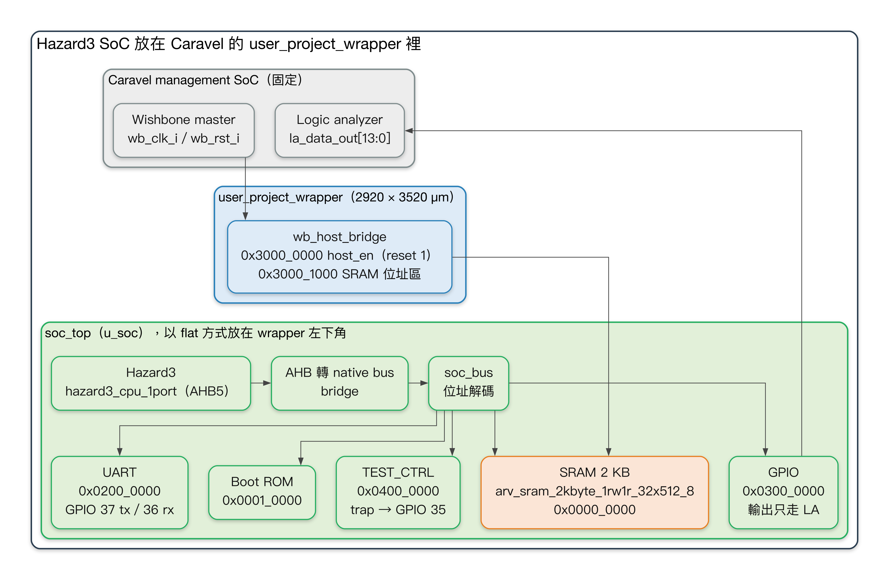
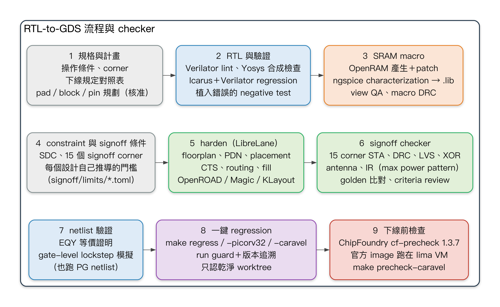
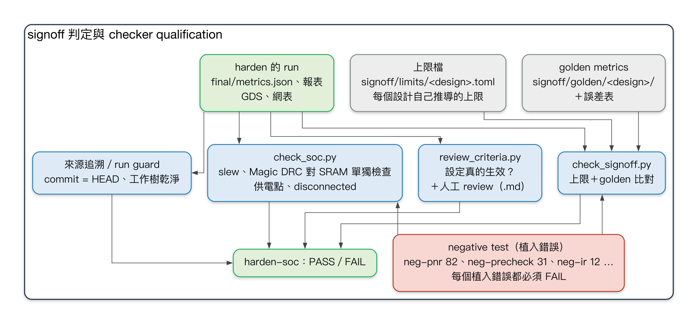
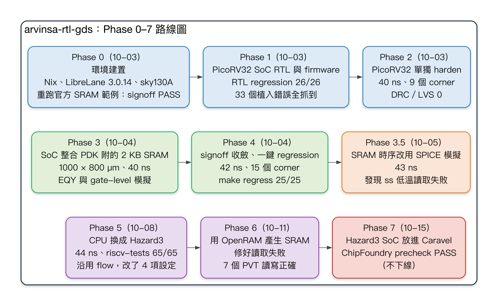
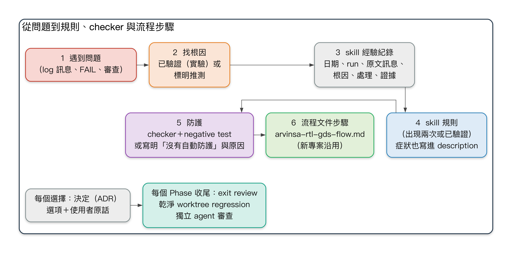
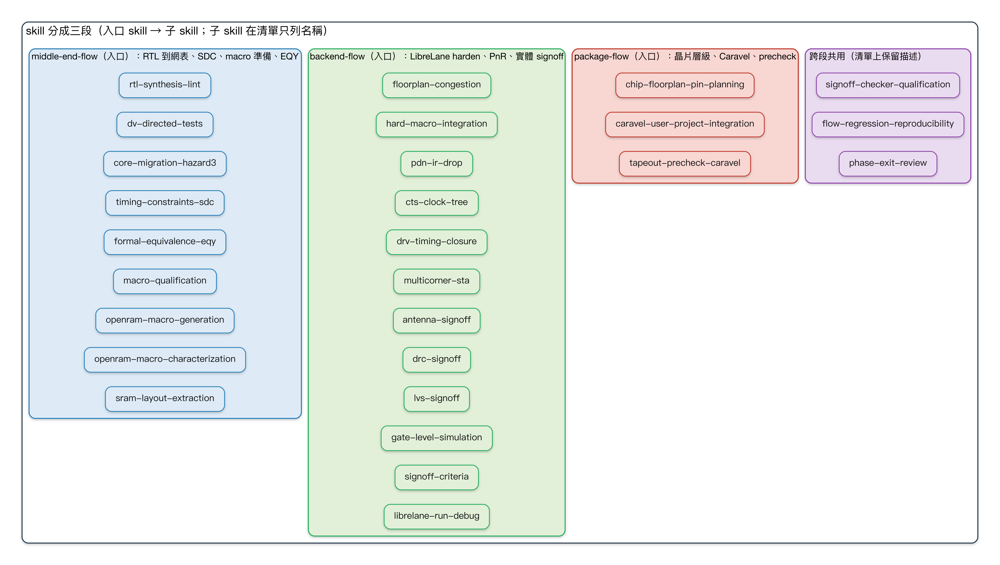

# arvinsa-rtl-gds 技術報告

**在 SkyWater sky130A 上用全開源工具建立 RTL-to-GDS 流程：從 RISC-V SoC 到 ChipFoundry Caravel precheck PASS**

| | |
|---|---|
| 報告日期 | 2026-10-15 |
| 專案期間 | 2026-10-03 – 2026-10-15（132 個 commit） |
| 最終證據 | commit `2b04451`（三條乾淨 worktree regression）；exit review commit `0d47a3d` |
| 狀態 | Phase 0–7 與 Phase 3.5 完成。Phase 7 只做到 precheck，**沒有下線**。 |
| 語言 | 繁體中文（本檔）。英文版：[`technical_report_en.md`](technical_report_en.md) |

---

## 摘要

本專案只用開源 EDA 工具，在 SkyWater sky130A PDK 上建立一條可重複執行、有 regression test 的 RTL-to-GDS 流程：
- LibreLane 3.0.14，內含 Yosys、OpenROAD、Magic、KLayout、Netgen；
- OpenRAM 產生 SRAM；
- ngspice 做特性化。

test vehicle 是一顆帶 SRAM macro 的小型 RISC-V SoC。

工作分九個階段（Phase 0–7，加上 Phase 3.5）：
- 環境建置；
- RTL 與 RTL 驗證；
- 單獨 harden 一顆 core；
- SoC 整合預建 SRAM；
- signoff 收斂與一鍵 regression；
- SRAM 的 SPICE 特性化；
- CPU 從 PicoRV32 換成 Hazard3；
- OpenRAM 自產 SRAM；
- 最後放進 ChipFoundry 的 Caravel。

最終設計是 Hazard3 SoC 加上 2 KB 自產 SRAM，以扁平方式放在 Caravel 的 `user_project_wrapper` 裡，結果如下：
- **ChipFoundry precheck PASS**：官方 13 項檢查中 11 項 PASS；剩下兩項只報 OpenRAM bitcell 的規則，而且違規位置和 PDK 自己的預建 SRAM 完全相同。
- **完成和單獨 SoC 同一套 signoff**：15 個 corner 的 STA、DRC、LVS、antenna、formal equivalence（EQY）、gate-level 模擬；IR drop 從 Caravel 真實的 pad 起算，電流用 CPU max power pattern。

從 Phase 3 起，每個 Phase 都以三件事收尾：乾淨 worktree 的完整 regression、獨立 agent 審查、exit review。過程中遇到的問題（工具缺陷、checker 漏洞、流程順序錯誤），寫回三個地方：
- 流程 skill（專案期間 23 個；總檢討後 30 個，分成 Middle-end、Backend、Package 三段，各有一個入口）；
- 流程文件；
- 自動 checker 加上 negative test（植入錯誤，checker 必須抓到）。

2026-10-15 的總檢討發現，247 個問題中仍有 39 個只在經驗紀錄或沒有寫進任何 skill（第 7 章）；使用者之後選定的寫回見 §8.5–§8.6。

本報告完整記錄：一路做了什麼、遇到哪些問題與怎麼解決、skill 與流程因此怎麼修正，以及還有哪些問題沒解決。

---

## 目錄

1. [目標與範圍](#1-目標與範圍)
2. [技術組合與環境](#2-技術組合與環境)
3. [設計：SoC、CPU、SRAM 與 Caravel wrapper](#3-設計)
4. [流程：步驟、checker、regression 與來源追溯](#4-流程)
5. [逐 Phase 的歷程](#5-逐-phase-的歷程)
6. [最終成果](#6-最終成果)
7. [遇到的問題](#7-遇到的問題)
8. [skill 與流程怎麼修正](#8-skill-與流程怎麼修正)
9. [待解問題與後續工作](#9-待解問題與後續工作)
10. [目前狀態與重現方式](#10-目前狀態與重現方式)
- [附錄 A：決定紀錄（ADR）](#附錄-a決定紀錄)
- [附錄 B：圖的出處](#附錄-b圖的出處)
- [附錄 C：名詞](#附錄-c名詞)

---

## 1. 目標與範圍

目標出自 `project-plan.md`：
1. **一個指令就能重現的流程**：任何人在乾淨的 checkout 上一個指令重跑都 PASS。signoff metrics 和 golden 比對，除了誤差表列出的項目（ADR-0015）都要逐值相同。每個 PASS／FAIL 都由 checker 判定，而 checker 本身會 FAIL 這件事，已經用植入錯誤證明過。
2. **貼近實際的 test vehicle**：帶 SRAM macro 的 RISC-V SoC，一路做到 signoff（DRC／LVS／STA PASS）。
3. **和 PDK、設計無關的流程**，之後的專案可以沿用。這個 repo 現在是使用者其他 IC 專案的流程來源（`CLAUDE.md` 規則 8、`arvinsa-rtl-gds-flow.md`）。

**為什麼用 sky130A 而不是 SkyWater 90 nm（SKY90-FD）**（ADR-0001）：
- 開源版 SKY90-FD 停在實驗性預覽，並在 2026 年 2 月封存；
- 它的標準元件庫 repo 裡沒有任何 cell；
- OpenRAM、LibreLane、OpenROAD 都不支援它。

sky130A 是同一家晶圓廠的製程。PDK 相依的部分集中在設定與 `ip/sram/`，之後可以換成別的 PDK。

**使用者決定的範圍**（每一項都記在 ADR；Phase 5 起附使用者原話）：
- CPU 先 PicoRV32 後 Hazard3（ADR-0002、ADR-0011）；
- SRAM 先用 PDK 預建 macro，後改 OpenRAM 自產（ADR-0003、ADR-0018）；
- Phase 7 放進 Caravel，只做到 ChipFoundry precheck，不下線（ADR-0019 決定 1）。

**工作方式**：工程由 Claude Code 在使用者指導下進行，原則如下：
- 凡是影響規格、量測方法、signoff 標準、時程或範圍的選擇，先查證、列出選項與建議，由使用者決定（`CLAUDE.md` 規則 13）。
- 由沒有參與實作的獨立 agent 審查：Phase 1 審 testbench；Phase 3 起，每個 Phase 收尾時審文件與 checker。
- 反覆用到的做法寫成專案 skill（`.claude/skills/*/SKILL.md`）：最後共 30 個，分成 Middle-end、Backend、Package 三段，各有一個入口 skill（§8.6）。

---

## 2. 技術組合與環境

| 項目 | 選擇 |
|---|---|
| PDK | SkyWater sky130A，標準元件庫 `sky130_fd_sc_hd`，PDK commit `8afc8346`（LibreLane 3.0.14 釘定） |
| RTL-to-GDS | LibreLane 3.0.14（Classic flow，commit `f24e0ea5`），呼叫 Yosys、OpenROAD、Magic 8.3.623、KLayout 0.30.7、Netgen |
| SRAM | Phase 3–5：PDK 預建 `sky130_sram_2kbyte_1rw1r_32x512_8`；Phase 6–7：自產 `arv_sram_2kbyte_1rw1r_32x512_8`（OpenRAM `3608704c` 加 repo 內 4 個 patch） |
| SRAM 特性化 | ngspice：Phase 3.5 量 PDK 附的 SPICE 網表；Phase 6 量 OpenRAM 的電路圖網表。版圖萃取網表只做了讀寫試跑 |
| CPU | PicoRV32（Phase 1–4，保留為 `make regress-picorv32`）；Hazard3 `hazard3_cpu_1port`（Phase 5 起） |
| 模擬 | Icarus Verilog 13.0、Verilator 5.050 |
| Formal | Yosys EQY（合成網表對最終網表） |
| Firmware | `riscv64-elf-gcc` 16.1（rv32）；Hazard3 用含 newlib 的 xPack toolchain |
| 下線預檢 | ChipFoundry `cf-precheck` 1.3.7 官方 Docker image（linux/amd64），在 Apple Silicon 上用 lima VM（vz＋Rosetta）執行 |
| 主機 | Apple Silicon macOS、Nix；記憶體 24 GB、10 核 |

所有版本釘在 `env/versions.mk`，`make env-check` 比對 `toolchain.md` 與本機實際安裝的版本。

Phase 0 遇到的環境問題（`docs/phase_exit/phase0.md`）：
- **網路慢**：到 GitHub 單一連線只有 45–175 kB/s。Nix 安裝程式與 PDK 都改成可續傳、驗 sha256 的下載方式（`make pdk-fetch`）。
- **平台差異**：LibreLane 的參考設計在本機有 74 個 max slew 違規，官方 CI 是 70 個。本機連跑三次結果完全相同，所以 checker 改成兩層：signoff 項目跨平台比對；307 個 metrics 只和本機 golden 逐值比對。

---

## 3. 設計

### 3.1 SoC 與位址映射

SoC（`soc_top`）由 RTL、firmware、DV 三方的契約定義：`docs/spec/soc_spec.md`。位址映射的唯一來源是 `rtl/include/memmap.vh`。

| 區塊 | Base | 大小 |
|---|---|---|
| SRAM | `0x0000_0000` | 2 KB（512 個 32-bit word） |
| Boot ROM | `0x0001_0000` | 512 B |
| UART | `0x0200_0000` | DIV、DATA |
| GPIO | `0x0300_0000` | GPIO_OUT、GPIO_IN（`boot_mode`） |
| TEST_CTRL | `0x0400_0000` | SIG、DONE（PASS = `0x600D_C0DE`）、IRQ_TRIG；Hazard3 版另有 FATAL（+0xC，驅動 `trap`） |

**host write port** 讓外部 master 在 CPU 停住時把程式寫進 SRAM。這個 port 在 Phase 1 就設計好，所以 Phase 7 接 Caravel 的 Wishbone 時，SoC 的 RTL 不必改。

### 3.2 CPU

- **PicoRV32**（Phase 1–4）：原生記憶體介面。
- **Hazard3**（Phase 5 起，ADR-0011）：用 `hazard3_cpu_1port`（指令與資料共用一條 AHB5），經 AHB 轉 native bus 的轉接器接到 SoC。
  - 這樣 SoC 匯流排、SRAM 介面、周邊與大部分 DV checker 都不用動。原本的目標是「flow 只改 design 層」，實際沒有完全做到（見 Phase 5）。
  - 轉接器的植入錯誤（H01–H04）由既有的 TEST_CTRL、匯流排 assertion、timeout、coverage checker 抓到；ADR-0011 計畫中的專用 AHB 協定 checker 沒有寫。
  - 驗證：riscv-tests 65/65；與 Hazard3 的 `rvcpp` ISS 逐指令比對 48/48。

### 3.3 SRAM macro

SRAM 是 2 KB、32 × 512、1RW＋1R 的 macro。
- Phase 3 用 PDK 預建 macro，搭配刻意保守的 padded `.lib`（ADR-0007）。
- Phase 3.5 用 SPICE 實測，發現它在 ss −40 °C（1.60–1.95 V）、ss 25 °C 1.60 V、tt −40 °C 1.60 V 會**讀成前一次的值**（ADR-0010）。
- Phase 6 用 OpenRAM 自產，並修正讀取電路（ADR-0018）：
  - sense amp 輸入端加預充電（patch 0001）；
  - `clk1` 接系統時脈，讓閒置 port 的 chip-select flip-flop 有被鎖存。

  自產 macro 在查過的 7 個 PVT 條件下都讀對；在特性化的 5 個 PVT 下讀寫都正確。


*圖 1：自產 `arv_sram_2kbyte_1rw1r_32x512_8` 的版圖（694.27 × 428.415 µm）。*

### 3.4 放進 Caravel（Phase 7）

ChipFoundry 的 Caravel 提供管理用 SoC、pad，以及固定 2920 × 3520 µm 的使用者區 `user_project_wrapper`。Hazard3 SoC 以**扁平方式**放進 wrapper：標準元件與 SRAM macro 直接在 wrapper 層擺放、繞線，不先 harden 成獨立的 macro（ADR-0019 決定 2）。



*圖 2：Hazard3 SoC 在 Caravel `user_project_wrapper` 裡的架構。出處：`docs/spec/soc_spec.md` §2、§4；ADR-0011；ADR-0019 決定 8–10、12。*

主要接線（ADR-0019）：
- **clock 與 reset**（決定 8）：接 `wb_clk_i`／`wb_rst_i`，和 Wishbone 同一個 clock domain；週期 44 ns。
- **host bridge**（決定 9）：`wb_host_bridge` 有兩個位址區：
  - `0x3000_0000`：控制暫存器，bit 0 是 `host_en`。reset 值為 1，管理用韌體寫 0 之前 CPU 一直停住。
  - `0x3000_1000–0x3000_17FF`：對應 SRAM 的 512 個 word。
- **腳位**（決定 10）：
  - `uart_tx`、`uart_rx`、`trap`、`boot_mode[1:0]` 放在左緣最下方、離 block 最近的 GPIO 37–33；
  - `gpio_out` 只走 logic analyzer；
  - SoC 的每個腳位都鏡像到 `la_data_out`。
- **block 位置**（決定 12）：左下角，靠近 Wishbone 腳位。pad、block、pin 的規劃在寫 RTL 與 config 之前，先經使用者核准（決定 13、`CLAUDE.md` 規則 14）。


*圖 3：wrapper 的 floorplan 與 pin 規劃（`pnr/user_project_wrapper/pin_plan.toml`，2026-10-12 核准）。*

---

## 4. 流程

### 4.1 步驟



*圖 4：流程的步驟、工具與 checker。出處：`arvinsa-rtl-gds-flow.md` §3–§4。*

完整流程（每一步的做法、PASS 條件、checker 與對應的 skill）在 [`arvinsa-rtl-gds-flow.md`](../../arvinsa-rtl-gds-flow.md)，這是新專案的入口。摘要如下：
1. **規格與計畫**
   - 操作範圍與 corner：VDD 與 Tj 由使用者決定，corner 清單由它推出。
   - 下線平台試算表：每項收件檢查都算到本設計的數字。
   - pad／block／pin 規劃：寫 RTL 前經使用者核准。
2. **RTL 與驗證**
   - Verilator lint、Yosys 合成檢查。
   - Icarus＋Verilator 的 self-checking regression。
   - 植入錯誤清單（`dv/bugs.toml`），regression 必須全部抓到。
3. **macro**
   - 選定前的 go／no-go：在操作範圍內做 SPICE 讀寫，並用平台的 DRC deck 檢查。
   - 每個交付檔的 view QA：名稱、腳位、`.lib` 數值、LEF 對 GDS（`scripts/check_macro_views.py`）。
   - 特性化，產生 `.lib`。
4. **約束與 signoff 條件（任何 harden 之前）**
   - SDC、15 個 signoff corner。
   - `signoff/limits/<design>.toml` 的上限由每個設計自己推導，每列要有出處。這是流程要求，目前還沒有 checker 強制（ADR-0020）。
5. **harden（LibreLane）**：floorplan、PDN、placement、CTS、routing、fill。
6. **signoff**（每次 harden 結尾自動執行）
   - 15 個 corner 的 STA、DRC、LVS、XOR、antenna、IR；
   - 與 golden metrics 比對；
   - 每次 harden 後寫 criteria review（`CLAUDE.md` 規則 9）。
7. **網表驗證**
   - EQY 證明合成網表與最終網表等價；
   - 最終網表與 RTL 逐 cycle 比對的 gate-level lockstep 模擬，也包括含電源接腳的網表。
8. **一鍵 regression**：`make regress`（Hazard3 SoC）、`make regress-picorv32`、`make regress-caravel`。
   - **run guard**：只接受在目前 commit、乾淨工作樹 harden 出來的 run。
   - **來源追溯**：記錄 commit、submodule 與工具版本。
9. **下線預檢**：跑 ChipFoundry 官方 image，由 repo 的 checker 判定（`make precheck-caravel`）。

### 4.2 一次 harden 怎麼判定



*圖 5：一次 harden 怎麼判定，以及 checker 本身怎麼驗證。*

一次 harden 要以下全部 PASS 才算 PASS：
- **`check_signoff.py`**：`final/metrics.json` 對上限檔、對 golden。除了誤差表列出的 metric 族群（ADR-0015），其餘必須逐值相同。
- **`check_soc.py`**：檢查 metrics 表達不了的項目：
  - 每個 corner 的 max slew（含 Caravel 邊界的例外，ADR-0019 決定 16）；
  - SRAM 外框內的 Magic DRC，逐一比對 SRAM 單獨檢查時的違規位置；
  - IR 的供電點；
  - 斷線腳位。
- **`review_criteria.py`**：確認每個設定真的生效：config 生效、各 step 的設定、每個時序 step 與 signoff corner 都有 clock uncertainty、corner 齊全。
- **來源追溯與 run guard**：確認 commit 與工作樹乾淨。

checker 本身**用 negative test 驗證**：植入錯誤，每一個都必須讓預期的 checker FAIL。專案結束時部分 suite 的案例數：

| negative test | 案例數 |
|---|---|
| `neg-pnr` | 82 |
| `neg-precheck` | 31 |
| `neg-ir` | 12（`soc_top`）、10（wrapper） |
| `neg-run-guard` | 65 |
| `neg-rtl`（Hazard3／PicoRV32）／`neg-rtl-caravel` | 36／33／42 |
| `neg-pnr-caravel` | 9 |
| `neg-eqy` | 16（Hazard3）、12（PicoRV32）、14（`picorv32_core`） |
| `neg-openram` | 50 |

### 4.3 regression、golden 與可重現性

從 Phase 3 起，每個 Phase 只認**乾淨 git worktree** 的 regression 結果：用 `git worktree add --detach` 加 submodule 建立，開始時沒有任何本機修改。外部工具用 `LIBRELANE_DIR`、`XPACK_DIR`、`PRECHECK_DECK` 指向已安裝的版本。開發目錄補跑的結果一律不算（skill `flow-regression-reproducibility`）。

**golden 比對**讓不可重現的地方現形：
- 多執行緒 detailed routing 偶爾會差幾 µm 的繞線。
- `GRT-0229` 會隨機讓增量 global routing 中止。處理方式是有上限的重試：只對已知的訊息接續（`GRT-0229`；Phase 5 起也包括總溢位 ≤ 10 的 `GRT-0116`），最多重試兩次，每次重試都記錄。
- ADR-0015：版圖誤差在 Hazard3 上量；PicoRV32 在 Phase 5 另取四個樣本重訂；wrapper 沿用 Hazard3 的誤差。

Phase 7 的 wrapper 在四組比較中都和 golden 逐值相同。`picorv32_core` 在三次 run 中有一次 29 個 metrics 落在誤差內，另兩次逐值相同，所以誤差表保留。

---

## 5. 逐 Phase 的歷程



*圖 6：Phase 路線圖，含日期與重點成果。出處：`README.md`、`docs/phase_exit/phase*.md`。*


*圖 7：各 Phase 的關鍵數字：週期、最差 setup／hold slack、IR（各 Phase 的模型不同，不能直接比）、結案 regression 的項目數與時間、植入錯誤數。每個數字的出處在 `figures/SOURCES.md`。*

### Phase 0：環境（2026-10-03）

- **目標**：LibreLane／sky130A 能用，並在官方 SRAM 參考設計上證明。
- **結果**：
  - smoke test PASS；
  - 參考設計以 25 ns 重跑，16 個 signoff 項目都是 0；
  - slack 與官方 CI 相差 ≤ 0.01 ns；
  - 307 個 metrics 與本機 golden 逐值相同（`docs/phase_exit/phase0.md`）。
- **問題與處理**：
  - 網路慢：改成可續傳的下載。
  - `make clean` 刪掉執行中的 flow 目錄：範圍縮小到 Phase 1 的產出。
  - 釘的 CI 參考設計 commit 不是 LibreLane 3.0.14 測試用的那一版：重新釘。
  - 和 CI 的 slew 違規數不同（74 對 70）：屬於平台差異，checker 改成跨平台只比 signoff 項目，metrics 只和本機 golden 比。

### Phase 1：SoC RTL、firmware 與 RTL regression（2026-10-03）

- **結果**：
  - lint（23 個變體、0 個警告）、合成檢查、firmware、上游 PicoRV32 測試都 PASS；
  - `make regress-rtl` 26/26：13 支測試 × Icarus 與 Verilator，cycle 數與 UART 文字一致；
  - `make neg-rtl` 33/33 個植入錯誤都抓到。
- **testbench qualification**：兩輪獨立審查在 `bugs.toml` 以外植入錯誤。
  - 第一輪植入 20 個，regression 漏掉 10 個。
  - 第二輪植入 23 個（F01–F24，F16 作廢改 F16b），又漏掉 10 個，例如：UART stall 路徑從沒被走到、firmware 被改成先寫 DONE 再寫 SIG、一筆匯流排交易存取 SRAM 兩次。
  - 新增 4 個 checker（`sram_port`、`irq_line`、`uart_div`、`coverage`）與新測試補上缺口；`neg-rtl` 從 8 → 20 → 33。
- **教訓**：沒被證明會 FAIL 的 self-checking 測試不算證據。這成為 skill `signoff-checker-qualification` 與 `dv-directed-tests` 的基礎。

### Phase 2：單獨 harden PicoRV32（2026-10-03）

- **結果**：
  - GDS 533.6 × 544.3 µm；Magic、KLayout 與繞線 DRC 都是 0；LVS 0；XOR 0。
  - 40 ns、9 個 corner：setup +6.175 ns（`max_ss_100C`），hold +0.039 ns（`min_ff_n40C`）。
  - 上游 ISA 測試在最終網表上 PASS；RTL 與 gate level 的 117,381 筆匯流排交易逐筆相同。
  - 據此定 SoC 的 die 為 1000 × 800 µm（ADR-0006）。
- **問題**：`power__total` 是最後一個寫入的 corner（max_ff），不是 nom_tt（LibreLane `openroad.py` 第 808–810 行）。這個 metric 陷阱記在 skill `librelane-run-debug`。


*圖 8：單獨 harden 的 `picorv32_core`。*

### Phase 3：SoC 整合預建 SRAM（2026-10-04）

- **結果**：
  - 1000 × 800 µm、40 ns，9 個 corner PASS；
  - SRAM 外的 Magic 完整 GDS DRC 為 0；
  - EQY 18,100/18,100 個分區等價（合成網表對最終網表）；
  - gate-level 模擬 13/13；
  - `neg-pnr` P01–P20 全部抓到。
  - `make phase3` 在乾淨 checkout 第四次才端到端跑完。
- **收斂過程的問題**（`docs/phase_exit/phase3.md`「怎麼收斂」）：
  1. **`PDN-0179`**：SRAM 離 die 邊緣 25 µm，上方只剩 6 µm 的 row。移動 SRAM，讓它的 halo 蓋過 core 邊界。
  2. **diode 太多**：heuristic diode insertion 插了 10,231 顆，global routing 跑了 10 分鐘以上不收斂。改成給 SRAM 補 antenna LEF（ADR-0008）。
  3. **13 個 top cell**：Magic 寫出的 GDS 有 13 個 top cell。改用 KLayout 做主要的 stream-out。
  4. **假的 `nwell.4`**：abstract DRC 在每條 row 都報。改用完整 GDS DRC，由 `check_soc.py magic_drc` 判定。
  5. **ss corner 的 max slew 違規**：來自 L 形轉角的繞路，根因是 placement 目標密度被自動算成 68%，改成 55% 後解決。中途把 signoff max transition 放寬到 1.0 ns（ADR-0009），找到根因後**撤回**。
  6. **`GRT-0229` 隨機中止**：同一份輸入重跑 4 次，2 次中止、2 次通過，而且通過的兩次彼此結果相同。處理：有上限的重試（`pnr/librelane_flow.sh`）；同時更正先前只跑一次就下的歸因。
- **獨立審查**：找到 5 個 checker 漏洞，在 Phase 4 開頭修正。

### Phase 4：signoff 收斂與一鍵 regression（2026-10-04）

- **時序目標**：
  - 25 ns 做不到，SRAM 路徑差約 7 ns。
  - 在 Phase 4 加嚴的條件下，40 ns 也不過：SRAM 半週期路徑在 `min_ss_n40C` 差 0.42 ns。
  - 使用者選 **42 ns**，不放寬任何假設（ADR-0004）。
- **加嚴的 signoff**：
  - 15 個 corner，含溫度反轉（ss −40 °C）；
  - SRAM derate 1.575；
  - duty cycle 預算；
  - static IR 改判 VDD 降壓加 VSS（ground）抬升，上限 20 mV；
  - EQY 加比 flip-flop 種類與 clock 接線；
  - 含電源接腳的 gate-level 模擬。
- **收斂**：
  - resizer 看 15 個 corner 時 35 分鐘以上不結束，`RSZ_CORNERS` 維持 9 個。
  - hold 用 0.3 ns 餘量修掉。
  - CTS 為了和 flip-flop 對齊，在 SRAM 的 clock 前插了 delay buffer，LibreLane 沒有變數可以關掉（解法 `-no_insertion_delay` 到 Phase 5 才做）。
  - 第 5 次 harden 15 個 corner 全過。
- **regression**：乾淨 worktree 的 `make regress` 25/25，123 分鐘，163 個 negative test 案例（含 positive control）全部符合預期。前三次乾淨 run 不算數，原因分別是：
  - 審查後改了 checker；
  - 繞線器的中間數字不同；
  - gate-level 模擬超過牆鐘時限。

### Phase 3.5：SRAM 時序改用 SPICE 實測（2026-10-05）

- **做法**（ADR-0010）：
  - 本機 ngspice 量 PDK 附的電晶體級網表；
  - 5 個 PVT 的 `.lib` 由量測 JSON 產生，並檢查沒有過期；
  - 新增 hold 弧，因為 `dout0` 在 clock 邊緣之後馬上開始變化。
- **關鍵發現**：預建 SRAM 在下列條件會**讀錯**（讀成前一次的值）：
  - ss −40 °C（1.60–1.95 V）；
  - ss 25 °C 1.60 V；
  - tt −40 °C 1.60 V。

  原因已在 bit 0 的 sense amp 內部節點確認：sense amp 沒有預充電，column mux 只有 NMOS，Vt 高時拉不回來。使用者把它列為頭號下線風險；Phase 6 之前，ss −40 °C 用佔位 `.lib`。
- **時序**：
  - 實測加餘量仍低於 padded `.lib`，下限仍由 padded 值決定（例外：ss 100 °C 的 hold 0.53 ns；`dout0` 的 max capacitance 從 0.02756 改成 0.05 pF）。
  - 新的 hold 弧加上 0.3 ns 的 hold 餘量，讓 SRAM 半週期路徑上多了一顆 delay cell，使用者選 **43 ns**。
- **問題**：第一版 `.lib` 的負載斜率太陡（ss 100 °C 下 5 → 20 fF 延遲多 1.3 ns，等於 60–140 kΩ 的 driver），讓 `RepairDesignPostGPL` 跑了 75 分鐘後異常結束（正常約 40 秒）。改成每列取負載中的最大值。
- **regression**：乾淨 worktree 25/25（136 分鐘），164 個 negative test 案例全部符合預期。第一次失敗是 negative test 腳本先清空檔案再讀。

### Phase 5：CPU 換成 Hazard3（2026-10-08）

- **結果**：
  - riscv-tests 65/65，ISS trace 比對 48/48。
  - **44 ns**、15 個 corner 的 signoff：Hazard3 +1.114／+0.109 ns，PicoRV32 +0.789／+0.080 ns。
  - 乾淨 worktree 的 `make regress` 21/21、`make regress-picorv32` 26/26，三次 harden 都與 golden 逐值相同。
- **收斂**（Hazard3 共 12 次 harden；PicoRV32 另外 5 次，加上誤差樣本）：
  1. **resizer 失控**：`RepairDesignPostGPL` 跑了 108 分鐘、記憶體到 92.9 GB，原因是 resizer 換上推不動一顆 buffer 的弱 cell `a2111oi_1`。ADR-0012 排除弱 cell，harden 前用 `pnr/check_weak_cells.py` 檢查。
  2. **ss_n40C setup −4.158 ns**：resizer 沒看溫度反轉 corner。處理：ADR-0013。
  3. **剩 −0.381 ns**：使用者選 44 ns。
  4. **signoff −1.131 ns**，其中約 0.97 ns 在繞線後才出現：加一次繞線後的 resizer 修復（ADR-0014）。
  5. **上限與 golden**：從 PicoRV32 抄來的上限不適用 Hazard3，golden 比對也因小的版圖差異 FAIL。改成每個設計自己推導上限，並加版圖誤差（ADR-0015）。
  6. **PicoRV32 的半週期路徑被吃掉**：CTS 為了對齊 latency，在 `sram0/clk0` 前插了 10 顆 `delaybuf`。LibreLane 沒有開關可以關掉，所以用 repo 的 plugin 換掉 CTS step，加 `-no_insertion_delay`（ADR-0016）。
  7. **最壞組合 IR 超標**：獨立審查推估 ff 電流加 ss 電阻的最壞組合約 25.6 mV，exit review 實測 25.75 mV，超過 20 mV。met5 strap 加寬到 4.8 µm 後降到 14.13 mV（ADR-0017）。
- **沒達成**：exit criterion 7b「只改 design 層」。改了 4 項 flow 設定（ADR-0012、0013、0014、0016，兩個 CPU 一起改），另外還有週期、CTS plugin、checker 與上限；使用者接受為與計畫不同。

### Phase 6：OpenRAM 自產 SRAM（2026-10-11）

- **產生**：
  - OpenRAM `3608704c` 加 repo 內 4 個 patch，在 macOS 本機執行。
  - macro 的產生與 DRC／LVS 用 OpenRAM 自己釘的 2022 PDK，因為新版 PDK 的元件改名會讓 OpenRAM 的 LVS 不一致（ADR-0018 決定 5）。
- **修好讀取失敗**：
  - 預設設定的 macro 和預建的一樣會讀錯。
  - 用網表 what-if 比較 transmission gate 與 sense amp 輸入端預充電，選擇預充電（patch 0001）。
  - 接著 2 KB macro 在 tt 25 °C 讀錯，原因是閒置 port 的 chip-select flip-flop 從沒被時脈鎖存。`clk1` 接系統時脈後，7 個條件都讀對。
- **特性化**：5 個 PVT 的時序與 internal power 都用 SPICE 量。過程中要處理三件事：port 1 浮接的穿透電流、半穩態的 bitcell、gmin。
- **整合時的問題**：
  - LEF 的資料庫單位 2000 讓 OpenROAD 丟掉整份 LEF（`ODB-0205`），改成 1000。
  - **最終 GDS 裡的 SRAM 是空的**：OpenRAM 的 LEF 沒有 `FOREIGN`，stream-out 沒有合併 macro 的 GDS，log 卻寫「All LEF cells have matching GDS cells」。處理：補 `FOREIGN`，並新增 checker `check_macro_gds.py`。
  - **flow 的 KLayout DRC 在 SRAM 裡報 27 個違規**：預建 macro 會是 0，只因為 deck 依名稱排除 `*sky130_sram_*kbyte_*`。用 OpenRAM patch 0002–0004 修正。
  - **EQY 略過自產 SRAM**：EQY 的網表解析只認 `sky130_*` 開頭的 cell，自產 SRAM 被靜默略過。修正後出現 EQY 失敗：兩份網表其實等價，是 OpenROAD 對調等價輸入（`RSZ-0043`）讓名稱對應矛盾，屬工具限制，改成排除被對調的腳位（決定 18）。
- **結果**：
  - Hazard3 setup／hold +0.656／+0.126 ns，PicoRV32 +0.769／+0.082 ns。
  - `85bfa75` 的乾淨 worktree regression 23/23、28/28。
- **版圖萃取試跑**：萃取網表讀寫正確，但延遲是電路圖的 **2.0 倍**。這是 Phase 7 已知限制 2 的來源。


*圖 9：Hazard3 加自產 SRAM 的 `soc_top`（Phase 6 的設計，Phase 7 以相同結果重新 harden）。*

### Phase 7：放進 Caravel 與 ChipFoundry precheck（2026-10-12 – 10-15）

每一步與背後的決定記在 ADR-0019 決定 1–26。
1. **precheck 環境**（決定 3–5）：
   - 官方 `cf precheck` 只能在 linux/amd64 的 Docker image 裡跑。用 lima VM＋Rosetta 跑官方範例，19 分鐘，11 項 PASS。
   - 新版 precheck deck 拿掉了 SRAM 核心區的豁免，連 PDK 預建 SRAM 都會報 `MR_licon.SP.6`、`MR_mcon.CON.10`。exit 條件因此訂為：11 項 PASS；兩項 KLayout 檢查只能有這兩條規則，而且位置與預建 macro 單獨檢查時相同。
2. **wrapper RTL**（決定 8、9）：Wishbone host bridge，`host_en` reset 值 1。
3. **先規劃**（決定 10–13）：
   - 第一次選 GPIO 8–20 時，沒先看 pad 位置，結果離 block 2–3 mm。
   - 使用者指出順序錯了：block 位置要在選 pin 之前定好。
   - 重新規劃為 GPIO 33–37，並用四層機制強制這個順序：
     - checker（`make pin-plan`，加 `neg-pin-plan`）；
     - Claude Code 在核准前擋下編輯的 hook；
     - skill（`chip-floorplan-pin-planning`）；
     - 流程文件（`arvinsa-rtl-gds-flow.md` 4.1），並寫進 `CLAUDE.md` 規則 14。
4. **harden 探索**：
   - `RSZ-0074`：resizer 把沒接的 inout `analog_io` 同時算成 driver 與 load。用 `RSZ_DONT_TOUCH_RX` 與一個 checker 處理。
   - Caravel 輸入的 transition（0.84–0.97 ns）超過 slew 上限。內部 net 照舊判，邊界 net 另訂上限（決定 16）。
   - Caravel 輸入路徑 hold −0.071 ns：global routing 後的 hold 餘量從 0.05 改成 0.2 ns（決定 17）。
5. **IR**（決定 18–20），一天內改了三次：
   1. 從 Caravel 真實的 `vccd1` pad 與跨接線起算，最壞組合到 104 mV，met4 strap 從 1.6 改成 4.8 µm。
   2. 改用預算所保護的慢 corner 判。
   3. 電流改用 **CPU max power pattern** 的切換活動（`fw/tests/maxpower`，在 gate-level 模擬錄波）。使用者原話：「一般IR都會用CPU max power pattern去做不是嗎」。

   結果 19.56 mV，上限 20 mV。
6. **內部 net 的 slew**：最後一次 slew 修復後，重新 global routing 把一條 net 擠去繞路（0.779 ns）。試了四種修法都不收斂，最後把 placement 密度 55% 改成 50% 解決（決定 21）。
7. **EQY**：OpenROAD 對調腳位後，16,149 個分區有 1 個證不出來，於是加一次自動 `amend` 重試。第一版把 flip-flop 併進分區，結果證明**變成空洞**（植入的 NAND→NOR 錯誤也 PASS）。negative test 抓到後，重試改成只併組合邏輯（決定 23）。
8. **precheck 判定 checker**（步驟 6）：`check_precheck.py`。獨立審查補了 4 個漏洞，例如舊報表配新 GDS 會判 PASS。
9. **官方 precheck**（步驟 7）：
   - `decap_3` fill 讓 li1 密度到 75%（上限 60%），改用 `ef_decap_12` 加 fill，降到 39.9%。
   - VM 10 GiB 時 BEOL、LVS、OEB 被 OOM kill，VM 改成 16 GiB。
   - 比對基準只比允許的規則。

   `550869c` precheck PASS。
10. **結案 regression**：
    - **第一輪**（`84fe505`）：三條全部 PASS。期間兩個獨立 agent 同時審查：
      - 文件核對 110 列：5 列錯誤、23 列會誤導；
      - 找 checker 漏洞：8 個漏洞（H1–H8）加 1 個防護缺口。

      使用者選擇全部修正後重跑（決定 26）。
    - **第二輪**（`2b04451`）是正式證據。磁碟滿（只剩 0.8 GiB）同時打斷 PicoRV32（寫檔失敗）與 Hazard3（STA 卡住）；Hazard3 第二次又遇到 KLayout Signal 11，推測是記憶體壓力，沒有確認。Hazard3 共跑了三次。
11. **fill 試跑**（決定 26）：用 Caravel 的 fill 做法單獨補 wrapper，預估 fill 後的密度（§6.5）。

---

## 6. 最終成果

除非另外註明，本節數字都來自 `2b04451` 第二輪結案 regression（`docs/phase_exit/phase7.md`）。what-if 分析（例如 §9.1 的 `dout0` transition）是在同一份版圖另外跑的 STA。

### 6.1 regression

| regression | 項目 | 時間 | 結果 |
|---|---|---|---|
| `make regress-caravel`（wrapper） | 18 | 476 分鐘 | **18/18 PASS** |
| `make regress-picorv32` | 31 | 248 分鐘 | **31/31 PASS** |
| `make regress`（Hazard3 `soc_top`） | 30 | 211 分鐘 | **30/30 PASS** |

四次 harden 都沒有重試，也都與 golden 逐值相同：wrapper 455 個 metrics、Hazard3 `soc_top` 441 個、PicoRV32 `soc_top` 435 個、`picorv32_core` 325 個。

### 6.2 版圖


*圖 10：最終的 `user_project_wrapper`（2920 × 3520 µm）。SoC 與 SRAM 在左下角，其餘是電源網路、tap cell、decap 與 fill，邊緣另有少數邏輯 cell。*


*圖 11：wrapper 左下角放大：Hazard3 SoC 的邏輯 cell 在 SRAM macro 的下方與左側。*

### 6.3 signoff（wrapper，44 ns）

| 項目 | wrapper | Hazard3 `soc_top`（對照） |
|---|---|---|
| 最差 setup | +0.548 ns（min_ss_n40C_1v60，SRAM 半週期路徑） | +0.656 ns |
| 最差 hold | +0.187 ns（max_ff_100C_1v95） | +0.126 ns（min_ff_n40C_1v95） |
| 標準元件 | 165,577 顆，含 140,477 顆 tap cell（邏輯 cell 25,100 顆）；使用率 7.0%（含 SRAM） | 30,406 顆，含 6,445 顆 tap cell |
| flip-flop | 2,238 | 2,152 |
| 繞線 DRC／KLayout DRC／LVS／XOR／antenna | 0 | 0 |
| Magic DRC（flow 的計數） | 5,572,955 個，全部在 SRAM 內、位置與 SRAM 單獨檢查相同 | 4,770,846 個，同左 |
| EQY | 16,149／16,149 個分區 | PASS |
| gate-level 模擬 | 16/16 | 16＋16（含電源接腳版） |
| IR，max power pattern（上限 20 mV） | **19.56 mV**，從 Caravel pad 起算（wrapper 內部只占 2–5 mV） | 4.67 mV，從自己的 ring 起算（不能直接比） |


*圖 12：wrapper 在 15 個 signoff corner 的最差 setup 與 hold slack。*


*圖 13：wrapper 在 max power pattern 下的 VDD 降壓（vccd1，11.92 mV）與 VSS 抬升（vssd1，7.65 mV）分布，max_ss_100C_1v60、window 5c，合計 19.56 mV。*

### 6.4 precheck

官方 image（cf-precheck 1.3.7）共 13 項檢查：
- 11 項 PASS；選用的 `magic_drc` 略過。
- `klayout_feol` 有 16,900 個標記，全是 `MR_licon.SP.6`；`klayout_beol` 有 50,184 個，全是 `MR_mcon.CON.10`。都在 SRAM 內，而且位置與 PDK 預建 macro 單獨檢查時相同。

repo 的 `check_precheck.py` 依 ADR-0019 決定 5 判為 **PASS**。ChipFoundry 是否接受這個判法還不知道（待解問題 1）。

### 6.5 密度與 fill 試跑

precheck 只查密度上限。一般認為 Caravel 的下線腳本會先對整顆晶片補 metal fill，再查下限（證據中等，沒有文件明講；`runs/p7_review/chipfoundry_fill.md`）：`check_density.py`，li1 與 met1–4 ≥ 35%、met5 ≥ 45%、FOM ≥ 33%，以 700 µm 視窗計。

wrapper 單獨、還沒補 fill 時遠低於下限（met2 1.6%、met3 0.8%）。fill 試跑照 Caravel 的 `generate_fill.py`（`wafflefill(tiled)`）與 `check_density.py` 重寫一份來補 wrapper、再量一次。fill 區塊分開量再逐格相加，最多高估 0.33 個百分點：

| 層 | 補 fill 前（die 內） | 補 fill 後最低視窗 | 低於下限的視窗 |
|---|---|---|---|
| li1 | 39.9% | 41.4% | 0 |
| met1 | 18.1% | 36.0% | 0 |
| met2 | 1.6% | 34.8%（估計；實量 34.55%） | 63 個中 1 個 |
| met3 | 0.8% | 37.9% | 0 |
| met4 | 25.1% | 50.0% | 0（最高 59.7%，貼近上限 60%） |
| met5 | 26.1% | 58.1% | 0 |
| FOM | 41.1% | 31.5% | 1,386 個中 15 個 |


*圖 14：補 fill 前後各 700 µm 視窗的密度（`runs/p7_review/fill_trial/`）。*

precheck 報的補 fill 前 met4 26.7%、met5 27.3%，比上表高，推測是把 die 外的電源環也算進去。

這次試跑能說明與不能說明的：
- 補不起來的視窗都在左下角 SoC 與 SRAM 一帶。
- die 右緣與上緣的視窗，沒有外殼一起看就判斷不了。
- ChipFoundry 實際用的 fill 參數不知道。

---

## 7. 遇到的問題

### 7.1 怎麼收集

2026-10-15 由四個沒參與實作的 agent 走過每一個 Phase：
- 三個分別讀 Phase 0–3.5、4–5、6–7 的 exit review、ADR、筆記、skill 經驗紀錄與 `git log`；
- 一個橫向稽核 23 個 skill 與流程文件。

每個問題都用 `git grep` 查證它**現在**被捕捉在哪一層：skill 規則本文、只在 skill 經驗紀錄、流程文件的某一步、自動 checker 或 negative test，或哪裡都沒有。報告在 `docs/notes/problem_review/`（`review_p0_35.md`、`review_p4_5.md`、`review_p6_7.md`、`review_skills.md`）。第五個 agent 驗證這些報告的說法，並合併建議（`verify_and_merge.md`，§8.5）。


*圖 15：(a) Phase 0–7 的 247 個問題依類別分；(b) 每個問題現在被捕捉的程度，只算最強的那一層。類別依關鍵字歸類，做法在 `figures/scripts/problems_overview.py`。*

共 **247 個問題**：Phase 0–3.5 有 90 個、Phase 4–5 有 62 個、Phase 6–7 有 95 個。三份報告的捕捉分類定義略有不同，下面的合計只能看量級。依現在最強的捕捉層：
- 115 個已寫進 skill 規則或流程文件，**而且**有自動防護；
- 93 個有規則或流程文件，但沒有自動防護（或已寫明「沒有自動防護」與原因）；
- 23 個只在 skill 經驗紀錄；
- 16 個只在 ADR、筆記或 commit 訊息裡。

### 7.2 問題的種類

| 類別（依關鍵字歸類，見圖 15） | 數量 | 代表例子（Phase） | 怎麼解決 |
|---|---|---|---|
| 工具缺陷或意外行為 | 93 | `GRT-0229` 隨機中止（3）；resizer 在弱 cell 上失控，記憶體到 92.9 GB（5）；CTS 在 SRAM clock 前插 latency 對齊 buffer（4–5）；LEF 沒有 `FOREIGN` 時 stream-out 不合併 macro GDS，log 卻說成功（6）；沒接的 inout 造成 `RSZ-0074`（7）；設了 driving cell 時 OpenSTA 忽略 `set_input_transition`（7）；PSM 在某些供電點 Signal 11（7）；KLayout Signal 11，推測是記憶體壓力（7） | 只對確切訊息做有上限的重試；用工具設定或 repo plugin 繞過，不改釘版的工具；寫 checker 偵測症狀；用 negative test 重現它（`CLAUDE.md` 規則 10） |
| checker 或測試漏洞 | 54 | Phase 1 testbench 兩輪各漏掉 10 個植入錯誤；`check_soc.py` 的迴圈變數蓋掉 SRAM 原點（7）；EQY 略過所有非 `sky130_` cell（6）；舊的 precheck 報表配新 GDS 被判 PASS（7）；`judged_by` 接受任何字串（7）；NaN 被 `max()` 略過（7） | 修正、加 negative test、把漏洞類型寫進 `signoff-checker-qualification` 的表；開 regression 前先在真的 run 上跑 positive control |
| 流程順序或做法 | 32 | 先選 GPIO 才定 block 位置（7）；第一次 harden 後才定 signoff 條件（2–3）；IR 判法一天改三次（7）；證據留在 session 暫存目錄（3、4、5、6、7） | 規劃核准的檢查（pin-plan checker 與編輯 hook，`CLAUDE.md` 規則 14）、ADR-0020 的 19 條提早檢查、放寬登記表 |
| 規格或假設 | 22 | SRAM 在 ss 低溫讀錯（3.5）；padded `.lib` 沒有走線寄生（3–7）；Caravel 時脈的 duty cycle 與 jitter（5、7） | 選定 macro 前做 SPICE go／no-go、寫明假設、列入下線風險清單 |
| 平台規定 | 14 | 整個使用者區只有一顆 `vccd1` pad；邊界 transition 超過 slew 上限；`decap_3` 造成 li1 密度超標；新 deck 對預建 SRAM 的規則；metal fill 由誰補（都在 Phase 7） | 平台試算表（ADR-0020 A2）、skill `tapeout-precheck-caravel` |
| 主機環境與資源 | 8 | 另一個程式佔掉記憶體（5）；兩個 `neg-pnr` 同時被系統中止（6）；磁碟滿讓 regression FAIL、STA 卡住（7） | precheck VM 的記憶體已有自動檢查；ADR-0021 之後，`scripts/regress.py` 在磁碟剩餘不到 100 GiB 時拒絕開跑，每個 target 超過參考時間的 3 倍就砍掉並判 FAIL（`neg-regress` 的 `low_disk`、`timeout`）；同時跑幾條仍靠人判斷 |
| 文件與決定不同步 | 7 | 後面的決定改了，前面的段落沒標註；把不同條件的數字放在一起比（5、6、7） | 每個 Phase 收尾的獨立文件核對 |
| 其他 | 11 | 混合或無法歸類的列 | — |
| macro 或 IP | 6 | SRAM `.lib` 的負載表斜率為負（3.5）；LEF 資料庫單位 2000（`ODB-0205`）（6） | view QA（`scripts/check_macro_views.py`、`make neg-macro-views`） |

### 7.3 代價最高的問題

大部分出自流程回顧（`docs/notes/flow_retro/README.md`、ADR-0020），最後兩列出自 exit review 與 2026-10-15 的審查。時間由 commit 時間推估，只能看量級。

| 問題 | 代價 | 什麼能更早抓到 |
|---|---|---|
| 預建 SRAM 在 ss 低溫讀錯 | 對一顆後來被換掉的 macro 做完整特性化（約 19 小時）；Phase 3.5–5 都用佔位 `.lib` | 選定 macro **之前**，在操作範圍內做 SPICE 讀寫（B1） |
| 週期 40 → 42 → 43 → 44 ns | 三輪收斂 | 操作範圍由使用者決定，第一份網表就做 corner 代價的 what-if（A1、A3） |
| Phase 7 的平台問題（單顆 `vccd1` pad、邊界 slew 與 hold、li1 密度、預建 SRAM 的規則、fill） | 約兩天重做、三項放寬 | 平台試算表：每項收件檢查都算到本設計的數字（A2） |
| 修復步驟失控（4 次，每次 26–108 分鐘，一次到 92.9 GB） | 耗掉數小時；三次由人停下，一次工具自己異常結束 | 在所有 signoff corner 做弱 cell QA（C2）；自動停止尚未實作 |
| 每個 Phase 收尾都找到 checker 漏洞（Phase 3、4、3.5、5、6、7 分別 5、10、12、8、7、8＋1 個） | Phase 4 起每個 Phase 多一輪完整 regression（Phase 3、3.5 的漏洞留到下一個 Phase 修） | checker 寫完就審查漏洞，不等收尾（E3） |
| 本機資源：磁碟滿、記憶體壓力 | Phase 7 三條結案 regression 中有兩條重跑 | regression 的資源檢查與逾時（2026-10-15 已實作，ADR-0021；§8.5 B1） |

### 7.4 可以帶到任何專案的教訓

1. **checker 要親眼看過它 FAIL，才算證據。** 每個 Phase 的獨立漏洞審查都找到 5–12 個漏洞；有些修正本身又帶進新的 bug：新加的變數和既有名稱重複，讓某一項檢查每次 run 都 FAIL（Phase 6 的 `files`、Phase 7 的 `defines`）。Phase 6 那次到結案 regression 才抓到；Phase 7 那次在開 regression 前、用真的 run 跑 positive control 抓到。
2. **工具會靜默失敗。** 實例：
   - EQY 略過 cell 而不警告；
   - stream-out 的 log 說成功，SRAM 卻是空的；
   - 設定沒生效，log 看起來仍正常；
   - 磁碟滿時 STA 直接卡住。

   對策是 checker 要看**產出**（GDS 裡有沒有 macro、報表裡有沒有那些腳位），不能看 log。
3. **放寬之前，先寫清楚它在保護什麼。** 在一個設計上量出來的放寬（IR 的 corner、resizer 的餘量、golden 的誤差），換 CPU 之後就靜默失效。這是放寬登記表的由來。
4. **平台規定要算成數字，不能只看項目名稱。** 在平台文件上看到「IR drop」或「density」不夠，必須在第一次 harden 前算出本設計的數字。
5. **實體相關的決定要照順序。** pad 與電源進入點 → block 位置 → pin → RTL → harden。Phase 7 因為順序錯了重做一次。
6. **證據要放在下一個讀者打得開的地方。** 出處只在 session 暫存目錄或已被覆蓋的 run，就只能當推測引用。

## 8. skill 與流程怎麼修正

### 8.1 機制



*圖 16：一個問題怎麼變成 skill 規則、防護與流程步驟（`CLAUDE.md` 規則 2、3、5、8、10、13）。*

- 每個問題先寫成對應 skill **經驗紀錄**的一列：日期、run、原文訊息、根因（標明已驗證或推測）、處理、證據（`CLAUDE.md` 規則 2）。
- 同一現象出現兩次以上，或根因已用實驗確認，才從經驗紀錄搬進**規則本文**（規則 3）。推測的根因不能寫進規則（2026-10-15 的審查發現有違反的，§8.5 C1）。
- 工具缺陷要有四項防護（規則 10）：
  - 症狀，也要寫進 skill 的 `description`，因為 Claude 只靠這段決定要不要讀這個 skill；
  - 怎麼發現；
  - 怎麼繞過；
  - 防復發：checker 加 negative test，或寫明「沒有自動防護」與原因。
- 改規則時，同一個 commit 更新 README 的 skill 索引（規則 5）。`make skill-check` 只檢查格式與索引，內容是否一致要人工核對。改流程時同步更新 `arvinsa-rtl-gds-flow.md`（規則 8）。
- 影響規格或時程的選擇，列出選項交給使用者決定，使用者原話記進 ADR（規則 13）。

### 8.2 規則怎麼一路長出來

| 日期 | 改動 | 起因 |
|---|---|---|
| 10-03 | Phase 3 期間建立 15 個 skill（14 個在 `654c303`，`signoff-criteria` 在 `d31b52b`）：`librelane-run-debug`、`drv-timing-closure`、`signoff-checker-qualification` 等 | Phase 2–3 的工作 |
| 10-04 | `flow-regression-reproducibility`、`multicorner-sta`、`phase-exit-review`、`dv-directed-tests`、`openram-macro-characterization` | Phase 4 的 regression 與 Phase 3.5 的特性化；使用者：「這個 phase 4 的重要任務也要分析建立對應的skill」 |
| 10-05 | `core-migration-hazard3` | Phase 5 開始前（`CLAUDE.md` 規則 7） |
| 10-07 | 規則 9：每次 harden 後寫 criteria review，由 Stop hook 強制；規則 10：工具缺陷的四項防護；規則 11：`runs/todo.md` 與進度狀態列 | 使用者要求 |
| 10-09 | 規則 12：macro 交給 flow 前先做 view QA；規則 13：先查證、列選項、由使用者決定；`arvinsa-rtl-gds-flow.md` 成為新專案的入口 | Phase 6 的 macro 問題；使用者要求 |
| 10-12 | `tapeout-precheck-caravel`、`chip-floorplan-pin-planning`；規則 14：pad／block／pin 規劃在 RTL 前核准，由 checker、hook、skill、流程文件強制 | Phase 7；使用者：「要想個辦法確保之後一定會先探討pad & pin location」 |
| 10-14 | ADR-0020：19 條提早檢查（A1–E3）寫進流程文件與 12 個 skill；放寬與補償登記表（`docs/relaxation_register.md`，90 列）；checker 漏洞類型表新增 7 類 | 使用者要求的流程回顧；Phase 7 的 checker 漏洞審查 |
| 10-15 | 磁碟滿、KLayout 當掉、fill 試跑的經驗紀錄 | Phase 7 結案 regression |
| 10-15 | ADR-0021：審查的維護寫回（20 個 skill、流程文件、README）；三個太長的 skill 依功能拆分（23 → 27）；新增 Middle-end、Backend、Package 三個入口 skill（30）；`check_skills.py` 的長度與分段檢查；`regress.py` 的磁碟檢查與逾時 | 2026-10-15 的問題總檢討；使用者：「整個流程可以分成Middle-end，backend，package 三大部分，每一部分各自搜尋相關的skill」 |

Phase 7 結束時，23 個 skill 共有 260 列經驗紀錄。`SKILL.md` 改動最多的 skill：`drv-timing-closure`（27 個 commit）、`signoff-checker-qualification`（26）、`librelane-run-debug`（22）、`signoff-criteria`（20；含 knowledge 檔為 30）、`flow-regression-reproducibility`（20）。

### 8.3 問題變成防護的例子

| 問題 | 規則 | 防護 |
|---|---|---|
| `GRT-0229` 隨機中止（Phase 3） | `librelane-run-debug`：只對已知訊息重試，最多兩次，每次都記錄 | `test-flow-retry`（14 個重試情境＋1）；每次重試記在 run 的 `retries.txt` |
| 弱 cell 讓 resizer 失控（Phase 5） | `drv-timing-closure`：在所有 signoff corner 排除推不動一顆 buffer 的 cell | 每次 harden 前跑 `pnr/check_weak_cells.py`（查 resizer 的 corner；全部 signoff corner 沒有自動防護） |
| 最終 GDS 的 SRAM 是空的（Phase 6） | `hard-macro-integration`：LEF 要有 `FOREIGN`；檢查產出的 GDS，不看 log | `check_macro_gds.py`、view QA、`neg-macro-views` |
| EQY 略過非 `sky130_` 的 cell（Phase 6） | `hard-macro-integration` 規則 10（每支 checker 在 positive run 印出讀到的 macro instance）；`formal-equivalence-eqy` 規則 5 | `neg-eqy` 的案例 |
| block 位置還沒定就選 GPIO（Phase 7） | `CLAUDE.md` 規則 14、`chip-floorplan-pin-planning` | `make pin-plan`、`neg-pin-plan`（26 個）、PreToolUse hook |
| `amend` 後 EQY 變成空洞證明（Phase 7） | `formal-equivalence-eqy` 規則 7：只 amend 組合邏輯的 driver | `nand2_comb_to_nor2`、`nand2_flop_to_nor2` 與 `amended_sequential()` 檢查 |
| checker 新加的變數蓋掉預期值（Phase 6、7） | `signoff-checker-qualification` 規則 13 | 每次 regression 前在真的 run 上跑 positive control（P00／C00） |

### 8.4 流程回顧（ADR-0020）

使用者 2026-10-14 的問題是：哪些處理很久或必須放寬的事，其實是因為太晚才開始看？三個 agent 的回答合併成 19 條提早檢查（shift-left，A1–E3），寫進 `arvinsa-rtl-gds-flow.md` 與 12 個 skill，包括：
- 操作範圍對照表；
- 平台試算表；
- corner 代價 what-if；
- 用 SPICE 與平台 deck 做 macro 的 go／no-go；
- 任何 harden 前先推導 signoff 條件；
- library 與工具預設值的 QA；
- resizer 的 corner 等於 signoff corner；
- floorplan 試跑就做 IR；
- 放寬登記表；
- golden 誤差至少用四個樣本定；
- checker 寫完就審查漏洞。

使用者決定這次先寫進流程，自動 checker 留到下一個專案開始時做（ADR-0020 決定 2）。

### 8.5 2026-10-15 審查建議的寫回

第五個 agent 驗證四份報告的 58 條建議：45 條屬實、13 條部分屬實（多半是次數多算，或漏看已有的防護），沒有不屬實的。合併後共 27 項，分三群（`docs/notes/problem_review/verify_and_merge.md` §3）。
- **要使用者決定**：新 checker、signoff 範圍、全域設定，以及可能構成下線風險的事（`CLAUDE.md` 規則 13）。使用者 2026-10-15 已決定（ADR-0021），結果整理在表格之後。
- **照規則做的維護**：把已驗證的經驗升為規則、修正過時的文字。

**A 群：會讓下一個專案直接出錯，或選不到 skill**

| # | 寫回 | 位置 | 要使用者決定 |
|---|---|---|---|
| A1 | **skill 的 description 太長，在 Claude 的 skill 清單裡消失。** 單份 description 超過 1,536 字元會被截斷；所有 description 合計受 context window 1% 的預算限制，超過時最少被使用的 skill 先失去 description。目前有 3 份超過單份上限；驗證 agent 自己收到的清單裡，有 5 個 skill 完全沒有 description，等於選不到。 | 縮短 23 份 description；`check_skills.py` 加長度上限與一個超長的植入錯誤 | 縮短：不用。新檢查與 `CLAUDE.md` 規則 5 的修改：要 |
| A2 | **交付的 GDS 沒有 latch-up 標記（`areaid.lowTapDensity`，GDS 81/14），而且沒有任何檢查查預設的 6 µm tap 到 diffusion 規則。** 三個原因：Magic 只查 15 µm；PDK 與 precheck 的 KLayout deck 只宣告這一層，沒有任何規則用到；Magic 自己產生的標記只蓋 top cell 內縮 250 µm 的範圍。 | ADR-0019、放寬登記表、Phase 7 已知限制、`drc-signoff` 規則 7 | **已決定**：已量測（§9.1 第 7 項）；記錄並問 ChipFoundry，不改設計 |
| A3 | `floorplan-congestion` 沒指向 pad／block／pin 的核准流程，可能繞過 `CLAUDE.md` 規則 14 | `floorplan-congestion` 規則 2、3 與 description | 不用 |
| A4 | 和後來決定矛盾的規則，例如舊的 `sram0/clk1` 例外、讓人以為有判 EM 的 IR 規則 | `timing-constraints-sdc` 規則 5、`signoff-criteria`、`lvs-signoff` 規則 2、`pdn-ir-drop`、`drv-timing-closure`、`multicorner-sta` | 不用 |
| A5 | 新專案的入口（流程文件）缺必要步驟：`*_VIOLATION_CORNERS`（LibreLane 預設 setup 只判 tt）、結案 regression 前先跑 positive control、EQY 的三種靜默略過、flow FAIL 時 checker 照跑 | `arvinsa-rtl-gds-flow.md` 4.5–4.9 | 不用 |
| A6 | LibreLane 設定靜默無效（`SIGNOFF_SDC_FILE` 沒設、`DRT_ANTENNA_REPAIR_MARGIN`、`RT_CLOCK_MIN_LAYER` 等），缺「怎麼發現」與防護 | 五個 skill；`check_inputs.py` 新增列 | 文字：不用。checker：要 |
| A7 | EM 從沒判過（Phase 5 met5 加寬前，單一 cut 的 via4 用到上限的 78%，加寬後 18%） | 流程文件 4.6；之後的 checker | **要** |

**B 群：已經重複發生，但目前只靠人記得**

| # | 寫回 | 要使用者決定 |
|---|---|---|
| B1 | regression 的本機資源：平行數、記憶體、磁碟、逾時、卡住偵測、舊 worktree 清理。已驗證 5 次、推測 1 次；`scripts/regress.py` 沒有逾時，`env-check-flow` 不查磁碟 | 規則文字：不用。磁碟檢查、逾時、negative test、全域 guard 設定：要 |
| B2 | step 失控時自動停（resizer 失控 4 次） | 要 |
| B3 | 實驗當下就把證據存到不會被覆蓋的地方（Phase 3–7 都發生過） | 不用 |
| B4 | 「之後再處理」的項目要追到結清；latch-up 標記就是這樣漏掉的 | 規則文字：不用。改 `CLAUDE.md` 規則 11：要 |
| B5 | 決定被取代時標註前文；skill 不寫案例數，改成指向腳本 | 改 `CLAUDE.md`：要；其餘不用 |
| B6 | 不在 regression 裡的 negative test 會悄悄過期 | 文字：不用。checker：要 |
| B7 | 跟版圖有關的計數寫死總數，每次改 CTS 都假 FAIL（4 次） | 要（改 checker） |
| B8 | 為一個變體改的共用 flow 設定，每個變體都要重 harden | 不用 |
| B9 | checker 裡的變數重名（3 次） | lint 檢查：要 |
| B10 | 約 20 列已驗證或重複出現的經驗紀錄升為規則（`RSZ-0064`、`RSZ-0074` 的三種原因、`no such vector`、`GRT-0243`、RTL testbench 的漏洞類型等） | 不用 |
| B11 | checker 訊息分不出「工具當掉」與「結果不對」；其他已確認缺陷的防護 | 文字：不用。checker：要 |
| B12 | GDS 的 sha256 因日期每次不同，這不代表不可重現 | 不用 |

**C 群：文件整理**（除了 C7、C8，都不用使用者決定）：
- C1：寫在規則本文的推測；
- C2：把設計數字移出 skill；
- C3：過時的「待補」節；
- C4：`phase-exit-review` 模板更新到 Phase 7；
- C5：Caravel 的 fill 與密度下限寫進 `tapeout-precheck-caravel`；
- C6：小的方法提醒；
- C7：RTL code coverage（要決定）；
- C8：長段工作前一次取得授權（要決定）。

**使用者決定之後的結果（ADR-0021）**：
- **已完成**：所有維護類寫回（A3–A5、A6 文字、B3、B4 文字、B5 文字、B8、B10、B12、C1–C6）。由五個 agent 改了 20 個 skill，流程文件與 README 都已同步，`make skill-check` PASS。
- **已實作的 checker**：
  - **A1** `scripts/check_skills.py`：單份 description ≤ 1,024 字元、清單上保留描述的合計 ≤ 8,000，並有超長的植入錯誤。
  - **B1** `scripts/regress.py`：磁碟剩餘不到 `REGRESS_MIN_FREE_GB`（100 GiB）就拒絕開跑；每個 target 超過參考時間 3 倍（至少 30 分鐘）就逾時，整個程序群組都砍掉。`make neg-regress` 加 `low_disk`、`timeout` 兩案，現在 10/10。已在 `f02a1a0` 的乾淨 worktree 用真實 regression 確認：Hazard3 30/30、PicoRV32 31/31、wrapper 18/18（含 ChipFoundry precheck）；每次 harden 都和 golden 逐值相同，沒有任何一項超過逾時上限的 35%，三條都通過磁碟檢查。
- **A2（latch-up）**：已量測（§9.1 第 7 項）、記錄，並併進 ChipFoundry 問題草稿；不改設計。
- **佐證收錄、run 刪除**（ADR-0021 決定 7；使用者：這些 run 是為了這份報告與流程，「主要是重要的佐證報告才收」）：`make collect-evidence`（`scripts/collect_evidence.py`）把文件引用的報告、每次 harden 的判定與 criteria review、regression 摘要、precheck 結果收進 `docs/evidence/`，保留原路徑（677 個檔、6.8 MB；`docs/evidence/references.md` 列出每個被引用路徑的收錄狀態）。GDS、DEF、網表、整個 run 目錄不收，由乾淨 checkout 重跑產生。之後刪掉所有 worktree 與 `runs/`。這個做法已寫進流程（`flow-regression-reproducibility` 規則 16）。
- **延到下一個專案**（照 ADR-0020 決定 2 的做法，skill 裡寫明「目前沒有自動防護」）：A6 的 checker 列、A7 EM、B2 失控自動停、B6、B7、B9、B11；C7、C8 不做。

### 8.6 總檢討後的 skill 結構



*圖 17：30 個 skill：三個入口（Middle-end、Backend、Package）與各自的細部 skill，加上三個跨段共用 skill。出處：ADR-0021 決定 5、6；`.claude/skills/*-flow/SKILL.md`；`.claude/settings.json`。*

審查發現有 5 個 skill 在 Claude 的 skill 清單裡沒有描述，另有 2 個被截斷。
- **原因**：單份 description 超過 1,536 字元會被截斷；全部 description 共用 context window 1% 的預算，最少被使用的 skill 先失去描述。
- **使用者的決定**：分兩步。
  1. 三個太長的 skill 依功能拆分（決定 5）：
     - `tapeout-precheck-caravel` → 原名加 `caravel-user-project-integration`；
     - `openram-macro-characterization` → 原名加 `openram-macro-generation`、`sram-layout-extraction`；
     - `hard-macro-integration` → 原名加 `macro-qualification`。
  2. 整個流程分成 **Middle-end、Backend、Package** 三段，各一個入口 skill（決定 6）：
     - 入口的 description 寫該段最常見的情況與確切錯誤訊息；
     - 本文是「情況或訊息 → 細部 skill 檔案」的對照表；
     - 24 個細部 skill 在清單只列名稱（`.claude/settings.json` 的 `skillOverrides: name-only`）；
     - 三個跨段共用的（`signoff-checker-qualification`、`flow-regression-reproducibility`、`phase-exit-review`）保留描述。
- **清單現況**：description 從 20,475 字元降到約 4,500 字元。
- **防護**：`make skill-check` 檢查每個細部 skill 剛好在一個入口的表裡、而且設成只列名稱，也檢查長度。
- **規則同步**：`CLAUDE.md` 規則 1、5 改成先讀該段的入口；新增細部 skill 時，要同時改入口表與 `skillOverrides`。

## 9. 待解問題與後續工作

### 9.1 下線前一定要處理的（Phase 7 已知限制 1–6，`docs/phase_exit/phase7.md`）

1. **precheck 的判法**：官方結果的兩項 KLayout 檢查仍是 FAIL，PASS 是本 repo 依「規則與位置都和預建 SRAM 相同」判的。ChipFoundry 沒有確認，issue 草稿也還沒送出（ADR-0019 決定 6、26）。另外，自產 SRAM 在完整的 Magic 規則下約有 220 萬個違規（和 §6.3 flow 的 Magic DRC 計數基準不同）。
2. **SRAM `.lib` 沒有走線寄生**：版圖萃取網表的讀出穩定時間是電路圖的 2.0 倍。`.lib` 的延遲下限還蓋得住，`dout0` 的 transition 蓋不住。`dout0` transition 改成量到的值後，wrapper 最差 setup 從 +0.548 降到 **+0.151 ns**。要用平面萃取網表重新特性化。
3. **密度**：試跑補 fill 之後，仍有 1 個 met2 視窗（實量 34.55%）與 15 個 FOM 視窗（最低 31.5%）低於下線時的下限，都在 SoC／SRAM 那一角（§6.5）。要向 ChipFoundry 書面確認；必要時降低局部密度。
4. **EM 從沒檢查過**：flow 從來沒有判過 electromigration。
5. **IR 餘量只有 0.44 mV**（19.56／20 mV）。其他保留：
   - pattern 沒有 Wishbone 主機端的存取；
   - 零延遲模擬不含 glitch；
   - 「最耗電」是三段取最大，不是證明；
   - pad 端最低 1.62 V 是假設。
6. **使用限制**：
   - 管理端時脈 ≤ 22.7 MHz；
   - 韌體一定要把 `host_en` 寫 0；
   - `gpio_out` 只能從 logic analyzer 看；
   - PLL 的 jitter 與 duty cycle 是假設。
7. **latch-up 標記**（2026-10-15 審查新發現；Phase 7 已知限制 21）：交付的 GDS 沒有 `areaid.lowTapDensity`（81/14），flow 與 precheck 也都沒有檢查預設的 6 µm tap 規則。量測（`docs/notes/latchup/`）：離同型 tap 超過 15 µm 的 diffusion 為 0；超過 6 µm 的約佔 SRAM 外 diffusion 面積的 7%（標準元件照 15 µm 規則放 tap，`FP_TAPCELL_DIST` 13 µm）。使用者決定記錄並問 ChipFoundry 標記由誰加、用哪個距離判，不改設計（ADR-0021 決定 2）。

### 9.2 方法上的已知限制（Phase 7 已知限制 7–20）

這些不影響這次的結果，但要知道：
- clock skew metric 含報表算法的悲觀量（約 2.7 ns，推測）；
- 邊界 slew 的例外判法；
- resizer 沒看 ff_100C；
- placement 密度 50% 是繞過的做法；
- EQY 只證合成網表對最終網表，RTL 到網表靠 gate-level 模擬；
- golden 誤差沿用 Hazard3 的值；
- `ef_decap_12` 沒有 `.lib`；
- 工具版本與官方 image 不同；
- 扁平放法沒有官方範例；
- 部分放寬的依據不是在 wrapper 上量的；
- 提早檢查的自動化延到下一個專案；
- wrapper 的 negative test 只涵蓋它特有的檢查，CVC 的 HI-Z 警告沒有自動判定；
- 供電點放在 Caravel 跨接線上時 PSM 會當掉（Signal 11）；
- regression 對本機資源不足沒有防護。

### 9.3 待探討

- **latch-up 標記**（A2，已量測，見 §9.1 第 7 項）：等 ChipFoundry 回覆使用者區的標記由誰加、用 6 µm 還是 15 µm 判。
- **skill 清單的實際狀況**（A1）：`make skill-check` 已強制長度，但清單上是否真的看得到入口的描述，取決於模型的 context window 與使用者的其他 skill；Claude Code 升版時用 `/context` 或 `/doctor` 確認。
- **step 失控自動停止**（B2），以及 ADR-0021 決定 3 延到下一個專案的其他 checker（A6 的 `check_inputs.py` 列、A7 EM、B6、B7、B9、B11）。
- **EM**（A7）：用和 IR 相同的 max power pattern 電流做 EM checker，via 電流也要和 tech LEF 的上限比。範圍已由使用者決定為電源網路（strap 與 via，ff 與 ss corner），訊號線不在範圍（ADR-0021 決定 8）。
- **clock 的繞線層**（A6）：新專案的 config 第一版就明確設 `RT_CLOCK_MIN_LAYER`（sky130 用 `met3`），並做 checker 確認 `resolved.json` 不是 null；本專案不設（ADR-0021 決定 8）。
- **各 Phase 留下的量測問題**：
  - SRAM macro 內部的 IR（PSM 的 CSV 裡 SRAM 只有一個供電節點；是不是 PSM 的建模方式沒有查）；
  - clock skew 的 2.7 ns 報表算法（沒有讀 OpenSTA 原始碼確認）；
  - 加了 ff_100C 之後，resizer 為什麼不放大 `a221oi_1`；
  - PSM 為什麼在某些供電點當掉。

### 9.4 後續工作

- **下線路線**：
  - 送出要問 ChipFoundry 的問題：precheck 判法、fill、SRAM 的 Magic DRC；
  - 用寄生重新特性化 SRAM；
  - 加 EM；
  - 檢討 IR 餘量。
- **下一個專案**：把 ADR-0020 延後的自動 checker 做出來：
  - harden 前檢查 limits 的出處與 corner 清單；
  - harden 內檢查平台的密度上下限；
  - 放寬登記表的「在本設計上量過」檢查。

## 10. 目前狀態與重現方式

- **狀態**：Phase 0–7 與 Phase 3.5 完成（README「專案狀態」）。`docs/phase_exit/phase7.md` 在 2026-10-15 判定 PASS。沒有下線。
- **重現**：在乾淨的 checkout，依 `env/setup.md` 建好 flow 環境後：
  ```bash
  make env-check
  make regress            # Hazard3 SoC，約 3.5 小時
  make regress-picorv32   # PicoRV32 SoC，約 4 小時
  make regress-caravel    # Caravel wrapper，含官方 precheck，約 6–8 小時（需要 lima VM）
  ```
  結果在 `runs/regress*/summary.md` 與 `junit.xml`。每次 harden 都和 `signoff/golden/<design>/metrics.json` 比對。
- **新專案沿用這套流程**：見 `arvinsa-rtl-gds-flow.md` §1：起手清單、可以直接沿用的、要依新設計重做的。
- **主機磁碟**：專案結束時，其他 13 個 worktree 的 `runs/` 約 386 GB（其中三個 `p7close2_*` 是結案證據），主目錄的 `runs/` 另有 176 GB。要不要清由使用者決定。

---

## 附錄 A：決定紀錄

| ADR | 決定 |
|---|---|
| 0001 | PDK 用 sky130A，不用 SKY90-FD |
| 0002 | RISC-V core 先 PicoRV32、後 Hazard3 |
| 0003 | SRAM 先用 PDK 預建 macro、後用 OpenRAM 自產 |
| 0004 | silicon 時序目標 40 ns（25 ns 為 stretch goal）；之後 42、43、44 ns |
| 0005 | Phase 1 工具慣例 |
| 0006 | `soc_top` 的 die 為 1000 × 800 µm |
| 0007 | SRAM 用保守的 padded `.lib` |
| 0008 | SRAM 的 LEF 補上 antenna 資料（`ANTENNAGATEAREA`） |
| 0009 | PnR max fanout 8；signoff max transition 放寬到 1.0 ns（已撤回） |
| 0010 | SRAM 時序改用本機 ngspice 實測（Phase 3.5） |
| 0011 | Phase 5 把 CPU 換成 Hazard3 |
| 0012 | resizer 不准用推不動一顆 buffer 的弱 cell；harden 前檢查 |
| 0013 | resizer 也看溫度反轉的 ss_n40C corner |
| 0014 | global routing 後再修一次 setup |
| 0015 | golden 比對允許小的版圖數量與面積誤差 |
| 0016 | CTS 不做 macro 的 latency 對齊（`-no_insertion_delay`） |
| 0017 | met5 strap 加寬到 4.8 µm；每次 harden 檢查最壞組合 IR |
| 0018 | Phase 6 用 OpenRAM 自產 SRAM macro |
| 0019 | Phase 7 把 Hazard3 SoC 扁平放進 Caravel wrapper，目標是 ChipFoundry precheck PASS（26 個決定） |
| 0020 | 流程回顧的 19 條提早檢查寫進流程與 skill；放寬登記表 |
| 0021 | 問題總檢討的寫回；latch-up 已量測並記錄；skill 長度與 regression 資源的檢查；拆分三個 skill；skill 分成 Middle-end、Backend、Package 三段 |

## 附錄 B：圖的出處

架構與流程圖用 `arvinsa-draw-diagram` skill 畫：手寫 node／link JSON，交給它的 `engine.py`。產生程式是 `figures/scripts/diagrams.py`；`figures/diagrams/` 裡每張圖的 JSON，都在 `_note` 寫了出處。

版圖截圖與數據圖的來源包括：結案 run、SRAM macro 的 GDS、核准時的 floorplan run（`p7_floorplan4`）、fill 試跑、README 與 exit review。每張圖的來源檔、產生指令與圖上數字的出處，見 [`figures/SOURCES.md`](figures/SOURCES.md)。重畫架構圖需要 `Arvinsa-skill-develop-template` repo（`diagrams.py` 指向它的 `engine.py`）。

## 附錄 C：名詞

| 名詞 | 意思 |
|---|---|
| harden | 對一個區塊跑 RTL-to-GDS：合成、擺放與繞線、signoff |
| signoff | 版圖被接受前必須 PASS 的檢查：STA、DRC、LVS、antenna、IR 等 |
| corner | 時序分析用的製程／電壓／溫度組合，加上 RC 萃取 corner（min／nom／max），例如 `max_ss_100C_1v60`；15 個 corner＝5 個 PVT × 3 個 RC |
| golden | 一次經過檢視、被接受的 run 的完整 metrics；之後的 run 必須在 ADR-0015 列出的誤差內和它相符 |
| checker | 把結果判成 PASS 或 FAIL 的腳本 |
| negative test／植入錯誤 | 故意植入錯誤，要求 checker 必須 FAIL 的測試 |
| testbench／checker qualification | 證明測試與 checker 抓得到植入的錯誤 |
| 乾淨 worktree | 新建、沒有本機修改的 `git worktree`；正式結果只認這裡跑出來的 |
| run guard | 只在 harden 是目前 commit、乾淨工作樹做出來時，才允許下游步驟 |
| criteria review | 每次 harden 後檢視每個 signoff 條件有沒有被執行、是否仍合理 |
| EQY | Yosys 的 formal equivalence，證明兩份網表等價 |
| precheck | 下線平台收件前的自動檢查（ChipFoundry `cf-precheck`） |
| max power pattern | 刻意讓電路切換最多的韌體測試，用來決定 IR drop 的電流 |
| skill | 流程文件（`SKILL.md`），含規則、已知陷阱與經驗紀錄 |
| ADR | 決定紀錄，含選項、理由與使用者原話 |
